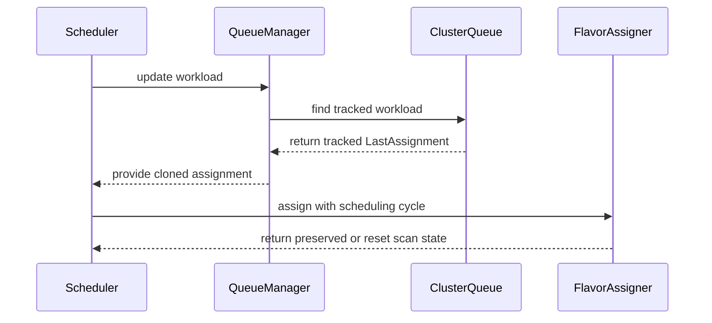

# PR #13956: Preserve flavor scan progress across scheduling cycles

**Summary**: Preserve flavor scan progress across scheduling cycles

**Sources**: https://github.com/kubernetes-sigs/kueue/pull/13956

**Last updated**: 2026-09-30T12:52:22Z

---

## Metadata

- **State**: closed (merged)
- **Author**: [@varunsyal](https://github.com/varunsyal)
- **Branch**: `preserve-flavor-scan-progress` → `main`
- **Created**: 2026-08-07T09:44:38Z
- **Updated**: 2026-09-30T12:52:22Z
- **Merged**: 2026-08-07T20:36:54Z
- **Closed**: 2026-08-07T20:36:54Z
- **Labels**: `kind/bug`, `release-note`, `lgtm`, `size/XXL`, `approved`, `ok-to-test`, `cncf-cla: yes`, `area/tas`
- **Assignees**: [@kshalot](https://github.com/kshalot)
- **Requested reviewers**: [@amy](https://github.com/amy), [@pajakd](https://github.com/pajakd), [@mbobrovskyi](https://github.com/mbobrovskyi)
- **Changed files**: 14   **+1498 / -75**

## Description

#### What type of PR is this?

/kind bug
/area tas

#### What this PR does / why we need it:

The flavor scan records where it stopped in `LastTriedFlavorIdx` so the next cycle can resume from there. On a busy cluster it never gets to. **Three independent mechanisms discard that progress:**

1. `lastAssignmentOutdated` discards the assignment whenever the ClusterQueue's `AllocatableResourceGeneration` advances — which happens on **every admission or eviction anywhere in the Cohort**.
2. `markSkipped` clears it when a Workload is skipped because another Workload processed earlier in the same cycle took the capacity or preemption targets it had been assigned.
3. Any update to the Workload rebuilds its `workload.Info` in `AddOrUpdateWorkloadWithoutLock`, dropping the progress outright.

Under sustained load all three fire constantly, so the scan restarts from the first flavor indefinitely. A Workload whose quota fits flavor A but whose topology cannot be placed there is re-nominated to A forever and never reaches flavor B, even when B has room.

This PR:

- treats an assignment from the **current or immediately preceding** cycle as current, via a new `SchedulingCycle` field on `AssignmentClusterQueueState`;
- keeps it when a Workload is skipped, since both skip reasons are in-cycle contention rather than a verdict on the flavor;
- carries it across a Workload update.

The progress still expires on its own — it keeps the cycle it was recorded in, so anything older than one cycle falls back to the generation check.

It also **moves the staleness decision out of the flavor assigner into the scheduler**. `Assign` was clearing `LastAssignment` on the Workload it had been handed — a surprising side effect of computing an assignment — and it runs once per reduced pod count under partial admission, so the check ran more than once per Workload per cycle. `getAssignments` now decides once.

Guarded by the new `PreserveFlavorScanProgress` feature gate: **beta, enabled by default**, so the fix applies without opt-in while remaining switchable off.

#### Which issue(s) this PR fixes:

Fixes kubernetes-sigs/kueue#13658

#### Special notes for your reviewer:

This approach follows the discussion with @mimowo captured in https://github.com/kubernetes-sigs/kueue/pull/13691#issuecomment-5214224883

**Previously considered alternatives.**

- **PR #13691** — a `TASFlavorFallback` gate letting the in-cycle TAS recompute fall through to the next flavor, which would also require recomputing DRS and refreshing the fair-sharing ordering mid-cycle.
- **PR #13800** — a TTL-bounded map of recently failed flavor placements on the `Scheduler`, which adds a structure parallel to `LastAssignment`.

This PR fixes the existing mechanism instead, and is not TAS-specific.

**The generation churn is the necessary condition, and the tests establish it in both directions.** `TestScheduleForPreserveFlavorScanProgress` drives real scheduling cycles against a fair-sharing ClusterQueue with `ReclaimWithinCohort: Any` / `WithinClusterQueue: LowerPriority`:

| | gate off | gate on |
|---|---|---|
| generation advancing every cycle | **never admitted** | reaches the second flavor |
| ClusterQueue settled | reaches the second flavor | reaches the second flavor |

The gate-off/churn case reproduces the reported signature line for line — `Re-computing the assignment as it doesn't fit for TAS` → `newMode: Preempt` → `no candidate workloads allowed for preemption` → requeue with `PreemptionNoCandidates`, every cycle. The no-churn row is why the generation lookup is not a reliable signal: it is the *only* reason the progress ever survives today.

**Where this does not help.** When the scan ends on the last flavor it records `-1` ("start over") and there is no progress to preserve. Two such cases are covered:

- Preemption needed but no candidates exist — `shouldTryNextFlavor` returns true for `noPreemptionCandidates` *before* either fungibility policy is consulted, so **no `flavorFungibility` configuration** yields a usable index here.
- The in-cycle recomputation runs and quota has also tightened, so the replayed scan walks past the nominated flavor to the end.

Both report the same `newMode: Preempt` as the case this PR does fix, so a log line alone cannot distinguish them.

**Deliberately out of scope:**

- **The remaining `LastAssignment = nil` sites** (`markPreemptionGated`, `markPreemptionOutcome`, and the flavor-migration eviction). Removing these needs a decision per site — whether migration should preserve progress at all, and whether preemption being gated is contention or a verdict on the flavor — and none of those paths has test coverage today. The TAS-recompute clear must stay regardless: it deliberately restarts the scan and then pins via `NominationMapping`.
- **Renaming `AssignmentClusterQueueState` → `FlavorSearchState`, and dropping `ClusterQueueGeneration`.** Agreed on the direction. Keeping both out here so this stays reviewable and cherry-pickable; they belong together as one follow-up on main, since once the generation lookup is gone the struct really is just a flavor-search state.

AI assistance was used for parts of this change.

#### Does this PR introduce a user-facing change?

```release-note
Scheduling: Fixed a bug where Workloads repeatedly retried one ResourceFlavor without trying the others. This fix is controlled by the FlavorFungibilityPreserveScanProgress feature gate.
```


<!-- This is an auto-generated comment: release notes by coderabbit.ai -->
## Summary by CodeRabbit

* **New Features**
  * Preserved flavor-scanning progress across scheduling cycles, helping workloads continue from the last attempted flavor after contention or queue updates.
  * Added the `FlavorFungibilityPreserveScanProgress` beta feature, enabled by default in version 0.20.
  * Retained assignment progress when workload scheduling requirements remain compatible.

* **Bug Fixes**
  * Prevented unnecessary flavor-scan resets while still resetting stale assignments when scheduling requirements or scheduling context changes.
  * Improved workload placement across available flavors during topology-aware scheduling.
<!-- end of auto-generated comment: release notes by coderabbit.ai -->

## Discussion

### Comment by [@netlify[bot]](https://github.com/apps/netlify) — 2026-08-07T09:44:44Z

### <span aria-hidden="true">✅</span> Deploy Preview for *kubernetes-sigs-kueue* ready!


|  Name | Link |
|:-:|------------------------|
|<span aria-hidden="true">🔨</span> Latest commit | 880d53846a957261f7568d355631e45912d4b3c5 |
|<span aria-hidden="true">🔍</span> Latest deploy log | https://app.netlify.com/projects/kubernetes-sigs-kueue/deploys/6a762d2c30149e00087ad77a |
|<span aria-hidden="true">😎</span> Deploy Preview | [https://deploy-preview-13956--kubernetes-sigs-kueue.netlify.app](https://deploy-preview-13956--kubernetes-sigs-kueue.netlify.app) |
|<span aria-hidden="true">📱</span> Preview on mobile | <details><summary> Toggle QR Code... </summary><br /><br /><br /><br />_Use your smartphone camera to open QR code link._</details> |
---
<!-- [kubernetes-sigs-kueue Preview](https://deploy-preview-13956--kubernetes-sigs-kueue.netlify.app) -->
_To edit notification comments on pull requests, go to your [Netlify project configuration](https://app.netlify.com/projects/kubernetes-sigs-kueue/configuration/notifications#deploy-notifications)._

### Comment by [@coderabbitai[bot]](https://github.com/apps/coderabbitai) — 2026-08-07T09:44:46Z

<!-- This is an auto-generated comment: summarize by coderabbit.ai -->
<!-- review_stack_entry_start -->

[](https://app.coderabbit.ai/change-stack/kubernetes-sigs/kueue/pull/13956?utm_source=github_walkthrough&utm_medium=github&utm_campaign=change_stack)

<!-- review_stack_entry_end -->
<!-- walkthrough_start -->

<details>
<summary>📝 Walkthrough</summary>

## Walkthrough

The change adds feature-gated flavor-scan progress preservation. Assignment metadata tracks scheduling cycle and shape. Queue updates clone matching state, and scheduler logic invalidates stale assignments. Unit and integration tests cover quota churn and topology-aware flavor selection.

### Changes

**Flavor scan progress preservation**

|Layer / File(s)|Summary|
|---|---|
|**Assignment metadata and feature gate** <br> `pkg/workload/workload.go`, `pkg/features/kube_features.go`, `site/data/featuregates/...`, `test/compatibility_lifecycle/...`|Assignments record scheduling-cycle and scheduling-shape metadata. The beta feature gate is enabled by default from version `0.20`.|
|**Tracked workload state transfer** <br> `pkg/cache/queue/cluster_queue.go`, `pkg/cache/queue/manager.go`, `pkg/cache/queue/manager_test.go`|Queue updates locate workloads in heap, inadmissible, or inflight tracking and clone matching `LastAssignment` state.|
|**Scheduler progress lifecycle** <br> `pkg/scheduler/flavorassigner/flavorassigner.go`, `pkg/scheduler/scheduler.go`|The scheduler preserves scan progress when enabled and resets it when scheduling shape, cycle age, or ClusterQueue generation makes it stale.|
|**Flavor progress and topology validation** <br> `pkg/scheduler/*_test.go`, `pkg/scheduler/flavorassigner/flavorassigner_test.go`, `test/integration/singlecluster/tas/*`|Tests cover bookmarks, contention, quota churn, TAS placement, fair sharing, and alternate flavor selection.|

**Estimated code review effort:** 4 (Complex) | ~45 minutes

### Sequence Diagram(s)



**Possibly related issues**

- kubernetes-sigs/kueue#13695 — Both changes preserve `LastTriedFlavorIdx` and assignment state across scheduling cycles and ClusterQueue churn.

**Possibly related PRs**

- [kubernetes-sigs/kueue#13496](https://github.com/kubernetes-sigs/kueue/pull/13496) — Both changes modify ClusterQueue workload tracking and queue state lookup.
- [kubernetes-sigs/kueue#13800](https://github.com/kubernetes-sigs/kueue/pull/13800) — Both changes modify flavor-assignment state across scheduling cycles.

**Suggested reviewers:** `amy`, `pajakd`, `mbobrovskyi`

</details>

<!-- walkthrough_end -->
<!-- pre_merge_checks_walkthrough_start -->

<details>
<summary>🚥 Pre-merge checks | ✅ 4 | ❌ 1</summary>

### ❌ Failed checks (1 warning)

|     Check name     | Status     | Explanation                                                                           | Resolution                                                                         |
| :----------------: | :--------- | :------------------------------------------------------------------------------------ | :--------------------------------------------------------------------------------- |
| Docstring Coverage | ⚠️ Warning | Docstring coverage is 62.50% which is insufficient. The required threshold is 80.00%. | Write docstrings for the functions missing them to satisfy the coverage threshold. |

<details>
<summary>✅ Passed checks (4 passed)</summary>

|         Check name         | Status   | Explanation                                                                                                                                   |
| :------------------------: | :------- | :-------------------------------------------------------------------------------------------------------------------------------------------- |
|     Linked Issues check    | ✅ Passed | The changes preserve flavor scan progress across workload updates and scheduling cycles, addressing the TAS flavor-pinning issue in [`#13658`]. |
| Out of Scope Changes check | ✅ Passed | The implementation, feature-gate updates, and supporting unit and integration tests align with the linked issue and stated objectives.        |
|      Description Check     | ✅ Passed | Check skipped - CodeRabbit’s high-level summary is enabled.                                                                                   |
|         Title check        | ✅ Passed | The title clearly and concisely describes the PR's main change: preserving flavor scan progress across scheduling cycles.                     |

</details>

</details>

<!-- pre_merge_checks_walkthrough_end -->
<!-- finishing_touch_checkbox_start -->

<details>
<summary>✨ Finishing Touches</summary>

<details>
<summary>🧪 Generate unit tests (beta)</summary>

- [ ] <!-- {"checkboxId": "f47ac10b-58cc-4372-a567-0e02b2c3d479", "radioGroupId": "utg-output-choice-group-unknown_comment_id"} -->   Create PR with unit tests

</details>

</details>

<!-- finishing_touch_checkbox_end -->
<!-- tips_start -->

---

Thanks for using [CodeRabbit](https://coderabbit.ai?utm_source=oss&utm_medium=github&utm_campaign=kubernetes-sigs/kueue&utm_content=13956)! It's free for OSS, and your support helps us grow. If you like it, consider giving us a shout-out.

<details>
<summary>❤️ Share</summary>

- [X](https://twitter.com/intent/tweet?text=I%20just%20used%20%40coderabbitai%20for%20my%20code%20review%2C%20and%20it%27s%20fantastic%21%20It%27s%20free%20for%20OSS%20and%20offers%20a%20free%20trial%20for%20the%20proprietary%20code.%20Check%20it%20out%3A&url=https%3A//coderabbit.ai)
- [Mastodon](https://mastodon.social/share?text=I%20just%20used%20%40coderabbitai%20for%20my%20code%20review%2C%20and%20it%27s%20fantastic%21%20It%27s%20free%20for%20OSS%20and%20offers%20a%20free%20trial%20for%20the%20proprietary%20code.%20Check%20it%20out%3A%20https%3A%2F%2Fcoderabbit.ai)
- [Reddit](https://www.reddit.com/submit?title=Great%20tool%20for%20code%20review%20-%20CodeRabbit&text=I%20just%20used%20CodeRabbit%20for%20my%20code%20review%2C%20and%20it%27s%20fantastic%21%20It%27s%20free%20for%20OSS%20and%20offers%20a%20free%20trial%20for%20proprietary%20code.%20Check%20it%20out%3A%20https%3A//coderabbit.ai)
- [LinkedIn](https://www.linkedin.com/sharing/share-offsite/?url=https%3A%2F%2Fcoderabbit.ai&mini=true&title=Great%20tool%20for%20code%20review%20-%20CodeRabbit&summary=I%20just%20used%20CodeRabbit%20for%20my%20code%20review%2C%20and%20it%27s%20fantastic%21%20It%27s%20free%20for%20OSS%20and%20offers%20a%20free%20trial%20for%20proprietary%20code)

</details>


<sub>Comment `@coderabbitai help` to get the list of available commands.</sub>

<!-- tips_end -->

### Comment by [@kubernetes-prow[bot]](https://github.com/apps/kubernetes-prow) — 2026-08-07T09:44:49Z

Hi @varunsyal. Thanks for your PR.

I'm waiting for a [kubernetes-sigs](https://github.com/orgs/kubernetes-sigs/people) member to verify that this patch is reasonable to test. If it is, they should reply with `/ok-to-test` on its own line. Until that is done, I will not automatically test new commits in this PR, but the usual testing commands by org members will still work.

Regular contributors should [join the org](https://git.k8s.io/community/community-membership.md#member) to skip this step.

Once the patch is verified, the new status will be reflected by the `ok-to-test` label.

I understand the commands that are listed [here](https://go.k8s.io/bot-commands?repo=kubernetes-sigs%2Fkueue).

<details>

Instructions for interacting with me using PR comments are available [here](https://git.k8s.io/community/contributors/guide/pull-requests.md).  If you have questions or suggestions related to my behavior, please file an issue against the [kubernetes-sigs/prow](https://github.com/kubernetes-sigs/prow/issues/new?title=Prow%20issue:) repository.
</details>

### Comment by [@mimowo](https://github.com/mimowo) — 2026-08-07T10:13:16Z

/ok-to-test

### Comment by [@kshalot](https://github.com/kshalot) — 2026-08-07T19:51:05Z

@varunsyal This looks good to me 🎉 

My remaining comments:
* I don't have a strong opinion in the [FG discussion](https://github.com/kubernetes-sigs/kueue/pull/13956#discussion_r3738122344). I think your approach to handling missing scheduling hashes is okay.
* [The nit about the unit test](https://github.com/kubernetes-sigs/kueue/pull/13956#discussion_r3738354065) is just a remark, I wouldn't treat it as something critical.
* The [one about integration test](https://github.com/kubernetes-sigs/kueue/pull/13956#discussion_r3738276033) is also a moot point.

I'm leaving LGTM as a signal to the approvers. If you decide that you want to apply the integration test in this PR, then I'll try to re-LGTM, but if I don't manage to then @mimowo feel free to approve without it.

That's quite a fix for a first-time contribution 😃 

/lgtm

### Comment by [@kubernetes-prow[bot]](https://github.com/apps/kubernetes-prow) — 2026-08-07T19:51:14Z

LGTM label has been added.  <details>Git tree hash: 41b5ec0626a2ad8df70283fa9e725f993540bf69</details>

### Comment by [@mimowo](https://github.com/mimowo) — 2026-08-07T20:34:26Z

/approve
I found this small issue, but I don't see it practical. THis is behind FG so users could mitigate if hit, but I don't think this is likely: https://github.com/kubernetes-sigs/kueue/pull/13956#discussion_r3738599185. Still, if possible it would be nice to fix before the release.

### Comment by [@kubernetes-prow[bot]](https://github.com/apps/kubernetes-prow) — 2026-08-07T20:34:39Z

[APPROVALNOTIFIER] This PR is **APPROVED**

This pull-request has been approved by: *<a href="https://github.com/kubernetes-sigs/kueue/pull/13956#issuecomment-5221748986" title="Approved">mimowo</a>*, *<a href="https://github.com/kubernetes-sigs/kueue/pull/13956#" title="Author self-approved">varunsyal</a>*

The full list of commands accepted by this bot can be found [here](https://go.k8s.io/bot-commands?repo=kubernetes-sigs%2Fkueue).

The pull request process is described [here](https://git.k8s.io/community/contributors/guide/owners.md#the-code-review-process)

<details >
Needs approval from an approver in each of these files:

- ~~[OWNERS](https://github.com/kubernetes-sigs/kueue/blob/main/OWNERS)~~ [mimowo]

Approvers can indicate their approval by writing `/approve` in a comment
Approvers can cancel approval by writing `/approve cancel` in a comment
</details>
<!-- META={"approvers":[]} -->

### Comment by [@mimowo](https://github.com/mimowo) — 2026-08-07T20:34:52Z

@varunsyal please prepare cherrypick PRs

### Comment by [@mimowo](https://github.com/mimowo) — 2026-08-07T20:47:48Z

Thank you once again for this excellent contribution 🥇  Looking forward to more collab like this 👍

### Comment by [@mimowo](https://github.com/mimowo) — 2026-08-07T20:59:25Z

@coderabbitai please open a follow up issue, capturing requests from https://github.com/kubernetes-sigs/kueue/pull/13956#issuecomment-5221394053 as well as https://github.com/kubernetes-sigs/kueue/pull/13956#discussion_r3738663682 and https://github.com/kubernetes-sigs/kueue/pull/13956#discussion_r3738681617

### Comment by [@coderabbitai[bot]](https://github.com/apps/coderabbitai) — 2026-08-07T21:00:35Z

<!-- This is an auto-generated reply by CodeRabbit -->
> [!TIP]
> For best results, initiate chat on the files or code changes.

<details>
<summary>🧩 Analysis chain</summary>

🏁 Script executed:

```shell
#!/bin/bash
set -euo pipefail

repo="kubernetes-sigs/kueue"

printf '%s\n' '=== Issue comment 5221394053 ==='
gh api "repos/${repo}/issues/comments/5221394053" \
  --jq '{html_url, user: .user.login, body}'

printf '%s\n' '=== Review comment 3738663682 ==='
gh api "repos/${repo}/pulls/comments/3738663682" \
  --jq '{html_url, user: .user.login, path, line, body}'

printf '%s\n' '=== Review comment 3738681617 ==='
gh api "repos/${repo}/pulls/comments/3738681617" \
  --jq '{html_url, user: .user.login, path, line, body}'
```

Length of output: 3415

---

🏁 Script executed:

```shell
#!/bin/bash
set -euo pipefail

repo="kubernetes-sigs/kueue"
title="Refactor flavor scan state and restart scans after ClusterQueue generation changes"
body_file="$(mktemp)"
trap 'rm -f "$body_file"' EXIT

cat >"$body_file" <<'EOF'
## Summary

Refactor the persisted flavor-scan state that was added by `#13956`.

The current `LastTriedFlavorIdx` model uses `-1` sentinel arithmetic. This makes it difficult to restart a flavor scan after a ClusterQueue resource-generation change. The state should explicitly represent the next flavor to scan and the number of flavors that remain in the current scan.

Also rename `AssignmentClusterQueueState` to a name that describes its current responsibility, such as `FlavorSearchState`.

## Required changes

- Replace or refactor `LastTriedFlavorIdx` into an explicit flavor-scan progress model.
  - A candidate model is `NextFlavorIdx` and `RemainingFlavors`.
  - Initialize a scan with `NextFlavorIdx = 0` and `RemainingFlavors = len(flavors)`.
- Update the pending-flavor decision to use the explicit remaining-flavor state.
- When the ClusterQueue generation changes, reset the remaining flavor count so that the scheduler can scan the flavor list again.
- If a different representation is selected, preserve the same behavior. For example, a `wrapPending` state can prevent a workload from becoming inadmissible before the restarted scan completes.
- Rename `AssignmentClusterQueueState` to a name such as `FlavorSearchState`.
- Update affected scheduler, flavor assigner, workload state, and test code.

## Rationale

ClusterQueue resource-generation changes can make a previously exhausted flavor scan relevant again. The scheduler must restart the scan without depending on a `-1` sentinel value or ambiguous index arithmetic.

## Acceptance criteria

- A generation change restarts flavor scanning from the configured flavor list.
- The scheduler does not mark a workload inadmissible while flavors remain in a restarted scan.
- The state representation has explicit and documented scan semantics.
- The renamed type reflects that the state tracks flavor search progress.
- Unit and integration tests cover generation-bump scan restart behavior.

## Context

- PR: `#13956`
- Review summary from `@kshalot`: https://github.com/kubernetes-sigs/kueue/pull/13956#issuecomment-5221394053
- Flavor-scan state proposal from `@mimowo`: https://github.com/kubernetes-sigs/kueue/pull/13956#discussion_r3738663682
- Type rename request from `@mimowo`: https://github.com/kubernetes-sigs/kueue/pull/13956#discussion_r3738681617
EOF

gh issue create \
  --repo "$repo" \
  --title "$title" \
  --body-file "$body_file" \
  --assignee "mimowo"
```

Length of output: 2863

---

</details>

`@mimowo` Created follow-up issue `#13974` and assigned it to you.

The issue captures the requested flavor-scan state refactor, scan restart after ClusterQueue generation changes, and the `AssignmentClusterQueueState` rename. It also links all three referenced comments.

<sub>You are interacting with an AI system.</sub>

### Comment by [@varunsyal](https://github.com/varunsyal) — 2026-08-07T22:36:11Z

/cherrypick release-0.19
/cherrypick release-0.18

### Comment by [@k8s-infra-cherrypick-robot](https://github.com/k8s-infra-cherrypick-robot) — 2026-08-07T22:36:20Z

@varunsyal: only [kubernetes-sigs](https://github.com/orgs/kubernetes-sigs/people) org members may request cherry picks. If you are already part of the org, make sure to [change](https://github.com/orgs/kubernetes-sigs/people?query=varunsyal) your membership to public. Otherwise you can still do the cherry-pick manually. 

<details>

In response to [this](https://github.com/kubernetes-sigs/kueue/pull/13956#issuecomment-5222875001):

>/cherrypick release-0.19
>/cherrypick release-0.18


Instructions for interacting with me using PR comments are available [here](https://git.k8s.io/community/contributors/guide/pull-requests.md).  If you have questions or suggestions related to my behavior, please file an issue against the [kubernetes-sigs/prow](https://github.com/kubernetes-sigs/prow/issues/new?title=Prow%20issue:) repository.
</details>

### Comment by [@mimowo](https://github.com/mimowo) — 2026-09-30T12:52:19Z

/release-note-edit
```release-note
Scheduling: Fixed a bug where Workloads repeatedly retried one ResourceFlavor without trying the others. This fix is controlled by the FlavorFungibilityPreserveScanProgress feature gate.
```

## Reviews

### Review by [@mimowo](https://github.com/mimowo) (commented) — 2026-08-07T10:23:09Z

- **pkg/cache/queue/cluster_queue.go:988** by [@mimowo](https://github.com/mimowo) — 2026-08-07T10:23:10Z
```diff
@@ -974,6 +974,20 @@ func (c *ClusterQueue) Info(key workload.Reference) *workload.Info {
 	return c.heap.GetByKey(key)
 }
 
+// trackedInfo returns the workload.Info currently tracked for the key, looking in the heap
+// and then in inadmissibleWorkloads. A Workload that failed to be admitted is held in the
+// latter, which Info deliberately does not consult. The inflight Workload is not covered,
+// since it is being scheduled and the scheduler holds its own copy.
+// Users of this method should not modify the returned object.
+func (c *ClusterQueue) trackedInfo(key workload.Reference) *workload.Info {
+	c.rwm.RLock()
+	defer c.rwm.RUnlock()
+	if wInfo := c.heap.GetByKey(key); wInfo != nil {
+		return wInfo
+	}
+	return c.inadmissibleWorkloads.get(key)
```

  I'm wondering we may also need to do lookup to the inflight object, wdyt>

### Review by [@mimowo](https://github.com/mimowo) (commented) — 2026-08-07T10:49:20Z

- **pkg/features/kube_features.go:537** by [@mimowo](https://github.com/mimowo) — 2026-08-07T10:49:20Z
```diff
@@ -524,6 +524,18 @@ const (
 	// by the pod-group framework (missing is-group-workload annotation).
 	PodIntegrationValidateGroupOwner featuregate.Feature = "PodIntegrationValidateGroupOwner"
 
+	// owner: @varunsyal
+	// kep: https://github.com/kubernetes-sigs/kueue/tree/main/keps/582-preempt-based-on-flavor-order
+	//
+	// Keeps the flavor scan progress recorded in LastTriedFlavorIdx usable in the next
+	// scheduling cycle. Without this the progress is discarded whenever the ClusterQueue's
+	// AllocatableResourceGeneration advances, which happens on every admission or eviction
+	// in the Cohort, and whenever a Workload is skipped because another Workload processed
+	// earlier in the cycle took the capacity or the preemption targets it had been assigned.
+	// Under sustained load either can happen every cycle, leaving the scan to restart from
+	// the first flavor indefinitely.
+	PreserveFlavorScanProgress featuregate.Feature = "PreserveFlavorScanProgress"
```

  nit, I would probably name the feature gate as `FlavorFungibilityPreserveScanProgress`, because this only makes sense in the context of flavor fungability.  It makes the depenency clear also by name.

### Review by [@kshalot](https://github.com/kshalot) (commented) — 2026-08-07T11:06:43Z

- **pkg/cache/queue/manager.go:731** by [@kshalot](https://github.com/kshalot) — 2026-08-07T11:06:42Z
```diff
@@ -720,9 +720,20 @@ func (m *Manager) AddOrUpdateWorkloadWithoutLock(log logr.Logger, w *kueue.Workl
 	allOptions := append(m.workloadInfoOptions, opts...)
 	wInfo := workload.NewInfo(w, allOptions...)
 	wInfo.UpdateSchedulingHash(log)
-	m.addWorkload(wInfo, q)
 
 	cq := m.hm.ClusterQueue(q.ClusterQueue)
+	// Rebuilding the Info would drop the flavor scan progress an earlier cycle recorded, so
+	// carry it over. Any update to the Workload lands here, and on a busy cluster those
+	// arrive constantly, which would otherwise send the scan back to the first flavor every
+	// time. The progress still expires on its own, since it keeps the scheduling cycle it
+	// was recorded in and lastAssignmentOutdated discards it once it is older than that.
+	if features.Enabled(features.PreserveFlavorScanProgress) && cq != nil {
+		if tracked := cq.trackedInfo(wlKey); tracked != nil && tracked.LastAssignment != nil {
```

  I only briefly thought about it, so sorry for a vague comment, but I'm wondering whether there is some edge case where the Workload changes (for example the number of podsets or requests) and we still apply the previous assignment.
  
  I'm thinking that maybe we could compare the scheduling hashes of `tracked` and `wInfo` just in case. I'll analyse closer, but I'm dropping this comment here in case someone has a strong view already

### Review by [@mimowo](https://github.com/mimowo) (commented) — 2026-08-07T11:19:22Z

- **pkg/cache/queue/manager.go:731** by [@mimowo](https://github.com/mimowo) — 2026-08-07T11:19:22Z
```diff
@@ -720,9 +720,20 @@ func (m *Manager) AddOrUpdateWorkloadWithoutLock(log logr.Logger, w *kueue.Workl
 	allOptions := append(m.workloadInfoOptions, opts...)
 	wInfo := workload.NewInfo(w, allOptions...)
 	wInfo.UpdateSchedulingHash(log)
-	m.addWorkload(wInfo, q)
 
 	cq := m.hm.ClusterQueue(q.ClusterQueue)
+	// Rebuilding the Info would drop the flavor scan progress an earlier cycle recorded, so
+	// carry it over. Any update to the Workload lands here, and on a busy cluster those
+	// arrive constantly, which would otherwise send the scan back to the first flavor every
+	// time. The progress still expires on its own, since it keeps the scheduling cycle it
+	// was recorded in and lastAssignmentOutdated discards it once it is older than that.
+	if features.Enabled(features.PreserveFlavorScanProgress) && cq != nil {
+		if tracked := cq.trackedInfo(wlKey); tracked != nil && tracked.LastAssignment != nil {
```

  Yes, I was thinking about this too, I think we could rely the equailalance check on`SchedulingHash`. For that we should probably inprint the old one in `AssignmentClusterQueueState` too, and do something like
  
  ```
  if tracked != nil &&  tracked.LastAssignment != nil &&  workload.SameSchedulingShape(tracked, wInfo) {
      wInfo.LastAssignment = tracked.LastAssignment.Clone()
  }
  ```
  then we would also update `lastAssignmentOutdated` to short circuit and say "yes" in case the hash changed.
  
  It would be great to iron this one our, but also it seems that the impact of on checking this is very limited - we already make the compromise of not reacting to CQ generation changes for one cycle. Arguably not reacting to workload scheduling changes is worse, but at the same time the lifetime is just one cycle, so I'm not very concerned about this gap.

### Review by [@kshalot](https://github.com/kshalot) (commented) — 2026-08-07T12:47:33Z

- **pkg/cache/queue/manager.go:731** by [@kshalot](https://github.com/kshalot) — 2026-08-07T12:47:33Z
```diff
@@ -720,9 +720,20 @@ func (m *Manager) AddOrUpdateWorkloadWithoutLock(log logr.Logger, w *kueue.Workl
 	allOptions := append(m.workloadInfoOptions, opts...)
 	wInfo := workload.NewInfo(w, allOptions...)
 	wInfo.UpdateSchedulingHash(log)
-	m.addWorkload(wInfo, q)
 
 	cq := m.hm.ClusterQueue(q.ClusterQueue)
+	// Rebuilding the Info would drop the flavor scan progress an earlier cycle recorded, so
+	// carry it over. Any update to the Workload lands here, and on a busy cluster those
+	// arrive constantly, which would otherwise send the scan back to the first flavor every
+	// time. The progress still expires on its own, since it keeps the scheduling cycle it
+	// was recorded in and lastAssignmentOutdated discards it once it is older than that.
+	if features.Enabled(features.PreserveFlavorScanProgress) && cq != nil {
+		if tracked := cq.trackedInfo(wlKey); tracked != nil && tracked.LastAssignment != nil {
```

  Yes, I think the risk here is pretty limited. I was worried about panic when we have more PodSets than in the LastAssignment and we index the slice out of bounds. But we have this guarded from what I can see:
  https://github.com/kubernetes-sigs/kueue/blob/2f1ee626eab5a438d43000a2a30a3e41fdcf22b4/pkg/workload/workload.go#L203-L205

### Review by [@kshalot](https://github.com/kshalot) (commented) — 2026-08-07T12:59:54Z

- **pkg/cache/queue/manager.go:731** by [@kshalot](https://github.com/kshalot) — 2026-08-07T12:59:53Z
```diff
@@ -720,9 +720,20 @@ func (m *Manager) AddOrUpdateWorkloadWithoutLock(log logr.Logger, w *kueue.Workl
 	allOptions := append(m.workloadInfoOptions, opts...)
 	wInfo := workload.NewInfo(w, allOptions...)
 	wInfo.UpdateSchedulingHash(log)
-	m.addWorkload(wInfo, q)
 
 	cq := m.hm.ClusterQueue(q.ClusterQueue)
+	// Rebuilding the Info would drop the flavor scan progress an earlier cycle recorded, so
+	// carry it over. Any update to the Workload lands here, and on a busy cluster those
+	// arrive constantly, which would otherwise send the scan back to the first flavor every
+	// time. The progress still expires on its own, since it keeps the scheduling cycle it
+	// was recorded in and lastAssignmentOutdated discards it once it is older than that.
+	if features.Enabled(features.PreserveFlavorScanProgress) && cq != nil {
+		if tracked := cq.trackedInfo(wlKey); tracked != nil && tracked.LastAssignment != nil {
```

  But TBH checking the scheduling hashes seems cheap and maybe it would also make the code more understandable. If I was reading this for the first time, I would expect this check to be there in some capacity. If I saw it, it would be a signal that I'm understanding the code correctly. But this is not a concrete argument, I know :) It also eliminates those hypothetical scenarios where it breaks something... Why not just address it 🤷 
  
  `SchedulingEquivalenceHashing` is in beta and enabled by default. If it was still in alpha then I'd be more worried about coupling `PreserveFlavorScanProgress` with it. We can always extract a more minimal hashing FG, which only computes the hashes but does not use them in scheduling.

### Review by [@mimowo](https://github.com/mimowo) (commented) — 2026-08-07T13:06:55Z

- **test/integration/singlecluster/tas/tas_preserve_flavor_scan_progress_test.go:151** by [@mimowo](https://github.com/mimowo) — 2026-08-07T13:06:55Z
```diff
@@ -0,0 +1,207 @@
+/*
+Copyright The Kubernetes Authors.
+
+Licensed under the Apache License, Version 2.0 (the "License");
+you may not use this file except in compliance with the License.
+You may obtain a copy of the License at
+
+    http://www.apache.org/licenses/LICENSE-2.0
+
+Unless required by applicable law or agreed to in writing, software
+distributed under the License is distributed on an "AS IS" BASIS,
+WITHOUT WARRANTIES OR CONDITIONS OF ANY KIND, either express or implied.
+See the License for the specific language governing permissions and
+limitations under the License.
+*/
+
+package tas
+
+import (
+	"github.com/onsi/ginkgo/v2"
+	"github.com/onsi/gomega"
+	corev1 "k8s.io/api/core/v1"
+	"k8s.io/apimachinery/pkg/api/resource"
+	"sigs.k8s.io/controller-runtime/pkg/client"
+
+	config "sigs.k8s.io/kueue/apis/config/v1beta2"
+	kueue "sigs.k8s.io/kueue/apis/kueue/v1beta2"
+	"sigs.k8s.io/kueue/pkg/features"
+	utiltas "sigs.k8s.io/kueue/pkg/util/tas"
+	utiltestingapi "sigs.k8s.io/kueue/pkg/util/testing/v1beta2"
+	testingnode "sigs.k8s.io/kueue/pkg/util/testingjobs/node"
+	"sigs.k8s.io/kueue/test/util"
+)
+
+// equalPriority is shared by both Workloads in these specs so that the
+// WithinClusterQueue: LowerPriority policy finds no preemption victim, as happens in a
+// ClusterQueue where every Workload runs at the same priority.
+const equalPriority = 100
+
+// These specs cover the PreserveFlavorScanProgress gate end to end: a Workload whose TAS
+// placement fails on the flavor selected by quota must still reach another flavor of the
+// ResourceGroup and be admitted there.
+var _ = ginkgo.Describe("Topology Aware Scheduling preserving flavor scan progress", ginkgo.Ordered, func() {
+	var (
+		ns           *corev1.Namespace
+		nodes        []corev1.Node
+		topology     *kueue.Topology
+		tasFlavor1   *kueue.ResourceFlavor
+		tasFlavor2   *kueue.ResourceFlavor
+		clusterQueue *kueue.ClusterQueue
+		localQueue   *kueue.LocalQueue
+	)
+
+	ginkgo.BeforeAll(func() {
+		// Fair sharing on, so the fair-share entry iterator and preemption path drive
+		// this spec rather than the classical ones.
+		fwk.StartManager(ctx, cfg, managerSetupWithConfig(&config.Configuration{
+			FairSharing: &config.FairSharing{},
+		}))
+	})
+
+	ginkgo.AfterAll(func() {
+		fwk.StopManager(ctx)
+	})
+
+	ginkgo.BeforeEach(func() {
+		ns = util.CreateNamespaceFromPrefixWithLog(ctx, k8sClient, "tas-preserve-flavor-scan-")
+
+		// One node per flavor. The blocker Workload fills the flavor-1 node, so the
+		// second Workload can only be placed on the flavor-2 node.
+		nodes = []corev1.Node{
+			*testingnode.MakeNode("preserve-f1").
+				Label("node-group", "tas").
+				Label("tas-flavor", "f1").
+				Label(corev1.LabelHostname, "preserve-f1").
+				StatusAllocatable(corev1.ResourceList{
+					corev1.ResourceCPU:  resource.MustParse("2"),
+					corev1.ResourcePods: resource.MustParse("10"),
+				}).
+				Ready().
+				Obj(),
+			*testingnode.MakeNode("preserve-f2").
+				Label("node-group", "tas").
+				Label("tas-flavor", "f2").
+				Label(corev1.LabelHostname, "preserve-f2").
+				StatusAllocatable(corev1.ResourceList{
+					corev1.ResourceCPU:  resource.MustParse("2"),
+					corev1.ResourcePods: resource.MustParse("10"),
+				}).
+				Ready().
+				Obj(),
+		}
+		util.CreateNodesWithStatus(ctx, k8sClient, nodes)
+
+		topology = utiltestingapi.MakeDefaultOneLevelTopology("default")
+		util.MustCreate(ctx, k8sClient, topology)
+
+		tasFlavor1 = utiltestingapi.MakeResourceFlavor("tas-flavor-1").
+			NodeLabel("node-group", "tas").
+			NodeLabel("tas-flavor", "f1").
+			TopologyName("default").Obj()
+		util.MustCreate(ctx, k8sClient, tasFlavor1)
+
+		tasFlavor2 = utiltestingapi.MakeResourceFlavor("tas-flavor-2").
+			NodeLabel("node-group", "tas").
+			NodeLabel("tas-flavor", "f2").
+			TopologyName("default").Obj()
+		util.MustCreate(ctx, k8sClient, tasFlavor2)
+
+		// Quota on each flavor exceeds what its single node can host, so flavor-1 keeps
+		// looking admissible to the quota-only flavor selection after its node is full.
+		//
+		// The ClusterQueue sets two preemption policies. Neither policy offers
+		// flavor-1 a way forward here: the two Workloads share a priority, so
+		// WithinClusterQueue: LowerPriority finds no victim in the ClusterQueue, and
+		// no other ClusterQueue in the Cohort is borrowing, so ReclaimWithinCohort
+		// has nothing to reclaim. That combination leaves a Workload pinned to one
+		// flavor.
+		clusterQueue = utiltestingapi.MakeClusterQueue("cluster-queue").
+			Cohort("tas-cohort").
+			Preemption(kueue.ClusterQueuePreemption{
+				WithinClusterQueue:  kueue.PreemptionPolicyLowerPriority,
+				ReclaimWithinCohort: kueue.PreemptionPolicyAny,
+			}).
+			ResourceGroup(
+				*utiltestingapi.MakeFlavorQuotas(tasFlavor1.Name).Resource(corev1.ResourceCPU, "4").Obj(),
+				*utiltestingapi.MakeFlavorQuotas(tasFlavor2.Name).Resource(corev1.ResourceCPU, "4").Obj(),
+			).
+			Obj()
+		util.MustCreate(ctx, k8sClient, clusterQueue)
+		util.ExpectClusterQueuesToBeActive(ctx, k8sClient, clusterQueue)
+
+		localQueue = utiltestingapi.MakeLocalQueue("local-queue", ns.Name).ClusterQueue(clusterQueue.Name).Obj()
+		util.MustCreate(ctx, k8sClient, localQueue)
+	})
+
+	ginkgo.AfterEach(func() {
+		gomega.Expect(util.DeleteWorkloadsInNamespace(ctx, k8sClient, ns)).Should(gomega.Succeed())
+		gomega.Expect(util.DeleteObject(ctx, k8sClient, localQueue)).Should(gomega.Succeed())
+		util.ExpectObjectToBeDeleted(ctx, k8sClient, clusterQueue, true)
+		util.ExpectObjectToBeDeleted(ctx, k8sClient, tasFlavor1, true)
+		util.ExpectObjectToBeDeleted(ctx, k8sClient, tasFlavor2, true)
+		util.ExpectObjectToBeDeleted(ctx, k8sClient, topology, true)
+		for _, node := range nodes {
+			util.ExpectObjectToBeDeleted(ctx, k8sClient, &node, true)
+		}
+		gomega.Expect(forceDeleteNamespace(ctx, k8sClient, ns)).To(gomega.Succeed())
+	})
+
+	// Only the gate-enabled state is run. This spec cannot discriminate between the two
+	// states: a settled ClusterQueue stops advancing AllocatableResourceGeneration, so the
```

  Actually, I think it would be better to have an integration test which discriminates the two. I think the sustained load is not needed if we control when the quota is released using API request ineterceptors, similarly as @kshalot did here: https://github.com/kubernetes-sigs/kueue/pull/12331.
  
  So the plan would be:
  - f1: enougb nominial quota , but the node is occupied by a higher prio workload (or just cordoned)
  - f2: has available capacity
  - Wx  - pre-admitted workload on f2 or f1 in the same CQ, but too small to block anything, just to "generate churn" later (might be even on f3)
  
  0. Wnew new pending workload
  1. first scheduling cycle for pending Wx selectes f1 at nomination phase, but fails in the eval phase.
  2. Now we use the interceptor to for the requeue api call in scheduler to finish Wx and we can await with releasing the request until we observe an update to CQ status
  3. release the Api request - this will make Wnew retried and without the change it would start from f1 - again failing to admit
  
  the difference:
  - with gate off it will fail again, we probably should take the capacity from f2 in the meanwhile
  - with gate on it will schedule on f2
  
  However, I agree this scenario is involving and requires "time manipulation" by the interceptor. So it is not a requirement, but we could follow up on that at some point. Let me know if you have cycles to try the challenge.

### Review by [@varunsyal](https://github.com/varunsyal) (commented) — 2026-08-07T18:37:16Z

- **pkg/cache/queue/cluster_queue.go:988** by [@varunsyal](https://github.com/varunsyal) — 2026-08-07T18:37:16Z
```diff
@@ -974,6 +974,20 @@ func (c *ClusterQueue) Info(key workload.Reference) *workload.Info {
 	return c.heap.GetByKey(key)
 }
 
+// trackedInfo returns the workload.Info currently tracked for the key, looking in the heap
+// and then in inadmissibleWorkloads. A Workload that failed to be admitted is held in the
+// latter, which Info deliberately does not consult. The inflight Workload is not covered,
+// since it is being scheduled and the scheduler holds its own copy.
+// Users of this method should not modify the returned object.
+func (c *ClusterQueue) trackedInfo(key workload.Reference) *workload.Info {
+	c.rwm.RLock()
+	defer c.rwm.RUnlock()
+	if wInfo := c.heap.GetByKey(key); wInfo != nil {
+		return wInfo
+	}
+	return c.inadmissibleWorkloads.get(key)
```

  Good catch, added. It looks like a no-op for the heap, but not for the LocalQueue, which is the part I had missed.

### Review by [@varunsyal](https://github.com/varunsyal) (commented) — 2026-08-07T18:37:31Z

- **pkg/features/kube_features.go:537** by [@varunsyal](https://github.com/varunsyal) — 2026-08-07T18:37:31Z
```diff
@@ -524,6 +524,18 @@ const (
 	// by the pod-group framework (missing is-group-workload annotation).
 	PodIntegrationValidateGroupOwner featuregate.Feature = "PodIntegrationValidateGroupOwner"
 
+	// owner: @varunsyal
+	// kep: https://github.com/kubernetes-sigs/kueue/tree/main/keps/582-preempt-based-on-flavor-order
+	//
+	// Keeps the flavor scan progress recorded in LastTriedFlavorIdx usable in the next
+	// scheduling cycle. Without this the progress is discarded whenever the ClusterQueue's
+	// AllocatableResourceGeneration advances, which happens on every admission or eviction
+	// in the Cohort, and whenever a Workload is skipped because another Workload processed
+	// earlier in the cycle took the capacity or the preemption targets it had been assigned.
+	// Under sustained load either can happen every cycle, leaving the scan to restart from
+	// the first flavor indefinitely.
+	PreserveFlavorScanProgress featuregate.Feature = "PreserveFlavorScanProgress"
```

  Makes sense! Updated

### Review by [@coderabbitai[bot]](https://github.com/apps/coderabbitai) (commented) — 2026-08-07T18:39:53Z


<details>
<summary>🧹 Nitpick comments (4)</summary><blockquote>

<details>
<summary>pkg/scheduler/scheduler_preserve_flavor_scan_progress_test.go (2)</summary><blockquote>

`219-222`: _📐 Maintainability & Code Quality_ | _🔵 Trivial_ | _💤 Low value_

**Move the topology registration out of the flavor loop.**

`cqCache.AddOrUpdateTopology` does not depend on `flavor`. The loop calls it once per flavor with the same topology. The result is correct, but the placement suggests a per-flavor topology that does not exist.


<details>
<summary>♻️ Proposed cleanup</summary>

```diff
-			for _, flavor := range resourceFlavors {
-				cqCache.AddOrUpdateResourceFlavor(log, &flavor)
-				cqCache.AddOrUpdateTopology(log, &singleLevelTopology)
-			}
+			cqCache.AddOrUpdateTopology(log, &singleLevelTopology)
+			for i := range resourceFlavors {
+				cqCache.AddOrUpdateResourceFlavor(log, &resourceFlavors[i])
+			}
```
</details>

<details>
<summary>🤖 Prompt for AI Agents</summary>

```
Verify each finding against current code. Fix only still-valid issues, skip the
rest with a brief reason, keep changes minimal, and validate.

In `@pkg/scheduler/scheduler_preserve_flavor_scan_progress_test.go` around lines
219 - 222, Move the AddOrUpdateTopology call out of the resourceFlavors loop in
the test setup, registering singleLevelTopology once before or after the loop.
Keep AddOrUpdateResourceFlavor inside the loop so each flavor is still
registered individually.
```

</details>

<!-- cr-comment:v1:e7fb41417f9a54fd8285034f -->

---

`294-311`: _🎯 Functional Correctness_ | _🔵 Trivial_ | _💤 Low value_

**Helper returns the first flavor of the first PodSet only.**

`admittedFlavorForPodSet` returns after the first map entry. Map iteration order is random. The current Workloads request one resource, so the result is stable. If a later case adds a second resource, the helper becomes non-deterministic. Consider reading `psa.Flavors[corev1.ResourceCPU]` directly.

<details>
<summary>🤖 Prompt for AI Agents</summary>

```
Verify each finding against current code. Fix only still-valid issues, skip the
rest with a brief reason, keep changes minimal, and validate.

In `@pkg/scheduler/scheduler_preserve_flavor_scan_progress_test.go` around lines
294 - 311, Update admittedFlavorForPodSet to return the flavor assigned to the
corev1.ResourceCPU key directly from each PodSetAssignment’s Flavors map instead
of iterating over map entries and returning the first value. Preserve the
empty-reference result when no quota reservation exists or the CPU flavor is
unavailable.
```

</details>

<!-- cr-comment:v1:2e20805bddba1bbc64fe1c1e -->

</blockquote></details>
<details>
<summary>pkg/scheduler/scheduler_test.go (1)</summary><blockquote>

`8948-9107`: _🎯 Functional Correctness_ | _🔵 Trivial_ | _💤 Low value_

**Consider adding a case for an unknown current hash.**

The table covers `workload.SchedulingHashUnknown` on the stored side. It does not cover the case where `currentSchedulingHash` is unknown and the stored hash is a real value. That is the mirrored path through the same comparison. Add it if `lastAssignmentOutdated` treats the two sides differently.

Go's standard `testing.T` table style is correct here for `pkg/`. Based on learnings: for unit tests under `pkg/` in this repository, use Go's standard `testing.T` conventions rather than Ginkgo/Gomega.

<details>
<summary>🤖 Prompt for AI Agents</summary>

```
Verify each finding against current code. Fix only still-valid issues, skip the
rest with a brief reason, keep changes minimal, and validate.

In `@pkg/scheduler/scheduler_test.go` around lines 8948 - 9107, Extend the
TestLastAssignmentOutdated table with a preserve-progress case where
last.SchedulingHash is a real shape and currentSchedulingHash is
workload.SchedulingHashUnknown, asserting the expected mirrored comparison
behavior. Keep the existing standard testing.T table structure and avoid
unrelated test changes.
```

</details>

<!-- cr-comment:v1:eb190276bf6ea7bb1cab81eb -->

_Source: Learnings_

</blockquote></details>
<details>
<summary>test/integration/singlecluster/tas/tas_preserve_flavor_scan_progress_test.go (1)</summary><blockquote>

`54-64`: _📐 Maintainability & Code Quality_ | _🔵 Trivial_ | _💤 Low value_

**Confirm that `ginkgo.Ordered` is required here.**

The spec block contains a single `It`. `ginkgo.Ordered` adds ordering constraints and prevents parallel execution of the container. If the block stays at one spec, `Ordered` is not needed. `BeforeAll` does require `Ordered`, so keep it if the manager start must stay in `BeforeAll`.

<details>
<summary>🤖 Prompt for AI Agents</summary>

```
Verify each finding against current code. Fix only still-valid issues, skip the
rest with a brief reason, keep changes minimal, and validate.

In `@test/integration/singlecluster/tas/tas_preserve_flavor_scan_progress_test.go`
around lines 54 - 64, Review the surrounding spec container and remove
ginkgo.Ordered if it contains only the single It shown, since ordering is
unnecessary. If manager initialization must remain in BeforeAll, retain Ordered
because BeforeAll requires it; otherwise move setup to per-spec lifecycle and
remove the ordering constraint.
```

</details>

<!-- cr-comment:v1:5719e6926168bf2b7f92bb86 -->

</blockquote></details>

</blockquote></details>

<details>
<summary>🤖 Prompt for all review comments with AI agents</summary>

```
Verify each finding against current code. Fix only still-valid issues, skip the
rest with a brief reason, keep changes minimal, and validate.

Nitpick comments:
In `@pkg/scheduler/scheduler_preserve_flavor_scan_progress_test.go`:
- Around line 219-222: Move the AddOrUpdateTopology call out of the
resourceFlavors loop in the test setup, registering singleLevelTopology once
before or after the loop. Keep AddOrUpdateResourceFlavor inside the loop so each
flavor is still registered individually.
- Around line 294-311: Update admittedFlavorForPodSet to return the flavor
assigned to the corev1.ResourceCPU key directly from each PodSetAssignment’s
Flavors map instead of iterating over map entries and returning the first value.
Preserve the empty-reference result when no quota reservation exists or the CPU
flavor is unavailable.

In `@pkg/scheduler/scheduler_test.go`:
- Around line 8948-9107: Extend the TestLastAssignmentOutdated table with a
preserve-progress case where last.SchedulingHash is a real shape and
currentSchedulingHash is workload.SchedulingHashUnknown, asserting the expected
mirrored comparison behavior. Keep the existing standard testing.T table
structure and avoid unrelated test changes.

In
`@test/integration/singlecluster/tas/tas_preserve_flavor_scan_progress_test.go`:
- Around line 54-64: Review the surrounding spec container and remove
ginkgo.Ordered if it contains only the single It shown, since ordering is
unnecessary. If manager initialization must remain in BeforeAll, retain Ordered
because BeforeAll requires it; otherwise move setup to per-spec lifecycle and
remove the ordering constraint.
```

</details>

---

<details>
<summary>ℹ️ Review info</summary>

<details>
<summary>⚙️ Run configuration</summary>

**Configuration used**: Path: .coderabbit.yaml

**Review profile**: CHILL

**Plan**: Pro Plus

**Run ID**: `bdaf2b36-f577-4b53-bdcb-cf67f6158384`

</details>

<details>
<summary>📥 Commits</summary>

Reviewing files that changed from the base of the PR and between 15e0299f3827424356d32fd5260afbc2c8f556e4 and a9e4159c55775ec334ee1b2b60796703b34bf83a.

</details>

<details>
<summary>📒 Files selected for processing (14)</summary>

* `pkg/cache/queue/cluster_queue.go`
* `pkg/cache/queue/manager.go`
* `pkg/cache/queue/manager_test.go`
* `pkg/features/kube_features.go`
* `pkg/scheduler/flavorassigner/flavorassigner.go`
* `pkg/scheduler/flavorassigner/flavorassigner_test.go`
* `pkg/scheduler/scheduler.go`
* `pkg/scheduler/scheduler_preserve_flavor_scan_progress_test.go`
* `pkg/scheduler/scheduler_test.go`
* `pkg/workload/workload.go`
* `site/data/featuregates/versioned_feature_list.yaml`
* `test/compatibility_lifecycle/reference/versioned_feature_list.yaml`
* `test/integration/singlecluster/tas/suite_test.go`
* `test/integration/singlecluster/tas/tas_preserve_flavor_scan_progress_test.go`

</details>

</details>

<!-- This is an auto-generated comment by CodeRabbit for review status -->

### Review by [@varunsyal](https://github.com/varunsyal) (commented) — 2026-08-07T18:45:58Z

- **pkg/cache/queue/manager.go:731** by [@varunsyal](https://github.com/varunsyal) — 2026-08-07T18:45:58Z
```diff
@@ -720,9 +720,20 @@ func (m *Manager) AddOrUpdateWorkloadWithoutLock(log logr.Logger, w *kueue.Workl
 	allOptions := append(m.workloadInfoOptions, opts...)
 	wInfo := workload.NewInfo(w, allOptions...)
 	wInfo.UpdateSchedulingHash(log)
-	m.addWorkload(wInfo, q)
 
 	cq := m.hm.ClusterQueue(q.ClusterQueue)
+	// Rebuilding the Info would drop the flavor scan progress an earlier cycle recorded, so
+	// carry it over. Any update to the Workload lands here, and on a busy cluster those
+	// arrive constantly, which would otherwise send the scan back to the first flavor every
+	// time. The progress still expires on its own, since it keeps the scheduling cycle it
+	// was recorded in and lastAssignmentOutdated discards it once it is older than that.
+	if features.Enabled(features.PreserveFlavorScanProgress) && cq != nil {
+		if tracked := cq.trackedInfo(wlKey); tracked != nil && tracked.LastAssignment != nil {
```

  Addressed - Thanks both!  
  `AssignmentClusterQueueState` now records the SchedulingHash it was computed for, and `lastAssignmentOutdated` short-circuits to outdated on a mismatch — checked before the cycle age, so a changed shape starts the scan over even if it was assigned in the preceding cycle. The carry in `AddOrUpdateWorkloadWithoutLock` uses the same check, so a mismatched assignment is never stored.
  
  @kshalot right that the panic was already guarded. The quieter case was an unchanged PodSet with changed requests, where the index stays in range and the scan resumes past flavors the Workload might now fit — low impact, but the same class of bug this PR fixes.
  
  One thing worth flagging, and let me know if it does not make sense -  if SchedulingHash is unavailable (SchedulingEquivalenceHashing is off) - I'm treating it as "unchanged" rather than "changed" since treating it as changed would make the gate a silent no-op whenever hashing is disabled

### Review by [@kshalot](https://github.com/kshalot) (commented) — 2026-08-07T19:01:25Z

- **pkg/cache/queue/manager.go:731** by [@kshalot](https://github.com/kshalot) — 2026-08-07T19:01:24Z
```diff
@@ -720,9 +720,20 @@ func (m *Manager) AddOrUpdateWorkloadWithoutLock(log logr.Logger, w *kueue.Workl
 	allOptions := append(m.workloadInfoOptions, opts...)
 	wInfo := workload.NewInfo(w, allOptions...)
 	wInfo.UpdateSchedulingHash(log)
-	m.addWorkload(wInfo, q)
 
 	cq := m.hm.ClusterQueue(q.ClusterQueue)
+	// Rebuilding the Info would drop the flavor scan progress an earlier cycle recorded, so
+	// carry it over. Any update to the Workload lands here, and on a busy cluster those
+	// arrive constantly, which would otherwise send the scan back to the first flavor every
+	// time. The progress still expires on its own, since it keeps the scheduling cycle it
+	// was recorded in and lastAssignmentOutdated discards it once it is older than that.
+	if features.Enabled(features.PreserveFlavorScanProgress) && cq != nil {
+		if tracked := cq.trackedInfo(wlKey); tracked != nil && tracked.LastAssignment != nil {
```

  My initial thought was to make the `FlavorFungibilityPreserveScanProgress` FG dependent on the scheduling hash FG, but I think your approach is better 👍 
  
  We can also consider adding `... && !features.Enabled(FlavorFungibilityPreserveScanProgress)` here:
  https://github.com/kubernetes-sigs/kueue/blob/1363002bf45186e37cb23625348e85edcf5804fa/pkg/workload/workload.go#L363
  
  To have one less "edge case" we have to worry about. I think this is the only place where we need to check this flag? But scheduling equivalence hashing is on it's way to GA I think, so we wouldn't have to live with this "drift" and edge condition for long. As you can see I don't have a strong opinion here :) If it was me writing this, I'd probably compute the hash if the `FlavorFungibilityPreserveScanProgress` gate if enabled. cc @mimowo

### Review by [@kshalot](https://github.com/kshalot) (commented) — 2026-08-07T19:29:54Z

- **test/integration/singlecluster/tas/tas_preserve_flavor_scan_progress_test.go:151** by [@kshalot](https://github.com/kshalot) — 2026-08-07T19:29:54Z
```diff
@@ -0,0 +1,207 @@
+/*
+Copyright The Kubernetes Authors.
+
+Licensed under the Apache License, Version 2.0 (the "License");
+you may not use this file except in compliance with the License.
+You may obtain a copy of the License at
+
+    http://www.apache.org/licenses/LICENSE-2.0
+
+Unless required by applicable law or agreed to in writing, software
+distributed under the License is distributed on an "AS IS" BASIS,
+WITHOUT WARRANTIES OR CONDITIONS OF ANY KIND, either express or implied.
+See the License for the specific language governing permissions and
+limitations under the License.
+*/
+
+package tas
+
+import (
+	"github.com/onsi/ginkgo/v2"
+	"github.com/onsi/gomega"
+	corev1 "k8s.io/api/core/v1"
+	"k8s.io/apimachinery/pkg/api/resource"
+	"sigs.k8s.io/controller-runtime/pkg/client"
+
+	config "sigs.k8s.io/kueue/apis/config/v1beta2"
+	kueue "sigs.k8s.io/kueue/apis/kueue/v1beta2"
+	"sigs.k8s.io/kueue/pkg/features"
+	utiltas "sigs.k8s.io/kueue/pkg/util/tas"
+	utiltestingapi "sigs.k8s.io/kueue/pkg/util/testing/v1beta2"
+	testingnode "sigs.k8s.io/kueue/pkg/util/testingjobs/node"
+	"sigs.k8s.io/kueue/test/util"
+)
+
+// equalPriority is shared by both Workloads in these specs so that the
+// WithinClusterQueue: LowerPriority policy finds no preemption victim, as happens in a
+// ClusterQueue where every Workload runs at the same priority.
+const equalPriority = 100
+
+// These specs cover the PreserveFlavorScanProgress gate end to end: a Workload whose TAS
+// placement fails on the flavor selected by quota must still reach another flavor of the
+// ResourceGroup and be admitted there.
+var _ = ginkgo.Describe("Topology Aware Scheduling preserving flavor scan progress", ginkgo.Ordered, func() {
+	var (
+		ns           *corev1.Namespace
+		nodes        []corev1.Node
+		topology     *kueue.Topology
+		tasFlavor1   *kueue.ResourceFlavor
+		tasFlavor2   *kueue.ResourceFlavor
+		clusterQueue *kueue.ClusterQueue
+		localQueue   *kueue.LocalQueue
+	)
+
+	ginkgo.BeforeAll(func() {
+		// Fair sharing on, so the fair-share entry iterator and preemption path drive
+		// this spec rather than the classical ones.
+		fwk.StartManager(ctx, cfg, managerSetupWithConfig(&config.Configuration{
+			FairSharing: &config.FairSharing{},
+		}))
+	})
+
+	ginkgo.AfterAll(func() {
+		fwk.StopManager(ctx)
+	})
+
+	ginkgo.BeforeEach(func() {
+		ns = util.CreateNamespaceFromPrefixWithLog(ctx, k8sClient, "tas-preserve-flavor-scan-")
+
+		// One node per flavor. The blocker Workload fills the flavor-1 node, so the
+		// second Workload can only be placed on the flavor-2 node.
+		nodes = []corev1.Node{
+			*testingnode.MakeNode("preserve-f1").
+				Label("node-group", "tas").
+				Label("tas-flavor", "f1").
+				Label(corev1.LabelHostname, "preserve-f1").
+				StatusAllocatable(corev1.ResourceList{
+					corev1.ResourceCPU:  resource.MustParse("2"),
+					corev1.ResourcePods: resource.MustParse("10"),
+				}).
+				Ready().
+				Obj(),
+			*testingnode.MakeNode("preserve-f2").
+				Label("node-group", "tas").
+				Label("tas-flavor", "f2").
+				Label(corev1.LabelHostname, "preserve-f2").
+				StatusAllocatable(corev1.ResourceList{
+					corev1.ResourceCPU:  resource.MustParse("2"),
+					corev1.ResourcePods: resource.MustParse("10"),
+				}).
+				Ready().
+				Obj(),
+		}
+		util.CreateNodesWithStatus(ctx, k8sClient, nodes)
+
+		topology = utiltestingapi.MakeDefaultOneLevelTopology("default")
+		util.MustCreate(ctx, k8sClient, topology)
+
+		tasFlavor1 = utiltestingapi.MakeResourceFlavor("tas-flavor-1").
+			NodeLabel("node-group", "tas").
+			NodeLabel("tas-flavor", "f1").
+			TopologyName("default").Obj()
+		util.MustCreate(ctx, k8sClient, tasFlavor1)
+
+		tasFlavor2 = utiltestingapi.MakeResourceFlavor("tas-flavor-2").
+			NodeLabel("node-group", "tas").
+			NodeLabel("tas-flavor", "f2").
+			TopologyName("default").Obj()
+		util.MustCreate(ctx, k8sClient, tasFlavor2)
+
+		// Quota on each flavor exceeds what its single node can host, so flavor-1 keeps
+		// looking admissible to the quota-only flavor selection after its node is full.
+		//
+		// The ClusterQueue sets two preemption policies. Neither policy offers
+		// flavor-1 a way forward here: the two Workloads share a priority, so
+		// WithinClusterQueue: LowerPriority finds no victim in the ClusterQueue, and
+		// no other ClusterQueue in the Cohort is borrowing, so ReclaimWithinCohort
+		// has nothing to reclaim. That combination leaves a Workload pinned to one
+		// flavor.
+		clusterQueue = utiltestingapi.MakeClusterQueue("cluster-queue").
+			Cohort("tas-cohort").
+			Preemption(kueue.ClusterQueuePreemption{
+				WithinClusterQueue:  kueue.PreemptionPolicyLowerPriority,
+				ReclaimWithinCohort: kueue.PreemptionPolicyAny,
+			}).
+			ResourceGroup(
+				*utiltestingapi.MakeFlavorQuotas(tasFlavor1.Name).Resource(corev1.ResourceCPU, "4").Obj(),
+				*utiltestingapi.MakeFlavorQuotas(tasFlavor2.Name).Resource(corev1.ResourceCPU, "4").Obj(),
+			).
+			Obj()
+		util.MustCreate(ctx, k8sClient, clusterQueue)
+		util.ExpectClusterQueuesToBeActive(ctx, k8sClient, clusterQueue)
+
+		localQueue = utiltestingapi.MakeLocalQueue("local-queue", ns.Name).ClusterQueue(clusterQueue.Name).Obj()
+		util.MustCreate(ctx, k8sClient, localQueue)
+	})
+
+	ginkgo.AfterEach(func() {
+		gomega.Expect(util.DeleteWorkloadsInNamespace(ctx, k8sClient, ns)).Should(gomega.Succeed())
+		gomega.Expect(util.DeleteObject(ctx, k8sClient, localQueue)).Should(gomega.Succeed())
+		util.ExpectObjectToBeDeleted(ctx, k8sClient, clusterQueue, true)
+		util.ExpectObjectToBeDeleted(ctx, k8sClient, tasFlavor1, true)
+		util.ExpectObjectToBeDeleted(ctx, k8sClient, tasFlavor2, true)
+		util.ExpectObjectToBeDeleted(ctx, k8sClient, topology, true)
+		for _, node := range nodes {
+			util.ExpectObjectToBeDeleted(ctx, k8sClient, &node, true)
+		}
+		gomega.Expect(forceDeleteNamespace(ctx, k8sClient, ns)).To(gomega.Succeed())
+	})
+
+	// Only the gate-enabled state is run. This spec cannot discriminate between the two
+	// states: a settled ClusterQueue stops advancing AllocatableResourceGeneration, so the
```

  I like this approach. I was also thinking about simply adding a label on Wnew, which seemed easier to simulate because it doesn't require Wx and making assumptions about `AllocatableResourceGeneration` being bumped.
  
  But I think @mimowo more precisely represents the thing we are trying to reproduce, i.e. cluster churn.

### Review by [@varunsyal](https://github.com/varunsyal) (commented) — 2026-08-07T19:33:12Z

- **test/integration/singlecluster/tas/tas_preserve_flavor_scan_progress_test.go:151** by [@varunsyal](https://github.com/varunsyal) — 2026-08-07T19:33:12Z
```diff
@@ -0,0 +1,207 @@
+/*
+Copyright The Kubernetes Authors.
+
+Licensed under the Apache License, Version 2.0 (the "License");
+you may not use this file except in compliance with the License.
+You may obtain a copy of the License at
+
+    http://www.apache.org/licenses/LICENSE-2.0
+
+Unless required by applicable law or agreed to in writing, software
+distributed under the License is distributed on an "AS IS" BASIS,
+WITHOUT WARRANTIES OR CONDITIONS OF ANY KIND, either express or implied.
+See the License for the specific language governing permissions and
+limitations under the License.
+*/
+
+package tas
+
+import (
+	"github.com/onsi/ginkgo/v2"
+	"github.com/onsi/gomega"
+	corev1 "k8s.io/api/core/v1"
+	"k8s.io/apimachinery/pkg/api/resource"
+	"sigs.k8s.io/controller-runtime/pkg/client"
+
+	config "sigs.k8s.io/kueue/apis/config/v1beta2"
+	kueue "sigs.k8s.io/kueue/apis/kueue/v1beta2"
+	"sigs.k8s.io/kueue/pkg/features"
+	utiltas "sigs.k8s.io/kueue/pkg/util/tas"
+	utiltestingapi "sigs.k8s.io/kueue/pkg/util/testing/v1beta2"
+	testingnode "sigs.k8s.io/kueue/pkg/util/testingjobs/node"
+	"sigs.k8s.io/kueue/test/util"
+)
+
+// equalPriority is shared by both Workloads in these specs so that the
+// WithinClusterQueue: LowerPriority policy finds no preemption victim, as happens in a
+// ClusterQueue where every Workload runs at the same priority.
+const equalPriority = 100
+
+// These specs cover the PreserveFlavorScanProgress gate end to end: a Workload whose TAS
+// placement fails on the flavor selected by quota must still reach another flavor of the
+// ResourceGroup and be admitted there.
+var _ = ginkgo.Describe("Topology Aware Scheduling preserving flavor scan progress", ginkgo.Ordered, func() {
+	var (
+		ns           *corev1.Namespace
+		nodes        []corev1.Node
+		topology     *kueue.Topology
+		tasFlavor1   *kueue.ResourceFlavor
+		tasFlavor2   *kueue.ResourceFlavor
+		clusterQueue *kueue.ClusterQueue
+		localQueue   *kueue.LocalQueue
+	)
+
+	ginkgo.BeforeAll(func() {
+		// Fair sharing on, so the fair-share entry iterator and preemption path drive
+		// this spec rather than the classical ones.
+		fwk.StartManager(ctx, cfg, managerSetupWithConfig(&config.Configuration{
+			FairSharing: &config.FairSharing{},
+		}))
+	})
+
+	ginkgo.AfterAll(func() {
+		fwk.StopManager(ctx)
+	})
+
+	ginkgo.BeforeEach(func() {
+		ns = util.CreateNamespaceFromPrefixWithLog(ctx, k8sClient, "tas-preserve-flavor-scan-")
+
+		// One node per flavor. The blocker Workload fills the flavor-1 node, so the
+		// second Workload can only be placed on the flavor-2 node.
+		nodes = []corev1.Node{
+			*testingnode.MakeNode("preserve-f1").
+				Label("node-group", "tas").
+				Label("tas-flavor", "f1").
+				Label(corev1.LabelHostname, "preserve-f1").
+				StatusAllocatable(corev1.ResourceList{
+					corev1.ResourceCPU:  resource.MustParse("2"),
+					corev1.ResourcePods: resource.MustParse("10"),
+				}).
+				Ready().
+				Obj(),
+			*testingnode.MakeNode("preserve-f2").
+				Label("node-group", "tas").
+				Label("tas-flavor", "f2").
+				Label(corev1.LabelHostname, "preserve-f2").
+				StatusAllocatable(corev1.ResourceList{
+					corev1.ResourceCPU:  resource.MustParse("2"),
+					corev1.ResourcePods: resource.MustParse("10"),
+				}).
+				Ready().
+				Obj(),
+		}
+		util.CreateNodesWithStatus(ctx, k8sClient, nodes)
+
+		topology = utiltestingapi.MakeDefaultOneLevelTopology("default")
+		util.MustCreate(ctx, k8sClient, topology)
+
+		tasFlavor1 = utiltestingapi.MakeResourceFlavor("tas-flavor-1").
+			NodeLabel("node-group", "tas").
+			NodeLabel("tas-flavor", "f1").
+			TopologyName("default").Obj()
+		util.MustCreate(ctx, k8sClient, tasFlavor1)
+
+		tasFlavor2 = utiltestingapi.MakeResourceFlavor("tas-flavor-2").
+			NodeLabel("node-group", "tas").
+			NodeLabel("tas-flavor", "f2").
+			TopologyName("default").Obj()
+		util.MustCreate(ctx, k8sClient, tasFlavor2)
+
+		// Quota on each flavor exceeds what its single node can host, so flavor-1 keeps
+		// looking admissible to the quota-only flavor selection after its node is full.
+		//
+		// The ClusterQueue sets two preemption policies. Neither policy offers
+		// flavor-1 a way forward here: the two Workloads share a priority, so
+		// WithinClusterQueue: LowerPriority finds no victim in the ClusterQueue, and
+		// no other ClusterQueue in the Cohort is borrowing, so ReclaimWithinCohort
+		// has nothing to reclaim. That combination leaves a Workload pinned to one
+		// flavor.
+		clusterQueue = utiltestingapi.MakeClusterQueue("cluster-queue").
+			Cohort("tas-cohort").
+			Preemption(kueue.ClusterQueuePreemption{
+				WithinClusterQueue:  kueue.PreemptionPolicyLowerPriority,
+				ReclaimWithinCohort: kueue.PreemptionPolicyAny,
+			}).
+			ResourceGroup(
+				*utiltestingapi.MakeFlavorQuotas(tasFlavor1.Name).Resource(corev1.ResourceCPU, "4").Obj(),
+				*utiltestingapi.MakeFlavorQuotas(tasFlavor2.Name).Resource(corev1.ResourceCPU, "4").Obj(),
+			).
+			Obj()
+		util.MustCreate(ctx, k8sClient, clusterQueue)
+		util.ExpectClusterQueuesToBeActive(ctx, k8sClient, clusterQueue)
+
+		localQueue = utiltestingapi.MakeLocalQueue("local-queue", ns.Name).ClusterQueue(clusterQueue.Name).Obj()
+		util.MustCreate(ctx, k8sClient, localQueue)
+	})
+
+	ginkgo.AfterEach(func() {
+		gomega.Expect(util.DeleteWorkloadsInNamespace(ctx, k8sClient, ns)).Should(gomega.Succeed())
+		gomega.Expect(util.DeleteObject(ctx, k8sClient, localQueue)).Should(gomega.Succeed())
+		util.ExpectObjectToBeDeleted(ctx, k8sClient, clusterQueue, true)
+		util.ExpectObjectToBeDeleted(ctx, k8sClient, tasFlavor1, true)
+		util.ExpectObjectToBeDeleted(ctx, k8sClient, tasFlavor2, true)
+		util.ExpectObjectToBeDeleted(ctx, k8sClient, topology, true)
+		for _, node := range nodes {
+			util.ExpectObjectToBeDeleted(ctx, k8sClient, &node, true)
+		}
+		gomega.Expect(forceDeleteNamespace(ctx, k8sClient, ns)).To(gomega.Succeed())
+	})
+
+	// Only the gate-enabled state is run. This spec cannot discriminate between the two
+	// states: a settled ClusterQueue stops advancing AllocatableResourceGeneration, so the
```

  Good idea. Worth noting first that the gate-on vs gate-off discrimination is already covered deterministically, just not at the integration level. `TestScheduleForPreserveFlavorScanProgress` drives real cycles through scheduler.schedule against a fair-sharing ClusterQueue forcing AllocatableResourceGeneration to advance every cycle:
    
     |                                  | gate off                  | gate on                   |
     |----------------------------------|---------------------------|---------------------------|
     | generation advancing every cycle | never admitted            | reaches the second flavor |
     | ClusterQueue settled             | reaches the second flavor | reaches the second flavor |
     
     interceptor-based test would add the full controller stack rather than the missing signal. So worth having for sure. I can give it a try as part of this PR or as a follow up, as you suggest.

### Review by [@mimowo](https://github.com/mimowo) (commented) — 2026-08-07T19:37:09Z

- **pkg/cache/queue/manager.go:731** by [@mimowo](https://github.com/mimowo) — 2026-08-07T19:37:09Z
```diff
@@ -720,9 +720,20 @@ func (m *Manager) AddOrUpdateWorkloadWithoutLock(log logr.Logger, w *kueue.Workl
 	allOptions := append(m.workloadInfoOptions, opts...)
 	wInfo := workload.NewInfo(w, allOptions...)
 	wInfo.UpdateSchedulingHash(log)
-	m.addWorkload(wInfo, q)
 
 	cq := m.hm.ClusterQueue(q.ClusterQueue)
+	// Rebuilding the Info would drop the flavor scan progress an earlier cycle recorded, so
+	// carry it over. Any update to the Workload lands here, and on a busy cluster those
+	// arrive constantly, which would otherwise send the scan back to the first flavor every
+	// time. The progress still expires on its own, since it keeps the scheduling cycle it
+	// was recorded in and lastAssignmentOutdated discards it once it is older than that.
+	if features.Enabled(features.PreserveFlavorScanProgress) && cq != nil {
+		if tracked := cq.trackedInfo(wlKey); tracked != nil && tracked.LastAssignment != nil {
```

  > My initial thought was to make the FlavorFungibilityPreserveScanProgress FG dependent on the scheduling hash FG, but I think your approach is better 👍
  
  These two FGs have overlap, but don't depend on each other.

### Review by [@kshalot](https://github.com/kshalot) (commented) — 2026-08-07T19:45:02Z

- **pkg/scheduler/scheduler_preserve_flavor_scan_progress_test.go:277** by [@kshalot](https://github.com/kshalot) — 2026-08-07T19:45:01Z
```diff
@@ -0,0 +1,311 @@
+/*
+Copyright The Kubernetes Authors.
+
+Licensed under the Apache License, Version 2.0 (the "License");
+you may not use this file except in compliance with the License.
+You may obtain a copy of the License at
+
+    http://www.apache.org/licenses/LICENSE-2.0
+
+Unless required by applicable law or agreed to in writing, software
+distributed under the License is distributed on an "AS IS" BASIS,
+WITHOUT WARRANTIES OR CONDITIONS OF ANY KIND, either express or implied.
+See the License for the specific language governing permissions and
+limitations under the License.
+*/
+
+package scheduler
+
+import (
+	"context"
+	"sync"
+	"testing"
+	"time"
+
+	corev1 "k8s.io/api/core/v1"
+	"k8s.io/apimachinery/pkg/api/resource"
+	"k8s.io/component-base/featuregate"
+	testingclock "k8s.io/utils/clock/testing"
+	"sigs.k8s.io/controller-runtime/pkg/client"
+	"sigs.k8s.io/controller-runtime/pkg/client/interceptor"
+
+	config "sigs.k8s.io/kueue/apis/config/v1beta2"
+	kueue "sigs.k8s.io/kueue/apis/kueue/v1beta2"
+	qcache "sigs.k8s.io/kueue/pkg/cache/queue"
+	schdcache "sigs.k8s.io/kueue/pkg/cache/scheduler"
+	tasindexer "sigs.k8s.io/kueue/pkg/controller/tas/indexer"
+	"sigs.k8s.io/kueue/pkg/features"
+	preemptexpectations "sigs.k8s.io/kueue/pkg/scheduler/preemption/expectations"
+	"sigs.k8s.io/kueue/pkg/util/routine"
+	utiltesting "sigs.k8s.io/kueue/pkg/util/testing"
+	utiltestingapi "sigs.k8s.io/kueue/pkg/util/testing/v1beta2"
+	testingnode "sigs.k8s.io/kueue/pkg/util/testingjobs/node"
+	"sigs.k8s.io/kueue/pkg/workload"
+)
+
+// preserveProgressCycles is how many scheduling cycles each case drives. Anything above
+// two is enough: the behaviour under test is whether the flavor progress recorded in one
+// cycle is still usable in the next.
+const preserveProgressCycles = 4
+
+// equalTestPriority is shared by both Workloads so that a WithinClusterQueue:
+// LowerPriority policy finds no preemption victim.
+const equalTestPriority = 10
+
+// TestScheduleForPreserveFlavorScanProgress drives real scheduling cycles to see whether a
+// Workload whose TAS placement fails on the flavor that quota selected can ever reach the
+// next flavor of its ResourceGroup.
+//
+// It exists because the two smaller tests for this gate (TestLastAssignmentOutdated and
+// TestEntryMarkSkipped) each assert one mechanism in isolation, and neither shows what a
+// Workload actually ends up admitted on. Only a multi-cycle run does, because the gate's
+// whole purpose is to carry flavor progress from one cycle into the next.
+//
+// The cases vary two things:
+//
+//   - the gate, so the change is measured against its own absence;
+//   - whether AllocatableResourceGeneration advances between cycles.
+//
+// The ClusterQueue is fixed at fair sharing with ReclaimWithinCohort: Any and
+// WithinClusterQueue: LowerPriority, since that is the configuration this gate was written
+// for. Neither policy offers the first flavor a way forward: the two Workloads share a
+// priority, so LowerPriority finds no victim in the ClusterQueue, and nothing else in the
+// Cohort is borrowing, so ReclaimWithinCohort has nothing to reclaim.
+//
+// The generation churn is the necessary condition. While it keeps advancing the Workload is
+// never admitted with the gate off: every cycle re-nominates the first flavor, the TAS
+// recompute reports Preempt, no victim is found, and the Workload is requeued with
+// PreemptionNoCandidates. With the gate on it resumes the scan where the previous cycle left
+// off and reaches the second flavor. Once the ClusterQueue settles and the generation stops
+// advancing, the recorded progress is never discarded, so the Workload escapes the first
+// flavor on its own and the gate makes no difference.
+func TestScheduleForPreserveFlavorScanProgress(t *testing.T) {
+	now := time.Now().Truncate(time.Second)
+	singleLevelTopology := *utiltestingapi.MakeDefaultOneLevelTopology("tas-single-level")
+
+	// flavor-1 has a single node that the blocking Workload fully occupies, so the tested
+	// Workload's topology never fits there. flavor-2 has room for it.
+	nodes := []corev1.Node{
+		*testingnode.MakeNode("node-f1").
+			Label("tas-node", "true").
+			Label("tas-flavor", "f1").
+			Label(corev1.LabelHostname, "node-f1").
+			StatusAllocatable(corev1.ResourceList{
+				corev1.ResourceCPU:  resource.MustParse("2"),
+				corev1.ResourcePods: resource.MustParse("10"),
+			}).
+			Ready().
+			Obj(),
+		*testingnode.MakeNode("node-f2").
+			Label("tas-node", "true").
+			Label("tas-flavor", "f2").
+			Label(corev1.LabelHostname, "node-f2").
+			StatusAllocatable(corev1.ResourceList{
+				corev1.ResourceCPU:  resource.MustParse("2"),
+				corev1.ResourcePods: resource.MustParse("10"),
+			}).
+			Ready().
+			Obj(),
+	}
+	resourceFlavors := []kueue.ResourceFlavor{
+		*utiltestingapi.MakeResourceFlavor("tas-flavor-1").
+			NodeLabel("tas-flavor", "f1").
+			TopologyName("tas-single-level").
+			Obj(),
+		*utiltestingapi.MakeResourceFlavor("tas-flavor-2").
+			NodeLabel("tas-flavor", "f2").
+			TopologyName("tas-single-level").
+			Obj(),
+	}
+	queues := []kueue.LocalQueue{
+		*utiltestingapi.MakeLocalQueue("tas-lq", "default").ClusterQueue("tas-cq").Obj(),
+	}
+	// blocker occupies node-f1 entirely; pending needs a whole node and so can only be
+	// placed on node-f2. They share a priority so that a LowerPriority policy finds no
+	// victim, matching a ClusterQueue whose Workloads all run at the same priority.
+	blocker := *utiltestingapi.MakeWorkload("blocker", "default").
+		Queue("tas-lq").
+		Creation(now.Add(-time.Minute)).
+		Priority(equalTestPriority).
+		PodSets(*utiltestingapi.MakePodSet("one", 1).
+			NodeSelector(map[string]string{"tas-flavor": "f1"}).
+			RequiredTopologyRequest(corev1.LabelHostname).
+			Request(corev1.ResourceCPU, "2").
+			Obj()).
+		Obj()
+	pending := *utiltestingapi.MakeWorkload("pending", "default").
+		Queue("tas-lq").
+		Creation(now).
+		Priority(equalTestPriority).
+		PodSets(*utiltestingapi.MakePodSet("one", 1).
+			RequiredTopologyRequest(corev1.LabelHostname).
+			Request(corev1.ResourceCPU, "2").
+			Obj()).
+		Obj()
+
+	cases := map[string]struct {
+		gateEnabled bool
+		// noChurn leaves the ClusterQueue's quotas alone between cycles, so
+		// AllocatableResourceGeneration never advances.
+		noChurn bool
+		// wantPendingFlavor is the flavor "pending" must end up admitted on, or empty if
+		// it must remain unadmitted.
+		wantPendingFlavor kueue.ResourceFlavorReference
+	}{
+		"gate disabled": {
+			gateEnabled:       false,
+			wantPendingFlavor: "",
+		},
+		"gate enabled": {
+			gateEnabled:       true,
+			wantPendingFlavor: "tas-flavor-2",
+		},
+		// Without churn the recorded flavor progress is never discarded, so the Workload
+		// escapes the first flavor on its own and the gate makes no difference. This is why
+		// an integration spec cannot discriminate between the two gate states: a settled
+		// ClusterQueue stops advancing its generation.
+		"no generation churn, gate disabled": {
+			gateEnabled:       false,
+			noChurn:           true,
+			wantPendingFlavor: "tas-flavor-2",
+		},
+		"no generation churn, gate enabled": {
+			gateEnabled:       true,
+			noChurn:           true,
+			wantPendingFlavor: "tas-flavor-2",
+		},
+	}
+
+	// Quota on each flavor exceeds what its single node can host, so flavor-1 keeps looking
+	// admissible to the quota-only flavor selection even after its node is fully occupied.
+	// That gap between quota and topology is what can pin a Workload to the first flavor.
+	clusterQueue := *utiltestingapi.MakeClusterQueue("tas-cq").
+		Preemption(kueue.ClusterQueuePreemption{
+			WithinClusterQueue:  kueue.PreemptionPolicyLowerPriority,
+			ReclaimWithinCohort: kueue.PreemptionPolicyAny,
+		}).
+		ResourceGroup(
+			*utiltestingapi.MakeFlavorQuotas("tas-flavor-1").Resource(corev1.ResourceCPU, "4").Obj(),
+			*utiltestingapi.MakeFlavorQuotas("tas-flavor-2").Resource(corev1.ResourceCPU, "4").Obj(),
+		).
+		Obj()
+
+	for name, tc := range cases {
+		t.Run(name, func(t *testing.T) {
+			features.SetFeatureGatesDuringTest(t, map[featuregate.Feature]bool{
+				features.FlavorFungibilityPreserveScanProgress: tc.gateEnabled,
+			})
+
+			ctx, log := utiltesting.ContextWithLog(t)
+			testWls := []kueue.Workload{*blocker.DeepCopy(), *pending.DeepCopy()}
+			clientBuilder := utiltesting.NewClientBuilder().
+				WithLists(
+					&kueue.WorkloadList{Items: testWls},
+					&kueue.TopologyList{Items: []kueue.Topology{singleLevelTopology}},
+					&corev1.NodeList{Items: nodes},
+					&kueue.LocalQueueList{Items: queues}).
+				WithObjects(utiltesting.MakeNamespace("default")).
+				WithInterceptorFuncs(interceptor.Funcs{SubResourcePatch: utiltesting.TreatSSAAsStrategicMerge}).
+				WithStatusSubresource(&kueue.Workload{})
+			_ = tasindexer.SetupIndexes(ctx, utiltesting.AsIndexer(clientBuilder))
+			cl := clientBuilder.Build()
+			recorder := &utiltesting.EventRecorder{}
+			cqCache := schdcache.New(cl, schdcache.WithFairSharing(true))
+			qManager, requeuer := qcache.NewManagerForUnitTestsWithRequeuer(cl, cqCache)
+
+			for i := range nodes {
+				cqCache.TASCache().SyncNode(&nodes[i])
+			}
+			for _, flavor := range resourceFlavors {
+				cqCache.AddOrUpdateResourceFlavor(log, &flavor)
+				cqCache.AddOrUpdateTopology(log, &singleLevelTopology)
+			}
+			if err := cqCache.AddClusterQueue(ctx, &clusterQueue); err != nil {
+				t.Fatalf("Inserting clusterQueue in cache: %v", err)
+			}
+			if err := qManager.AddClusterQueue(ctx, &clusterQueue); err != nil {
+				t.Fatalf("Inserting clusterQueue in manager: %v", err)
+			}
+			cqCopy := clusterQueue.DeepCopy()
+			cqCopy.ResourceVersion = ""
+			if err := cl.Create(ctx, cqCopy); err != nil {
+				t.Fatalf("Creating clusterQueue: %v", err)
+			}
+			for _, q := range queues {
+				if err := qManager.AddLocalQueue(ctx, &q); err != nil {
+					t.Fatalf("Inserting queue %s/%s in manager: %v", q.Namespace, q.Name, err)
+				}
+			}
+
+			scheduler := New(qManager, cqCache, cl, recorder,
+				WithClock(t, testingclock.NewFakeClock(now)),
+				WithFairSharing(&config.FairSharing{}),
+				WithPreemptionExpectations(preemptexpectations.New()))
+			wg := sync.WaitGroup{}
+			scheduler.setAdmissionRoutineWrapper(routine.NewWrapper(
+				func() { wg.Add(1) },
+				func() { wg.Done() },
+			))
+
+			ctx, cancel := context.WithTimeout(ctx, queueingTimeout)
+			go qManager.CleanUpOnContext(ctx)
+			defer cancel()
+
+			for i := range preserveProgressCycles {
+				scheduler.schedule(ctx)
+				wg.Wait()
+				// Reproduce a busy Cohort. AllocatableResourceGeneration only advances when
+				// the quotas actually change (see updateQuotasAndResourceGroups), so flip
+				// flavor-2's quota between two values to force a real bump every cycle. The
+				// bump is what discards LastAssignment in lastAssignmentOutdated, and with
+				// it the flavor progress recorded one cycle earlier. On a cluster with
+				// steady admissions and evictions that bump happens continuously, which is
+				// the condition this gate exists to survive.
+				//
+				// flavor-2 is the one flipped so that flavor-1, the flavor under test,
+				// keeps a constant quota throughout.
+				if !tc.noChurn {
+					churned := clusterQueue.DeepCopy()
+					churnQuota := "4"
+					if i%2 == 0 {
+						churnQuota = "5"
+					}
+					churned.Spec.ResourceGroups[0].Flavors[1].Resources[0].NominalQuota = resource.MustParse(churnQuota)
+					if err := cqCache.UpdateClusterQueue(log, churned); err != nil {
+						t.Fatalf("Updating clusterQueue in cache: %v", err)
+					}
+				}
```

  btw. at a glance, I think that even this unit test could be made a little bit more "production-lile", by creating a pre-admitted workload `tas-cq` on some arbitrary other flavor. Sth like:
  ```go
  if err := cqCache.DeleteWorkload(log, workload.Key(&churner)); err != nil {
          t.Fatalf("....", err)
  }
  if !cqCache.AddOrUpdateWorkload(log, churner.DeepCopy()) {
          t.Fatalf("...")
  }
  ```
  
  Because then it goes from an "admin-action" path (quota edit) to a "workload-lifecycle" path (churn).
  
  Though it is functionally the same as I think it goes through the same code path. So maybe don't bother applying, but I started writing this to think out loud, so I'll post the comment 😆

### Review by [@mimowo](https://github.com/mimowo) (commented) — 2026-08-07T20:33:19Z

- **pkg/scheduler/scheduler.go:800** by [@mimowo](https://github.com/mimowo) — 2026-08-07T20:33:20Z
```diff
@@ -760,12 +766,42 @@ type partialAssignment struct {
 }
 
 func (s *Scheduler) getAssignments(ctx context.Context, wl *workload.Info, snap *schdcache.Snapshot) (flavorassigner.Assignment, []*preemption.Target) {
-	assignment, targets := s.getInitialAssignments(ctx, wl, snap)
 	cq := snap.ClusterQueue(wl.ClusterQueue)
+	// The flavor scan resumes from the progress recorded in LastAssignment, so it has to be
+	// dropped once it no longer describes the current state. Deciding that here rather than
+	// inside the assigner keeps it to one place per Workload per cycle: the assigner runs
+	// again for each reduced pod count when partial admission is in play.
+	if wl.LastAssignment != nil && lastAssignmentOutdated(wl.LastAssignment, cq.AllocatableResourceGeneration, s.schedulingCycle, wl.SchedulingHash) {
+		log.FromContext(ctx).V(6).Info("Clearing Workload's last assignment because it was outdated",
+			"cq.AllocatableResourceGeneration", cq.AllocatableResourceGeneration,
+			"wl.LastAssignment.ClusterQueueGeneration", wl.LastAssignment.ClusterQueueGeneration)
+		wl.LastAssignment = nil
+	}
+	assignment, targets := s.getInitialAssignments(ctx, wl, snap)
 	updateAssignmentForTAS(ctx, snap, cq, wl, &assignment, targets)
 	return assignment, targets
 }
 
+// lastAssignmentOutdated reports whether the recorded flavor assignment no longer describes
+// the current state, in which case the flavor scan has to start over.
+func lastAssignmentOutdated(last *workload.AssignmentClusterQueueState, currentCQGeneration, currentSchedulingCycle int64, currentSchedulingHash workload.EquivalenceHash) bool {
+	if features.Enabled(features.FlavorFungibilityPreserveScanProgress) {
+		// Checked before the cycle age, so that a Workload whose shape changed starts over
+		// even when it was assigned in the preceding cycle.
+		if !last.MatchesSchedulingShape(currentSchedulingHash) {
+			return true
+		}
+		// An assignment computed in the current or the immediately preceding cycle is not
+		// treated as outdated. The ClusterQueue generation advances on every admission or
+		// eviction in the Cohort, which on a busy cluster discards the flavor progress
+		// recorded one cycle earlier before it can be used.
+		if currentSchedulingCycle-last.SchedulingCycle <= 1 {
+			return false
+		}
```

  I think there is one subtle problematic scenario here. 
  
  Consider that:
  0. we have [f1,f2,f3], none of them have capacity
  2. a workload have checked flavors [f1, f2], and failed on f2; f3 remains to check.
  3. in the meanwhile a change to f1 made f1 admissible
  4. because we now carry the stopgap we will continue checking f3 on the next scheduling cycle, and after failing we will move the workload to "inadmissible" 
  
  Issue: assuming the second cycle in question took >1s the requeue inadmissible will be missed, and the workload will stay pending forever. 
  
  This may not be a practical issue, because:
  1. on a busy cluster there will be a permanent inflow of requeue events, and so it will return to the heap quickly
  2. on a not so busy cluster cycles will take <1s, and so the requeue will happen anyway after the second cycle elapses
  
  So, I dont' consider the issue blocking, but I will propose how to fix in a follow up. Basically, the idea is to remember during the scan that generation changed, and if generation changed then don't put to inadmissible, but instead start scanning again from 0 gracefully.
  
  cc @kshalot

### Review by [@mimowo](https://github.com/mimowo) (commented) — 2026-08-07T20:45:46Z

- **pkg/scheduler/scheduler.go:800** by [@mimowo](https://github.com/mimowo) — 2026-08-07T20:45:46Z
```diff
@@ -760,12 +766,42 @@ type partialAssignment struct {
 }
 
 func (s *Scheduler) getAssignments(ctx context.Context, wl *workload.Info, snap *schdcache.Snapshot) (flavorassigner.Assignment, []*preemption.Target) {
-	assignment, targets := s.getInitialAssignments(ctx, wl, snap)
 	cq := snap.ClusterQueue(wl.ClusterQueue)
+	// The flavor scan resumes from the progress recorded in LastAssignment, so it has to be
+	// dropped once it no longer describes the current state. Deciding that here rather than
+	// inside the assigner keeps it to one place per Workload per cycle: the assigner runs
+	// again for each reduced pod count when partial admission is in play.
+	if wl.LastAssignment != nil && lastAssignmentOutdated(wl.LastAssignment, cq.AllocatableResourceGeneration, s.schedulingCycle, wl.SchedulingHash) {
+		log.FromContext(ctx).V(6).Info("Clearing Workload's last assignment because it was outdated",
+			"cq.AllocatableResourceGeneration", cq.AllocatableResourceGeneration,
+			"wl.LastAssignment.ClusterQueueGeneration", wl.LastAssignment.ClusterQueueGeneration)
+		wl.LastAssignment = nil
+	}
+	assignment, targets := s.getInitialAssignments(ctx, wl, snap)
 	updateAssignmentForTAS(ctx, snap, cq, wl, &assignment, targets)
 	return assignment, targets
 }
 
+// lastAssignmentOutdated reports whether the recorded flavor assignment no longer describes
+// the current state, in which case the flavor scan has to start over.
+func lastAssignmentOutdated(last *workload.AssignmentClusterQueueState, currentCQGeneration, currentSchedulingCycle int64, currentSchedulingHash workload.EquivalenceHash) bool {
+	if features.Enabled(features.FlavorFungibilityPreserveScanProgress) {
+		// Checked before the cycle age, so that a Workload whose shape changed starts over
+		// even when it was assigned in the preceding cycle.
+		if !last.MatchesSchedulingShape(currentSchedulingHash) {
+			return true
+		}
+		// An assignment computed in the current or the immediately preceding cycle is not
+		// treated as outdated. The ClusterQueue generation advances on every admission or
+		// eviction in the Cohort, which on a busy cluster discards the flavor progress
+		// recorded one cycle earlier before it can be used.
+		if currentSchedulingCycle-last.SchedulingCycle <= 1 {
+			return false
+		}
```

  As for this fix I imagine we could re-org a bit out struct, like 
  
  So instead of LastTriedFlavorIdx I consider we could have:
  
  ```golang
  type FlavorScanProgress struct {
      // index of the flavor to be scanned next
      NextFlavorIdx   int
      
      // count of the flavors counting from the stopgap (inclusive)
      RemainingFlavors int
  }
  
  type AssignmentClusterQueueState struct {
     ....
      FlavorScanProgress     []map[corev1.ResourceName]FlavorScanProgress
  }
  ```
  
  -we start `NextFlavorIdx=0`, `RemainingFlavors=len(flavors)`
  - then PendingFlavors() (used to determine if we make it inadmissible means RemainingFlavors>0
  - when we observe a generation bump we would restet REmainingFlavors to `len(flavors)` so that we can circle back the scan
  
  Alternatively we could extend the structure with another bool like `wrapPending` which is set on generation bump, and would make sure that PendingFlavors() is false even if we have NextFlavorIdx=-1.
  
  That will work too, but I think the mechanism needs refreshing, and the arithmetics on -1 makes my hair grey ;). 
  
  In any case I'm fine with either of the approaches as a follow up bugfix.

### Review by [@mimowo](https://github.com/mimowo) (commented) — 2026-08-07T20:49:18Z

- **pkg/scheduler/scheduler.go:800** by [@mimowo](https://github.com/mimowo) — 2026-08-07T20:49:18Z
```diff
@@ -760,12 +766,42 @@ type partialAssignment struct {
 }
 
 func (s *Scheduler) getAssignments(ctx context.Context, wl *workload.Info, snap *schdcache.Snapshot) (flavorassigner.Assignment, []*preemption.Target) {
-	assignment, targets := s.getInitialAssignments(ctx, wl, snap)
 	cq := snap.ClusterQueue(wl.ClusterQueue)
+	// The flavor scan resumes from the progress recorded in LastAssignment, so it has to be
+	// dropped once it no longer describes the current state. Deciding that here rather than
+	// inside the assigner keeps it to one place per Workload per cycle: the assigner runs
+	// again for each reduced pod count when partial admission is in play.
+	if wl.LastAssignment != nil && lastAssignmentOutdated(wl.LastAssignment, cq.AllocatableResourceGeneration, s.schedulingCycle, wl.SchedulingHash) {
+		log.FromContext(ctx).V(6).Info("Clearing Workload's last assignment because it was outdated",
+			"cq.AllocatableResourceGeneration", cq.AllocatableResourceGeneration,
+			"wl.LastAssignment.ClusterQueueGeneration", wl.LastAssignment.ClusterQueueGeneration)
+		wl.LastAssignment = nil
+	}
+	assignment, targets := s.getInitialAssignments(ctx, wl, snap)
 	updateAssignmentForTAS(ctx, snap, cq, wl, &assignment, targets)
 	return assignment, targets
 }
 
+// lastAssignmentOutdated reports whether the recorded flavor assignment no longer describes
+// the current state, in which case the flavor scan has to start over.
+func lastAssignmentOutdated(last *workload.AssignmentClusterQueueState, currentCQGeneration, currentSchedulingCycle int64, currentSchedulingHash workload.EquivalenceHash) bool {
+	if features.Enabled(features.FlavorFungibilityPreserveScanProgress) {
+		// Checked before the cycle age, so that a Workload whose shape changed starts over
+		// even when it was assigned in the preceding cycle.
+		if !last.MatchesSchedulingShape(currentSchedulingHash) {
+			return true
+		}
+		// An assignment computed in the current or the immediately preceding cycle is not
+		// treated as outdated. The ClusterQueue generation advances on every admission or
+		// eviction in the Cohort, which on a busy cluster discards the flavor progress
+		// recorded one cycle earlier before it can be used.
+		if currentSchedulingCycle-last.SchedulingCycle <= 1 {
+			return false
+		}
```

  Then, I would like to also rename AssignmentClusterQueueState as FlavorSearchState, or something like this.

### Review by [@varunsyal](https://github.com/varunsyal) (commented) — 2026-08-07T22:35:59Z

- **pkg/scheduler/scheduler.go:800** by [@varunsyal](https://github.com/varunsyal) — 2026-08-07T22:35:58Z
```diff
@@ -760,12 +766,42 @@ type partialAssignment struct {
 }
 
 func (s *Scheduler) getAssignments(ctx context.Context, wl *workload.Info, snap *schdcache.Snapshot) (flavorassigner.Assignment, []*preemption.Target) {
-	assignment, targets := s.getInitialAssignments(ctx, wl, snap)
 	cq := snap.ClusterQueue(wl.ClusterQueue)
+	// The flavor scan resumes from the progress recorded in LastAssignment, so it has to be
+	// dropped once it no longer describes the current state. Deciding that here rather than
+	// inside the assigner keeps it to one place per Workload per cycle: the assigner runs
+	// again for each reduced pod count when partial admission is in play.
+	if wl.LastAssignment != nil && lastAssignmentOutdated(wl.LastAssignment, cq.AllocatableResourceGeneration, s.schedulingCycle, wl.SchedulingHash) {
+		log.FromContext(ctx).V(6).Info("Clearing Workload's last assignment because it was outdated",
+			"cq.AllocatableResourceGeneration", cq.AllocatableResourceGeneration,
+			"wl.LastAssignment.ClusterQueueGeneration", wl.LastAssignment.ClusterQueueGeneration)
+		wl.LastAssignment = nil
+	}
+	assignment, targets := s.getInitialAssignments(ctx, wl, snap)
 	updateAssignmentForTAS(ctx, snap, cq, wl, &assignment, targets)
 	return assignment, targets
 }
 
+// lastAssignmentOutdated reports whether the recorded flavor assignment no longer describes
+// the current state, in which case the flavor scan has to start over.
+func lastAssignmentOutdated(last *workload.AssignmentClusterQueueState, currentCQGeneration, currentSchedulingCycle int64, currentSchedulingHash workload.EquivalenceHash) bool {
+	if features.Enabled(features.FlavorFungibilityPreserveScanProgress) {
+		// Checked before the cycle age, so that a Workload whose shape changed starts over
+		// even when it was assigned in the preceding cycle.
+		if !last.MatchesSchedulingShape(currentSchedulingHash) {
+			return true
+		}
+		// An assignment computed in the current or the immediately preceding cycle is not
+		// treated as outdated. The ClusterQueue generation advances on every admission or
+		// eviction in the Cohort, which on a busy cluster discards the flavor progress
+		// recorded one cycle earlier before it can be used.
+		if currentSchedulingCycle-last.SchedulingCycle <= 1 {
+			return false
+		}
```

  Thanks Michal for pointing out the above case, and proposed refactor. I'll be happy to work on the follow-up if you like.

### Review by [@mimowo](https://github.com/mimowo) (commented) — 2026-08-10T11:00:11Z

- **pkg/scheduler/scheduler.go:800** by [@mimowo](https://github.com/mimowo) — 2026-08-10T11:00:11Z
```diff
@@ -760,12 +766,42 @@ type partialAssignment struct {
 }
 
 func (s *Scheduler) getAssignments(ctx context.Context, wl *workload.Info, snap *schdcache.Snapshot) (flavorassigner.Assignment, []*preemption.Target) {
-	assignment, targets := s.getInitialAssignments(ctx, wl, snap)
 	cq := snap.ClusterQueue(wl.ClusterQueue)
+	// The flavor scan resumes from the progress recorded in LastAssignment, so it has to be
+	// dropped once it no longer describes the current state. Deciding that here rather than
+	// inside the assigner keeps it to one place per Workload per cycle: the assigner runs
+	// again for each reduced pod count when partial admission is in play.
+	if wl.LastAssignment != nil && lastAssignmentOutdated(wl.LastAssignment, cq.AllocatableResourceGeneration, s.schedulingCycle, wl.SchedulingHash) {
+		log.FromContext(ctx).V(6).Info("Clearing Workload's last assignment because it was outdated",
+			"cq.AllocatableResourceGeneration", cq.AllocatableResourceGeneration,
+			"wl.LastAssignment.ClusterQueueGeneration", wl.LastAssignment.ClusterQueueGeneration)
+		wl.LastAssignment = nil
+	}
+	assignment, targets := s.getInitialAssignments(ctx, wl, snap)
 	updateAssignmentForTAS(ctx, snap, cq, wl, &assignment, targets)
 	return assignment, targets
 }
 
+// lastAssignmentOutdated reports whether the recorded flavor assignment no longer describes
+// the current state, in which case the flavor scan has to start over.
+func lastAssignmentOutdated(last *workload.AssignmentClusterQueueState, currentCQGeneration, currentSchedulingCycle int64, currentSchedulingHash workload.EquivalenceHash) bool {
+	if features.Enabled(features.FlavorFungibilityPreserveScanProgress) {
+		// Checked before the cycle age, so that a Workload whose shape changed starts over
+		// even when it was assigned in the preceding cycle.
+		if !last.MatchesSchedulingShape(currentSchedulingHash) {
+			return true
+		}
+		// An assignment computed in the current or the immediately preceding cycle is not
+		// treated as outdated. The ClusterQueue generation advances on every admission or
+		// eviction in the Cohort, which on a busy cluster discards the flavor progress
+		// recorded one cycle earlier before it can be used.
+		if currentSchedulingCycle-last.SchedulingCycle <= 1 {
+			return false
+		}
```

  Yes please, this would be great. If you don't have cycles this is also fine.
