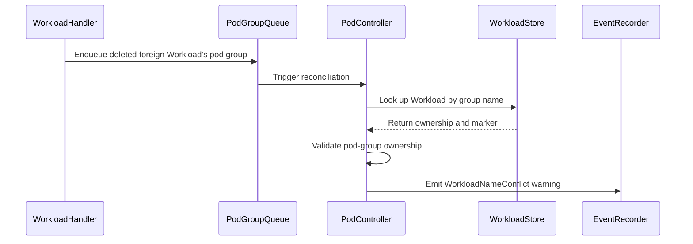

# PR #13960: fix(pod): refuse adopting and finalizing foreign Workloads by pod group name

**Summary**: fix(pod): refuse adopting and finalizing foreign Workloads by pod group name

**Sources**: https://github.com/kubernetes-sigs/kueue/pull/13960

**Last updated**: 2026-08-20T13:09:07Z

---

## Metadata

- **State**: closed (merged)
- **Author**: [@vladikkuzn](https://github.com/vladikkuzn)
- **Branch**: `fix/pod-group-workload-adoption-v2` → `main`
- **Created**: 2026-08-07T12:00:41Z
- **Updated**: 2026-08-20T13:09:07Z
- **Merged**: 2026-08-18T17:51:13Z
- **Closed**: 2026-08-18T17:51:13Z
- **Labels**: `kind/bug`, `release-note`, `lgtm`, `size/XL`, `approved`, `cncf-cla: yes`, `area/integrations`
- **Assignees**: [@tenzen-y](https://github.com/tenzen-y)
- **Requested reviewers**: [@mimowo](https://github.com/mimowo), [@sohankunkerkar](https://github.com/sohankunkerkar)
- **Changed files**: 9   **+679 / -139**

## Description

#### What type of PR is this?

/kind bug
/area integrations

#### What this PR does / why we need it:

Re-lands the pod-group Workload adoption fix together with the finalization-path gap @tenzen-y spotted, plus the integration test @mimowo asked for.

**Stacked on the revert, https://github.com/kubernetes-sigs/kueue/pull/13945 — please merge that first.** Commit 1 restores the original change from PR 13014; commit 2 adds what was missing. (PR 13014 is the original fix, PR 13882 was its release-0.18 cherry-pick, now closed.)

## The gap in PR 13014

PR 13014 guarded `(*Pod).FindMatchingWorkloads`, but that guard sits inside `ensureOneWorkload`, and finalization runs earlier and never reaches it:

1. `(*Pod).Load` returns `shouldFinalize = !p.isFound` — true whenever a reconcile of `{Name: <groupName>, Namespace: "group/<ns>"}` finds **zero** pods carrying that group name. `key` is left as `{groupName, ns}`.
2. `JobReconciler.ReconcileGenericJob` calls [`r.finalize`](https://github.com/kubernetes-sigs/kueue/blob/main/pkg/controller/jobframework/reconciler.go#L330) **before** the namespace-selector check, before `FindAncestorJobManagedByKueue`, before the queue-name check, and before `ensureOneWorkload`. `(*Pod).Skip` does not help either — its first branch requires `p.isFound`.
3. `finalizeWorkloads` → `getWorkloads` → [`ListChildWorkloads`](https://github.com/kubernetes-sigs/kueue/blob/main/pkg/controller/jobs/pod/pod_controller.go#L1212), which resolved the Workload by **name alone**, with no `is-group-workload` check.
4. [`FinalizeOrphanedWorkload`](https://github.com/kubernetes-sigs/kueue/blob/main/pkg/workload/workload.go#L1406) then marks the victim's Workload `Finished` with reason `OwnerNotFound` ("The workload's owner no longer exists") and strips `kueue.x-k8s.io/resource-in-use`.

Note it does **not** call `Delete` — the damage is Finish + de-finalize. The victim's quota is released from the cache while its real pods keep running, and the victim's own Job reconciler then sees `IsFinished`, emits `FinishedWorkload` and drops the Job finalizer, so the Job runs untracked.

`controllerutil.HasControllerReference(wl)` makes the victim's case strictly worse: a Workload owned by a `batch/Job` has a controller reference (so `canFinish` is true and it gets Finished), whereas a genuine pod-group Workload only has non-controller owner references (so it merely loses its finalizer).

### How it is reachable

A *managed* attacker pod group cannot reach this after PR 13014 — the pod carries `podconstants.PodFinalizer`, so deleting it leaves the pod `Terminating`, `p.isFound` stays true, and the group wedges on `errNotPodGroupWorkload`. The reachable variants are pods that never got the finalizer:

- **No queue name**, with `manageJobsWithoutQueueName=false` and no default LocalQueue: the webhook adds no scheduling gate, no finalizer and no managed label — yet the pod still carries the `kueue.x-k8s.io/pod-group-name` label, and `podEventHandler.Delete` enqueues `{groupName, "group/<ns>"}` unconditionally. Creating and deleting one throwaway pod is enough. No queue, no quota reservation, no admission required.
- Pods with `SuspendedByParentAnnotation` (`suspendByParent` gates the pod but deliberately skips `AddFinalizer`), namespace/pod-selector-excluded pods, or pods created while the webhook was down.

## The fix

Refuse the Workload in `ListChildWorkloads` when it **lacks the `is-group-workload` marker and carries a controller reference**. `NewGroupWorkload` always stamps the marker, and a pod group only ever adds non-controller owner references, so a controller reference means the Workload belongs to someone else.

Returning an empty list (rather than an error or event) is deliberate: `ListChildWorkloads` has exactly one caller chain (`getWorkloads` → `finalizeWorkloads`), so no caller can be driven into creating a duplicate Workload; an error would propagate through `finalize` and requeue the doomed request forever while short-circuiting `finalizeJob`; and an event is impossible here because `p.pod` is the zero-valued Pod when no pods exist. The user-visible `WorkloadNameConflict` warning still fires on the `FindMatchingWorkloads` path, where a real pod exists.

#### Special notes for your reviewer:

- **Why the controller-reference condition, and not the marker alone.** The marker is only stamped by `NewGroupWorkload`, so a marker check on its own would regress **user-supplied prebuilt pod-group Workloads**: the prebuilt branch bypasses `FindMatchingWorkloads`, so PR 13014 never affected them, but they would now never have their `resource-in-use` finalizer removed (`isOrphanedWorkload` returns false while owner refs exist, so jobframework's `finalizeWorkloads` is the only thing that removes it). The alternative was to stamp the marker onto adopted prebuilt Workloads in `EnsureWorkloadOwnedByAllMembers`; that mutates user-supplied objects and rewrites six existing prebuilt test expectations, so the two-condition predicate seemed the smaller change. Happy to switch if you prefer the stamping approach. `TestReconciler/prebuilt pod group workload without the group marker is still finalized` pins this behaviour.
- **The integration test demonstrates the bug**, as requested. With the guard removed it fails within milliseconds of the attacker pod's deletion:
  ```
  Expected <[]string | len:0, cap:0>: nil
  to contain element matching <string>: kueue.x-k8s.io/resource-in-use
  ```
  It uses a real `batch/Job` victim (so the Workload has a genuine controller reference and finalizer) and an unmanaged attacker pod, and asserts the victim keeps its finalizer, its `Admitted` condition, no `Finished` condition, and no group marker. A paired existing spec (`util.ExpectWorkloadsFinalizedOrGone`) confirms legitimate groups still have their finalizers removed, so the guard does not leak finalizers.
- **Out of scope** (not fixed here): `statefulset_reconciler.go`'s `findWorkloadName` falls back to the legacy UID-less `GetWorkloadName("", sts.Name)`, but `reconcileWorkload` checks `HasOwnerReference` before mutating, so it is not exploitable the same way.
- Verification: `make verify-checks` passes; `./pkg/controller/jobs/pod/...`, `./pkg/features/...`, `./pkg/workload/...`, `./pkg/controller/jobframework/...` unit tests pass (868); the full pod integration suite passes (43/43).

cc @tenzen-y @mimowo — this is item 3 of the plan we agreed on: PR 13882 is closed, https://github.com/kubernetes-sigs/kueue/pull/13945 reverts main, and this PR re-lands with your comment addressed and integration coverage.

#### Does this PR introduce a user-facing change?

```release-note
PodGroup integration: Fixed a bug where a Pod could bypass ClusterQueue quota by setting `kueue.x-k8s.io/pod-group-name` to another Workload's name. Kueue now only adopts Workloads created by the pod-group framework (stamped with `kueue.x-k8s.io/is-group-workload`), and no longer finalizes a foreign Workload that merely shares the pod group name, which previously marked it Finished and released its quota while its pods were still running.
```


<!-- This is an auto-generated comment: release notes by coderabbit.ai -->
## Summary by CodeRabbit

* **Bug Fixes**
  * Improved pod-group reconciliation to avoid finalizing workloads owned by unrelated Jobs.
  * Prevented pod groups from adopting, modifying, or deleting unrelated workloads with matching names.
  * Ensured unmanaged workloads retain their finalizers, admission settings, quota reservations, and identity.
  * Pod-group workloads are finalized correctly when their pods no longer exist.
  * Requeued blocked pod groups when related workloads are deleted.
* **New Features**
  * Added the `PodIntegrationValidateGroupOwner` feature gate, enabled by default, to validate workload ownership.
* **Tests**
  * Added unit and integration coverage for ownership validation and orphaned workload handling.
<!-- end of auto-generated comment: release notes by coderabbit.ai -->

## Discussion

### Comment by [@netlify[bot]](https://github.com/apps/netlify) — 2026-08-07T12:00:48Z

### <span aria-hidden="true">✅</span> Deploy Preview for *kubernetes-sigs-kueue* ready!


|  Name | Link |
|:-:|------------------------|
|<span aria-hidden="true">🔨</span> Latest commit | e08aa638a3d9f2cfcc98c562f89193cb7b997350 |
|<span aria-hidden="true">🔍</span> Latest deploy log | https://app.netlify.com/projects/kubernetes-sigs-kueue/deploys/6a839e4c4b04f30008d193b2 |
|<span aria-hidden="true">😎</span> Deploy Preview | [https://deploy-preview-13960--kubernetes-sigs-kueue.netlify.app](https://deploy-preview-13960--kubernetes-sigs-kueue.netlify.app) |
|<span aria-hidden="true">📱</span> Preview on mobile | <details><summary> Toggle QR Code... </summary><br /><br /><br /><br />_Use your smartphone camera to open QR code link._</details> |
---
<!-- [kubernetes-sigs-kueue Preview](https://deploy-preview-13960--kubernetes-sigs-kueue.netlify.app) -->
_To edit notification comments on pull requests, go to your [Netlify project configuration](https://app.netlify.com/projects/kubernetes-sigs-kueue/configuration/notifications#deploy-notifications)._

### Comment by [@linux-foundation-easycla[bot]](https://github.com/apps/linux-foundation-easycla) — 2026-08-07T12:00:52Z

<a href="https://easycla.lfx.linuxfoundation.org/#/?version=2"></a><br >The committers listed above are authorized under a signed CLA.<ul><li>:white_check_mark: login: vladikkuzn / name: vladikkuzn (0441ae19945ee6f1db1ca859900b1a8d1b322b29, 59fd70bfe79619e068bd01b3a4b38619cd7f04e1, 9c4bf2d9611752643d14e58fccc47d073c82d333)</li></ul>

### Comment by [@coderabbitai[bot]](https://github.com/apps/coderabbitai) — 2026-08-07T12:01:06Z

<!-- This is an auto-generated comment: summarize by coderabbit.ai -->
<!-- review_stack_entry_start -->

[](https://app.coderabbit.ai/change-stack/kubernetes-sigs/kueue/pull/13960?utm_source=github_walkthrough&utm_medium=github&utm_campaign=change_stack)

<!-- review_stack_entry_end -->
<!-- This is an auto-generated comment: review paused by coderabbit.ai -->

> [!NOTE]
> ## Reviews paused
> 
> It looks like this branch is under active development. To avoid overwhelming you with review comments due to an influx of new commits, CodeRabbit has automatically paused this review. You can configure this behavior by changing the `reviews.auto_review.auto_pause_after_reviewed_commits` setting.
> 
> Use the following commands to manage reviews:
> - `@coderabbitai resume` to resume automatic reviews.
> - `@coderabbitai review` to trigger a single review.
> 
> Use the checkboxes below for quick actions:
> - [ ] <!-- {"checkboxId": "7f6cc2e2-2e4e-497a-8c31-c9e4573e93d1"} --> ▶️ Resume reviews
> - [ ] <!-- {"checkboxId": "e9bb8d72-00e8-4f67-9cb2-caf3b22574fe"} --> 🔍 Trigger review

<!-- end of auto-generated comment: review paused by coderabbit.ai -->
<!-- walkthrough_start -->

<details>
<summary>📝 Walkthrough</summary>

## Walkthrough

Pod-group reconciliation now validates Workload ownership before adoption or finalization when the feature gate is enabled. Deleted foreign Workloads can requeue their pod groups. Tests cover ownership conflicts, orphaned Workloads, conflict events, and pod-group markers.

### Changes

**Pod-group ownership validation**

|Layer / File(s)|Summary|
|---|---|
|**Ownership validation contract** <br> `pkg/features/kube_features.go`, `site/data/featuregates/versioned_feature_list.yaml`, `test/compatibility_lifecycle/reference/versioned_feature_list.yaml`, `pkg/util/testing/v1beta2/wrappers.go`|The `PodIntegrationValidateGroupOwner` feature gate is Beta and enabled by default in version 0.20. The `Group()` helper applies the pod-group marker.|
|**Ownership validation guard** <br> `pkg/controller/jobs/pod/pod_controller.go`|Enabled validation rejects unmarked foreign Workloads, emits a `WorkloadNameConflict` warning, and prevents foreign Workloads from deletion or finalization.|
|**Foreign Workload deletion handling** <br> `pkg/controller/jobs/pod/event_handlers.go`, `pkg/controller/jobs/pod/event_handlers_test.go`|Deleted non-framework Workloads requeue matching pod groups when validation is enabled. Tests cover foreign, controller-owned, and pod-group Workloads.|
|**Reconciliation and integration validation** <br> `pkg/controller/jobs/pod/pod_controller_test.go`, `test/integration/singlecluster/controller/jobs/pod/pod_controller_test.go`|Tests cover marker-based fixtures, foreign ownership, orphan finalization, conflict events, and preservation of foreign Job-owned Workloads.|

**Estimated code review effort:** 3 (Moderate) | ~25 minutes

### Sequence Diagram(s)



**Possibly related PRs**

- [kubernetes-sigs/kueue#13014](https://github.com/kubernetes-sigs/kueue/pull/13014): Extends related pod-group Workload ownership validation.
- [kubernetes-sigs/kueue#13857](https://github.com/kubernetes-sigs/kueue/pull/13857): Adds related feature-gated Workload ownership handling during lifecycle transitions.
- [kubernetes-sigs/kueue#13945](https://github.com/kubernetes-sigs/kueue/pull/13945): Reintroduces related foreign-Workload ownership validation.

**Suggested reviewers:** `tenzen-y`, `mimowo`, `sohankunkerkar`

</details>

<!-- walkthrough_end -->
<!-- pre_merge_checks_walkthrough_start -->

<details>
<summary>🚥 Pre-merge checks | ✅ 5</summary>

<details>
<summary>✅ Passed checks (5 passed)</summary>

|         Check name         | Status   | Explanation                                                                                                                     |
| :------------------------: | :------- | :------------------------------------------------------------------------------------------------------------------------------ |
|      Description Check     | ✅ Passed | Check skipped - CodeRabbit’s high-level summary is enabled.                                                                     |
|         Title check        | ✅ Passed | The title clearly and concisely describes the main change: preventing pod groups from adopting or finalizing foreign Workloads. |
|     Docstring Coverage     | ✅ Passed | No functions found in the changed files to evaluate docstring coverage. Skipping docstring coverage check.                      |
|     Linked Issues check    | ✅ Passed | Check skipped because no linked issues were found for this pull request.                                                        |
| Out of Scope Changes check | ✅ Passed | Check skipped because no linked issues were found for this pull request.                                                        |

</details>

</details>

<!-- pre_merge_checks_walkthrough_end -->
<!-- finishing_touch_checkbox_start -->

<details>
<summary>✨ Finishing Touches</summary>

<details>
<summary>🧪 Generate unit tests (beta)</summary>

- [ ] <!-- {"checkboxId": "f47ac10b-58cc-4372-a567-0e02b2c3d479", "radioGroupId": "utg-output-choice-group-unknown_comment_id"} -->   Create PR with unit tests

</details>

</details>

<!-- finishing_touch_checkbox_end -->
<!-- tips_start -->

---

Thanks for using [CodeRabbit](https://coderabbit.ai?utm_source=oss&utm_medium=github&utm_campaign=kubernetes-sigs/kueue&utm_content=13960)! It's free for OSS, and your support helps us grow. If you like it, consider giving us a shout-out.

<details>
<summary>❤️ Share</summary>

- [X](https://twitter.com/intent/tweet?text=I%20just%20used%20%40coderabbitai%20for%20my%20code%20review%2C%20and%20it%27s%20fantastic%21%20It%27s%20free%20for%20OSS%20and%20offers%20a%20free%20trial%20for%20the%20proprietary%20code.%20Check%20it%20out%3A&url=https%3A//coderabbit.ai)
- [Mastodon](https://mastodon.social/share?text=I%20just%20used%20%40coderabbitai%20for%20my%20code%20review%2C%20and%20it%27s%20fantastic%21%20It%27s%20free%20for%20OSS%20and%20offers%20a%20free%20trial%20for%20the%20proprietary%20code.%20Check%20it%20out%3A%20https%3A%2F%2Fcoderabbit.ai)
- [Reddit](https://www.reddit.com/submit?title=Great%20tool%20for%20code%20review%20-%20CodeRabbit&text=I%20just%20used%20CodeRabbit%20for%20my%20code%20review%2C%20and%20it%27s%20fantastic%21%20It%27s%20free%20for%20OSS%20and%20offers%20a%20free%20trial%20for%20proprietary%20code.%20Check%20it%20out%3A%20https%3A//coderabbit.ai)
- [LinkedIn](https://www.linkedin.com/sharing/share-offsite/?url=https%3A%2F%2Fcoderabbit.ai&mini=true&title=Great%20tool%20for%20code%20review%20-%20CodeRabbit&summary=I%20just%20used%20CodeRabbit%20for%20my%20code%20review%2C%20and%20it%27s%20fantastic%21%20It%27s%20free%20for%20OSS%20and%20offers%20a%20free%20trial%20for%20proprietary%20code)

</details>


<sub>Comment `@coderabbitai help` to get the list of available commands.</sub>

<!-- tips_end -->

### Comment by [@vladikkuzn](https://github.com/vladikkuzn) — 2026-08-07T17:44:39Z

/cc @tenzen-y

### Comment by [@tenzen-y](https://github.com/tenzen-y) — 2026-08-10T18:34:37Z

@vladikkuzn, can you rebase this PR onto main?

### Comment by [@vladikkuzn](https://github.com/vladikkuzn) — 2026-08-10T23:29:22Z

@tenzen-y rebased onto latest `main` and force-pushed — PR head is now `bc4ed3ba`.

The rebase surfaced a semantic conflict: `main` dropped the `k8s.io/utils/ptr` import from `pkg/controller/jobs/pod/pod_controller_test.go` while this PR added a `ptr.To` usage there, so the package no longer type-checked. Restored the import in the commit that introduced the usage, and verified both commits vet cleanly on their own.

Also addressed the review comment on the integration test in the same push.

### Comment by [@vladikkuzn](https://github.com/vladikkuzn) — 2026-08-11T12:33:17Z

/retest-required

### Comment by [@tenzen-y](https://github.com/tenzen-y) — 2026-08-11T23:50:26Z

@vladikkuzn sorry again... can you re rebase this onto main branch?

### Comment by [@vladikkuzn](https://github.com/vladikkuzn) — 2026-08-12T13:31:18Z

@tenzen-y no problem — rebased onto latest `main` and force-pushed. PR head is now `55667d3`.

The rebase hit one conflict, in `pkg/features/kube_features.go`. It was purely additive: `main` gained `MultiKueueRemoteSpecSync` and `RecomputeAssignmentUponPreemptionTargetsOverlap` right where this PR adds `PodIntegrationValidateGroupOwner`, in both the feature-const block and the versioned feature-gate map. Kept all three entries; no logic in this PR changed.

Verified `go build ./pkg/...` passes on the rebased head.

### Comment by [@kubernetes-prow[bot]](https://github.com/apps/kubernetes-prow) — 2026-08-12T16:22:13Z

LGTM label has been added.  <details>Git tree hash: 6b69c3a92c3754f32ef24d2f0ee5b9cbd98972b9</details>

### Comment by [@kubernetes-prow[bot]](https://github.com/apps/kubernetes-prow) — 2026-08-18T17:35:56Z

LGTM label has been added.  <details>Git tree hash: 29db628d2ddcc4ac6a4c474488b4e929566e3347</details>

### Comment by [@kubernetes-prow[bot]](https://github.com/apps/kubernetes-prow) — 2026-08-18T17:36:00Z

[APPROVALNOTIFIER] This PR is **APPROVED**

This pull-request has been approved by: *<a href="https://github.com/kubernetes-sigs/kueue/pull/13960#pullrequestreview-4963998208" title="Approved">tenzen-y</a>*, *<a href="https://github.com/kubernetes-sigs/kueue/pull/13960#" title="Author self-approved">vladikkuzn</a>*

The full list of commands accepted by this bot can be found [here](https://go.k8s.io/bot-commands?repo=kubernetes-sigs%2Fkueue).

The pull request process is described [here](https://git.k8s.io/community/contributors/guide/owners.md#the-code-review-process)

<details >
Needs approval from an approver in each of these files:

- ~~[OWNERS](https://github.com/kubernetes-sigs/kueue/blob/main/OWNERS)~~ [tenzen-y]

Approvers can indicate their approval by writing `/approve` in a comment
Approvers can cancel approval by writing `/approve cancel` in a comment
</details>
<!-- META={"approvers":[]} -->

### Comment by [@tenzen-y](https://github.com/tenzen-y) — 2026-08-18T17:36:11Z

/cherrypick release-0.18
/cherrypick release-0.19

### Comment by [@k8s-infra-cherrypick-robot](https://github.com/k8s-infra-cherrypick-robot) — 2026-08-18T17:36:14Z

@tenzen-y: once the present PR merges, I will cherry-pick it on top of `release-0.18`, `release-0.19` in new PRs and assign them to you.

<details>

In response to [this](https://github.com/kubernetes-sigs/kueue/pull/13960#issuecomment-5331834976):

>/cherrypick release-0.18
>/cherrypick release-0.19


Instructions for interacting with me using PR comments are available [here](https://git.k8s.io/community/contributors/guide/pull-requests.md).  If you have questions or suggestions related to my behavior, please file an issue against the [kubernetes-sigs/prow](https://github.com/kubernetes-sigs/prow/issues/new?title=Prow%20issue:) repository.
</details>

### Comment by [@k8s-infra-cherrypick-robot](https://github.com/k8s-infra-cherrypick-robot) — 2026-08-18T17:51:53Z

@tenzen-y: #13960 failed to apply on top of branch "release-0.18":
```
Applying: fix(pod): refuse adopting non-pod-group Workloads by group name
Using index info to reconstruct a base tree...
M	pkg/controller/jobs/pod/event_handlers.go
M	pkg/controller/jobs/pod/pod_controller.go
M	pkg/controller/jobs/pod/pod_controller_test.go
M	pkg/features/kube_features.go
M	pkg/util/testing/v1beta2/wrappers.go
M	site/data/featuregates/versioned_feature_list.yaml
M	test/compatibility_lifecycle/reference/versioned_feature_list.yaml
M	test/integration/singlecluster/controller/jobs/pod/pod_controller_test.go
Falling back to patching base and 3-way merge...
Auto-merging pkg/controller/jobs/pod/event_handlers.go
Auto-merging pkg/controller/jobs/pod/pod_controller.go
CONFLICT (content): Merge conflict in pkg/controller/jobs/pod/pod_controller.go
Auto-merging pkg/controller/jobs/pod/pod_controller_test.go
CONFLICT (content): Merge conflict in pkg/controller/jobs/pod/pod_controller_test.go
Auto-merging pkg/features/kube_features.go
Auto-merging pkg/util/testing/v1beta2/wrappers.go
Auto-merging site/data/featuregates/versioned_feature_list.yaml
Auto-merging test/compatibility_lifecycle/reference/versioned_feature_list.yaml
Auto-merging test/integration/singlecluster/controller/jobs/pod/pod_controller_test.go
CONFLICT (content): Merge conflict in test/integration/singlecluster/controller/jobs/pod/pod_controller_test.go
error: Failed to merge in the changes.
hint: Use 'git am --show-current-patch=diff' to see the failed patch
hint: When you have resolved this problem, run "git am --continue".
hint: If you prefer to skip this patch, run "git am --skip" instead.
hint: To restore the original branch and stop patching, run "git am --abort".
hint: Disable this message with "git config set advice.mergeConflict false"
Patch failed at 0001 fix(pod): refuse adopting non-pod-group Workloads by group name

```

<details>

In response to [this](https://github.com/kubernetes-sigs/kueue/pull/13960#issuecomment-5331834976):

>/cherrypick release-0.18
>/cherrypick release-0.19


Instructions for interacting with me using PR comments are available [here](https://git.k8s.io/community/contributors/guide/pull-requests.md).  If you have questions or suggestions related to my behavior, please file an issue against the [kubernetes-sigs/prow](https://github.com/kubernetes-sigs/prow/issues/new?title=Prow%20issue:) repository.
</details>

### Comment by [@k8s-infra-cherrypick-robot](https://github.com/k8s-infra-cherrypick-robot) — 2026-08-18T17:52:32Z

@tenzen-y: new pull request created: #14599

<details>

In response to [this](https://github.com/kubernetes-sigs/kueue/pull/13960#issuecomment-5331834976):

>/cherrypick release-0.18
>/cherrypick release-0.19


Instructions for interacting with me using PR comments are available [here](https://git.k8s.io/community/contributors/guide/pull-requests.md).  If you have questions or suggestions related to my behavior, please file an issue against the [kubernetes-sigs/prow](https://github.com/kubernetes-sigs/prow/issues/new?title=Prow%20issue:) repository.
</details>

### Comment by [@tenzen-y](https://github.com/tenzen-y) — 2026-08-18T18:23:04Z

/cherrypick website

### Comment by [@k8s-infra-cherrypick-robot](https://github.com/k8s-infra-cherrypick-robot) — 2026-08-18T18:23:41Z

@tenzen-y: #13960 failed to apply on top of branch "website":
```
Applying: fix(pod): refuse adopting non-pod-group Workloads by group name
Using index info to reconstruct a base tree...
M	pkg/controller/jobs/pod/pod_controller.go
M	pkg/controller/jobs/pod/pod_controller_test.go
M	pkg/features/kube_features.go
M	pkg/util/testing/v1beta2/wrappers.go
M	site/data/featuregates/versioned_feature_list.yaml
M	test/compatibility_lifecycle/reference/versioned_feature_list.yaml
M	test/integration/singlecluster/controller/jobs/pod/pod_controller_test.go
Falling back to patching base and 3-way merge...
Auto-merging pkg/controller/jobs/pod/pod_controller.go
Auto-merging pkg/controller/jobs/pod/pod_controller_test.go
Auto-merging pkg/features/kube_features.go
CONFLICT (content): Merge conflict in pkg/features/kube_features.go
Auto-merging pkg/util/testing/v1beta2/wrappers.go
Auto-merging site/data/featuregates/versioned_feature_list.yaml
Auto-merging test/compatibility_lifecycle/reference/versioned_feature_list.yaml
Auto-merging test/integration/singlecluster/controller/jobs/pod/pod_controller_test.go
error: Failed to merge in the changes.
hint: Use 'git am --show-current-patch=diff' to see the failed patch
hint: When you have resolved this problem, run "git am --continue".
hint: If you prefer to skip this patch, run "git am --skip" instead.
hint: To restore the original branch and stop patching, run "git am --abort".
hint: Disable this message with "git config set advice.mergeConflict false"
Patch failed at 0001 fix(pod): refuse adopting non-pod-group Workloads by group name

```

<details>

In response to [this](https://github.com/kubernetes-sigs/kueue/pull/13960#issuecomment-5332325353):

>/cherrypick website


Instructions for interacting with me using PR comments are available [here](https://git.k8s.io/community/contributors/guide/pull-requests.md).  If you have questions or suggestions related to my behavior, please file an issue against the [kubernetes-sigs/prow](https://github.com/kubernetes-sigs/prow/issues/new?title=Prow%20issue:) repository.
</details>

### Comment by [@tenzen-y](https://github.com/tenzen-y) — 2026-08-20T13:09:04Z

/release-note-edit
```release-note
PodGroup integration: Fixed a bug where a Pod could bypass ClusterQueue quota by setting `kueue.x-k8s.io/pod-group-name` to another Workload's name. Kueue now only adopts Workloads created by the pod-group framework (stamped with `kueue.x-k8s.io/is-group-workload`), and no longer finalizes a foreign Workload that merely shares the pod group name, which previously marked it Finished and released its quota while its pods were still running.
```

## Reviews

### Review by [@coderabbitai[bot]](https://github.com/apps/coderabbitai) (commented) — 2026-08-07T12:06:35Z

**Actionable comments posted: 1**

<details>
<summary>🤖 Prompt for all review comments with AI agents</summary>

```
Verify each finding against current code. Fix only still-valid issues, skip the
rest with a brief reason, keep changes minimal, and validate.

Inline comments:
In `@test/integration/singlecluster/controller/jobs/pod/pod_controller_test.go`:
- Around line 2029-2036: Extend the Consistently assertions in the “Checking the
victim Workload keeps its finalizer, quota and admission” block to verify that
victimWl.Status.Admission remains present and that victimWl.Status.Conditions
includes WorkloadQuotaReserved=True. Keep the existing finalizer, admission,
finished-condition, and annotation assertions unchanged.
```

</details>

<details>
<summary>🪄 Autofix</summary>

Fix all unresolved CodeRabbit comments on this PR:

- [ ] <!-- {"checkboxId": "4b0d0e0a-96d7-4f10-b296-3a18ea78f0b9"} --> Push a commit to this branch (recommended)
- [ ] <!-- {"checkboxId": "ff5b1114-7d8c-49e6-8ac1-43f82af23a33"} --> Create a new PR with the fixes

</details>

---

<details>
<summary>ℹ️ Review info</summary>

<details>
<summary>⚙️ Run configuration</summary>

**Configuration used**: Path: .coderabbit.yaml

**Review profile**: CHILL

**Plan**: Pro Plus

**Run ID**: `5e297258-a63a-4069-98ef-d75306d409e4`

</details>

<details>
<summary>📥 Commits</summary>

Reviewing files that changed from the base of the PR and between 2f1ee626eab5a438d43000a2a30a3e41fdcf22b4 and 6ee1297ac9e50f1704d8b50105d0f292a2287746.

</details>

<details>
<summary>📒 Files selected for processing (4)</summary>

* `pkg/controller/jobs/pod/pod_controller.go`
* `pkg/controller/jobs/pod/pod_controller_test.go`
* `pkg/features/kube_features.go`
* `test/integration/singlecluster/controller/jobs/pod/pod_controller_test.go`

</details>

</details>

<!-- This is an auto-generated comment by CodeRabbit for review status -->

- **test/integration/singlecluster/controller/jobs/pod/pod_controller_test.go:2040** by [@coderabbitai[bot]](https://github.com/apps/coderabbitai) — 2026-08-07T12:06:34Z
```diff
@@ -1966,6 +1968,74 @@ var _ = ginkgo.Describe("Pod controller", ginkgo.Label("job:pod", "area:jobs"),
 					})
 				})
 			})
+
+			// A pod group whose pods have all disappeared is finalized before any of the
+			// adoption checks run, so a Pod that merely borrows another job's Workload name
+			// can drive the reconciler into finalizing that foreign Workload.
+			ginkgo.It("Should not finalize a foreign Workload sharing the group name when the pod group has no pods", func() {
+				victimJob := testingjob.MakeJob("victim-job", ns.Name).
+					Queue(kueue.LocalQueueName(lq.Name)).
+					Request(corev1.ResourceCPU, "1").
+					Obj()
+
+				ginkgo.By("Creating the victim Job", func() {
+					util.MustCreate(ctx, k8sClient, victimJob)
+				})
+
+				createdVictimJob := &batchv1.Job{}
+				gomega.Eventually(func(g gomega.Gomega) {
+					g.Expect(k8sClient.Get(ctx, client.ObjectKeyFromObject(victimJob), createdVictimJob)).Should(gomega.Succeed())
+					g.Expect(createdVictimJob.UID).NotTo(gomega.BeEmpty())
+				}, util.Timeout, util.Interval).Should(gomega.Succeed())
+
+				victimWlKey := types.NamespacedName{
+					Name:      workloadjob.GetWorkloadNameForJob(victimJob.Name, createdVictimJob.UID),
+					Namespace: ns.Name,
+				}
+				victimWl := &kueue.Workload{}
+
+				ginkgo.By("Admitting the victim Workload", func() {
+					gomega.Eventually(func(g gomega.Gomega) {
+						g.Expect(k8sClient.Get(ctx, victimWlKey, victimWl)).Should(gomega.Succeed())
+					}, util.Timeout, util.Interval).Should(gomega.Succeed())
+
+					admission := utiltestingapi.MakeAdmission(kueue.ClusterQueueReference(cq.Name)).
+						PodSets(utiltestingapi.MakePodSetAssignment(kueue.DefaultPodSetName).
+							Assignment(corev1.ResourceCPU, "fl", "1").
+							Count(victimWl.Spec.PodSets[0].Count).
+							Obj()).
+						Obj()
+					util.SetQuotaReservation(ctx, k8sClient, victimWlKey, admission)
+					util.SyncAdmittedConditionForWorkloads(ctx, k8sClient, victimWl)
+
+					gomega.Expect(k8sClient.Get(ctx, victimWlKey, victimWl)).To(gomega.Succeed())
+					gomega.Expect(victimWl.Finalizers).To(gomega.ContainElement(kueue.ResourceInUseFinalizerName))
+					gomega.Expect(metav1.GetControllerOfNoCopy(victimWl)).NotTo(gomega.BeNil())
+				})
+
+				// No Queue(), so the webhook leaves this Pod unmanaged: no scheduling gate and
+				// no pod finalizer. It therefore vanishes immediately on delete, leaving the
+				// group with zero pods, which is what drives the reconciler into finalization.
+				attackerPod := testingpod.MakePod("attacker-pod", ns.Name).
+					GroupNameLabel(victimWlKey.Name).
+					GroupTotalCount("1").
+					Obj()
+
+				ginkgo.By("Creating and deleting an unmanaged Pod that claims the victim Workload's name as its group", func() {
+					util.MustCreate(ctx, k8sClient, attackerPod)
+					util.ExpectObjectToBeDeleted(ctx, k8sClient, attackerPod, true)
+				})
+
+				ginkgo.By("Checking the victim Workload keeps its finalizer, quota and admission", func() {
+					gomega.Consistently(func(g gomega.Gomega) {
+						g.Expect(k8sClient.Get(ctx, victimWlKey, victimWl)).Should(gomega.Succeed())
+						g.Expect(victimWl.Finalizers).To(gomega.ContainElement(kueue.ResourceInUseFinalizerName))
+						g.Expect(victimWl.Status.Conditions).ToNot(utiltesting.HaveConditionStatusTrue(kueue.WorkloadFinished))
+						g.Expect(victimWl.Status.Conditions).To(utiltesting.HaveConditionStatusTrue(kueue.WorkloadAdmitted))
+						g.Expect(victimWl.Annotations).NotTo(gomega.HaveKey(podconstants.IsGroupWorkloadAnnotationKey))
+					}, util.ConsistentDuration, util.ShortInterval).Should(gomega.Succeed())
```

  _🎯 Functional Correctness_ | _🟡 Minor_ | _⚡ Quick win_
  
  **Assert that the quota reservation remains present.**
  
  These assertions do not verify `victimWl.Status.Admission` or `WorkloadQuotaReserved=True`. A regression that releases the reservation but leaves the admitted condition unchanged can pass this test. Assert both states.
  
  <details>
  <summary>Proposed test addition</summary>
  
  ```diff
   g.Expect(victimWl.Finalizers).To(gomega.ContainElement(kueue.ResourceInUseFinalizerName))
  +g.Expect(victimWl.Status.Admission).NotTo(gomega.BeNil())
  +g.Expect(victimWl.Status.Conditions).To(utiltesting.HaveConditionStatusTrue(kueue.WorkloadQuotaReserved))
   g.Expect(victimWl.Status.Conditions).ToNot(utiltesting.HaveConditionStatusTrue(kueue.WorkloadFinished))
   g.Expect(victimWl.Status.Conditions).To(utiltesting.HaveConditionStatusTrue(kueue.WorkloadAdmitted))
  ```
  </details>
  
  Based on PR objectives, the victim Workload must retain its quota reservation.
  
  <!-- suggestion_start -->
  
  <details>
  <summary>📝 Committable suggestion</summary>
  
  > ‼️ **IMPORTANT**
  > Carefully review the code before committing. Ensure that it accurately replaces the highlighted code, contains no missing lines, and has no issues with indentation. Thoroughly test & benchmark the code to ensure it meets the requirements.
  
  ```suggestion
  				ginkgo.By("Checking the victim Workload keeps its finalizer, quota and admission", func() {
  					gomega.Consistently(func(g gomega.Gomega) {
  						g.Expect(k8sClient.Get(ctx, victimWlKey, victimWl)).Should(gomega.Succeed())
  						g.Expect(victimWl.Finalizers).To(gomega.ContainElement(kueue.ResourceInUseFinalizerName))
  						g.Expect(victimWl.Status.Admission).NotTo(gomega.BeNil())
  						g.Expect(victimWl.Status.Conditions).To(utiltesting.HaveConditionStatusTrue(kueue.WorkloadQuotaReserved))
  						g.Expect(victimWl.Status.Conditions).ToNot(utiltesting.HaveConditionStatusTrue(kueue.WorkloadFinished))
  						g.Expect(victimWl.Status.Conditions).To(utiltesting.HaveConditionStatusTrue(kueue.WorkloadAdmitted))
  						g.Expect(victimWl.Annotations).NotTo(gomega.HaveKey(podconstants.IsGroupWorkloadAnnotationKey))
  					}, util.ConsistentDuration, util.ShortInterval).Should(gomega.Succeed())
  ```
  
  </details>
  
  <!-- suggestion_end -->
  
  <details>
  <summary>🤖 Prompt for AI Agents</summary>
  
  ```
  Verify each finding against current code. Fix only still-valid issues, skip the
  rest with a brief reason, keep changes minimal, and validate.
  
  In `@test/integration/singlecluster/controller/jobs/pod/pod_controller_test.go`
  around lines 2029 - 2036, Extend the Consistently assertions in the “Checking
  the victim Workload keeps its finalizer, quota and admission” block to verify
  that victimWl.Status.Admission remains present and that
  victimWl.Status.Conditions includes WorkloadQuotaReserved=True. Keep the
  existing finalizer, admission, finished-condition, and annotation assertions
  unchanged.
  ```
  
  </details>
  
  <!-- fingerprinting:phantom:medusa:tapir -->
  
  <!-- cr-indicator-types:potential_issue -->
  
  <!-- cr-comment:v1:75b22626244e99998ff875ad -->
  
  <!-- This is an auto-generated reply by CodeRabbit -->
  
  ✅ Confirmed as addressed by @vladikkuzn
  
  <!-- This is an auto-generated comment by CodeRabbit -->

### Review by [@vladikkuzn](https://github.com/vladikkuzn) (commented) — 2026-08-10T14:22:16Z

- **test/integration/singlecluster/controller/jobs/pod/pod_controller_test.go:2040** by [@vladikkuzn](https://github.com/vladikkuzn) — 2026-08-10T14:22:16Z
```diff
@@ -1966,6 +1968,74 @@ var _ = ginkgo.Describe("Pod controller", ginkgo.Label("job:pod", "area:jobs"),
 					})
 				})
 			})
+
+			// A pod group whose pods have all disappeared is finalized before any of the
+			// adoption checks run, so a Pod that merely borrows another job's Workload name
+			// can drive the reconciler into finalizing that foreign Workload.
+			ginkgo.It("Should not finalize a foreign Workload sharing the group name when the pod group has no pods", func() {
+				victimJob := testingjob.MakeJob("victim-job", ns.Name).
+					Queue(kueue.LocalQueueName(lq.Name)).
+					Request(corev1.ResourceCPU, "1").
+					Obj()
+
+				ginkgo.By("Creating the victim Job", func() {
+					util.MustCreate(ctx, k8sClient, victimJob)
+				})
+
+				createdVictimJob := &batchv1.Job{}
+				gomega.Eventually(func(g gomega.Gomega) {
+					g.Expect(k8sClient.Get(ctx, client.ObjectKeyFromObject(victimJob), createdVictimJob)).Should(gomega.Succeed())
+					g.Expect(createdVictimJob.UID).NotTo(gomega.BeEmpty())
+				}, util.Timeout, util.Interval).Should(gomega.Succeed())
+
+				victimWlKey := types.NamespacedName{
+					Name:      workloadjob.GetWorkloadNameForJob(victimJob.Name, createdVictimJob.UID),
+					Namespace: ns.Name,
+				}
+				victimWl := &kueue.Workload{}
+
+				ginkgo.By("Admitting the victim Workload", func() {
+					gomega.Eventually(func(g gomega.Gomega) {
+						g.Expect(k8sClient.Get(ctx, victimWlKey, victimWl)).Should(gomega.Succeed())
+					}, util.Timeout, util.Interval).Should(gomega.Succeed())
+
+					admission := utiltestingapi.MakeAdmission(kueue.ClusterQueueReference(cq.Name)).
+						PodSets(utiltestingapi.MakePodSetAssignment(kueue.DefaultPodSetName).
+							Assignment(corev1.ResourceCPU, "fl", "1").
+							Count(victimWl.Spec.PodSets[0].Count).
+							Obj()).
+						Obj()
+					util.SetQuotaReservation(ctx, k8sClient, victimWlKey, admission)
+					util.SyncAdmittedConditionForWorkloads(ctx, k8sClient, victimWl)
+
+					gomega.Expect(k8sClient.Get(ctx, victimWlKey, victimWl)).To(gomega.Succeed())
+					gomega.Expect(victimWl.Finalizers).To(gomega.ContainElement(kueue.ResourceInUseFinalizerName))
+					gomega.Expect(metav1.GetControllerOfNoCopy(victimWl)).NotTo(gomega.BeNil())
+				})
+
+				// No Queue(), so the webhook leaves this Pod unmanaged: no scheduling gate and
+				// no pod finalizer. It therefore vanishes immediately on delete, leaving the
+				// group with zero pods, which is what drives the reconciler into finalization.
+				attackerPod := testingpod.MakePod("attacker-pod", ns.Name).
+					GroupNameLabel(victimWlKey.Name).
+					GroupTotalCount("1").
+					Obj()
+
+				ginkgo.By("Creating and deleting an unmanaged Pod that claims the victim Workload's name as its group", func() {
+					util.MustCreate(ctx, k8sClient, attackerPod)
+					util.ExpectObjectToBeDeleted(ctx, k8sClient, attackerPod, true)
+				})
+
+				ginkgo.By("Checking the victim Workload keeps its finalizer, quota and admission", func() {
+					gomega.Consistently(func(g gomega.Gomega) {
+						g.Expect(k8sClient.Get(ctx, victimWlKey, victimWl)).Should(gomega.Succeed())
+						g.Expect(victimWl.Finalizers).To(gomega.ContainElement(kueue.ResourceInUseFinalizerName))
+						g.Expect(victimWl.Status.Conditions).ToNot(utiltesting.HaveConditionStatusTrue(kueue.WorkloadFinished))
+						g.Expect(victimWl.Status.Conditions).To(utiltesting.HaveConditionStatusTrue(kueue.WorkloadAdmitted))
+						g.Expect(victimWl.Annotations).NotTo(gomega.HaveKey(podconstants.IsGroupWorkloadAnnotationKey))
+					}, util.ConsistentDuration, util.ShortInterval).Should(gomega.Succeed())
```

  Good catch — the `By` text claimed the block checked quota, but the assertions never did. Added in `568f6269e`:
  
  ```go
  g.Expect(victimWl.Status.Admission).NotTo(gomega.BeNil())
  g.Expect(victimWl.Status.Conditions).To(utiltesting.HaveConditionStatusTrue(kueue.WorkloadQuotaReserved))
  ```
  
  Verified locally: the spec `Should not finalize a foreign Workload sharing the group name when the pod group has no pods` passes with the added assertions.

### Review by [@coderabbitai[bot]](https://github.com/apps/coderabbitai) (commented) — 2026-08-10T14:23:03Z

- **test/integration/singlecluster/controller/jobs/pod/pod_controller_test.go:2040** by [@coderabbitai[bot]](https://github.com/apps/coderabbitai) — 2026-08-10T14:23:03Z
```diff
@@ -1966,6 +1968,74 @@ var _ = ginkgo.Describe("Pod controller", ginkgo.Label("job:pod", "area:jobs"),
 					})
 				})
 			})
+
+			// A pod group whose pods have all disappeared is finalized before any of the
+			// adoption checks run, so a Pod that merely borrows another job's Workload name
+			// can drive the reconciler into finalizing that foreign Workload.
+			ginkgo.It("Should not finalize a foreign Workload sharing the group name when the pod group has no pods", func() {
+				victimJob := testingjob.MakeJob("victim-job", ns.Name).
+					Queue(kueue.LocalQueueName(lq.Name)).
+					Request(corev1.ResourceCPU, "1").
+					Obj()
+
+				ginkgo.By("Creating the victim Job", func() {
+					util.MustCreate(ctx, k8sClient, victimJob)
+				})
+
+				createdVictimJob := &batchv1.Job{}
+				gomega.Eventually(func(g gomega.Gomega) {
+					g.Expect(k8sClient.Get(ctx, client.ObjectKeyFromObject(victimJob), createdVictimJob)).Should(gomega.Succeed())
+					g.Expect(createdVictimJob.UID).NotTo(gomega.BeEmpty())
+				}, util.Timeout, util.Interval).Should(gomega.Succeed())
+
+				victimWlKey := types.NamespacedName{
+					Name:      workloadjob.GetWorkloadNameForJob(victimJob.Name, createdVictimJob.UID),
+					Namespace: ns.Name,
+				}
+				victimWl := &kueue.Workload{}
+
+				ginkgo.By("Admitting the victim Workload", func() {
+					gomega.Eventually(func(g gomega.Gomega) {
+						g.Expect(k8sClient.Get(ctx, victimWlKey, victimWl)).Should(gomega.Succeed())
+					}, util.Timeout, util.Interval).Should(gomega.Succeed())
+
+					admission := utiltestingapi.MakeAdmission(kueue.ClusterQueueReference(cq.Name)).
+						PodSets(utiltestingapi.MakePodSetAssignment(kueue.DefaultPodSetName).
+							Assignment(corev1.ResourceCPU, "fl", "1").
+							Count(victimWl.Spec.PodSets[0].Count).
+							Obj()).
+						Obj()
+					util.SetQuotaReservation(ctx, k8sClient, victimWlKey, admission)
+					util.SyncAdmittedConditionForWorkloads(ctx, k8sClient, victimWl)
+
+					gomega.Expect(k8sClient.Get(ctx, victimWlKey, victimWl)).To(gomega.Succeed())
+					gomega.Expect(victimWl.Finalizers).To(gomega.ContainElement(kueue.ResourceInUseFinalizerName))
+					gomega.Expect(metav1.GetControllerOfNoCopy(victimWl)).NotTo(gomega.BeNil())
+				})
+
+				// No Queue(), so the webhook leaves this Pod unmanaged: no scheduling gate and
+				// no pod finalizer. It therefore vanishes immediately on delete, leaving the
+				// group with zero pods, which is what drives the reconciler into finalization.
+				attackerPod := testingpod.MakePod("attacker-pod", ns.Name).
+					GroupNameLabel(victimWlKey.Name).
+					GroupTotalCount("1").
+					Obj()
+
+				ginkgo.By("Creating and deleting an unmanaged Pod that claims the victim Workload's name as its group", func() {
+					util.MustCreate(ctx, k8sClient, attackerPod)
+					util.ExpectObjectToBeDeleted(ctx, k8sClient, attackerPod, true)
+				})
+
+				ginkgo.By("Checking the victim Workload keeps its finalizer, quota and admission", func() {
+					gomega.Consistently(func(g gomega.Gomega) {
+						g.Expect(k8sClient.Get(ctx, victimWlKey, victimWl)).Should(gomega.Succeed())
+						g.Expect(victimWl.Finalizers).To(gomega.ContainElement(kueue.ResourceInUseFinalizerName))
+						g.Expect(victimWl.Status.Conditions).ToNot(utiltesting.HaveConditionStatusTrue(kueue.WorkloadFinished))
+						g.Expect(victimWl.Status.Conditions).To(utiltesting.HaveConditionStatusTrue(kueue.WorkloadAdmitted))
+						g.Expect(victimWl.Annotations).NotTo(gomega.HaveKey(podconstants.IsGroupWorkloadAnnotationKey))
+					}, util.ConsistentDuration, util.ShortInterval).Should(gomega.Succeed())
```

  `@vladikkuzn`, confirmed. The test now verifies that the victim Workload retains its admission and quota reservation. Thank you for the targeted verification.
  
  🐇 ✅
  
  <!-- <review_comment_addressed> -->
  
  ---
  
  <!-- This is an auto-generated comment: tweet message by coderabbit.ai -->
  
  If you found this review helpful, would you consider giving us a shout-out on [X](https://twitter.com/intent/tweet?related=CodeRabbitAI&text=%40coderabbitai%20caught%20a%20test%20gap%3A%20assert%20quota%20reservation%20and%20admission%20remain%20present%2C%20preventing%20silent%20releases%20from%20passing.%20Try%20it%20for%20sharper%20PR%20reviews!%20%F0%9F%8E%AF&url=https%3A%2F%2Fgithub.com%2Fkubernetes-sigs%2Fkueue%2Fpull%2F13960%23discussion_r3735626180)?
  
  Thank you for using CodeRabbit!
  
  <!-- end of auto-generated comment: tweet message by coderabbit.ai -->
  
  <sub>You are interacting with an AI system.</sub>
  
  <!-- This is an auto-generated reply by CodeRabbit -->

### Review by [@coderabbitai[bot]](https://github.com/apps/coderabbitai) (commented) — 2026-08-10T14:25:18Z

**Actionable comments posted: 1**

<details>
<summary>🤖 Prompt for all review comments with AI agents</summary>

```
Verify each finding against current code. Fix only still-valid issues, skip the
rest with a brief reason, keep changes minimal, and validate.

Inline comments:
In `@test/integration/singlecluster/controller/jobs/pod/pod_controller_test.go`:
- Around line 2030-2038: Extend the Consistently callback in the victim workload
test to assert that victimWl retains createdVictimJob as its controller owner
after reconciliation. Use the existing owner-reference assertion pattern and
preserve the current workload status and annotation checks.
```

</details>

<details>
<summary>🪄 Autofix</summary>

Fix all unresolved CodeRabbit comments on this PR:

- [ ] <!-- {"checkboxId": "4b0d0e0a-96d7-4f10-b296-3a18ea78f0b9"} --> Push a commit to this branch (recommended)
- [ ] <!-- {"checkboxId": "ff5b1114-7d8c-49e6-8ac1-43f82af23a33"} --> Create a new PR with the fixes

</details>

---

<details>
<summary>ℹ️ Review info</summary>

<details>
<summary>⚙️ Run configuration</summary>

**Configuration used**: Path: .coderabbit.yaml

**Review profile**: CHILL

**Plan**: Pro Plus

**Run ID**: `e5f76341-a6f1-462d-b901-747d11dd8012`

</details>

<details>
<summary>📥 Commits</summary>

Reviewing files that changed from the base of the PR and between af8951f393b1b2e4aaab8bebdcf08fc530dd976d and 568f6269e820a93a0e79d5432b2c2f9cc76363e6.

</details>

<details>
<summary>📒 Files selected for processing (1)</summary>

* `test/integration/singlecluster/controller/jobs/pod/pod_controller_test.go`

</details>

</details>

<!-- This is an auto-generated comment by CodeRabbit for review status -->

- **test/integration/singlecluster/controller/jobs/pod/pod_controller_test.go:2040** by [@coderabbitai[bot]](https://github.com/apps/coderabbitai) — 2026-08-10T14:25:17Z
```diff
@@ -1887,6 +1890,154 @@ var _ = ginkgo.Describe("Pod controller", ginkgo.Label("job:pod", "area:jobs"),
 					util.ExpectWorkloadsFinalizedOrGone(ctx, k8sClient, wlLookupKey)
 				})
 			})
+
+			ginkgo.It("Should not adopt or delete a foreign non-pod-group Workload sharing the group name", func() {
+				const groupName = "shared-wl-name"
+
+				wl := utiltestingapi.MakeWorkload(groupName, ns.Name).
+					Queue(kueue.LocalQueueName(lq.Name)).
+					PodSets(
+						*utiltestingapi.MakePodSet(kueue.DefaultPodSetName, 1).
+							Request(corev1.ResourceCPU, "1").
+							Obj(),
+					).
+					Obj()
+				wlLookupKey := types.NamespacedName{Name: groupName, Namespace: ns.Name}
+
+				ginkgo.By("Creating a non-pod-group Workload with the group name", func() {
+					util.MustCreate(ctx, k8sClient, wl)
+				})
+
+				ginkgo.By("Admit the foreign Workload", func() {
+					admission := utiltestingapi.MakeAdmission(kueue.ClusterQueueReference(clusterQueue.Name)).
+						PodSets(utiltestingapi.MakePodSetAssignment(kueue.DefaultPodSetName).
+							Assignment(corev1.ResourceCPU, "default", "1").
+							Count(wl.Spec.PodSets[0].Count).
+							Obj()).
+						Obj()
+					util.SetQuotaReservation(ctx, k8sClient, wlLookupKey, admission)
+					util.SyncAdmittedConditionForWorkloads(ctx, k8sClient, wl)
+				})
+
+				pod := testingpod.MakePod("test-pod1", ns.Name).
+					GroupNameLabel(groupName).
+					GroupTotalCount("1").
+					Request(corev1.ResourceCPU, "1").
+					Queue(lq.Name).
+					Obj()
+				podLookupKey := client.ObjectKeyFromObject(pod)
+
+				ginkgo.By("Creating a pod group Pod that collides on the Workload name", func() {
+					util.MustCreate(ctx, k8sClient, pod)
+				})
+
+				ginkgo.By("Checking the Pod stays scheduling-gated", func() {
+					gomega.Eventually(func(g gomega.Gomega) {
+						createdPod := &corev1.Pod{}
+						g.Expect(k8sClient.Get(ctx, podLookupKey, createdPod)).Should(gomega.Succeed())
+						g.Expect(createdPod.Spec.SchedulingGates).To(
+							gomega.ContainElement(corev1.PodSchedulingGate{Name: podconstants.SchedulingGateName}),
+						)
+					}, util.Timeout, util.Interval).Should(gomega.Succeed())
+
+					gomega.Consistently(func(g gomega.Gomega) {
+						createdPod := &corev1.Pod{}
+						g.Expect(k8sClient.Get(ctx, podLookupKey, createdPod)).Should(gomega.Succeed())
+						g.Expect(createdPod.Spec.SchedulingGates).To(
+							gomega.ContainElement(corev1.PodSchedulingGate{Name: podconstants.SchedulingGateName}),
+						)
+					}, util.ConsistentDuration, util.ShortInterval).Should(gomega.Succeed())
+				})
+
+				ginkgo.By("Checking the foreign Workload is not deleted or rewritten as a pod-group Workload", func() {
+					gomega.Consistently(func(g gomega.Gomega) {
+						createdWorkload := &kueue.Workload{}
+						g.Expect(k8sClient.Get(ctx, wlLookupKey, createdWorkload)).Should(gomega.Succeed())
+						g.Expect(createdWorkload.Annotations).NotTo(gomega.HaveKey(podconstants.IsGroupWorkloadAnnotationKey))
+						g.Expect(createdWorkload.Spec.PodSets).To(gomega.HaveLen(1))
+						g.Expect(createdWorkload.Spec.PodSets[0].Name).To(gomega.Equal(kueue.DefaultPodSetName))
+						g.Expect(createdWorkload.OwnerReferences).To(gomega.BeEmpty())
+					}, util.ConsistentDuration, util.ShortInterval).Should(gomega.Succeed())
+				})
+
+				ginkgo.By("Checking a WorkloadNameConflict warning event is emitted", func() {
+					util.ExpectEventAppeared(ctx, k8sClient, eventsv1.Event{
+						Reason: podcontroller.ReasonWorkloadNameConflict,
+						Type:   corev1.EventTypeWarning,
+						Note:   fmt.Sprintf(`A Workload named %q already exists but is not a pod group workload; this pod group cannot be admitted`, groupName),
+					})
+				})
+			})
+
+			// A pod group whose pods have all disappeared is finalized before any of the
+			// adoption checks run, so a Pod that merely borrows another job's Workload name
+			// can drive the reconciler into finalizing that foreign Workload.
+			ginkgo.It("Should not finalize a foreign Workload sharing the group name when the pod group has no pods", func() {
+				victimJob := testingjob.MakeJob("victim-job", ns.Name).
+					Queue(kueue.LocalQueueName(lq.Name)).
+					Request(corev1.ResourceCPU, "1").
+					Obj()
+
+				ginkgo.By("Creating the victim Job", func() {
+					util.MustCreate(ctx, k8sClient, victimJob)
+				})
+
+				createdVictimJob := &batchv1.Job{}
+				gomega.Eventually(func(g gomega.Gomega) {
+					g.Expect(k8sClient.Get(ctx, client.ObjectKeyFromObject(victimJob), createdVictimJob)).Should(gomega.Succeed())
+					g.Expect(createdVictimJob.UID).NotTo(gomega.BeEmpty())
+				}, util.Timeout, util.Interval).Should(gomega.Succeed())
+
+				victimWlKey := types.NamespacedName{
+					Name:      workloadjob.GetWorkloadNameForJob(victimJob.Name, createdVictimJob.UID),
+					Namespace: ns.Name,
+				}
+				victimWl := &kueue.Workload{}
+
+				ginkgo.By("Admitting the victim Workload", func() {
+					gomega.Eventually(func(g gomega.Gomega) {
+						g.Expect(k8sClient.Get(ctx, victimWlKey, victimWl)).Should(gomega.Succeed())
+					}, util.Timeout, util.Interval).Should(gomega.Succeed())
+
+					admission := utiltestingapi.MakeAdmission(kueue.ClusterQueueReference(cq.Name)).
+						PodSets(utiltestingapi.MakePodSetAssignment(kueue.DefaultPodSetName).
+							Assignment(corev1.ResourceCPU, "fl", "1").
+							Count(victimWl.Spec.PodSets[0].Count).
+							Obj()).
+						Obj()
+					util.SetQuotaReservation(ctx, k8sClient, victimWlKey, admission)
+					util.SyncAdmittedConditionForWorkloads(ctx, k8sClient, victimWl)
+
+					gomega.Expect(k8sClient.Get(ctx, victimWlKey, victimWl)).To(gomega.Succeed())
+					gomega.Expect(victimWl.Finalizers).To(gomega.ContainElement(kueue.ResourceInUseFinalizerName))
+					gomega.Expect(metav1.GetControllerOfNoCopy(victimWl)).NotTo(gomega.BeNil())
+				})
+
+				// No Queue(), so the webhook leaves this Pod unmanaged: no scheduling gate and
+				// no pod finalizer. It therefore vanishes immediately on delete, leaving the
+				// group with zero pods, which is what drives the reconciler into finalization.
+				attackerPod := testingpod.MakePod("attacker-pod", ns.Name).
+					GroupNameLabel(victimWlKey.Name).
+					GroupTotalCount("1").
+					Obj()
+
+				ginkgo.By("Creating and deleting an unmanaged Pod that claims the victim Workload's name as its group", func() {
+					util.MustCreate(ctx, k8sClient, attackerPod)
+					util.ExpectObjectToBeDeleted(ctx, k8sClient, attackerPod, true)
+				})
+
+				ginkgo.By("Checking the victim Workload keeps its finalizer, quota and admission", func() {
+					gomega.Consistently(func(g gomega.Gomega) {
+						g.Expect(k8sClient.Get(ctx, victimWlKey, victimWl)).Should(gomega.Succeed())
+						g.Expect(victimWl.Finalizers).To(gomega.ContainElement(kueue.ResourceInUseFinalizerName))
+						g.Expect(victimWl.Status.Admission).NotTo(gomega.BeNil())
+						g.Expect(victimWl.Status.Conditions).To(utiltesting.HaveConditionStatusTrue(kueue.WorkloadQuotaReserved))
+						g.Expect(victimWl.Status.Conditions).ToNot(utiltesting.HaveConditionStatusTrue(kueue.WorkloadFinished))
+						g.Expect(victimWl.Status.Conditions).To(utiltesting.HaveConditionStatusTrue(kueue.WorkloadAdmitted))
+						g.Expect(victimWl.Annotations).NotTo(gomega.HaveKey(podconstants.IsGroupWorkloadAnnotationKey))
+					}, util.ConsistentDuration, util.ShortInterval).Should(gomega.Succeed())
```

  _🎯 Functional Correctness_ | _🟡 Minor_ | _⚡ Quick win_
  
  **Assert that the Job controller reference remains unchanged.**
  
  The test verifies that a controller reference exists before the attacker Pod is created. It does not verify that the reference remains after reconciliation. Add an assertion inside `Consistently` that the Workload still has `createdVictimJob` as its controller owner.
  
  <details>
  <summary>Proposed test addition</summary>
  
  ```diff
   g.Expect(victimWl.Status.Conditions).To(utiltesting.HaveConditionStatusTrue(kueue.WorkloadAdmitted))
   g.Expect(victimWl.Annotations).NotTo(gomega.HaveKey(podconstants.IsGroupWorkloadAnnotationKey))
  +util.MustHaveOwnerReference(g, victimWl.OwnerReferences, createdVictimJob, k8sClient.Scheme())
  ```
  </details>
  
  <!-- suggestion_start -->
  
  <details>
  <summary>📝 Committable suggestion</summary>
  
  > ‼️ **IMPORTANT**
  > Carefully review the code before committing. Ensure that it accurately replaces the highlighted code, contains no missing lines, and has no issues with indentation. Thoroughly test & benchmark the code to ensure it meets the requirements.
  
  ```suggestion
  					gomega.Consistently(func(g gomega.Gomega) {
  						g.Expect(k8sClient.Get(ctx, victimWlKey, victimWl)).Should(gomega.Succeed())
  						g.Expect(victimWl.Finalizers).To(gomega.ContainElement(kueue.ResourceInUseFinalizerName))
  						g.Expect(victimWl.Status.Admission).NotTo(gomega.BeNil())
  						g.Expect(victimWl.Status.Conditions).To(utiltesting.HaveConditionStatusTrue(kueue.WorkloadQuotaReserved))
  						g.Expect(victimWl.Status.Conditions).ToNot(utiltesting.HaveConditionStatusTrue(kueue.WorkloadFinished))
  						g.Expect(victimWl.Status.Conditions).To(utiltesting.HaveConditionStatusTrue(kueue.WorkloadAdmitted))
  						g.Expect(victimWl.Annotations).NotTo(gomega.HaveKey(podconstants.IsGroupWorkloadAnnotationKey))
  						util.MustHaveOwnerReference(g, victimWl.OwnerReferences, createdVictimJob, k8sClient.Scheme())
  					}, util.ConsistentDuration, util.ShortInterval).Should(gomega.Succeed())
  ```
  
  </details>
  
  <!-- suggestion_end -->
  
  <details>
  <summary>🤖 Prompt for AI Agents</summary>
  
  ```
  Verify each finding against current code. Fix only still-valid issues, skip the
  rest with a brief reason, keep changes minimal, and validate.
  
  In `@test/integration/singlecluster/controller/jobs/pod/pod_controller_test.go`
  around lines 2030 - 2038, Extend the Consistently callback in the victim
  workload test to assert that victimWl retains createdVictimJob as its controller
  owner after reconciliation. Use the existing owner-reference assertion pattern
  and preserve the current workload status and annotation checks.
  ```
  
  </details>
  
  <!-- fingerprinting:phantom:medusa:tapir -->
  
  <!-- cr-indicator-types:potential_issue -->
  
  <!-- cr-comment:v1:2b2b559dd93982644e1de837 -->
  
  <!-- This is an auto-generated reply by CodeRabbit -->
  
  ✅ Confirmed as addressed by @vladikkuzn
  
  <!-- This is an auto-generated comment by CodeRabbit -->

### Review by [@vladikkuzn](https://github.com/vladikkuzn) (commented) — 2026-08-10T23:29:11Z

- **test/integration/singlecluster/controller/jobs/pod/pod_controller_test.go:2040** by [@vladikkuzn](https://github.com/vladikkuzn) — 2026-08-10T23:29:10Z
```diff
@@ -1887,6 +1890,154 @@ var _ = ginkgo.Describe("Pod controller", ginkgo.Label("job:pod", "area:jobs"),
 					util.ExpectWorkloadsFinalizedOrGone(ctx, k8sClient, wlLookupKey)
 				})
 			})
+
+			ginkgo.It("Should not adopt or delete a foreign non-pod-group Workload sharing the group name", func() {
+				const groupName = "shared-wl-name"
+
+				wl := utiltestingapi.MakeWorkload(groupName, ns.Name).
+					Queue(kueue.LocalQueueName(lq.Name)).
+					PodSets(
+						*utiltestingapi.MakePodSet(kueue.DefaultPodSetName, 1).
+							Request(corev1.ResourceCPU, "1").
+							Obj(),
+					).
+					Obj()
+				wlLookupKey := types.NamespacedName{Name: groupName, Namespace: ns.Name}
+
+				ginkgo.By("Creating a non-pod-group Workload with the group name", func() {
+					util.MustCreate(ctx, k8sClient, wl)
+				})
+
+				ginkgo.By("Admit the foreign Workload", func() {
+					admission := utiltestingapi.MakeAdmission(kueue.ClusterQueueReference(clusterQueue.Name)).
+						PodSets(utiltestingapi.MakePodSetAssignment(kueue.DefaultPodSetName).
+							Assignment(corev1.ResourceCPU, "default", "1").
+							Count(wl.Spec.PodSets[0].Count).
+							Obj()).
+						Obj()
+					util.SetQuotaReservation(ctx, k8sClient, wlLookupKey, admission)
+					util.SyncAdmittedConditionForWorkloads(ctx, k8sClient, wl)
+				})
+
+				pod := testingpod.MakePod("test-pod1", ns.Name).
+					GroupNameLabel(groupName).
+					GroupTotalCount("1").
+					Request(corev1.ResourceCPU, "1").
+					Queue(lq.Name).
+					Obj()
+				podLookupKey := client.ObjectKeyFromObject(pod)
+
+				ginkgo.By("Creating a pod group Pod that collides on the Workload name", func() {
+					util.MustCreate(ctx, k8sClient, pod)
+				})
+
+				ginkgo.By("Checking the Pod stays scheduling-gated", func() {
+					gomega.Eventually(func(g gomega.Gomega) {
+						createdPod := &corev1.Pod{}
+						g.Expect(k8sClient.Get(ctx, podLookupKey, createdPod)).Should(gomega.Succeed())
+						g.Expect(createdPod.Spec.SchedulingGates).To(
+							gomega.ContainElement(corev1.PodSchedulingGate{Name: podconstants.SchedulingGateName}),
+						)
+					}, util.Timeout, util.Interval).Should(gomega.Succeed())
+
+					gomega.Consistently(func(g gomega.Gomega) {
+						createdPod := &corev1.Pod{}
+						g.Expect(k8sClient.Get(ctx, podLookupKey, createdPod)).Should(gomega.Succeed())
+						g.Expect(createdPod.Spec.SchedulingGates).To(
+							gomega.ContainElement(corev1.PodSchedulingGate{Name: podconstants.SchedulingGateName}),
+						)
+					}, util.ConsistentDuration, util.ShortInterval).Should(gomega.Succeed())
+				})
+
+				ginkgo.By("Checking the foreign Workload is not deleted or rewritten as a pod-group Workload", func() {
+					gomega.Consistently(func(g gomega.Gomega) {
+						createdWorkload := &kueue.Workload{}
+						g.Expect(k8sClient.Get(ctx, wlLookupKey, createdWorkload)).Should(gomega.Succeed())
+						g.Expect(createdWorkload.Annotations).NotTo(gomega.HaveKey(podconstants.IsGroupWorkloadAnnotationKey))
+						g.Expect(createdWorkload.Spec.PodSets).To(gomega.HaveLen(1))
+						g.Expect(createdWorkload.Spec.PodSets[0].Name).To(gomega.Equal(kueue.DefaultPodSetName))
+						g.Expect(createdWorkload.OwnerReferences).To(gomega.BeEmpty())
+					}, util.ConsistentDuration, util.ShortInterval).Should(gomega.Succeed())
+				})
+
+				ginkgo.By("Checking a WorkloadNameConflict warning event is emitted", func() {
+					util.ExpectEventAppeared(ctx, k8sClient, eventsv1.Event{
+						Reason: podcontroller.ReasonWorkloadNameConflict,
+						Type:   corev1.EventTypeWarning,
+						Note:   fmt.Sprintf(`A Workload named %q already exists but is not a pod group workload; this pod group cannot be admitted`, groupName),
+					})
+				})
+			})
+
+			// A pod group whose pods have all disappeared is finalized before any of the
+			// adoption checks run, so a Pod that merely borrows another job's Workload name
+			// can drive the reconciler into finalizing that foreign Workload.
+			ginkgo.It("Should not finalize a foreign Workload sharing the group name when the pod group has no pods", func() {
+				victimJob := testingjob.MakeJob("victim-job", ns.Name).
+					Queue(kueue.LocalQueueName(lq.Name)).
+					Request(corev1.ResourceCPU, "1").
+					Obj()
+
+				ginkgo.By("Creating the victim Job", func() {
+					util.MustCreate(ctx, k8sClient, victimJob)
+				})
+
+				createdVictimJob := &batchv1.Job{}
+				gomega.Eventually(func(g gomega.Gomega) {
+					g.Expect(k8sClient.Get(ctx, client.ObjectKeyFromObject(victimJob), createdVictimJob)).Should(gomega.Succeed())
+					g.Expect(createdVictimJob.UID).NotTo(gomega.BeEmpty())
+				}, util.Timeout, util.Interval).Should(gomega.Succeed())
+
+				victimWlKey := types.NamespacedName{
+					Name:      workloadjob.GetWorkloadNameForJob(victimJob.Name, createdVictimJob.UID),
+					Namespace: ns.Name,
+				}
+				victimWl := &kueue.Workload{}
+
+				ginkgo.By("Admitting the victim Workload", func() {
+					gomega.Eventually(func(g gomega.Gomega) {
+						g.Expect(k8sClient.Get(ctx, victimWlKey, victimWl)).Should(gomega.Succeed())
+					}, util.Timeout, util.Interval).Should(gomega.Succeed())
+
+					admission := utiltestingapi.MakeAdmission(kueue.ClusterQueueReference(cq.Name)).
+						PodSets(utiltestingapi.MakePodSetAssignment(kueue.DefaultPodSetName).
+							Assignment(corev1.ResourceCPU, "fl", "1").
+							Count(victimWl.Spec.PodSets[0].Count).
+							Obj()).
+						Obj()
+					util.SetQuotaReservation(ctx, k8sClient, victimWlKey, admission)
+					util.SyncAdmittedConditionForWorkloads(ctx, k8sClient, victimWl)
+
+					gomega.Expect(k8sClient.Get(ctx, victimWlKey, victimWl)).To(gomega.Succeed())
+					gomega.Expect(victimWl.Finalizers).To(gomega.ContainElement(kueue.ResourceInUseFinalizerName))
+					gomega.Expect(metav1.GetControllerOfNoCopy(victimWl)).NotTo(gomega.BeNil())
+				})
+
+				// No Queue(), so the webhook leaves this Pod unmanaged: no scheduling gate and
+				// no pod finalizer. It therefore vanishes immediately on delete, leaving the
+				// group with zero pods, which is what drives the reconciler into finalization.
+				attackerPod := testingpod.MakePod("attacker-pod", ns.Name).
+					GroupNameLabel(victimWlKey.Name).
+					GroupTotalCount("1").
+					Obj()
+
+				ginkgo.By("Creating and deleting an unmanaged Pod that claims the victim Workload's name as its group", func() {
+					util.MustCreate(ctx, k8sClient, attackerPod)
+					util.ExpectObjectToBeDeleted(ctx, k8sClient, attackerPod, true)
+				})
+
+				ginkgo.By("Checking the victim Workload keeps its finalizer, quota and admission", func() {
+					gomega.Consistently(func(g gomega.Gomega) {
+						g.Expect(k8sClient.Get(ctx, victimWlKey, victimWl)).Should(gomega.Succeed())
+						g.Expect(victimWl.Finalizers).To(gomega.ContainElement(kueue.ResourceInUseFinalizerName))
+						g.Expect(victimWl.Status.Admission).NotTo(gomega.BeNil())
+						g.Expect(victimWl.Status.Conditions).To(utiltesting.HaveConditionStatusTrue(kueue.WorkloadQuotaReserved))
+						g.Expect(victimWl.Status.Conditions).ToNot(utiltesting.HaveConditionStatusTrue(kueue.WorkloadFinished))
+						g.Expect(victimWl.Status.Conditions).To(utiltesting.HaveConditionStatusTrue(kueue.WorkloadAdmitted))
+						g.Expect(victimWl.Annotations).NotTo(gomega.HaveKey(podconstants.IsGroupWorkloadAnnotationKey))
+					}, util.ConsistentDuration, util.ShortInterval).Should(gomega.Succeed())
```

  Good catch — the test asserted the controller reference only *before* the attacker Pod was created, so an ownership takeover during reconciliation would have slipped through.
  
  Added the assertion inside the `Consistently` block in `bc4ed3ba`:
  
  ```go
  util.MustHaveOwnerReference(g, victimWl.OwnerReferences, createdVictimJob, k8sClient.Scheme())
  ```

### Review by [@coderabbitai[bot]](https://github.com/apps/coderabbitai) (commented) — 2026-08-10T23:29:28Z

- **test/integration/singlecluster/controller/jobs/pod/pod_controller_test.go:2040** by [@coderabbitai[bot]](https://github.com/apps/coderabbitai) — 2026-08-10T23:29:28Z
```diff
@@ -1887,6 +1890,154 @@ var _ = ginkgo.Describe("Pod controller", ginkgo.Label("job:pod", "area:jobs"),
 					util.ExpectWorkloadsFinalizedOrGone(ctx, k8sClient, wlLookupKey)
 				})
 			})
+
+			ginkgo.It("Should not adopt or delete a foreign non-pod-group Workload sharing the group name", func() {
+				const groupName = "shared-wl-name"
+
+				wl := utiltestingapi.MakeWorkload(groupName, ns.Name).
+					Queue(kueue.LocalQueueName(lq.Name)).
+					PodSets(
+						*utiltestingapi.MakePodSet(kueue.DefaultPodSetName, 1).
+							Request(corev1.ResourceCPU, "1").
+							Obj(),
+					).
+					Obj()
+				wlLookupKey := types.NamespacedName{Name: groupName, Namespace: ns.Name}
+
+				ginkgo.By("Creating a non-pod-group Workload with the group name", func() {
+					util.MustCreate(ctx, k8sClient, wl)
+				})
+
+				ginkgo.By("Admit the foreign Workload", func() {
+					admission := utiltestingapi.MakeAdmission(kueue.ClusterQueueReference(clusterQueue.Name)).
+						PodSets(utiltestingapi.MakePodSetAssignment(kueue.DefaultPodSetName).
+							Assignment(corev1.ResourceCPU, "default", "1").
+							Count(wl.Spec.PodSets[0].Count).
+							Obj()).
+						Obj()
+					util.SetQuotaReservation(ctx, k8sClient, wlLookupKey, admission)
+					util.SyncAdmittedConditionForWorkloads(ctx, k8sClient, wl)
+				})
+
+				pod := testingpod.MakePod("test-pod1", ns.Name).
+					GroupNameLabel(groupName).
+					GroupTotalCount("1").
+					Request(corev1.ResourceCPU, "1").
+					Queue(lq.Name).
+					Obj()
+				podLookupKey := client.ObjectKeyFromObject(pod)
+
+				ginkgo.By("Creating a pod group Pod that collides on the Workload name", func() {
+					util.MustCreate(ctx, k8sClient, pod)
+				})
+
+				ginkgo.By("Checking the Pod stays scheduling-gated", func() {
+					gomega.Eventually(func(g gomega.Gomega) {
+						createdPod := &corev1.Pod{}
+						g.Expect(k8sClient.Get(ctx, podLookupKey, createdPod)).Should(gomega.Succeed())
+						g.Expect(createdPod.Spec.SchedulingGates).To(
+							gomega.ContainElement(corev1.PodSchedulingGate{Name: podconstants.SchedulingGateName}),
+						)
+					}, util.Timeout, util.Interval).Should(gomega.Succeed())
+
+					gomega.Consistently(func(g gomega.Gomega) {
+						createdPod := &corev1.Pod{}
+						g.Expect(k8sClient.Get(ctx, podLookupKey, createdPod)).Should(gomega.Succeed())
+						g.Expect(createdPod.Spec.SchedulingGates).To(
+							gomega.ContainElement(corev1.PodSchedulingGate{Name: podconstants.SchedulingGateName}),
+						)
+					}, util.ConsistentDuration, util.ShortInterval).Should(gomega.Succeed())
+				})
+
+				ginkgo.By("Checking the foreign Workload is not deleted or rewritten as a pod-group Workload", func() {
+					gomega.Consistently(func(g gomega.Gomega) {
+						createdWorkload := &kueue.Workload{}
+						g.Expect(k8sClient.Get(ctx, wlLookupKey, createdWorkload)).Should(gomega.Succeed())
+						g.Expect(createdWorkload.Annotations).NotTo(gomega.HaveKey(podconstants.IsGroupWorkloadAnnotationKey))
+						g.Expect(createdWorkload.Spec.PodSets).To(gomega.HaveLen(1))
+						g.Expect(createdWorkload.Spec.PodSets[0].Name).To(gomega.Equal(kueue.DefaultPodSetName))
+						g.Expect(createdWorkload.OwnerReferences).To(gomega.BeEmpty())
+					}, util.ConsistentDuration, util.ShortInterval).Should(gomega.Succeed())
+				})
+
+				ginkgo.By("Checking a WorkloadNameConflict warning event is emitted", func() {
+					util.ExpectEventAppeared(ctx, k8sClient, eventsv1.Event{
+						Reason: podcontroller.ReasonWorkloadNameConflict,
+						Type:   corev1.EventTypeWarning,
+						Note:   fmt.Sprintf(`A Workload named %q already exists but is not a pod group workload; this pod group cannot be admitted`, groupName),
+					})
+				})
+			})
+
+			// A pod group whose pods have all disappeared is finalized before any of the
+			// adoption checks run, so a Pod that merely borrows another job's Workload name
+			// can drive the reconciler into finalizing that foreign Workload.
+			ginkgo.It("Should not finalize a foreign Workload sharing the group name when the pod group has no pods", func() {
+				victimJob := testingjob.MakeJob("victim-job", ns.Name).
+					Queue(kueue.LocalQueueName(lq.Name)).
+					Request(corev1.ResourceCPU, "1").
+					Obj()
+
+				ginkgo.By("Creating the victim Job", func() {
+					util.MustCreate(ctx, k8sClient, victimJob)
+				})
+
+				createdVictimJob := &batchv1.Job{}
+				gomega.Eventually(func(g gomega.Gomega) {
+					g.Expect(k8sClient.Get(ctx, client.ObjectKeyFromObject(victimJob), createdVictimJob)).Should(gomega.Succeed())
+					g.Expect(createdVictimJob.UID).NotTo(gomega.BeEmpty())
+				}, util.Timeout, util.Interval).Should(gomega.Succeed())
+
+				victimWlKey := types.NamespacedName{
+					Name:      workloadjob.GetWorkloadNameForJob(victimJob.Name, createdVictimJob.UID),
+					Namespace: ns.Name,
+				}
+				victimWl := &kueue.Workload{}
+
+				ginkgo.By("Admitting the victim Workload", func() {
+					gomega.Eventually(func(g gomega.Gomega) {
+						g.Expect(k8sClient.Get(ctx, victimWlKey, victimWl)).Should(gomega.Succeed())
+					}, util.Timeout, util.Interval).Should(gomega.Succeed())
+
+					admission := utiltestingapi.MakeAdmission(kueue.ClusterQueueReference(cq.Name)).
+						PodSets(utiltestingapi.MakePodSetAssignment(kueue.DefaultPodSetName).
+							Assignment(corev1.ResourceCPU, "fl", "1").
+							Count(victimWl.Spec.PodSets[0].Count).
+							Obj()).
+						Obj()
+					util.SetQuotaReservation(ctx, k8sClient, victimWlKey, admission)
+					util.SyncAdmittedConditionForWorkloads(ctx, k8sClient, victimWl)
+
+					gomega.Expect(k8sClient.Get(ctx, victimWlKey, victimWl)).To(gomega.Succeed())
+					gomega.Expect(victimWl.Finalizers).To(gomega.ContainElement(kueue.ResourceInUseFinalizerName))
+					gomega.Expect(metav1.GetControllerOfNoCopy(victimWl)).NotTo(gomega.BeNil())
+				})
+
+				// No Queue(), so the webhook leaves this Pod unmanaged: no scheduling gate and
+				// no pod finalizer. It therefore vanishes immediately on delete, leaving the
+				// group with zero pods, which is what drives the reconciler into finalization.
+				attackerPod := testingpod.MakePod("attacker-pod", ns.Name).
+					GroupNameLabel(victimWlKey.Name).
+					GroupTotalCount("1").
+					Obj()
+
+				ginkgo.By("Creating and deleting an unmanaged Pod that claims the victim Workload's name as its group", func() {
+					util.MustCreate(ctx, k8sClient, attackerPod)
+					util.ExpectObjectToBeDeleted(ctx, k8sClient, attackerPod, true)
+				})
+
+				ginkgo.By("Checking the victim Workload keeps its finalizer, quota and admission", func() {
+					gomega.Consistently(func(g gomega.Gomega) {
+						g.Expect(k8sClient.Get(ctx, victimWlKey, victimWl)).Should(gomega.Succeed())
+						g.Expect(victimWl.Finalizers).To(gomega.ContainElement(kueue.ResourceInUseFinalizerName))
+						g.Expect(victimWl.Status.Admission).NotTo(gomega.BeNil())
+						g.Expect(victimWl.Status.Conditions).To(utiltesting.HaveConditionStatusTrue(kueue.WorkloadQuotaReserved))
+						g.Expect(victimWl.Status.Conditions).ToNot(utiltesting.HaveConditionStatusTrue(kueue.WorkloadFinished))
+						g.Expect(victimWl.Status.Conditions).To(utiltesting.HaveConditionStatusTrue(kueue.WorkloadAdmitted))
+						g.Expect(victimWl.Annotations).NotTo(gomega.HaveKey(podconstants.IsGroupWorkloadAnnotationKey))
+					}, util.ConsistentDuration, util.ShortInterval).Should(gomega.Succeed())
```

  `@vladikkuzn`, confirmed. The `Consistently` block now verifies that the victim Workload retains `createdVictimJob` as its owner after reconciliation. This addresses the missing ownership-integrity check.
  
  🐇 ✅
  
  <!-- <review_comment_addressed> -->
  
  ---
  
  <!-- This is an auto-generated comment: tweet message by coderabbit.ai -->
  
  If you found this review helpful, would you consider giving us a shout-out on [X](https://twitter.com/intent/tweet?related=CodeRabbitAI&text=Catch%20ownership%20takeovers%20in%20reconciliation%3A%20assert%20the%20Workload%20keeps%20its%20%60createdVictimJob%60%20controller%20reference%20throughout%20%60Consistently%60.%20Stronger%20tests%20with%20%40coderabbitai%20%F0%9F%8E%AF%F0%9F%94%92&url=https%3A%2F%2Fgithub.com%2Fkubernetes-sigs%2Fkueue%2Fpull%2F13960%23discussion_r3750381373)?
  
  Thank you for using CodeRabbit!
  
  <!-- end of auto-generated comment: tweet message by coderabbit.ai -->
  
  <sub>You are interacting with an AI system.</sub>
  
  <!-- This is an auto-generated reply by CodeRabbit -->

### Review by [@coderabbitai[bot]](https://github.com/apps/coderabbitai) (commented) — 2026-08-10T23:35:25Z

**Actionable comments posted: 1**

<details>
<summary>🤖 Prompt for all review comments with AI agents</summary>

```
Verify each finding against current code. Fix only still-valid issues, skip the
rest with a brief reason, keep changes minimal, and validate.

Inline comments:
In `@pkg/controller/jobs/pod/pod_controller.go`:
- Around line 1265-1274: The unmarked conflicting Workload deletion does not
requeue the blocked pod group because errNotPodGroupWorkload is swallowed by
workloadHandler. Update the deletion handling around workloadHandler and the
errNotPodGroupWorkload path to enqueue the affected pod group when such a
conflict is removed, while preserving the existing refusal behavior; add a
regression test covering deletion of an unmarked conflicting Workload.
```

</details>

<details>
<summary>🪄 Autofix</summary>

Fix all unresolved CodeRabbit comments on this PR:

- [ ] <!-- {"checkboxId": "4b0d0e0a-96d7-4f10-b296-3a18ea78f0b9"} --> Push a commit to this branch (recommended)
- [ ] <!-- {"checkboxId": "ff5b1114-7d8c-49e6-8ac1-43f82af23a33"} --> Create a new PR with the fixes

</details>

---

<details>
<summary>ℹ️ Review info</summary>

<details>
<summary>⚙️ Run configuration</summary>

**Configuration used**: Path: .coderabbit.yaml

**Review profile**: CHILL

**Plan**: Pro Plus

**Run ID**: `e8aefa8c-4390-4156-9c20-93e1f4acaa3a`

</details>

<details>
<summary>📥 Commits</summary>

Reviewing files that changed from the base of the PR and between 568f6269e820a93a0e79d5432b2c2f9cc76363e6 and bc4ed3bac029a4d3d819e2d9b53a2d5117ba94c9.

</details>

<details>
<summary>📒 Files selected for processing (7)</summary>

* `pkg/controller/jobs/pod/pod_controller.go`
* `pkg/controller/jobs/pod/pod_controller_test.go`
* `pkg/features/kube_features.go`
* `pkg/util/testing/v1beta2/wrappers.go`
* `site/data/featuregates/versioned_feature_list.yaml`
* `test/compatibility_lifecycle/reference/versioned_feature_list.yaml`
* `test/integration/singlecluster/controller/jobs/pod/pod_controller_test.go`

</details>

<details>
<summary>🚧 Files skipped from review as they are similar to previous changes (2)</summary>

* site/data/featuregates/versioned_feature_list.yaml
* test/compatibility_lifecycle/reference/versioned_feature_list.yaml

</details>

</details>

<!-- This is an auto-generated comment by CodeRabbit for review status -->

- **pkg/controller/jobs/pod/pod_controller.go:1290** by [@coderabbitai[bot]](https://github.com/apps/coderabbitai) — 2026-08-10T23:35:24Z
```diff
@@ -1247,6 +1262,17 @@ func (p *Pod) FindMatchingWorkloads(ctx context.Context, c client.Client, r even
 		return nil, nil, err
 	}
 
+	// Only adopt Workloads created by the pod-group framework. Refuse without putting the
+	// foreign Workload in toDelete, or the reconciler would delete the victim's Workload.
+	if features.Enabled(features.PodIntegrationValidateGroupOwner) &&
+		workload.Annotations[podconstants.IsGroupWorkloadAnnotationKey] != podconstants.IsGroupWorkloadAnnotationValue {
+		log.V(4).Info("Existing workload with the pod group name was not created by the pod group framework; refusing adoption",
+			"workload", klog.KObj(workload))
+		r.Eventf(&p.pod, nil, corev1.EventTypeWarning, ReasonWorkloadNameConflict, "Admission",
+			"A Workload named %q already exists but is not a pod group workload; this pod group cannot be admitted", groupName)
+		return nil, nil, errNotPodGroupWorkload
+	}
```

  _🩺 Stability & Availability_ | _🟡 Minor_ | _⚡ Quick win_
  
  <details>
  <summary>🧩 Analysis chain</summary>
  
  🏁 Script executed:
  
  ```shell
  #!/bin/bash
  # Description: Trace prebuilt-workload lookup and Workload-to-Pod reconcile mapping.
  set -euo pipefail
  
  echo "== prebuilt workload lookup in the pod integration and jobframework"
  rg -n -C 6 --type=go 'PrebuiltWorkloadLabel|prebuiltWorkload|ErrPrebuiltWorkloadNotFound' pkg/controller
  
  echo "== FindMatchingWorkloads callers and prebuilt short-circuit ordering"
  ast-grep run --pattern 'func ($_ $_) FindMatchingWorkloads($$$) { $$$ }' --lang go pkg/controller
  
  echo "== Workload -> Pod reconcile request mapping in the pod integration"
  rg -n -C 10 --type=go 'handler.EventHandler|Watches\(|func .*Workload.*(Create|Update|Delete)\(' pkg/controller/jobs/pod
  ```
  
  Repository: kubernetes-sigs/kueue
  
  Length of output: 50378
  
  ---
  
  🏁 Script executed:
  
  ```shell
  #!/bin/bash
  set -euo pipefail
  
  echo "== candidate files =="
  git ls-files 'pkg/controller/jobs/pod/*' 'pkg/controller/jobframework/*' | sed -n '1,120p'
  
  echo "== prebuilt symbols in pod integration =="
  rg -n -C 8 --type=go 'PrebuiltWorkloadLabel|PrebuiltWorkload|prebuiltWorkload|ErrPrebuiltWorkloadNotFound' pkg/controller/jobs/pod pkg/controller/jobframework | sed -n '1,260p'
  
  echo "== matching workload definitions and calls =="
  rg -n -C 12 --type=go 'FindMatchingWorkloads|ListChildWorkloads' pkg/controller/jobs/pod pkg/controller/jobframework | sed -n '1,320p'
  
  echo "== pod controller watches and handlers =="
  rg -n -C 12 --type=go 'Watches|EventHandler|Enqueue|Workload' pkg/controller/jobs/pod --glob '*.go' | sed -n '1,360p'
  ```
  
  Repository: kubernetes-sigs/kueue
  
  Length of output: 50377
  
  ---
  
  🏁 Script executed:
  
  ```shell
  #!/bin/bash
  set -euo pipefail
  
  echo "== pod workload matching =="
  sed -n '1190,1315p' pkg/controller/jobs/pod/pod_controller.go
  
  echo "== prebuilt name implementation and usages =="
  rg -n -C 12 --type=go 'func PrebuiltWorkloadNameFor|PrebuiltWorkloadNameFor\(' pkg/controller pkg | sed -n '1,220p'
  
  echo "== pod event handlers =="
  cat -n pkg/controller/jobs/pod/event_handlers.go | sed -n '1,280p'
  
  echo "== pod controller setup and watches =="
  rg -n -C 20 --type=go 'SetupWithManager|For\(|Owns\(|Watches\(|WorkloadTo|Workload' pkg/controller/jobs/pod pkg/controller/jobframework/setup.go pkg/controller/jobframework/integrationmanager.go | sed -n '1,360p'
  
  echo "== unretryable error handling =="
  rg -n -C 12 --type=go 'UnretryableError|errNotPodGroupWorkload' pkg/controller/jobs/pod pkg/controller/jobframework | sed -n '1,240p'
  ```
  
  Repository: kubernetes-sigs/kueue
  
  Length of output: 50377
  
  ---
  
  🏁 Script executed:
  
  ```shell
  #!/bin/bash
  set -euo pipefail
  
  echo "== all prebuilt references and definitions =="
  rg -n --type=go 'PrebuiltWorkload(NameFor|Label|Annotation)|prebuiltWorkload' pkg/controller/jobframework pkg/controller/jobs/pod | sed -n '1,260p'
  
  echo "== reconciler workload selection and prebuilt ordering =="
  sed -n '900,1085p' pkg/controller/jobframework/reconciler.go
  
  echo "== reconciler setup and Workload watch registration =="
  rg -n -C 25 --type=go 'func \(r \*JobReconciler\) SetupWithManager|workloadHandler|Owns\(.*Workload|Watches\(.*Workload|WithPredicates' pkg/controller/jobframework pkg/controller/jobs/pod | sed -n '1,320p'
  
  echo "== error definitions and classification =="
  rg -n -C 20 --type=go 'errNotPodGroupWorkload|UnretryableError|IsUnretryable|Retry' pkg/controller/jobs/pod pkg/controller/jobframework | sed -n '1,300p'
  ```
  
  Repository: kubernetes-sigs/kueue
  
  Length of output: 50377
  
  ---
  
  🏁 Script executed:
  
  ```shell
  #!/bin/bash
  set -euo pipefail
  
  echo "== prebuilt lookup semantics =="
  sed -n '205,235p' pkg/controller/jobframework/utils.go
  sed -n '940,985p' pkg/controller/jobframework/reconciler.go
  
  echo "== generic reconcile error handling =="
  rg -n -C 30 --type=go 'func \(r \*JobReconciler\) ReconcileGenericJob|IsUnretryableError' pkg/controller/jobframework/reconciler.go
  
  echo "== conflict and workload-handler tests =="
  rg -n -C 12 --type=go 'WorkloadNameConflict|not a pod group workload|workloadHandler|queueReconcileForChildPod|is-group-workload' pkg/controller/jobs/pod/*_test.go | sed -n '1,320p'
  
  echo "== focused read-only source verifier =="
  python3 - <<'PY'
  from pathlib import Path
  
  pod = Path("pkg/controller/jobs/pod/pod_controller.go").read_text()
  handler = Path("pkg/controller/jobs/pod/event_handlers.go").read_text()
  reconciler = Path("pkg/controller/jobframework/reconciler.go").read_text()
  
  checks = {
      "prebuilt branch precedes composable matching":
          reconciler.index("if prebuiltWorkload := PrebuiltWorkloadNameFor(job.Object()); prebuiltWorkload != \"\";") <
          reconciler.index("match, toDelete, err = cj.FindMatchingWorkloads"),
      "group matching contains the reviewed refusal":
          "errNotPodGroupWorkload" in pod,
      "workload update uses the new object":
          "queueReconcileForChildPod(ctx, e.ObjectNew, q)" in handler,
      "workload delete uses the deleted object":
          "queueReconcileForChildPod(ctx, e.Object, q)" in handler,
      "group enqueue requires marker":
          "w.Annotations[podconstants.IsGroupWorkloadAnnotationKey] == podconstants.IsGroupWorkloadAnnotationValue" in handler,
      "handler drops workloads without owner references":
          "if len(w.OwnerReferences) == 0" in handler,
  }
  for name, result in checks.items():
      print(f"{name}: {result}")
  PY
  ```
  
  Repository: kubernetes-sigs/kueue
  
  Length of output: 15040
  
  ---
  
  
  
  </details>
  
  **Requeue the pod group when an unmarked conflicting Workload is deleted.** `errNotPodGroupWorkload` is swallowed, and `workloadHandler` ignores deleted Workloads without the group marker. The pod group can therefore remain blocked after the conflict is removed. Add a recovery enqueue and regression test.
  
  <details>
  <summary>🤖 Prompt for AI Agents</summary>
  
  ```
  Verify each finding against current code. Fix only still-valid issues, skip the
  rest with a brief reason, keep changes minimal, and validate.
  
  In `@pkg/controller/jobs/pod/pod_controller.go` around lines 1265 - 1274, The
  unmarked conflicting Workload deletion does not requeue the blocked pod group
  because errNotPodGroupWorkload is swallowed by workloadHandler. Update the
  deletion handling around workloadHandler and the errNotPodGroupWorkload path to
  enqueue the affected pod group when such a conflict is removed, while preserving
  the existing refusal behavior; add a regression test covering deletion of an
  unmarked conflicting Workload.
  ```
  
  </details>
  
  <!-- fingerprinting:phantom:medusa:komodo -->
  
  <!-- cr-indicator-types:potential_issue -->
  
  <!-- cr-comment:v1:89bfa23e68f996bb464232e3 -->
  
  <!-- This is an auto-generated reply by CodeRabbit -->
  
  ✅ Addressed in commits 5f42184 to 35c36eb

### Review by [@vladikkuzn](https://github.com/vladikkuzn) (commented) — 2026-08-11T12:14:09Z

- **pkg/controller/jobs/pod/pod_controller.go:1290** by [@vladikkuzn](https://github.com/vladikkuzn) — 2026-08-11T12:14:09Z
```diff
@@ -1247,6 +1262,17 @@ func (p *Pod) FindMatchingWorkloads(ctx context.Context, c client.Client, r even
 		return nil, nil, err
 	}
 
+	// Only adopt Workloads created by the pod-group framework. Refuse without putting the
+	// foreign Workload in toDelete, or the reconciler would delete the victim's Workload.
+	if features.Enabled(features.PodIntegrationValidateGroupOwner) &&
+		workload.Annotations[podconstants.IsGroupWorkloadAnnotationKey] != podconstants.IsGroupWorkloadAnnotationValue {
+		log.V(4).Info("Existing workload with the pod group name was not created by the pod group framework; refusing adoption",
+			"workload", klog.KObj(workload))
+		r.Eventf(&p.pod, nil, corev1.EventTypeWarning, ReasonWorkloadNameConflict, "Admission",
+			"A Workload named %q already exists but is not a pod group workload; this pod group cannot be admitted", groupName)
+		return nil, nil, errNotPodGroupWorkload
+	}
```

  Good catch — fixed in `8090b81c7`. `workloadHandler.Delete` now enqueues the pod-group request for deleted Workloads that lack the `is-group-workload` annotation, before the `len(OwnerReferences) == 0` early return in `queueReconcileForChildPod` (a foreign Workload with no owner refs previously enqueued nothing at all). Gated on `PodIntegrationValidateGroupOwner`, so behavior is unchanged when the gate is off.
  
  Regression test added in `pkg/controller/jobs/pod/event_handlers_test.go`, covering an unowned foreign Workload, a Job-owned one, no enqueue when the gate is off, and no duplicate enqueue for genuine group Workloads.

### Review by [@coderabbitai[bot]](https://github.com/apps/coderabbitai) (commented) — 2026-08-11T12:14:50Z

- **pkg/controller/jobs/pod/pod_controller.go:1290** by [@coderabbitai[bot]](https://github.com/apps/coderabbitai) — 2026-08-11T12:14:50Z
```diff
@@ -1247,6 +1262,17 @@ func (p *Pod) FindMatchingWorkloads(ctx context.Context, c client.Client, r even
 		return nil, nil, err
 	}
 
+	// Only adopt Workloads created by the pod-group framework. Refuse without putting the
+	// foreign Workload in toDelete, or the reconciler would delete the victim's Workload.
+	if features.Enabled(features.PodIntegrationValidateGroupOwner) &&
+		workload.Annotations[podconstants.IsGroupWorkloadAnnotationKey] != podconstants.IsGroupWorkloadAnnotationValue {
+		log.V(4).Info("Existing workload with the pod group name was not created by the pod group framework; refusing adoption",
+			"workload", klog.KObj(workload))
+		r.Eventf(&p.pod, nil, corev1.EventTypeWarning, ReasonWorkloadNameConflict, "Admission",
+			"A Workload named %q already exists but is not a pod group workload; this pod group cannot be admitted", groupName)
+		return nil, nil, errNotPodGroupWorkload
+	}
```

  <details>
  <summary>🧩 Analysis chain</summary>
  
  🏁 Script executed:
  
  ```shell
  #!/bin/bash
  set -euo pipefail
  
  echo "== workload handler outline =="
  ast-grep outline pkg/controller/jobs/pod/event_handlers.go --items all --view expanded
  
  echo "== workload delete logic =="
  rg -n -A45 -B12 --type=go 'func \(.*workloadHandler.*\) Delete|queueReconcileForChildPod' pkg/controller/jobs/pod/event_handlers.go
  
  echo "== targeted test coverage =="
  rg -n -A25 -B12 --type=go 'PodIntegrationValidateGroupOwner|is-group-workload|WorkloadNameConflict|workloadHandler.*Delete|Delete.*workloadHandler' pkg/controller/jobs/pod/event_handlers_test.go
  
  echo "== requested commit availability =="
  git show --no-patch --format='%H%n%s' 8090b81c7 2>&1 || true
  ```
  
  Length of output: 8565
  
  ---
  
  🏁 Script executed:
  
  ```shell
  #!/bin/bash
  set -euo pipefail
  
  echo "== complete workload delete regression test =="
  sed -n '1,90p' pkg/controller/jobs/pod/event_handlers_test.go
  ```
  
  Length of output: 3322
  
  ---
  
  </details>
  
  `@vladikkuzn`, verified. The fix addresses the finding.
  
  `workloadHandler.Delete` now enqueues the blocked pod group before the owner-reference early return. The feature gate preserves the previous behavior when disabled.
  
  The regression test covers unowned and Job-owned foreign Workloads, marked pod-group Workloads without duplicate requests, and the disabled gate.
  
  AI-assisted verification completed.  
  🐇 ✅
  
  <!-- <review_comment_addressed> -->
  
  ---
  
  <!-- This is an auto-generated comment: tweet message by coderabbit.ai -->
  
  If you found this review helpful, would you consider giving us a shout-out on [X](https://twitter.com/intent/tweet?related=CodeRabbitAI&text=%40coderabbitai%20caught%20a%20subtle%20Kueue%20deadlock%3A%20deleted%20unmarked%20Workloads%20didn%E2%80%99t%20requeue%20blocked%20pod%20groups.%20A%20gated%20fix%20and%20regression%20tests%20restore%20recovery.%20Try%20it%20for%20sharper%20reviews!%20%F0%9F%90%87%F0%9F%94%A7&url=https%3A%2F%2Fgithub.com%2Fkubernetes-sigs%2Fkueue%2Fpull%2F13960%23discussion_r3754215437)?
  
  Thank you for using CodeRabbit!
  
  <!-- end of auto-generated comment: tweet message by coderabbit.ai -->
  
  <sub>You are interacting with an AI system.</sub>
  
  <!-- This is an auto-generated reply by CodeRabbit -->

### Review by [@tenzen-y](https://github.com/tenzen-y) (commented) — 2026-08-12T00:17:01Z

LGTM, thank you!

After rebasing, I will add labels

### Review by [@tenzen-y](https://github.com/tenzen-y) (commented) — 2026-08-12T16:22:05Z

/lgtm
/approve

Thank you!

/hold
for @mimowo

### Review by [@tenzen-y](https://github.com/tenzen-y) (commented) — 2026-08-15T01:19:35Z

- **pkg/controller/jobs/pod/pod_controller.go:1289** by [@tenzen-y](https://github.com/tenzen-y) — 2026-08-15T01:18:28Z
```diff
@@ -1247,6 +1262,17 @@ func (p *Pod) FindMatchingWorkloads(ctx context.Context, c client.Client, r even
 		return nil, nil, err
 	}
 
+	// Only adopt Workloads created by the pod-group framework. Refuse without putting the
+	// foreign Workload in toDelete, or the reconciler would delete the victim's Workload.
+	if features.Enabled(features.PodIntegrationValidateGroupOwner) &&
+		workload.Annotations[podconstants.IsGroupWorkloadAnnotationKey] != podconstants.IsGroupWorkloadAnnotationValue {
+		log.V(4).Info("Existing workload with the pod group name was not created by the pod group framework; refusing adoption",
+			"workload", klog.KObj(workload))
+		r.Eventf(&p.pod, nil, corev1.EventTypeWarning, ReasonWorkloadNameConflict, "Admission",
+			"A Workload named %q already exists but is not a pod group workload; this pod group cannot be admitted", groupName)
+		return nil, nil, errNotPodGroupWorkload
```

  ```suggestion
  		if _, inactivePods := p.partitionPods(); len(inactivePods) > 0 {
  			if err := p.finalizePods(ctx, c, inactivePods); err != nil {
  				return nil, nil, err
  			}
  		}
  		return nil, nil, errNotPodGroupWorkload
  ```
  
  Should we remove the finalizer? Otherwise, users can not remove these pods even manually, right?
  Am I missing anything?

### Review by [@vladikkuzn](https://github.com/vladikkuzn) (commented) — 2026-08-17T23:52:09Z

- **pkg/controller/jobs/pod/pod_controller.go:1289** by [@vladikkuzn](https://github.com/vladikkuzn) — 2026-08-17T23:52:09Z
```diff
@@ -1247,6 +1262,17 @@ func (p *Pod) FindMatchingWorkloads(ctx context.Context, c client.Client, r even
 		return nil, nil, err
 	}
 
+	// Only adopt Workloads created by the pod-group framework. Refuse without putting the
+	// foreign Workload in toDelete, or the reconciler would delete the victim's Workload.
+	if features.Enabled(features.PodIntegrationValidateGroupOwner) &&
+		workload.Annotations[podconstants.IsGroupWorkloadAnnotationKey] != podconstants.IsGroupWorkloadAnnotationValue {
+		log.V(4).Info("Existing workload with the pod group name was not created by the pod group framework; refusing adoption",
+			"workload", klog.KObj(workload))
+		r.Eventf(&p.pod, nil, corev1.EventTypeWarning, ReasonWorkloadNameConflict, "Admission",
+			"A Workload named %q already exists but is not a pod group workload; this pod group cannot be admitted", groupName)
+		return nil, nil, errNotPodGroupWorkload
```

  Good catch, you're right — applied in `d5200cc4e`.
  
  A refused group is never ungated, so its pods stay gated with no `nodeName`. `isPodRunnableOrSucceeded` puts exactly those into `inactivePods` once they get a `deletionTimestamp`, so without stripping the finalizer here a manual delete leaves them `Terminating` forever. This also mirrors what `ConstructComposableWorkload` already does for a group.
  
  The `ListChildWorkloads` bail-out is covered by the same fix: it returns an empty list, so the reconciler still reaches `FindMatchingWorkloads` and hits this path.
  
  Added a unit test case (`deleted pods of a group refused adoption of a foreign workload are finalized`) that fails without the production change.

### Review by [@tenzen-y](https://github.com/tenzen-y) (commented) — 2026-08-18T17:35:50Z

Looks great, thank you!
/lgtm
/approve

/hold cancel
