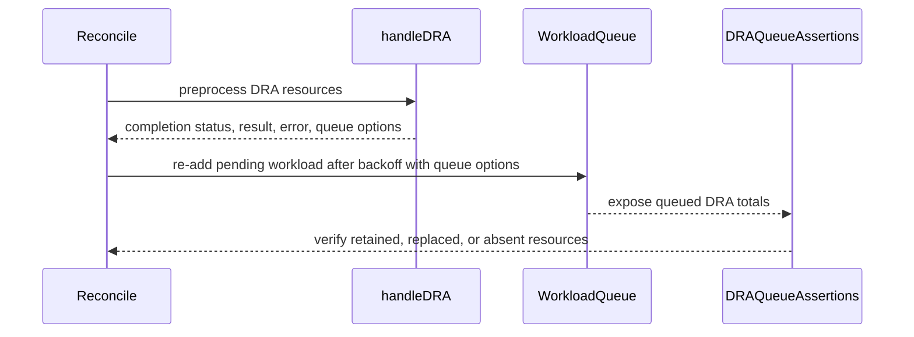

# PR #13967: Issue-13930 |  preserve DRA-preprocessed resources on backoff requeue…

**Summary**: Issue-13930 |  preserve DRA-preprocessed resources on backoff requeue…

**Sources**: https://github.com/kubernetes-sigs/kueue/pull/13967

**Last updated**: 2026-08-24T18:22:37Z

---

## Metadata

- **State**: open
- **Author**: [@vibhordubey333](https://github.com/vibhordubey333)
- **Branch**: `Bug/13930` → `main`
- **Created**: 2026-08-07T16:42:04Z
- **Updated**: 2026-08-24T18:22:37Z
- **Merged**: —
- **Closed**: —
- **Labels**: `kind/bug`, `release-note`, `size/L`, `ok-to-test`, `cncf-cla: yes`, `area/dra`
- **Assignees**: _none_
- **Requested reviewers**: [@mimowo](https://github.com/mimowo), [@mbobrovskyi](https://github.com/mbobrovskyi)
- **Changed files**: 3   **+175 / -24**

## Description

#### What type of PR is this?

/kind bug

#### What this PR does / why we need it:

When the alpha `KueueDRAIntegration` feature gate is enabled, `handleDRA` pre-computes a workload's DRA-backed resources and queues the workload with `workload.WithPreprocessedDRAResources(...)`, so the queued `Info` correctly reflects the workload's device/quota footprint.

If that same `Reconcile` call also handles a backoff-requeue for the workload (i.e. the workload's retry backoff timer has just elapsed), the requeue path calls `AddOrUpdateWorkload` again with **no** `InfoOption`s. Since `AddOrUpdateWorkload` always rebuilds the queued `Info` from scratch rather than merging with what's already there, this second call overwrites the correct DRA-adjusted entry with one built from the workload's raw pod-spec requests — silently dropping the DRA logical resources and leaving in any extended resources DRA was meant to replace.

This PR fixes it by having `handleDRA` return the `InfoOption`s it already computed, so `Reconcile` can pass the same options into the backoff-requeue `AddOrUpdateWorkload` call instead of dropping them.

#### Which issue(s) this PR fixes:
Fixes #13930

#### Special notes for your reviewer:

- The fix only changes what `AddOrUpdateWorkload` is called with at the backoff-requeue site; it does not change any admission/quota logic. For any workload that isn't simultaneously mid-DRA-preprocessing and past its backoff deadline in the same reconcile pass, the new `draQueueOptions` variable is `nil`, which is a no-op for the variadic call — behavior is unchanged.
- `handleDRA`'s return signature grew a 4th value (`queueOptions []workload.InfoOption`); all of its internal early-return branches (including the ones delegating to `markDRAInadmissible`) were updated accordingly.
- Added a regression test (`workload_controller_dra_test.go`) that sets an elapsed `RequeueState.RequeueAt` on a DRA `ResourceClaimTemplate` workload to exercise both code paths in one `Reconcile` call. Verified it fails on `main` before this fix (the DRA "gpu" resource is missing from the queued `Info`) and passes after.
- Verified with `make test` (full unit + envtest integration suite, no failures) and by running the `test/integration/singlecluster/controller/dra` and `.../controller/core` ginkgo suites directly against a real envtest control plane to confirm the reconciler logs show correct DRA/requeue behavior with no new errors.

#### Does this PR introduce a user-facing change?

```release-note
Fix a bug where a workload's DRA-preprocessed resource accounting could be lost when its backoff-requeue and DRA processing occurred in the same reconcile, causing the queue to fall back to raw pod-spec requests instead of the correct DRA-adjusted resources. Behind the alpha `KueueDRAIntegration` feature gate.
```

<!-- This is an auto-generated comment: release notes by coderabbit.ai -->
## Summary by CodeRabbit

* **Bug Fixes**
  * Improved queue handling for workloads using Dynamic Resource Allocation (DRA) after backoff and requeue.
  * Preserved DRA resource information when workloads are re-added, ensuring accurate queue accounting.
  * Corrected accounting for ResourceClaimTemplate resources and extended resources while retaining workload requests.
  * Improved recognition and validation of additional GPU device classes in DRA configurations.
<!-- end of auto-generated comment: release notes by coderabbit.ai -->

## Discussion

### Comment by [@netlify[bot]](https://github.com/apps/netlify) — 2026-08-07T16:42:09Z

### <span aria-hidden="true">✅</span> Deploy Preview for *kubernetes-sigs-kueue* canceled.


|  Name | Link |
|:-:|------------------------|
|<span aria-hidden="true">🔨</span> Latest commit | 9b3409b711172a010a78811fdd2f98eedd715528 |
|<span aria-hidden="true">🔍</span> Latest deploy log | https://app.netlify.com/projects/kubernetes-sigs-kueue/deploys/6a7c0eac3b65330008cc7a48 |

### Comment by [@kubernetes-prow[bot]](https://github.com/apps/kubernetes-prow) — 2026-08-07T16:42:14Z

Hi @vibhordubey333. Thanks for your PR.

I'm waiting for a [kubernetes-sigs](https://github.com/orgs/kubernetes-sigs/people) member to verify that this patch is reasonable to test. If it is, they should reply with `/ok-to-test` on its own line. Until that is done, I will not automatically test new commits in this PR, but the usual testing commands by org members will still work.

Regular contributors should [join the org](https://git.k8s.io/community/community-membership.md#member) to skip this step.

Once the patch is verified, the new status will be reflected by the `ok-to-test` label.

I understand the commands that are listed [here](https://go.k8s.io/bot-commands?repo=kubernetes-sigs%2Fkueue).

<details>

Instructions for interacting with me using PR comments are available [here](https://git.k8s.io/community/contributors/guide/pull-requests.md).  If you have questions or suggestions related to my behavior, please file an issue against the [kubernetes-sigs/prow](https://github.com/kubernetes-sigs/prow/issues/new?title=Prow%20issue:) repository.
</details>

### Comment by [@coderabbitai[bot]](https://github.com/apps/coderabbitai) — 2026-08-07T16:42:15Z

<!-- This is an auto-generated comment: summarize by coderabbit.ai -->
<!-- review_stack_entry_start -->

[](https://app.coderabbit.ai/change-stack/kubernetes-sigs/kueue/pull/13967?utm_source=github_walkthrough&utm_medium=github&utm_campaign=change_stack)

<!-- review_stack_entry_end -->
<!-- recent_review_start -->

No actionable comments were generated in the recent review. 🎉

<details>
<summary>ℹ️ Recent review info</summary>

<details>
<summary>⚙️ Run configuration</summary>

**Configuration used**: Path: .coderabbit.yaml

**Review profile**: CHILL

**Plan**: Pro Plus

**Run ID**: `cb3d2286-eb69-45fc-9b41-c36c4dd30bc6`

</details>

<details>
<summary>📥 Commits</summary>

Reviewing files that changed from the base of the PR and between f92bd6e7681639753668ada820bd63f997d58f80 and 9b3409b711172a010a78811fdd2f98eedd715528.

</details>

<details>
<summary>📒 Files selected for processing (3)</summary>

* `pkg/controller/core/workload_controller.go`
* `pkg/controller/core/workload_controller_dra_test.go`
* `pkg/controller/core/workload_controller_test.go`

</details>

<details>
<summary>🚧 Files skipped from review as they are similar to previous changes (2)</summary>

* pkg/controller/core/workload_controller.go
* pkg/controller/core/workload_controller_test.go

</details>

</details>

---


<!-- recent_review_end -->
<!-- walkthrough_start -->

<details>
<summary>📝 Walkthrough</summary>

## Walkthrough

DRA preprocessing now returns queue options with its result. `Reconcile` stores these options and reuses them when requeueing pending workloads after backoff. Tests verify DRA resource accounting for ResourceClaimTemplate and extended-resource workloads.

### Changes

**DRA queue requeue handling**

|Layer / File(s)|Summary|
|---|---|
|**Propagate DRA preprocessing options** <br> `pkg/controller/core/workload_controller.go`|`handleDRA` returns queue options across DRA success and error paths and passes them when initially queueing admissible workloads.|
|**Reuse options during backoff requeue** <br> `pkg/controller/core/workload_controller.go`|`Reconcile` captures DRA queue options and supplies them when re-adding pending workloads after backoff.|
|**Validate DRA queue accounting** <br> `pkg/controller/core/workload_controller_dra_test.go`, `pkg/controller/core/workload_controller_test.go`|Tests verify backoff processing, ResourceClaimTemplate accounting, extended-resource replacement, absent resources, mapper setup, and queue verification conditions.|

**Estimated code review effort:** 3 (Moderate) | ~20 minutes

### Sequence Diagram(s)



**Possibly related issues**

- `kubernetes-sigs/kueue#13930`: Describes the DRA queue-information loss addressed by preserving preprocessing options across backoff requeue.
- `kubernetes-sigs/kueue#14035`: Describes the DRA preprocessing and queue-options flow implemented by this change.

**Possibly related PRs**

- [kubernetes-sigs/kueue#11927](https://github.com/kubernetes-sigs/kueue/pull/11927): Both changes preserve DRA-derived workload resource requests during requeue handling.
- [kubernetes-sigs/kueue#13549](https://github.com/kubernetes-sigs/kueue/pull/13549): Both changes modify DRA handling and queue resource accounting in `workload_controller.go`.

**Suggested reviewers:** `mimowo`, `mbobrovskyi`

</details>

<!-- walkthrough_end -->
<!-- pre_merge_checks_walkthrough_start -->

<details>
<summary>🚥 Pre-merge checks | ✅ 5</summary>

<details>
<summary>✅ Passed checks (5 passed)</summary>

|         Check name         | Status   | Explanation                                                                                                               |
| :------------------------: | :------- | :------------------------------------------------------------------------------------------------------------------------ |
|      Description Check     | ✅ Passed | Check skipped - CodeRabbit’s high-level summary is enabled.                                                               |
|         Title check        | ✅ Passed | The title clearly identifies the issue and the main change: preserving DRA-preprocessed resources during backoff requeue. |
|     Docstring Coverage     | ✅ Passed | No functions found in the changed files to evaluate docstring coverage. Skipping docstring coverage check.                |
|     Linked Issues check    | ✅ Passed | Check skipped because no linked issues were found for this pull request.                                                  |
| Out of Scope Changes check | ✅ Passed | Check skipped because no linked issues were found for this pull request.                                                  |

</details>

</details>

<!-- pre_merge_checks_walkthrough_end -->
<!-- finishing_touch_checkbox_start -->

<details>
<summary>✨ Finishing Touches</summary>

<details>
<summary>🧪 Generate unit tests (beta)</summary>

- [ ] <!-- {"checkboxId": "f47ac10b-58cc-4372-a567-0e02b2c3d479", "radioGroupId": "utg-output-choice-group-unknown_comment_id"} -->   Create PR with unit tests

</details>

</details>

<!-- finishing_touch_checkbox_end -->
<!-- tips_start -->

---

Thanks for using [CodeRabbit](https://coderabbit.ai?utm_source=oss&utm_medium=github&utm_campaign=kubernetes-sigs/kueue&utm_content=13967)! It's free for OSS, and your support helps us grow. If you like it, consider giving us a shout-out.

<details>
<summary>❤️ Share</summary>

- [X](https://twitter.com/intent/tweet?text=I%20just%20used%20%40coderabbitai%20for%20my%20code%20review%2C%20and%20it%27s%20fantastic%21%20It%27s%20free%20for%20OSS%20and%20offers%20a%20free%20trial%20for%20the%20proprietary%20code.%20Check%20it%20out%3A&url=https%3A//coderabbit.ai)
- [Mastodon](https://mastodon.social/share?text=I%20just%20used%20%40coderabbitai%20for%20my%20code%20review%2C%20and%20it%27s%20fantastic%21%20It%27s%20free%20for%20OSS%20and%20offers%20a%20free%20trial%20for%20the%20proprietary%20code.%20Check%20it%20out%3A%20https%3A%2F%2Fcoderabbit.ai)
- [Reddit](https://www.reddit.com/submit?title=Great%20tool%20for%20code%20review%20-%20CodeRabbit&text=I%20just%20used%20CodeRabbit%20for%20my%20code%20review%2C%20and%20it%27s%20fantastic%21%20It%27s%20free%20for%20OSS%20and%20offers%20a%20free%20trial%20for%20proprietary%20code.%20Check%20it%20out%3A%20https%3A//coderabbit.ai)
- [LinkedIn](https://www.linkedin.com/sharing/share-offsite/?url=https%3A%2F%2Fcoderabbit.ai&mini=true&title=Great%20tool%20for%20code%20review%20-%20CodeRabbit&summary=I%20just%20used%20CodeRabbit%20for%20my%20code%20review%2C%20and%20it%27s%20fantastic%21%20It%27s%20free%20for%20OSS%20and%20offers%20a%20free%20trial%20for%20proprietary%20code)

</details>


<sub>Comment `@coderabbitai help` to get the list of available commands.</sub>

<!-- tips_end -->

### Comment by [@Vaishnav88sk](https://github.com/Vaishnav88sk) — 2026-08-07T17:07:02Z

/ok-to-test

### Comment by [@kubernetes-prow[bot]](https://github.com/apps/kubernetes-prow) — 2026-08-07T17:49:56Z

[APPROVALNOTIFIER] This PR is **NOT APPROVED**

This pull-request has been approved by: *<a href="https://github.com/kubernetes-sigs/kueue/pull/13967#" title="Author self-approved">vibhordubey333</a>*
**Once this PR has been reviewed and has the lgtm label**, please assign [sohankunkerkar](https://github.com/sohankunkerkar) for approval. For more information see [the Code Review Process](https://git.k8s.io/community/contributors/guide/owners.md#the-code-review-process).

The full list of commands accepted by this bot can be found [here](https://go.k8s.io/bot-commands?repo=kubernetes-sigs%2Fkueue).

<details open>
Needs approval from an approver in each of these files:

- **[OWNERS](https://github.com/kubernetes-sigs/kueue/blob/main/OWNERS)**

Approvers can indicate their approval by writing `/approve` in a comment
Approvers can cancel approval by writing `/approve cancel` in a comment
</details>
<!-- META={"approvers":["sohankunkerkar"]} -->

### Comment by [@sohankunkerkar](https://github.com/sohankunkerkar) — 2026-08-08T04:28:26Z

/area dra

### Comment by [@sohankunkerkar](https://github.com/sohankunkerkar) — 2026-08-08T04:55:55Z

@PannagaRao could you review this PR?

### Comment by [@thc1006](https://github.com/thc1006) — 2026-08-08T05:05:00Z

Thanks for picking this up. Your description matches what I see: 215 passes the options, 561 doesn't, and handleDRA returns done=false on success so the same reconcile reaches it.

Worth flagging that this bites harder when the devices come from a ResourceClaimTemplate. Those requests aren't in the pod spec at all, so the rebuild doesn't shrink the charge, it drops it entirely. I've made #13601 wait on this one.

### Comment by [@PannagaRao](https://github.com/PannagaRao) — 2026-08-09T00:12:14Z

> @PannagaRao could you review this PR?

Reviewed the fix - LGTM.

### Comment by [@sohankunkerkar](https://github.com/sohankunkerkar) — 2026-08-09T06:38:12Z

Thanks for working on this. The bug is real. One thing the PR doesn't cover: `handleDRA` clears conditions locally but doesn't persist them. When the backoff path runs `PatchAdmissionStatus` to clear RequeueAt, it overwrites the local wl   with the API server's version (DeepCopyInto back into the caller's pointer). So the cleared conditions get restored silently. The second `AddOrUpdateWorkload` then queues with both the wrong resources and the restored stale conditions.

Threading the options through fixes the resource loss, but I'd suggest also persisting the condition clearing in `handleDRA` so the backoff path doesn't restore stale conditions. That's already been flagged on #13549 and is part of #13969.

Filed https://github.com/kubernetes-sigs/kueue/issues/14035 for the longer-term refactor to a single queueing point.

### Comment by [@thc1006](https://github.com/thc1006) — 2026-08-09T08:50:06Z

@vibhordubey333 the line behind what @sohankunkerkar describes is `pkg/workload/patching/patching.go:266`. `patchStatus` works on `wlCopy := wl.DeepCopy()` and finishes with `wlCopy.DeepCopyInto(wl)`, so the caller's `wl` ends up holding whatever came back from the API server. It sits after both branches, the merge patch and the server-side apply, so it does not depend on `WorkloadRequestUseMergePatch` being on. Anything cleared in memory and never written is back once that returns.

On scope, since it may save you widening this one: KEP-2941 waits on #13930 for the resources half only. A restored condition does not change what the Workload is charged, and the prioritized-list envelope is about the charge, so this PR closes that prerequisite whether or not the condition clearing is persisted here or in #13969.

### Comment by [@thc1006](https://github.com/thc1006) — 2026-08-10T02:40:52Z

Two smaller things, so neither turns into work that is not needed.

On the thread above about `draQueueOptions` carrying state between reconciles: it cannot. The declaration is inside `Reconcile`, so every invocation starts from a nil slice, and a Workload that stops needing DRA processing on a later pass simply leaves it nil on that pass. There is nothing to reset, and adding a reset would only suggest to the next reader that there is.

On the regression test: asserting the logical DRA total after the backoff is half of it. A rebuild that adds the logical key while leaving the replaced extended-resource key behind is a double charge, and it would satisfy an assertion that only reads the logical one. Both halves say what the fix is for:

```go
got := queuedInfo.TotalRequests[podSet]
if got["gpu"] != 1 {
	t.Errorf(...)
}
if _, found := got["vendor.example/gpu"]; found {
	t.Errorf("the replaced extended resource is still charged after the backoff")
}
```

### Comment by [@linux-foundation-easycla[bot]](https://github.com/apps/linux-foundation-easycla) — 2026-08-10T08:40:09Z

<a href="https://easycla.lfx.linuxfoundation.org/#/?version=2"></a><br >The committers listed above are authorized under a signed CLA.<ul><li>:white_check_mark: login: vibhordubey333 / name: Vibhor Dubey (3935f3a466d8074b1b80052c4c2023b430803249, a23a9323879b0f85281ce458ddc8d9db05aeaffe)</li></ul>

### Comment by [@vibhordubey333](https://github.com/vibhordubey333) — 2026-08-10T08:40:18Z

Addressed review feedback:
- Added godoc on `handleDRA` for the `queueOptions` return contract
- Clarified `draQueueOptions` assignment (else branch when `done=false`)
- Added extended-resource backoff regression test asserting replaced extended resource is not double-charged

Verified locally:
- `TestReconcileDRA` (all cases, including new backoff tests)
- `TestReconcileRequeue`, `TestReconcileInadmissible`, `TestReconcileEviction`
- `pkg/controller/core` full package
- DRA + workload controller integration suites

Condition persistence deferred to #13969 per discussion with @sohankunkerkar and @thc1006.

/retest

### Comment by [@vibhordubey333](https://github.com/vibhordubey333) — 2026-08-10T08:41:11Z

@sohankunkerkar Thanks for the detailed analysis — you're right that `PatchAdmissionStatus` restores the API-server conditions via `DeepCopyInto` after `handleDRA` clears them in memory, so stale conditions can reappear on the backoff path.

I'm keeping this PR scoped to the resource-loss fix for #13930. Persisting the condition clearing belongs in #13969, and the single-queueing-point refactor is tracked in #14035. Happy to help on those follow-ups.

### Comment by [@vibhordubey333](https://github.com/vibhordubey333) — 2026-08-10T08:41:16Z

@thc1006 Agreed on both points.

On `draQueueOptions`: same reasoning — local to `Reconcile`, no cross-reconcile carry. I've adopted the clearer `else` assignment style from Vaishnav's suggestion without adding a reset that would imply otherwise.

On the test: added a backoff + extended-resource case that asserts both halves — logical `gpu` is charged and `example.com/gpu` is not. The existing ResourceClaimTemplate backoff test stays as the "DRA charge entirely absent from pod spec" case.

### Comment by [@sohankunkerkar](https://github.com/sohankunkerkar) — 2026-08-24T15:42:58Z

@vibhordubey333 Let me know when this PR is ready for review.

### Comment by [@vibhordubey333](https://github.com/vibhordubey333) — 2026-08-24T15:56:07Z

> @vibhordubey333 Let me know when this PR is ready for review.

@sohankunkerkar It is ready for review.

## Reviews

### Review by [@Vaishnav88sk](https://github.com/Vaishnav88sk) (changes_requested) — 2026-08-07T17:49:43Z

- **pkg/controller/core/workload_controller.go:545** by [@Vaishnav88sk](https://github.com/Vaishnav88sk) — 2026-08-07T17:45:23Z
```diff
@@ -520,8 +522,12 @@ func (r *WorkloadReconciler) Reconcile(ctx context.Context, req ctrl.Request) (r
 		}
 		return ctrl.Result{}, nil
 	}
+	var draQueueOptions []workload.InfoOption
 	if workload.Status(&wl) == workload.StatusPending && dra.NeedsDRAReconcile(&wl, r.draBackedResources) {
-		if done, result, err := r.handleDRA(ctx, &wl); done {
+		var done bool
+		var result ctrl.Result
+		var err error
+		if done, result, draQueueOptions, err = r.handleDRA(ctx, &wl); done {
 			return result, err
 		}
 	}
```

  `draQueueOptions` is declared once and only assigned when `handleDRA` is called. If a workload stops needing DRA reconcile between reconciles (e.g., DRA resources removed from spec), `draQueueOptions` still carries stale options from the previous reconcile. This would apply stale DRA-preprocessed resources to a workload that no longer has DRA.
  It shoul scope the assignment so it is only used when `handleDRA` actually runs:
  ```suggestion
  var draQueueOptions []workload.InfoOption
  if workload.Status(&wl) == workload.StatusPending && dra.NeedsDRAReconcile(&wl, r.draBackedResources) {
      if done, result, opts, err := r.handleDRA(ctx, &wl); done {
          return result, err
      } else {
          draQueueOptions = opts
      }
  }
  ```

- **pkg/controller/core/workload_controller.go:136** by [@Vaishnav88sk](https://github.com/Vaishnav88sk) — 2026-08-07T17:46:19Z
```diff
@@ -127,7 +127,7 @@ func (r *WorkloadReconciler) handleDRAConsumableCapacity(
 	return dra.MergeDRAResources(draResources, capacityResources), false, ctrl.Result{}, nil
 }
 
-func (r *WorkloadReconciler) handleDRA(ctx context.Context, wl *kueue.Workload) (done bool, result ctrl.Result, err error) {
+func (r *WorkloadReconciler) handleDRA(ctx context.Context, wl *kueue.Workload) (done bool, result ctrl.Result, queueOptions []workload.InfoOption, err error) {
```

  Now that handleDRA returns a 4th value (`queueOptions []workload.InfoOption`), a brief godoc comment would help future readers understand the contract, especially since 4-value returns are easy to misread at call sites.

### Review by [@vibhordubey333](https://github.com/vibhordubey333) (commented) — 2026-08-10T08:40:31Z

- **pkg/controller/core/workload_controller.go:545** by [@vibhordubey333](https://github.com/vibhordubey333) — 2026-08-10T08:40:31Z
```diff
@@ -520,8 +522,12 @@ func (r *WorkloadReconciler) Reconcile(ctx context.Context, req ctrl.Request) (r
 		}
 		return ctrl.Result{}, nil
 	}
+	var draQueueOptions []workload.InfoOption
 	if workload.Status(&wl) == workload.StatusPending && dra.NeedsDRAReconcile(&wl, r.draBackedResources) {
-		if done, result, err := r.handleDRA(ctx, &wl); done {
+		var done bool
+		var result ctrl.Result
+		var err error
+		if done, result, draQueueOptions, err = r.handleDRA(ctx, &wl); done {
 			return result, err
 		}
 	}
```

  Good catch on making the assignment intent clearer. I've updated the call site to only assign `draQueueOptions` in the `else` branch when `handleDRA` returns `done=false`.
  
  On cross-reconcile staleness: `draQueueOptions` is declared inside `Reconcile`, so each invocation starts as `nil`. If a workload stops needing DRA on a later reconcile, `NeedsDRAReconcile` is false and the variable stays `nil` for that pass — there's no state carried from a prior reconcile. (thc1006 also pointed this out on the main thread.)
  
  Thanks for the review.

### Review by [@vibhordubey333](https://github.com/vibhordubey333) (commented) — 2026-08-10T08:40:31Z

- **pkg/controller/core/workload_controller.go:136** by [@vibhordubey333](https://github.com/vibhordubey333) — 2026-08-10T08:40:31Z
```diff
@@ -127,7 +127,7 @@ func (r *WorkloadReconciler) handleDRAConsumableCapacity(
 	return dra.MergeDRAResources(draResources, capacityResources), false, ctrl.Result{}, nil
 }
 
-func (r *WorkloadReconciler) handleDRA(ctx context.Context, wl *kueue.Workload) (done bool, result ctrl.Result, err error) {
+func (r *WorkloadReconciler) handleDRA(ctx context.Context, wl *kueue.Workload) (done bool, result ctrl.Result, queueOptions []workload.InfoOption, err error) {
```

  Done — added a godoc on `handleDRA` documenting the `queueOptions` return value and when callers must forward it to `AddOrUpdateWorkload`.

### Review by [@sohankunkerkar](https://github.com/sohankunkerkar) (commented) — 2026-08-10T13:16:38Z

- **pkg/controller/core/workload_controller.go:224** by [@sohankunkerkar](https://github.com/sohankunkerkar) — 2026-08-10T13:16:38Z
```diff
@@ -206,23 +213,22 @@ func (r *WorkloadReconciler) handleDRA(ctx context.Context, wl *kueue.Workload)
 		log.V(3).Info("Cleared previous inadmissible conditions after successful DRA processing")
 	}
 
-	var queueOptions []workload.InfoOption
 	if len(draResources) > 0 || len(replacedExtendedResources) > 0 {
 		queueOptions = append(queueOptions, workload.WithPreprocessedDRAResources(draResources, replacedExtendedResources))
 	}
 
 	if workload.IsAdmissible(wl) {
```

  When backoff is expired, this queues the workload, then the backoff path at line 570 queues again after `PatchAdmissionStatus` overwrites wl. A `RequeueState.RequeueAt != nil` guard here would avoid the double-queue for the backoff case, but wouldn't fully resolve #14035 as other reconcile paths can still hit the same overwrite pattern as DRA grows.

### Review by [@vibhordubey333](https://github.com/vibhordubey333) (commented) — 2026-08-10T16:02:33Z

- **pkg/controller/core/workload_controller.go:224** by [@vibhordubey333](https://github.com/vibhordubey333) — 2026-08-10T16:02:33Z
```diff
@@ -206,23 +213,22 @@ func (r *WorkloadReconciler) handleDRA(ctx context.Context, wl *kueue.Workload)
 		log.V(3).Info("Cleared previous inadmissible conditions after successful DRA processing")
 	}
 
-	var queueOptions []workload.InfoOption
 	if len(draResources) > 0 || len(replacedExtendedResources) > 0 {
 		queueOptions = append(queueOptions, workload.WithPreprocessedDRAResources(draResources, replacedExtendedResources))
 	}
 
 	if workload.IsAdmissible(wl) {
```

  Thanks @sohankunkerkar for pointing it out. 
  @thc1006 Do you you want me to fix this issue as part of this PR or any plan to fix in [#14035 ](https://github.com/kubernetes-sigs/kueue/issues/14035) ?

### Review by [@thc1006](https://github.com/thc1006) (commented) — 2026-08-10T16:14:18Z

- **pkg/controller/core/workload_controller.go:224** by [@thc1006](https://github.com/thc1006) — 2026-08-10T16:14:18Z
```diff
@@ -206,23 +213,22 @@ func (r *WorkloadReconciler) handleDRA(ctx context.Context, wl *kueue.Workload)
 		log.V(3).Info("Cleared previous inadmissible conditions after successful DRA processing")
 	}
 
-	var queueOptions []workload.InfoOption
 	if len(draResources) > 0 || len(replacedExtendedResources) > 0 {
 		queueOptions = append(queueOptions, workload.WithPreprocessedDRAResources(draResources, replacedExtendedResources))
 	}
 
 	if workload.IsAdmissible(wl) {
```

  My view, and @sohankunkerkar should overrule it since he spotted this and owns #14035: do the narrow fix here and leave the refactor there. #14035 says it depends on #13969, so folding it in would stall a backoff fix behind a refactor that has its own prerequisite.
  
  Two things to be careful about while doing it.
  
  Skip only the `AddOrUpdateWorkload` call, not the preprocessing above it. The backoff path passes `draQueueOptions` to its own `AddOrUpdateWorkload`, so those options still have to be computed on this reconcile. Returning early from `handleDRA` would leave them empty and bring #13930 straight back, which is the bug this PR exists to fix.
  
  The guard is also wider than the set the backoff branch actually queues. Inside `if wl.Status.RequeueState != nil && wl.Status.RequeueState.RequeueAt != nil` there are two ways out that never reach a queue call: `*requeueAfter > 0` returns with a `RequeueAfter` because the backoff has not elapsed, and the queueing below only happens when `workload.Status(&wl) == workload.StatusPending`. A workload in either shape is queued by `handleDRA` today and would stop being queued. That may be right, since one is still waiting out its backoff, but it is a behaviour change rather than a no-op, so it is worth a case fixing which way it goes.
  
  Last small one: the closing line reads `Successfully pre-processed and queued DRA workload in scheduler`, which stops being true for whatever the guard skips.
  
  This comment was written in part with the assistance of generative AI. Bcuz my English might be sucks.

### Review by [@thc1006](https://github.com/thc1006) (commented) — 2026-08-10T16:31:41Z

- **pkg/controller/core/workload_controller.go:224** by [@thc1006](https://github.com/thc1006) — 2026-08-10T16:31:41Z
```diff
@@ -206,23 +213,22 @@ func (r *WorkloadReconciler) handleDRA(ctx context.Context, wl *kueue.Workload)
 		log.V(3).Info("Cleared previous inadmissible conditions after successful DRA processing")
 	}
 
-	var queueOptions []workload.InfoOption
 	if len(draResources) > 0 || len(replacedExtendedResources) > 0 {
 		queueOptions = append(queueOptions, workload.WithPreprocessedDRAResources(draResources, replacedExtendedResources))
 	}
 
 	if workload.IsAdmissible(wl) {
```

  Correction to my second point: only one of those two shapes actually changes.
  
  `workload.Status(&wl) != StatusPending` means finished, admitted, or holding a quota reservation, and each of those makes `IsAdmissible` false. So `handleDRA` already takes its `else` branch for them and puts the workload in the cache rather than the queue. The guard changes nothing there and it does not need a test.
  
  The one that does change is a workload whose backoff has not elapsed: it returns at `*requeueAfter > 0` before reaching any queue call, while `handleDRA` queues it today because it is pending and admissible. That is the case worth pinning.
  
  Sorry for the extra round. I had read those two blocks out of a filtered grep and joined them wrongly.
  
  This comment was written in part with the assistance of generative AI. Bcuz my English might be sucks.

### Review by [@vibhordubey333](https://github.com/vibhordubey333) (commented) — 2026-08-12T06:13:56Z

- **pkg/controller/core/workload_controller.go:224** by [@vibhordubey333](https://github.com/vibhordubey333) — 2026-08-12T06:13:56Z
```diff
@@ -206,23 +213,22 @@ func (r *WorkloadReconciler) handleDRA(ctx context.Context, wl *kueue.Workload)
 		log.V(3).Info("Cleared previous inadmissible conditions after successful DRA processing")
 	}
 
-	var queueOptions []workload.InfoOption
 	if len(draResources) > 0 || len(replacedExtendedResources) > 0 {
 		queueOptions = append(queueOptions, workload.WithPreprocessedDRAResources(draResources, replacedExtendedResources))
 	}
 
 	if workload.IsAdmissible(wl) {
```

  Thanks, agreed on the narrow fix here and leaving the single-queueing refactor to [14035](https://github.com/kubernetes-sigs/kueue/issues/14035)
  
  I'll add a RequeueState.RequeueAt != nil guard around only the AddOrUpdateWorkload call in handleDRA, keeping all preprocessing and queueOptions computation unchanged so the backoff path still receives draQueueOptions.
  
  On your correction: understood, non-pending workloads already go through the cache branch via IsAdmissible, so no extra test there. I'll add a case for a pending DRA workload whose backoff has not elapsed: handleDRA should preprocess and return options but not queue, and Reconcile should return RequeueAfter with zero workloads in the queue.
  
  I'll also split the closing log so it doesn't claim "queued" when the guard skips the queue call.

### Review by [@thc1006](https://github.com/thc1006) (commented) — 2026-08-24T18:22:37Z

Thanks for picking this up, and for the regression test. The `InfoOption` propagation is the right fix for #13930 and I could follow it end to end.

One thing I think has to change before this lands, and it is the `waitingForBackoff` guard rather than the propagation.

With `RequeueAt` in the future, `handleDRA` now skips the queue call, and the branch below returns `RequeueAfter` without queueing either. Nothing else covers it: `Create`, the pending-to-pending `Update` branch, and the immediate-requeue branch of the eviction transition all say "handled in Reconcile" for DRA workloads, and the last one only runs when `backoff <= 0` anyway.

On `main` that same workload reaches `PushOrUpdate`, where `backoffWaitingTimeExpired` is false and `insertInadmissible` runs, which calls `addPendingResources`. So today it sits in `inadmissibleWorkloads` with its pending resources counted and visible in the queue snapshot, and it is still not poppable. After this change it is absent from the queue manager altogether, which costs the accounting and the visibility without adding any scheduling protection.

`wantWorkloadsInQueue: new(0)` in "should preprocess but not queue" pins that shape. It also leaves the case unable to check the preprocessing it is named for, since there is no entry to read.

Would dropping the guard work? The elapsed path would queue twice, but both calls now carry `draQueueOptions`, so neither loses the footprint, and collapsing to one queueing point stays with #14035.

Two smaller things on the tests:

- `wantAbsentDRAResources` asserts `GetValue(resName) > 0`, so a key left behind at zero would pass. Converting `Requests` to a map and asserting the key is not present would pin the replacement instead.
- The elapsed case sets only `RequeueAt`. A real PodsReady or AdmissionCheck backoff also carries `Requeued=False`, and `backoffWaitingTimeExpired` returns false on that condition by itself. `PendingWorkloadsInfo` returns heap plus inadmissible plus inflight, so `len == 1` does not say which bucket the workload reached.

Separately, and not something I think belongs in this PR: `patchStatus` ends in `wlCopy.DeepCopyInto(wl)`, and controller-runtime's `PatchSubResource` decodes the response into the body, so after the status patch `wl` carries the persisted spec again. The RuntimeClass, LimitRange and limits-to-requests work `AdjustResources` did earlier in `handleDRA` is gone by the time the queue call runs, and `draQueueOptions` only restores the DRA part. `main` loses that too, and loses the DRA part on top, so this PR is strictly ahead. It seems worth its own issue rather than growing this one.

Last, the description and release note still say the alpha `KueueDRAIntegration` gate; it has been Beta and on by default since 0.18. And `make test` resolves to `go list ./... | grep -v '/test/'`, so it does not include the integration suite.
