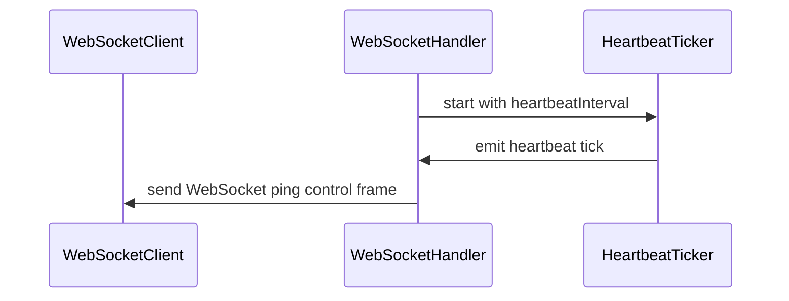

# PR #13970: kueueviz: add WebSocket heartbeat support

**Summary**: kueueviz: add WebSocket heartbeat support

**Sources**: https://github.com/kubernetes-sigs/kueue/pull/13970

**Last updated**: 2026-09-30T12:55:56Z

---

## Metadata

- **State**: closed (merged)
- **Author**: [@amirialy](https://github.com/amirialy)
- **Branch**: `feat/heartbeat-ws-kueueviz` → `main`
- **Created**: 2026-08-07T17:52:10Z
- **Updated**: 2026-09-30T12:55:56Z
- **Merged**: 2026-08-13T19:07:35Z
- **Closed**: 2026-08-13T19:07:35Z
- **Labels**: `kind/feature`, `release-note`, `size/L`, `lgtm`, `approved`, `ok-to-test`, `cncf-cla: yes`
- **Assignees**: [@tenzen-y](https://github.com/tenzen-y)
- **Requested reviewers**: [@akram](https://github.com/akram), [@mimowo](https://github.com/mimowo)
- **Changed files**: 3   **+96 / -9**

## Description

#### What type of PR is this?

/kind feature

#### What this PR does / why we need it:

Adds periodic WebSocket heartbeat pings to the KueueViz backend.

This change sends WebSocket ping control frames every 30 seconds to keep connections active. It also adds  a regression test verifying that heartbeat ping frames are sent.

#### Which issue(s) this PR fixes:

Fixes #13961

#### Special notes for your reviewer:

#### Does this PR introduce a user-facing change?

```release-note
KueueViz: The backend now sends WebSocket ping messages every 30 seconds, including when dashboard data has not changed.
```

<!-- This is an auto-generated comment: release notes by coderabbit.ai -->
## Summary by CodeRabbit

* **Bug Fixes**
  * Improved WebSocket connection reliability by sending periodic heartbeat signals.
  * Connections are now closed when heartbeat delivery fails.

* **Tests**
  * Added coverage verifying that heartbeat signals are sent over WebSocket connections.
<!-- end of auto-generated comment: release notes by coderabbit.ai -->

## Discussion

### Comment by [@netlify[bot]](https://github.com/apps/netlify) — 2026-08-07T17:52:17Z

### <span aria-hidden="true">✅</span> Deploy Preview for *kubernetes-sigs-kueue* canceled.


|  Name | Link |
|:-:|------------------------|
|<span aria-hidden="true">🔨</span> Latest commit | 41378af14a2fd16aaa0a74d0643ff6098774b561 |
|<span aria-hidden="true">🔍</span> Latest deploy log | https://app.netlify.com/projects/kubernetes-sigs-kueue/deploys/6a7c95f68f5e0c000809f0da |

### Comment by [@kubernetes-prow[bot]](https://github.com/apps/kubernetes-prow) — 2026-08-07T17:52:21Z

Hi @amirialy. Thanks for your PR.

I'm waiting for a [kubernetes-sigs](https://github.com/orgs/kubernetes-sigs/people) member to verify that this patch is reasonable to test. If it is, they should reply with `/ok-to-test` on its own line. Until that is done, I will not automatically test new commits in this PR, but the usual testing commands by org members will still work.

>[!TIP]
>**We noticed you've done this a few times! Consider [joining the org](https://git.k8s.io/community/community-membership.md#member) to skip this step and gain `/lgtm` and other bot rights.** We recommend asking approvers on your previous PRs to sponsor you.

Once the patch is verified, the new status will be reflected by the `ok-to-test` label.

I understand the commands that are listed [here](https://go.k8s.io/bot-commands?repo=kubernetes-sigs%2Fkueue).

<details>

Instructions for interacting with me using PR comments are available [here](https://git.k8s.io/community/contributors/guide/pull-requests.md).  If you have questions or suggestions related to my behavior, please file an issue against the [kubernetes-sigs/prow](https://github.com/kubernetes-sigs/prow/issues/new?title=Prow%20issue:) repository.
</details>

### Comment by [@coderabbitai[bot]](https://github.com/apps/coderabbitai) — 2026-08-07T17:52:36Z

<!-- This is an auto-generated comment: summarize by coderabbit.ai -->
<!-- review_stack_entry_start -->

[](https://app.coderabbit.ai/change-stack/kubernetes-sigs/kueue/pull/13970?utm_source=github_walkthrough&utm_medium=github&utm_campaign=change_stack)

<!-- review_stack_entry_end -->
<!-- recent_review_start -->

No actionable comments were generated in the recent review. 🎉

<details>
<summary>ℹ️ Recent review info</summary>

<details>
<summary>⚙️ Run configuration</summary>

**Configuration used**: Path: .coderabbit.yaml

**Review profile**: CHILL

**Plan**: Pro Plus

**Run ID**: `a4b39543-b9a5-4540-885f-175f9c4db7c5`

</details>

<details>
<summary>📥 Commits</summary>

Reviewing files that changed from the base of the PR and between 063be8c39353bf035302a1a963005d72db5ccd32 and 41378af14a2fd16aaa0a74d0643ff6098774b561.

</details>

<details>
<summary>📒 Files selected for processing (1)</summary>

* `cmd/kueueviz/backend/handlers/websocket_handler.go`

</details>

<details>
<summary>🚧 Files skipped from review as they are similar to previous changes (1)</summary>

* cmd/kueueviz/backend/handlers/websocket_handler.go

</details>

</details>

---


<!-- recent_review_end -->
<!-- walkthrough_start -->

<details>
<summary>📝 Walkthrough</summary>

## Walkthrough

The WebSocket handler now uses a 30-second default heartbeat interval, sends periodic ping control frames with write deadlines, and terminates the update loop after heartbeat failures. Tests construct handlers through `New` and verify heartbeat delivery.

### Changes

**WebSocket heartbeat**

|Layer / File(s)|Summary|
|---|---|
|**Heartbeat configuration and handler construction** <br> `cmd/kueueviz/backend/handlers/handlers.go`, `cmd/kueueviz/backend/handlers/websocket_handler_test.go`|`Handlers` initializes a 30-second heartbeat interval. Tests use `New` and configure shorter intervals where required.|
|**Heartbeat ticker and ping delivery** <br> `cmd/kueueviz/backend/handlers/websocket_handler.go`, `cmd/kueueviz/backend/handlers/websocket_handler_test.go`|The WebSocket update loop starts and stops a heartbeat ticker, sends ping control frames with a write deadline, logs failures, and exits after failed writes. Tests verify ping delivery.|

**Estimated code review effort:** 2 (Simple) | ~10 minutes

### Sequence Diagram(s)



**Suggested reviewers:** `akram`, `mimowo`

</details>

<!-- walkthrough_end -->
<!-- pre_merge_checks_walkthrough_start -->

<details>
<summary>🚥 Pre-merge checks | ✅ 5</summary>

<details>
<summary>✅ Passed checks (5 passed)</summary>

|         Check name         | Status   | Explanation                                                                                                                                |
| :------------------------: | :------- | :----------------------------------------------------------------------------------------------------------------------------------------- |
|     Linked Issues check    | ✅ Passed | The changes implement periodic WebSocket ping frames with a 30-second default interval and add a regression test, satisfying issue `#13961`. |
| Out of Scope Changes check | ✅ Passed | The code and test changes are directly related to implementing and verifying the requested WebSocket heartbeat support.                    |
|     Docstring Coverage     | ✅ Passed | No functions found in the changed files to evaluate docstring coverage. Skipping docstring coverage check.                                 |
|      Description Check     | ✅ Passed | Check skipped - CodeRabbit’s high-level summary is enabled.                                                                                |
|         Title check        | ✅ Passed | The title clearly and concisely describes the main change: adding WebSocket heartbeat support to KueueViz.                                 |

</details>

</details>

<!-- pre_merge_checks_walkthrough_end -->
<!-- finishing_touch_checkbox_start -->

<details>
<summary>✨ Finishing Touches</summary>

<details>
<summary>🧪 Generate unit tests (beta)</summary>

- [ ] <!-- {"checkboxId": "f47ac10b-58cc-4372-a567-0e02b2c3d479", "radioGroupId": "utg-output-choice-group-unknown_comment_id"} -->   Create PR with unit tests

</details>

</details>

<!-- finishing_touch_checkbox_end -->
<!-- tips_start -->

---

Thanks for using [CodeRabbit](https://coderabbit.ai?utm_source=oss&utm_medium=github&utm_campaign=kubernetes-sigs/kueue&utm_content=13970)! It's free for OSS, and your support helps us grow. If you like it, consider giving us a shout-out.

<details>
<summary>❤️ Share</summary>

- [X](https://twitter.com/intent/tweet?text=I%20just%20used%20%40coderabbitai%20for%20my%20code%20review%2C%20and%20it%27s%20fantastic%21%20It%27s%20free%20for%20OSS%20and%20offers%20a%20free%20trial%20for%20the%20proprietary%20code.%20Check%20it%20out%3A&url=https%3A//coderabbit.ai)
- [Mastodon](https://mastodon.social/share?text=I%20just%20used%20%40coderabbitai%20for%20my%20code%20review%2C%20and%20it%27s%20fantastic%21%20It%27s%20free%20for%20OSS%20and%20offers%20a%20free%20trial%20for%20the%20proprietary%20code.%20Check%20it%20out%3A%20https%3A%2F%2Fcoderabbit.ai)
- [Reddit](https://www.reddit.com/submit?title=Great%20tool%20for%20code%20review%20-%20CodeRabbit&text=I%20just%20used%20CodeRabbit%20for%20my%20code%20review%2C%20and%20it%27s%20fantastic%21%20It%27s%20free%20for%20OSS%20and%20offers%20a%20free%20trial%20for%20proprietary%20code.%20Check%20it%20out%3A%20https%3A//coderabbit.ai)
- [LinkedIn](https://www.linkedin.com/sharing/share-offsite/?url=https%3A%2F%2Fcoderabbit.ai&mini=true&title=Great%20tool%20for%20code%20review%20-%20CodeRabbit&summary=I%20just%20used%20CodeRabbit%20for%20my%20code%20review%2C%20and%20it%27s%20fantastic%21%20It%27s%20free%20for%20OSS%20and%20offers%20a%20free%20trial%20for%20proprietary%20code)

</details>


<sub>Comment `@coderabbitai help` to get the list of available commands.</sub>

<!-- tips_end -->

### Comment by [@tenzen-y](https://github.com/tenzen-y) — 2026-08-07T17:53:23Z

/ok-to-test

### Comment by [@mimowo](https://github.com/mimowo) — 2026-08-12T16:21:31Z

cc @danylott

### Comment by [@kubernetes-prow[bot]](https://github.com/apps/kubernetes-prow) — 2026-08-13T18:46:42Z

LGTM label has been added.  <details>Git tree hash: 9dc9dd3e22821cafe3ad490d2123620e863fdbb4</details>

### Comment by [@kubernetes-prow[bot]](https://github.com/apps/kubernetes-prow) — 2026-08-13T18:46:45Z

[APPROVALNOTIFIER] This PR is **APPROVED**

This pull-request has been approved by: *<a href="https://github.com/kubernetes-sigs/kueue/pull/13970#" title="Author self-approved">amirialy</a>*, *<a href="https://github.com/kubernetes-sigs/kueue/pull/13970#pullrequestreview-4926066622" title="Approved">danylott</a>*, *<a href="https://github.com/kubernetes-sigs/kueue/pull/13970#pullrequestreview-4930521578" title="Approved">tenzen-y</a>*

The full list of commands accepted by this bot can be found [here](https://go.k8s.io/bot-commands?repo=kubernetes-sigs%2Fkueue).

The pull request process is described [here](https://git.k8s.io/community/contributors/guide/owners.md#the-code-review-process)

<details >
Needs approval from an approver in each of these files:

- ~~[OWNERS](https://github.com/kubernetes-sigs/kueue/blob/main/OWNERS)~~ [tenzen-y]

Approvers can indicate their approval by writing `/approve` in a comment
Approvers can cancel approval by writing `/approve cancel` in a comment
</details>
<!-- META={"approvers":[]} -->

### Comment by [@tenzen-y](https://github.com/tenzen-y) — 2026-08-13T18:47:14Z

/release-note-edit

```release-note
KueurViz: support WebSocket heartbeat
```

### Comment by [@mimowo](https://github.com/mimowo) — 2026-09-30T12:55:53Z

/release-note-edit
```release-note
KueueViz: The backend now sends WebSocket ping messages every 30 seconds, including when dashboard data has not changed.
```

## Reviews

### Review by [@Vaishnav88sk](https://github.com/Vaishnav88sk) (changes_requested) — 2026-08-12T12:35:55Z

minor nits

- **cmd/kueueviz/backend/handlers/websocket_handler.go:213** by [@Vaishnav88sk](https://github.com/Vaishnav88sk) — 2026-08-12T12:34:49Z
```diff
@@ -210,6 +210,9 @@ func (h *Handlers) handleInformerUpdates(ctx context.Context, conn *websocket.Co
 		authTickerC = authTicker.C
 	}
 
+	heartbeatTicker := time.NewTicker(h.heartbeatInterval)
```

  guard `time.NewTicker(h.heartbeatInterval)` with `if h.heartbeatInterval > 0` to avoid a panic if unset outside `New`.

- **cmd/kueueviz/backend/handlers/websocket_handler.go:254** by [@Vaishnav88sk](https://github.com/Vaishnav88sk) — 2026-08-12T12:35:45Z
```diff
@@ -240,6 +243,16 @@ func (h *Handlers) handleInformerUpdates(ctx context.Context, conn *websocket.Co
 				slog.Error("Error sending update", "error", err)
 				return
 			}
+
+		case <-heartbeatTicker.C:
+			if err := conn.WriteControl(
```

  failed heartbeat does `return` (drops the conn). Fine, but consider `slog.Warn`/retry since a single transient write error closes the session.

### Review by [@amirialy](https://github.com/amirialy) (commented) — 2026-08-12T15:33:43Z

- **cmd/kueueviz/backend/handlers/websocket_handler.go:213** by [@amirialy](https://github.com/amirialy) — 2026-08-12T15:33:43Z
```diff
@@ -210,6 +210,9 @@ func (h *Handlers) handleInformerUpdates(ctx context.Context, conn *websocket.Co
 		authTickerC = authTicker.C
 	}
 
+	heartbeatTicker := time.NewTicker(h.heartbeatInterval)
```

  Good point.

### Review by [@danylott](https://github.com/danylott) (approved) — 2026-08-13T10:36:59Z

Implementation looks good, thanks!
LGTM

### Review by [@tenzen-y](https://github.com/tenzen-y) (commented) — 2026-08-13T18:46:34Z

Thank you!
/lgtm
/approve
