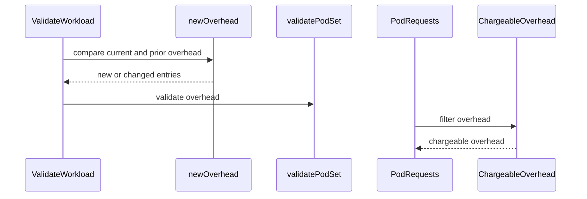

# PR #13995: Validate pod overhead, and charge only what can be charged

**Summary**: Validate pod overhead, and charge only what can be charged

**Sources**: https://github.com/kubernetes-sigs/kueue/pull/13995

**Last updated**: 2026-10-11T07:04:42Z

---

## Metadata

- **State**: closed
- **Author**: [@thc1006](https://github.com/thc1006)
- **Branch**: `fix/validate-podspec-overhead` → `main`
- **Created**: 2026-08-08T05:59:42Z
- **Updated**: 2026-10-11T07:04:42Z
- **Merged**: —
- **Closed**: 2026-10-11T07:03:17Z
- **Labels**: `kind/bug`, `size/XL`, `release-note-action-required`, `do-not-merge/work-in-progress`, `cncf-cla: yes`
- **Assignees**: _none_
- **Requested reviewers**: [@amy](https://github.com/amy), [@mimowo](https://github.com/mimowo), [@mbobrovskyi](https://github.com/mbobrovskyi), [@olekzabl](https://github.com/olekzabl)
- **Changed files**: 13   **+753 / -9**

## Description

#### What type of PR is this?

/kind bug

#### What this PR does / why we need it:

`validatePodSet` walks the init containers, the containers, and the pod-level resources:

```go
	// validate initContainers
	icPath := path.Child("template", "spec", "initContainers")
	...
	// validate containers
	cPath := path.Child("template", "spec", "containers")
	...
	// validate pod-level resources
	if ps.Template.Spec.Resources != nil {
```

It stops there, and `spec.overhead` is part of the charge. `PodRequests` calls `resourcehelpers.PodRequests` with a zero-valued options struct, so `ExcludeOverhead` is false and `component-helpers` adds it:

```go
	if !opts.ExcludeOverhead && pod.Spec.Overhead != nil {
		addResourceList(reqs, pod.Spec.Overhead)
	}
```

So overhead was the one place a quantity reached quota without passing the checks the rest of the PodSet's quantities pass. Two of them matter:

A negative overhead is subtracted from the request even with `WorkloadValidateResourcesAreNonNegative` enabled, and `Requests.FloorToZero` afterwards turns a large enough one into a clean zero. A container requesting `example.com/gpu: 1` alongside an overhead of `example.com/gpu: -1` reaches the queue at zero.

`pods`, which `validateResourceList` refuses in every list it does reach, was accepted in overhead. Flavor assignment replaces that key with the PodSet count, so the value is discarded rather than counted.

Sending overhead through `validateResourceList` closes both, each on the terms it already has: the reserved name unconditionally, the sign behind the feature gate.

##### What this leaves alone

Nothing else about overhead changes, and a PodSet without one is untouched. The reserved-name and non-negative rules are the existing ones; this only reaches them from a field that was missed.

#### Which issue(s) this PR fixes:

Fixes #13991

#### Special notes for your reviewer:

Refusing such an overhead on every update would strand the Workloads that already carry one. A reserved Workload with a `pods` overhead could not write a Finished condition, could not be deactivated, and could not drop its `resource-in-use` finalizer after a delete, since that removal is an Update; it would sit in Terminating still holding the quota, and `pods` has no gate to turn off. So the check reads what the request introduces rather than what the object already had, which is also the only thing a reserved Workload can change, its PodSets being immutable by then. `introducedOverhead` is that reading: an entry the old object carried at the same value is not the update's to answer for.

Letting it stay means it would keep being charged, so the accounting stops reading it. Before anything is summed, `resources.ChargeableOverhead` drops an overhead entry naming `pods` or holding a negative quantity: the first is written from the PodSet count during flavor assignment, and the second cancels a request the PodSet did make, which `FloorToZero` afterwards cannot tell apart from nothing having been asked for. A request of 1 with an overhead of -1 is charged 1 rather than 0, `pods: 8` leaves the count alone, and a positive overhead is still added. That also makes turning the gate off a way through a rollout, which it was not before: the gate only ever stopped the value arriving, never stopped it cancelling.

MultiKueue and ConcurrentAdmission are here because each builds a Workload by copying one. That copy is a create, so there is no earlier state for the webhook to ratchet against, and a parent only carrying a legacy entry would have its copy refused. Both take the same view the accounting reads, on a copy, so the source keeps what it is allowed to keep and the comparison against a remote does not churn on a difference neither side can act on.

The two halves of an admitted Workload are treated differently on purpose. Its quota reservation stays at the figure recorded when it was granted, because re-charging a Workload that already holds one is not this PR's to do. Its topology usage does not, because leaving TAS on the old figure would have it go on believing a node has room the Pods are not using.

The same trap exists for the container and pod-level lists this sits beside, which refuse an unchanged legacy value on every update today. That is worth deciding separately rather than copying.

Tests, by what they pin. The webhook table has the create side, a negative overhead refused with the gate on and accepted with it off, `pods` refused either way, an ordinary overhead accepted, and the update side, a reserved Workload keeping a `pods` or a negative entry it does not change, removing one, adding a `pods` entry before reserving, changing a negative entry to another negative one, and the gate letting a reserved Workload keep a negative one. `TestPodRequests` has the three charge rows, `TestNewInfo` the same three through a Workload plus a TAS Workload admitted with a legacy overhead, and the effective-resource test a RuntimeClass beside entries that are not charged. `TestGenerateVariant` covers the ConcurrentAdmission copy, `TestCloneForCreateAndRemoteSync` the MultiKueue one, and two `TestWlReconcile` cases drive a scaled-down elastic Workload whose local copy carries a `pods` or a negative overhead through the remote sync.

In the webhook integration suite, a negative overhead and one naming `pods` join the existing table of refused resource lists, and one spec creates a Workload with a negative overhead while the gate is off, turns the gate on, is refused when it changes the entry to another negative value, is allowed an update that leaves it alone, and is deactivated once it holds a reservation. That last step is the reason for the ratchet, and it is the one a unit test on `validatePodSet` cannot show: what decides it is the webhook being registered on the update.

The `pods` half of the ratchet has no integration case and cannot have one. Its refusal has no gate, so once this lands no such Workload can be created through the API and only an object that predates it can carry one. That half stays in the unit tests.

A Workload the webhook refuses leaves the Job that produced it without an event, the same as any other spec it refuses today, so an operator sees a Job that does not start rather than a reason. This adds a way to reach that, it does not add the behaviour, and improving it belongs with the rest of that path rather than here.

This is the remaining resource list on a Workload that was not passed through `validateResourceList`. It is not the last thing between a quantity and a DRA logical resource: #14004 shows a positive, validated overhead being deleted with the key it shares. #13985 and #13988 cover the two an administrator can supply through configuration; this is the one a user can put on a Workload.

Rebased on 30 September and squashed to one commit.

#### Does this PR introduce a user-facing change?

```release-note
Workload: Fixed a bug where `spec.podSets[].template.spec.overhead` was charged without validation, so a negative entry could cancel a container's request and an entry named `pods` was accepted. Overhead is now validated like the other resource lists, and an entry that cannot be charged is left out of the charge.

ACTION REQUIRED: If a Workload already carries a negative or `pods` overhead, it keeps it and can still be updated, deactivated and deleted, but introducing or changing such an entry is rejected. In MultiKueue, upgrade manager clusters before workers, since an older manager sends the entry unchanged to a worker that now validates creates. A Workload holding a quota reservation keeps the usage recorded in its `status.admission` until that reservation is released.
```

#### AI usage

This PR was written in part with the assistance of generative AI. I have reviewed and tested every change myself.

## Discussion

### Comment by [@kubernetes-prow[bot]](https://github.com/apps/kubernetes-prow) — 2026-08-08T05:59:45Z

Skipping CI for Draft Pull Request.
If you want CI signal for your change, please convert it to an actual PR.
You can still manually trigger a test run with `/test all`

### Comment by [@netlify[bot]](https://github.com/apps/netlify) — 2026-08-08T05:59:48Z

### <span aria-hidden="true">✅</span> Deploy Preview for *kubernetes-sigs-kueue* canceled.


|  Name | Link |
|:-:|------------------------|
|<span aria-hidden="true">🔨</span> Latest commit | b58a6f8aab168cdd3a923c5754fb4436b926fbc1 |
|<span aria-hidden="true">🔍</span> Latest deploy log | https://app.netlify.com/projects/kubernetes-sigs-kueue/deploys/6abd286c4c3b170008213992 |

### Comment by [@coderabbitai[bot]](https://github.com/apps/coderabbitai) — 2026-08-08T05:59:50Z

<!-- This is an auto-generated comment: summarize by coderabbit.ai -->
<!-- review_stack_entry_start -->

[](https://app.coderabbit.ai/change-stack/kubernetes-sigs/kueue/pull/13995?utm_source=github_walkthrough&utm_medium=github&utm_campaign=change_stack)

<!-- review_stack_entry_end -->
<!-- This is an auto-generated comment: review paused by coderabbit.ai -->

> [!NOTE]
> ## Reviews paused
> 
> It looks like this branch is under active development. To avoid overwhelming you with review comments due to an influx of new commits, CodeRabbit has automatically paused this review. You can configure this behavior by changing the `reviews.auto_review.auto_pause_after_reviewed_commits` setting.
> 
> Use the following commands to manage reviews:
> - `@coderabbitai resume` to resume automatic reviews.
> - `@coderabbitai review` to trigger a single review.
> 
> Use the checkboxes below for quick actions:
> - [ ] <!-- {"checkboxId": "7f6cc2e2-2e4e-497a-8c31-c9e4573e93d1"} --> ▶️ Resume reviews
> - [ ] <!-- {"checkboxId": "e9bb8d72-00e8-4f67-9cb2-caf3b22574fe"} --> 🔍 Trigger review

<!-- end of auto-generated comment: review paused by coderabbit.ai -->
<!-- walkthrough_start -->

<details>
<summary>📝 Walkthrough</summary>

## Walkthrough

Pod overhead validation now covers creation and updates. Resource accounting filters negative and pod-count overhead while charging positive overhead. MultiKueue normalizes overhead before comparison and remote workload creation.

### Changes

**Pod overhead handling**

|Layer / File(s)|Summary|
|---|---|
|**Validate pod overhead changes** <br> `pkg/features/kube_features.go`, `pkg/webhooks/workload_webhook.go`, `pkg/webhooks/workload_webhook_test.go`|Validation compares current overhead with prior overhead during updates. It rejects new or changed invalid entries and covers reserved keys, feature-gated negative values, and lifecycle exceptions.|
|**Normalize overhead for resource accounting** <br> `pkg/resources/...`, `pkg/workload/...`|Request helpers filter negative and pod-count overhead. Positive overhead remains included in total requests. Tests cover filtering, immutability, RuntimeClass handling, and request consistency.|
|**Normalize remote workload overhead** <br> `pkg/controller/admissionchecks/multikueue/workload.go`, `pkg/controller/admissionchecks/multikueue/workload_test.go`|Remote workload comparison and creation remove non-chargeable overhead from copied PodSets. Tests cover charged and uncharged overhead changes.|

**Estimated code review effort:** 3 (Moderate) | ~25 minutes

### Sequence Diagram(s)



**Possibly related PRs**

- [kubernetes-sigs/kueue#12838](https://github.com/kubernetes-sigs/kueue/pull/12838): Modifies related workload resource validation and accounting paths.
- [kubernetes-sigs/kueue#13014](https://github.com/kubernetes-sigs/kueue/pull/13014): Modifies shared workload resource accounting through `resources.NewRequestsFromPodSpec`.

**Suggested reviewers:** `mimowo`, `mbobrovskyi`, `olekzabl`

</details>

<!-- walkthrough_end -->
<!-- pre_merge_checks_walkthrough_start -->

<details>
<summary>🚥 Pre-merge checks | ✅ 4 | ❌ 1</summary>

### ❌ Failed checks (1 warning)

|     Check name     | Status     | Explanation                                                                           | Resolution                                                                         |
| :----------------: | :--------- | :------------------------------------------------------------------------------------ | :--------------------------------------------------------------------------------- |
| Docstring Coverage | ⚠️ Warning | Docstring coverage is 50.00% which is insufficient. The required threshold is 80.00%. | Write docstrings for the functions missing them to satisfy the coverage threshold. |

<details>
<summary>✅ Passed checks (4 passed)</summary>

|         Check name         | Status   | Explanation                                                                                                                                    |
| :------------------------: | :------- | :--------------------------------------------------------------------------------------------------------------------------------------------- |
|     Linked Issues check    | ✅ Passed | The changes satisfy issue `#13991` by validating overhead and preventing negative overhead from reducing charged workload resources.             |
| Out of Scope Changes check | ✅ Passed | The accounting, update handling, RuntimeClass behavior, and tests directly support overhead validation and its resource-charging requirements. |
|      Description Check     | ✅ Passed | Check skipped - CodeRabbit’s high-level summary is enabled.                                                                                    |
|         Title check        | ✅ Passed | The title clearly summarizes the main changes: pod overhead validation and charging only chargeable overhead.                                  |

</details>

</details>

<!-- pre_merge_checks_walkthrough_end -->

- [ ] <!-- {"checkboxId":"585bb3f6-faf5-4dbf-96d2-74e382adf19a"} --> Fix all pre-merge checks with AI
<!-- finishing_touch_checkbox_start -->

<details>
<summary>✨ Finishing Touches</summary>

<details>
<summary>🧪 Generate unit tests (beta)</summary>

- [ ] <!-- {"checkboxId": "f47ac10b-58cc-4372-a567-0e02b2c3d479", "radioGroupId": "utg-output-choice-group-unknown_comment_id"} -->   Create PR with unit tests

</details>

</details>

<!-- finishing_touch_checkbox_end -->
<!-- tips_start -->

---


<sub>Comment `@coderabbitai help` to get the list of available commands.</sub>

<!-- tips_end -->

### Comment by [@kubernetes-prow[bot]](https://github.com/apps/kubernetes-prow) — 2026-08-08T06:00:01Z

[APPROVALNOTIFIER] This PR is **NOT APPROVED**

This pull-request has been approved by: *<a href="https://github.com/kubernetes-sigs/kueue/pull/13995#" title="Author self-approved">thc1006</a>*
**Once this PR has been reviewed and has the lgtm label**, please assign [mbobrovskyi](https://github.com/mbobrovskyi), [mimowo](https://github.com/mimowo) for approval. For more information see [the Code Review Process](https://git.k8s.io/community/contributors/guide/owners.md#the-code-review-process).

The full list of commands accepted by this bot can be found [here](https://go.k8s.io/bot-commands?repo=kubernetes-sigs%2Fkueue).

<details open>
Needs approval from an approver in each of these files:

- **[OWNERS](https://github.com/kubernetes-sigs/kueue/blob/main/OWNERS)**

Approvers can indicate their approval by writing `/approve` in a comment
Approvers can cancel approval by writing `/approve cancel` in a comment
</details>
<!-- META={"approvers":["mbobrovskyi","mimowo"]} -->

### Comment by [@thc1006](https://github.com/thc1006) — 2026-08-08T14:00:13Z

/test pull-kueue-verify-main

### Comment by [@thc1006](https://github.com/thc1006) — 2026-08-12T18:18:19Z

/test pull-kueue-verify-main

### Comment by [@thc1006](https://github.com/thc1006) — 2026-10-11T07:03:16Z

Closing for now because of the open PR limit. `validatePodSet` on main still skips `spec.overhead` and `PodRequests` adds it as is, so #13991 stays open.

## Reviews

### Review by [@coderabbitai[bot]](https://github.com/apps/coderabbitai) (commented) — 2026-08-08T15:04:43Z

**Actionable comments posted: 1**

<details>
<summary>🤖 Prompt for all review comments with AI agents</summary>

```
Verify each finding against current code. Fix only still-valid issues, skip the
rest with a brief reason, keep changes minimal, and validate.

Inline comments:
In `@pkg/controller/admissionchecks/multikueue/workload.go`:
- Around line 675-705: Add tests covering cloneForCreate and
isRemoteSpecOutOfSync with overhead requiring normalization, verifying creation
is marked out of sync only when normalized overhead differs from the previous
remote Workload. Also cover already-normalized and normalization-equivalent
overhead cases to ensure they do not cause out-of-sync churn.
```

</details>

<details>
<summary>🪄 Autofix</summary>

Fix all unresolved CodeRabbit comments on this PR:

- [ ] <!-- {"checkboxId": "4b0d0e0a-96d7-4f10-b296-3a18ea78f0b9"} --> Push a commit to this branch (recommended)
- [ ] <!-- {"checkboxId": "ff5b1114-7d8c-49e6-8ac1-43f82af23a33"} --> Create a new PR with the fixes

</details>

---

<details>
<summary>ℹ️ Review info</summary>

<details>
<summary>⚙️ Run configuration</summary>

**Configuration used**: Path: .coderabbit.yaml

**Review profile**: CHILL

**Plan**: Pro Plus

**Run ID**: `16d43753-f651-4573-a142-811939d75e9a`

</details>

<details>
<summary>📥 Commits</summary>

Reviewing files that changed from the base of the PR and between 978657c8464caf596d0b6a84671801b18c0a7ee1 and 01454feddcea34769fbe3f45ca4f3614c5d2e015.

</details>

<details>
<summary>📒 Files selected for processing (7)</summary>

* `pkg/controller/admissionchecks/multikueue/workload.go`
* `pkg/resources/factory.go`
* `pkg/resources/requests.go`
* `pkg/resources/requests_test.go`
* `pkg/webhooks/workload_webhook_test.go`
* `pkg/workload/resources.go`
* `pkg/workload/workload.go`

</details>

<details>
<summary>🚧 Files skipped from review as they are similar to previous changes (1)</summary>

* pkg/webhooks/workload_webhook_test.go

</details>

</details>

<!-- This is an auto-generated comment by CodeRabbit for review status -->

- **pkg/controller/admissionchecks/multikueue/workload.go:705** by [@coderabbitai[bot]](https://github.com/apps/coderabbitai) — 2026-08-08T15:04:40Z
```diff
@@ -668,9 +669,41 @@ func isRemoteSpecOutOfSync(local, remote kueue.WorkloadSpec) bool {
 	// so any differences should not be considered as out-of-sync.
 	local.PreemptionGates = nil
 	remote.PreemptionGates = nil
+	// The remote was created without the overhead entries that are not charged,
+	// so compare what both sides would carry rather than deleting and recreating
+	// it on every pass.
+	local.PodSets = podSetsWithChargeableOverhead(local.PodSets)
+	remote.PodSets = podSetsWithChargeableOverhead(remote.PodSets)
 	return !equality.Semantic.DeepEqual(local, remote)
 }
 
+// chargeableOverhead rewrites the overhead in place, for PodSets that are
+// already a copy.
+func chargeableOverhead(podSets []kueue.PodSet) {
+	for i := range podSets {
+		podSets[i].Template.Spec.Overhead = resources.ChargeableOverhead(podSets[i].Template.Spec.Overhead)
+	}
+}
+
+// podSetsWithChargeableOverhead returns podSets, or a shallow copy of it whose
+// overhead is the chargeable part, leaving the caller's slice alone.
+func podSetsWithChargeableOverhead(podSets []kueue.PodSet) []kueue.PodSet {
+	changed := false
+	out := make([]kueue.PodSet, len(podSets))
+	copy(out, podSets)
+	for i := range out {
+		charged := resources.ChargeableOverhead(out[i].Template.Spec.Overhead)
+		if len(charged) != len(out[i].Template.Spec.Overhead) {
+			changed = true
+			out[i].Template.Spec.Overhead = charged
+		}
+	}
+	if !changed {
+		return podSets
+	}
+	return out
+}
```

  _🎯 Functional Correctness_ | _🟡 Minor_ | _⚡ Quick win_
  
  <details>
  <summary>🧩 Analysis chain</summary>
  
  🏁 Script executed:
  
  ```shell
  #!/bin/bash
  set -euo pipefail
  
  ast-grep outline pkg/controller/admissionchecks/multikueue/workload_test.go \
    --items all --type function
  
  rg -n -C 5 \
    'isRemoteSpecOutOfSync|cloneForCreate|PodSets|Overhead|ResourcePods|MustParse\("-' \
    pkg/controller/admissionchecks/multikueue/workload_test.go
  
  rg --files -g '*_test.go' | rg '(^pkg/controller/admissionchecks/multikueue/|^test/integration/)' \
    | xargs -r rg -n -C 3 \
      'MultiKueue|isRemoteSpecOutOfSync|cloneForCreate|Overhead|ResourcePods'
  ```
  
  Repository: kubernetes-sigs/kueue
  
  Length of output: 50378
  
  ---
  
  🏁 Script executed:
  
  ```shell
  #!/bin/bash
  set -euo pipefail
  
  echo "## relevant workload.go functions"
  ast-grep outline pkg/controller/admissionchecks/multikueue/workload.go \
    --items all --type function \
    | rg -n 'cloneForCreate|podSetsWithChargeableOverhead|chargeableOverhead|isRemoteSpecOutOfSync|Remote|Remote' \
    || true
  
  echo
  echo "## relevant occurrences in workload.go"
  rg -n -C 4 \
    'func (cloneForCreate|podSetsWithChargeableOverhead|chargeableOverhead|isRemoteSpecOutOfSync|.*Remote.*)|podSetsWithChargeableOverhead|isRemoteSpecOutOfSync|chargeableOverhead|createRemoteWorkload|Remote' \
    pkg/controller/admissionchecks/multikueue/workload.go
  
  echo
  echo "## exact matches in pkg/controller/admissionchecks/multikueue tests"
  python3 - <<'PY'
  import os, re, glob
  targets = ['isRemoteSpecOutOfSync','cloneForCreate','podSetsWithChargeableOverhead','chargeableOverhead','ResourcePods',
             'Overhead']
  pat = re.compile(r'\b('+'|'.join(re.escape(t) for t in targets)+r')\b')
  for path in glob.glob('pkg/controller/admissionchecks/multikueue/*test.go'):
      if 'workload' not in path.lower():
          continue
      hits=[]
      for i,line in enumerate(open(path),1):
          if pat.search(line):
              hits.append((i,line.rstrip()))
      if hits:
          print(f'### {path}')
          for i,line in hits[:20]:
              print(f'{i}: {line}')
          if len(hits)>20:
              print(f'... {len(hits)-20} more hits')
  PY
  
  echo
  echo "## focused integration references excluding resource-heavy test fixtures"
  python3 - <<'PY'
  import os, glob, re
  pat = re.compile(r'(isRemoteSpecOutOfSync|cloneForCreate|podSetsWithChargeableOverhead|chargeableOverhead)\b')
  for path in glob.glob('test/integration/**/*.go', recursive=True):
      hits=[]
      for i,line in enumerate(open(path),1):
          if pat.search(line):
              hits.append((i,line.rstrip()))
      if hits:
          print(f'### {path}')
          for i,line in hits:
              print(f'{i}: {line}')
  PY
  ```
  
  Repository: kubernetes-sigs/kueue
  
  Length of output: 17193
  
  ---
  
  
  
  </details>
  
  **Cover normalized remote Workload creation behavior.**
  
  `cloneForCreate` applies normalized overhead, while `isRemoteSpecOutOfSync` compares only normalized overhead. Add unit/integration coverage that checks Workloads creating as out of sync only when the normalized overhead differs from previous remote overhead, and cases where normalization causes no out-of-sync churn.
  
  <details>
  <summary>🤖 Prompt for AI Agents</summary>
  
  ```
  Verify each finding against current code. Fix only still-valid issues, skip the
  rest with a brief reason, keep changes minimal, and validate.
  
  In `@pkg/controller/admissionchecks/multikueue/workload.go` around lines 675 -
  705, Add tests covering cloneForCreate and isRemoteSpecOutOfSync with overhead
  requiring normalization, verifying creation is marked out of sync only when
  normalized overhead differs from the previous remote Workload. Also cover
  already-normalized and normalization-equivalent overhead cases to ensure they do
  not cause out-of-sync churn.
  ```
  
  </details>
  
  <!-- fingerprinting:phantom:poseidon:tapir -->
  
  <!-- cr-indicator-types:potential_issue -->
  
  <!-- cr-comment:v1:920ea0a29f829e335142e5ad -->
  
  _Source: Path instructions_
  
  <!-- This is an auto-generated comment by CodeRabbit -->
  
  ✅ Addressed in commit 8dfe5fa
