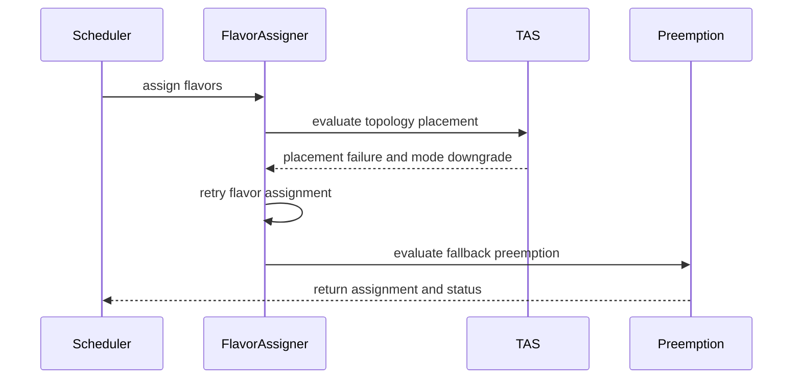

# PR #14008: Fix TAS flavor fallback by recomputing workload assignment

**Summary**: Fix TAS flavor fallback by recomputing workload assignment

**Sources**: https://github.com/kubernetes-sigs/kueue/pull/14008

**Last updated**: 2026-10-16T17:44:28Z

---

## Metadata

- **State**: open
- **Author**: [@qiujiaro](https://github.com/qiujiaro)
- **Branch**: `issue-10824-lazy-tas` → `main`
- **Created**: 2026-08-08T10:45:33Z
- **Updated**: 2026-10-16T17:44:28Z
- **Merged**: —
- **Closed**: —
- **Labels**: `kind/bug`, `size/XL`, `ok-to-test`, `do-not-merge/release-note-label-needed`, `cncf-cla: yes`, `area/tas`
- **Assignees**: [@amy](https://github.com/amy)
- **Requested reviewers**: [@amy](https://github.com/amy), [@mimowo](https://github.com/mimowo), [@kshalot](https://github.com/kshalot), [@PBundyra](https://github.com/PBundyra)
- **Changed files**: 3   **+653 / -63**

## Description

#### What type of PR is this?

/kind bug
/area tas

#### What this PR does / why we need it:

When flavor fungibility is configured with `WhenCanPreempt: TryNextFlavor`, quota assignment can select a flavor that fits quota but later fails TAS placement.

Previously, the failed TAS result only changed the mode of the existing assignment to `Preempt` or `NoFit`. Flavor assignment was not recalculated, so Kueue could miss another viable flavor.

This PR:

- Records TAS failures as monotonic flavor downgrades: `Fit -> Preempt -> NoFit`.
- Recomputes the complete workload flavor assignment after a TAS downgrade.
- Recalculates quota usage, borrowing, and preemption for every PodSet group.
- Applies a TAS flavor downgrade consistently across resource groups in the same PodSet group.
- Supports workloads containing multiple PodSets and multiple resource groups.
- Preserves the status message associated with the selected flavor.

Recomputing the complete workload prevents stale quota accounting when an earlier PodSet changes flavor and avoids assigning multiple incompatible TAS flavors to one PodSet.

The retry loop terminates because each PodSet/flavor state can only move toward `NoFit`.

Tests cover:

- Falling back to a preemptible flavor after a quota-fit flavor fails TAS.
- Consistent fallback across multiple resource groups.
- Recomputing quota for later PodSets after an earlier PodSet changes flavor.
- Existing TAS preemption scenarios across the scheduler test matrix.

AI tools were used to assist with coding.

#### Which issue(s) this PR fixes:

Fixes #10824 

#### Special notes for your reviewer:

The implementation intentionally reruns the complete workload flavor assignment instead of caching full per-resource-group candidates. This ensures that quota usage remains consistent across PodSets after a TAS-driven flavor change.

#### Does this PR introduce a user-facing change?

No

```release-note
Fixed TAS flavor fallback so that Kueue can try alternative resource flavors after topology placement fails.

<!-- This is an auto-generated comment: release notes by coderabbit.ai -->
## Summary by CodeRabbit

* **Bug Fixes**
  * Improved scheduling when topology-aware constraints reject a flavor by retrying suitable alternatives.
  * Preserved and surfaced relevant topology failure reasons and assignment status.
  * Improved preemption decisions so lower-priority workloads are evicted only after fallback flavors are evaluated.
  * Recomputed quota correctly across subsequent workload groups when flavor fallback occurs.
  * Improved handling of grouped workloads during topology-aware flavor downgrades.
<!-- end of auto-generated comment: release notes by coderabbit.ai -->

## Discussion

### Comment by [@kubernetes-prow[bot]](https://github.com/apps/kubernetes-prow) — 2026-08-08T10:45:36Z

Adding the "do-not-merge/release-note-label-needed" label because no release-note block was detected, please follow our [release note process](https://git.k8s.io/community/contributors/guide/release-notes.md) to remove it.

<details>

Instructions for interacting with me using PR comments are available [here](https://git.k8s.io/community/contributors/guide/pull-requests.md).  If you have questions or suggestions related to my behavior, please file an issue against the [kubernetes-sigs/prow](https://github.com/kubernetes-sigs/prow/issues/new?title=Prow%20issue:) repository.
</details>

### Comment by [@netlify[bot]](https://github.com/apps/netlify) — 2026-08-08T10:45:39Z

### <span aria-hidden="true">✅</span> Deploy Preview for *kubernetes-sigs-kueue* ready!


|  Name | Link |
|:-:|------------------------|
|<span aria-hidden="true">🔨</span> Latest commit | 626ecd695972f0bc5aa254ef8b4181e308f4be88 |
|<span aria-hidden="true">🔍</span> Latest deploy log | https://app.netlify.com/projects/kubernetes-sigs-kueue/deploys/6a7928c2571d9900089b3d2f |
|<span aria-hidden="true">😎</span> Deploy Preview | [https://deploy-preview-14008--kubernetes-sigs-kueue.netlify.app](https://deploy-preview-14008--kubernetes-sigs-kueue.netlify.app) |
|<span aria-hidden="true">📱</span> Preview on mobile | <details><summary> Toggle QR Code... </summary><br /><br /><br /><br />_Use your smartphone camera to open QR code link._</details> |
---
<!-- [kubernetes-sigs-kueue Preview](https://deploy-preview-14008--kubernetes-sigs-kueue.netlify.app) -->
_To edit notification comments on pull requests, go to your [Netlify project configuration](https://app.netlify.com/projects/kubernetes-sigs-kueue/configuration/notifications#deploy-notifications)._

### Comment by [@kubernetes-prow[bot]](https://github.com/apps/kubernetes-prow) — 2026-08-08T10:45:42Z

Welcome @qiujiaro! <br><br>It looks like this is your first PR to <a href='https://github.com/kubernetes-sigs/kueue'>kubernetes-sigs/kueue</a> 🎉. Please refer to our [pull request process documentation](https://www.kubernetes.dev/docs/guide/pull-requests/) to help your PR have a smooth ride to approval. <br><br>You will be prompted by a bot to use commands during the review process. Do not be afraid to follow the prompts! It is okay to experiment. [Here is the bot commands documentation](https://go.k8s.io/bot-commands). <br><br>You can also check if kubernetes-sigs/kueue has [its own contribution guidelines](https://github.com/kubernetes-sigs/kueue/tree/master/CONTRIBUTING.md). <br><br>You may want to refer to our [testing guide](https://git.k8s.io/community/contributors/devel/sig-testing/testing.md) if you run into trouble with your tests not passing. <br><br>If you are having difficulty getting your pull request seen, please follow the [recommended escalation practices](https://www.kubernetes.dev/docs/guide/pull-requests/#why-is-my-pull-request-not-getting-reviewed). Also, for tips and tricks in the contribution process you may want to read the [Kubernetes contributor cheat sheet](https://www.kubernetes.dev/docs/contributor-cheatsheet/). We want to make sure your contribution gets all the attention it needs! <br><br>Thank you, and welcome to Kubernetes. :smiley:

### Comment by [@kubernetes-prow[bot]](https://github.com/apps/kubernetes-prow) — 2026-08-08T10:45:43Z

Hi @qiujiaro. Thanks for your PR.

I'm waiting for a [kubernetes-sigs](https://github.com/orgs/kubernetes-sigs/people) member to verify that this patch is reasonable to test. If it is, they should reply with `/ok-to-test` on its own line. Until that is done, I will not automatically test new commits in this PR, but the usual testing commands by org members will still work.

Regular contributors should [join the org](https://git.k8s.io/community/community-membership.md#member) to skip this step.

Once the patch is verified, the new status will be reflected by the `ok-to-test` label.

I understand the commands that are listed [here](https://go.k8s.io/bot-commands?repo=kubernetes-sigs%2Fkueue).

<details>

Instructions for interacting with me using PR comments are available [here](https://git.k8s.io/community/contributors/guide/pull-requests.md).  If you have questions or suggestions related to my behavior, please file an issue against the [kubernetes-sigs/prow](https://github.com/kubernetes-sigs/prow/issues/new?title=Prow%20issue:) repository.
</details>

### Comment by [@coderabbitai[bot]](https://github.com/apps/coderabbitai) — 2026-08-08T10:45:45Z

<!-- This is an auto-generated comment: summarize by coderabbit.ai -->
<!-- review_stack_entry_start -->

[](https://app.coderabbit.ai/change-stack/kubernetes-sigs/kueue/pull/14008?utm_source=github_walkthrough&utm_medium=github&utm_campaign=change_stack)

<!-- review_stack_entry_end -->
No actionable comments were generated in the recent review. 🎉

<details>
<summary>ℹ️ Recent review info</summary>

<details>
<summary>⚙️ Run configuration</summary>

**Configuration used**: Path: .coderabbit.yaml

**Review profile**: CHILL

**Plan**: Pro Plus

**Run ID**: `93dd380f-175a-48ae-98e8-819012f181c5`

</details>

<details>
<summary>📥 Commits</summary>

Reviewing files that changed from the base of the PR and between 032fac6806498bc5862ca5487c53fe2bf46900b2 and 626ecd695972f0bc5aa254ef8b4181e308f4be88.

</details>

<details>
<summary>📒 Files selected for processing (3)</summary>

* `pkg/scheduler/flavorassigner/flavorassigner.go`
* `pkg/scheduler/flavorassigner/flavorassigner_test.go`
* `pkg/scheduler/scheduler_tas_test.go`

</details>

<details>
<summary>🚧 Files skipped from review as they are similar to previous changes (3)</summary>

* pkg/scheduler/flavorassigner/flavorassigner_test.go
* pkg/scheduler/flavorassigner/flavorassigner.go
* pkg/scheduler/scheduler_tas_test.go

</details>

</details>

---
<!-- walkthrough_start -->

<details>
<summary>📝 Walkthrough</summary>

## Walkthrough

Flavor assignment now retries after eligible TAS placement failures. TAS modes and failure reasons are tracked per PodSet and flavor, propagated across topology groups, and returned with the selected assignment. Tests cover fallback, preemption, quota recomputation, bookmarks, and grouped PodSets.

### Changes

**TAS flavor fallback**

|Layer / File(s)|Summary|
|---|---|
|**TAS mode tracking and flavor selection** <br> `pkg/scheduler/flavorassigner/flavorassigner.go`|Flavor evaluation applies recorded TAS modes and preserves TAS-derived status and reasons.|
|**Topology assignment retry orchestration** <br> `pkg/scheduler/flavorassigner/flavorassigner.go`|`assignTopology` processes TAS placement, records failures, downgrades eligible modes, and requests another flavor-assignment pass.|
|**Fallback and downgrade validation** <br> `pkg/scheduler/flavorassigner/flavorassigner_test.go`, `pkg/scheduler/scheduler_tas_test.go`|Tests validate exhausted retries, bookmarks, grouped PodSet propagation, fallback preemption, and quota recomputation.|

**Estimated code review effort:** 4 (Complex) | ~45 minutes

### Sequence Diagram(s)



**Possibly related issues**

- `kubernetes-sigs/kueue#13695`: The issue describes TAS-aware flavor selection and fallback behavior in the same flavor-assignment path.

**Possibly related PRs**

- [kubernetes-sigs/kueue#12562](https://github.com/kubernetes-sigs/kueue/pull/12562): Both modify grouped PodSet TAS flavor resolution.
- [kubernetes-sigs/kueue#13800](https://github.com/kubernetes-sigs/kueue/pull/13800): Both modify TAS-aware flavor selection and fallback handling.

**Suggested reviewers:** `amy`, `kshalot`, `mimowo`

</details>

<!-- walkthrough_end -->
<!-- pre_merge_checks_walkthrough_start -->

<details>
<summary>🚥 Pre-merge checks | ✅ 5</summary>

<details>
<summary>✅ Passed checks (5 passed)</summary>

|         Check name         | Status   | Explanation                                                                                                                                      |
| :------------------------: | :------- | :----------------------------------------------------------------------------------------------------------------------------------------------- |
|      Description Check     | ✅ Passed | Check skipped - CodeRabbit’s high-level summary is enabled.                                                                                      |
|         Title check        | ✅ Passed | The title clearly describes the TAS flavor fallback and workload assignment recomputation implemented by the pull request.                       |
|     Linked Issues check    | ✅ Passed | The changes address issue `#10824` by retrying earlier flavors after TAS failure and recomputing assignments for preemption and quota consistency. |
| Out of Scope Changes check | ✅ Passed | The code and test changes remain focused on TAS flavor fallback, assignment recomputation, preemption, and related quota behavior.               |
|     Docstring Coverage     | ✅ Passed | No functions found in the changed files to evaluate docstring coverage. Skipping docstring coverage check.                                       |

</details>

</details>

<!-- pre_merge_checks_walkthrough_end -->
<!-- finishing_touch_checkbox_start -->

<details>
<summary>✨ Finishing Touches</summary>

<details>
<summary>🧪 Generate unit tests (beta)</summary>

- [ ] <!-- {"checkboxId": "f47ac10b-58cc-4372-a567-0e02b2c3d479", "radioGroupId": "utg-output-choice-group-unknown_comment_id"} -->   Create PR with unit tests

</details>

</details>

<!-- finishing_touch_checkbox_end -->
<!-- tips_start -->

---

Thanks for using [CodeRabbit](https://coderabbit.ai?utm_source=oss&utm_medium=github&utm_campaign=kubernetes-sigs/kueue&utm_content=14008)! It's free for OSS, and your support helps us grow. If you like it, consider giving us a shout-out.

<details>
<summary>❤️ Share</summary>

- [X](https://twitter.com/intent/tweet?text=I%20just%20used%20%40coderabbitai%20for%20my%20code%20review%2C%20and%20it%27s%20fantastic%21%20It%27s%20free%20for%20OSS%20and%20offers%20a%20free%20trial%20for%20the%20proprietary%20code.%20Check%20it%20out%3A&url=https%3A//coderabbit.ai)
- [Mastodon](https://mastodon.social/share?text=I%20just%20used%20%40coderabbitai%20for%20my%20code%20review%2C%20and%20it%27s%20fantastic%21%20It%27s%20free%20for%20OSS%20and%20offers%20a%20free%20trial%20for%20the%20proprietary%20code.%20Check%20it%20out%3A%20https%3A%2F%2Fcoderabbit.ai)
- [Reddit](https://www.reddit.com/submit?title=Great%20tool%20for%20code%20review%20-%20CodeRabbit&text=I%20just%20used%20CodeRabbit%20for%20my%20code%20review%2C%20and%20it%27s%20fantastic%21%20It%27s%20free%20for%20OSS%20and%20offers%20a%20free%20trial%20for%20proprietary%20code.%20Check%20it%20out%3A%20https%3A//coderabbit.ai)
- [LinkedIn](https://www.linkedin.com/sharing/share-offsite/?url=https%3A%2F%2Fcoderabbit.ai&mini=true&title=Great%20tool%20for%20code%20review%20-%20CodeRabbit&summary=I%20just%20used%20CodeRabbit%20for%20my%20code%20review%2C%20and%20it%27s%20fantastic%21%20It%27s%20free%20for%20OSS%20and%20offers%20a%20free%20trial%20for%20proprietary%20code)

</details>


<sub>Comment `@coderabbitai help` to get the list of available commands.</sub>

<!-- tips_end -->

### Comment by [@kubernetes-prow[bot]](https://github.com/apps/kubernetes-prow) — 2026-08-08T10:45:52Z

[APPROVALNOTIFIER] This PR is **NOT APPROVED**

This pull-request has been approved by: *<a href="https://github.com/kubernetes-sigs/kueue/pull/14008#" title="Author self-approved">qiujiaro</a>*
**Once this PR has been reviewed and has the lgtm label**, please assign [sohankunkerkar](https://github.com/sohankunkerkar) for approval. For more information see [the Code Review Process](https://git.k8s.io/community/contributors/guide/owners.md#the-code-review-process).

The full list of commands accepted by this bot can be found [here](https://go.k8s.io/bot-commands?repo=kubernetes-sigs%2Fkueue).

<details open>
Needs approval from an approver in each of these files:

- **[OWNERS](https://github.com/kubernetes-sigs/kueue/blob/main/OWNERS)**

Approvers can indicate their approval by writing `/approve` in a comment
Approvers can cancel approval by writing `/approve cancel` in a comment
</details>
<!-- META={"approvers":["sohankunkerkar"]} -->

### Comment by [@tenzen-y](https://github.com/tenzen-y) — 2026-08-08T13:31:41Z

/ok-to-test

### Comment by [@mimowo](https://github.com/mimowo) — 2026-08-10T10:59:14Z

cc @varunsyal @pajakd @kshalot would you like to give it a review pass?

### Comment by [@mimowo](https://github.com/mimowo) — 2026-08-11T13:23:09Z

cc @apullo777 @amy @kshalot @pajakd @varunsyal, pinging to figure out collectively if this is desired change. 

At the first glance this has a great potential for (2) from https://github.com/kubernetes-sigs/kueue/pull/13691#issuecomment-5146663958

Which is another, maybe more generic and cleaner approach than https://github.com/kubernetes-sigs/kueue/pull/13691#issuecomment-5214224883

However, I'm far from convinced before burning some ai and human tokens :)

### Comment by [@amy](https://github.com/amy) — 2026-08-11T15:54:00Z

/assign

Will take a pass sometime this week/weekend

### Comment by [@qiujiaro](https://github.com/qiujiaro) — 2026-08-13T23:54:16Z

I completed an independent validation of this change: [experiment report](https://github.com/qiujiaro/gpu-fleet-scale-lab/blob/main/docs/Kueue_PR_14008_Experiment_Report.md).

Summary:
- P1–P10 correctness and recovery scenarios pass.
- 250 deterministic reference-model cases produced no invalid `Fit`;
  3 documented differences require global cross-PodSet backtracking, which
  Kueue does not guarantee.
- Retry is monotonic, has no repeated states, and stays within `1 + 2N`.
- Real-control-plane fallback, recovery, idempotence, and quota cleanup pass.
- Clean-checkout benchmarks show +0.2% on the no-failure path and +0.8%
  on the built-in TAS scheduler benchmark. The synthetic 64-failure case
  terminates in 17.21 ms with 129 bounded assignment passes.

The report includes the raw integration and benchmark artifacts.

### Comment by [@qiujiaro](https://github.com/qiujiaro) — 2026-08-18T08:59:23Z

> I completed an independent validation of this change: [experiment report](https://github.com/qiujiaro/gpu-fleet-scale-lab/blob/main/docs/Kueue_PR_14008_Experiment_Report.md).
> 
> Summary:
> 
> * P1–P10 correctness and recovery scenarios pass.
> * 250 deterministic reference-model cases produced no invalid `Fit`;
>   3 documented differences require global cross-PodSet backtracking, which
>   Kueue does not guarantee.
> * Retry is monotonic, has no repeated states, and stays within `1 + 2N`.
> * Real-control-plane fallback, recovery, idempotence, and quota cleanup pass.
> * Clean-checkout benchmarks show +0.2% on the no-failure path and +0.8%
>   on the built-in TAS scheduler benchmark. The synthetic 64-failure case
>   terminates in 17.21 ms with 129 bounded assignment passes.
> 
> The report includes the raw integration and benchmark artifacts.

@amy @mimowo  just following up on this when you get a chance to take a look at the results. Thanks!

### Comment by [@qiujiaro](https://github.com/qiujiaro) — 2026-09-01T23:08:40Z

@amy quick ping - just wanted to check if it's still on your radar

### Comment by [@mimowo](https://github.com/mimowo) — 2026-10-16T17:44:28Z

For now we've gone with this approach: https://github.com/kubernetes-sigs/kueue/pull/16766 which overlaps highly on the fixed cases. Let me know if you see more cases where this approach has an advantage.

## Reviews

### Review by [@coderabbitai[bot]](https://github.com/apps/coderabbitai) (commented) — 2026-08-09T02:05:35Z

**Actionable comments posted: 1**

<details>
<summary>🧹 Nitpick comments (1)</summary><blockquote>

<details>
<summary>pkg/scheduler/flavorassigner/flavorassigner_test.go (1)</summary><blockquote>

`6494-6505`: _📐 Maintainability & Code Quality_ | _🔵 Trivial_ | _⚡ Quick win_

**Add an assertion for the no-op downgrade.**

The `Assign` retry loop in `flavorassigner.go` terminates only because `downgradeTASFlavorMode` returns `false` once a mode cannot go lower. The test does not cover that case. A regression that returns `true` for a repeated downgrade would produce an infinite scheduling loop and would still pass this test.

Add a third downgrade with an already-recorded mode and assert `changed == false`.


<details>
<summary>💚 Proposed assertion for loop termination</summary>

```diff
 	got, found := modes.modeForPodSets([]int{0, 1}, wl, "tas-a")
 	if !found || got.preemptionMode != noFit {
 		t.Errorf("group mode = (%v, %t), want (noFit, true)", got.preemptionMode, found)
 	}
+
+	// The retry loop in Assign terminates only while downgrades are monotonic.
+	// A repeated downgrade must not report a change.
+	if changed := assigner.downgradeTASFlavorMode(modes, failure, preempt); changed {
+		t.Error("downgrade to a higher mode reported a change; the Assign retry loop would not terminate")
+	}
+	if changed := assigner.downgradeTASFlavorMode(modes, failure, noFit); changed {
+		t.Error("repeated downgrade to noFit reported a change; the Assign retry loop would not terminate")
+	}
 }
```
</details>

<details>
<summary>🤖 Prompt for AI Agents</summary>

```
Verify each finding against current code. Fix only still-valid issues, skip the
rest with a brief reason, keep changes minimal, and validate.

In `@pkg/scheduler/flavorassigner/flavorassigner_test.go` around lines 6494 -
6505, Add a third call to downgradeTASFlavorMode after the existing noFit
downgrade, using the already-recorded mode, and assert that it returns changed
== false. Keep the existing assertions intact so the test verifies both the
downgrade to noFit and termination when no further downgrade is possible.
```

</details>

<!-- cr-comment:v1:a1953fc78a379416301b4e14 -->

_Source: Path instructions_

</blockquote></details>

</blockquote></details>

<details>
<summary>🤖 Prompt for all review comments with AI agents</summary>

```
Verify each finding against current code. Fix only still-valid issues, skip the
rest with a brief reason, keep changes minimal, and validate.

Inline comments:
In `@pkg/scheduler/flavorassigner/flavorassigner.go`:
- Around line 1295-1297: Update the best-assignment selection logic so
hasTASFlavorMode is set only when assigning bestStatus for a selected flavor
that actually has TAS reasons, rather than for any candidate flavor. Then keep
the return branch guarded by that scoped flag, ensuring non-TAS winners do not
return bestStatus containing stale rejected TAS reasons.

---

Nitpick comments:
In `@pkg/scheduler/flavorassigner/flavorassigner_test.go`:
- Around line 6494-6505: Add a third call to downgradeTASFlavorMode after the
existing noFit downgrade, using the already-recorded mode, and assert that it
returns changed == false. Keep the existing assertions intact so the test
verifies both the downgrade to noFit and termination when no further downgrade
is possible.
```

</details>

<details>
<summary>🪄 Autofix</summary>

Fix all unresolved CodeRabbit comments on this PR:

- [ ] <!-- {"checkboxId": "4b0d0e0a-96d7-4f10-b296-3a18ea78f0b9"} --> Push a commit to this branch (recommended)
- [ ] <!-- {"checkboxId": "ff5b1114-7d8c-49e6-8ac1-43f82af23a33"} --> Create a new PR with the fixes

</details>

---

<details>
<summary>ℹ️ Review info</summary>

<details>
<summary>⚙️ Run configuration</summary>

**Configuration used**: Path: .coderabbit.yaml

**Review profile**: CHILL

**Plan**: Pro Plus

**Run ID**: `090aa452-4288-46df-a720-149c2faf8fbe`

</details>

<details>
<summary>📥 Commits</summary>

Reviewing files that changed from the base of the PR and between 2febc5c2c9016583e2616bcab703ff28bd0147fe and ee81b87871ffbb1d1dee3055ebbcd076526cf392.

</details>

<details>
<summary>📒 Files selected for processing (3)</summary>

* `pkg/scheduler/flavorassigner/flavorassigner.go`
* `pkg/scheduler/flavorassigner/flavorassigner_test.go`
* `pkg/scheduler/scheduler_tas_test.go`

</details>

</details>

<!-- This is an auto-generated comment by CodeRabbit for review status -->

- **pkg/scheduler/flavorassigner/flavorassigner.go:1297** by [@coderabbitai[bot]](https://github.com/apps/coderabbitai) — 2026-08-09T02:05:34Z
```diff
@@ -1158,6 +1292,9 @@ func (a *FlavorAssigner) findFlavorForPodSets(
 		if bestAssignmentMode.preemptionMode == fit {
 			return bestAssignment, nil, consideredFlavors
 		}
+		if hasTASFlavorMode && bestStatus != nil {
+			return bestAssignment, bestStatus, consideredFlavors
+		}
```

  _🎯 Functional Correctness_ | _🟡 Minor_ | _⚡ Quick win_
  
  <details>
  <summary>🧩 Analysis chain</summary>
  
  🏁 Script executed:
  
  ```shell
  #!/bin/bash
  # Description: Inspect how the returned Status reaches the workload condition message.
  set -euo pipefail
  
  # Locate the Status message assembly and the callers of findFlavorForPodSets.
  rg -n -C 6 'func \(a \*FlavorAssigner\) findFlavorForPodSets|hasTASFlavorMode|bestStatus' pkg/scheduler/flavorassigner/flavorassigner.go
  
  # Find tests that assert on multi-flavor reason text, to see whether the narrowing is covered.
  rg -n -C 3 "couldn't assign flavors to pod set" pkg/scheduler --glob '*_test.go' | head -60
  ```
  
  Repository: kubernetes-sigs/kueue
  
  Length of output: 9259
  
  ---
  
  🏁 Script executed:
  
  ```shell
  #!/bin/bash
  set -euo pipefail
  
  echo "== Target function around status accumulation and return =="
  sed -n '1120,1310p' pkg/scheduler/flavorassigner/flavorassigner.go
  
  echo
  echo "== Assigners using findFlavorForPodSets and status message assembly =="
  rg -n -C 5 'findFlavorForPodSets\(|Message:|couldn'\''t assign flavors|Status{reasons|NoFitReason|reasons|noFitReason' pkg/scheduler/flavorassigner pkg/scheduler --glob '*flavor*.go' --glob '*_test.go' | head -220
  
  echo
  echo "== TAS flavor mode helpers =="
  rg -n -C 4 'tasFlavorModes|modeForPodSets|FlavorFungibility' pkg/scheduler/flavorassigner/flavorassigner.go pkg/scheduler/flavorassigner | head -220
  
  echo
  echo "== Go files containing TAS flavor mode tests/assertions =="
  rg -n --glob '*_test.go' 'TAS|tas|Tas|flavorAssignmentMode|couldn'\''t assign flavors|insufficient unused quota' pkg/scheduler | head -240
  ```
  
  Repository: kubernetes-sigs/kueue
  
  Length of output: 8163
  
  ---
  
  🏁 Script executed:
  
  ```shell
  #!/bin/bash
  set -euo pipefail
  
  echo "== Status and caller/message assembly =="
  rg -n -C 4 'findFlavorForPodSets\(|Message:|couldn.*assign flavors|NewStatus|status\.reasons|Reasons:|Reasons' pkg/scheduler/flavorassigner pkg/scheduler --glob '*flavor*.go' --glob '*_test.go' | head -260
  
  echo
  echo "== TAS flavor modes definitions/usages with tests =="
  rg -n -C 3 'tasFlavorModes|modeForPodSets|FlavorFungibility|insufficient unused quota|pending the preemption|couldn.*assign flavors|TAS|tas|Tas' pkg/scheduler --glob '*_test.go' | head -260
  ```
  
  Repository: kubernetes-sigs/kueue
  
  Length of output: 42290
  
  ---
  
  🌐 Web query:
  
  `Kueue TAS flavor mode preemption preemptionMode noFit flavor assignment mode default preemption`
  
  💡 Result:
  
  In Kueue, flavor assignment is the process of determining which ResourceFlavor should be assigned to a workload's PodSets to satisfy resource requirements [1]. This process uses an internal FlavorAssigner that evaluates flavors based on quota availability, borrowing limits, and preemption policies [1]. The concept of a NoFit or Preempt "mode" arises within the FlavorAssigner, which calculates a FlavorAssignmentMode for each pod set [2]. These modes indicate the status of the assignment: 1. Fit: There is enough unused quota to assign the flavor without preemption, potentially using borrowing [2][3]. 2. Preempt: Admission is possible through preemption, although actual preemption may depend on specific policies, limits, or priorities [2][3]. 3. NoFit: There is insufficient quota to assign the flavor, or preemption is required but not allowed (e.g., due to existing borrowing or policy constraints) [2][3]. Internally, the FlavorAssigner uses a granular preemptionMode to categorize these states, including granular levels like noFit, noPreemptionCandidates, preempt, reclaim, and fit [4][3]. Regarding Topology-Aware Scheduling (TAS), the assignment process incorporates topology constraints [1]. When TAS is enabled, the FlavorAssigner calculates WorkloadTASRequests and updates assignments to ensure that workload pod sets fit within specific topology domains [5][1]. Recent updates, such as those addressed in PR `#10193`, have focused on fixing issues where TAS preemption fails with multiple resources by ensuring that the Preempt mode is consistently applied across all relevant PodSets and resources when fragmentation or other TAS-specific constraints require it [6]. It is important to distinguish these assignment modes from the cluster-level Preemption strategies configured in the Kueue Configuration (e.g., LessThanOrEqualToFinalShare, LessThanInitialShare), which define the constraints the preemption algorithm must satisfy when deciding which workloads to evict [7][8][9].
  
  Citations:
  
  - 1: https://deepwiki.com/kubernetes-sigs/kueue/4.6-flavor-assignment
  - 2: https://pkg.go.dev/sigs.k8s.io/kueue/pkg/scheduler/flavorassigner
  - 3: https://github.com/kubernetes-sigs/kueue/blob/9c069eab/pkg/scheduler/flavorassigner/flavorassigner.go
  - 4: https://github.com/kubernetes-sigs/kueue/blob/v0.18.1/pkg/scheduler/flavorassigner/flavorassigner.go
  - 5: https://kueue.sigs.k8s.io/docs/concepts/topology_aware_scheduling/
  - 6: https://github.com/kubernetes-sigs/kueue/pull/10193
  - 7: https://kueue.sigs.k8s.io/docs/concepts/preemption/
  - 8: https://kueue.sigs.k8s.io/docs/reference/kueue-config.v1beta1/
  - 9: https://kueue.sigs.k8s.io/v0.19/docs/reference/kueue-config.v1beta2/
  
  ---
  
  🏁 Script executed:
  
  ```shell
  #!/bin/bash
  set -euo pipefail
  
  echo "== Source locations for TAS flavor mode construction =="
  rg -n 'tasFlavorModes|WorkloadTASRequests|tasyPreemptionMode|preemptionMode|fit|preempt|noFit|can fit|fit |Preempt|no fit|insufficient unused quota|TopologyAssignment' pkg/scheduler --glob '*go' | head -260
  
  echo
  echo "== Files likely to construct TAS flavor modes =="
  fd -t f '.*\.go$' pkg/scheduler | rg 'flavor|flavorassigner|tas|topology|scheduler'
  ```
  
  Repository: kubernetes-sigs/kueue
  
  Length of output: 33066
  
  ---
  
  🏁 Script executed:
  
  ```shell
  #!/bin/bash
  set -euo pipefail
  
  echo "== tas_flavorassigner.go outline =="
  ast-grep outline pkg/scheduler/flavorassigner/tas_flavorassigner.go --view compact || true
  echo
  wc -l pkg/scheduler/flavorassigner/tas_flavorassigner.go
  echo
  
  echo "== tas_flavorassigner.go relevant contents =="
  sed -n '1,260p' pkg/scheduler/flavorassigner/tas_flavorassigner.go
  
  echo
  echo "== flavorassigner TestStatus and flavor assigner tests relevant =="
  rg -n -C 5 'TestStatus|func Test.*Status|findFlavorForPodSets|couldn.*assign flavors|insufficient unused quota|WorkloadQuotaReservedReasonWaitingForPreemptedWorkloads|FlavorFungibility|TAS|tas|tasy|TopologyAssignment' pkg/scheduler/flavorassigner/flavorassigner_test.go pkg/scheduler/flavorassigner --glob '*_test.go' | head -240
  ```
  
  Repository: kubernetes-sigs/kueue
  
  Length of output: 30155
  
  ---
  
  🏁 Script executed:
  
  ```shell
  #!/bin/bash
  set -euo pipefail
  
  echo "== Status implementation =="
  rg -n -C 8 'func \(s \*Status\) Message|func \(s \*Status\) NoFitReason|func.*NewStatus|type Status' pkg/scheduler/flavorassigner/flavorassigner.go pkg/scheduler/flavorassigner --glob '*go' | head -120
  
  echo
  echo "== TAS flavor assigner implementation references =="
  rg -n 'tasFlavorModes|type tasFlavorModes|func .*modeForPodSets|Preemption|Preempt|NoFit|noFit|TopologyAssignment|TopologyAssignment|TopologyPlacementFailed|TopologyPlacement' pkg/scheduler/flavorassigner pkg/scheduler/cache/scheduler --glob '*go' | head -260
  ```
  
  Repository: kubernetes-sigs/kueue
  
  Length of output: 33511
  
  ---
  
  🏁 Script executed:
  
  ```shell
  #!/bin/bash
  set -euo pipefail
  python3 - <<'PY'
  from pathlib import Path
  import re
  
  p = Path('pkg/scheduler/flavorassigner/flavorassigner.go')
  src = p.read_text()
  func_re = re.search(r'(func \(a \*FlavorAssigner\) findFlavorForPodSets\([\s\S]*?\n\})', src)
  if func_re:
      body = func_re.group(1)
      print("findFlavorForPodSets line count:", body.count('\n') + 1)
      statements = re.findall(r'.{0,180}\b(?:return|hasTASFlavorMode = true|bestStatus = flavorStatus|status\.reasons = |flavorQuotaReasons = |tasMode\.reasons).*', body)
      for i,line in enumerate(src.splitlines(),1):
          m = re.search(r'hasTASFlavorMode = true|bestStatus = flavorStatus|status\.reasons = .*tasMode\.reasons|flavorQuotaReasons = .*tasMode\.reasons|return bestAssignment, bestStatus|return bestAssignment, status', line)
          if m:
              # collect nearby lines
              start=max(1,i-20); end=min(len(src.splitlines()),i+10)
              print(f"\n--- context around line {i} ---")
              for j in range(start,end+1):
                  print(f"{j:5d}: {src.splitlines()[j-1]}")
  PY
  ```
  
  Repository: kubernetes-sigs/kueue
  
  Length of output: 10216
  
  ---
  
  
  
  </details>
  
  **Keep `hasTASFlavorMode` scoped to TAS-downgraded winners.**
  
  `hasTASFlavorMode` becomes true when any candidate flavor has TAS reasons, but the branch returns `bestStatus` for every Flavor Fungibility outcome. If the selected flavor has no TAS reasons, earlier rejected TAS flavor reasons stay in `status.reasons` and disappear from the workload condition message. Set this flag only when `bestStatus` is assigned and the selected flavor has TAS reasons.
  
  <details>
  <summary>🤖 Prompt for AI Agents</summary>
  
  ```
  Verify each finding against current code. Fix only still-valid issues, skip the
  rest with a brief reason, keep changes minimal, and validate.
  
  In `@pkg/scheduler/flavorassigner/flavorassigner.go` around lines 1295 - 1297,
  Update the best-assignment selection logic so hasTASFlavorMode is set only when
  assigning bestStatus for a selected flavor that actually has TAS reasons, rather
  than for any candidate flavor. Then keep the return branch guarded by that
  scoped flag, ensuring non-TAS winners do not return bestStatus containing stale
  rejected TAS reasons.
  ```
  
  </details>
  
  <!-- fingerprinting:phantom:medusa:komodo -->
  
  <!-- cr-indicator-types:potential_issue -->
  
  <!-- cr-comment:v1:767f867dcf21e53861276777 -->
  
  <!-- This is an auto-generated comment by CodeRabbit -->
  
  ✅ Addressed in commit 032fac6
