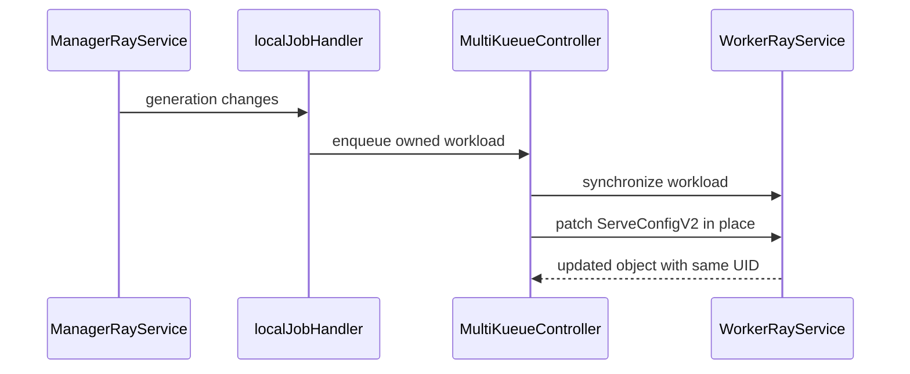

# PR #14036: MultiKueue: forward RayService serveConfigV2 in-place updates to the worker

**Summary**: MultiKueue: forward RayService serveConfigV2 in-place updates to the worker

**Sources**: https://github.com/kubernetes-sigs/kueue/pull/14036

**Last updated**: 2026-09-30T15:53:22Z

---

## Metadata

- **State**: closed (merged)
- **Author**: [@kevin85421](https://github.com/kevin85421)
- **Branch**: `multikueue-rayservice-serveconfig-sync` → `main`
- **Created**: 2026-08-09T07:34:21Z
- **Updated**: 2026-09-30T15:53:22Z
- **Merged**: 2026-08-11T13:33:19Z
- **Closed**: 2026-08-11T13:33:19Z
- **Labels**: `kind/feature`, `release-note`, `size/L`, `lgtm`, `approved`, `cncf-cla: yes`, `area/multikueue`
- **Assignees**: [@mimowo](https://github.com/mimowo)
- **Requested reviewers**: [@mimowo](https://github.com/mimowo), [@mbobrovskyi](https://github.com/mbobrovskyi), [@olekzabl](https://github.com/olekzabl), [@kshalot](https://github.com/kshalot), [@tenzen-y](https://github.com/tenzen-y), [@PBundyra](https://github.com/PBundyra)
- **Changed files**: 13   **+355 / -14**

## Description

#### What type of PR is this?

/kind feature
/area multikueue

#### What this PR does / why we need it:

**Background — RayService in-place updates.** KubeRay's `RayService` supports an *in-place update* of the Serve application config: when you edit `serveConfigV2` (the Serve app definition) and re-apply the CR, KubeRay applies the new config to the **existing** RayCluster rather than creating a new one — affected deployments transition `UPDATING → HEALTHY`. It changes no pods and needs no new cluster; it is the normal way to roll out a new model/app version on a running service. See the [KubeRay RayService guide](https://docs.ray.io/en/latest/cluster/kubernetes/user-guides/rayservice.html#kuberay-rayservice) for details.

**Problem — MultiKueue does not forward these changes today.** A `RayService` dispatched to a worker cluster is **create-once**: the adapter's `SyncJob` copies status back from the worker but never re-applies the manager's spec to the worker copy. So editing `serveConfigV2` on the **manager** `RayService` currently has **no effect** — the change is silently dropped and never reaches the worker's KubeRay, where the service actually runs. Operators cannot perform an in-place Serve update on a MultiKueue-dispatched `RayService`.

**This PR** adds a small, generic hook to the shared Ray MultiKueue adapter that lets a job type forward selected manager-side spec changes to its worker copy after admission:

- **`RemoteSpecSyncer[PtrT]` interface** (`NeedsSync` / `Apply`) plus a `WithRemoteSpecSync` adapter option. The adapter owns the mechanism (detect on reconcile, in-place patch the remote); each job type owns the policy — which fields to forward, and when. The interface itself is field-agnostic.
- **`RayService`** provides the only implementation today: it forwards **only** `serveConfigV2` (the Ray Serve application config).

**Prompt trigger — forward in ~1s, not up to `workerLostTimeout`.** A `serveConfigV2` edit does not change the manager `RayService`'s `Workload` (it is PodSet-neutral, quota-neutral). The MultiKueue admission-check controller reconciles `Workload`s, so without an extra signal the edit would only be forwarded on the next *periodic* requeue (`workerLostTimeout`, default **15 min**). To close that gap this PR adds an opt-in local-job watch:

- **`MultiKueueLocalJobWatcher` optional adapter interface** (`NewEmptyLocalJob`). An adapter that forwards spec changes returns an empty job object to watch; create-once adapters return `nil` and are unaffected.
- **`localJobHandler`** enqueues the owning `Workload` (resolved via the owner-reference index) whenever the watched manager job's spec `generation` bumps, so the edit promptly re-runs `SyncJob`. Status-only updates are filtered out to avoid a status-sync feedback loop.

#### Which issue(s) this PR fixes:

#### Special notes for your reviewer:

- AI tools were used to help prepare this change, per the Kubernetes AI tool usage policy.

#### Does this PR introduce a user-facing change?

```release-note
MultiKueue: Added support for forwarding in-place `serveConfigV2` (Ray Serve application config) updates on a `RayService` from the manager to the worker cluster, so editing the Serve config on the manager now takes effect on the worker promptly. Controlled by the `MultiKueueRemoteSpecSync` feature gate (Beta, enabled by default in v0.20). Changes to `rayClusterConfig`/`upgradeStrategy` (zero-downtime upgrade) are not yet propagated.
```


<!-- This is an auto-generated comment: release notes by coderabbit.ai -->
## Summary by CodeRabbit

* **New Features**
  * RayService configurations can now synchronize from the manager to existing worker jobs without requiring re-admission.
  * Serve configuration updates are applied in place while preserving existing MultiKueue metadata.
  * Added the `MultiKueueRemoteSpecSync` beta feature gate, enabled by default.
* **Bug Fixes**
  * Workloads now reconcile promptly when watched manager-side job specifications change.
<!-- end of auto-generated comment: release notes by coderabbit.ai -->

## Discussion

### Comment by [@kubernetes-prow[bot]](https://github.com/apps/kubernetes-prow) — 2026-08-09T07:34:24Z

Skipping CI for Draft Pull Request.
If you want CI signal for your change, please convert it to an actual PR.
You can still manually trigger a test run with `/test all`

### Comment by [@netlify[bot]](https://github.com/apps/netlify) — 2026-08-09T07:34:27Z

### <span aria-hidden="true">✅</span> Deploy Preview for *kubernetes-sigs-kueue* canceled.


|  Name | Link |
|:-:|------------------------|
|<span aria-hidden="true">🔨</span> Latest commit | 08e5991d660d88cf3735daf0d33952def780df89 |
|<span aria-hidden="true">🔍</span> Latest deploy log | https://app.netlify.com/projects/kubernetes-sigs-kueue/deploys/6a7acf1c0d89ee0008f7ccc2 |

### Comment by [@coderabbitai[bot]](https://github.com/apps/coderabbitai) — 2026-08-09T07:34:31Z

<!-- This is an auto-generated comment: summarize by coderabbit.ai -->
<!-- review_stack_entry_start -->

[](https://app.coderabbit.ai/change-stack/kubernetes-sigs/kueue/pull/14036?utm_source=github_walkthrough&utm_medium=github&utm_campaign=change_stack)

<!-- review_stack_entry_end -->
<!-- This is an auto-generated comment: review paused by coderabbit.ai -->

> [!NOTE]
> ## Reviews paused
> 
> It looks like this branch is under active development. To avoid overwhelming you with review comments due to an influx of new commits, CodeRabbit has automatically paused this review. You can configure this behavior by changing the `reviews.auto_review.auto_pause_after_reviewed_commits` setting.
> 
> Use the following commands to manage reviews:
> - `@coderabbitai resume` to resume automatic reviews.
> - `@coderabbitai review` to trigger a single review.
> 
> Use the checkboxes below for quick actions:
> - [ ] <!-- {"checkboxId": "7f6cc2e2-2e4e-497a-8c31-c9e4573e93d1"} --> ▶️ Resume reviews
> - [ ] <!-- {"checkboxId": "e9bb8d72-00e8-4f67-9cb2-caf3b22574fe"} --> 🔍 Trigger review

<!-- end of auto-generated comment: review paused by coderabbit.ai -->
<!-- walkthrough_start -->

<details>
<summary>📝 Walkthrough</summary>

## Walkthrough

The MultiKueue Ray adapter now supports feature-gated synchronization of selected manager-side specification changes to existing worker objects. RayService synchronizes `serveConfigV2`, with local-job watches and integration coverage.

### Changes

**RayService remote specification synchronization**

|Layer / File(s)|Summary|
|---|---|
|**Adapter synchronization contract** <br> `pkg/controller/jobs/ray/ray_multikueue_adapter.go`, `pkg/controller/jobframework/multikueue.go`, `pkg/features/kube_features.go`, `site/data/featuregates/versioned_feature_list.yaml`, `test/compatibility_lifecycle/reference/versioned_feature_list.yaml`|Adds the `RemoteSpecSyncer` contract, adapter configuration, local-job watcher support, feature-gated patching, and the `MultiKueueRemoteSpecSync` feature gate.|
|**Manager-side job watch handling** <br> `pkg/controller/admissionchecks/multikueue/workload.go`|Watches supported local job generation changes and enqueues owned workloads after the configured delay.|
|**RayService synchronization implementation** <br> `pkg/controller/jobs/rayservice/rayservice_multikueue_adapter.go`, `pkg/controller/jobs/rayservice/rayservice_controller.go`|Compares and applies `ServeConfigV2` changes, and registers the synchronizer with the RayService adapter.|
|**Integration and end-to-end validation** <br> `pkg/controller/jobs/rayservice/rayservice_multikueue_adapter_test.go`, `test/integration/multikueue/*`, `test/e2e/multikueue/extended/e2e_test.go`|Tests initial and updated `ServeConfigV2` propagation while preserving the worker object UID and MultiKueue metadata.|

**Estimated code review effort:** 3 (Moderate) | ~25 minutes

### Sequence Diagram(s)



**Possibly related PRs**

- [kubernetes-sigs/kueue#13494](https://github.com/kubernetes-sigs/kueue/pull/13494): Shares the Ray MultiKueue adapter design and replica synchronization behavior.
- [kubernetes-sigs/kueue#13793](https://github.com/kubernetes-sigs/kueue/pull/13793): Also modifies MultiKueue manager-to-worker synchronization and workload reconciliation.

**Suggested labels:** `area/ray-integration`

**Suggested reviewers:** `mbobrovskyi`, `kshalot`, `olekzabl`

</details>

<!-- walkthrough_end -->
<!-- pre_merge_checks_walkthrough_start -->

<details>
<summary>🚥 Pre-merge checks | ✅ 4 | ❌ 1</summary>

### ❌ Failed checks (1 warning)

|     Check name     | Status     | Explanation                                                                           | Resolution                                                                         |
| :----------------: | :--------- | :------------------------------------------------------------------------------------ | :--------------------------------------------------------------------------------- |
| Docstring Coverage | ⚠️ Warning | Docstring coverage is 28.57% which is insufficient. The required threshold is 80.00%. | Write docstrings for the functions missing them to satisfy the coverage threshold. |

<details>
<summary>✅ Passed checks (4 passed)</summary>

|         Check name         | Status   | Explanation                                                                                                                    |
| :------------------------: | :------- | :----------------------------------------------------------------------------------------------------------------------------- |
|      Description Check     | ✅ Passed | Check skipped - CodeRabbit’s high-level summary is enabled.                                                                    |
|         Title check        | ✅ Passed | The title clearly and concisely describes the main change: forwarding RayService serveConfigV2 updates to the worker in place. |
|     Linked Issues check    | ✅ Passed | Check skipped because no linked issues were found for this pull request.                                                       |
| Out of Scope Changes check | ✅ Passed | Check skipped because no linked issues were found for this pull request.                                                       |

</details>

</details>

<!-- pre_merge_checks_walkthrough_end -->
<!-- finishing_touch_checkbox_start -->

<details>
<summary>✨ Finishing Touches</summary>

<details>
<summary>🧪 Generate unit tests (beta)</summary>

- [ ] <!-- {"checkboxId": "f47ac10b-58cc-4372-a567-0e02b2c3d479", "radioGroupId": "utg-output-choice-group-unknown_comment_id"} -->   Create PR with unit tests

</details>

</details>

<!-- finishing_touch_checkbox_end -->
<!-- tips_start -->

---

Thanks for using [CodeRabbit](https://coderabbit.ai?utm_source=oss&utm_medium=github&utm_campaign=kubernetes-sigs/kueue&utm_content=14036)! It's free for OSS, and your support helps us grow. If you like it, consider giving us a shout-out.

<details>
<summary>❤️ Share</summary>

- [X](https://twitter.com/intent/tweet?text=I%20just%20used%20%40coderabbitai%20for%20my%20code%20review%2C%20and%20it%27s%20fantastic%21%20It%27s%20free%20for%20OSS%20and%20offers%20a%20free%20trial%20for%20the%20proprietary%20code.%20Check%20it%20out%3A&url=https%3A//coderabbit.ai)
- [Mastodon](https://mastodon.social/share?text=I%20just%20used%20%40coderabbitai%20for%20my%20code%20review%2C%20and%20it%27s%20fantastic%21%20It%27s%20free%20for%20OSS%20and%20offers%20a%20free%20trial%20for%20the%20proprietary%20code.%20Check%20it%20out%3A%20https%3A%2F%2Fcoderabbit.ai)
- [Reddit](https://www.reddit.com/submit?title=Great%20tool%20for%20code%20review%20-%20CodeRabbit&text=I%20just%20used%20CodeRabbit%20for%20my%20code%20review%2C%20and%20it%27s%20fantastic%21%20It%27s%20free%20for%20OSS%20and%20offers%20a%20free%20trial%20for%20proprietary%20code.%20Check%20it%20out%3A%20https%3A//coderabbit.ai)
- [LinkedIn](https://www.linkedin.com/sharing/share-offsite/?url=https%3A%2F%2Fcoderabbit.ai&mini=true&title=Great%20tool%20for%20code%20review%20-%20CodeRabbit&summary=I%20just%20used%20CodeRabbit%20for%20my%20code%20review%2C%20and%20it%27s%20fantastic%21%20It%27s%20free%20for%20OSS%20and%20offers%20a%20free%20trial%20for%20proprietary%20code)

</details>


<sub>Comment `@coderabbitai help` to get the list of available commands.</sub>

<!-- tips_end -->

### Comment by [@mimowo](https://github.com/mimowo) — 2026-08-11T06:10:44Z

/lgtm
/approve
Thank you for constantly improving KubeRay on MultiKueue 👍 

Let me know if this is something you would like to cherrypickk.

### Comment by [@kubernetes-prow[bot]](https://github.com/apps/kubernetes-prow) — 2026-08-11T06:10:53Z

LGTM label has been added.  <details>Git tree hash: 985fbc1e4d0474390b2874a653c9361a6a618b00</details>

### Comment by [@kubernetes-prow[bot]](https://github.com/apps/kubernetes-prow) — 2026-08-11T06:10:56Z

[APPROVALNOTIFIER] This PR is **APPROVED**

This pull-request has been approved by: *<a href="https://github.com/kubernetes-sigs/kueue/pull/14036#" title="Author self-approved">kevin85421</a>*, *<a href="https://github.com/kubernetes-sigs/kueue/pull/14036#issuecomment-5249630845" title="Approved">mimowo</a>*

The full list of commands accepted by this bot can be found [here](https://go.k8s.io/bot-commands?repo=kubernetes-sigs%2Fkueue).

The pull request process is described [here](https://git.k8s.io/community/contributors/guide/owners.md#the-code-review-process)

<details >
Needs approval from an approver in each of these files:

- ~~[OWNERS](https://github.com/kubernetes-sigs/kueue/blob/main/OWNERS)~~ [mimowo]

Approvers can indicate their approval by writing `/approve` in a comment
Approvers can cancel approval by writing `/approve cancel` in a comment
</details>
<!-- META={"approvers":[]} -->

### Comment by [@mimowo](https://github.com/mimowo) — 2026-08-11T06:14:13Z

/hold
looks like multiple e2e fail on webhooks: https://prow.k8s.io/view/gs/kubernetes-ci-logs/pr-logs/pull/kubernetes-sigs_kueue/14036/pull-kueue-test-e2e-tas-extended-shard-1-main/2087056703659970560
https://prow.k8s.io/view/gs/kubernetes-ci-logs/pr-logs/pull/kubernetes-sigs_kueue/14036/pull-kueue-test-e2e-extended-shard-1-main-1-34/2087056689680355328
https://prow.k8s.io/view/gs/kubernetes-ci-logs/pr-logs/pull/kubernetes-sigs_kueue/14036/pull-kueue-test-e2e-tas-extended-shard-1-main/2087056703659970560

This could be a symptom if kueue is crashing and then webhook requests failing on restart, ptal

### Comment by [@kevin85421](https://github.com/kevin85421) — 2026-08-11T06:49:33Z

> /hold looks like multiple e2e fail on webhooks: https://prow.k8s.io/view/gs/kubernetes-ci-logs/pr-logs/pull/kubernetes-sigs_kueue/14036/pull-kueue-test-e2e-tas-extended-shard-1-main/2087056703659970560 https://prow.k8s.io/view/gs/kubernetes-ci-logs/pr-logs/pull/kubernetes-sigs_kueue/14036/pull-kueue-test-e2e-extended-shard-1-main-1-34/2087056689680355328 https://prow.k8s.io/view/gs/kubernetes-ci-logs/pr-logs/pull/kubernetes-sigs_kueue/14036/pull-kueue-test-e2e-tas-extended-shard-1-main/2087056703659970560
> 
> This could be a symptom if kueue is crashing and then webhook requests failing on restart, ptal

The Kueue pod crashes because the RayService informer times out when the RayService CRD is not installed in the cluster. Should we install the RayService CRD in the test Kubernetes cluster, or should Kueue avoid crashing when the CRD is missing, even if the integration is enabled?

### Comment by [@mimowo](https://github.com/mimowo) — 2026-08-11T07:23:18Z

I think for normal kueue we avoid crashing, so Multikueue should follow the partern

### Comment by [@kevin85421](https://github.com/kevin85421) — 2026-08-11T07:28:32Z

> I think for normal kueue we avoid crashing, so Multikueue should follow the partern

Got it. I am pushing a fix right now. It's not ready for review. I will ping you when this PR is ready for review.

### Comment by [@kevin85421](https://github.com/kevin85421) — 2026-08-11T08:32:01Z

@mimowo: https://github.com/kubernetes-sigs/kueue/pull/14036/commits/08e5991d660d88cf3735daf0d33952def780df89 fixes the CI failures. This PR is ready to review. Thanks.

### Comment by [@mimowo](https://github.com/mimowo) — 2026-08-11T08:58:28Z

/lgtm
Thank you 👍

### Comment by [@kubernetes-prow[bot]](https://github.com/apps/kubernetes-prow) — 2026-08-11T08:58:34Z

LGTM label has been added.  <details>Git tree hash: 6aa15b6c9e903322b5dcf66e07a2a1867f75db1e</details>

### Comment by [@mimowo](https://github.com/mimowo) — 2026-08-11T13:18:05Z

/unhold

### Comment by [@kevin85421](https://github.com/kevin85421) — 2026-08-11T17:39:12Z

/cherrypick release-0.19
/cherrypick release-0.18

### Comment by [@k8s-infra-cherrypick-robot](https://github.com/k8s-infra-cherrypick-robot) — 2026-08-11T17:39:49Z

@kevin85421: #14036 failed to apply on top of branch "release-0.18":
```
Applying: MultiKueue: forward RayService serveConfigV2 in-place updates to the worker
Using index info to reconstruct a base tree...
M	pkg/controller/jobs/ray/ray_multikueue_adapter.go
M	pkg/controller/jobs/rayservice/rayservice_controller.go
M	test/e2e/multikueue/extended/e2e_test.go
M	test/integration/multikueue/jobs_test.go
M	test/integration/multikueue/suite_test.go
Falling back to patching base and 3-way merge...
Auto-merging pkg/controller/jobs/ray/ray_multikueue_adapter.go
CONFLICT (content): Merge conflict in pkg/controller/jobs/ray/ray_multikueue_adapter.go
Auto-merging pkg/controller/jobs/rayservice/rayservice_controller.go
CONFLICT (content): Merge conflict in pkg/controller/jobs/rayservice/rayservice_controller.go
Auto-merging test/e2e/multikueue/extended/e2e_test.go
Auto-merging test/integration/multikueue/jobs_test.go
Auto-merging test/integration/multikueue/suite_test.go
CONFLICT (content): Merge conflict in test/integration/multikueue/suite_test.go
error: Failed to merge in the changes.
hint: Use 'git am --show-current-patch=diff' to see the failed patch
hint: When you have resolved this problem, run "git am --continue".
hint: If you prefer to skip this patch, run "git am --skip" instead.
hint: To restore the original branch and stop patching, run "git am --abort".
hint: Disable this message with "git config set advice.mergeConflict false"
Patch failed at 0001 MultiKueue: forward RayService serveConfigV2 in-place updates to the worker

```

<details>

In response to [this](https://github.com/kubernetes-sigs/kueue/pull/14036#issuecomment-5256711436):

>/cherrypick release-0.19
>/cherrypick release-0.18


Instructions for interacting with me using PR comments are available [here](https://git.k8s.io/community/contributors/guide/pull-requests.md).  If you have questions or suggestions related to my behavior, please file an issue against the [kubernetes-sigs/prow](https://github.com/kubernetes-sigs/prow/issues/new?title=Prow%20issue:) repository.
</details>

### Comment by [@k8s-infra-cherrypick-robot](https://github.com/k8s-infra-cherrypick-robot) — 2026-08-11T17:40:25Z

@kevin85421: #14036 failed to apply on top of branch "release-0.19":
```
Applying: MultiKueue: forward RayService serveConfigV2 in-place updates to the worker
Using index info to reconstruct a base tree...
M	pkg/controller/jobs/rayservice/rayservice_controller.go
M	test/e2e/multikueue/extended/e2e_test.go
M	test/integration/multikueue/jobs_test.go
M	test/integration/multikueue/suite_test.go
Falling back to patching base and 3-way merge...
Auto-merging pkg/controller/jobs/rayservice/rayservice_controller.go
CONFLICT (content): Merge conflict in pkg/controller/jobs/rayservice/rayservice_controller.go
Auto-merging test/e2e/multikueue/extended/e2e_test.go
Auto-merging test/integration/multikueue/jobs_test.go
Auto-merging test/integration/multikueue/suite_test.go
CONFLICT (content): Merge conflict in test/integration/multikueue/suite_test.go
error: Failed to merge in the changes.
hint: Use 'git am --show-current-patch=diff' to see the failed patch
hint: When you have resolved this problem, run "git am --continue".
hint: If you prefer to skip this patch, run "git am --skip" instead.
hint: To restore the original branch and stop patching, run "git am --abort".
hint: Disable this message with "git config set advice.mergeConflict false"
Patch failed at 0001 MultiKueue: forward RayService serveConfigV2 in-place updates to the worker

```

<details>

In response to [this](https://github.com/kubernetes-sigs/kueue/pull/14036#issuecomment-5256711436):

>/cherrypick release-0.19
>/cherrypick release-0.18


Instructions for interacting with me using PR comments are available [here](https://git.k8s.io/community/contributors/guide/pull-requests.md).  If you have questions or suggestions related to my behavior, please file an issue against the [kubernetes-sigs/prow](https://github.com/kubernetes-sigs/prow/issues/new?title=Prow%20issue:) repository.
</details>

### Comment by [@mbobrovskyi](https://github.com/mbobrovskyi) — 2026-09-30T15:53:20Z

/release-note-edit
```release-note
MultiKueue: Added support for forwarding in-place `serveConfigV2` (Ray Serve application config) updates on a `RayService` from the manager to the worker cluster, so editing the Serve config on the manager now takes effect on the worker promptly. Controlled by the `MultiKueueRemoteSpecSync` feature gate (Beta, enabled by default in v0.20). Changes to `rayClusterConfig`/`upgradeStrategy` (zero-downtime upgrade) are not yet propagated.
```

## Reviews

### Review by [@coderabbitai[bot]](https://github.com/apps/coderabbitai) (commented) — 2026-08-09T08:19:36Z

**Actionable comments posted: 1**

<details>
<summary>🤖 Prompt for all review comments with AI agents</summary>

```
Verify each finding against current code. Fix only still-valid issues, skip the
rest with a brief reason, keep changes minimal, and validate.

Inline comments:
In `@pkg/controller/jobs/rayservice/rayservice_multikueue_adapter_test.go`:
- Around line 85-112: Add an adapter table case in
pkg/controller/jobs/rayservice/rayservice_multikueue_adapter_test.go:85-112 that
changes rayClusterConfig and upgradeStrategy after admission, verifies both
worker values remain unchanged, and confirms ServeConfigV2 still synchronizes;
add the corresponding integration scenario in
test/integration/multikueue/jobs_test.go:1798-1835 to verify pod-affecting
updates are not sent to the worker. Cover both the positive ServeConfigV2 update
and the negative preservation of rayClusterConfig and upgradeStrategy.
```

</details>

<details>
<summary>🪄 Autofix</summary>

Fix all unresolved CodeRabbit comments on this PR:

- [ ] <!-- {"checkboxId": "4b0d0e0a-96d7-4f10-b296-3a18ea78f0b9"} --> Push a commit to this branch (recommended)
- [ ] <!-- {"checkboxId": "ff5b1114-7d8c-49e6-8ac1-43f82af23a33"} --> Create a new PR with the fixes

</details>

---

<details>
<summary>ℹ️ Review info</summary>

<details>
<summary>⚙️ Run configuration</summary>

**Configuration used**: Path: .coderabbit.yaml

**Review profile**: CHILL

**Plan**: Pro Plus

**Run ID**: `b998ad84-f5d4-4765-95a9-470d47248a01`

</details>

<details>
<summary>📥 Commits</summary>

Reviewing files that changed from the base of the PR and between a52952af128dbdc97cdda7978188b002e5a3472f and bd1c161fbd34159dc77f6aabe96cb0b4962ccdc3.

</details>

<details>
<summary>📒 Files selected for processing (6)</summary>

* `pkg/controller/jobs/ray/ray_multikueue_adapter.go`
* `pkg/controller/jobs/rayservice/rayservice_controller.go`
* `pkg/controller/jobs/rayservice/rayservice_multikueue_adapter.go`
* `pkg/controller/jobs/rayservice/rayservice_multikueue_adapter_test.go`
* `test/integration/multikueue/jobs_test.go`
* `test/integration/multikueue/suite_test.go`

</details>

</details>

<!-- This is an auto-generated comment by CodeRabbit for review status -->

- **pkg/controller/jobs/rayservice/rayservice_multikueue_adapter_test.go:112** by [@coderabbitai[bot]](https://github.com/apps/coderabbitai) — 2026-08-09T08:19:36Z
```diff
@@ -82,6 +82,34 @@ func TestMultiKueueAdapter(t *testing.T) {
 					Obj(),
 			},
 		},
+		"sync forwards a serveConfigV2 change to the existing remote rayservice": {
+			featureGates: map[featuregate.Feature]bool{features.WorkloadIdentifierAnnotations: false},
+			managersRayServices: []rayv1.RayService{
+				*rayServiceBuilder.Clone().WithServeConfigV2("new-config").Obj(),
+			},
+			workerRayServices: []rayv1.RayService{
+				*rayServiceBuilder.Clone().
+					PrebuiltWorkloadLabel("wl1").
+					Label(kueue.MultiKueueOriginLabel, "origin1").
+					WithServeConfigV2("old-config").
+					Obj(),
+			},
+			operation: func(ctx context.Context, adapter jobframework.MultiKueueAdapter, managerClient, workerClient client.Client) error {
+				_, err := adapter.SyncJob(ctx, managerClient, workerClient, types.NamespacedName{Name: "rayservice1", Namespace: TestNamespace}, "wl1", "origin1")
+				return err
+			},
+
+			wantManagersRayServices: []rayv1.RayService{
+				*rayServiceBuilder.Clone().WithServeConfigV2("new-config").Obj(),
+			},
+			wantWorkerRayServices: []rayv1.RayService{
+				*rayServiceBuilder.Clone().
+					PrebuiltWorkloadLabel("wl1").
+					Label(kueue.MultiKueueOriginLabel, "origin1").
+					WithServeConfigV2("new-config").
+					Obj(),
+			},
+		},
```

  _🗄️ Data Integrity & Integration_ | _🟠 Major_ | _⚡ Quick win_
  
  **Add coverage for fields that must remain local to the worker.**
  
  The new tests prove that `ServeConfigV2` is forwarded. They do not prove that excluded fields remain unchanged. Add cases that update `rayClusterConfig` and `upgradeStrategy` after admission, then verify that the worker retains its prior values while `ServeConfigV2` updates.
  
  - `pkg/controller/jobs/rayservice/rayservice_multikueue_adapter_test.go#L85-L112`: Add a table case that verifies the allowlist behavior in the adapter.
  - `test/integration/multikueue/jobs_test.go#L1798-L1835`: Add an integration scenario that verifies the worker does not receive pod-affecting updates.
  
  Based on the PR objectives, `rayClusterConfig` and `upgradeStrategy` must remain unsynchronized because they require admission handling. As per path instructions, new tests must cover positive and negative scenarios.
  
  <details>
  <summary>📍 Affects 2 files</summary>
  
  - `pkg/controller/jobs/rayservice/rayservice_multikueue_adapter_test.go#L85-L112` (this comment)
  - `test/integration/multikueue/jobs_test.go#L1798-L1835`
  
  </details>
  
  <details>
  <summary>🤖 Prompt for AI Agents</summary>
  
  ```
  Verify each finding against current code. Fix only still-valid issues, skip the
  rest with a brief reason, keep changes minimal, and validate.
  
  In `@pkg/controller/jobs/rayservice/rayservice_multikueue_adapter_test.go` around
  lines 85 - 112, Add an adapter table case in
  pkg/controller/jobs/rayservice/rayservice_multikueue_adapter_test.go:85-112 that
  changes rayClusterConfig and upgradeStrategy after admission, verifies both
  worker values remain unchanged, and confirms ServeConfigV2 still synchronizes;
  add the corresponding integration scenario in
  test/integration/multikueue/jobs_test.go:1798-1835 to verify pod-affecting
  updates are not sent to the worker. Cover both the positive ServeConfigV2 update
  and the negative preservation of rayClusterConfig and upgradeStrategy.
  ```
  
  </details>
  
  <!-- consolidated_sites_start -->
  <!--
  <consolidated_sites>
  <site>
  <role>anchor</role>
  <file>pkg/controller/jobs/rayservice/rayservice_multikueue_adapter_test.go</file>
  <line_range>85-112</line_range>
  </site>
  <site>
  <role>sibling</role>
  <file>test/integration/multikueue/jobs_test.go</file>
  <line_range>1798-1835</line_range>
  </site>
  </consolidated_sites>
  -->
  <!-- consolidated_sites_end -->
  
  <!-- fingerprinting:phantom:poseidon:tapir -->
  
  <!-- cr-indicator-types:potential_issue -->
  
  <!-- cr-comment:v1:2e68305be0b6053020413868 -->
  
  _Source: Path instructions_
  
  <!-- This is an auto-generated comment by CodeRabbit -->

### Review by [@kevin85421](https://github.com/kevin85421) (commented) — 2026-08-10T17:49:05Z

- **pkg/controller/jobs/ray/ray_multikueue_adapter.go:67** by [@kevin85421](https://github.com/kevin85421) — 2026-08-10T17:45:40Z
```diff
@@ -55,6 +55,22 @@ type adapter[PtrT objAsPtr[T], T any] struct {
 	// on the worker cluster. It is left unset for job types that do not support
 	// this (see ElasticReplicaSync).
 	elastic *ElasticReplicaSync[PtrT, T]
+	// remoteSpecSync is optional. When set, the adapter forwards manager-side spec
+	// changes onto the remote copy on the worker cluster after admission (see
+	// RemoteSpecSyncer).
+	remoteSpecSync RemoteSpecSyncer[PtrT]
+}
+
+// RemoteSpecSyncer lets a job type forward selected spec changes from the manager
+// copy to its worker copy after the job is admitted, via an in-place patch of the
+// remote. Each job type decides which fields to forward and when a sync is needed.
+type RemoteSpecSyncer[PtrT any] interface {
```

  One possible follow-up is to move the elastic RayCluster to this generic interface.

- **pkg/controller/admissionchecks/multikueue/workload.go:1206** by [@kevin85421](https://github.com/kevin85421) — 2026-08-10T17:47:01Z
```diff
@@ -1134,12 +1185,35 @@ func (w *wlReconciler) setupWithManager(mgr ctrl.Manager) error {
 		},
 	}
 
-	return ctrl.NewControllerManagedBy(mgr).
+	builder := ctrl.NewControllerManagedBy(mgr).
 		Named("multikueue_workload").
 		For(&kueue.Workload{}).
 		WatchesRawSource(source.Channel(w.clusters.wlUpdateCh, syncHndl)).
 		Watches(&kueue.MultiKueueConfig{}, &configHandler{client: w.client, eventsBatchPeriod: w.eventsBatchPeriod}).
-		Watches(&kueue.AdmissionCheck{}, &admissionCheckHandler{client: w.client, eventsBatchPeriod: w.eventsBatchPeriod}).
+		Watches(&kueue.AdmissionCheck{}, &admissionCheckHandler{client: w.client, eventsBatchPeriod: w.eventsBatchPeriod})
+
+	// Watch the local (manager) job objects of adapters that forward spec changes
```

  Maybe we can consider watching all adapters directly, which is not that expensive.

- **pkg/controller/jobs/rayservice/rayservice_multikueue_adapter.go:39** by [@kevin85421](https://github.com/kevin85421) — 2026-08-10T17:48:51Z
```diff
@@ -27,6 +27,22 @@ import (
 
 var _ jobframework.MultiKueueAdapter = ray.NewMKAdapter(copyJobSpec, copyJobStatus, getEmptyList, gvk, getManagedBy, setManagedBy)
 
+// remoteSpecSyncer is RayService's RemoteSpecSyncer for MultiKueue.
+type remoteSpecSyncer struct{}
+
+var _ ray.RemoteSpecSyncer[*rayv1.RayService] = remoteSpecSyncer{}
+
+// NeedsSync reports whether the manager's serveConfigV2 differs from the worker's.
+// serveConfigV2 is the Ray Serve application config; forwarding it performs an
+// in-place Serve update on the worker cluster's RayService.
+func (remoteSpecSyncer) NeedsSync(remote, local *rayv1.RayService) bool {
+	return remote.Spec.ServeConfigV2 != local.Spec.ServeConfigV2
```

  I didn't add additional complexity to guard users' changes, in case we need to support zero-downtime upgrades soon.

### Review by [@coderabbitai[bot]](https://github.com/apps/coderabbitai) (commented) — 2026-08-10T17:54:38Z

**Actionable comments posted: 1**

<details>
<summary>🤖 Prompt for all review comments with AI agents</summary>

```
Verify each finding against current code. Fix only still-valid issues, skip the
rest with a brief reason, keep changes minimal, and validate.

Inline comments:
In `@test/e2e/multikueue/extended/e2e_test.go`:
- Around line 1013-1020: The e2e test must verify synchronization of an existing
worker RayService rather than a newly created copy. Before the manager update,
wait for the worker resource and assert its Spec.ServeConfigV2 equals
serveConfigV2, recording its UID and workload admission; after the update,
assert those same UID and admission values before validating
updatedServeConfigV2 in the existing workerClient check.
```

</details>

<details>
<summary>🪄 Autofix</summary>

Fix all unresolved CodeRabbit comments on this PR:

- [ ] <!-- {"checkboxId": "4b0d0e0a-96d7-4f10-b296-3a18ea78f0b9"} --> Push a commit to this branch (recommended)
- [ ] <!-- {"checkboxId": "ff5b1114-7d8c-49e6-8ac1-43f82af23a33"} --> Create a new PR with the fixes

</details>

---

<details>
<summary>ℹ️ Review info</summary>

<details>
<summary>⚙️ Run configuration</summary>

**Configuration used**: Path: .coderabbit.yaml

**Review profile**: CHILL

**Plan**: Pro Plus

**Run ID**: `9f4d11a2-aa15-4ba2-9d48-8fb8b0d915f0`

</details>

<details>
<summary>📥 Commits</summary>

Reviewing files that changed from the base of the PR and between bd1c161fbd34159dc77f6aabe96cb0b4962ccdc3 and 66f3753062e365e16aa65230d488adaa2c96ce39.

</details>

<details>
<summary>📒 Files selected for processing (4)</summary>

* `pkg/controller/admissionchecks/multikueue/workload.go`
* `pkg/controller/jobframework/multikueue.go`
* `pkg/controller/jobs/ray/ray_multikueue_adapter.go`
* `test/e2e/multikueue/extended/e2e_test.go`

</details>

</details>

<!-- This is an auto-generated comment by CodeRabbit for review status -->

- **test/e2e/multikueue/extended/e2e_test.go:1020** by [@coderabbitai[bot]](https://github.com/apps/coderabbitai) — 2026-08-10T17:54:37Z
```diff
@@ -986,6 +986,38 @@ app = HelloWorld.bind()`,
 						g.Expect(apimeta.IsStatusConditionTrue(createdRayService.Status.Conditions, string(rayv1.RayServiceReady))).To(gomega.BeTrue())
 					}, util.VeryLongTimeout, util.Interval).Should(gomega.Succeed())
 				})
+
+				// An in-place serveConfigV2 edit is quota-neutral, so MultiKueue forwards it
+				// to the worker copy without re-admission. num_replicas 1 -> 2 is a clear,
+				// observable change within serveConfigV2.
+				updatedServeConfigV2 := `applications:
+  - name: hello_app
+    import_path: hello_serve:app
+    route_prefix: /
+    deployments:
+      - name: HelloWorld
+        num_replicas: 2
+        max_replicas_per_node: 1
+        ray_actor_options:
+          num_cpus: 0.2`
+
+				ginkgo.By("Updating serveConfigV2 on the manager", func() {
+					gomega.Eventually(func(g gomega.Gomega) {
+						createdRayService := &rayv1.RayService{}
+						g.Expect(k8sManagerClient.Get(ctx, client.ObjectKeyFromObject(rayService), createdRayService)).To(gomega.Succeed())
+						createdRayService.Spec.ServeConfigV2 = updatedServeConfigV2
+						g.Expect(k8sManagerClient.Update(ctx, createdRayService)).To(gomega.Succeed())
+					}, util.Timeout, util.Interval).Should(gomega.Succeed())
+				})
+
+				ginkgo.By("Checking the serveConfigV2 change is promptly forwarded to the worker cluster", func() {
+					workerClient := kubernetesClients[admittedWorker].client
+					gomega.Eventually(func(g gomega.Gomega) {
+						workerRayService := &rayv1.RayService{}
+						g.Expect(workerClient.Get(ctx, client.ObjectKeyFromObject(rayService), workerRayService)).To(gomega.Succeed())
+						g.Expect(workerRayService.Spec.ServeConfigV2).To(gomega.Equal(updatedServeConfigV2))
+					}, util.MediumTimeout, util.Interval).Should(gomega.Succeed())
+				})
```

  _🗄️ Data Integrity & Integration_ | _🟠 Major_ | _⚡ Quick win_
  
  **Assert the existing worker copy before checking the update.**
  
  Line 1016 is the first read of the worker `RayService`, and it occurs after the manager update. If the worker copy is created later, it can be created with `updatedServeConfigV2`. The test would then pass without exercising in-place `RemoteSpecSync`.
  
  Before Line 1004, wait for the worker copy and assert `Spec.ServeConfigV2 == serveConfigV2`. Record its UID and the workload admission. After the update, assert the same UID and admission before checking `updatedServeConfigV2`. The PR objective requires synchronization to an existing worker copy without re-admission.
  
  <details>
  <summary>🤖 Prompt for AI Agents</summary>
  
  ```
  Verify each finding against current code. Fix only still-valid issues, skip the
  rest with a brief reason, keep changes minimal, and validate.
  
  In `@test/e2e/multikueue/extended/e2e_test.go` around lines 1013 - 1020, The e2e
  test must verify synchronization of an existing worker RayService rather than a
  newly created copy. Before the manager update, wait for the worker resource and
  assert its Spec.ServeConfigV2 equals serveConfigV2, recording its UID and
  workload admission; after the update, assert those same UID and admission values
  before validating updatedServeConfigV2 in the existing workerClient check.
  ```
  
  </details>
  
  <!-- fingerprinting:phantom:poseidon:caracal -->
  
  <!-- cr-indicator-types:potential_issue -->
  
  <!-- cr-comment:v1:68d120cf1d97aacb822b84c3 -->
  
  <!-- This is an auto-generated reply by CodeRabbit -->
  
  ✅ Addressed in commit 2cca326

### Review by [@mimowo](https://github.com/mimowo) (commented) — 2026-08-10T18:11:58Z

- **pkg/controller/admissionchecks/multikueue/workload.go:1128** by [@mimowo](https://github.com/mimowo) — 2026-08-10T18:11:58Z
```diff
@@ -1124,6 +1124,57 @@ func multiKueueConfigName(ac *kueue.AdmissionCheck) string {
 	return ac.Spec.Parameters.Name
 }
 
+// localJobHandler enqueues the workload(s) owned by a manager-side job when the
```

  This is a pretty big change, but no API change, so I'm wondering if we could consider it as bugfix rather and checrrypick, using FG for safety, wdyt?

### Review by [@kevin85421](https://github.com/kevin85421) (commented) — 2026-08-10T21:43:19Z

- **test/e2e/multikueue/extended/e2e_test.go:1020** by [@kevin85421](https://github.com/kevin85421) — 2026-08-10T21:42:49Z
```diff
@@ -986,6 +986,38 @@ app = HelloWorld.bind()`,
 						g.Expect(apimeta.IsStatusConditionTrue(createdRayService.Status.Conditions, string(rayv1.RayServiceReady))).To(gomega.BeTrue())
 					}, util.VeryLongTimeout, util.Interval).Should(gomega.Succeed())
 				})
+
+				// An in-place serveConfigV2 edit is quota-neutral, so MultiKueue forwards it
+				// to the worker copy without re-admission. num_replicas 1 -> 2 is a clear,
+				// observable change within serveConfigV2.
+				updatedServeConfigV2 := `applications:
+  - name: hello_app
+    import_path: hello_serve:app
+    route_prefix: /
+    deployments:
+      - name: HelloWorld
+        num_replicas: 2
+        max_replicas_per_node: 1
+        ray_actor_options:
+          num_cpus: 0.2`
+
+				ginkgo.By("Updating serveConfigV2 on the manager", func() {
+					gomega.Eventually(func(g gomega.Gomega) {
+						createdRayService := &rayv1.RayService{}
+						g.Expect(k8sManagerClient.Get(ctx, client.ObjectKeyFromObject(rayService), createdRayService)).To(gomega.Succeed())
+						createdRayService.Spec.ServeConfigV2 = updatedServeConfigV2
+						g.Expect(k8sManagerClient.Update(ctx, createdRayService)).To(gomega.Succeed())
+					}, util.Timeout, util.Interval).Should(gomega.Succeed())
+				})
+
+				ginkgo.By("Checking the serveConfigV2 change is promptly forwarded to the worker cluster", func() {
+					workerClient := kubernetesClients[admittedWorker].client
+					gomega.Eventually(func(g gomega.Gomega) {
+						workerRayService := &rayv1.RayService{}
+						g.Expect(workerClient.Get(ctx, client.ObjectKeyFromObject(rayService), workerRayService)).To(gomega.Succeed())
+						g.Expect(workerRayService.Spec.ServeConfigV2).To(gomega.Equal(updatedServeConfigV2))
+					}, util.MediumTimeout, util.Interval).Should(gomega.Succeed())
+				})
```

  Updated https://github.com/kubernetes-sigs/kueue/pull/14036/changes/2cca32686279775e612c0693c1960d141ee6502a

- **pkg/controller/admissionchecks/multikueue/workload.go:1128** by [@kevin85421](https://github.com/kevin85421) — 2026-08-10T21:43:14Z
```diff
@@ -1124,6 +1124,57 @@ func multiKueueConfigName(ac *kueue.AdmissionCheck) string {
 	return ac.Spec.Parameters.Name
 }
 
+// localJobHandler enqueues the workload(s) owned by a manager-side job when the
```

  SG, updated https://github.com/kubernetes-sigs/kueue/pull/14036/changes/c44cec23419b74276638891b9daef5d528d5ae02

### Review by [@coderabbitai[bot]](https://github.com/apps/coderabbitai) (commented) — 2026-08-10T21:44:42Z

- **test/e2e/multikueue/extended/e2e_test.go:1020** by [@coderabbitai[bot]](https://github.com/apps/coderabbitai) — 2026-08-10T21:44:42Z
```diff
@@ -986,6 +986,38 @@ app = HelloWorld.bind()`,
 						g.Expect(apimeta.IsStatusConditionTrue(createdRayService.Status.Conditions, string(rayv1.RayServiceReady))).To(gomega.BeTrue())
 					}, util.VeryLongTimeout, util.Interval).Should(gomega.Succeed())
 				})
+
+				// An in-place serveConfigV2 edit is quota-neutral, so MultiKueue forwards it
+				// to the worker copy without re-admission. num_replicas 1 -> 2 is a clear,
+				// observable change within serveConfigV2.
+				updatedServeConfigV2 := `applications:
+  - name: hello_app
+    import_path: hello_serve:app
+    route_prefix: /
+    deployments:
+      - name: HelloWorld
+        num_replicas: 2
+        max_replicas_per_node: 1
+        ray_actor_options:
+          num_cpus: 0.2`
+
+				ginkgo.By("Updating serveConfigV2 on the manager", func() {
+					gomega.Eventually(func(g gomega.Gomega) {
+						createdRayService := &rayv1.RayService{}
+						g.Expect(k8sManagerClient.Get(ctx, client.ObjectKeyFromObject(rayService), createdRayService)).To(gomega.Succeed())
+						createdRayService.Spec.ServeConfigV2 = updatedServeConfigV2
+						g.Expect(k8sManagerClient.Update(ctx, createdRayService)).To(gomega.Succeed())
+					}, util.Timeout, util.Interval).Should(gomega.Succeed())
+				})
+
+				ginkgo.By("Checking the serveConfigV2 change is promptly forwarded to the worker cluster", func() {
+					workerClient := kubernetesClients[admittedWorker].client
+					gomega.Eventually(func(g gomega.Gomega) {
+						workerRayService := &rayv1.RayService{}
+						g.Expect(workerClient.Get(ctx, client.ObjectKeyFromObject(rayService), workerRayService)).To(gomega.Succeed())
+						g.Expect(workerRayService.Spec.ServeConfigV2).To(gomega.Equal(updatedServeConfigV2))
+					}, util.MediumTimeout, util.Interval).Should(gomega.Succeed())
+				})
```

  <details>
  <summary>🧩 Analysis chain</summary>
  
  🏁 Script executed:
  
  ```shell
  #!/bin/bash
  set -euo pipefail
  
  git show --format=fuller --stat --oneline 2cca32686279775e612c0693c1960d141ee6502a --
  git show --format= --unified=35 2cca32686279775e612c0693c1960d141ee6502a -- test/e2e/multikueue/extended/e2e_test.go
  ```
  
  Length of output: 4633
  
  ---
  
  </details>
  
  `@kevin85421`, verified with AI assistance. Commit `2cca3268` addresses the finding.
  
  The test now verifies the initial worker `RayService` configuration before the manager update. It records the worker UID and verifies that the same worker copy receives `updatedServeConfigV2`.
  
  <!-- <review_comment_addressed> -->
  
  ---
  
  <!-- This is an auto-generated comment: tweet message by coderabbit.ai -->
  
  If you found this review helpful, would you consider giving us a shout-out on [X](https://twitter.com/intent/tweet?related=CodeRabbitAI&text=Catch%20false-positive%20e2e%20tests%3A%20%40coderabbitai%20recommends%20asserting%20the%20existing%20worker%20RayService%E2%80%99s%20config%2C%20UID%2C%20and%20admission%20before%2Fafter%20updates%E2%80%94proving%20in-place%20sync%20without%20re-admission.%20%F0%9F%A7%AA%E2%9C%85&url=https%3A%2F%2Fgithub.com%2Fkubernetes-sigs%2Fkueue%2Fpull%2F14036%23discussion_r3752022724)?
  
  Thank you for using CodeRabbit!
  
  <!-- end of auto-generated comment: tweet message by coderabbit.ai -->
  
  <sub>You are interacting with an AI system.</sub>
  
  <!-- This is an auto-generated reply by CodeRabbit -->

### Review by [@mimowo](https://github.com/mimowo) (commented) — 2026-08-11T05:46:05Z

- **pkg/features/kube_features.go:864** by [@mimowo](https://github.com/mimowo) — 2026-08-11T05:46:06Z
```diff
@@ -852,6 +859,10 @@ var defaultVersionedFeatureGates = map[featuregate.Feature]featuregate.Versioned
 	SkipAncestorCheckForDeletedWorkloads: {
 		{Version: version.MustParse("0.20"), Default: true, PreRelease: featuregate.Beta},
 	},
+
+	MultiKueueRemoteSpecSync: {
+		{Version: version.MustParse("0.20"), Default: false, PreRelease: featuregate.Alpha},
```

  Should we rather make it enabled by default? Otherwise I'm not clear what will be the graduation criteria.

### Review by [@mimowo](https://github.com/mimowo) (commented) — 2026-08-11T05:47:03Z

- **pkg/features/kube_features.go:864** by [@mimowo](https://github.com/mimowo) — 2026-08-11T05:47:03Z
```diff
@@ -852,6 +859,10 @@ var defaultVersionedFeatureGates = map[featuregate.Feature]featuregate.Versioned
 	SkipAncestorCheckForDeletedWorkloads: {
 		{Version: version.MustParse("0.20"), Default: true, PreRelease: featuregate.Beta},
 	},
+
+	MultiKueueRemoteSpecSync: {
+		{Version: version.MustParse("0.20"), Default: false, PreRelease: featuregate.Alpha},
```

  IIUC there is no API, so this change could even be considered a bugfix, let me know what are the risks as my KubeRay knowledge is limited

### Review by [@kevin85421](https://github.com/kevin85421) (commented) — 2026-08-11T05:56:30Z

- **pkg/features/kube_features.go:864** by [@kevin85421](https://github.com/kevin85421) — 2026-08-11T05:56:29Z
```diff
@@ -852,6 +859,10 @@ var defaultVersionedFeatureGates = map[featuregate.Feature]featuregate.Versioned
 	SkipAncestorCheckForDeletedWorkloads: {
 		{Version: version.MustParse("0.20"), Default: true, PreRelease: featuregate.Beta},
 	},
+
+	MultiKueueRemoteSpecSync: {
+		{Version: version.MustParse("0.20"), Default: false, PreRelease: featuregate.Alpha},
```

  Enabling it by default makes sense to me. I initially disabled it by default because I didn’t know that a feature gate could skip alpha.

### Review by [@mimowo](https://github.com/mimowo) (commented) — 2026-08-11T05:59:43Z

- **pkg/features/kube_features.go:864** by [@mimowo](https://github.com/mimowo) — 2026-08-11T05:59:43Z
```diff
@@ -852,6 +859,10 @@ var defaultVersionedFeatureGates = map[featuregate.Feature]featuregate.Versioned
 	SkipAncestorCheckForDeletedWorkloads: {
 		{Version: version.MustParse("0.20"), Default: true, PreRelease: featuregate.Beta},
 	},
+
+	MultiKueueRemoteSpecSync: {
+		{Version: version.MustParse("0.20"), Default: false, PreRelease: featuregate.Alpha},
```

  We can skip alpha, that even happens in the core k8s. 
  
  Especially for bugfix-style FGs it makes sense. If  you want we could consider backporting as Alpha.

### Review by [@kevin85421](https://github.com/kevin85421) (commented) — 2026-08-11T06:02:28Z

- **pkg/features/kube_features.go:864** by [@kevin85421](https://github.com/kevin85421) — 2026-08-11T06:02:28Z
```diff
@@ -852,6 +859,10 @@ var defaultVersionedFeatureGates = map[featuregate.Feature]featuregate.Versioned
 	SkipAncestorCheckForDeletedWorkloads: {
 		{Version: version.MustParse("0.20"), Default: true, PreRelease: featuregate.Beta},
 	},
+
+	MultiKueueRemoteSpecSync: {
+		{Version: version.MustParse("0.20"), Default: false, PreRelease: featuregate.Alpha},
```

  Thank you for the context! Beta makes more sense to me, since this is actually a bug fix.

### Review by [@kevin85421](https://github.com/kevin85421) (commented) — 2026-08-11T06:03:41Z

- **pkg/features/kube_features.go:864** by [@kevin85421](https://github.com/kevin85421) — 2026-08-11T06:03:41Z
```diff
@@ -852,6 +859,10 @@ var defaultVersionedFeatureGates = map[featuregate.Feature]featuregate.Versioned
 	SkipAncestorCheckForDeletedWorkloads: {
 		{Version: version.MustParse("0.20"), Default: true, PreRelease: featuregate.Beta},
 	},
+
+	MultiKueueRemoteSpecSync: {
+		{Version: version.MustParse("0.20"), Default: false, PreRelease: featuregate.Alpha},
```

  Updated: https://github.com/kubernetes-sigs/kueue/pull/14036/commits/4bd8e95f5f3f21053171e338ca70cc1ea624ba50

### Review by [@mimowo](https://github.com/mimowo) (commented) — 2026-08-11T06:05:42Z

- **test/integration/multikueue/jobs_test.go:1798** by [@mimowo](https://github.com/mimowo) — 2026-08-11T06:05:42Z
```diff
@@ -1793,6 +1795,45 @@ var _ = ginkgo.Describe("MultiKueue", ginkgo.Label("area:multikueue", "feature:m
 		})
 	})
 
+	ginkgo.It("Should forward a serveConfigV2 update to the RayService on the worker if admitted", func() {
```

  Hm, I think it would be good to divide the file into multiple files per framework, as we do for e2e test, say
  job_test.go, kuberay_test.go, wdyt?
  
  ofc that is an idea for a follow up

### Review by [@mimowo](https://github.com/mimowo) (commented) — 2026-08-11T06:07:37Z

- **pkg/controller/admissionchecks/multikueue/workload.go:1154** by [@mimowo](https://github.com/mimowo) — 2026-08-11T06:07:37Z
```diff
@@ -1124,6 +1124,57 @@ func multiKueueConfigName(ac *kueue.AdmissionCheck) string {
 	return ac.Spec.Parameters.Name
 }
 
+// localJobHandler enqueues the workload(s) owned by a manager-side job when the
+// job's spec changes.
+//
+// Normally a job spec edit makes the job controller update the workload, which in
+// turn reconciles this admission-check controller. But a spec change that does not
+// alter the workload's PodSets (e.g. a RayService serveConfigV2 edit) leaves the
+// workload untouched, so that path never fires and this controller would only
+// reconcile on the next periodic requeue. This handler bridges that gap by watching
+// the job directly, so such a change promptly re-runs SyncJob.
+type localJobHandler struct {
+	client            client.Client
+	gvk               schema.GroupVersionKind
+	eventsBatchPeriod time.Duration
+}
+
+var _ handler.EventHandler = (*localJobHandler)(nil)
+
+func (h *localJobHandler) Create(context.Context, event.CreateEvent, workqueue.TypedRateLimitingInterface[reconcile.Request]) {
+}
+
+func (h *localJobHandler) Update(ctx context.Context, e event.UpdateEvent, q workqueue.TypedRateLimitingInterface[reconcile.Request]) {
+	// React to spec changes only; a status-only update (e.g. status synced back
+	// from the worker) neither needs nor should re-trigger a sync.
+	//
+	// TODO: generation bumps only on spec changes, so metadata-only edits (labels,
+	// annotations) are filtered out here. Revisit if a future adapter needs to forward
+	// such metadata to the worker.
```

  Good point, we may need to use the mechanism for Label sync later on - the priority label in particular. (follow up idea)

### Review by [@kevin85421](https://github.com/kevin85421) (commented) — 2026-08-11T06:15:34Z

- **test/integration/multikueue/jobs_test.go:1798** by [@kevin85421](https://github.com/kevin85421) — 2026-08-11T06:15:34Z
```diff
@@ -1793,6 +1795,45 @@ var _ = ginkgo.Describe("MultiKueue", ginkgo.Label("area:multikueue", "feature:m
 		})
 	})
 
+	ginkgo.It("Should forward a serveConfigV2 update to the RayService on the worker if admitted", func() {
```

  makes sense

### Review by [@kevin85421](https://github.com/kevin85421) (commented) — 2026-08-11T06:18:38Z

- **test/integration/multikueue/jobs_test.go:1798** by [@kevin85421](https://github.com/kevin85421) — 2026-08-11T06:18:37Z
```diff
@@ -1793,6 +1795,45 @@ var _ = ginkgo.Describe("MultiKueue", ginkgo.Label("area:multikueue", "feature:m
 		})
 	})
 
+	ginkgo.It("Should forward a serveConfigV2 update to the RayService on the worker if admitted", func() {
```

  Open an issue to track the progress: https://github.com/kubernetes-sigs/kueue/issues/14165

### Review by [@kevin85421](https://github.com/kevin85421) (commented) — 2026-08-11T06:23:05Z

- **pkg/controller/admissionchecks/multikueue/workload.go:1154** by [@kevin85421](https://github.com/kevin85421) — 2026-08-11T06:23:04Z
```diff
@@ -1124,6 +1124,57 @@ func multiKueueConfigName(ac *kueue.AdmissionCheck) string {
 	return ac.Spec.Parameters.Name
 }
 
+// localJobHandler enqueues the workload(s) owned by a manager-side job when the
+// job's spec changes.
+//
+// Normally a job spec edit makes the job controller update the workload, which in
+// turn reconciles this admission-check controller. But a spec change that does not
+// alter the workload's PodSets (e.g. a RayService serveConfigV2 edit) leaves the
+// workload untouched, so that path never fires and this controller would only
+// reconcile on the next periodic requeue. This handler bridges that gap by watching
+// the job directly, so such a change promptly re-runs SyncJob.
+type localJobHandler struct {
+	client            client.Client
+	gvk               schema.GroupVersionKind
+	eventsBatchPeriod time.Duration
+}
+
+var _ handler.EventHandler = (*localJobHandler)(nil)
+
+func (h *localJobHandler) Create(context.Context, event.CreateEvent, workqueue.TypedRateLimitingInterface[reconcile.Request]) {
+}
+
+func (h *localJobHandler) Update(ctx context.Context, e event.UpdateEvent, q workqueue.TypedRateLimitingInterface[reconcile.Request]) {
+	// React to spec changes only; a status-only update (e.g. status synced back
+	// from the worker) neither needs nor should re-trigger a sync.
+	//
+	// TODO: generation bumps only on spec changes, so metadata-only edits (labels,
+	// annotations) are filtered out here. Revisit if a future adapter needs to forward
+	// such metadata to the worker.
```

  Open an issue to track the progress: https://github.com/kubernetes-sigs/kueue/issues/14166.
