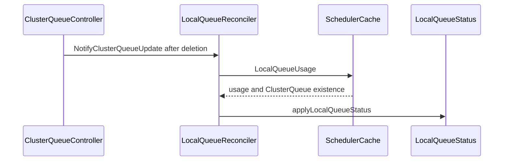

# PR #14131: Fix LocalQueue status after ClusterQueue deletion

**Summary**: Fix LocalQueue status after ClusterQueue deletion

**Sources**: https://github.com/kubernetes-sigs/kueue/pull/14131

**Last updated**: 2026-08-23T09:11:40Z

---

## Metadata

- **State**: open
- **Author**: [@YQ-Wang](https://github.com/YQ-Wang)
- **Branch**: `feat/13873-localqueue-cache-status` → `main`
- **Created**: 2026-08-10T16:16:19Z
- **Updated**: 2026-08-23T09:11:40Z
- **Merged**: —
- **Closed**: —
- **Labels**: `kind/bug`, `release-note`, `size/L`, `ok-to-test`, `cncf-cla: yes`
- **Assignees**: _none_
- **Requested reviewers**: [@pajakd](https://github.com/pajakd), [@sohankunkerkar](https://github.com/sohankunkerkar), [@kshalot](https://github.com/kshalot), [@tenzen-y](https://github.com/tenzen-y)
- **Changed files**: 5   **+221 / -44**

## Description

#### What type of PR is this?

/kind bug

#### What this PR does / why we need it:

When a ClusterQueue is forcefully deleted, the LocalQueue controller can observe the API deletion before scheduler cache cleanup and publish `ClusterQueueDoesNotExist` while retaining non-zero usage. This PR waits for scheduler cache cleanup before publishing the missing-ClusterQueue status, adds a post-cleanup notification to reconcile affected LocalQueues promptly, and reads ClusterQueue presence and LocalQueue usage from one scheduler-cache snapshot before publishing that status.

#### Which issue(s) this PR fixes:

Fixes #13873

#### Special notes for your reviewer:

cc @mimowo

You raised the original concern in #13708, and the issue flags one decision worth your sign-off: option 3 changes *when* the `Active` condition becomes visible. Between the ClusterQueue API deletion and scheduler cache cleanup, the LocalQueue keeps reporting `Active=True`/`Ready` rather than flipping to `Active=False` immediately as it does today. The window is bounded by one `UpdatesBatchPeriod` requeue, and in practice the cache entry is already gone by then because `ClusterQueueReconciler.Delete` cleans it synchronously before notifying. The issue treats this as the accepted cost of never publishing a contradictory status — please confirm you agree with that trade before this merges.

On acceptance criterion 1: `applyLocalQueueStatus` still takes a `stats` parameter rather than dropping it. It is now mandatory instead of a nil-able override, and both callers source it from `Cache.LocalQueueUsage`, so usage has a single derivation path. The parameter stays because the not-found branch must use ClusterQueue presence and usage from the same cache snapshot. Separate reads could straddle cache cleanup and recreate the contradictory status.

`NotifyClusterQueueUpdate` uses a blocking send, matching `resourceflavor_controller.go`, `admissioncheck_controller.go`, and `cohort_controller.go`. Correctness does not depend on the notification: the `RequeueAfter` in the not-found branch converges on its own, and the notify only removes a requeue round-trip.

The existing force-deletion integration regression is unchanged. Deterministic unit tests cover both stale-cache and cleaned-cache ordering, plus the post-cleanup notification and its handler. The `wantRequeueAfter` → `wantResult` conversion across the existing table cases is intentional: every case now asserts the full `reconcile.Result`, so an unexpected requeue can no longer slip past a skipped assertion.

AI tools were used to assist with implementation and review. The final diff was manually reviewed and validated.

Validation:
- `go test ./pkg/controller/core ./pkg/cache/scheduler -run '^(TestLocalQueueReconcile|TestLocalQueueNotifyClusterQueueUpdate|TestLocalQueueClusterQueueHandlerGeneric|TestLocalQueueUsage)$' -count=1`
- `go test -race ./pkg/controller/core ./pkg/cache/scheduler -count=1`
- `go test -race ./test/integration/singlecluster/controller/core -run '^TestAPIs$' -ginkgo.focus='Should update status when ClusterQueue are forcefully deleted' -count=1`
- `golangci-lint run ./pkg/controller/core/...`
- `git diff --check`

#### Does this PR introduce a user-facing change?

```release-note
LocalQueue: Fixed status showing non-zero usage alongside ClusterQueueDoesNotExist during ClusterQueue teardown.
```

<!-- This is an auto-generated comment: release notes by coderabbit.ai -->
## Summary by CodeRabbit

* **Bug Fixes**
  * Improved LocalQueue status accuracy when its associated ClusterQueue is deleted or unavailable.
  * Prevented stale usage information while cache updates are completing.
  * LocalQueues now refresh automatically after related ClusterQueue changes.
  * Added clearer status reporting when the associated ClusterQueue does not exist.
  * Improved preservation and initialization of fair-sharing usage data during reconciliation.
  * Improved handling of delayed cache updates and incomplete ClusterQueue information.
<!-- end of auto-generated comment: release notes by coderabbit.ai -->

## Discussion

### Comment by [@netlify[bot]](https://github.com/apps/netlify) — 2026-08-10T16:16:26Z

### <span aria-hidden="true">✅</span> Deploy Preview for *kubernetes-sigs-kueue* ready!


|  Name | Link |
|:-:|------------------------|
|<span aria-hidden="true">🔨</span> Latest commit | 4c2354140af8376885f2518269a710c62ee084ff |
|<span aria-hidden="true">🔍</span> Latest deploy log | https://app.netlify.com/projects/kubernetes-sigs-kueue/deploys/6a8725fd5755e00008a57ec4 |
|<span aria-hidden="true">😎</span> Deploy Preview | [https://deploy-preview-14131--kubernetes-sigs-kueue.netlify.app](https://deploy-preview-14131--kubernetes-sigs-kueue.netlify.app) |
|<span aria-hidden="true">📱</span> Preview on mobile | <details><summary> Toggle QR Code... </summary><br /><br /><br /><br />_Use your smartphone camera to open QR code link._</details> |
---
<!-- [kubernetes-sigs-kueue Preview](https://deploy-preview-14131--kubernetes-sigs-kueue.netlify.app) -->
_To edit notification comments on pull requests, go to your [Netlify project configuration](https://app.netlify.com/projects/kubernetes-sigs-kueue/configuration/notifications#deploy-notifications)._

### Comment by [@coderabbitai[bot]](https://github.com/apps/coderabbitai) — 2026-08-10T16:16:27Z

<!-- This is an auto-generated comment: summarize by coderabbit.ai -->
<!-- review_stack_entry_start -->

[](https://app.coderabbit.ai/change-stack/kubernetes-sigs/kueue/pull/14131?utm_source=github_walkthrough&utm_medium=github&utm_campaign=change_stack)

<!-- review_stack_entry_end -->
<!-- This is an auto-generated comment: review paused by coderabbit.ai -->

> [!NOTE]
> ## Reviews paused
> 
> It looks like this branch is under active development. To avoid overwhelming you with review comments due to an influx of new commits, CodeRabbit has automatically paused this review. You can configure this behavior by changing the `reviews.auto_review.auto_pause_after_reviewed_commits` setting.
> 
> Use the following commands to manage reviews:
> - `@coderabbitai resume` to resume automatic reviews.
> - `@coderabbitai review` to trigger a single review.
> 
> Use the checkboxes below for quick actions:
> - [ ] <!-- {"checkboxId": "7f6cc2e2-2e4e-497a-8c31-c9e4573e93d1"} --> ▶️ Resume reviews
> - [ ] <!-- {"checkboxId": "e9bb8d72-00e8-4f67-9cb2-caf3b22574fe"} --> 🔍 Trigger review

<!-- end of auto-generated comment: review paused by coderabbit.ai -->
<!-- walkthrough_start -->

<details>
<summary>📝 Walkthrough</summary>

## Walkthrough

The scheduler cache now reports ClusterQueue existence with LocalQueue usage. The LocalQueue controller delays status updates while deleted ClusterQueues remain cached, then requeues affected LocalQueues and applies centralized cache usage.

### Changes

**LocalQueue ClusterQueue synchronization**

|Layer / File(s)|Summary|
|---|---|
|**Snapshot usage and existence contract** <br> `pkg/cache/scheduler/cache.go`, `pkg/cache/scheduler/cache_test.go`|`LocalQueueUsage` returns usage, ClusterQueue existence, and errors from one cache snapshot. Tests validate the new result.|
|**Reconciliation and status flow** <br> `pkg/controller/core/localqueue_controller.go`, `pkg/controller/core/localqueue_controller_test.go`|The reconciler requeues while a missing ClusterQueue remains cached and writes status from cache-provided usage. Tests cover cache deletion, fair-sharing results, and status conditions.|
|**ClusterQueue deletion notification wiring** <br> `pkg/controller/core/localqueue_controller.go`, `pkg/controller/core/core.go`, `pkg/controller/core/localqueue_controller_test.go`|ClusterQueue deletion events notify the LocalQueue reconciler and enqueue related LocalQueues. Tests cover event filtering, channel behavior, and queue selection.|

**Estimated code review effort:** 3 (Moderate) | ~25 minutes

### Sequence Diagram(s)



**Possibly related PRs**

- [kubernetes-sigs/kueue#13708](https://github.com/kubernetes-sigs/kueue/pull/13708): Both changes update LocalQueue reconciliation and cache usage handling after ClusterQueue deletion.
- [kubernetes-sigs/kueue#13570](https://github.com/kubernetes-sigs/kueue/pull/13570): Both changes modify ClusterQueue-triggered LocalQueue reconciliation.
- [kubernetes-sigs/kueue#13724](https://github.com/kubernetes-sigs/kueue/pull/13724): Both changes modify LocalQueue fair-sharing and status reconciliation.

**Suggested reviewers:** `pajakd`, `sohankunkerkar`, `tenzen-y`

</details>

<!-- walkthrough_end -->
<!-- pre_merge_checks_walkthrough_start -->

<details>
<summary>🚥 Pre-merge checks | ✅ 4 | ❌ 1</summary>

### ❌ Failed checks (1 warning)

|     Check name     | Status     | Explanation                                                                          | Resolution                                                                         |
| :----------------: | :--------- | :----------------------------------------------------------------------------------- | :--------------------------------------------------------------------------------- |
| Docstring Coverage | ⚠️ Warning | Docstring coverage is 0.00% which is insufficient. The required threshold is 80.00%. | Write docstrings for the functions missing them to satisfy the coverage threshold. |

<details>
<summary>✅ Passed checks (4 passed)</summary>

|         Check name         | Status   | Explanation                                                                                                                                                   |
| :------------------------: | :------- | :------------------------------------------------------------------------------------------------------------------------------------------------------------ |
|     Linked Issues check    | ✅ Passed | The changes satisfy issue `#13873` by centralizing cache usage lookup, preventing contradictory status, and covering cleanup ordering and force-deletion cases. |
| Out of Scope Changes check | ✅ Passed | The cache, controller, watcher, and test changes directly support the linked issue objectives and contain no unrelated code changes.                          |
|      Description Check     | ✅ Passed | Check skipped - CodeRabbit’s high-level summary is enabled.                                                                                                   |
|         Title check        | ✅ Passed | The title clearly and concisely describes the main change: fixing LocalQueue status handling after ClusterQueue deletion.                                     |

</details>

</details>

<!-- pre_merge_checks_walkthrough_end -->
<!-- finishing_touch_checkbox_start -->

<details>
<summary>✨ Finishing Touches</summary>

<details>
<summary>🧪 Generate unit tests (beta)</summary>

- [ ] <!-- {"checkboxId": "f47ac10b-58cc-4372-a567-0e02b2c3d479", "radioGroupId": "utg-output-choice-group-unknown_comment_id"} -->   Create PR with unit tests

</details>

</details>

<!-- finishing_touch_checkbox_end -->
<!-- tips_start -->

---

Thanks for using [CodeRabbit](https://coderabbit.ai?utm_source=oss&utm_medium=github&utm_campaign=kubernetes-sigs/kueue&utm_content=14131)! It's free for OSS, and your support helps us grow. If you like it, consider giving us a shout-out.

<details>
<summary>❤️ Share</summary>

- [X](https://twitter.com/intent/tweet?text=I%20just%20used%20%40coderabbitai%20for%20my%20code%20review%2C%20and%20it%27s%20fantastic%21%20It%27s%20free%20for%20OSS%20and%20offers%20a%20free%20trial%20for%20the%20proprietary%20code.%20Check%20it%20out%3A&url=https%3A//coderabbit.ai)
- [Mastodon](https://mastodon.social/share?text=I%20just%20used%20%40coderabbitai%20for%20my%20code%20review%2C%20and%20it%27s%20fantastic%21%20It%27s%20free%20for%20OSS%20and%20offers%20a%20free%20trial%20for%20the%20proprietary%20code.%20Check%20it%20out%3A%20https%3A%2F%2Fcoderabbit.ai)
- [Reddit](https://www.reddit.com/submit?title=Great%20tool%20for%20code%20review%20-%20CodeRabbit&text=I%20just%20used%20CodeRabbit%20for%20my%20code%20review%2C%20and%20it%27s%20fantastic%21%20It%27s%20free%20for%20OSS%20and%20offers%20a%20free%20trial%20for%20proprietary%20code.%20Check%20it%20out%3A%20https%3A//coderabbit.ai)
- [LinkedIn](https://www.linkedin.com/sharing/share-offsite/?url=https%3A%2F%2Fcoderabbit.ai&mini=true&title=Great%20tool%20for%20code%20review%20-%20CodeRabbit&summary=I%20just%20used%20CodeRabbit%20for%20my%20code%20review%2C%20and%20it%27s%20fantastic%21%20It%27s%20free%20for%20OSS%20and%20offers%20a%20free%20trial%20for%20proprietary%20code)

</details>


<sub>Comment `@coderabbitai help` to get the list of available commands.</sub>

<!-- tips_end -->

### Comment by [@kubernetes-prow[bot]](https://github.com/apps/kubernetes-prow) — 2026-08-10T16:16:30Z

Hi @YQ-Wang. Thanks for your PR.

I'm waiting for a [kubernetes-sigs](https://github.com/orgs/kubernetes-sigs/people) member to verify that this patch is reasonable to test. If it is, they should reply with `/ok-to-test` on its own line. Until that is done, I will not automatically test new commits in this PR, but the usual testing commands by org members will still work.

>[!TIP]
>**We noticed you've done this a few times! Consider [joining the org](https://git.k8s.io/community/community-membership.md#member) to skip this step and gain `/lgtm` and other bot rights.** We recommend asking approvers on your previous PRs to sponsor you.

Once the patch is verified, the new status will be reflected by the `ok-to-test` label.

I understand the commands that are listed [here](https://go.k8s.io/bot-commands?repo=kubernetes-sigs%2Fkueue).

<details>

Instructions for interacting with me using PR comments are available [here](https://git.k8s.io/community/contributors/guide/pull-requests.md).  If you have questions or suggestions related to my behavior, please file an issue against the [kubernetes-sigs/prow](https://github.com/kubernetes-sigs/prow/issues/new?title=Prow%20issue:) repository.
</details>

### Comment by [@kubernetes-prow[bot]](https://github.com/apps/kubernetes-prow) — 2026-08-10T16:16:38Z

[APPROVALNOTIFIER] This PR is **NOT APPROVED**

This pull-request has been approved by: *<a href="https://github.com/kubernetes-sigs/kueue/pull/14131#" title="Author self-approved">YQ-Wang</a>*
**Once this PR has been reviewed and has the lgtm label**, please assign [mimowo](https://github.com/mimowo) for approval. For more information see [the Code Review Process](https://git.k8s.io/community/contributors/guide/owners.md#the-code-review-process).

The full list of commands accepted by this bot can be found [here](https://go.k8s.io/bot-commands?repo=kubernetes-sigs%2Fkueue).

<details open>
Needs approval from an approver in each of these files:

- **[OWNERS](https://github.com/kubernetes-sigs/kueue/blob/main/OWNERS)**

Approvers can indicate their approval by writing `/approve` in a comment
Approvers can cancel approval by writing `/approve cancel` in a comment
</details>
<!-- META={"approvers":["mimowo"]} -->

### Comment by [@YQ-Wang](https://github.com/YQ-Wang) — 2026-08-10T16:33:31Z

/kind cleanup
/remove-kind bug

### Comment by [@mbobrovskyi](https://github.com/mbobrovskyi) — 2026-08-10T16:41:15Z

/ok-to-test

### Comment by [@linux-foundation-easycla[bot]](https://github.com/apps/linux-foundation-easycla) — 2026-08-10T17:25:10Z

<a href="https://easycla.lfx.linuxfoundation.org/#/?version=2"></a><br >The committers listed above are authorized under a signed CLA.<ul><li>:white_check_mark: login: YQ-Wang / name: Yiqing Wang (0ee678ca7acaea24cc119dfe711f1d193545f116, a712fc6b416da8674ee1b1dc1b81b9c57bea2ec1, b9dcc8f06e7e782482a927217c5cec96ad34e4bd)</li></ul>

### Comment by [@YQ-Wang](https://github.com/YQ-Wang) — 2026-08-10T18:56:44Z

cc @mimowo

### Comment by [@sohankunkerkar](https://github.com/sohankunkerkar) — 2026-08-11T00:33:16Z

/release-note-edit

```release-note
LocalQueue: Fixed status showing non-zero usage alongside ClusterQueueDoesNotExist during ClusterQueue teardown.
```

### Comment by [@sohankunkerkar](https://github.com/sohankunkerkar) — 2026-08-11T00:34:39Z

@YQ-Wang I think this will categorized as bug or regression. Any reason you chose it as cleanup?

### Comment by [@YQ-Wang](https://github.com/YQ-Wang) — 2026-08-11T05:28:32Z

> @YQ-Wang I think this will categorized as bug or regression. Any reason you chose it as cleanup?

Good catch, agreed, this is a bug fix (incorrect LocalQueue status during ClusterQueue teardown), not cleanup. Updating the kind.

/kind bug
/remove-kind cleanup

### Comment by [@YQ-Wang](https://github.com/YQ-Wang) — 2026-08-11T07:04:02Z

@thc1006 Thanks for the detailed reproducer. I verified it against the current head, and you are right that the active path can combine the recreated ClusterQueue’s condition with usage from the previous same-named cache entry. I narrowed the PR description so it no longer reads as covering the same-name recreate case.

The original maintainer request and #13873 acceptance criteria are scoped to the API-NotFound versus scheduler-cache-cleanup ordering. I propose tracking incarnation matching separately. A complete fix also needs to define how a same-name, different-UID replacement delivered as an Update should rebuild the scheduler cache and queue-manager state; assigning the new UID to retained state would not be sufficient.

@mimowo, does keeping this PR scoped to the deletion-ordering bug sound right?

### Comment by [@YQ-Wang](https://github.com/YQ-Wang) — 2026-08-23T09:11:40Z

I’m keeping same-name ClusterQueue recreation out of scope for this PR, which remains limited to the API-NotFound vs scheduler-cache cleanup ordering in #13873.

Draft #14735 covers the recreate status bug: store the ClusterQueue UID in the scheduler cache, wait to publish LocalQueue status while it disagrees with the API object, and reject in-place cache updates that would relabel leftover usage as a new UID. It does not rebuild name-keyed quota accounting.

## Reviews

### Review by [@coderabbitai[bot]](https://github.com/apps/coderabbitai) (commented) — 2026-08-10T17:29:43Z

**Actionable comments posted: 1**

<details>
<summary>🧹 Nitpick comments (1)</summary><blockquote>

<details>
<summary>pkg/controller/core/localqueue_controller_test.go (1)</summary><blockquote>

`84-84`: _📐 Maintainability & Code Quality_ | _🔵 Trivial_ | _⚡ Quick win_

**Assert the reconciliation result for every test case.**

A nil `wantResult` skips the result assertion. An unexpected requeue can pass in those cases. Store `reconcile.Result` by value so its zero value verifies the expected empty result.

<details>
<summary>Proposed refactor</summary>

```diff
-		wantResult                   *reconcile.Result
+		wantResult                   reconcile.Result
...
-			wantResult: &reconcile.Result{
+			wantResult: reconcile.Result{
 				RequeueAfter: constants.UpdatesBatchPeriod,
 			},
...
-			wantResult: &reconcile.Result{},
+			wantResult: reconcile.Result{},
...
-			if tc.wantResult != nil {
-				if diff := cmp.Diff(*tc.wantResult, result); diff != "" {
-					t.Errorf("unexpected reconcile result (-want/+got):\n%s", diff)
-				}
+			if diff := cmp.Diff(tc.wantResult, result); diff != "" {
+				t.Errorf("unexpected reconcile result (-want/+got):\n%s", diff)
 			}
```
</details>


Also applies to: 1001-1005

<details>
<summary>🤖 Prompt for AI Agents</summary>

```
Verify each finding against current code. Fix only still-valid issues, skip the
rest with a brief reason, keep changes minimal, and validate.

In `@pkg/controller/core/localqueue_controller_test.go` at line 84, Update the
test case definition and reconciliation assertions in the local queue controller
tests to store wantResult as a reconcile.Result value rather than a pointer.
Always compare the actual reconciliation result with wantResult, using its zero
value for cases expecting no requeue, including the additional cases around the
referenced test range.
```

</details>

<!-- cr-comment:v1:cf8e55b81a8d2293efe1509b -->

</blockquote></details>

</blockquote></details>

<details>
<summary>🤖 Prompt for all review comments with AI agents</summary>

```
Verify each finding against current code. Fix only still-valid issues, skip the
rest with a brief reason, keep changes minimal, and validate.

Inline comments:
In `@pkg/controller/core/localqueue_controller.go`:
- Around line 176-185: Update NotifyClusterQueueUpdate so the delete-event
dispatch to cqUpdateCh is non-blocking when the channel is full, while
preserving the existing oldCQ non-nil and newCQ nil guard and event payload;
allow the secondary notification to be dropped or coalesced because the existing
delete watch and RequeueAfter paths provide eventual reconciliation.

---

Nitpick comments:
In `@pkg/controller/core/localqueue_controller_test.go`:
- Line 84: Update the test case definition and reconciliation assertions in the
local queue controller tests to store wantResult as a reconcile.Result value
rather than a pointer. Always compare the actual reconciliation result with
wantResult, using its zero value for cases expecting no requeue, including the
additional cases around the referenced test range.
```

</details>

<details>
<summary>🪄 Autofix</summary>

Fix all unresolved CodeRabbit comments on this PR:

- [ ] <!-- {"checkboxId": "4b0d0e0a-96d7-4f10-b296-3a18ea78f0b9"} --> Push a commit to this branch (recommended)
- [ ] <!-- {"checkboxId": "ff5b1114-7d8c-49e6-8ac1-43f82af23a33"} --> Create a new PR with the fixes

</details>

---

<details>
<summary>ℹ️ Review info</summary>

<details>
<summary>⚙️ Run configuration</summary>

**Configuration used**: Path: .coderabbit.yaml

**Review profile**: CHILL

**Plan**: Pro Plus

**Run ID**: `727af9b6-174d-4383-8d76-9a458a05b455`

</details>

<details>
<summary>📥 Commits</summary>

Reviewing files that changed from the base of the PR and between d0fd75e09a8efe21bee89cd5a77d87ea9314186b and 9c8bc42b441ce930689fa4e3b7d5425df6845fb3.

</details>

<details>
<summary>📒 Files selected for processing (5)</summary>

* `pkg/cache/scheduler/cache.go`
* `pkg/cache/scheduler/cache_test.go`
* `pkg/controller/core/core.go`
* `pkg/controller/core/localqueue_controller.go`
* `pkg/controller/core/localqueue_controller_test.go`

</details>

</details>

<!-- This is an auto-generated comment by CodeRabbit for review status -->

- **pkg/controller/core/localqueue_controller.go:185** by [@coderabbitai[bot]](https://github.com/apps/coderabbitai) — 2026-08-10T17:29:42Z
```diff
@@ -170,6 +173,17 @@ func (r *LocalQueueReconciler) NotifyWorkloadUpdate(oldWl, newWl *kueue.Workload
 	}
 }
 
+// NotifyClusterQueueUpdate enqueues LocalQueues after ClusterQueue cache cleanup.
+// Only delete events are forwarded: Create/Update are already covered by the
+// ClusterQueue watch, while Delete must run again after ClusterQueueReconciler
+// removes the scheduler cache entry so LocalQueue status can publish
+// ClusterQueueDoesNotExist with zero usage from the cache.
+func (r *LocalQueueReconciler) NotifyClusterQueueUpdate(oldCQ, newCQ *kueue.ClusterQueue) {
+	if oldCQ != nil && newCQ == nil {
+		r.cqUpdateCh <- event.GenericEvent{Object: oldCQ}
+	}
+}
```

  _🩺 Stability & Availability_ | _🟠 Major_ | _⚡ Quick win_
  
  **Prevent a full notification channel from blocking reconciliation.**
  
  Line 183 blocks when `cqUpdateCh` is full. A burst of ClusterQueue deletions can then stall ClusterQueue reconciliation. Use a non-blocking or coalescing dispatch for this secondary notification. The delete watch and `RequeueAfter` path provide an eventual reconciliation fallback.
  
  <details>
  <summary>Proposed fix</summary>
  
  ```diff
   func (r *LocalQueueReconciler) NotifyClusterQueueUpdate(oldCQ, newCQ *kueue.ClusterQueue) {
   	if oldCQ != nil && newCQ == nil {
  -		r.cqUpdateCh <- event.GenericEvent{Object: oldCQ}
  +		select {
  +		case r.cqUpdateCh <- event.GenericEvent{Object: oldCQ}:
  +		default:
  +			r.logger().V(2).Info("Skipping ClusterQueue cleanup notification; LocalQueue reconcile will retry", "clusterQueue", klog.KObj(oldCQ))
  +		}
   	}
   }
  ```
  </details>
  
  <!-- suggestion_start -->
  
  <details>
  <summary>📝 Committable suggestion</summary>
  
  > ‼️ **IMPORTANT**
  > Carefully review the code before committing. Ensure that it accurately replaces the highlighted code, contains no missing lines, and has no issues with indentation. Thoroughly test & benchmark the code to ensure it meets the requirements.
  
  ```suggestion
  // NotifyClusterQueueUpdate enqueues LocalQueues after ClusterQueue cache cleanup.
  // Only delete events are forwarded: Create/Update are already covered by the
  // ClusterQueue watch, while Delete must run again after ClusterQueueReconciler
  // removes the scheduler cache entry so LocalQueue status can publish
  // ClusterQueueDoesNotExist with zero usage from the cache.
  func (r *LocalQueueReconciler) NotifyClusterQueueUpdate(oldCQ, newCQ *kueue.ClusterQueue) {
  	if oldCQ != nil && newCQ == nil {
  		select {
  		case r.cqUpdateCh <- event.GenericEvent{Object: oldCQ}:
  		default:
  			r.logger().V(2).Info("Skipping ClusterQueue cleanup notification; LocalQueue reconcile will retry", "clusterQueue", klog.KObj(oldCQ))
  		}
  	}
  }
  ```
  
  </details>
  
  <!-- suggestion_end -->
  
  <details>
  <summary>🤖 Prompt for AI Agents</summary>
  
  ```
  Verify each finding against current code. Fix only still-valid issues, skip the
  rest with a brief reason, keep changes minimal, and validate.
  
  In `@pkg/controller/core/localqueue_controller.go` around lines 176 - 185, Update
  NotifyClusterQueueUpdate so the delete-event dispatch to cqUpdateCh is
  non-blocking when the channel is full, while preserving the existing oldCQ
  non-nil and newCQ nil guard and event payload; allow the secondary notification
  to be dropped or coalesced because the existing delete watch and RequeueAfter
  paths provide eventual reconciliation.
  ```
  
  </details>
  
  <!-- fingerprinting:phantom:medusa:tapir -->
  
  <!-- cr-indicator-types:potential_issue -->
  
  <!-- cr-comment:v1:b1fa919fde6dee20bc9bc246 -->
  
  <!-- This is an auto-generated reply by CodeRabbit -->
  
  ✅ Addressed in commit bf1ee2d
  
  <!-- This is an auto-generated comment by CodeRabbit -->

### Review by [@YQ-Wang](https://github.com/YQ-Wang) (commented) — 2026-08-10T17:48:42Z

- **pkg/controller/core/localqueue_controller.go:185** by [@YQ-Wang](https://github.com/YQ-Wang) — 2026-08-10T17:48:42Z
```diff
@@ -170,6 +173,17 @@ func (r *LocalQueueReconciler) NotifyWorkloadUpdate(oldWl, newWl *kueue.Workload
 	}
 }
 
+// NotifyClusterQueueUpdate enqueues LocalQueues after ClusterQueue cache cleanup.
+// Only delete events are forwarded: Create/Update are already covered by the
+// ClusterQueue watch, while Delete must run again after ClusterQueueReconciler
+// removes the scheduler cache entry so LocalQueue status can publish
+// ClusterQueueDoesNotExist with zero usage from the cache.
+func (r *LocalQueueReconciler) NotifyClusterQueueUpdate(oldCQ, newCQ *kueue.ClusterQueue) {
+	if oldCQ != nil && newCQ == nil {
+		r.cqUpdateCh <- event.GenericEvent{Object: oldCQ}
+	}
+}
```

  Thanks, but I'd leave this as is.
  The same blocking send already happens three times on this path (`resourceflavor_controller.go:223`, `admissioncheck_controller.go:196`, `cohort_controller.go:248`), so guarding only the fourth wouldn't prevent a stall. Correctness also doesn't rely on this notification, the `RequeueAfter` in the not-found branch converges either way, and the notify only saves ~1s of latency. The channel fills only during a burst of deletions, which is exactly when that latency matters most.

### Review by [@coderabbitai[bot]](https://github.com/apps/coderabbitai) (commented) — 2026-08-10T17:49:08Z

- **pkg/controller/core/localqueue_controller.go:185** by [@coderabbitai[bot]](https://github.com/apps/coderabbitai) — 2026-08-10T17:49:08Z
```diff
@@ -170,6 +173,17 @@ func (r *LocalQueueReconciler) NotifyWorkloadUpdate(oldWl, newWl *kueue.Workload
 	}
 }
 
+// NotifyClusterQueueUpdate enqueues LocalQueues after ClusterQueue cache cleanup.
+// Only delete events are forwarded: Create/Update are already covered by the
+// ClusterQueue watch, while Delete must run again after ClusterQueueReconciler
+// removes the scheduler cache entry so LocalQueue status can publish
+// ClusterQueueDoesNotExist with zero usage from the cache.
+func (r *LocalQueueReconciler) NotifyClusterQueueUpdate(oldCQ, newCQ *kueue.ClusterQueue) {
+	if oldCQ != nil && newCQ == nil {
+		r.cqUpdateCh <- event.GenericEvent{Object: oldCQ}
+	}
+}
```

  `@YQ-Wang`, understood. The blocking send is an existing pattern across this deletion path. Changing only this notification would not address the broader stall condition.
  
  `RequeueAfter` preserves convergence if the notification is delayed. The notification improves deletion-status latency during bursts. I will leave this unchanged.
  
  AI-assisted review.  
  🐇
  
  ---
  
  <details>
  <summary>✏️ Learnings added</summary>
  
  ```
  Learnt from: YQ-Wang
  Repo: kubernetes-sigs/kueue PR: 14131
  File: pkg/controller/core/localqueue_controller.go:176-185
  Timestamp: 2026-08-10T17:48:58.824Z
  Learning: In the ClusterQueue force-deletion path, `LocalQueueReconciler.NotifyClusterQueueUpdate` uses a blocking notification send intentionally. Equivalent blocking sends already exist in `resourceflavor_controller.go`, `admissioncheck_controller.go`, and `cohort_controller.go`. The LocalQueue `RequeueAfter` path ensures status convergence if the notification is delayed or absent; the notification is a latency optimization during deletion bursts.
  ```
  
  > Note: Learnings are effective only in the context of similar code segments. To apply general coding guidelines, please configure [review instructions](https://docs.coderabbit.ai/guides/review-instructions). You can manage existing learnings in the [app](https://app.coderabbit.ai/learnings).
  
  </details>
  
  <sub>You are interacting with an AI system.</sub>
  
  <!-- This is an auto-generated reply by CodeRabbit -->

### Review by [@sohankunkerkar](https://github.com/sohankunkerkar) (commented) — 2026-08-10T21:42:13Z

- **pkg/controller/core/localqueue_controller.go:226** by [@sohankunkerkar](https://github.com/sohankunkerkar) — 2026-08-10T21:38:22Z
```diff
@@ -199,7 +213,22 @@ func (r *LocalQueueReconciler) Reconcile(ctx context.Context, req ctrl.Request)
 	var cq kueue.ClusterQueue
 	if err := r.client.Get(ctx, client.ObjectKey{Name: string(queueObj.Spec.ClusterQueue)}, &cq); err != nil {
 		if apierrors.IsNotFound(err) {
-			err = r.updateStatusIfChanged(ctx, &queueObj, &schdcache.LocalQueueUsageStats{}, metav1.ConditionFalse, "ClusterQueueDoesNotExist", clusterQueueIsInactiveMsg)
+			// Active comes from this API Get, usage from the scheduler cache.
+			// ClusterQueueReconciler deletes the cache entry asynchronously, so
+			// reconcile can observe NotFound while the cache still holds
+			// non-zero usage. Wait for that cleanup instead of publishing a
+			// status that mixes ClusterQueueDoesNotExist with stale usage.
+			// NotifyClusterQueueUpdate enqueues the LocalQueues once cleanup is
+			// done; RequeueAfter backs it up if this reconcile raced ahead of
+			// the notify.
+			stats, cqInCache, usageErr := r.cache.LocalQueueUsage(&queueObj)
```

  I think `usageErr` gets swallowed when `cqInCache` is true. If `LocalQueueUsage` returns `errQNotFound` (CQ in cache but LQ not registered), this silently retries without logging. Might be worth checking `usageErr` before the `cqInCache` branch, or at least logging it.

### Review by [@YQ-Wang](https://github.com/YQ-Wang) (commented) — 2026-08-10T21:57:17Z

- **pkg/controller/core/localqueue_controller.go:226** by [@YQ-Wang](https://github.com/YQ-Wang) — 2026-08-10T21:57:17Z
```diff
@@ -199,7 +213,22 @@ func (r *LocalQueueReconciler) Reconcile(ctx context.Context, req ctrl.Request)
 	var cq kueue.ClusterQueue
 	if err := r.client.Get(ctx, client.ObjectKey{Name: string(queueObj.Spec.ClusterQueue)}, &cq); err != nil {
 		if apierrors.IsNotFound(err) {
-			err = r.updateStatusIfChanged(ctx, &queueObj, &schdcache.LocalQueueUsageStats{}, metav1.ConditionFalse, "ClusterQueueDoesNotExist", clusterQueueIsInactiveMsg)
+			// Active comes from this API Get, usage from the scheduler cache.
+			// ClusterQueueReconciler deletes the cache entry asynchronously, so
+			// reconcile can observe NotFound while the cache still holds
+			// non-zero usage. Wait for that cleanup instead of publishing a
+			// status that mixes ClusterQueueDoesNotExist with stale usage.
+			// NotifyClusterQueueUpdate enqueues the LocalQueues once cleanup is
+			// done; RequeueAfter backs it up if this reconcile raced ahead of
+			// the notify.
+			stats, cqInCache, usageErr := r.cache.LocalQueueUsage(&queueObj)
```

  Thanks, you're right that it wasn't surfaced anywhere.
  
  I'd like to keep the check order as is, though. `errQNotFound` only comes back while the ClusterQueue is still in the cache, which is the state this branch is waiting out, so returning it would log a reconcile error and back off for something we expect during teardown.
  
  Added a V(2) log in 7dca9c8 so the retry isn't silent, plus a comment above it explaining why the error isn't returned here.

### Review by [@thc1006](https://github.com/thc1006) (commented) — 2026-08-11T05:52:55Z

TLDR: the atomic read is a real improvement, but the snapshot does not say which ClusterQueue it came from, so the rapid-recreation case in the description is still open on the active path. I have a reproducer and a small patch below.

Reading one snapshot under one lock does fix the case the NotFound branch is about. What it cannot do is tie that snapshot to the object the API read returned, because `LocalQueueUsage` finds the cache entry by `qObj.Spec.ClusterQueue` and the cached `clusterQueue` keeps only `Name`. Under delete and recreate of the same name, the two reads can describe two different ClusterQueues, and the lock says nothing about that.

Two things follow from it. `UpdateStatusIfChanged` drops the presence bit outright at `stats, _, err := r.cache.LocalQueueUsage(queue)`, so the active path never consults the atomicity this PR added. And a presence bit would not be enough anyway, since a stale entry under the same name reports as present.

I put the recreated ClusterQueue in the client and the deleted one, with its usage, in the scheduler cache, then ran one reconcile against `7dca9c8bc`:

```
first Reconcile() RequeueAfter = 0s, want 1s
published Active=True/Ready while the cache held the previous ClusterQueue
published usage from the previous ClusterQueue: admitted=1 flavorsUsage=[{rf [{cpu 4}]}]
```

The `Active=True` comes from the recreated ClusterQueue and `admitted=1 / cpu=4` from the deleted one, in one status, and the reconcile returns clean so it stays that way.

On whether the two reads can really disagree that way, I think this PR has already answered it. The comment you added says reconcile can observe the API deletion while the cache still holds usage. The same gap with a recreate in it leaves the cache holding a different ClusterQueue instead of none.

What worked for me was carrying the incarnation with the snapshot. Three small edits on the cache side:

```go
type clusterQueue struct {
	Name kueue.ClusterQueueReference
	UID  types.UID
	// ...
}

// in updateClusterQueue, which runs on both add and update
c.UID = in.UID

type LocalQueueUsageStats struct {
	ClusterQueueUID types.UID
	// ...
}
```

and then the reconcile reads once and refuses to publish across incarnations:

```go
stats, cqInCache, usageErr := r.cache.LocalQueueUsage(&queueObj)
if usageErr != nil {
	return ctrl.Result{}, usageErr
}
// The condition below comes from the API object and the usage from the
// scheduler cache. Under delete and recreate of one name they can be two
// different ClusterQueues, so publish only once they agree on which.
if !cqInCache || stats.ClusterQueueUID != cq.UID {
	log.V(2).Info("ClusterQueue in the scheduler cache is a different incarnation, waiting for it to catch up",
		"clusterQueue", cq.Name, "apiUID", cq.UID, "cacheUID", stats.ClusterQueueUID)
	return ctrl.Result{RequeueAfter: constants.UpdatesBatchPeriod}, nil
}
```

with the two branches below it calling `applyLocalQueueStatus` with that same `stats` rather than going through `UpdateStatusIfChanged`. That also gives the active path the single derivation you describe in the special notes, which today only the not-found branch gets.

With that in place the reproducer passes, and `go test -race ./pkg/controller/core ./pkg/cache/scheduler -run TestLocalQueue -count=50` is green, as are both packages in full.

The UID is just the token I reached for. Anything that identifies the incarnation would do, if you would rather not put a Kubernetes field in the cache struct.

<details>
<summary>the test I used for the numbers above</summary>

```go
// A ClusterQueue deleted and recreated under one name leaves the API object and
// the scheduler cache entry describing two different incarnations. The status
// must not take the condition from one and the usage from the other.
func TestLocalQueueStatusIsNotPublishedAcrossClusterQueueIncarnations(t *testing.T) {
	now := time.Now()

	makeCQ := func(uid string) *kueue.ClusterQueue {
		cq := utiltestingapi.MakeClusterQueue("test-cluster-queue").
			ResourceGroup(*utiltestingapi.MakeFlavorQuotas("rf").Resource(corev1.ResourceCPU, "10").Obj()).
			Obj()
		cq.UID = types.UID(uid)
		apimeta.SetStatusCondition(&cq.Status.Conditions, metav1.Condition{
			Type:    kueue.ClusterQueueActive,
			Status:  metav1.ConditionTrue,
			Reason:  "Ready",
			Message: "Can admit new workloads",
		})
		return cq
	}
	newCQ, oldCQ := makeCQ("new"), makeCQ("old")

	lq := utiltestingapi.MakeLocalQueue("test-queue", "default").
		ClusterQueue("test-cluster-queue").Obj()

	objs := []client.Object{newCQ, lq}
	cl := utiltesting.NewClientBuilder().
		WithObjects(objs...).
		WithStatusSubresource(objs...).
		WithInterceptorFuncs(interceptor.Funcs{SubResourcePatch: utiltesting.TreatSSAAsStrategicMerge}).
		Build()

	ctx, log := utiltesting.ContextWithLog(t)

	// The scheduler cache still holds the deleted ClusterQueue and its usage.
	cqCache := schdcache.New(cl)
	if err := cqCache.AddClusterQueue(ctx, oldCQ); err != nil {
		t.Fatalf("AddClusterQueue(old): %v", err)
	}
	_ = cqCache.AddLocalQueue(lq)
	cqCache.AddOrUpdateWorkload(log, utiltestingapi.MakeWorkload("wl", "default").
		Queue("test-queue").
		Request(corev1.ResourceCPU, "4").
		SimpleReserveQuota("test-cluster-queue", "rf", now).
		AdmittedAt(true, now).
		Obj())

	qManager := qcache.NewManagerForUnitTests(cl, cqCache)
	if err := qManager.AddClusterQueue(ctx, oldCQ); err != nil {
		t.Fatalf("qManager.AddClusterQueue(old): %v", err)
	}
	_ = qManager.AddLocalQueue(ctx, lq)

	reconciler := NewLocalQueueReconciler(cl, qManager, cqCache)
	lqKey := client.ObjectKeyFromObject(lq)

	got := func(t *testing.T) *kueue.LocalQueue {
		t.Helper()
		var out kueue.LocalQueue
		if err := cl.Get(ctx, lqKey, &out); err != nil {
			t.Fatalf("get LocalQueue: %v", err)
		}
		return &out
	}

	result, err := reconciler.Reconcile(ctx, reconcile.Request{NamespacedName: lqKey})
	if err != nil {
		t.Fatalf("first Reconcile() error: %v", err)
	}
	if result.RequeueAfter != constants.UpdatesBatchPeriod {
		t.Errorf("first Reconcile() RequeueAfter = %v, want %v", result.RequeueAfter, constants.UpdatesBatchPeriod)
	}
	first := got(t)
	if cond := apimeta.FindStatusCondition(first.Status.Conditions, kueue.LocalQueueActive); cond != nil {
		t.Errorf("published Active=%s/%s while the cache held the previous ClusterQueue", cond.Status, cond.Reason)
	}
	if first.Status.AdmittedWorkloads != 0 || len(first.Status.FlavorsUsage) != 0 {
		t.Errorf("published usage from the previous ClusterQueue: admitted=%d flavorsUsage=%v",
			first.Status.AdmittedWorkloads, first.Status.FlavorsUsage)
	}

	// The scheduler cache catches up: the deleted ClusterQueue goes, the
	// recreated one arrives with no workloads yet.
	cqCache.DeleteClusterQueue(oldCQ)
	qManager.DeleteClusterQueue(log, oldCQ)
	if err := cqCache.AddClusterQueue(ctx, newCQ); err != nil {
		t.Fatalf("AddClusterQueue(new): %v", err)
	}
	_ = cqCache.AddLocalQueue(lq)
	if err := qManager.AddClusterQueue(ctx, newCQ); err != nil {
		t.Fatalf("qManager.AddClusterQueue(new): %v", err)
	}
	_ = qManager.AddLocalQueue(ctx, lq)

	if _, err := reconciler.Reconcile(ctx, reconcile.Request{NamespacedName: lqKey}); err != nil {
		t.Fatalf("second Reconcile() error: %v", err)
	}
	second := got(t)
	cond := apimeta.FindStatusCondition(second.Status.Conditions, kueue.LocalQueueActive)
	if cond == nil || cond.Status != metav1.ConditionTrue || cond.Reason != "Ready" {
		t.Errorf("second Reconcile() condition = %v, want True/Ready", cond)
	}
	if second.Status.AdmittedWorkloads != 0 || second.Status.ReservingWorkloads != 0 {
		t.Errorf("second Reconcile() usage = admitted %d / reserving %d, want zero from the recreated ClusterQueue",
			second.Status.AdmittedWorkloads, second.Status.ReservingWorkloads)
	}
}
```

</details>

Whether this has to land here or as a follow-up is a call for the approvers, since the rest of the PR stands on its own. I raise it in this one because rapid recreation is named in the description as something it closes.

This comment was written in part with the assistance of generative AI. Bcuz my English might be sucks.
