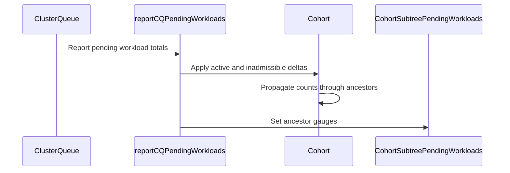

# PR #14149: Add cohort subtree pending workloads metric

**Summary**: Add cohort subtree pending workloads metric

**Sources**: https://github.com/kubernetes-sigs/kueue/pull/14149

**Last updated**: 2026-08-31T19:43:13Z

---

## Metadata

- **State**: open
- **Author**: [@carmal891](https://github.com/carmal891)
- **Branch**: `feature/13588-custom-metric-labels` → `main`
- **Created**: 2026-08-10T21:20:38Z
- **Updated**: 2026-08-31T19:43:13Z
- **Merged**: —
- **Closed**: —
- **Labels**: `kind/feature`, `release-note`, `size/L`, `cncf-cla: yes`, `area/testing`
- **Assignees**: _none_
- **Requested reviewers**: [@mimowo](https://github.com/mimowo), [@pajakd](https://github.com/pajakd), [@Singularity23x0](https://github.com/Singularity23x0)
- **Changed files**: 8   **+473 / -8**

## Description

<!--  Thanks for sending a pull request!  Here are some tips for you:

1. If this is your first time, please read our contributor guidelines: https://git.k8s.io/community/contributors/guide/first-contribution.md#your-first-contribution and developer guide https://git.k8s.io/community/contributors/devel/development.md#development-guide
2. Please label this pull request according to what type of issue you are addressing, especially if this is a release targeted pull request. For reference on required PR/issue labels, read here:
https://git.k8s.io/community/contributors/devel/sig-release/release.md#issuepr-kind-label
3. Ensure you have added or ran the appropriate tests for your PR: https://git.k8s.io/community/contributors/devel/sig-testing/testing.md
4. If you want *faster* PR reviews, read how: https://git.k8s.io/community/contributors/guide/pull-requests.md#best-practices-for-faster-reviews
5. If the PR is unfinished, see how to mark it: https://git.k8s.io/community/contributors/guide/pull-requests.md#marking-unfinished-pull-requests
-->

#### What type of PR is this?
/kind feature
/area testing

<!--
Add one of the following kinds:
/kind bug
/kind cleanup
/kind documentation
/kind feature
/kind kep

Optionally add one or more of the following kinds if applicable:
/kind api-change
/kind deprecation
/kind failing-test
/kind flake
/kind regression

Please also consider setting the area:
/area tas
/area was
/area integrations
/area multikueue
/area dashboard
/area localization
/area testing
/area website
-->

#### What this PR does / why we need it:

Adds a new Prometheus gauge metric kueue_cohort_subtree_pending_workloads that reports the number of pending workloads per cohort subtree, broken down by status (active or inadmissible).

Kueue currently reports pending workload counts per ClusterQueue and quota rollups per Cohort, but there is no metric showing pending workloads aggregated across a Cohort's subtree. This makes it hard to answer capacity questions at the team or department level without manually summing across every ClusterQueue.


#### Which issue(s) this PR fixes:
<!--
*Automatically closes linked issue when PR is merged.
Usage: `Fixes #<issue number>`, or `Fixes (paste link of issue)`.
_If PR is about `failing-tests or flakes`, please post the related issues/tests in a comment and do not use `Fixes`_*
-->
Fixes #14555 

#### Special notes for your reviewer:

The implementation mirrors the admitted-workloads cohort metric pattern. The gauge is reset to zero before each re-report to avoid stale values when ClusterQueues are removed from a cohort.

#### Does this PR introduce a user-facing change?
<!--
If no, just write "NONE" in the release-note block below.
If yes, a release note is required:
Enter your extended release note in the block below. If the PR requires additional action from users switching to the new release, include the string "action required".
-->
```release-note
Adds new Prometheus metric `kueue_cohort_subtree_pending_workloads{cohort, status, replica_role}` that reports the number of pending workloads per cohort subtree, aggregated from all ClusterQueues within that cohort.
```


<!-- This is an auto-generated comment: release notes by coderabbit.ai -->
## Summary by CodeRabbit

## Summary by CodeRabbit

* **New Features**
  * Added metrics for active and inadmissible pending workloads across cohort hierarchies.
  * Metrics include cohort, workload status, replica role, and custom labels.
* **Bug Fixes**
  * Improved metric accuracy when queues or cohorts are moved, updated, or deleted.
  * Added cleanup to prevent stale cohort pending-workload metrics.
* **Documentation**
  * Documented the `kueue_cohort_subtree_pending_workloads` metric, including its labels and reporting behavior.
<!-- end of auto-generated comment: release notes by coderabbit.ai -->

## Discussion

### Comment by [@netlify[bot]](https://github.com/apps/netlify) — 2026-08-10T21:20:44Z

### <span aria-hidden="true">✅</span> Deploy Preview for *kubernetes-sigs-kueue* ready!


|  Name | Link |
|:-:|------------------------|
|<span aria-hidden="true">🔨</span> Latest commit | d02e7be7eb97e9a6055cfb76da94453f63af8b34 |
|<span aria-hidden="true">🔍</span> Latest deploy log | https://app.netlify.com/projects/kubernetes-sigs-kueue/deploys/6a95c12d20cdd9000899afd1 |
|<span aria-hidden="true">😎</span> Deploy Preview | [https://deploy-preview-14149--kubernetes-sigs-kueue.netlify.app](https://deploy-preview-14149--kubernetes-sigs-kueue.netlify.app) |
|<span aria-hidden="true">📱</span> Preview on mobile | <details><summary> Toggle QR Code... </summary><br /><br /><br /><br />_Use your smartphone camera to open QR code link._</details> |
---
<!-- [kubernetes-sigs-kueue Preview](https://deploy-preview-14149--kubernetes-sigs-kueue.netlify.app) -->
_To edit notification comments on pull requests, go to your [Netlify project configuration](https://app.netlify.com/projects/kubernetes-sigs-kueue/configuration/notifications#deploy-notifications)._

### Comment by [@kubernetes-prow[bot]](https://github.com/apps/kubernetes-prow) — 2026-08-10T21:20:50Z

[APPROVALNOTIFIER] This PR is **NOT APPROVED**

This pull-request has been approved by: *<a href="https://github.com/kubernetes-sigs/kueue/pull/14149#" title="Author self-approved">carmal891</a>*
**Once this PR has been reviewed and has the lgtm label**, please assign [mbobrovskyi](https://github.com/mbobrovskyi), [pbundyra](https://github.com/pbundyra), [tenzen-y](https://github.com/tenzen-y) for approval. For more information see [the Code Review Process](https://git.k8s.io/community/contributors/guide/owners.md#the-code-review-process).

The full list of commands accepted by this bot can be found [here](https://go.k8s.io/bot-commands?repo=kubernetes-sigs%2Fkueue).

<details open>
Needs approval from an approver in each of these files:

- **[OWNERS](https://github.com/kubernetes-sigs/kueue/blob/main/OWNERS)**

Approvers can indicate their approval by writing `/approve` in a comment
Approvers can cancel approval by writing `/approve cancel` in a comment
</details>
<!-- META={"approvers":["mbobrovskyi","pbundyra","tenzen-y"]} -->

### Comment by [@coderabbitai[bot]](https://github.com/apps/coderabbitai) — 2026-08-10T21:21:17Z

<!-- This is an auto-generated comment: summarize by coderabbit.ai -->
<!-- review_stack_entry_start -->

[](https://app.coderabbit.ai/change-stack/kubernetes-sigs/kueue/pull/14149?utm_source=github_walkthrough&utm_medium=github&utm_campaign=change_stack)

<!-- review_stack_entry_end -->
<!-- This is an auto-generated comment: review paused by coderabbit.ai -->

> [!NOTE]
> ## Reviews paused
> 
> It looks like this branch is under active development. To avoid overwhelming you with review comments due to an influx of new commits, CodeRabbit has automatically paused this review. You can configure this behavior by changing the `reviews.auto_review.auto_pause_after_reviewed_commits` setting.
> 
> Use the following commands to manage reviews:
> - `@coderabbitai resume` to resume automatic reviews.
> - `@coderabbitai review` to trigger a single review.
> 
> Use the checkboxes below for quick actions:
> - [ ] <!-- {"checkboxId": "7f6cc2e2-2e4e-497a-8c31-c9e4573e93d1"} --> ▶️ Resume reviews
> - [ ] <!-- {"checkboxId": "e9bb8d72-00e8-4f67-9cb2-caf3b22574fe"} --> 🔍 Trigger review

<!-- end of auto-generated comment: review paused by coderabbit.ai -->
<!-- recent_review_start -->

No actionable comments were generated in the recent review. 🎉

<details>
<summary>ℹ️ Recent review info</summary>

<details>
<summary>⚙️ Run configuration</summary>

**Configuration used**: Path: .coderabbit.yaml

**Review profile**: CHILL

**Plan**: Pro Plus

**Run ID**: `79a4d2e1-134a-40c5-b604-9c02f18b8f29`

</details>

<details>
<summary>📥 Commits</summary>

Reviewing files that changed from the base of the PR and between 79b78766a5739f5046616ed5b771f85b7313fe76 and eadb853b9f3f6546ecd222f67b26351e5b10af2c.

</details>

<details>
<summary>📒 Files selected for processing (8)</summary>

* `pkg/cache/queue/cluster_queue.go`
* `pkg/cache/queue/cohort.go`
* `pkg/cache/queue/manager.go`
* `pkg/cache/queue/manager_test.go`
* `pkg/cache/queue/metrics.go`
* `pkg/metrics/metrics.go`
* `pkg/metrics/metrics_test.go`
* `site/content/en/docs/reference/metrics.md`

</details>

<details>
<summary>🚧 Files skipped from review as they are similar to previous changes (8)</summary>

* pkg/cache/queue/manager_test.go
* site/content/en/docs/reference/metrics.md
* pkg/cache/queue/cluster_queue.go
* pkg/metrics/metrics.go
* pkg/cache/queue/metrics.go
* pkg/metrics/metrics_test.go
* pkg/cache/queue/cohort.go
* pkg/cache/queue/manager.go

</details>

**Included review availability:** Your plan includes up to 8 reviews per rolling hour; 6 remain after this review.

</details>

---


<!-- recent_review_end -->
<!-- walkthrough_start -->

<details>
<summary>📝 Walkthrough</summary>

## Walkthrough

### Changes

The PR adds the `kueue_cohort_subtree_pending_workloads` gauge for active and inadmissible workloads. It propagates ClusterQueue deltas through cohort ancestors and updates counts during hierarchy changes and deletion. Tests and documentation cover the metric.

**Cohort pending workload metrics**

|Layer / File(s)|Summary|
|---|---|
|**Metric contract and storage** <br> `pkg/metrics/metrics.go`, `pkg/metrics/metrics_test.go`, `site/content/en/docs/reference/metrics.md`|Defines, registers, reports, cleans up, tests, and documents the cohort subtree pending-workload metric.|
|**Hierarchy aggregation and reporting** <br> `pkg/cache/queue/cluster_queue.go`, `pkg/cache/queue/cohort.go`, `pkg/cache/queue/metrics.go`|Tracks previously reported ClusterQueue counts and propagates active and inadmissible deltas through cohort ancestors.|
|**Hierarchy lifecycle integration and validation** <br> `pkg/cache/queue/manager.go`, `pkg/cache/queue/manager_test.go`|Maintains counts when cohorts or ClusterQueues move or are deleted. Tests cover nested cohorts, reparenting, custom labels, and cleanup.|

**Estimated code review effort:** 3 (Moderate) | ~25 minutes

<!-- final_review_risk_start -->
**Merge Risk:** _⚪ Minimal_ · up to `eadb8`

This change adds a cohort-subtree pending-workloads metric with corresponding tests and documentation; no actionable merge-blocking risk remains beyond normal checks and review.
<!-- final_review_risk_end -->

### Sequence Diagram(s)



**Suggested reviewers:** `pajakd`

</details>

<!-- walkthrough_end -->
<!-- pre_merge_checks_walkthrough_start -->

<details>
<summary>🚥 Pre-merge checks | ✅ 4 | ❌ 1</summary>

### ❌ Failed checks (1 warning)

|     Check name     | Status     | Explanation                                                                           | Resolution                                                                         |
| :----------------: | :--------- | :------------------------------------------------------------------------------------ | :--------------------------------------------------------------------------------- |
| Docstring Coverage | ⚠️ Warning | Docstring coverage is 10.53% which is insufficient. The required threshold is 80.00%. | Write docstrings for the functions missing them to satisfy the coverage threshold. |

<details>
<summary>✅ Passed checks (4 passed)</summary>

|         Check name         | Status   | Explanation                                                                                                                              |
| :------------------------: | :------- | :--------------------------------------------------------------------------------------------------------------------------------------- |
|      Description Check     | ✅ Passed | Check skipped - CodeRabbit’s high-level summary is enabled.                                                                              |
|         Title check        | ✅ Passed | The title clearly and concisely describes the addition of the cohort subtree pending workloads metric.                                   |
|     Linked Issues check    | ✅ Passed | The changes implement the requested gauge metric with subtree aggregation and active or inadmissible workload status reporting [`#14555`]. |
| Out of Scope Changes check | ✅ Passed | The changes support the requested metric through necessary aggregation logic, cleanup, tests, registration, and documentation.           |

</details>

</details>

<!-- pre_merge_checks_walkthrough_end -->
<!-- finishing_touch_checkbox_start -->

<details>
<summary>✨ Finishing Touches</summary>

<details>
<summary>🧪 Generate unit tests (beta)</summary>

- [ ] <!-- {"checkboxId": "f47ac10b-58cc-4372-a567-0e02b2c3d479", "radioGroupId": "utg-output-choice-group-unknown_comment_id"} -->   Create PR with unit tests

</details>

</details>

<!-- finishing_touch_checkbox_end -->
<!-- tips_start -->

---


<sub>Comment `@coderabbitai help` to get the list of available commands.</sub>

<!-- tips_end -->

### Comment by [@Singularity23x0](https://github.com/Singularity23x0) — 2026-08-17T11:02:49Z

> Fixes https://github.com/kubernetes-sigs/kueue/issues/12629

Please mark it as "Contributes to #", otherwise it will close the umbrella issue once merged.
Creating a dedicated issue for this change would be best for transparency. You can link it in the umbrella issue for visibility as well. Then feel free to mark that one in the description as "Fixes #".

### Comment by [@coderabbitai[bot]](https://github.com/apps/coderabbitai) — 2026-08-17T13:27:10Z

<!-- This is an auto-generated comment by CodeRabbit -->
> [!NOTE]
> GitHub couldn't provide a complete incremental comparison for this pull request, so CodeRabbit is performing a full review instead. This review may take a little longer.

### Comment by [@carmal891](https://github.com/carmal891) — 2026-08-18T01:14:28Z

> > Fixes #12629
> 
> Please mark it as "Contributes to #", otherwise it will close the umbrella issue once merged. Creating a dedicated issue for this change would be best for transparency. You can link it in the umbrella issue for visibility as well. Then feel free to mark that one in the description as "Fixes #".

Done

### Comment by [@Singularity23x0](https://github.com/Singularity23x0) — 2026-08-31T14:51:56Z

Hi @carmal891, whats the status on this PR? =D

### Comment by [@carmal891](https://github.com/carmal891) — 2026-08-31T14:56:08Z

@Singularity23x0 Apologies for the delay, I got caught up with work priorities. I’ve addressed the PR suggestions locally and will update the PR in some time for the second round of review.

### Comment by [@carmal891](https://github.com/carmal891) — 2026-08-31T19:43:13Z

@Singularity23x0 Please proceed to review when possible. Thanks for the patience

## Reviews

### Review by [@coderabbitai[bot]](https://github.com/apps/coderabbitai) (commented) — 2026-08-10T21:25:23Z

**Actionable comments posted: 4**

<details>
<summary>🤖 Prompt for all review comments with AI agents</summary>

```
Verify each finding against current code. Fix only still-valid issues, skip the
rest with a brief reason, keep changes minimal, and validate.

Inline comments:
In `@pkg/cache/queue/manager.go`:
- Around line 344-348: Preserve pending workload counts when DeleteCohort
replaces a cohort with an implicit one: in pkg/cache/queue/manager.go lines
344-348, save the subtree counts before removal, initialize or recompute the
replacement, and re-emit active and inadmissible metrics after cleanup; in
pkg/cache/queue/manager_test.go lines 2918-2923, retain cq2 after deletion,
trigger a later pending-workload report, and assert the metric includes both
existing and newly added workloads.
- Around line 319-325: Validate hierarchy.HasCycle(oldParent) before updating
counts or traversing the former parent in the reparenting logic around oldParent
and PathSelfToRoot. Use that pre-change validation to guard both
updatePendingWorkloadsCount and the metrics traversal, preventing traversal of a
cyclic old parent; retain the existing new-parent and cohort-cycle checks.
- Around line 452-456: Update the edge-move flow around
reportCohortSubtreePendingWorkloads and cqImpl.Update so a failed
ClusterQueue.Update preserves the existing cohort contribution and
lastReportedCohort values. Validate the update before zeroing the old
contribution, or capture and restore the prior contribution when Update returns
an error; keep successful moves clearing the old contribution as they do now.

In `@pkg/metrics/metrics.go`:
- Around line 1448-1450: Update ReportCohortSubtreePendingWorkloads to retrieve
the configured Cohort label values and include them in the labels passed to
CohortSubtreePendingWorkloads.WithLabelValues, preserving the existing cohort,
status, and replica_role values. Update each reporting call in the queue metrics
and manager paths to provide the retrieved values instead of nil, and add
coverage for configured Cohort custom labels.
```

</details>

<details>
<summary>🪄 Autofix</summary>

Fix all unresolved CodeRabbit comments on this PR:

- [ ] <!-- {"checkboxId": "4b0d0e0a-96d7-4f10-b296-3a18ea78f0b9"} --> Push a commit to this branch (recommended)
- [ ] <!-- {"checkboxId": "ff5b1114-7d8c-49e6-8ac1-43f82af23a33"} --> Create a new PR with the fixes

</details>

---

<details>
<summary>ℹ️ Review info</summary>

<details>
<summary>⚙️ Run configuration</summary>

**Configuration used**: Path: .coderabbit.yaml

**Review profile**: CHILL

**Plan**: Pro Plus

**Run ID**: `aee8e7fd-7318-4c3c-af87-f90b4aad1040`

</details>

<details>
<summary>📥 Commits</summary>

Reviewing files that changed from the base of the PR and between e89d9f8d970d487292516df50c73afb7e363b837 and 2b100bde1b0ea67c417cf42d514039402b32334b.

</details>

<details>
<summary>📒 Files selected for processing (8)</summary>

* `pkg/cache/queue/cluster_queue.go`
* `pkg/cache/queue/cohort.go`
* `pkg/cache/queue/manager.go`
* `pkg/cache/queue/manager_test.go`
* `pkg/cache/queue/metrics.go`
* `pkg/metrics/metrics.go`
* `pkg/metrics/metrics_test.go`
* `site/content/en/docs/reference/metrics.md`

</details>

</details>

<!-- This is an auto-generated comment by CodeRabbit for review status -->

- **pkg/cache/queue/manager.go:323** by [@coderabbitai[bot]](https://github.com/apps/coderabbitai) — 2026-08-10T21:25:22Z
```diff
@@ -308,8 +308,31 @@ func (m *Manager) AddOrUpdateCohort(ctx context.Context, cohort *kueue.Cohort) {
 	cohortName := kueue.CohortReference(cohort.Name)
 
 	m.hm.AddCohort(cohortName)
-	m.hm.UpdateCohortEdge(cohortName, cohort.Spec.ParentName)
+
 	c := m.hm.Cohort(cohortName)
+	oldParent := c.Parent()
+
+	m.hm.UpdateCohortEdge(cohortName, cohort.Spec.ParentName)
+
+	newParent := c.Parent()
+	// If the cohort moved parents, adjust all affected ancestor counts and re-emit.
+	if oldParent != newParent && !hierarchy.HasCycle(c) {
+		if oldParent != nil {
+			oldParent.updatePendingWorkloadsCount(-c.pendingActiveCount, -c.pendingInadmissibleCount)
+			for ancestor := range oldParent.PathSelfToRoot() {
+				metrics.ReportCohortSubtreePendingWorkloads(ancestor.Name, metrics.PendingStatusActive, ancestor.pendingActiveCount, nil, m.roleTracker)
+				metrics.ReportCohortSubtreePendingWorkloads(ancestor.Name, metrics.PendingStatusInadmissible, ancestor.pendingInadmissibleCount, nil, m.roleTracker)
+			}
```

  _🩺 Stability & Availability_ | _🟠 Major_ | _⚡ Quick win_
  
  **Check the former parent before traversing it.**
  
  Line 319 checks `c` after its edge changes. If `oldParent` already has a cycle and this cohort is a leaf below it, moving the leaf makes `HasCycle(c)` false. Lines 322-325 then traverse the still-cyclic `oldParent` forever while the Manager lock is held.
  
  Check `hierarchy.HasCycle(oldParent)` before both the count update and `PathSelfToRoot` traversal.
  
  <details>
  <summary>🤖 Prompt for AI Agents</summary>
  
  ```
  Verify each finding against current code. Fix only still-valid issues, skip the
  rest with a brief reason, keep changes minimal, and validate.
  
  In `@pkg/cache/queue/manager.go` around lines 319 - 325, Validate
  hierarchy.HasCycle(oldParent) before updating counts or traversing the former
  parent in the reparenting logic around oldParent and PathSelfToRoot. Use that
  pre-change validation to guard both updatePendingWorkloadsCount and the metrics
  traversal, preventing traversal of a cyclic old parent; retain the existing
  new-parent and cohort-cycle checks.
  ```
  
  </details>
  
  <!-- fingerprinting:phantom:medusa:tapir -->
  
  <!-- cr-indicator-types:potential_issue -->
  
  <!-- cr-comment:v1:b6d779df272790e77f010ffa -->
  
  <!-- This is an auto-generated comment by CodeRabbit -->
  
  ✅ Addressed in commit deccf6e

- **pkg/cache/queue/manager.go:348** by [@coderabbitai[bot]](https://github.com/apps/coderabbitai) — 2026-08-10T21:25:22Z
```diff
@@ -318,7 +341,11 @@ func (m *Manager) AddOrUpdateCohort(ctx context.Context, cohort *kueue.Cohort) {
 func (m *Manager) DeleteCohort(cohortName kueue.CohortReference) {
 	m.Lock()
 	defer m.Unlock()
+	if cohort := m.hm.Cohort(cohortName); cohort != nil {
+		cohort.updatePendingWorkloadsCount(-cohort.pendingActiveCount, -cohort.pendingInadmissibleCount)
+	}
 	m.hm.DeleteCohort(cohortName)
+	metrics.ClearCohortPendingWorkloadsMetrics(cohortName)
```

  _🗄️ Data Integrity & Integration_ | _🟠 Major_ | _🏗️ Heavy lift_
  
  **Preserve pending counts when deletion creates an implicit cohort.**
  
  `hierarchy.Manager.DeleteCohort` replaces a deleted cohort that still has children with an implicit cohort of the same name. Line 345 resets the old instance counts before that replacement. The replacement starts at zero, and each child ClusterQueue retains its previous `lastReportedCohort*` values. Later reports therefore apply only a delta and undercount the subtree.
  
  - `pkg/cache/queue/manager.go#L344-L348`: save the subtree counts before removal, initialize or recompute the implicit replacement, and re-emit its active and inadmissible metrics after cleanup.
  - `pkg/cache/queue/manager_test.go#L2918-L2923`: retain `cq2` after deletion, trigger a later pending-workload report, and assert that the metric includes both its existing and newly added workloads.
  
  <details>
  <summary>📍 Affects 2 files</summary>
  
  - `pkg/cache/queue/manager.go#L344-L348` (this comment)
  - `pkg/cache/queue/manager_test.go#L2918-L2923`
  
  </details>
  
  <details>
  <summary>🤖 Prompt for AI Agents</summary>
  
  ```
  Verify each finding against current code. Fix only still-valid issues, skip the
  rest with a brief reason, keep changes minimal, and validate.
  
  In `@pkg/cache/queue/manager.go` around lines 344 - 348, Preserve pending workload
  counts when DeleteCohort replaces a cohort with an implicit one: in
  pkg/cache/queue/manager.go lines 344-348, save the subtree counts before
  removal, initialize or recompute the replacement, and re-emit active and
  inadmissible metrics after cleanup; in pkg/cache/queue/manager_test.go lines
  2918-2923, retain cq2 after deletion, trigger a later pending-workload report,
  and assert the metric includes both existing and newly added workloads.
  ```
  
  </details>
  
  <!-- consolidated_sites_start -->
  <!--
  <consolidated_sites>
  <site>
  <role>anchor</role>
  <file>pkg/cache/queue/manager.go</file>
  <line_range>344-348</line_range>
  </site>
  <site>
  <role>sibling</role>
  <file>pkg/cache/queue/manager_test.go</file>
  <line_range>2918-2923</line_range>
  </site>
  </consolidated_sites>
  -->
  <!-- consolidated_sites_end -->
  
  <!-- fingerprinting:phantom:medusa:tapir -->
  
  <!-- cr-indicator-types:potential_issue -->
  
  <!-- cr-comment:v1:76d1f88a2d562d0babe25609 -->
  
  <!-- This is an auto-generated comment by CodeRabbit -->
  
  ✅ Addressed in commit deccf6e

- **pkg/cache/queue/manager.go:456** by [@coderabbitai[bot]](https://github.com/apps/coderabbitai) — 2026-08-10T21:25:22Z
```diff
@@ -422,11 +449,15 @@ func (m *Manager) UpdateClusterQueue(ctx context.Context, cq *kueue.ClusterQueue
 	}
 
 	oldActive := cqImpl.Active()
+	// Zero out the old cohort contribution before the edge is moved.
+	reportCohortSubtreePendingWorkloads(m, cqImpl, 0, 0)
 	// TODO(#8): recreate heap based on a change of queueing policy.
 	if err := cqImpl.Update(cq); err != nil {
 		return err
```

  _🗄️ Data Integrity & Integration_ | _🟠 Major_ | _⚡ Quick win_
  
  **Restore the old contribution when `ClusterQueue.Update` fails.**
  
  Line 453 subtracts the current contribution before line 455 can reject an invalid `NamespaceSelector`. The ClusterQueue then remains attached to its old cohort, but its aggregate and `lastReportedCohort*` values are zeroed. The metric stays incorrect until another report changes the count.
  
  Validate the update before clearing the contribution, or restore the captured old contribution on the error path.
  
  <details>
  <summary>🤖 Prompt for AI Agents</summary>
  
  ```
  Verify each finding against current code. Fix only still-valid issues, skip the
  rest with a brief reason, keep changes minimal, and validate.
  
  In `@pkg/cache/queue/manager.go` around lines 452 - 456, Update the edge-move flow
  around reportCohortSubtreePendingWorkloads and cqImpl.Update so a failed
  ClusterQueue.Update preserves the existing cohort contribution and
  lastReportedCohort values. Validate the update before zeroing the old
  contribution, or capture and restore the prior contribution when Update returns
  an error; keep successful moves clearing the old contribution as they do now.
  ```
  
  </details>
  
  <!-- fingerprinting:phantom:medusa:tapir -->
  
  <!-- cr-indicator-types:potential_issue -->
  
  <!-- cr-comment:v1:1cf72b6f6ca2305ef3fa5f3d -->
  
  <!-- This is an auto-generated comment by CodeRabbit -->
  
  ✅ Addressed in commit deccf6e

- **pkg/metrics/metrics.go:1522** by [@coderabbitai[bot]](https://github.com/apps/coderabbitai) — 2026-08-10T21:25:22Z
```diff
@@ -1429,6 +1445,11 @@ func ReportCohortSubtreeAdmittedActiveWorkloads(cohort kueue.CohortReference, co
 	CohortSubtreeAdmittedActiveWorkloads.WithLabelValues(labels...).Set(float64(count))
 }
 
+func ReportCohortSubtreePendingWorkloads(cohort kueue.CohortReference, status string, count int, customLabelValues []string, tracker *roletracker.RoleTracker) {
+	labels := append([]string{string(cohort), status, roletracker.GetRole(tracker)}, customLabelValues...)
+	CohortSubtreePendingWorkloads.WithLabelValues(labels...).Set(float64(count))
```

  _🩺 Stability & Availability_ | _🟠 Major_ | _⚡ Quick win_
  
  **Pass configured Cohort label values to this metric.**
  
  Line 1450 supplies only `cohort`, `status`, and `replica_role`. Lines 1001-1007 add configured Cohort labels to the `GaugeVec`. The supplied callers in `pkg/cache/queue/metrics.go` and `pkg/cache/queue/manager.go` pass `nil`, so `WithLabelValues` panics when Cohort custom labels are configured.
  
  Retrieve and pass the Cohort label values at each reporting call. Add the required custom-label integration coverage.
  
  <details>
  <summary>🤖 Prompt for AI Agents</summary>
  
  ```
  Verify each finding against current code. Fix only still-valid issues, skip the
  rest with a brief reason, keep changes minimal, and validate.
  
  In `@pkg/metrics/metrics.go` around lines 1448 - 1450, Update
  ReportCohortSubtreePendingWorkloads to retrieve the configured Cohort label
  values and include them in the labels passed to
  CohortSubtreePendingWorkloads.WithLabelValues, preserving the existing cohort,
  status, and replica_role values. Update each reporting call in the queue metrics
  and manager paths to provide the retrieved values instead of nil, and add
  coverage for configured Cohort custom labels.
  ```
  
  </details>
  
  <!-- fingerprinting:phantom:medusa:tapir -->
  
  <!-- cr-indicator-types:potential_issue -->
  
  <!-- cr-comment:v1:dc36661943e27b71c853ba8b -->
  
  <!-- This is an auto-generated comment by CodeRabbit -->
  
  ✅ Addressed in commits 98497c0 to d02e7be

### Review by [@mimowo](https://github.com/mimowo) (commented) — 2026-08-11T07:52:07Z

- **pkg/cache/queue/cluster_queue.go:225** by [@mimowo](https://github.com/mimowo) — 2026-08-11T07:52:07Z
```diff
@@ -217,6 +217,12 @@ type ClusterQueue struct {
 	// Configured resources are seeded at 0 by Update() so they appear in metrics
 	// even when no workloads are pending; stale zero entries are pruned on Update().
 	pendingResourcesTotal map[corev1.ResourceName]int64
+
+	// lastReportedCohortActive and lastReportedCohortInadmissible are the pending
+	// counts last propagated into the cohort subtree aggregates. Used to compute
+	// the signed delta on each reportCQPendingWorkloads call.
+	lastReportedCohortActive       int
+	lastReportedCohortInadmissible int
```

  I would like to consider ecapsualting that, maybe this will happen naturally after https://github.com/kubernetes-sigs/kueue/pull/14111

### Review by [@carmal891](https://github.com/carmal891) (commented) — 2026-08-17T13:27:04Z

- **pkg/cache/queue/cluster_queue.go:225** by [@carmal891](https://github.com/carmal891) — 2026-08-17T13:27:04Z
```diff
@@ -217,6 +217,12 @@ type ClusterQueue struct {
 	// Configured resources are seeded at 0 by Update() so they appear in metrics
 	// even when no workloads are pending; stale zero entries are pruned on Update().
 	pendingResourcesTotal map[corev1.ResourceName]int64
+
+	// lastReportedCohortActive and lastReportedCohortInadmissible are the pending
+	// counts last propagated into the cohort subtree aggregates. Used to compute
+	// the signed delta on each reportCQPendingWorkloads call.
+	lastReportedCohortActive       int
+	lastReportedCohortInadmissible int
```

  Done

### Review by [@Singularity23x0](https://github.com/Singularity23x0) (commented) — 2026-08-18T14:05:52Z

- **pkg/cache/queue/manager.go:365** by [@Singularity23x0](https://github.com/Singularity23x0) — 2026-08-18T14:05:52Z
```diff
@@ -306,8 +306,31 @@ func (m *Manager) AddOrUpdateCohort(ctx context.Context, cohort *kueue.Cohort) {
 	cohortName := kueue.CohortReference(cohort.Name)
 
 	m.hm.AddCohort(cohortName)
-	m.hm.UpdateCohortEdge(cohortName, cohort.Spec.ParentName)
+
 	c := m.hm.Cohort(cohortName)
+	oldParent := c.Parent()
+
+	m.hm.UpdateCohortEdge(cohortName, cohort.Spec.ParentName)
+
+	newParent := c.Parent()
+	// If the cohort moved parents, adjust all affected ancestor counts and re-emit.
+	if oldParent != newParent && !hierarchy.HasCycle(c) {
+		if oldParent != nil && !hierarchy.HasCycle(oldParent) {
+			oldParent.updatePendingWorkloadsCount(-c.pendingActiveCount, -c.pendingInadmissibleCount)
+			for ancestor := range oldParent.PathSelfToRoot() {
+				metrics.ReportCohortSubtreePendingWorkloads(ancestor.Name, metrics.PendingStatusActive, ancestor.pendingActiveCount, m.customLabels.CohortGet(ancestor.Name), m.roleTracker)
+				metrics.ReportCohortSubtreePendingWorkloads(ancestor.Name, metrics.PendingStatusInadmissible, ancestor.pendingInadmissibleCount, m.customLabels.CohortGet(ancestor.Name), m.roleTracker)
+			}
+		}
+		if newParent != nil {
+			newParent.updatePendingWorkloadsCount(c.pendingActiveCount, c.pendingInadmissibleCount)
+			for ancestor := range newParent.PathSelfToRoot() {
+				metrics.ReportCohortSubtreePendingWorkloads(ancestor.Name, metrics.PendingStatusActive, ancestor.pendingActiveCount, m.customLabels.CohortGet(ancestor.Name), m.roleTracker)
+				metrics.ReportCohortSubtreePendingWorkloads(ancestor.Name, metrics.PendingStatusInadmissible, ancestor.pendingInadmissibleCount, m.customLabels.CohortGet(ancestor.Name), m.roleTracker)
+			}
+		}
+	}
```

  One issue here is if we change parents to someone who has the same ancestry, then we will be walking the same path of the tree twice. More importantly we will be updating metric series twice.
  It would be good if we could gather the ancestors first, and only update the ones that actually see a change.

### Review by [@Singularity23x0](https://github.com/Singularity23x0) (commented) — 2026-08-18T14:10:19Z

- **pkg/cache/queue/manager.go:349** by [@Singularity23x0](https://github.com/Singularity23x0) — 2026-08-18T14:10:20Z
```diff
@@ -316,7 +339,26 @@ func (m *Manager) AddOrUpdateCohort(ctx context.Context, cohort *kueue.Cohort) {
 func (m *Manager) DeleteCohort(cohortName kueue.CohortReference) {
 	m.Lock()
 	defer m.Unlock()
+	if cohort := m.hm.Cohort(cohortName); cohort != nil {
+		cohort.updatePendingWorkloadsCount(-cohort.pendingActiveCount, -cohort.pendingInadmissibleCount)
+	}
 	m.hm.DeleteCohort(cohortName)
+	metrics.ClearCohortPendingWorkloadsMetrics(cohortName)
+	// hm.DeleteCohort replaces an explicit cohort that still has children with a
+	// fresh implicit cohort (zero counts). Re-seed its counts from the children
+	// so that future delta reports are correct.
```

  Will the children of the implicit cohort differ from the one that we just deleted? Can't we use the already calculated values of the deleted workload to populate the implicit counts?

### Review by [@Singularity23x0](https://github.com/Singularity23x0) (commented) — 2026-08-18T14:12:23Z

- **pkg/cache/queue/manager.go:390** by [@Singularity23x0](https://github.com/Singularity23x0) — 2026-08-18T14:12:23Z
```diff
@@ -316,7 +339,26 @@ func (m *Manager) AddOrUpdateCohort(ctx context.Context, cohort *kueue.Cohort) {
 func (m *Manager) DeleteCohort(cohortName kueue.CohortReference) {
 	m.Lock()
 	defer m.Unlock()
+	if cohort := m.hm.Cohort(cohortName); cohort != nil {
+		cohort.updatePendingWorkloadsCount(-cohort.pendingActiveCount, -cohort.pendingInadmissibleCount)
+	}
 	m.hm.DeleteCohort(cohortName)
+	metrics.ClearCohortPendingWorkloadsMetrics(cohortName)
+	// hm.DeleteCohort replaces an explicit cohort that still has children with a
+	// fresh implicit cohort (zero counts). Re-seed its counts from the children
+	// so that future delta reports are correct.
+	if implicit := m.hm.Cohort(cohortName); implicit != nil {
+		for _, cq := range implicit.ChildCQs() {
+			implicit.pendingActiveCount += cq.lastReportedCohort.active
+			implicit.pendingInadmissibleCount += cq.lastReportedCohort.inadmissible
+		}
+		for _, child := range implicit.ChildCohorts() {
+			implicit.pendingActiveCount += child.pendingActiveCount
+			implicit.pendingInadmissibleCount += child.pendingInadmissibleCount
+		}
+		metrics.ReportCohortSubtreePendingWorkloads(cohortName, metrics.PendingStatusActive, implicit.pendingActiveCount, m.customLabels.CohortGet(cohortName), m.roleTracker)
+		metrics.ReportCohortSubtreePendingWorkloads(cohortName, metrics.PendingStatusInadmissible, implicit.pendingInadmissibleCount, m.customLabels.CohortGet(cohortName), m.roleTracker)
```

  So, if the implicit exists there is no need to ClearCohortPendingWorkloadsMetrics. Given that the operation can be heavy on the metrics (cpu-wise), we should only clear the metrics if the cohort is actually deleted. If an implicit replaces it we can update the counts if necessary.

### Review by [@Singularity23x0](https://github.com/Singularity23x0) (commented) — 2026-08-18T14:13:38Z

- **pkg/cache/queue/manager.go:390** by [@Singularity23x0](https://github.com/Singularity23x0) — 2026-08-18T14:13:38Z
```diff
@@ -316,7 +339,26 @@ func (m *Manager) AddOrUpdateCohort(ctx context.Context, cohort *kueue.Cohort) {
 func (m *Manager) DeleteCohort(cohortName kueue.CohortReference) {
 	m.Lock()
 	defer m.Unlock()
+	if cohort := m.hm.Cohort(cohortName); cohort != nil {
+		cohort.updatePendingWorkloadsCount(-cohort.pendingActiveCount, -cohort.pendingInadmissibleCount)
+	}
 	m.hm.DeleteCohort(cohortName)
+	metrics.ClearCohortPendingWorkloadsMetrics(cohortName)
+	// hm.DeleteCohort replaces an explicit cohort that still has children with a
+	// fresh implicit cohort (zero counts). Re-seed its counts from the children
+	// so that future delta reports are correct.
+	if implicit := m.hm.Cohort(cohortName); implicit != nil {
+		for _, cq := range implicit.ChildCQs() {
+			implicit.pendingActiveCount += cq.lastReportedCohort.active
+			implicit.pendingInadmissibleCount += cq.lastReportedCohort.inadmissible
+		}
+		for _, child := range implicit.ChildCohorts() {
+			implicit.pendingActiveCount += child.pendingActiveCount
+			implicit.pendingInadmissibleCount += child.pendingInadmissibleCount
+		}
+		metrics.ReportCohortSubtreePendingWorkloads(cohortName, metrics.PendingStatusActive, implicit.pendingActiveCount, m.customLabels.CohortGet(cohortName), m.roleTracker)
+		metrics.ReportCohortSubtreePendingWorkloads(cohortName, metrics.PendingStatusInadmissible, implicit.pendingInadmissibleCount, m.customLabels.CohortGet(cohortName), m.roleTracker)
```

  Assuming the counts change from the original cohort to the implicit one, won't the implicit take the same place in the tree as the original cohort? Wouldn't that mean having to propagate the changes up the tree accross ancestors?

### Review by [@carmal891](https://github.com/carmal891) (commented) — 2026-08-31T18:03:16Z

- **pkg/cache/queue/manager.go:365** by [@carmal891](https://github.com/carmal891) — 2026-08-31T18:03:16Z
```diff
@@ -306,8 +306,31 @@ func (m *Manager) AddOrUpdateCohort(ctx context.Context, cohort *kueue.Cohort) {
 	cohortName := kueue.CohortReference(cohort.Name)
 
 	m.hm.AddCohort(cohortName)
-	m.hm.UpdateCohortEdge(cohortName, cohort.Spec.ParentName)
+
 	c := m.hm.Cohort(cohortName)
+	oldParent := c.Parent()
+
+	m.hm.UpdateCohortEdge(cohortName, cohort.Spec.ParentName)
+
+	newParent := c.Parent()
+	// If the cohort moved parents, adjust all affected ancestor counts and re-emit.
+	if oldParent != newParent && !hierarchy.HasCycle(c) {
+		if oldParent != nil && !hierarchy.HasCycle(oldParent) {
+			oldParent.updatePendingWorkloadsCount(-c.pendingActiveCount, -c.pendingInadmissibleCount)
+			for ancestor := range oldParent.PathSelfToRoot() {
+				metrics.ReportCohortSubtreePendingWorkloads(ancestor.Name, metrics.PendingStatusActive, ancestor.pendingActiveCount, m.customLabels.CohortGet(ancestor.Name), m.roleTracker)
+				metrics.ReportCohortSubtreePendingWorkloads(ancestor.Name, metrics.PendingStatusInadmissible, ancestor.pendingInadmissibleCount, m.customLabels.CohortGet(ancestor.Name), m.roleTracker)
+			}
+		}
+		if newParent != nil {
+			newParent.updatePendingWorkloadsCount(c.pendingActiveCount, c.pendingInadmissibleCount)
+			for ancestor := range newParent.PathSelfToRoot() {
+				metrics.ReportCohortSubtreePendingWorkloads(ancestor.Name, metrics.PendingStatusActive, ancestor.pendingActiveCount, m.customLabels.CohortGet(ancestor.Name), m.roleTracker)
+				metrics.ReportCohortSubtreePendingWorkloads(ancestor.Name, metrics.PendingStatusInadmissible, ancestor.pendingInadmissibleCount, m.customLabels.CohortGet(ancestor.Name), m.roleTracker)
+			}
+		}
+	}
```

  Fixed by gathering both ancestor paths first, then only updating and re-emitting the ones that actually see a change.

### Review by [@carmal891](https://github.com/carmal891) (commented) — 2026-08-31T18:04:51Z

- **pkg/cache/queue/manager.go:349** by [@carmal891](https://github.com/carmal891) — 2026-08-31T18:04:51Z
```diff
@@ -316,7 +339,26 @@ func (m *Manager) AddOrUpdateCohort(ctx context.Context, cohort *kueue.Cohort) {
 func (m *Manager) DeleteCohort(cohortName kueue.CohortReference) {
 	m.Lock()
 	defer m.Unlock()
+	if cohort := m.hm.Cohort(cohortName); cohort != nil {
+		cohort.updatePendingWorkloadsCount(-cohort.pendingActiveCount, -cohort.pendingInadmissibleCount)
+	}
 	m.hm.DeleteCohort(cohortName)
+	metrics.ClearCohortPendingWorkloadsMetrics(cohortName)
+	// hm.DeleteCohort replaces an explicit cohort that still has children with a
+	// fresh implicit cohort (zero counts). Re-seed its counts from the children
+	// so that future delta reports are correct.
```

  The children are identical because `hm.DeleteCohort` transfers them pointer-for-pointer via transferChildren. Used the deleted cohort's already correct counts directly.

### Review by [@carmal891](https://github.com/carmal891) (commented) — 2026-08-31T18:07:09Z

- **pkg/cache/queue/manager.go:390** by [@carmal891](https://github.com/carmal891) — 2026-08-31T18:07:09Z
```diff
@@ -316,7 +339,26 @@ func (m *Manager) AddOrUpdateCohort(ctx context.Context, cohort *kueue.Cohort) {
 func (m *Manager) DeleteCohort(cohortName kueue.CohortReference) {
 	m.Lock()
 	defer m.Unlock()
+	if cohort := m.hm.Cohort(cohortName); cohort != nil {
+		cohort.updatePendingWorkloadsCount(-cohort.pendingActiveCount, -cohort.pendingInadmissibleCount)
+	}
 	m.hm.DeleteCohort(cohortName)
+	metrics.ClearCohortPendingWorkloadsMetrics(cohortName)
+	// hm.DeleteCohort replaces an explicit cohort that still has children with a
+	// fresh implicit cohort (zero counts). Re-seed its counts from the children
+	// so that future delta reports are correct.
+	if implicit := m.hm.Cohort(cohortName); implicit != nil {
+		for _, cq := range implicit.ChildCQs() {
+			implicit.pendingActiveCount += cq.lastReportedCohort.active
+			implicit.pendingInadmissibleCount += cq.lastReportedCohort.inadmissible
+		}
+		for _, child := range implicit.ChildCohorts() {
+			implicit.pendingActiveCount += child.pendingActiveCount
+			implicit.pendingInadmissibleCount += child.pendingInadmissibleCount
+		}
+		metrics.ReportCohortSubtreePendingWorkloads(cohortName, metrics.PendingStatusActive, implicit.pendingActiveCount, m.customLabels.CohortGet(cohortName), m.roleTracker)
+		metrics.ReportCohortSubtreePendingWorkloads(cohortName, metrics.PendingStatusInadmissible, implicit.pendingInadmissibleCount, m.customLabels.CohortGet(cohortName), m.roleTracker)
```

  `Clear` is now called when the cohort is fully deleted. When an implicit cohort takes over, we update the gauge using `Report` instead.

### Review by [@carmal891](https://github.com/carmal891) (commented) — 2026-08-31T18:08:52Z

- **pkg/cache/queue/manager.go:390** by [@carmal891](https://github.com/carmal891) — 2026-08-31T18:08:52Z
```diff
@@ -316,7 +339,26 @@ func (m *Manager) AddOrUpdateCohort(ctx context.Context, cohort *kueue.Cohort) {
 func (m *Manager) DeleteCohort(cohortName kueue.CohortReference) {
 	m.Lock()
 	defer m.Unlock()
+	if cohort := m.hm.Cohort(cohortName); cohort != nil {
+		cohort.updatePendingWorkloadsCount(-cohort.pendingActiveCount, -cohort.pendingInadmissibleCount)
+	}
 	m.hm.DeleteCohort(cohortName)
+	metrics.ClearCohortPendingWorkloadsMetrics(cohortName)
+	// hm.DeleteCohort replaces an explicit cohort that still has children with a
+	// fresh implicit cohort (zero counts). Re-seed its counts from the children
+	// so that future delta reports are correct.
+	if implicit := m.hm.Cohort(cohortName); implicit != nil {
+		for _, cq := range implicit.ChildCQs() {
+			implicit.pendingActiveCount += cq.lastReportedCohort.active
+			implicit.pendingInadmissibleCount += cq.lastReportedCohort.inadmissible
+		}
+		for _, child := range implicit.ChildCohorts() {
+			implicit.pendingActiveCount += child.pendingActiveCount
+			implicit.pendingInadmissibleCount += child.pendingInadmissibleCount
+		}
+		metrics.ReportCohortSubtreePendingWorkloads(cohortName, metrics.PendingStatusActive, implicit.pendingActiveCount, m.customLabels.CohortGet(cohortName), m.roleTracker)
+		metrics.ReportCohortSubtreePendingWorkloads(cohortName, metrics.PendingStatusInadmissible, implicit.pendingInadmissibleCount, m.customLabels.CohortGet(cohortName), m.roleTracker)
```

  The implicit cohort has no parent as `detachCohortFromParent` removes the original from the tree before the implicit is created. So there are no ancestors above it to propagate to. The ancestors were already updated before the delete via `updatePendingWorkloadsCount`. I have added a comment in the code to make it clear
