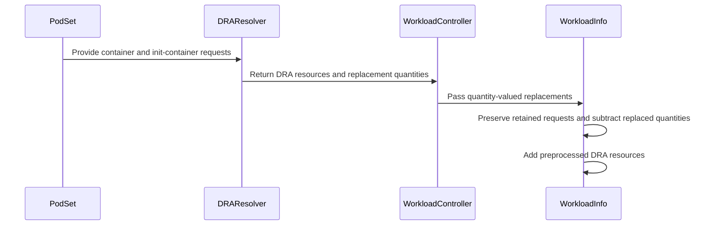

# PR #14154: Take back only what the extended-resource charge replaces

**Summary**: Take back only what the extended-resource charge replaces

**Sources**: https://github.com/kubernetes-sigs/kueue/pull/14154

**Last updated**: 2026-08-31T15:41:10Z

---

## Metadata

- **State**: open
- **Author**: [@thc1006](https://github.com/thc1006)
- **Branch**: `fix/extended-resource-replacement` → `main`
- **Created**: 2026-08-11T00:37:44Z
- **Updated**: 2026-08-31T15:41:10Z
- **Merged**: —
- **Closed**: —
- **Labels**: `kind/bug`, `size/XL`, `release-note-action-required`, `cncf-cla: yes`, `area/dra`
- **Assignees**: _none_
- **Requested reviewers**: [@mimowo](https://github.com/mimowo), [@mbobrovskyi](https://github.com/mbobrovskyi), [@PBundyra](https://github.com/PBundyra)
- **Changed files**: 8   **+667 / -64**

## Description

#### What type of PR is this?

/kind bug
/area dra

#### What this PR does / why we need it:

A DRA-backed extended resource was taken out of a PodSet's requests by deleting its name, so pod overhead and a transformation output carried under that same name went with it, and the rebuilt device charge stood in for all of them. The accounting now subtracts the containers' own request rather than removing the entry, read from the PodSet spec with the overhead left out rather than added and then taken back off.

That also fixes the second half of the issue. The resolver took the maximum over every init container and then the maximum of that against the sum of the regular ones, so a restartable init container was maxed against the total instead of added to it. It now aggregates the way a Pod's own requests are aggregated, which is also how the subtracted amount is derived, so the two sides stay comparable.

Three shapes from the issue are now cases, and each fails without the change:

- a container and pod overhead on one name, where the overhead used to disappear with the key
- a container and a transformation output on one name, same
- a restartable init container beside a regular one, which used to be charged once instead of twice, with an ordinary init container measured beside a running sidecar as a second resolver case

#### Which issue(s) this PR fixes:

Fixes #14004

#### Special notes for your reviewer:

The subtracted amount is derived where it is used, from the same PodSet spec the accounting already reads, rather than being resolved during preprocessing and carried alongside the charge. `ResolveExtendedResourceQuota` keeps its signature and still reports a set of names. One source of truth for the amount means there is no second value that can disagree with the spec for a given original resource name, so there is no mismatch to detect, floor, or report there. #14200 has since made each original name aggregate under its own name before any mapping, so the two sides agree there and #14156 is closed; this is rebased on top of it and keeps that ordering, along with its per-container integer check and its field paths.

#14047 is the one that has to land with a shared view rather than beside one, and I have measured what happens if it does not. It normalizes a negative container request to zero before the accounting view is built, while the amount taken back here is read from the PodSpec as it stands. Merged as they are, a PodSet asking `example.com/gpu: -3` on a DRA-backed name is charged `example.com/gpu: 3`: the retained side is zero, the subtraction reads `-3`, and `0 - (-3)` is a positive charge invented out of a request nobody made. With a pod overhead of `5` beside it the same arithmetic gives `8` where the overhead alone is `5`. The sidecar shape this PR corrects reaches a residual by a different route, and I measured it by merging the two branches locally: a restartable init container asking `-3` beside a regular container asking `8` leaves the retained side at `8` while the subtraction reads the raw `5`, so `3` is left standing under the original name with the logical name charged `8`. Reading them from one view is what removes both, which is why the fix cannot be a clamp on the subtracted amount alone. The cases added here pin the arithmetic as it stands, so that residual arrives as a failing test on the #14047 rebase rather than as a number nobody notices.

Clamping the subtracted amount at zero fixes both of those and breaks this PR on its own, which is the part worth being careful about: without #14047 the retained side still carries the `-3`, so `2 - 0` leaves `2` where the overhead is `5`. The two sides have to be read from the same chargeable per-container view, and neither PR can do that alone. Whichever lands second owns it. That was three readers until #14367 normalized the resolver, which is what closed #14216 and what this branch now sits on. Two are left, the retained side and the subtraction, and both still read the PodSpec as it stands.

#14367 had to land first, and it has: it merged on 19 August and this branch is rebased on top of it. What the table measures is why that order mattered. It drops a non-positive extended-resource request at the resolver, before the aggregation. Without it, correcting the sidecar lifecycle here starts letting a negative request cancel a positive one, because the old code hid that behind a max:

```
                                      main   this PR alone   14367 + this PR
restartable init -1, regular 1          1          0                1
restartable init -3, regular 8          8          5                8
```

The 0 and the 5 are undercharges this PR introduces on its own, reachable on a Workload created before `WorkloadValidateResourcesAreNonNegative` or with it turned off. The aggregation here is right for valid input; what is missing is the normalization at the source, which is #14367's one line rather than mine. The branch is rebased on it now, and the combination neither PR covers on its own — a negative restartable init beside a positive regular container — is a case at the resolver and two more through the accounting. Each was checked by breaking what it stands on: reverting the one-line filter takes the resolver case to 5, the row above, and deleting the replaced key outright instead of subtracting the container contribution takes the overhead beside the sidecar with it.

#14048 changes the same `applyResourceTransformations` signature and the same call site, to read `multiplyBy` from the requests before exclusion. Whichever lands first, the other needs both the unfiltered multiplier source and the retained/generated split, and the DRA merge has to stay after the generated totals are floored.

Transformation output is kept apart from the PodSet's own request while the subtraction happens, so an output landing on a replaced name survives it. That covers an output that recreates a name `excludeResourcePrefixes` had already removed, and a `Replace` whose output goes back onto its own input. Both were consumed before.

The second one is the only place this changes what a transformation costs, so it is worth being precise about. A `Replace` consuming a DRA-backed request is charged the device as well as whatever the transformation emits, and that is true on main too: measured on a PodSet requesting `example.com/gpu: 3`, an output of `example.com/credit: 1` gives `credit=3` and `gpu=3` both before and after this change, and an output written to the logical name gives `gpu=6` both before and after. Neither is touched here. What changes is only the case where the output lands back on the replaced name, which main dropped along with the request and this keeps, so it stops being the one shape that behaves differently from the other two. Whether the device should be charged at all once a `Replace` has consumed the request is #14160, and this PR does not answer it.

The KEP-2941 processing flow described the old behaviour, `Removes original extended resource`, and did not mention transformations, so it is updated alongside the change that makes it wrong.

PannagaRao and sohankunkerkar settled the policy on that thread: document the split rather than remap the residual onto the logical name or refuse the configuration. The DRA setup guide now says what is charged where, since that is the page someone configuring a ClusterQueue reads rather than the KEP, and two integration cases pin it.

One thing I offered on that thread was too absolute. I said a case pinning a logical-only ClusterQueue as inadmissible, which holds under the default `BlockUndeclared` strategy and not under `IgnoreUndeclared`. Measured through flavor assignment, with the container charge on the logical name and a residual under the raw one:

```
logical-only CQ, BlockUndeclared    NoFit   resource example.com/gpu unavailable in ClusterQueue
logical-only CQ, IgnoreUndeclared   Fit     the undeclared contribution is skipped
both names, BlockUndeclared         Fit     each contribution charged where it belongs
```

Both are in the guide. The integration case takes the default, and also pins that no `Requeued` condition is written, since a ClusterQueue missing a resource is an ordinary quota wait rather than a DRA misconfiguration, and treating it as one would reach the recovery problem in #13969.

There is a third shape, and it is the one the guide asks for rather than an edge: a `DeviceClass` with no `deviceClassMappings` entry, where the quota key falls back to the original name. Both contributions then land on that one key, so a ClusterQueue cannot meter them apart and the total under it stops being a count of devices. Every case here resolved a different logical name, so nothing was covering it; a container asking for 1 beside an overhead of 1 is now a case at 2 on the one key. Refusing that shape instead would refuse the documented default, and it needs no ClusterQueue change, only room for what was being dropped.

Verified rather than assumed. Reverting the subtraction to the old `delete` turns both accounting cases red. Reverting the aggregation to the old max-based one, and separately dropping `RestartPolicy` from the reconstructed containers, each turn both resolver cases red, the sidecar case at 1 instead of 2 and the ordinary-init case at 5 instead of 7. Beyond the cases, I swept 1008 configurations across container shapes, restartable and plain init containers, pod overhead, both transformation strategies and three excluded prefixes, and compared each against current main. 228 differ, and every one is a case where the old code dropped pod overhead or a transformation output carried under the replaced name. `gofmt`, `go vet`, `go build ./...`, and `pkg/dra`, `pkg/workload`, `pkg/cache` and `pkg/controller/core` under `-race` are clean. The two new integration cases run against envtest, and the whole suite runs with them: `Ran 58 of 58 Specs`, all passing, which is what the new block's manager restart needed checking against rather than running the two on their own. Reverting the subtraction to the old whole-key `delete` turns both of them red, the second one because the overhead it leaves behind is what the logical-only queue has no room for: on the old behaviour that Workload is admitted.

#### Does this PR introduce a user-facing change?

```release-note
DRA: Fixed a bug where a chargeable Pod overhead or a resource-transformation output that shared a name with a DRA-backed extended resource was taken back along with the DRA charge and dropped from quota accounting. Only the containers' own request is subtracted now, so any such contribution left under the original `extendedResourceName` after `excludeResourcePrefixes` and transformations is preserved. Also fixed a restartable init (sidecar) container being maxed against the total instead of added to it, so its devices are counted alongside the regular containers'.

ACTION REQUIRED: When a `deviceClassMappings` entry maps a DeviceClass to a different logical name, ClusterQueues must cover that logical name. A container-only request is fully translated and needs quota only on the logical name; cover the original `extendedResourceName` as well only if a Workload leaves chargeable Pod overhead or a resource-transformation output under it (normally in the same resource group). With such a residual uncovered, `BlockUndeclared` makes the Workload wait with the original name reported unavailable, while `IgnoreUndeclared` skips the residual and leaves it out of recorded usage. Where no mapping renames the DeviceClass, or the mapped name is the `extendedResourceName` itself, the device charge and the residual land on that one key, so its corrected usage can rise: a container asking for 1 with 1 of chargeable overhead now records 2 where it recorded 1. No second key is needed there, but the nominal quota has to cover the pair rather than a count of devices. The change applies as Workloads are evaluated, not to existing reservations at once.
```

#### AI usage

This PR was written in part with the assistance of generative AI. I reviewed and tested every change myself.


<!-- This is an auto-generated comment: release notes by coderabbit.ai -->
## Summary by CodeRabbit

* **Bug Fixes**
  * Improved resource accounting for workloads using dynamically resolved extended resources.
  * Preserved remaining resource requests when transformed or replaced resources are processed.
  * Improved handling of overhead and transformed resources that share resource names.
  * Corrected request aggregation for restartable init containers so their resource usage is accounted for consistently.
<!-- end of auto-generated comment: release notes by coderabbit.ai -->

## Discussion

### Comment by [@netlify[bot]](https://github.com/apps/netlify) — 2026-08-11T00:37:50Z

### <span aria-hidden="true">✅</span> Deploy Preview for *kubernetes-sigs-kueue* canceled.


|  Name | Link |
|:-:|------------------------|
|<span aria-hidden="true">🔨</span> Latest commit | f33854987729638b710d6e65ee9fcdc4bfbd5bff |
|<span aria-hidden="true">🔍</span> Latest deploy log | https://app.netlify.com/projects/kubernetes-sigs-kueue/deploys/6a959fc2d1df570007506cb1 |

### Comment by [@kubernetes-prow[bot]](https://github.com/apps/kubernetes-prow) — 2026-08-11T00:37:55Z

[APPROVALNOTIFIER] This PR is **NOT APPROVED**

This pull-request has been approved by: *<a href="https://github.com/kubernetes-sigs/kueue/pull/14154#" title="Author self-approved">thc1006</a>*
**Once this PR has been reviewed and has the lgtm label**, please assign [olekzabl](https://github.com/olekzabl), [tenzen-y](https://github.com/tenzen-y) for approval. For more information see [the Code Review Process](https://git.k8s.io/community/contributors/guide/owners.md#the-code-review-process).

The full list of commands accepted by this bot can be found [here](https://go.k8s.io/bot-commands?repo=kubernetes-sigs%2Fkueue).

<details open>
Needs approval from an approver in each of these files:

- **[OWNERS](https://github.com/kubernetes-sigs/kueue/blob/main/OWNERS)**

Approvers can indicate their approval by writing `/approve` in a comment
Approvers can cancel approval by writing `/approve cancel` in a comment
</details>
<!-- META={"approvers":["olekzabl","tenzen-y"]} -->

### Comment by [@coderabbitai[bot]](https://github.com/apps/coderabbitai) — 2026-08-11T00:38:26Z

<!-- This is an auto-generated comment: summarize by coderabbit.ai -->
<!-- review_stack_entry_start -->

[](https://app.coderabbit.ai/change-stack/kubernetes-sigs/kueue/pull/14154?utm_source=github_walkthrough&utm_medium=github&utm_campaign=change_stack)

<!-- review_stack_entry_end -->
<!-- This is an auto-generated comment: review paused by coderabbit.ai -->

> [!NOTE]
> ## Reviews paused
> 
> It looks like this branch is under active development. To avoid overwhelming you with review comments due to an influx of new commits, CodeRabbit has automatically paused this review. You can configure this behavior by changing the `reviews.auto_review.auto_pause_after_reviewed_commits` setting.
> 
> Use the following commands to manage reviews:
> - `@coderabbitai resume` to resume automatic reviews.
> - `@coderabbitai review` to trigger a single review.
> 
> Use the checkboxes below for quick actions:
> - [ ] <!-- {"checkboxId": "7f6cc2e2-2e4e-497a-8c31-c9e4573e93d1"} --> ▶️ Resume reviews
> - [ ] <!-- {"checkboxId": "e9bb8d72-00e8-4f67-9cb2-caf3b22574fe"} --> 🔍 Trigger review

<!-- end of auto-generated comment: review paused by coderabbit.ai -->
<!-- walkthrough_start -->

<details>
<summary>📝 Walkthrough</summary>

## Walkthrough

### Changes

The change replaces DRA resource-name tracking with per-resource quantities. DRA quota resolution now uses Pod request semantics. Workload rebuilding subtracts only replaced quantities while preserving overhead and transformation contributions.

**DRA replacement accounting**

|Layer / File(s)|Summary|
|---|---|
|**Resolve quantity-valued DRA replacements** <br> `pkg/dra/extended_resources.go`, `pkg/dra/extended_resources_test.go`|DRA resolution returns aggregated replacement quantities. Restartable init-container requests follow Pod aggregation semantics. Tests cover mapped, unmapped, multi-resource, and init-container cases.|
|**Propagate quantities and rebuild requests** <br> `pkg/controller/core/workload_controller.go`, `pkg/workload/workload.go`, `pkg/workload/workload_test.go`, `keps/2941-DRA/README.md`|Preprocessing passes quantity-valued replacements through workload accounting. Request rebuilding separates retained and generated resources, subtracts only replaced quantities, and preserves other contributions. Tests and documentation cover the updated behavior.|

**Estimated code review effort:** 3 (Moderate) | ~20 minutes

### Sequence Diagram(s)



**Possibly related issues**

- `kubernetes-sigs/kueue#14156`: Both changes update DRA extended-resource resolution and PodSet-level replacement quantities.

**Possibly related PRs**

- [kubernetes-sigs/kueue#11927](https://github.com/kubernetes-sigs/kueue/pull/11927): Both changes modify DRA preprocessing and workload request reconstruction.
- [kubernetes-sigs/kueue#13986](https://github.com/kubernetes-sigs/kueue/pull/13986): Both changes modify resource transformation handling in `pkg/workload/workload.go`.
- [kubernetes-sigs/kueue#14048](https://github.com/kubernetes-sigs/kueue/pull/14048): Both changes modify resource transformation and request-rebuilding logic.

**Suggested reviewers:** `mimowo`, `sohankunkerkar`, `kannon92`

</details>

<!-- walkthrough_end -->
<!-- pre_merge_checks_walkthrough_start -->

<details>
<summary>🚥 Pre-merge checks | ✅ 5</summary>

<details>
<summary>✅ Passed checks (5 passed)</summary>

|         Check name         | Status   | Explanation                                                                                                                                     |
| :------------------------: | :------- | :---------------------------------------------------------------------------------------------------------------------------------------------- |
|     Linked Issues check    | ✅ Passed | The changes address issue `#14004` by preserving overhead and transformation contributions and correcting restartable init-container aggregation. |
| Out of Scope Changes check | ✅ Passed | The implementation, tests, and KEP documentation changes directly support the linked issue objectives.                                          |
|     Docstring Coverage     | ✅ Passed | No functions found in the changed files to evaluate docstring coverage. Skipping docstring coverage check.                                      |
|      Description Check     | ✅ Passed | Check skipped - CodeRabbit’s high-level summary is enabled.                                                                                     |
|         Title check        | ✅ Passed | The title clearly summarizes the main change: subtracting only the amount replaced by the extended-resource charge.                             |

</details>

</details>

<!-- pre_merge_checks_walkthrough_end -->
<!-- finishing_touch_checkbox_start -->

<details>
<summary>✨ Finishing Touches</summary>

<details>
<summary>🧪 Generate unit tests (beta)</summary>

- [ ] <!-- {"checkboxId": "f47ac10b-58cc-4372-a567-0e02b2c3d479", "radioGroupId": "utg-output-choice-group-unknown_comment_id"} -->   Create PR with unit tests

</details>

</details>

<!-- finishing_touch_checkbox_end -->
<!-- tips_start -->

---


<sub>Comment `@coderabbitai help` to get the list of available commands.</sub>

<!-- tips_end -->

### Comment by [@sohankunkerkar](https://github.com/sohankunkerkar) — 2026-08-12T17:27:33Z

@thc1006 could you update the PR to pick the changes from https://github.com/kubernetes-sigs/kueue/pull/14200?

### Comment by [@thc1006](https://github.com/thc1006) — 2026-08-12T18:07:10Z

Done. Rebased onto #14200, and the branch is a single commit on top of its merge.

#14200's ordering, its per-container integer check and its field paths are all kept, and its cases still pass. The one I touched is `init containers use max, regular containers use sum`, now `ordinary init containers use max, regular containers use sum` with the same fixture and the same expected value. It's renamed because #14004's third case is a restartable init container, which adds to the regular containers rather than being maxed against them, so the old name no longer covers both.

While rebasing I also found the doc comment on `ResolveExtendedResourceQuota` still describing the max/sum aggregation, so that's updated to match, and I dropped a paragraph from the description that #14200 had already answered.

### Comment by [@thc1006](https://github.com/thc1006) — 2026-08-13T18:20:52Z

/hold

Holding this behind #14367 rather than only saying I would prefer that order.

The corrected sidecar aggregation is right for valid requests and wrong for a legacy negative one, because a restartable init container now joins the long-running total instead of being compared against it. Against this branch:

```
lifecycle aggregation of (-3 sidecar, 8 regular) -> 5
```

`main` charges 8 for the same shape. #14367 drops non-positive per-container requests before any of this runs, which removes the input rather than the symptom. Once it lands I will rebase and add the combination neither PR covers on its own: a negative restartable init beside a positive regular container, at the resolver and again at the accounting view, so a later change to one reader cannot quietly diverge from the other.

Two things in the last push, both from re-reading rather than from CI:

The `ClusterQueue` example in the KEP could not be applied. `FlavorQuotas.resources` is positional, `resources[i].name` has to equal `coveredResources[i]`, and I had the two lists in opposite orders. Against a running v0.19:

```
admission webhook "vclusterqueue.kb.io" denied the request:
  resources[0].name: Invalid value: "gpu-claims": must match the name in coveredResources
  resources[1].name: Invalid value: "example.com/gpu": must match the name in coveredResources
```

Reordered and re-checked the same way. The paragraph above it also still said separate flavors, from before the example settled on one.

This comment was written in part with the assistance of generative AI. The two outputs above are ones I ran.

### Comment by [@thc1006](https://github.com/thc1006) — 2026-08-23T12:37:02Z

The hold said this was waiting on #14367, which merged on 19 August. That is done, so the hold comes off.

/unhold

**Rebased.** On current main, which carries both #14200's per-original-name aggregation and #14367's non-positive filter. Nothing conflicted, and the source files are untouched by this round: the only changes are the two test additions below.

**The combination neither PR covered.** A negative restartable init container beside a positive regular one. The sidecar joins the long-running total rather than being maxed against it, so before #14367 the pair charged 5 where main charged 8 — the second row of the table in the description. There is a case at the resolver and two more through `NewInfo`.

Each was checked by breaking what it stands on rather than by watching it pass:

- reverting `quantity.Sign() <= 0` to `quantity.IsZero()` takes the resolver case to exactly 5, and nothing else with it;
- deleting the replaced key outright, which is what this PR replaced, takes the overhead beside the sidecar with it. The other accounting case passes either way and is there for the property rather than the regression.

**One cleanup while I was in there.** The DRA cases in `TestNewInfo` built their PodSets inside an anonymous function because they needed an overhead. `PodSetWrapper.PodOverHead` and `InitContainers` already existed, and `MakeContainer().AsSidecar()` covers the restart policy, so all five are fluent now and the table holds values rather than functions.

`go build ./...`, `go test -race -count=1` over `pkg/dra` and `pkg/workload`, `golangci-lint` (0 issues) and `make verify` all pass on a clean tree.

Still open and deliberately not touched here: #14160 has not settled the composition policy for a transformation and a DRA charge on the same request, and whenever #14047 lands the subtraction and the retained side have to be read from the same chargeable per-container view — whichever of the two goes second owns that.

This touches `_test.go`, which the root OWNERS routes to `test-approvers`, so it needs one of you on top of @mimowo.

/cc @mbobrovskyi
/cc @pbundyra

Comment drafted with AI assistance.

### Comment by [@thc1006](https://github.com/thc1006) — 2026-08-23T20:46:12Z

**TL;DR:** all six taken. Five went the way you asked. The one on `WithPreprocessedDRAResources` did not, and there is a hunk further down the KEP you have not reached that I would rather you heard about from me.

### `WithPreprocessedDRAResources`

The original line says the option provides "extended resources to remove", and removing them is what this branch stops doing. On `main` the second argument drives `delete(effectiveRequests, extRes)`. Here it drives `q.Sub(containerRequests[extRes])`, and the key only goes when the remainder reaches zero, so a Pod overhead or a transformation output written to that name survives. Keeping the sentence would leave a comment describing the behaviour this PR removes.

What I did instead was take it back to one line with one clause changed:

```diff
-// WithPreprocessedDRAResources provides DRA resources to add and extended resources to remove.
+// WithPreprocessedDRAResources provides DRA resources to add and extended resources whose container contribution the charge replaces.
```

The three sentences that followed it are gone. If you would rather have different words in that clause, give me yours and I will use them.

### The other five

- **KEP, both threads.** The paragraph that walked the mechanism a second time is gone, and so is the sentence step 6 already makes. What stays is that two names reaching one logical resource are treated alike, and the two gaps in #14160. I also took the processing order back to its four steps: you asked for that in r3806700425 and I had left a fifth one in.
- **`extended_resources.go`.** Cut to one line. The three you pointed at repeat what the `restartPolicy` field's own comment says a few lines up, so the call site needs only the reason the helper is there.
- **Concepts page.** Back to the original section. Nothing in it was made wrong by this change, and the paragraph I had added about both paths charging additively describes behaviour that predates the PR.
- **`setup_dra.md`.** The section is gone. One sentence in step 2 carries the part an administrator has to act on, which is covering the mapped name alongside the original.

Site docs go from +67/-8 to +6/-2.

### The hunk you have not reached

`#### Same Hardware with Both Paths` still carries a rewrite of about twenty lines, and by the standard you have been applying it does not belong here either.

The example gives `example.com/gpu` four devices of its own and labels it "for extended resource users", but that name's DeviceClass sits in `deviceClassMappings`, so a container asking for it is charged to `gpu-claims`. Step 4 of the Processing Flow says so. Splitting eight devices four and four leaves half of them unreachable, and an administrator following the example would size the wrong bucket.

That reads wrong on `main` rather than being something this branch broke. Say the word and I will lift it into its own PR.

Thanks for staying on the diff size across three rounds. It was wider than the fix needed, and each pass you asked for made it smaller.

### Comment by [@PannagaRao](https://github.com/PannagaRao) — 2026-08-25T01:51:06Z

@thc1006 Left a few more nits.

### Comment by [@thc1006](https://github.com/thc1006) — 2026-08-27T13:58:35Z

@PannagaRao all four taken, and I owe you a correction: the one reply I left on the last round is attached to the wrong thread. It describes what I did for the line above it, not for the one it is on. Sorry for the noise that caused.

**Line 943, "can we keep the original diff?"** Done. `This ensures no overlap or double-counting between the two mechanisms.` is back, and my sentence is gone.

**Line 946, "already covered in Processing Flow?"** Dropped. It is not quite the same point Processing Flow makes: that one is about `excludeResourcePrefixes`, and the paragraph was about a `Replace` transformation naming the same resource. But #14160 tracks that, so it does not need to live in this diff, and the KEP is shorter without it.

**The ClusterQueue example.** `example.com/gpu` is out of `coveredResources`, so the example charges `gpu-claims` alone and the eight devices in it match the cluster the paragraph describes.

**`ResolveExtendedResourceQuota`.** Same treatment as the KEP: the doc comment now names `resourcehelpers.PodRequests` and keeps only the two details that change the answer here, rather than walking the aggregation a second time.

The KEP diff is 26 lines added against 22 removed now. Nothing in the source changed for any of this.

### Comment by [@PannagaRao](https://github.com/PannagaRao) — 2026-08-31T14:27:10Z

@thc1006 Thanks for the fix. Comments look much better now. I just have a couple more nits

### Comment by [@thc1006](https://github.com/thc1006) — 2026-08-31T15:39:16Z

@PannagaRao all three are in f33854987, test files only.

**`workload_test.go`, "two contributions have nowhere to go".** The comment now says it directly: without a `deviceClassMappings` entry, the DRA charge for the container request and the Pod overhead both use the original resource name. The expected 2 was already in `wantInfo`, so the explanation around it is gone.

**"And staying there".** Now `Verifying the Pod overhead charge under the original extended resource name continues to prevent quota reservation`.

**The step above it.** Now `Verifying the Pod overhead charge uses the original extended resource name`. The paragraph about weaker assertions is gone; the assertions under the step already pin the reason and the message.

Two nearby lines read the same way, so I did those as well: the `transformOutputOnAReplacedKeySurvives` comment, and the admitted-path step, which now names both keys.

Checks: `golangci-lint` clean, `go test ./pkg/workload -run '^TestNewInfo$'` ok, and the two DRA integration specs run focused, both passed.

The four older KEP threads are all applied: steps 1 and 6 are your sentences taken verbatim, the other two the revert and the removal you asked for. They can be closed whenever you get to them.

## Reviews

### Review by [@PannagaRao](https://github.com/PannagaRao) (commented) — 2026-08-12T21:41:42Z

- **keps/2941-DRA/README.md:945** by [@PannagaRao](https://github.com/PannagaRao) — 2026-08-12T21:41:42Z
```diff
@@ -927,18 +927,33 @@ The two DRA paths resolve quota independently:
 5. If the mapping has counter sources configured, the workload is marked inadmissible.
    Extended resources do not carry profile-level information for counter-based charging.
    Otherwise charges device count.
-6. Removes original extended resource from the workload's effective resource requests
-   (tracked internally per PodSet) to avoid double-counting
+6. Subtracts what the containers asked for on that extended resource from the workload's
+   effective resource requests (tracked internally per PodSet) to avoid double-counting.
+   Pod overhead and resource transformation outputs carried under the same name are not
+   what the charge stands in for, so they are left intact
 7. Admits workload against the resolved quota key
 
 The extended resource translation reads directly from the workload spec before
 `excludeResourcePrefixes` filtering is applied. The processing order:
 1. Extended resource translation runs first, reading the original spec
 2. `excludeResourcePrefixes` filters the pod's `resources.requests`
-3. Original extended resource is removed from the workload's effective resource requests
-4. Translated resource is added through `preprocessedDRAResources`
-
-This ensures no overlap or double-counting between the two mechanisms.
+3. Resource transformations run
+4. What the containers asked for on each translated extended resource is subtracted from
+   the effective requests, so the pod overhead and anything a transformation added under
+   the same name are left alone
+5. Translated resource is added through `preprocessedDRAResources`
+
```

  On the overhead/transformation case: if a PodSet has overhead requesting `example.com/gpu: "1"` (or a transformation output landing on the same name as the DRA-backed resource) and a container requesting `example.com/gpu: "1",` the subtraction leaves the overhead or transformation output under the raw extended resource name while the container's request is replaced by the DRA logical name.
  
  The ClusterQueue then needs to cover both the logical resource name from DeviceClassMapping and example.com/gpu (the raw name) separately. Without it the workload is not admitted.
  
  Is there a realistic scenario where pod overhead or a transformation output carries a DRA-backed extended resource name? If so, those workloads would need the raw name added to the ClusterQueue, which they didn't before. Should those contributions also be mapped to the logical name, or should we document the separate quota tracking?

### Review by [@thc1006](https://github.com/thc1006) (commented) — 2026-08-13T02:23:29Z

- **keps/2941-DRA/README.md:945** by [@thc1006](https://github.com/thc1006) — 2026-08-13T02:23:29Z
```diff
@@ -927,18 +927,33 @@ The two DRA paths resolve quota independently:
 5. If the mapping has counter sources configured, the workload is marked inadmissible.
    Extended resources do not carry profile-level information for counter-based charging.
    Otherwise charges device count.
-6. Removes original extended resource from the workload's effective resource requests
-   (tracked internally per PodSet) to avoid double-counting
+6. Subtracts what the containers asked for on that extended resource from the workload's
+   effective resource requests (tracked internally per PodSet) to avoid double-counting.
+   Pod overhead and resource transformation outputs carried under the same name are not
+   what the charge stands in for, so they are left intact
 7. Admits workload against the resolved quota key
 
 The extended resource translation reads directly from the workload spec before
 `excludeResourcePrefixes` filtering is applied. The processing order:
 1. Extended resource translation runs first, reading the original spec
 2. `excludeResourcePrefixes` filters the pod's `resources.requests`
-3. Original extended resource is removed from the workload's effective resource requests
-4. Translated resource is added through `preprocessedDRAResources`
-
-This ensures no overlap or double-counting between the two mechanisms.
+3. Resource transformations run
+4. What the containers asked for on each translated extended resource is subtracted from
+   the effective requests, so the pod overhead and anything a transformation added under
+   the same name are left alone
+5. Translated resource is added through `preprocessedDRAResources`
+
```

  Good question, and yes, it's reachable without anyone hand writing a Workload. `handlePodOverhead` copies `RuntimeClass.overhead.podFixed` straight onto the PodSet's `spec.overhead`, and `podFixed` is a plain `ResourceList`, so a qualified extended resource name fits there. A transformation output can land on the same name just as easily, since nothing stops an administrator from naming one that way.
  
  On whether those two should be mapped as well, I'd rather they weren't, and for different reasons in each case.
  
  The resolver never sees the overhead. `ResolveExtendedResourceQuota` walks `initContainers` and `containers` and reads `container.Resources.Requests`, so `spec.overhead` isn't an input to it at all. Mapping the overhead onto the logical name would charge a device that nothing is going to ask the scheduler for.
  
  A transformation output is a Kueue quota resource rather than a Pod request. It might be a credit, a license count, or anything else the operator wanted to meter, and reusing an existing name can be deliberate. Rewriting it to the logical name would change what a transformation means, which feels like a wider decision than this PR.
  
  So I'd go with your third option: keep the split and say so plainly. Only the containers' DRA backed request is translated, and a ClusterQueue admitting these workloads has to cover the mapped logical name along with whatever is left under the original `extendedResourceName`. I'll put that in the DRA setup guide and the release note rather than only in the KEP. The setup guide is where someone configuring a ClusterQueue actually looks. I'll also add an integration case pinning a logical only ClusterQueue as inadmissible, and one covering both names as admissible.
  
  If you'd rather operators didn't have to configure two keys for this, the cleaner alternative is to reject the configuration up front when a RuntimeClass overhead or a transformation output collides with a mapped DRA name. That's a wider call than I want to make alone, so I'll follow your read on it.
  
  This comment was written in part with the assistance of generative AI. The code paths above I checked myself.

### Review by [@PannagaRao](https://github.com/PannagaRao) (commented) — 2026-08-13T03:46:25Z

- **keps/2941-DRA/README.md:945** by [@PannagaRao](https://github.com/PannagaRao) — 2026-08-13T03:46:25Z
```diff
@@ -927,18 +927,33 @@ The two DRA paths resolve quota independently:
 5. If the mapping has counter sources configured, the workload is marked inadmissible.
    Extended resources do not carry profile-level information for counter-based charging.
    Otherwise charges device count.
-6. Removes original extended resource from the workload's effective resource requests
-   (tracked internally per PodSet) to avoid double-counting
+6. Subtracts what the containers asked for on that extended resource from the workload's
+   effective resource requests (tracked internally per PodSet) to avoid double-counting.
+   Pod overhead and resource transformation outputs carried under the same name are not
+   what the charge stands in for, so they are left intact
 7. Admits workload against the resolved quota key
 
 The extended resource translation reads directly from the workload spec before
 `excludeResourcePrefixes` filtering is applied. The processing order:
 1. Extended resource translation runs first, reading the original spec
 2. `excludeResourcePrefixes` filters the pod's `resources.requests`
-3. Original extended resource is removed from the workload's effective resource requests
-4. Translated resource is added through `preprocessedDRAResources`
-
-This ensures no overlap or double-counting between the two mechanisms.
+3. Resource transformations run
+4. What the containers asked for on each translated extended resource is subtracted from
+   the effective requests, so the pod overhead and anything a transformation added under
+   the same name are left alone
+5. Translated resource is added through `preprocessedDRAResources`
+
```

  I personally would like for us to document the split and state that CQ should include both DRA logical resource and extendedResourceName instead of rejecting the workloads. 
  
  However I'll let @sohankunkerkar weigh in on this.

### Review by [@sohankunkerkar](https://github.com/sohankunkerkar) (commented) — 2026-08-13T05:09:56Z

- **keps/2941-DRA/README.md:945** by [@sohankunkerkar](https://github.com/sohankunkerkar) — 2026-08-13T05:09:56Z
```diff
@@ -927,18 +927,33 @@ The two DRA paths resolve quota independently:
 5. If the mapping has counter sources configured, the workload is marked inadmissible.
    Extended resources do not carry profile-level information for counter-based charging.
    Otherwise charges device count.
-6. Removes original extended resource from the workload's effective resource requests
-   (tracked internally per PodSet) to avoid double-counting
+6. Subtracts what the containers asked for on that extended resource from the workload's
+   effective resource requests (tracked internally per PodSet) to avoid double-counting.
+   Pod overhead and resource transformation outputs carried under the same name are not
+   what the charge stands in for, so they are left intact
 7. Admits workload against the resolved quota key
 
 The extended resource translation reads directly from the workload spec before
 `excludeResourcePrefixes` filtering is applied. The processing order:
 1. Extended resource translation runs first, reading the original spec
 2. `excludeResourcePrefixes` filters the pod's `resources.requests`
-3. Original extended resource is removed from the workload's effective resource requests
-4. Translated resource is added through `preprocessedDRAResources`
-
-This ensures no overlap or double-counting between the two mechanisms.
+3. Resource transformations run
+4. What the containers asked for on each translated extended resource is subtracted from
+   the effective requests, so the pod overhead and anything a transformation added under
+   the same name are left alone
+5. Translated resource is added through `preprocessedDRAResources`
+
```

  I agreed with documenting the split. The overhead is real runtime cost that the CQ should cover under the original name. Mapping it to the logical name would charge a device the runtime isn't requesting. The transformation case is the same. It's an explicit admin-configured quota resource, not a device request.

### Review by [@thc1006](https://github.com/thc1006) (commented) — 2026-08-13T05:57:20Z

- **keps/2941-DRA/README.md:945** by [@thc1006](https://github.com/thc1006) — 2026-08-13T05:57:20Z
```diff
@@ -927,18 +927,33 @@ The two DRA paths resolve quota independently:
 5. If the mapping has counter sources configured, the workload is marked inadmissible.
    Extended resources do not carry profile-level information for counter-based charging.
    Otherwise charges device count.
-6. Removes original extended resource from the workload's effective resource requests
-   (tracked internally per PodSet) to avoid double-counting
+6. Subtracts what the containers asked for on that extended resource from the workload's
+   effective resource requests (tracked internally per PodSet) to avoid double-counting.
+   Pod overhead and resource transformation outputs carried under the same name are not
+   what the charge stands in for, so they are left intact
 7. Admits workload against the resolved quota key
 
 The extended resource translation reads directly from the workload spec before
 `excludeResourcePrefixes` filtering is applied. The processing order:
 1. Extended resource translation runs first, reading the original spec
 2. `excludeResourcePrefixes` filters the pod's `resources.requests`
-3. Original extended resource is removed from the workload's effective resource requests
-4. Translated resource is added through `preprocessedDRAResources`
-
-This ensures no overlap or double-counting between the two mechanisms.
+3. Resource transformations run
+4. What the containers asked for on each translated extended resource is subtracted from
+   the effective requests, so the pod overhead and anything a transformation added under
+   the same name are left alone
+5. Translated resource is added through `preprocessedDRAResources`
+
```

  Thanks both. Keeping the split and documenting it, then.
  
  One correction to what I offered above. I said I would pin a logical-only ClusterQueue as inadmissible, and that is only true under the default `BlockUndeclared` strategy. Measured through flavor assignment, with the container charge on the logical name and an overhead residual under the raw one:
  
  ```
  logical-only CQ, BlockUndeclared    NoFit   resource example.com/gpu unavailable in ClusterQueue
  logical-only CQ, IgnoreUndeclared   Fit     the undeclared contribution is skipped
  both names, BlockUndeclared         Fit     each contribution charged where it belongs
  ```
  
  So the guide states both rather than the first as the only answer.
  
  Pushed in `f1f0db6`: a section in the DRA setup guide, an integration case for the first and third rows, and the release note marked action required, since a ClusterQueue covering only the logical name will start holding these Workloads once the residual stops being dropped. The first case also checks that no `Requeued` condition is written, since a ClusterQueue missing a resource is an ordinary quota wait rather than a DRA misconfiguration.
  
  I also noted in the guide that where the logical name and the original name are the same, the two contributions necessarily share one quota key, so the total under it is no longer a device count.
  
  This comment was written in part with the assistance of generative AI. The measurements above I ran myself.

### Review by [@sohankunkerkar](https://github.com/sohankunkerkar) (commented) — 2026-08-13T14:23:37Z

I think this PR is well documented and neatly written. I have one nit but overall LGTM
@PannagaRao could you PTAL?

- **pkg/workload/workload.go:696** by [@sohankunkerkar](https://github.com/sohankunkerkar) — 2026-08-13T14:10:39Z
```diff
@@ -681,6 +689,31 @@ func PodSetNameToTopologyRequest(wl *kueue.Workload) map[kueue.PodSetReference]*
 	})
 }
 
+// subtractReplacedRequests takes out of retained what the containers asked for on
+// each name a DRA charge stands in for. The charge replaces that much and no more,
+// so a pod overhead or a transformation output carried under the same name is left
+// where it is.
+func subtractReplacedRequests(retained corev1.ResourceList, spec *corev1.PodSpec, replaced sets.Set[corev1.ResourceName]) {
```

  nit: I'd change the naming to `subtractReplacedRequestsFrom` to match the codebase pattern

### Review by [@thc1006](https://github.com/thc1006) (commented) — 2026-08-13T14:33:39Z

- **pkg/workload/workload.go:696** by [@thc1006](https://github.com/thc1006) — 2026-08-13T14:33:39Z
```diff
@@ -681,6 +689,31 @@ func PodSetNameToTopologyRequest(wl *kueue.Workload) map[kueue.PodSetReference]*
 	})
 }
 
+// subtractReplacedRequests takes out of retained what the containers asked for on
+// each name a DRA charge stands in for. The charge replaces that much and no more,
+// so a pod overhead or a transformation output carried under the same name is left
+// where it is.
+func subtractReplacedRequests(retained corev1.ResourceList, spec *corev1.PodSpec, replaced sets.Set[corev1.ResourceName]) {
```

  Done in `2a313f3bd`, thanks.
  
  This reply was written in part with the assistance of generative AI. The rename and the test run are mine.

### Review by [@PannagaRao](https://github.com/PannagaRao) (commented) — 2026-08-13T14:58:35Z

- **keps/2941-DRA/README.md:918** by [@PannagaRao](https://github.com/PannagaRao) — 2026-08-13T14:58:29Z
```diff
@@ -912,9 +912,11 @@ The two DRA paths resolve quota independently:
 #### Processing Flow
 
 1. Kueue detects extended resources in `resources.requests` and computes each
-   original resource name's Pod-level request (max across init containers, sum
-   across regular containers, then max of the two) before any DeviceClass lookup
-   or quota-key mapping. Two different resource names later mapped to the same
+   original resource name's Pod-level request the way a Pod's own requests are
+   computed, before any DeviceClass lookup or quota-key mapping: regular and
+   restartable init containers contribute to the long-running total, and an
+   ordinary init container is measured together with the restartable ones
```

  I think this edit is missing the charge is _max across init containers_ portion from the original comment.

### Review by [@PannagaRao](https://github.com/PannagaRao) (commented) — 2026-08-13T15:21:11Z

- **keps/2941-DRA/README.md:943** by [@PannagaRao](https://github.com/PannagaRao) — 2026-08-13T15:21:05Z
```diff
@@ -927,18 +929,38 @@ The two DRA paths resolve quota independently:
 5. If the mapping has counter sources configured, the workload is marked inadmissible.
    Extended resources do not carry profile-level information for counter-based charging.
    Otherwise charges device count.
-6. Removes original extended resource from the workload's effective resource requests
-   (tracked internally per PodSet) to avoid double-counting
-7. Admits workload against the resolved quota key
-
-The extended resource translation reads directly from the workload spec before
-`excludeResourcePrefixes` filtering is applied. The processing order:
-1. Extended resource translation runs first, reading the original spec
+6. Subtracts what the containers asked for on that extended resource from what is
+   still retained under that name (tracked internally per PodSet) to avoid
+   double-counting. Pod overhead and resource transformation outputs carried under
+   the same name are not what the charge stands in for, so whatever of them is still
+   there once exclusions and transformations have run is left alone
+7. Admits the Workload against the resulting requests, which is the mapped logical
+   name together with any contribution still standing under the original one
+
+The container contribution is read from the workload spec as it stands, before any
+filtering, so that what is charged is what the Pods will ask for. Where it is taken
+back from is a later view. The processing order:
+1. The container contribution on each translated extended resource is read from the
```

  The processing order should reflect reading of original spec and applying Extended Resource Translation on it. 
  
  The edit states that the container contribution on each translated extended spec is read from spec and that Resource Transformation runs on it(Step 3) I don't think that matches the original comment.

### Review by [@PannagaRao](https://github.com/PannagaRao) (commented) — 2026-08-13T15:25:49Z

- **pkg/dra/extended_resources.go:201** by [@PannagaRao](https://github.com/PannagaRao) — 2026-08-13T15:25:42Z
```diff
@@ -189,14 +190,18 @@ func resolveQuotaKey(
 type containerExtendedResourceRequests struct {
 	path      *field.Path
 	resources corev1.ResourceList
+	// Carried so the total can be taken the way the Pod's own is: a restartable
+	// init container runs alongside the rest and adds to them.
+	restartPolicy *corev1.ContainerRestartPolicy
 }
 
 // ResolveExtendedResourceQuota converts extended resource requests across all PodSets
-// into DRA logical quota resources. Per PodSet, init containers are aggregated with
-// max (sequential) and regular containers with sum (concurrent), then combined with
-// max — per original resource name, before any two names sharing a quota key can
-// collapse into each other's contribution. The quota key for each original name is
-// resolved once per PodSet, from that name's own aggregated total.
+// into DRA logical quota resources. Per PodSet, the containers are totalled the way the
+// Pod's own requests are, so a restartable init container adds to the regular containers
+// rather than being maxed against them. That total is taken under each original resource
```

  Same as https://github.com/kubernetes-sigs/kueue/pull/14154#discussion_r3776461590

### Review by [@thc1006](https://github.com/thc1006) (commented) — 2026-08-13T17:13:43Z

- **keps/2941-DRA/README.md:918** by [@thc1006](https://github.com/thc1006) — 2026-08-13T17:13:43Z
```diff
@@ -912,9 +912,11 @@ The two DRA paths resolve quota independently:
 #### Processing Flow
 
 1. Kueue detects extended resources in `resources.requests` and computes each
-   original resource name's Pod-level request (max across init containers, sum
-   across regular containers, then max of the two) before any DeviceClass lookup
-   or quota-key mapping. Two different resource names later mapped to the same
+   original resource name's Pod-level request the way a Pod's own requests are
+   computed, before any DeviceClass lookup or quota-key mapping: regular and
+   restartable init containers contribute to the long-running total, and an
+   ordinary init container is measured together with the restartable ones
```

  You're right, the max fell out of that rewrite.
  
  I didn't put the original phrase back verbatim though, because "max across init containers" stopped being accurate once sidecars are in play. An init container isn't measured by its own request any more, it's measured together with the restartable ones already running beside it, and the maximum is over those measurements. The case named `an ordinary init container is measured with the sidecar already running` is the one that separates the two readings: sidecar 2, ordinary init 5, regular 1. The old phrasing reads as max(max(2, 5), 2+1) = 5, while the aggregation gives max(2, 2+5, 2+1) = 7, which is what that test expects.
  
  So step 1 now ends on the charge being the larger of the long-running total and the largest of those init measurements, and the resolver comment says the same thing. `81102ca` is documentation and comments only; the arithmetic already came from `PodRequests`.
  
  This reply was written in part with the assistance of generative AI.

### Review by [@thc1006](https://github.com/thc1006) (commented) — 2026-08-13T18:21:02Z

- **keps/2941-DRA/README.md:918** by [@thc1006](https://github.com/thc1006) — 2026-08-13T18:21:02Z
```diff
@@ -912,9 +912,11 @@ The two DRA paths resolve quota independently:
 #### Processing Flow
 
 1. Kueue detects extended resources in `resources.requests` and computes each
-   original resource name's Pod-level request (max across init containers, sum
-   across regular containers, then max of the two) before any DeviceClass lookup
-   or quota-key mapping. Two different resource names later mapped to the same
+   original resource name's Pod-level request the way a Pod's own requests are
+   computed, before any DeviceClass lookup or quota-key mapping: regular and
+   restartable init containers contribute to the long-running total, and an
+   ordinary init container is measured together with the restartable ones
```

  This one was still open, and you were right about it too: I fixed the KEP and the aggregation site last time and left the function's own comment saying only the sidecar half.
  
  It now carries the same rule as the other two: regular and restartable init containers make the long-running total, each init container is measured with the restartable ones already running beside it, and the charge is the larger of the two.
  
  While re-reading the section I also found that the `ClusterQueue` example a few lines above cannot be applied as written, since `resources[i].name` has to match `coveredResources[i]` and I had the lists in opposite orders. Fixed and checked against a running cluster.
  
  This reply was written in part with the assistance of generative AI.

### Review by [@thc1006](https://github.com/thc1006) (commented) — 2026-08-16T00:03:44Z

- **keps/2941-DRA/README.md:943** by [@thc1006](https://github.com/thc1006) — 2026-08-16T00:03:44Z
```diff
@@ -927,18 +929,38 @@ The two DRA paths resolve quota independently:
 5. If the mapping has counter sources configured, the workload is marked inadmissible.
    Extended resources do not carry profile-level information for counter-based charging.
    Otherwise charges device count.
-6. Removes original extended resource from the workload's effective resource requests
-   (tracked internally per PodSet) to avoid double-counting
-7. Admits workload against the resolved quota key
-
-The extended resource translation reads directly from the workload spec before
-`excludeResourcePrefixes` filtering is applied. The processing order:
-1. Extended resource translation runs first, reading the original spec
+6. Subtracts what the containers asked for on that extended resource from what is
+   still retained under that name (tracked internally per PodSet) to avoid
+   double-counting. Pod overhead and resource transformation outputs carried under
+   the same name are not what the charge stands in for, so whatever of them is still
+   there once exclusions and transformations have run is left alone
+7. Admits the Workload against the resulting requests, which is the mapped logical
+   name together with any contribution still standing under the original one
+
+The container contribution is read from the workload spec as it stands, before any
+filtering, so that what is charged is what the Pods will ask for. Where it is taken
+back from is a later view. The processing order:
+1. The container contribution on each translated extended resource is read from the
```

  You're right on both halves, and this one sat unanswered for too long, sorry.
  
  Step 1 had become "the container contribution is read from the original spec", which is only part of what happens there. Restored to the original's "extended resource translation runs first, reading the original spec", with the contribution named as the figure the later subtraction takes back rather than as the whole of step 1.
  
  Step 3 had no object, so it read as the transformations running over something already translated. They run over what `excludeResourcePrefixes` left, which is still the pod's own requests: `totalRequestsFromPodSets` does `applyResourceTransformations(dropExcludedResources(specRequests, ...))` and the translated resource is not merged until after the subtraction.
  
  While fixing that I found the paragraph under the list was mine and was wrong in the same way. It said "these steps run during DRA preprocessing, before Kueue's accounting exclusions and resource transformations", which contradicts steps 2 and 3 being exactly those. Only step 1 runs during preprocessing, so it says that now.
  
  `86c183d` is the KEP only.

### Review by [@thc1006](https://github.com/thc1006) (commented) — 2026-08-16T07:52:36Z

- **pkg/dra/extended_resources.go:201** by [@thc1006](https://github.com/thc1006) — 2026-08-16T07:52:36Z
```diff
@@ -189,14 +190,18 @@ func resolveQuotaKey(
 type containerExtendedResourceRequests struct {
 	path      *field.Path
 	resources corev1.ResourceList
+	// Carried so the total can be taken the way the Pod's own is: a restartable
+	// init container runs alongside the rest and adds to them.
+	restartPolicy *corev1.ContainerRestartPolicy
 }
 
 // ResolveExtendedResourceQuota converts extended resource requests across all PodSets
-// into DRA logical quota resources. Per PodSet, init containers are aggregated with
-// max (sequential) and regular containers with sum (concurrent), then combined with
-// max — per original resource name, before any two names sharing a quota key can
-// collapse into each other's contribution. The quota key for each original name is
-// resolved once per PodSet, from that name's own aggregated total.
+// into DRA logical quota resources. Per PodSet, the containers are totalled the way the
+// Pod's own requests are, so a restartable init container adds to the regular containers
+// rather than being maxed against them. That total is taken under each original resource
```

  Sorry, this thread stayed open longer than it should have. You pointed at the resolver's own comment and it does carry the same rule now: regular and restartable init containers make the long-running total, each init container is measured with the restartable ones already running beside it, and the charge is the larger of the two. That went in with `81102ca` alongside the KEP and the aggregation site.
  
  While going back over it I found the ordering was only pinned one way round. A sidecar declared before an ordinary init is running when the init starts, so the two are measured together, which the existing case covers at 7. Declared after, nothing is up yet and the init's own request stands alone, which comes to 5 for the same three containers. `76c4bd1` adds that second case; swapping the two init containers in it turns it red, so it is pinning the order rather than the number.
  
  Two documentation names went with it. The KEP's path separation still named the `DynamicResourceAllocation` gate for the claim-template path, which is `KueueDRAIntegration` now, and the setup guide asked for the original name in `coveredResources` without saying that a mapped DeviceClass charges the containers under the mapped name instead.
  
  This comment was written in part with the assistance of generative AI. The measurements above I ran myself.

### Review by [@PannagaRao](https://github.com/PannagaRao) (commented) — 2026-08-18T16:33:12Z

- **site/content/en/docs/concepts/dynamic_resource_allocation.md:72** by [@PannagaRao](https://github.com/PannagaRao) — 2026-08-18T16:33:12Z
```diff
@@ -64,11 +64,12 @@ For setup instructions, see
 When a Pod requests an extended resource backed by DRA (e.g.,
 `nvidia.com/gpu: 1`), the kube-scheduler auto-creates a `ResourceClaim`.
 Kueue detects the matching `DeviceClass`, uses `extendedResourceName` as the
-quota key, and drops the auto-created claim from accounting. This prevents
-quota from being charged for both the `resources.requests` entry **and** the
-auto-created claim, which would double count the same device. No
+quota key by default, and drops the auto-created claim from accounting. That
+prevents quota from being charged for both the `resources.requests` entry
+**and** the auto-created claim, which would double count the same device. No
 `deviceClassMappings` configuration is needed; the mapping is discovered
-from the `DeviceClass` automatically.
+from the `DeviceClass` automatically. A `deviceClassMappings` entry covering
+that `DeviceClass` moves the charge to the mapping's logical name.
```

  Maybe we could add only the last line to keep the diff minimal?

### Review by [@thc1006](https://github.com/thc1006) (commented) — 2026-08-18T17:21:29Z

- **site/content/en/docs/concepts/dynamic_resource_allocation.md:72** by [@thc1006](https://github.com/thc1006) — 2026-08-18T17:21:29Z
```diff
@@ -64,11 +64,12 @@ For setup instructions, see
 When a Pod requests an extended resource backed by DRA (e.g.,
 `nvidia.com/gpu: 1`), the kube-scheduler auto-creates a `ResourceClaim`.
 Kueue detects the matching `DeviceClass`, uses `extendedResourceName` as the
-quota key, and drops the auto-created claim from accounting. This prevents
-quota from being charged for both the `resources.requests` entry **and** the
-auto-created claim, which would double count the same device. No
+quota key by default, and drops the auto-created claim from accounting. That
+prevents quota from being charged for both the `resources.requests` entry
+**and** the auto-created claim, which would double count the same device. No
 `deviceClassMappings` configuration is needed; the mapping is discovered
-from the `DeviceClass` automatically.
+from the `DeviceClass` automatically. A `deviceClassMappings` entry covering
+that `DeviceClass` moves the charge to the mapping's logical name.
```

  Done, put the surrounding lines back to the original wording and kept only the new sentence.

### Review by [@PannagaRao](https://github.com/PannagaRao) (commented) — 2026-08-18T17:56:19Z

- **keps/2941-DRA/README.md:917** by [@PannagaRao](https://github.com/PannagaRao) — 2026-08-18T17:56:19Z
```diff
@@ -905,18 +905,22 @@ The two DRA paths resolve quota independently:
    name instead to unify quota with the ResourceClaimTemplate path. If the mapping has
    counter sources configured, the workload is marked inadmissible because extended resources
    do not carry the profile-level information needed for counter-based charging.
-2. **ResourceClaimTemplates** (`DynamicResourceAllocation` gate): uses `deviceClassMappings`
+2. **ResourceClaimTemplates** (`KueueDRAIntegration` gate): uses `deviceClassMappings`
    to map DeviceClass names to logical resource names. When the mapping has counter sources
    configured, charges counter units instead of device count.
 
 #### Processing Flow
 
-1. Kueue detects extended resources in `resources.requests` and computes each
-   original resource name's Pod-level request (max across init containers, sum
-   across regular containers, then max of the two) before any DeviceClass lookup
-   or quota-key mapping. Two different resource names later mapped to the same
-   quota key are therefore aggregated independently first, so neither collapses
-   into the other's contribution.
+1. Kueue detects extended resources in the `resources.requests` of the PodSet spec
+   `AdjustResources` has already processed, and computes each original resource
+   name's Pod-level request the way a Pod's own requests are computed, before any
+   DeviceClass lookup or quota-key mapping. Regular and
+   restartable init containers together make the long-running total; each init
+   container is measured with the restartable ones already running beside it;
+   and the charge is the larger of that total and the largest of those init
+   measurements. Two different resource names later mapped to the same quota
+   key are therefore aggregated independently first, so neither collapses into
+   the other's contribution.
 2. Looks up DeviceClasses by `extendedResourceName` by field indexer
```

  Can we simplify this? Instead of explaining how the charge is calculated, we could say: Kueue detects extended resources in the PodSet spec and aggregates each original name using `resourcehelpers.PodRequests` (overhead excluded; sidecars add to the app-container total, they are not maxed as ordinary inits).

### Review by [@PannagaRao](https://github.com/PannagaRao) (commented) — 2026-08-18T18:09:15Z

- **keps/2941-DRA/README.md:938** by [@PannagaRao](https://github.com/PannagaRao) — 2026-08-18T18:09:15Z
```diff
@@ -927,24 +931,48 @@ The two DRA paths resolve quota independently:
 5. If the mapping has counter sources configured, the workload is marked inadmissible.
    Extended resources do not carry profile-level information for counter-based charging.
    Otherwise charges device count.
-6. Removes original extended resource from the workload's effective resource requests
-   (tracked internally per PodSet) to avoid double-counting
-7. Admits workload against the resolved quota key
+6. Subtracts what the containers asked for on that extended resource from what is
+   still retained under that name (tracked internally per PodSet) to avoid
+   double-counting. Pod overhead and resource transformation outputs carried under
+   the same name are not what the charge stands in for, so whatever of them is still
+   there once exclusions and transformations have run is left alone
```

  I feel we could make this point less verbose. Maybe we could use - Subtracts the original extended resource from the workload's effective resource requests (tracked internally per PodSet) to avoid double-counting. Only the translated container amount is subtracted; Pod overhead and transformation output under the same name remain.

### Review by [@PannagaRao](https://github.com/PannagaRao) (commented) — 2026-08-18T18:10:36Z

- **keps/2941-DRA/README.md:946** by [@PannagaRao](https://github.com/PannagaRao) — 2026-08-18T18:10:36Z
```diff
@@ -927,24 +931,48 @@ The two DRA paths resolve quota independently:
 5. If the mapping has counter sources configured, the workload is marked inadmissible.
    Extended resources do not carry profile-level information for counter-based charging.
    Otherwise charges device count.
-6. Removes original extended resource from the workload's effective resource requests
-   (tracked internally per PodSet) to avoid double-counting
-7. Admits workload against the resolved quota key
+6. Subtracts what the containers asked for on that extended resource from what is
+   still retained under that name (tracked internally per PodSet) to avoid
+   double-counting. Pod overhead and resource transformation outputs carried under
+   the same name are not what the charge stands in for, so whatever of them is still
+   there once exclusions and transformations have run is left alone
+7. Admits the Workload against the resulting requests, which is the mapped logical
+   name together with any contribution still standing under the original one
 
 The extended resource translation reads directly from the workload spec before
-`excludeResourcePrefixes` filtering is applied. The processing order:
-1. Extended resource translation runs first, reading the original spec
+`excludeResourcePrefixes` filtering is applied, so that what is charged is what the
+Pods will ask for. Where it is taken back from is a later view. The processing order:
+1. Extended resource translation runs first, reading the original spec. The container
+   contribution it aggregates under each translated name is the figure step 4 takes back
```

  We could leave this part unchanged for a cleaner diff as the PR doesn't change these steps. WDYT?

### Review by [@PannagaRao](https://github.com/PannagaRao) (commented) — 2026-08-18T18:19:38Z

- **keps/2941-DRA/README.md:954** by [@PannagaRao](https://github.com/PannagaRao) — 2026-08-18T18:19:39Z
```diff
@@ -927,24 +931,48 @@ The two DRA paths resolve quota independently:
 5. If the mapping has counter sources configured, the workload is marked inadmissible.
    Extended resources do not carry profile-level information for counter-based charging.
    Otherwise charges device count.
-6. Removes original extended resource from the workload's effective resource requests
-   (tracked internally per PodSet) to avoid double-counting
-7. Admits workload against the resolved quota key
+6. Subtracts what the containers asked for on that extended resource from what is
+   still retained under that name (tracked internally per PodSet) to avoid
+   double-counting. Pod overhead and resource transformation outputs carried under
+   the same name are not what the charge stands in for, so whatever of them is still
+   there once exclusions and transformations have run is left alone
+7. Admits the Workload against the resulting requests, which is the mapped logical
+   name together with any contribution still standing under the original one
 
 The extended resource translation reads directly from the workload spec before
-`excludeResourcePrefixes` filtering is applied. The processing order:
-1. Extended resource translation runs first, reading the original spec
+`excludeResourcePrefixes` filtering is applied, so that what is charged is what the
+Pods will ask for. Where it is taken back from is a later view. The processing order:
+1. Extended resource translation runs first, reading the original spec. The container
+   contribution it aggregates under each translated name is the figure step 4 takes back
 2. `excludeResourcePrefixes` filters the pod's `resources.requests`
-3. Original extended resource is removed from the workload's effective resource requests
-4. Translated resource is added through `preprocessedDRAResources`
-
-This ensures no overlap or double-counting between the two mechanisms.
+3. Resource transformations run over what that filtering left, which is still the pod's
+   own requests. The translated resource is not among them
+4. The container contribution is subtracted from what is still retained under the
+   original name, so pod overhead and anything a transformation added under it survive.
+   A name an excluded prefix removed, or a `Replace` transformation consumed, has nothing
+   left to subtract from. A transformation may still generate a contribution under the
+   same name, and generated contributions are not touched by the subtraction
```

  I think the first sentence captures the idea. The next few lines kind of repeat the idea. Maybe we could remove them?

### Review by [@thc1006](https://github.com/thc1006) (commented) — 2026-08-18T19:35:24Z

- **keps/2941-DRA/README.md:917** by [@thc1006](https://github.com/thc1006) — 2026-08-18T19:35:24Z
```diff
@@ -905,18 +905,22 @@ The two DRA paths resolve quota independently:
    name instead to unify quota with the ResourceClaimTemplate path. If the mapping has
    counter sources configured, the workload is marked inadmissible because extended resources
    do not carry the profile-level information needed for counter-based charging.
-2. **ResourceClaimTemplates** (`DynamicResourceAllocation` gate): uses `deviceClassMappings`
+2. **ResourceClaimTemplates** (`KueueDRAIntegration` gate): uses `deviceClassMappings`
    to map DeviceClass names to logical resource names. When the mapping has counter sources
    configured, charges counter units instead of device count.
 
 #### Processing Flow
 
-1. Kueue detects extended resources in `resources.requests` and computes each
-   original resource name's Pod-level request (max across init containers, sum
-   across regular containers, then max of the two) before any DeviceClass lookup
-   or quota-key mapping. Two different resource names later mapped to the same
-   quota key are therefore aggregated independently first, so neither collapses
-   into the other's contribution.
+1. Kueue detects extended resources in the `resources.requests` of the PodSet spec
+   `AdjustResources` has already processed, and computes each original resource
+   name's Pod-level request the way a Pod's own requests are computed, before any
+   DeviceClass lookup or quota-key mapping. Regular and
+   restartable init containers together make the long-running total; each init
+   container is measured with the restartable ones already running beside it;
+   and the charge is the larger of that total and the largest of those init
+   measurements. Two different resource names later mapped to the same quota
+   key are therefore aggregated independently first, so neither collapses into
+   the other's contribution.
 2. Looks up DeviceClasses by `extendedResourceName` by field indexer
```

  Done. This now describes the helper call directly and keeps only the two details that matter here: overhead is excluded, and sidecars join the app-container total, before DeviceClass lookup or quota-key mapping.

### Review by [@thc1006](https://github.com/thc1006) (commented) — 2026-08-18T19:35:26Z

- **keps/2941-DRA/README.md:938** by [@thc1006](https://github.com/thc1006) — 2026-08-18T19:35:26Z
```diff
@@ -927,24 +931,48 @@ The two DRA paths resolve quota independently:
 5. If the mapping has counter sources configured, the workload is marked inadmissible.
    Extended resources do not carry profile-level information for counter-based charging.
    Otherwise charges device count.
-6. Removes original extended resource from the workload's effective resource requests
-   (tracked internally per PodSet) to avoid double-counting
-7. Admits workload against the resolved quota key
+6. Subtracts what the containers asked for on that extended resource from what is
+   still retained under that name (tracked internally per PodSet) to avoid
+   double-counting. Pod overhead and resource transformation outputs carried under
+   the same name are not what the charge stands in for, so whatever of them is still
+   there once exclusions and transformations have run is left alone
```

  Agreed, shortened. I kept it on the amount rather than the resource, since saying the resource is removed is how the old whole-key deletion read, and that is the bug this PR fixes.

### Review by [@thc1006](https://github.com/thc1006) (commented) — 2026-08-18T19:35:27Z

- **keps/2941-DRA/README.md:946** by [@thc1006](https://github.com/thc1006) — 2026-08-18T19:35:27Z
```diff
@@ -927,24 +931,48 @@ The two DRA paths resolve quota independently:
 5. If the mapping has counter sources configured, the workload is marked inadmissible.
    Extended resources do not carry profile-level information for counter-based charging.
    Otherwise charges device count.
-6. Removes original extended resource from the workload's effective resource requests
-   (tracked internally per PodSet) to avoid double-counting
-7. Admits workload against the resolved quota key
+6. Subtracts what the containers asked for on that extended resource from what is
+   still retained under that name (tracked internally per PodSet) to avoid
+   double-counting. Pod overhead and resource transformation outputs carried under
+   the same name are not what the charge stands in for, so whatever of them is still
+   there once exclusions and transformations have run is left alone
+7. Admits the Workload against the resulting requests, which is the mapped logical
+   name together with any contribution still standing under the original one
 
 The extended resource translation reads directly from the workload spec before
-`excludeResourcePrefixes` filtering is applied. The processing order:
-1. Extended resource translation runs first, reading the original spec
+`excludeResourcePrefixes` filtering is applied, so that what is charged is what the
+Pods will ask for. Where it is taken back from is a later view. The processing order:
+1. Extended resource translation runs first, reading the original spec. The container
+   contribution it aggregates under each translated name is the figure step 4 takes back
```

  Agreed. The intro sentence and step 1 are back to their previous wording; only the replacement step changes.

### Review by [@thc1006](https://github.com/thc1006) (commented) — 2026-08-18T19:35:29Z

- **keps/2941-DRA/README.md:954** by [@thc1006](https://github.com/thc1006) — 2026-08-18T19:35:29Z
```diff
@@ -927,24 +931,48 @@ The two DRA paths resolve quota independently:
 5. If the mapping has counter sources configured, the workload is marked inadmissible.
    Extended resources do not carry profile-level information for counter-based charging.
    Otherwise charges device count.
-6. Removes original extended resource from the workload's effective resource requests
-   (tracked internally per PodSet) to avoid double-counting
-7. Admits workload against the resolved quota key
+6. Subtracts what the containers asked for on that extended resource from what is
+   still retained under that name (tracked internally per PodSet) to avoid
+   double-counting. Pod overhead and resource transformation outputs carried under
+   the same name are not what the charge stands in for, so whatever of them is still
+   there once exclusions and transformations have run is left alone
+7. Admits the Workload against the resulting requests, which is the mapped logical
+   name together with any contribution still standing under the original one
 
 The extended resource translation reads directly from the workload spec before
-`excludeResourcePrefixes` filtering is applied. The processing order:
-1. Extended resource translation runs first, reading the original spec
+`excludeResourcePrefixes` filtering is applied, so that what is charged is what the
+Pods will ask for. Where it is taken back from is a later view. The processing order:
+1. Extended resource translation runs first, reading the original spec. The container
+   contribution it aggregates under each translated name is the figure step 4 takes back
 2. `excludeResourcePrefixes` filters the pod's `resources.requests`
-3. Original extended resource is removed from the workload's effective resource requests
-4. Translated resource is added through `preprocessedDRAResources`
-
-This ensures no overlap or double-counting between the two mechanisms.
+3. Resource transformations run over what that filtering left, which is still the pod's
+   own requests. The translated resource is not among them
+4. The container contribution is subtracted from what is still retained under the
+   original name, so pod overhead and anything a transformation added under it survive.
+   A name an excluded prefix removed, or a `Replace` transformation consumed, has nothing
+   left to subtract from. A transformation may still generate a contribution under the
+   same name, and generated contributions are not touched by the subtraction
```

  Done, kept the first sentence and dropped the three lines after it.

### Review by [@PannagaRao](https://github.com/PannagaRao) (commented) — 2026-08-23T19:46:36Z

- **keps/2941-DRA/README.md:945** by [@PannagaRao](https://github.com/PannagaRao) — 2026-08-23T19:46:36Z
```diff
@@ -927,24 +925,41 @@ The two DRA paths resolve quota independently:
 5. If the mapping has counter sources configured, the workload is marked inadmissible.
    Extended resources do not carry profile-level information for counter-based charging.
    Otherwise charges device count.
-6. Removes original extended resource from the workload's effective resource requests
-   (tracked internally per PodSet) to avoid double-counting
-7. Admits workload against the resolved quota key
+6. Subtracts only the translated container amount under the original extended resource
+   name from the Workload's effective requests (tracked internally per PodSet) to avoid
+   double-counting. Pod overhead and transformation outputs under that name remain.
+7. Admits the Workload against the resulting requests, which is the mapped logical
+   name together with any contribution still standing under the original one
 
 The extended resource translation reads directly from the workload spec before
 `excludeResourcePrefixes` filtering is applied. The processing order:
 1. Extended resource translation runs first, reading the original spec
 2. `excludeResourcePrefixes` filters the pod's `resources.requests`
-3. Original extended resource is removed from the workload's effective resource requests
-4. Translated resource is added through `preprocessedDRAResources`
-
-This ensures no overlap or double-counting between the two mechanisms.
+3. Resource transformations run over what that filtering left, which is still the pod's
+   own requests. The translated resource is not among them
+4. The container contribution is subtracted from what is still retained under the
+   original name, so pod overhead and anything a transformation added under it survive.
+5. Translated resource is added through `preprocessedDRAResources`
+
+Step 1 runs during DRA preprocessing, and what it produces is merged in at step 5, when
+`TotalRequests` is built from the same spec. The charge and the subtraction therefore come
```

  Do we need this since the Processing Flow already covers it?

### Review by [@PannagaRao](https://github.com/PannagaRao) (commented) — 2026-08-23T19:53:19Z

- **pkg/dra/extended_resources.go:266** by [@PannagaRao](https://github.com/PannagaRao) — 2026-08-23T19:53:19Z
```diff
@@ -239,24 +246,29 @@ func ResolveExtendedResourceQuota(ctx context.Context, cl client.Client, mapper
 		// The field path of the first container an original resource name is seen in,
 		// for error reporting once that name is resolved below.
 		firstPath := map[corev1.ResourceName]*field.Path{}
-		var maxInitResources, sumRegularResources corev1.ResourceList
-		for _, e := range initEntries {
-			for name := range e.resources {
-				if _, ok := firstPath[name]; !ok {
-					firstPath[name] = e.path
-				}
-			}
-			maxInitResources = utilresource.MergeResourceListKeepMax(maxInitResources, e.resources)
-		}
-		for _, e := range regularEntries {
-			for name := range e.resources {
-				if _, ok := firstPath[name]; !ok {
-					firstPath[name] = e.path
+		charged := func(entries []containerExtendedResourceRequests) []corev1.Container {
+			out := make([]corev1.Container, 0, len(entries))
+			for _, e := range entries {
+				for name := range e.resources {
+					if _, ok := firstPath[name]; !ok {
+						firstPath[name] = e.path
+					}
 				}
+				out = append(out, corev1.Container{
+					RestartPolicy: e.restartPolicy,
+					Resources:     corev1.ResourceRequirements{Requests: e.resources},
+				})
 			}
-			sumRegularResources = utilresource.MergeResourceListKeepSum(sumRegularResources, e.resources)
+			return out
 		}
-		podRequests := utilresource.MergeResourceListKeepMax(maxInitResources, sumRegularResources)
+		initCharged := charged(initEntries)
+		regularCharged := charged(regularEntries)
+		// Totalled as the Pod's own requests are: a sidecar joins the regular containers
```

  Same as https://github.com/kubernetes-sigs/kueue/pull/14154/changes#r3806594031

### Review by [@PannagaRao](https://github.com/PannagaRao) (commented) — 2026-08-23T20:00:39Z

- **pkg/workload/workload.go:168** by [@PannagaRao](https://github.com/PannagaRao) — 2026-08-23T20:00:39Z
```diff
@@ -165,7 +165,10 @@ func WithPreserveTotalRequests() InfoOption {
 	}
 }
 
-// WithPreprocessedDRAResources provides DRA resources to add and extended resources to remove.
+// WithPreprocessedDRAResources provides the DRA logical resources to add and the names
```

  Since WithPreprocessedDRAResources still provides DRA resources to add and extended resources to remove, maybe we could leave this comment as-is for a simpler diff?

### Review by [@PannagaRao](https://github.com/PannagaRao) (commented) — 2026-08-23T20:09:20Z

- **site/content/en/docs/concepts/dynamic_resource_allocation.md:101** by [@PannagaRao](https://github.com/PannagaRao) — 2026-08-23T20:09:20Z
```diff
@@ -81,13 +82,23 @@ The extended resource path additionally requires the Kubernetes
 
 ## Path separation
 
-The two paths are independent:
+The two submission paths are distinct, but they can share a quota key.
 - **ResourceClaimTemplate path**: uses `deviceClassMappings` configuration.
-- **Extended resource path**: uses auto-discovery from `DeviceClass` objects.
-
-Do not configure the same `DeviceClass` in both paths for the same workload.
-If overlap occurs, Kueue merges the resources using the `deviceClassMappings`
-logical name as the quota key, which may result in incorrect quota accounting.
+- **Extended resource path**: auto-discovers the mapping by indexing `DeviceClass`
+  objects, metering under the `DeviceClass`'s `extendedResourceName`. When that
+  `DeviceClass` also appears in `deviceClassMappings`, the containers' request is
+  metered under the mapping's logical name instead, so ResourceClaimTemplate and
+  extended-resource workloads can draw on the same quota pool.
+
+Only the containers' request is translated to the logical name. A chargeable Pod
+overhead or a resource-transformation output left under the original
+`extendedResourceName` stays there, so a `ClusterQueue` that meters both must
+cover the logical name and the original one.
+
+Requesting the same capacity through both a ResourceClaimTemplate and an extended
+resource in one workload charges both additively; Kueue does not deduplicate them
+into a single device allocation, even when both charges land on the same logical
+quota key.
```

  I'm not sure if we need this diff since the original comment also mentioned the result of using same Device class in both paths.

### Review by [@PannagaRao](https://github.com/PannagaRao) (commented) — 2026-08-23T20:11:25Z

- **site/content/en/docs/tasks/manage/setup_dra.md:173** by [@PannagaRao](https://github.com/PannagaRao) — 2026-08-23T20:11:25Z
```diff
@@ -158,14 +158,62 @@ auto-discovers the mapping by indexing `DeviceClass` objects.
 ### 2. Add the extended resource to your ClusterQueue
 
 The `coveredResources` must include the extended resource name that matches
-`spec.extendedResourceName` on the `DeviceClass`:
+`spec.extendedResourceName` on the `DeviceClass`. Where a `deviceClassMappings`
+entry remaps that name, cover the mapped name instead, and the original one only
+for whatever is left standing under it. See
+[What is charged where when the name is remapped](#what-is-charged-where-when-the-name-is-remapped).
 
 
 
 ```shell
 kubectl apply -f https://kueue.sigs.k8s.io/examples/dra/sample-dra-queues.yaml
 ```
 
+### What is charged where when the name is remapped
+
```

  Do we need this as a separate section? Relevant sections of the KEP already cover this right?

### Review by [@PannagaRao](https://github.com/PannagaRao) (commented) — 2026-08-25T01:39:59Z

- **keps/2941-DRA/README.md:983** by [@PannagaRao](https://github.com/PannagaRao) — 2026-08-25T01:39:59Z
```diff
@@ -971,19 +980,26 @@ metadata:
   name: gpu-queue
 spec:
   resourceGroups:
-  - coveredResources: ["example.com/gpu", "gpu-claims"]
+  - coveredResources: ["gpu-claims", "example.com/gpu"]
```

  We could remove the example-com/gpu to highlight the fact that quota is charged under logical resource name. It also contradicts what's stated about the cluster in line 955: 'Assuming a cluster with 1 node and 8 GPU devices available'

### Review by [@PannagaRao](https://github.com/PannagaRao) (commented) — 2026-08-25T01:44:47Z

- **pkg/dra/extended_resources.go:208** by [@PannagaRao](https://github.com/PannagaRao) — 2026-08-25T01:44:47Z
```diff
@@ -192,14 +193,19 @@ func resolveQuotaKey(
 type containerExtendedResourceRequests struct {
 	path      *field.Path
 	resources corev1.ResourceList
+	// Carried so the total can be taken the way the Pod's own is: a restartable
+	// init container runs alongside the rest and adds to them.
+	restartPolicy *corev1.ContainerRestartPolicy
 }
 
 // ResolveExtendedResourceQuota converts extended resource requests across all PodSets
-// into DRA logical quota resources. Per PodSet, init containers are aggregated with
-// max (sequential) and regular containers with sum (concurrent), then combined with
-// max — per original resource name, before any two names sharing a quota key can
-// collapse into each other's contribution. The quota key for each original name is
-// resolved once per PodSet, from that name's own aggregated total.
+// into DRA logical quota resources. Per PodSet, the containers are totalled the way the
+// Pod's own requests are: regular and restartable init containers make the long-running
+// total, each init container is measured with the restartable ones already running beside
+// it, and the charge is the larger of the two. That total is taken under each original resource
+// name, before any two names sharing a quota key can collapse into each other's
+// contribution. The quota key for each original name is resolved once per PodSet, from
+// that name's own aggregated total.
```

  Same as https://github.com/kubernetes-sigs/kueue/pull/14154/changes#r3806594031

### Review by [@PannagaRao](https://github.com/PannagaRao) (commented) — 2026-08-25T01:47:07Z

- **keps/2941-DRA/README.md:943** by [@PannagaRao](https://github.com/PannagaRao) — 2026-08-25T01:47:07Z
```diff
@@ -927,24 +925,34 @@ The two DRA paths resolve quota independently:
 5. If the mapping has counter sources configured, the workload is marked inadmissible.
    Extended resources do not carry profile-level information for counter-based charging.
    Otherwise charges device count.
-6. Removes original extended resource from the workload's effective resource requests
-   (tracked internally per PodSet) to avoid double-counting
-7. Admits workload against the resolved quota key
+6. Subtracts only the translated container amount under the original extended resource
+   name from the Workload's effective requests (tracked internally per PodSet) to avoid
+   double-counting. Pod overhead and transformation outputs under that name remain.
+7. Admits the Workload against the resulting requests, which is the mapped logical
+   name together with any contribution still standing under the original one
 
 The extended resource translation reads directly from the workload spec before
 `excludeResourcePrefixes` filtering is applied. The processing order:
 1. Extended resource translation runs first, reading the original spec
 2. `excludeResourcePrefixes` filters the pod's `resources.requests`
-3. Original extended resource is removed from the workload's effective resource requests
+3. The container contribution is subtracted from what is still retained under the
+   original name, so pod overhead and anything a transformation added under it survive
 4. Translated resource is added through `preprocessedDRAResources`
 
-This ensures no overlap or double-counting between the two mechanisms.
+Each name is aggregated under its own name before any mapping, so two names reaching one
+logical resource are charged and subtracted alike.
```

  This line sounds confusing and does not point out to the fact that there is no double counting. Can we keep the original diff?

### Review by [@PannagaRao](https://github.com/PannagaRao) (commented) — 2026-08-25T01:48:35Z

- **keps/2941-DRA/README.md:946** by [@PannagaRao](https://github.com/PannagaRao) — 2026-08-25T01:48:35Z
```diff
@@ -927,24 +925,34 @@ The two DRA paths resolve quota independently:
 5. If the mapping has counter sources configured, the workload is marked inadmissible.
    Extended resources do not carry profile-level information for counter-based charging.
    Otherwise charges device count.
-6. Removes original extended resource from the workload's effective resource requests
-   (tracked internally per PodSet) to avoid double-counting
-7. Admits workload against the resolved quota key
+6. Subtracts only the translated container amount under the original extended resource
+   name from the Workload's effective requests (tracked internally per PodSet) to avoid
+   double-counting. Pod overhead and transformation outputs under that name remain.
+7. Admits the Workload against the resulting requests, which is the mapped logical
+   name together with any contribution still standing under the original one
 
 The extended resource translation reads directly from the workload spec before
 `excludeResourcePrefixes` filtering is applied. The processing order:
 1. Extended resource translation runs first, reading the original spec
 2. `excludeResourcePrefixes` filters the pod's `resources.requests`
-3. Original extended resource is removed from the workload's effective resource requests
+3. The container contribution is subtracted from what is still retained under the
+   original name, so pod overhead and anything a transformation added under it survive
 4. Translated resource is added through `preprocessedDRAResources`
 
-This ensures no overlap or double-counting between the two mechanisms.
+Each name is aggregated under its own name before any mapping, so two names reaching one
+logical resource are charged and subtracted alike.
+
+This does not reach a resource transformation naming the same resource: a `Replace` consuming
+a DRA-backed input is still charged the device as well as whatever the transformation emits,
```

  Do we need this diff since it is already covered in Processing Flow?

### Review by [@thc1006](https://github.com/thc1006) (commented) — 2026-08-25T02:37:48Z

- **keps/2941-DRA/README.md:917** by [@thc1006](https://github.com/thc1006) — 2026-08-25T02:37:48Z
```diff
@@ -905,18 +905,22 @@ The two DRA paths resolve quota independently:
    name instead to unify quota with the ResourceClaimTemplate path. If the mapping has
    counter sources configured, the workload is marked inadmissible because extended resources
    do not carry the profile-level information needed for counter-based charging.
-2. **ResourceClaimTemplates** (`DynamicResourceAllocation` gate): uses `deviceClassMappings`
+2. **ResourceClaimTemplates** (`KueueDRAIntegration` gate): uses `deviceClassMappings`
    to map DeviceClass names to logical resource names. When the mapping has counter sources
    configured, charges counter units instead of device count.
 
 #### Processing Flow
 
-1. Kueue detects extended resources in `resources.requests` and computes each
-   original resource name's Pod-level request (max across init containers, sum
-   across regular containers, then max of the two) before any DeviceClass lookup
-   or quota-key mapping. Two different resource names later mapped to the same
-   quota key are therefore aggregated independently first, so neither collapses
-   into the other's contribution.
+1. Kueue detects extended resources in the `resources.requests` of the PodSet spec
+   `AdjustResources` has already processed, and computes each original resource
+   name's Pod-level request the way a Pod's own requests are computed, before any
+   DeviceClass lookup or quota-key mapping. Regular and
+   restartable init containers together make the long-running total; each init
+   container is measured with the restartable ones already running beside it;
+   and the charge is the larger of that total and the largest of those init
+   measurements. Two different resource names later mapped to the same quota
+   key are therefore aggregated independently first, so neither collapses into
+   the other's contribution.
 2. Looks up DeviceClasses by `extendedResourceName` by field indexer
```

  Taken as written, in `76138c9`. The `ResolveExtendedResourceQuota` godoc your other comment pointed at now says the same thing the same way.

### Review by [@thc1006](https://github.com/thc1006) (commented) — 2026-08-25T02:37:54Z

- **keps/2941-DRA/README.md:946** by [@thc1006](https://github.com/thc1006) — 2026-08-25T02:37:54Z
```diff
@@ -927,24 +925,34 @@ The two DRA paths resolve quota independently:
 5. If the mapping has counter sources configured, the workload is marked inadmissible.
    Extended resources do not carry profile-level information for counter-based charging.
    Otherwise charges device count.
-6. Removes original extended resource from the workload's effective resource requests
-   (tracked internally per PodSet) to avoid double-counting
-7. Admits workload against the resolved quota key
+6. Subtracts only the translated container amount under the original extended resource
+   name from the Workload's effective requests (tracked internally per PodSet) to avoid
+   double-counting. Pod overhead and transformation outputs under that name remain.
+7. Admits the Workload against the resulting requests, which is the mapped logical
+   name together with any contribution still standing under the original one
 
 The extended resource translation reads directly from the workload spec before
 `excludeResourcePrefixes` filtering is applied. The processing order:
 1. Extended resource translation runs first, reading the original spec
 2. `excludeResourcePrefixes` filters the pod's `resources.requests`
-3. Original extended resource is removed from the workload's effective resource requests
+3. The container contribution is subtracted from what is still retained under the
+   original name, so pod overhead and anything a transformation added under it survive
 4. Translated resource is added through `preprocessedDRAResources`
 
-This ensures no overlap or double-counting between the two mechanisms.
+Each name is aggregated under its own name before any mapping, so two names reaching one
+logical resource are charged and subtracted alike.
+
+This does not reach a resource transformation naming the same resource: a `Replace` consuming
+a DRA-backed input is still charged the device as well as whatever the transformation emits,
```

  Dropped in `76138c9`. The original line is back, so this paragraph is unchanged from `main` again.

### Review by [@thc1006](https://github.com/thc1006) (commented) — 2026-08-25T02:43:49Z

- **keps/2941-DRA/README.md:938** by [@thc1006](https://github.com/thc1006) — 2026-08-25T02:43:49Z
```diff
@@ -927,24 +931,48 @@ The two DRA paths resolve quota independently:
 5. If the mapping has counter sources configured, the workload is marked inadmissible.
    Extended resources do not carry profile-level information for counter-based charging.
    Otherwise charges device count.
-6. Removes original extended resource from the workload's effective resource requests
-   (tracked internally per PodSet) to avoid double-counting
-7. Admits workload against the resolved quota key
+6. Subtracts what the containers asked for on that extended resource from what is
+   still retained under that name (tracked internally per PodSet) to avoid
+   double-counting. Pod overhead and resource transformation outputs carried under
+   the same name are not what the charge stands in for, so whatever of them is still
+   there once exclusions and transformations have run is left alone
```

  Taken as written, in `ec0c996`. Step 7 was repeating your last clause once that landed, so it is back to one line.

### Review by [@PannagaRao](https://github.com/PannagaRao) (commented) — 2026-08-31T14:21:19Z

- **pkg/workload/workload_test.go:1146** by [@PannagaRao](https://github.com/PannagaRao) — 2026-08-31T14:21:20Z
```diff
@@ -972,6 +972,231 @@ func TestNewInfo(t *testing.T) {
 				}},
 			},
 		},
+		// What a transformation generated under the replaced name is not the request
+		// the DRA charge stands in for. Charging both is not new: an output on any
+		// other name is already charged beside the device, and this shape only stops
+		// losing the output along with the request. Issue 14160 has the question of
+		// whether the device belongs on that bill at all.
+		"replaceOutputOnItsOwnInputSurvivesTheDRASubtraction": {
+			workload: *utiltestingapi.MakeWorkload("dra", "").
+				PodSets(*utiltestingapi.MakePodSet("a", 1).
+					Request("example.com/gpu", "1").Obj()).
+				Obj(),
+			featureGates: map[featuregate.Feature]bool{features.KueueDRAIntegration: true},
+			infoOptions: []InfoOption{
+				WithResourceTransformations([]config.ResourceTransformation{{
+					Input:    "example.com/gpu",
+					Strategy: new(config.Replace),
+					Outputs:  corev1.ResourceList{"example.com/gpu": resource.MustParse("5")},
+				}}),
+				WithPreprocessedDRAResources(
+					map[kueue.PodSetReference]corev1.ResourceList{"a": {"gpu": resource.MustParse("1")}},
+					map[kueue.PodSetReference]sets.Set[corev1.ResourceName]{"a": sets.New[corev1.ResourceName]("example.com/gpu")},
+				),
+			},
+			wantInfo: Info{
+				TotalRequests: []PodSetResources{{
+					Name: "a",
+					Requests: resources.NewRequestsFromMap(map[corev1.ResourceName]int64{
+						"example.com/gpu": 5,
+						"gpu":             1,
+					}),
+					Count: 1,
+				}},
+			},
+		},
+		// The excluded prefix removed the request the charge replaces, so an output
+		// that recreates the name later belongs to the transformation, not to it.
+		"outputRecreatingAnExcludedNameSurvivesTheDRASubtraction": {
+			workload: *utiltestingapi.MakeWorkload("dra", "").
+				PodSets(*utiltestingapi.MakePodSet("a", 1).
+					Request("vendor.example/gpu", "2").
+					Request("quota.example/credit", "1").Obj()).
+				Obj(),
+			featureGates: map[featuregate.Feature]bool{features.KueueDRAIntegration: true},
+			infoOptions: []InfoOption{
+				WithExcludedResourcePrefixes([]string{"vendor.example/"}),
+				WithResourceTransformations([]config.ResourceTransformation{{
+					Input:    "quota.example/credit",
+					Strategy: new(config.Replace),
+					Outputs:  corev1.ResourceList{"vendor.example/gpu": resource.MustParse("1")},
+				}}),
+				WithPreprocessedDRAResources(
+					map[kueue.PodSetReference]corev1.ResourceList{"a": {"gpu": resource.MustParse("2")}},
+					map[kueue.PodSetReference]sets.Set[corev1.ResourceName]{"a": sets.New[corev1.ResourceName]("vendor.example/gpu")},
+				),
+			},
+			wantInfo: Info{
+				TotalRequests: []PodSetResources{{
+					Name: "a",
+					Requests: resources.NewRequestsFromMap(map[corev1.ResourceName]int64{
+						"vendor.example/gpu": 1,
+						"gpu":                2,
+					}),
+					Count: 1,
+				}},
+			},
+		},
+		// With the integration off nothing is taken back and nothing is added, so the
+		// PodSet keeps the extended resource it asked for and no logical name appears.
+		"withTheDRAGateOffTheExtendedResourceIsLeftAlone": {
+			workload: *utiltestingapi.MakeWorkload("dra", "").
+				PodSets(*utiltestingapi.MakePodSet("a", 1).
+					Request("example.com/gpu", "1").
+					PodOverHead(corev1.ResourceList{"example.com/gpu": resource.MustParse("1")}).
+					Obj()).
+				Obj(),
+			featureGates: map[featuregate.Feature]bool{features.KueueDRAIntegration: false},
+			infoOptions: []InfoOption{WithPreprocessedDRAResources(
+				map[kueue.PodSetReference]corev1.ResourceList{"a": {"gpu": resource.MustParse("1")}},
+				map[kueue.PodSetReference]sets.Set[corev1.ResourceName]{"a": sets.New[corev1.ResourceName]("example.com/gpu")},
+			)},
+			wantInfo: Info{
+				TotalRequests: []PodSetResources{{
+					Name: "a",
+					Requests: resources.NewRequestsFromMap(map[corev1.ResourceName]int64{
+						"example.com/gpu": 2,
+					}),
+					Count: 1,
+				}},
+			},
+		},
+		// The DRA charge replaces what the containers asked for, so an overhead on
+		// the same name is not part of it and has to survive the replacement.
+		"overheadOnAReplacedKeySurvives": {
+			workload: *utiltestingapi.MakeWorkload("dra", "").
+				PodSets(*utiltestingapi.MakePodSet("a", 1).
+					Request("example.com/gpu", "1").
+					PodOverHead(corev1.ResourceList{"example.com/gpu": resource.MustParse("1")}).
+					Obj()).
+				Obj(),
+			featureGates: map[featuregate.Feature]bool{features.KueueDRAIntegration: true},
+			infoOptions: []InfoOption{WithPreprocessedDRAResources(
+				map[kueue.PodSetReference]corev1.ResourceList{"a": {"gpu": resource.MustParse("1")}},
+				map[kueue.PodSetReference]sets.Set[corev1.ResourceName]{"a": sets.New[corev1.ResourceName]("example.com/gpu")},
+			)},
+			wantInfo: Info{
+				TotalRequests: []PodSetResources{{
+					Name: "a",
+					Requests: resources.NewRequestsFromMap(map[corev1.ResourceName]int64{
+						"example.com/gpu": 1,
+						"gpu":             1,
+					}),
+					Count: 1,
+				}},
+			},
+		},
+		// The resolver drops the sidecar's negative before charging, so it charges 8
+		// where the accounting view of the same spec reads 5. Both leave nothing under
+		// the replaced name: what the containers asked for is taken back in full.
+		"aNegativeSidecarLeavesNothingUnderTheReplacedName": {
+			workload: *utiltestingapi.MakeWorkload("dra", "").
+				PodSets(*utiltestingapi.MakePodSet("a", 1).
+					Request("example.com/gpu", "8").
+					InitContainers(*utiltesting.MakeContainer().Name("sidecar").AsSidecar().
+						WithResourceReq("example.com/gpu", "-3").Obj()).
+					Obj()).
+				Obj(),
+			featureGates: map[featuregate.Feature]bool{features.KueueDRAIntegration: true},
+			infoOptions: []InfoOption{WithPreprocessedDRAResources(
+				map[kueue.PodSetReference]corev1.ResourceList{"a": {"gpu": resource.MustParse("8")}},
+				map[kueue.PodSetReference]sets.Set[corev1.ResourceName]{"a": sets.New[corev1.ResourceName]("example.com/gpu")},
+			)},
+			wantInfo: Info{
+				TotalRequests: []PodSetResources{{
+					Name: "a",
+					Requests: resources.NewRequestsFromMap(map[corev1.ResourceName]int64{
+						"gpu": 8,
+					}),
+					Count: 1,
+				}},
+			},
+		},
+		// An overhead beside the sidecar is not what the containers asked for, so it
+		// survives. Taking back the charge's 8 rather than the containers' 5 would put
+		// the remainder below zero and delete the overhead along with it.
+		"anOverheadSurvivesBesideANegativeSidecar": {
+			workload: *utiltestingapi.MakeWorkload("dra", "").
+				PodSets(*utiltestingapi.MakePodSet("a", 1).
+					Request("example.com/gpu", "8").
+					InitContainers(*utiltesting.MakeContainer().Name("sidecar").AsSidecar().
+						WithResourceReq("example.com/gpu", "-3").Obj()).
+					PodOverHead(corev1.ResourceList{"example.com/gpu": resource.MustParse("1")}).
+					Obj()).
+				Obj(),
+			featureGates: map[featuregate.Feature]bool{features.KueueDRAIntegration: true},
+			infoOptions: []InfoOption{WithPreprocessedDRAResources(
+				map[kueue.PodSetReference]corev1.ResourceList{"a": {"gpu": resource.MustParse("8")}},
+				map[kueue.PodSetReference]sets.Set[corev1.ResourceName]{"a": sets.New[corev1.ResourceName]("example.com/gpu")},
+			)},
+			wantInfo: Info{
+				TotalRequests: []PodSetResources{{
+					Name: "a",
+					Requests: resources.NewRequestsFromMap(map[corev1.ResourceName]int64{
+						"example.com/gpu": 1,
+						"gpu":             8,
+					}),
+					Count: 1,
+				}},
+			},
+		},
+		// The case above without a deviceClassMappings entry, so the quota key falls
+		// back to the original name. That is the setup the extended-resource guide
+		// describes, and the two contributions have nowhere to go but the one key, so
+		// the total under it is no longer a count of devices.
```

  It is not clear to me what is - the two contributions have nowhere to go but the one key - that the comment adds. Can we refactor this comment as well to keep it simple?

### Review by [@PannagaRao](https://github.com/PannagaRao) (commented) — 2026-08-31T14:24:36Z

- **test/integration/singlecluster/controller/dra/dra_test.go:1000** by [@PannagaRao](https://github.com/PannagaRao) — 2026-08-31T14:24:36Z
```diff
@@ -970,6 +970,134 @@ var _ = ginkgo.Describe("DRA Integration", ginkgo.Ordered, ginkgo.ContinueOnFail
 				g.Expect(assignment.ResourceUsage).To(gomega.HaveKey(corev1.ResourceName(logicalName)))
 			}, util.Timeout, util.Interval).Should(gomega.Succeed())
 		})
+
+		ginkgo.It("Should leave pod overhead under the original extended resource name", func() {
+			ginkgo.By("Creating a workload whose overhead names the DRA-backed resource")
+			wl := utiltestingapi.MakeWorkload("overhead-wl", ns.Name).
+				Queue("unified-lq").
+				Request(corev1.ResourceName(extendedResourceName), "1").
+				Obj()
+			wl.Spec.PodSets[0].Template.Spec.Overhead = corev1.ResourceList{
+				corev1.ResourceName(extendedResourceName): resource.MustParse("1"),
+			}
+			gomega.Expect(k8sClient.Create(ctx, wl)).To(gomega.Succeed())
+
+			// Named rather than left to any pending reason: six of the seven that
+			// helper accepts are ones a Workload passes through on its way to being
+			// admitted, so one of those would satisfy a weaker assertion while the
+			// overhead went missing.
+			ginkgo.By("Waiting on the original name, rather than refused as misconfigured DRA")
+			gomega.Eventually(func(g gomega.Gomega) {
+				var updatedWl kueue.Workload
+				g.Expect(k8sClient.Get(ctx, client.ObjectKeyFromObject(wl), &updatedWl)).To(gomega.Succeed())
+				cond := apimeta.FindStatusCondition(updatedWl.Status.Conditions, kueue.WorkloadQuotaReserved)
+				g.Expect(cond).NotTo(gomega.BeNil())
+				g.Expect(cond.Status).To(gomega.Equal(metav1.ConditionFalse))
+				g.Expect(cond.Reason).To(gomega.Equal(kueue.WorkloadQuotaReservedReasonNoMatchingFlavor))
+				g.Expect(cond.Message).To(gomega.ContainSubstring(extendedResourceName))
+			}, util.Timeout, util.Interval).Should(gomega.Succeed())
+
+			ginkgo.By("And staying there, rather than reaching quota once the overhead is dropped")
```

  Can we add a step name that desribes what charge is being discussed - `And staying there` isn't clear

### Review by [@PannagaRao](https://github.com/PannagaRao) (commented) — 2026-08-31T14:26:17Z

- **test/integration/singlecluster/controller/dra/dra_test.go:985** by [@PannagaRao](https://github.com/PannagaRao) — 2026-08-31T14:26:17Z
```diff
@@ -970,6 +970,134 @@ var _ = ginkgo.Describe("DRA Integration", ginkgo.Ordered, ginkgo.ContinueOnFail
 				g.Expect(assignment.ResourceUsage).To(gomega.HaveKey(corev1.ResourceName(logicalName)))
 			}, util.Timeout, util.Interval).Should(gomega.Succeed())
 		})
+
+		ginkgo.It("Should leave pod overhead under the original extended resource name", func() {
+			ginkgo.By("Creating a workload whose overhead names the DRA-backed resource")
+			wl := utiltestingapi.MakeWorkload("overhead-wl", ns.Name).
+				Queue("unified-lq").
+				Request(corev1.ResourceName(extendedResourceName), "1").
+				Obj()
+			wl.Spec.PodSets[0].Template.Spec.Overhead = corev1.ResourceList{
+				corev1.ResourceName(extendedResourceName): resource.MustParse("1"),
+			}
+			gomega.Expect(k8sClient.Create(ctx, wl)).To(gomega.Succeed())
+
+			// Named rather than left to any pending reason: six of the seven that
```

  Could you take a look at this comment too? I  think it is too vague to understand
