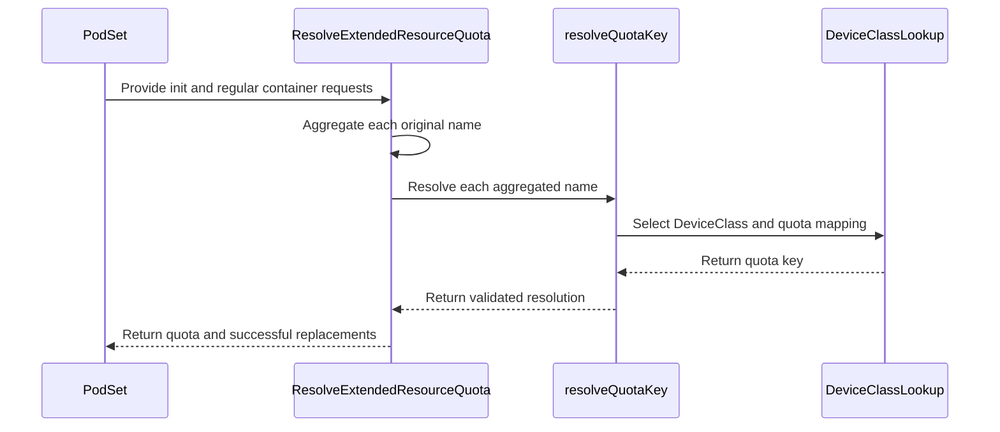

# PR #14200: DRA: aggregate extended resources by original name before mapping to quota key

**Summary**: DRA: aggregate extended resources by original name before mapping to quota key

**Sources**: https://github.com/kubernetes-sigs/kueue/pull/14200

**Last updated**: 2026-09-17T12:29:21Z

---

## Metadata

- **State**: closed (merged)
- **Author**: [@pujitha24](https://github.com/pujitha24)
- **Branch**: `auto/issue-14156` → `main`
- **Created**: 2026-08-11T14:57:29Z
- **Updated**: 2026-09-17T12:29:21Z
- **Merged**: 2026-08-12T17:13:20Z
- **Closed**: 2026-08-12T17:13:20Z
- **Labels**: `kind/bug`, `release-note`, `size/L`, `lgtm`, `approved`, `ok-to-test`, `cncf-cla: yes`, `area/dra`
- **Assignees**: [@sohankunkerkar](https://github.com/sohankunkerkar), [@thc1006](https://github.com/thc1006)
- **Requested reviewers**: [@mbobrovskyi](https://github.com/mbobrovskyi), [@PBundyra](https://github.com/PBundyra), [@thc1006](https://github.com/thc1006)
- **Changed files**: 3   **+336 / -95**

## Description

#### What type of PR is this?

/kind bug
/area dra

#### What this PR does / why we need it:

`ResolveExtendedResourceQuota` charges DRA-backed extended resources against a
logical `deviceClassMappings` quota key. It used to map each container's
requests to that quota key first, and only aggregate across containers
(max across init containers, sum across regular containers, then max of the
two) afterwards. That aggregation is not linear, so once two different
extended resource names are mapped to the same quota key, mapping before
aggregating collapses their independent contributions: `max(map(A), map(B))`
is not `map(max(A, B))`.

For example, with `class-a` (`vendor.example/a`) and `class-b`
(`vendor.example/b`) both mapped to quota key `gpu-claims`, an init container
requesting `vendor.example/a: 5` and a regular container requesting
`vendor.example/b: 5` charged `gpu-claims: 5` (the max of the two
already-mapped values) instead of `gpu-claims: 10` (the sum of each name's
own Pod-level aggregation), undercharging quota for that PodSet.

This PR reorders the computation so the per-container max/sum/max
aggregation runs on each original (unmapped) extended resource name first,
and each name's quota key is resolved once per PodSet from its own
aggregated total, then summed into the final per-key charge:
`charge[key] = sum(PodAggregation(R) for every R mapped to key)`. As a side
effect, a DeviceClass's mapping is now resolved once per original resource
name per PodSet instead of once per container occurrence, closing the
window where a DeviceClass created or deleted between two per-container
reads could leave a name inconsistently resolved.

The integer-quantity check on extended resource requests is now applied only
once a resource is confirmed to be DRA-backed (a matching DeviceClass is
found), instead of unconditionally on every domain-qualified resource name
before that's known. Previously, reordering the aggregation ahead of the
DeviceClass lookup meant a fractional quantity on a resource with no matching
DeviceClass at all (e.g. `other.example/d: 1500m`, which the standard,
non-DRA quota path accepts) would abort resolution for the whole PodSet. The
check still runs per container rather than on the aggregate, so two invalid
fractional requests can't sum to a valid whole and hide each other.

#### Which issue(s) this PR fixes:

Fixes #14156

#### Special notes for your reviewer:

This predates and is independent of PR #14154 (which rewrites the
container-aggregation mechanics in the same function but keeps the mapping
order, so it does not fix this collapse). No behavioral change for the
common case where at most one original extended resource name maps to a
given quota key within a PodSet — all pre-existing test cases in
`pkg/dra/extended_resources_test.go` still pass unmodified.

Validation performed: `go build ./...`; `go test ./pkg/dra/...
./pkg/controller/core/... ./pkg/workload/...` (all pass); `golangci-lint run
./pkg/dra/...` (0 issues); `gofmt -l` and `go vet ./pkg/dra/...` (clean). A
new test case reproduces the issue's exact scenario (two extended resource
names sharing a quota key, split across an init and a regular container) and
was manually confirmed to fail against the pre-fix code (asserting `5`) and
pass against the post-fix code (asserting `10`) via `git stash` of only the
non-test file. No live cluster / e2e run was performed; this is a pure
function over the workload spec and DeviceClass objects, fully exercised by
the existing fake-client unit test harness in this package.

#### Does this PR introduce a user-facing change?

```release-note
DRA: Fixed quota undercount when two extended resource names sharing a deviceClassMappings key were requested by different containers in the same PodSet.
```

---
AI assistance: this change was drafted with Claude Code.

<!-- This is an auto-generated comment: release notes by coderabbit.ai -->
## Summary by CodeRabbit

* **Bug Fixes**
  * Fixed extended-resource quota calculations when multiple resource names map to the same quota.
  * Ensured requests from initialization and regular containers are combined accurately.
  * Ignored fractional requests for resources that are not quota-backed.
  * Improved validation and resource replacement tracking for pod-level resource requests.
  * Added validation for per-container quantities that exceed supported integer limits.
  * Ensured quota resolution and capacity validation remain consistent across containers and resource names.
<!-- end of auto-generated comment: release notes by coderabbit.ai -->

## Discussion

### Comment by [@netlify[bot]](https://github.com/apps/netlify) — 2026-08-11T14:57:35Z

### <span aria-hidden="true">✅</span> Deploy Preview for *kubernetes-sigs-kueue* canceled.


|  Name | Link |
|:-:|------------------------|
|<span aria-hidden="true">🔨</span> Latest commit | 473d8b6b372fa03d3154e610bb800aed466c6386 |
|<span aria-hidden="true">🔍</span> Latest deploy log | https://app.netlify.com/projects/kubernetes-sigs-kueue/deploys/6a7ba0fe2ceb0600082323f7 |

### Comment by [@kubernetes-prow[bot]](https://github.com/apps/kubernetes-prow) — 2026-08-11T14:57:40Z

Hi @pujitha24. Thanks for your PR.

I'm waiting for a [kubernetes-sigs](https://github.com/orgs/kubernetes-sigs/people) member to verify that this patch is reasonable to test. If it is, they should reply with `/ok-to-test` on its own line. Until that is done, I will not automatically test new commits in this PR, but the usual testing commands by org members will still work.

>[!TIP]
>**We noticed you've done this a few times! Consider [joining the org](https://git.k8s.io/community/community-membership.md#member) to skip this step and gain `/lgtm` and other bot rights.** We recommend asking approvers on your previous PRs to sponsor you.

Once the patch is verified, the new status will be reflected by the `ok-to-test` label.

I understand the commands that are listed [here](https://go.k8s.io/bot-commands?repo=kubernetes-sigs%2Fkueue).

<details>

Instructions for interacting with me using PR comments are available [here](https://git.k8s.io/community/contributors/guide/pull-requests.md).  If you have questions or suggestions related to my behavior, please file an issue against the [kubernetes-sigs/prow](https://github.com/kubernetes-sigs/prow/issues/new?title=Prow%20issue:) repository.
</details>

### Comment by [@coderabbitai[bot]](https://github.com/apps/coderabbitai) — 2026-08-11T14:58:14Z

<!-- This is an auto-generated comment: summarize by coderabbit.ai -->
<!-- review_stack_entry_start -->

[](https://app.coderabbit.ai/change-stack/kubernetes-sigs/kueue/pull/14200?utm_source=github_walkthrough&utm_medium=github&utm_campaign=change_stack)

<!-- review_stack_entry_end -->
<!-- walkthrough_start -->

<details>
<summary>📝 Walkthrough</summary>

## Walkthrough

DRA extended-resource requests are aggregated by original resource name across init and regular containers before DeviceClass resolution. Each name is resolved once per PodSet. Replacement tracking occurs after successful validation.

### Changes

**DRA quota aggregation**

|Layer / File(s)|Summary|
|---|---|
|**Resource extraction and quota-key resolution** <br> `pkg/dra/extended_resources.go`|Requests are extracted by original resource name. `resolveQuotaKey` performs DeviceClass selection, quota-key mapping, and configuration validation.|
|**PodSet aggregation, validation, and tests** <br> `pkg/dra/extended_resources.go`, `pkg/dra/extended_resources_test.go`, `keps/2941-DRA/README.md`|PodSet processing applies max/sum aggregation before mapping. Tests cover shared quota keys, unmatched fractional resources, and aggregate overflow. The KEP documents the aggregation order.|

**Estimated code review effort:** 4 (Complex) | ~45 minutes

### Sequence Diagram(s)



**Possibly related issues**

- `kubernetes-sigs/kueue#14004` — Both changes update `ResolveExtendedResourceQuota` aggregation and replacement reconstruction.

**Possibly related PRs**

- [kubernetes-sigs/kueue#14044](https://github.com/kubernetes-sigs/kueue/pull/14044) — Both changes update DeviceClass selection and quota-key mapping in `pkg/dra/extended_resources.go`.
- [kubernetes-sigs/kueue#14154](https://github.com/kubernetes-sigs/kueue/pull/14154) — Both changes update extended-resource aggregation and replacement tracking.
- [kubernetes-sigs/kueue#14158](https://github.com/kubernetes-sigs/kueue/pull/14158) — Both changes modify DeviceClass-based quota-key resolution and selection.

**Suggested reviewers:** `mbobrovskyi`, `pbundyra`

</details>

<!-- walkthrough_end -->
<!-- pre_merge_checks_walkthrough_start -->

<details>
<summary>🚥 Pre-merge checks | ✅ 5</summary>

<details>
<summary>✅ Passed checks (5 passed)</summary>

|         Check name         | Status   | Explanation                                                                                                                                                       |
| :------------------------: | :------- | :---------------------------------------------------------------------------------------------------------------------------------------------------------------- |
|     Linked Issues check    | ✅ Passed | The changes satisfy `#14156` by aggregating each original resource name before one-time quota-key resolution and preserving validation and replacement consistency. |
| Out of Scope Changes check | ✅ Passed | The implementation, regression tests, and KEP documentation directly support `#14156`; no unrelated changes are evident.                                            |
|     Docstring Coverage     | ✅ Passed | Docstring coverage is 100.00% which is sufficient. The required threshold is 80.00%.                                                                              |
|      Description Check     | ✅ Passed | Check skipped - CodeRabbit’s high-level summary is enabled.                                                                                                       |
|         Title check        | ✅ Passed | The title clearly and concisely describes the main change: aggregating DRA extended resources by original name before quota-key mapping.                          |

</details>

</details>

<!-- pre_merge_checks_walkthrough_end -->
<!-- finishing_touch_checkbox_start -->

<details>
<summary>✨ Finishing Touches</summary>

<details>
<summary>🧪 Generate unit tests (beta)</summary>

- [ ] <!-- {"checkboxId": "f47ac10b-58cc-4372-a567-0e02b2c3d479", "radioGroupId": "utg-output-choice-group-unknown_comment_id"} -->   Create PR with unit tests

</details>

</details>

<!-- finishing_touch_checkbox_end -->
<!-- tips_start -->

---

Thanks for using [CodeRabbit](https://coderabbit.ai?utm_source=oss&utm_medium=github&utm_campaign=kubernetes-sigs/kueue&utm_content=14200)! It's free for OSS, and your support helps us grow. If you like it, consider giving us a shout-out.

<details>
<summary>❤️ Share</summary>

- [X](https://twitter.com/intent/tweet?text=I%20just%20used%20%40coderabbitai%20for%20my%20code%20review%2C%20and%20it%27s%20fantastic%21%20It%27s%20free%20for%20OSS%20and%20offers%20a%20free%20trial%20for%20the%20proprietary%20code.%20Check%20it%20out%3A&url=https%3A//coderabbit.ai)
- [Mastodon](https://mastodon.social/share?text=I%20just%20used%20%40coderabbitai%20for%20my%20code%20review%2C%20and%20it%27s%20fantastic%21%20It%27s%20free%20for%20OSS%20and%20offers%20a%20free%20trial%20for%20the%20proprietary%20code.%20Check%20it%20out%3A%20https%3A%2F%2Fcoderabbit.ai)
- [Reddit](https://www.reddit.com/submit?title=Great%20tool%20for%20code%20review%20-%20CodeRabbit&text=I%20just%20used%20CodeRabbit%20for%20my%20code%20review%2C%20and%20it%27s%20fantastic%21%20It%27s%20free%20for%20OSS%20and%20offers%20a%20free%20trial%20for%20proprietary%20code.%20Check%20it%20out%3A%20https%3A//coderabbit.ai)
- [LinkedIn](https://www.linkedin.com/sharing/share-offsite/?url=https%3A%2F%2Fcoderabbit.ai&mini=true&title=Great%20tool%20for%20code%20review%20-%20CodeRabbit&summary=I%20just%20used%20CodeRabbit%20for%20my%20code%20review%2C%20and%20it%27s%20fantastic%21%20It%27s%20free%20for%20OSS%20and%20offers%20a%20free%20trial%20for%20proprietary%20code)

</details>


<sub>Comment `@coderabbitai help` to get the list of available commands.</sub>

<!-- tips_end -->

### Comment by [@sohankunkerkar](https://github.com/sohankunkerkar) — 2026-08-11T15:35:17Z

/ok-to-test

### Comment by [@sohankunkerkar](https://github.com/sohankunkerkar) — 2026-08-11T15:35:33Z

@thc1006 could you take a look at it?

### Comment by [@thc1006](https://github.com/thc1006) — 2026-08-11T16:18:57Z

> @thc1006 could you take a look at it?

Roger!

### Comment by [@pujitha24](https://github.com/pujitha24) — 2026-08-11T17:10:13Z

@thc1006 thanks for the sweep, that's a solid catch. Pushed a commit that moves the integer check to run only after `resolveQuotaKey` confirms a DeviceClass match, still per container (not on the aggregate), so two invalid fractional requests can't sum into something that looks valid and slip through. `resolveQuotaKey` is still called once per name per PodSet, so the TOCTOU-closing part of the original fix is untouched. Added a test mirroring your `other.example/d: 1500m` case (fractional quantity, no matching DeviceClass) — confirmed it fails on the pre-fix code and passes now, alongside the existing DRA-backed non-integer test still erroring as before.

Also took your two smaller points: consolidated the template's `Fixes #` with the `Fixes #14156` that was duplicated further down, and added a sentence to the KEP's Processing Flow section noting the per-name aggregation now happens before DeviceClass lookup.

I'll leave the #14154 rebase-ordering and the `3000m`/AsInt64 issue to you as noted.

### Comment by [@kubernetes-prow[bot]](https://github.com/apps/kubernetes-prow) — 2026-08-11T18:42:32Z

LGTM label has been added.  <details>Git tree hash: 8879c1a593e193c1425051fbe1b7b72aa197f7b3</details>

### Comment by [@sohankunkerkar](https://github.com/sohankunkerkar) — 2026-08-11T22:21:07Z

/release-note-edit
```release-note
DRA: Fixed quota undercount when two extended resource names sharing a deviceClassMappings key were requested by different containers in the same PodSet.
```

### Comment by [@pujitha24](https://github.com/pujitha24) — 2026-08-11T22:23:57Z

Thanks for the review, @sohankunkerkar.

On the sidecar handling: this PR intentionally keeps the max/sum aggregation as-is and doesn't add the `RestartPolicy=Always` sidecar rule. @thc1006 raised the same point during review — #14154 (theirs) already adds sidecar-aware aggregation, and the plan we settled on is to rebase #14154 on top of this once it merges, so the sidecar logic composes with the mapping-order fix here rather than getting lost in a merge conflict. No scope change needed in this PR for that.

On the nit, done — reworded the aggregate-overflow message to "total extended resource quantity overflows int64" in 473d8b6b3.

### Comment by [@kubernetes-prow[bot]](https://github.com/apps/kubernetes-prow) — 2026-08-12T16:55:26Z

LGTM label has been added.  <details>Git tree hash: 369eac4c5fdb59df5c3611611ead010238f321a6</details>

### Comment by [@kubernetes-prow[bot]](https://github.com/apps/kubernetes-prow) — 2026-08-12T16:55:30Z

[APPROVALNOTIFIER] This PR is **APPROVED**

This pull-request has been approved by: *<a href="https://github.com/kubernetes-sigs/kueue/pull/14200#" title="Author self-approved">pujitha24</a>*, *<a href="https://github.com/kubernetes-sigs/kueue/pull/14200#pullrequestreview-4919033349" title="LGTM">sohankunkerkar</a>*, *<a href="https://github.com/kubernetes-sigs/kueue/pull/14200#pullrequestreview-4909622304" title="LGTM">thc1006</a>*

The full list of commands accepted by this bot can be found [here](https://go.k8s.io/bot-commands?repo=kubernetes-sigs%2Fkueue).

The pull request process is described [here](https://git.k8s.io/community/contributors/guide/owners.md#the-code-review-process)

<details >
Needs approval from an approver in each of these files:

- ~~[OWNERS](https://github.com/kubernetes-sigs/kueue/blob/main/OWNERS)~~ [sohankunkerkar]

Approvers can indicate their approval by writing `/approve` in a comment
Approvers can cancel approval by writing `/approve cancel` in a comment
</details>
<!-- META={"approvers":[]} -->

### Comment by [@mimowo](https://github.com/mimowo) — 2026-08-12T17:17:01Z

@sohankunkerkar should we consider CP this one as this is a bugfix and we generally CP bugfixes?

### Comment by [@sohankunkerkar](https://github.com/sohankunkerkar) — 2026-08-12T17:24:43Z

> @sohankunkerkar should we consider CP this one as this is a bugfix and we generally CP bugfixes?

Yup, I was just checking if this is required for release-0.18 but there's no harm to do that.

/cherry-pick release-0.19
/cherry-pick release-0.18

### Comment by [@k8s-infra-cherrypick-robot](https://github.com/k8s-infra-cherrypick-robot) — 2026-08-12T17:25:22Z

@sohankunkerkar: #14200 failed to apply on top of branch "release-0.18":
```
Applying: DRA: aggregate extended resources by original name before mapping to quota key
Using index info to reconstruct a base tree...
M	pkg/dra/extended_resources.go
Falling back to patching base and 3-way merge...
Auto-merging pkg/dra/extended_resources.go
CONFLICT (content): Merge conflict in pkg/dra/extended_resources.go
error: Failed to merge in the changes.
hint: Use 'git am --show-current-patch=diff' to see the failed patch
hint: When you have resolved this problem, run "git am --continue".
hint: If you prefer to skip this patch, run "git am --skip" instead.
hint: To restore the original branch and stop patching, run "git am --abort".
hint: Disable this message with "git config set advice.mergeConflict false"
Patch failed at 0001 DRA: aggregate extended resources by original name before mapping to quota key

```

<details>

In response to [this](https://github.com/kubernetes-sigs/kueue/pull/14200#issuecomment-5270138234):

>> @sohankunkerkar should we consider CP this one as this is a bugfix and we generally CP bugfixes?
>
>Yup, I was just checking if this is required for release-0.18 but there's no harm to do that.
>
>/cherry-pick release-0.19
>/cherry-pick release-0.18


Instructions for interacting with me using PR comments are available [here](https://git.k8s.io/community/contributors/guide/pull-requests.md).  If you have questions or suggestions related to my behavior, please file an issue against the [kubernetes-sigs/prow](https://github.com/kubernetes-sigs/prow/issues/new?title=Prow%20issue:) repository.
</details>

### Comment by [@k8s-infra-cherrypick-robot](https://github.com/k8s-infra-cherrypick-robot) — 2026-08-12T17:25:57Z

@sohankunkerkar: #14200 failed to apply on top of branch "release-0.19":
```
Applying: DRA: aggregate extended resources by original name before mapping to quota key
Applying: DRA: only require integer extended resource quantities once DRA-backed
Using index info to reconstruct a base tree...
M	keps/2941-DRA/README.md
Falling back to patching base and 3-way merge...
Auto-merging keps/2941-DRA/README.md
CONFLICT (content): Merge conflict in keps/2941-DRA/README.md
error: Failed to merge in the changes.
hint: Use 'git am --show-current-patch=diff' to see the failed patch
hint: When you have resolved this problem, run "git am --continue".
hint: If you prefer to skip this patch, run "git am --skip" instead.
hint: To restore the original branch and stop patching, run "git am --abort".
hint: Disable this message with "git config set advice.mergeConflict false"
Patch failed at 0002 DRA: only require integer extended resource quantities once DRA-backed

```

<details>

In response to [this](https://github.com/kubernetes-sigs/kueue/pull/14200#issuecomment-5270138234):

>> @sohankunkerkar should we consider CP this one as this is a bugfix and we generally CP bugfixes?
>
>Yup, I was just checking if this is required for release-0.18 but there's no harm to do that.
>
>/cherry-pick release-0.19
>/cherry-pick release-0.18


Instructions for interacting with me using PR comments are available [here](https://git.k8s.io/community/contributors/guide/pull-requests.md).  If you have questions or suggestions related to my behavior, please file an issue against the [kubernetes-sigs/prow](https://github.com/kubernetes-sigs/prow/issues/new?title=Prow%20issue:) repository.
</details>

### Comment by [@sohankunkerkar](https://github.com/sohankunkerkar) — 2026-08-12T17:26:00Z

/cherry-pick release-0.19

### Comment by [@sohankunkerkar](https://github.com/sohankunkerkar) — 2026-08-12T17:26:25Z

@pujitha24 could you create a CP for release-0.18 and release-0.19 manually?

### Comment by [@k8s-infra-cherrypick-robot](https://github.com/k8s-infra-cherrypick-robot) — 2026-08-12T17:26:37Z

@sohankunkerkar: #14200 failed to apply on top of branch "release-0.19":
```
Applying: DRA: aggregate extended resources by original name before mapping to quota key
Applying: DRA: only require integer extended resource quantities once DRA-backed
Using index info to reconstruct a base tree...
M	keps/2941-DRA/README.md
Falling back to patching base and 3-way merge...
Auto-merging keps/2941-DRA/README.md
CONFLICT (content): Merge conflict in keps/2941-DRA/README.md
error: Failed to merge in the changes.
hint: Use 'git am --show-current-patch=diff' to see the failed patch
hint: When you have resolved this problem, run "git am --continue".
hint: If you prefer to skip this patch, run "git am --skip" instead.
hint: To restore the original branch and stop patching, run "git am --abort".
hint: Disable this message with "git config set advice.mergeConflict false"
Patch failed at 0002 DRA: only require integer extended resource quantities once DRA-backed

```

<details>

In response to [this](https://github.com/kubernetes-sigs/kueue/pull/14200#issuecomment-5270151540):

>/cherry-pick release-0.19


Instructions for interacting with me using PR comments are available [here](https://git.k8s.io/community/contributors/guide/pull-requests.md).  If you have questions or suggestions related to my behavior, please file an issue against the [kubernetes-sigs/prow](https://github.com/kubernetes-sigs/prow/issues/new?title=Prow%20issue:) repository.
</details>

### Comment by [@sohankunkerkar](https://github.com/sohankunkerkar) — 2026-08-13T13:26:44Z

@thc1006 do you have bandwidth to CP this to 0.18/0.19?

## Reviews

### Review by [@thc1006](https://github.com/thc1006) (changes_requested) — 2026-08-11T16:49:10Z

Thanks for picking this up @pujitha24, and thanks @sohankunkerkar for the ping. Disclosure first: I filed #14156, and #14154 is mine and touches the same function, so I have a stake in both halves of this and I have tried to keep that out of the findings below.

TLDR: aggregating by original name and mapping afterwards is the right fix, and it does more than the issue asked for. One thing I would like changed before this merges: the integer check now runs on resources that are not DRA-backed at all.

I ran a sweep of 4096 PodSet shapes through `ResolveExtendedResourceQuota` on `4949d770d` and on its base `cbe41a945`, varying four container slots over two names sharing a quota key, a DRA-backed unmapped name, and a name with no DeviceClass. Comparing charge, replaced set and error count:

```
identical            1461
charge changed        940     the fix
errs 0 -> 1..4       1695     every one of them carries other.example/d: 1500m
regressions without that resource: 0
```

So the aggregation change itself moves no case from clean to erroring, which is a good sign. The 1695 are all the same shape, and that is the finding I left inline.

On the fix being wider than the issue, these are measured, same harness:

| shape, both names mapped to one key | base | this PR |
| --- | ---: | ---: |
| ordinary init A=5, regular B=5 | 5 | 10 |
| ordinary init A=5, ordinary init B=7 | 7 | 12 |
| regular A=2, regular B=3 | 5 | 5 |

The second row is worth a case of its own. It already comes out right here, so this is only about pinning it: the first row covers the max between the init and regular totals, and the second covers the max across init containers, which is a separate non-linear branch that mapping-first also collapsed. `5 + 7 = 12` because the scheduler builds a DeviceRequest per original name and both allocations live for the pod's lifetime.

One interaction to plan rather than fix here. #14154 makes the same aggregation sidecar-aware, and the two changes compose in one order only: Pod aggregation per original name first, then map and sum. A shape that shows it, again measured:

```
restartable init A=1, ordinary init B=3, regular A=1, A and B share a key

base        3
this PR     4
#14154      4     (for a different reason)
correct     5
```

This PR moves that case from 3 to 4, so it is not introducing anything. The remaining 1 is the sidecar rule that #14154 adds. My worry is only that a textual conflict resolution keeps one half and drops the other and still compiles green. Whichever of the two lands second, I am happy for that to be mine, should carry that case as a regression test. I will rebase #14154 on top of this once it merges and add it there.

Two smaller things. The KEP still describes the flow as lookup, then map, then charge, which reads like the order this PR is fixing. A sentence saying the Pod request is computed per original `extendedResourceName` first, and only then mapped and summed, would keep the next refactor from walking back into #14156. And the template's `Fixes #` at the top of the description is still empty, with the real `Fixes #14156` further down.

One observation that is not yours, so please do not take it on: `3000m` is rejected as a non-integer on both base and head, because `AsInt64` returns false for a milli-scaled quantity even though the value is 3 and the Pod API accepts it. The error even renders as `Invalid value: "3"`. Pre-existing, and I will file it separately.

The rest of the refactor reads well to me. Resolving once per name per PodSet instead of once per container is a real improvement, and `firstPath` keeping the first container's path for the error is a nice touch.

This review was written in part with the assistance of generative AI. Bcuz my English might be sucks.

- **pkg/dra/extended_resources.go:111** by [@thc1006](https://github.com/thc1006) — 2026-08-11T16:49:10Z
```diff
@@ -93,47 +93,21 @@ func selectedDeviceClass(items []resourceapi.DeviceClass) *resourceapi.DeviceCla
 	return selected
 }
 
-// resolveContainerExtendedResources converts DRA-backed extended resources in a
-// container's requests into logical quota keys. For each extended resource, it looks
-// up DeviceClasses by spec.extendedResourceName, selects the one the scheduler would
-// allocate from, and uses that class's deviceClassMappings entry as the quota key;
-// otherwise the extendedResourceName itself is used. Returns the converted resources
-// and the set of original resource names that were replaced (for double-count prevention).
-func resolveContainerExtendedResources(
-	ctx context.Context,
-	cl client.Client,
-	mapper *ResourceMapper,
-	container corev1.Container,
-	containerPath *field.Path,
-) (corev1.ResourceList, sets.Set[corev1.ResourceName], field.ErrorList) {
-	log := ctrl.LoggerFrom(ctx)
+// extendedResourceRequests extracts a container's extended resource requests, keyed by
+// their original (unmapped) resource name, validating that each quantity is an integer.
+// The DeviceClass mapping is resolved later, once per original name for the whole
+// PodSet, rather than per container here: mapping before aggregating across containers
+// would let two different resource names that share a quota key collapse into each
+// other's contribution, since max(map(A), map(B)) != map(max(A, B)) once A and B differ.
+func extendedResourceRequests(container corev1.Container, containerPath *field.Path) (corev1.ResourceList, field.ErrorList) {
 	result := corev1.ResourceList{}
-	replaced := sets.New[corev1.ResourceName]()
 	var errs field.ErrorList
 
 	for resourceName, quantity := range container.Resources.Requests {
 		if quantity.IsZero() || !utilresource.IsExtendedResourceName(resourceName) {
 			continue
 		}
 
-		log.V(4).Info("Checking extended resource for DRA backing", "resource", resourceName, "quantity", quantity.String())
-
-		var dcList resourceapi.DeviceClassList
-		if err := cl.List(ctx, &dcList, client.MatchingFields{
-			"spec.extendedResourceName": string(resourceName),
-		}); err != nil {
-			errs = append(errs, field.InternalError(
-				containerPath.Child("resources", "requests", string(resourceName)),
-				fmt.Errorf("failed to list DeviceClasses for extended resource %q: %w", resourceName, err),
-			))
-			continue
-		}
-
-		if len(dcList.Items) == 0 {
-			log.V(4).Info("No DeviceClass found, not a DRA-backed extended resource", "resource", resourceName)
-			continue
-		}
-
 		qty, ok := quantity.AsInt64()
```

  This check has moved ahead of the DeviceClass lookup, so it now runs on resources that turn out not to be DRA-backed.
  
  On base the order inside the loop is list DeviceClasses, `continue` when none match, then `AsInt64`. Here `extendedResourceRequests` validates every domain-qualified name before `resolveQuotaKey` is reached, so a resource nothing backs is judged by DRA's rules.
  
  Measured on this head against `cbe41a945`, one container requesting `other.example/d: 1500m` with no DeviceClass for that name:
  
  ```
  base   errs=[]  charged=map[]        the resource stays on the standard quota path
  head   errs=[spec.podSets[0]...requests.other.example/d: Invalid value: "1500m":
                extended resource quantity must be an integer]
  ```
  
  The part that made me want to raise it rather than let it go: the error list aborts the whole resolution, so an unrelated resource takes the valid charges with it. `-|A1|-|Df` in my sweep charged `gpu=1` on base and charges nothing here.
  
  A Pod would not get this far, since the API rejects a fractional extended resource. A Workload created directly does, and Kueue's own webhook validates the resource list without an integer check, so this is reachable.
  
  Would it work to resolve the name first and only run the integer check once a DeviceClass is found? Worth keeping the check per container rather than moving it after the aggregation, since two invalid `500m` regular requests would sum to a valid `1` and hide both. A case with no matching DeviceClass and a fractional quantity, asserting no DRA error and no replacement, would hold it.
  
  If the maintainers would rather Kueue reject these Workloads everywhere, that seems reasonable too, but as a deliberate validation change with its own test and a note in the KEP rather than as a side effect of the ordering fix. Say the word and I will dismiss this.

### Review by [@thc1006](https://github.com/thc1006) (commented) — 2026-08-11T17:33:21Z

That was a quick turnaround, thank you. I re-ran the same 4096-shape sweep on `8eee6ecaa` against `cbe41a945`, and the finding is fully closed:

```
before (4949d770d)   identical 1461   charge changed 940    newly erroring 1695
now    (8eee6ecaa)   identical 2732   charge changed 1364   newly erroring    0
```

All 940 of the intended charge changes survive, and the 1695 shapes that used to error are clean. Keeping the raw quantity with its container's path and validating after `resolveQuotaKey` is a nicer shape than what I suggested, and the two-500m case behaves: one error per container, each on the right path. I also checked that your new case fails on `4949d770d` and passes here, which it does. The KEP sentence lands the invariant in the right place.

One thing the new commit brings with it, and I would not have found it without the change, so this is not a complaint about the direction.

The `ok` from the aggregate conversion is dropped:

```go
// Safe: every container quantity contributing to this aggregate
// just passed the integer check above.
intQty, _ := quantity.AsInt64()
```

Each container's request fitting `int64` does not carry to their sum. `AsInt64` is also happy with exponent notation, so `9e18` passes per container while `1000000000000000000` written out in full does not, and two containers asking `9e18` sum to something `AsInt64` refuses. Measured on this head, two regular containers, one DeviceClass, no mapping:

```
per container 9e18: AsInt64=(9000000000000000000,true)   the integer check passes
asked for 18e18 devices -> charged="0"  replaced=[vendor.example/a]  errs=0
```

Charged nothing, no error, and the name is in `replaced`, so the original request comes off the standard path too. The Workload ends up costing zero.

Where it came from, so it is clear this is the new commit and not something you inherited:

| | charged |
| --- | --- |
| `cbe41a945` | `18E` |
| `4949d770d` | `18E` |
| `8eee6ecaa` | `0` |

The earlier two carry the oversized value forward, which the conversion into `Requests` clamps to `math.MaxInt64` later. That has its own problem, which is #14105 and mine to worry about, but it is not zero.

The small fix is to stop discarding the flag and refuse the aggregate the way a container's own request is refused, which fails closed instead of charging nothing:

```go
intQty, ok := quantity.AsInt64()
if !ok {
	allErrs = append(allErrs, field.Invalid(
		firstPath[resourceName].Child("resources", "requests", string(resourceName)),
		quantity.String(),
		"total extended resource quantity must be an integer",
	))
	continue
}
```

A case with two containers at `9e18` would hold it. The comment above that line is the part that made me look, since it states an invariant the code cannot keep, so whichever way this goes the comment should follow.

Still open from my first pass, and still not blocking: the two-ordinary-init case, `A=5` in one and `B=7` in the other with both names on one key, expecting 12. It already comes out right, so it is only about pinning the other non-linear branch. Say the word and I will send it as a follow-up rather than keep it on your plate.

This review was written in part with the assistance of generative AI. Bcuz my English might be sucks.

### Review by [@thc1006](https://github.com/thc1006) (approved) — 2026-08-11T18:42:23Z

TLDR: this closes it. I went digging for a way around the new check and couldn't find one, so I'm happy with it. There's one wording nit at the end that's fine to leave for later.

Thanks @pujitha24 for turning both rounds around so quickly, and @sohankunkerkar for the ping.

The overflow case behaves now:

```
9e18 x2 -> errs=1  charged=map[]  replaced=map[]
```

Nothing charged, and the name stays out of `replaced`, so the original request isn't taken off the standard path either.

I re-ran the same 4096-shape sweep against `cbe41a945` and it's unchanged from the previous head:

```
identical 2732   charge changed 1364   newly erroring 0
```

so this commit didn't disturb anything the last one settled.

What I really wanted to know was whether the aggregate could still hit `math.MaxInt64`, which the quota code reads as unlimited, while passing your new check. It can't, and the reason is nicer than I expected:

```
largest plain literal AsInt64 accepts   999999999999999999
9223372036854775e3                      AsInt64=(9223372036854775000,true)   807 short of the sentinel
9223372036854775807                     AsInt64=(0,false)
9.223372036854775807e18                 AsInt64=(0,false)
```

`AsInt64` won't take that value in any form I could write, so a sum landing exactly there fails your check the same way an overshoot does. I couldn't build a pair that passes and charges the sentinel, so I think the whole family is closed here.

One small thing, and it doesn't need another round. The message reuses the per-container wording:

```
containers[0]...vendor.example/a: Invalid value: "18e18":
  total extended resource quantity must be an integer
```

18e18 is an integer, it just doesn't fit `int64`, and the path points at the first container while the value belongs to neither of them. Something like "total ... does not fit a 64-bit integer" would read better for whoever hits it. Happy to leave that for a later change.

Still open from my first pass and still not blocking: the two-ordinary-init case, `A=5` and `B=7` on one key, expecting 12. It already comes out right, so it's only about pinning it. I'll send that separately so it doesn't hold this up.

/lgtm

This review was written in part with the assistance of generative AI. Bcuz my English might be sucks.

### Review by [@sohankunkerkar](https://github.com/sohankunkerkar) (commented) — 2026-08-11T22:17:44Z

Thanks for the fix! The aggregate-before-map reordering is solid. I have one nit but overall looks good!

- **pkg/dra/extended_resources.go:256** by [@sohankunkerkar](https://github.com/sohankunkerkar) — 2026-08-11T22:13:50Z
```diff
@@ -209,26 +213,101 @@ func ResolveExtendedResourceQuota(ctx context.Context, cl client.Client, mapper
 
 	for i := range wl.Spec.PodSets {
 		ps := &wl.Spec.PodSets[i]
-		replaced := sets.New[corev1.ResourceName]()
 		podSetPath := field.NewPath("spec", "podSets").Index(i).Child("template", "spec")
 
-		// Closure captures outer `replaced` set to accumulate across init and regular containers.
-		resolveContainers := func(containers []corev1.Container, pathSegment string, merge func(a, b corev1.ResourceList) corev1.ResourceList) corev1.ResourceList {
-			var result corev1.ResourceList
+		collect := func(containers []corev1.Container, pathSegment string) []containerExtendedResourceRequests {
+			var entries []containerExtendedResourceRequests
 			for j, container := range containers {
-				containerPath := podSetPath.Child(pathSegment).Index(j)
-				res, containerReplaced, errs := resolveContainerExtendedResources(ctx, cl, mapper, container, containerPath)
-				allErrs = append(allErrs, errs...)
-				replaced = replaced.Union(containerReplaced)
-				result = merge(result, res)
+				res := extendedResourceRequests(container)
+				if len(res) == 0 {
+					continue
+				}
+				entries = append(entries, containerExtendedResourceRequests{
+					path:      podSetPath.Child(pathSegment).Index(j),
+					resources: res,
+				})
+			}
+			return entries
+		}
+
+		initEntries := collect(ps.Template.Spec.InitContainers, "initContainers")
+		regularEntries := collect(ps.Template.Spec.Containers, "containers")
+
+		// The field path of the first container an original resource name is seen in,
+		// for error reporting once that name is resolved below.
+		firstPath := map[corev1.ResourceName]*field.Path{}
+		var maxInitResources, sumRegularResources corev1.ResourceList
+		for _, e := range initEntries {
+			for name := range e.resources {
+				if _, ok := firstPath[name]; !ok {
+					firstPath[name] = e.path
+				}
+			}
+			maxInitResources = utilresource.MergeResourceListKeepMax(maxInitResources, e.resources)
+		}
+		for _, e := range regularEntries {
+			for name := range e.resources {
+				if _, ok := firstPath[name]; !ok {
+					firstPath[name] = e.path
+				}
 			}
-			return result
+			sumRegularResources = utilresource.MergeResourceListKeepSum(sumRegularResources, e.resources)
 		}
+		podRequests := utilresource.MergeResourceListKeepMax(maxInitResources, sumRegularResources)
```

  I think this needs the sidecar handling. init containers with `RestartPolicy=Always` should be summed with     regular containers, not maxed among inits. #14154 already does this. Worth coordinating merge order so the sidecar logic isn't lost.

- **pkg/dra/extended_resources.go:303** by [@sohankunkerkar](https://github.com/sohankunkerkar) — 2026-08-11T22:16:15Z
```diff
@@ -209,26 +213,101 @@ func ResolveExtendedResourceQuota(ctx context.Context, cl client.Client, mapper
 
 	for i := range wl.Spec.PodSets {
 		ps := &wl.Spec.PodSets[i]
-		replaced := sets.New[corev1.ResourceName]()
 		podSetPath := field.NewPath("spec", "podSets").Index(i).Child("template", "spec")
 
-		// Closure captures outer `replaced` set to accumulate across init and regular containers.
-		resolveContainers := func(containers []corev1.Container, pathSegment string, merge func(a, b corev1.ResourceList) corev1.ResourceList) corev1.ResourceList {
-			var result corev1.ResourceList
+		collect := func(containers []corev1.Container, pathSegment string) []containerExtendedResourceRequests {
+			var entries []containerExtendedResourceRequests
 			for j, container := range containers {
-				containerPath := podSetPath.Child(pathSegment).Index(j)
-				res, containerReplaced, errs := resolveContainerExtendedResources(ctx, cl, mapper, container, containerPath)
-				allErrs = append(allErrs, errs...)
-				replaced = replaced.Union(containerReplaced)
-				result = merge(result, res)
+				res := extendedResourceRequests(container)
+				if len(res) == 0 {
+					continue
+				}
+				entries = append(entries, containerExtendedResourceRequests{
+					path:      podSetPath.Child(pathSegment).Index(j),
+					resources: res,
+				})
+			}
+			return entries
+		}
+
+		initEntries := collect(ps.Template.Spec.InitContainers, "initContainers")
+		regularEntries := collect(ps.Template.Spec.Containers, "containers")
+
+		// The field path of the first container an original resource name is seen in,
+		// for error reporting once that name is resolved below.
+		firstPath := map[corev1.ResourceName]*field.Path{}
+		var maxInitResources, sumRegularResources corev1.ResourceList
+		for _, e := range initEntries {
+			for name := range e.resources {
+				if _, ok := firstPath[name]; !ok {
+					firstPath[name] = e.path
+				}
+			}
+			maxInitResources = utilresource.MergeResourceListKeepMax(maxInitResources, e.resources)
+		}
+		for _, e := range regularEntries {
+			for name := range e.resources {
+				if _, ok := firstPath[name]; !ok {
+					firstPath[name] = e.path
+				}
 			}
-			return result
+			sumRegularResources = utilresource.MergeResourceListKeepSum(sumRegularResources, e.resources)
 		}
+		podRequests := utilresource.MergeResourceListKeepMax(maxInitResources, sumRegularResources)
 
-		maxInitResources := resolveContainers(ps.Template.Spec.InitContainers, "initContainers", utilresource.MergeResourceListKeepMax)
-		sumRegularResources := resolveContainers(ps.Template.Spec.Containers, "containers", utilresource.MergeResourceListKeepSum)
+		aggregated := corev1.ResourceList{}
+		replaced := sets.New[corev1.ResourceName]()
+		for resourceName, quantity := range podRequests {
+			quotaKey, errs := resolveQuotaKey(ctx, cl, mapper, resourceName, firstPath[resourceName])
+			if len(errs) > 0 {
+				allErrs = append(allErrs, errs...)
+				continue
+			}
+			if quotaKey == "" {
+				continue
+			}
+
+			// resourceName is confirmed DRA-backed: now hold it to the
+			// integer-only rule, checked per container rather than on the
+			// aggregate above, so two invalid fractional requests (e.g. two
+			// 500m requests summing to a valid 1) can't hide each other.
+			var intErrs field.ErrorList
+			for _, entries := range [][]containerExtendedResourceRequests{initEntries, regularEntries} {
+				for _, e := range entries {
+					qty, ok := e.resources[resourceName]
+					if !ok {
+						continue
+					}
+					if _, ok := qty.AsInt64(); !ok {
+						intErrs = append(intErrs, field.Invalid(
+							e.path.Child("resources", "requests", string(resourceName)),
+							qty.String(),
+							"extended resource quantity must be an integer",
+						))
+					}
+				}
+			}
+			if len(intErrs) > 0 {
+				allErrs = append(allErrs, intErrs...)
+				continue
+			}
+
+			// Each container's quantity passed the integer check above, but their
+			// sum can still overflow int64 (e.g. two containers requesting 9e18
+			// each), so the aggregate needs its own check rather than assuming ok.
+			intQty, ok := quantity.AsInt64()
+			if !ok {
+				allErrs = append(allErrs, field.Invalid(
+					firstPath[resourceName].Child("resources", "requests", string(resourceName)),
+					quantity.String(),
+					"total extended resource quantity must be an integer",
```

  nit: each container's quantity already passed the integer check above, so the value is an integer that overflows int64. Maybe "total extended resource quantity overflows int64"?

### Review by [@sohankunkerkar](https://github.com/sohankunkerkar) (approved) — 2026-08-12T16:55:19Z

Thanks!
/approve
/lgtm
