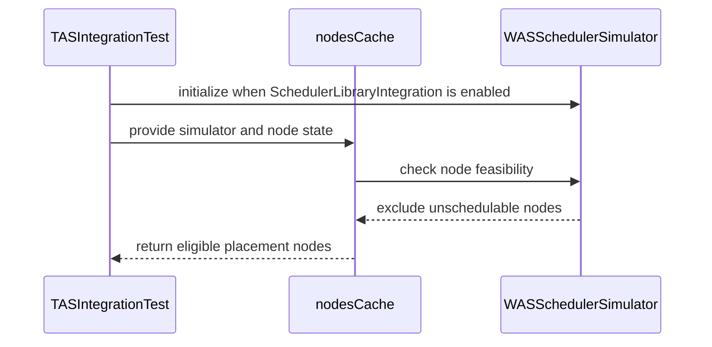

# PR #14203: Skip Kueue-side node health filtering under SchedulerLibraryIntegration

**Summary**: Skip Kueue-side node health filtering under SchedulerLibraryIntegration

**Sources**: https://github.com/kubernetes-sigs/kueue/pull/14203

**Last updated**: 2026-08-20T12:54:57Z

---

## Metadata

- **State**: closed (merged)
- **Author**: [@alien1403](https://github.com/alien1403)
- **Branch**: `was-node-health-checks` → `main`
- **Created**: 2026-08-11T16:04:05Z
- **Updated**: 2026-08-20T12:54:57Z
- **Merged**: 2026-08-18T12:37:16Z
- **Closed**: 2026-08-18T12:37:16Z
- **Labels**: `kind/feature`, `release-note`, `size/L`, `lgtm`, `approved`, `ok-to-test`, `cncf-cla: yes`, `area/tas`, `area/was`
- **Assignees**: [@olekzabl](https://github.com/olekzabl), [@tenzen-y](https://github.com/tenzen-y)
- **Requested reviewers**: [@amy](https://github.com/amy), [@pajakd](https://github.com/pajakd)
- **Changed files**: 5   **+331 / -7**

## Description

<!--  Thanks for sending a pull request!  Here are some tips for you:

1. If this is your first time, please read our contributor guidelines: https://git.k8s.io/community/contributors/guide/first-contribution.md#your-first-contribution and developer guide https://git.k8s.io/community/contributors/devel/development.md#development-guide
2. Please label this pull request according to what type of issue you are addressing, especially if this is a release targeted pull request. For reference on required PR/issue labels, read here:
https://git.k8s.io/community/contributors/devel/sig-release/release.md#issuepr-kind-label
3. Ensure you have added or ran the appropriate tests for your PR: https://git.k8s.io/community/contributors/devel/sig-testing/testing.md
4. If you want *faster* PR reviews, read how: https://git.k8s.io/community/contributors/guide/pull-requests.md#best-practices-for-faster-reviews
5. If the PR is unfinished, see how to mark it: https://git.k8s.io/community/contributors/guide/pull-requests.md#marking-unfinished-pull-requests
-->

#### What type of PR is this?

/kind cleanup
/kind feature

<!--
Add one of the following kinds:
/kind bug
/kind cleanup
/kind documentation
/kind feature
/kind kep

Optionally add one or more of the following kinds if applicable:
/kind api-change
/kind deprecation
/kind failing-test
/kind flake
/kind regression

Please also consider setting the area:
/area tas
/area was
/area integrations
/area multikueue
/area dashboard
/area localization
/area testing
/area website
-->

/area tas
/area was

#### What this PR does / why we need it:

Delegates node health and unschedulable checks to the WAS scheduling library when `SchedulerLibraryIntegration` is enabled.

#### Which issue(s) this PR fixes:
<!--
*Automatically closes linked issue when PR is merged.
Usage: `Fixes #<issue number>`, or `Fixes (paste link of issue)`.
_If PR is about `failing-tests or flakes`, please post the related issues/tests in a comment and do not use `Fixes`_*
-->
Ref #14176 

#### Special notes for your reviewer:

#### Does this PR introduce a user-facing change?
<!--
If no, just write "NONE" in the release-note block below.
If yes, a release note is required:
Enter your extended release note in the block below. If the PR requires additional action from users switching to the new release, include the string "action required".
-->
```release-note
WorkloadAwareScheduler: Delegated TAS node readiness and `spec.unschedulable` checks to the `scheduler-library` instead of applying them when building the TAS node cache. Controlled by the `SchedulerLibraryIntegration` feature gate, which is Alpha and disabled by default.
```


<!-- This is an auto-generated comment: release notes by coderabbit.ai -->
## Summary by CodeRabbit

- **Bug Fixes**
  - Improved scheduler cache handling for nodes that are unready or marked unschedulable.
  - Prevented unschedulable nodes from being selected during scheduling while continuing to consider eligible nodes.
  - Preserved appropriate hostname-level placement behavior when filtering unavailable nodes.

- **Tests**
  - Added coverage for node retention and filtering across scheduler integration scenarios.
  - Added integration coverage for generic admission and rack- and hostname-level placement involving unschedulable nodes.
<!-- end of auto-generated comment: release notes by coderabbit.ai -->

## Discussion

### Comment by [@netlify[bot]](https://github.com/apps/netlify) — 2026-08-11T16:04:11Z

### <span aria-hidden="true">✅</span> Deploy Preview for *kubernetes-sigs-kueue* ready!


|  Name | Link |
|:-:|------------------------|
|<span aria-hidden="true">🔨</span> Latest commit | 0c524c495a6a2e6ac74d1554cbf8386cdf855c65 |
|<span aria-hidden="true">🔍</span> Latest deploy log | https://app.netlify.com/projects/kubernetes-sigs-kueue/deploys/6a84188e7cc4d40008ab4c17 |
|<span aria-hidden="true">😎</span> Deploy Preview | [https://deploy-preview-14203--kubernetes-sigs-kueue.netlify.app](https://deploy-preview-14203--kubernetes-sigs-kueue.netlify.app) |
|<span aria-hidden="true">📱</span> Preview on mobile | <details><summary> Toggle QR Code... </summary><br /><br /><br /><br />_Use your smartphone camera to open QR code link._</details> |
---
<!-- [kubernetes-sigs-kueue Preview](https://deploy-preview-14203--kubernetes-sigs-kueue.netlify.app) -->
_To edit notification comments on pull requests, go to your [Netlify project configuration](https://app.netlify.com/projects/kubernetes-sigs-kueue/configuration/notifications#deploy-notifications)._

### Comment by [@kubernetes-prow[bot]](https://github.com/apps/kubernetes-prow) — 2026-08-11T16:04:16Z

Hi @alien1403. Thanks for your PR.

I'm waiting for a [kubernetes-sigs](https://github.com/orgs/kubernetes-sigs/people) member to verify that this patch is reasonable to test. If it is, they should reply with `/ok-to-test` on its own line. Until that is done, I will not automatically test new commits in this PR, but the usual testing commands by org members will still work.

Regular contributors should [join the org](https://git.k8s.io/community/community-membership.md#member) to skip this step.

Once the patch is verified, the new status will be reflected by the `ok-to-test` label.

I understand the commands that are listed [here](https://go.k8s.io/bot-commands?repo=kubernetes-sigs%2Fkueue).

<details>

Instructions for interacting with me using PR comments are available [here](https://git.k8s.io/community/contributors/guide/pull-requests.md).  If you have questions or suggestions related to my behavior, please file an issue against the [kubernetes-sigs/prow](https://github.com/kubernetes-sigs/prow/issues/new?title=Prow%20issue:) repository.
</details>

### Comment by [@coderabbitai[bot]](https://github.com/apps/coderabbitai) — 2026-08-11T16:04:59Z

<!-- This is an auto-generated comment: summarize by coderabbit.ai -->
<!-- review_stack_entry_start -->

[](https://app.coderabbit.ai/change-stack/kubernetes-sigs/kueue/pull/14203?utm_source=github_walkthrough&utm_medium=github&utm_campaign=change_stack)

<!-- review_stack_entry_end -->
<!-- This is an auto-generated comment: review paused by coderabbit.ai -->

> [!NOTE]
> ## Reviews paused
> 
> It looks like this branch is under active development. To avoid overwhelming you with review comments due to an influx of new commits, CodeRabbit has automatically paused this review. You can configure this behavior by changing the `reviews.auto_review.auto_pause_after_reviewed_commits` setting.
> 
> Use the following commands to manage reviews:
> - `@coderabbitai resume` to resume automatic reviews.
> - `@coderabbitai review` to trigger a single review.
> 
> Use the checkboxes below for quick actions:
> - [ ] <!-- {"checkboxId":"7f6cc2e2-2e4e-497a-8c31-c9e4573e93d1"} --> ▶️ Resume reviews
> - [ ] <!-- {"checkboxId":"e9bb8d72-00e8-4f67-9cb2-caf3b22574fe"} --> 🔍 Trigger review

<!-- end of auto-generated comment: review paused by coderabbit.ai -->
<!-- recent_review_start -->

No actionable comments were generated in the recent review. 🎉

<details>
<summary>ℹ️ Recent review info</summary>

<details>
<summary>⚙️ Run configuration</summary>

**Configuration used**: Path: .coderabbit.yaml

**Review profile**: CHILL

**Plan**: Pro Plus

**Run ID**: `44277fe7-c935-4a26-bd47-618f5ff45c01`

</details>

<details>
<summary>📥 Commits</summary>

Reviewing files that changed from the base of the PR and between 456c96f88ca70bcdac2cdf5f488b13aa711c466c and 0c524c495a6a2e6ac74d1554cbf8386cdf855c65.

</details>

<details>
<summary>📒 Files selected for processing (5)</summary>

* `pkg/cache/scheduler/tas_nodes_cache.go`
* `pkg/cache/scheduler/tas_nodes_cache_test.go`
* `pkg/cache/scheduler/was/scheduling_simulator.go`
* `pkg/cache/scheduler/was/scheduling_simulator_test.go`
* `pkg/scheduler/scheduler_tas_test.go`

</details>

<details>
<summary>🚧 Files skipped from review as they are similar to previous changes (5)</summary>

* pkg/cache/scheduler/was/scheduling_simulator.go
* pkg/cache/scheduler/tas_nodes_cache.go
* pkg/cache/scheduler/was/scheduling_simulator_test.go
* pkg/scheduler/scheduler_tas_test.go
* pkg/cache/scheduler/tas_nodes_cache_test.go

</details>

**Included review availability:** Your plan includes up to 8 reviews per rolling hour; 6 remain after this review.

</details>

---


<!-- recent_review_end -->
<!-- walkthrough_start -->

<details>
<summary>📝 Walkthrough</summary>

## Walkthrough

The node cache now retains unready and unschedulable nodes when `SchedulerLibraryIntegration` is enabled. It tracks their availability separately. The WAS scheduler simulator filters unschedulable nodes. TAS integration tests cover rack- and hostname-level placement.

### Changes

**Unschedulable node handling**

|Layer / File(s)|Summary|
|---|---|
|**Node cache integration behavior** <br> `pkg/cache/scheduler/tas_nodes_cache.go`, `pkg/cache/scheduler/tas_nodes_cache_test.go`|The cache tracks schedulable and ready nodes separately. It retains unready and unschedulable nodes when scheduler library integration is enabled and excludes them from searches by topology level. Tests cover both feature-gate states.|
|**WAS unschedulable filtering** <br> `pkg/cache/scheduler/was/scheduling_simulator.go`, `pkg/cache/scheduler/was/scheduling_simulator_test.go`|The simulator enables the `NodeUnschedulable` filter plugin. Tests verify that feasibility excludes unschedulable nodes.|
|**TAS scheduler integration validation** <br> `pkg/scheduler/scheduler_tas_test.go`|The tests initialize the WAS simulator when `SchedulerLibraryIntegration` is enabled and cover TAS admission plus rack- and hostname-level placement with unschedulable nodes.|

**Estimated code review effort:** 3 (Moderate) | ~25 minutes

<!-- final_review_risk_start -->
**Merge Risk:** _⚪ Minimal_ · up to `0c524`

This change delegates node health and unschedulable checks when the integration is enabled; no actionable merge-blocking risk remains beyond normal checks and review.
<!-- final_review_risk_end -->

**Suggested reviewers:** `amy`, `pajakd`

### Sequence Diagram(s)



</details>

<!-- walkthrough_end -->
<!-- pre_merge_checks_walkthrough_start -->

<details>
<summary>🚥 Pre-merge checks | ✅ 4 | ❌ 1</summary>

### ❌ Failed checks (1 warning)

|     Check name     | Status     | Explanation                                                                          | Resolution                                                                         |
| :----------------: | :--------- | :----------------------------------------------------------------------------------- | :--------------------------------------------------------------------------------- |
| Docstring Coverage | ⚠️ Warning | Docstring coverage is 0.00% which is insufficient. The required threshold is 80.00%. | Write docstrings for the functions missing them to satisfy the coverage threshold. |

<details>
<summary>✅ Passed checks (4 passed)</summary>

|         Check name         | Status   | Explanation                                                                                                                                        |
| :------------------------: | :------- | :------------------------------------------------------------------------------------------------------------------------------------------------- |
|      Description Check     | ✅ Passed | Check skipped - CodeRabbit’s high-level summary is enabled.                                                                                        |
|         Title check        | ✅ Passed | The title clearly and concisely describes the main change: bypassing Kueue-side node health filtering when SchedulerLibraryIntegration is enabled. |
|     Linked Issues check    | ✅ Passed | Check skipped because no linked issues were found for this pull request.                                                                           |
| Out of Scope Changes check | ✅ Passed | Check skipped because no linked issues were found for this pull request.                                                                           |

</details>

</details>

<!-- pre_merge_checks_walkthrough_end -->
<!-- finishing_touch_checkbox_start -->

<details>
<summary>✨ Finishing Touches</summary>

<details>
<summary>🧪 Generate unit tests (beta)</summary>

- [ ] <!-- {"checkboxId": "f47ac10b-58cc-4372-a567-0e02b2c3d479", "radioGroupId": "utg-output-choice-group-unknown_comment_id"} -->   Create PR with unit tests

</details>

</details>

<!-- finishing_touch_checkbox_end -->
<!-- tips_start -->

---

Thanks for using [CodeRabbit](https://coderabbit.ai?utm_source=oss&utm_medium=github&utm_campaign=kubernetes-sigs/kueue&utm_content=14203)! It's free for OSS, and your support helps us grow. If you like it, consider giving us a shout-out.

<details>
<summary>❤️ Share</summary>

- [X](https://twitter.com/intent/tweet?text=I%20just%20used%20%40coderabbitai%20for%20my%20code%20review%2C%20and%20it%27s%20fantastic%21%20It%27s%20free%20for%20OSS%20and%20offers%20a%20free%20trial%20for%20the%20proprietary%20code.%20Check%20it%20out%3A&url=https%3A//coderabbit.ai)
- [Mastodon](https://mastodon.social/share?text=I%20just%20used%20%40coderabbitai%20for%20my%20code%20review%2C%20and%20it%27s%20fantastic%21%20It%27s%20free%20for%20OSS%20and%20offers%20a%20free%20trial%20for%20the%20proprietary%20code.%20Check%20it%20out%3A%20https%3A%2F%2Fcoderabbit.ai)
- [Reddit](https://www.reddit.com/submit?title=Great%20tool%20for%20code%20review%20-%20CodeRabbit&text=I%20just%20used%20CodeRabbit%20for%20my%20code%20review%2C%20and%20it%27s%20fantastic%21%20It%27s%20free%20for%20OSS%20and%20offers%20a%20free%20trial%20for%20proprietary%20code.%20Check%20it%20out%3A%20https%3A//coderabbit.ai)
- [LinkedIn](https://www.linkedin.com/sharing/share-offsite/?url=https%3A%2F%2Fcoderabbit.ai&mini=true&title=Great%20tool%20for%20code%20review%20-%20CodeRabbit&summary=I%20just%20used%20CodeRabbit%20for%20my%20code%20review%2C%20and%20it%27s%20fantastic%21%20It%27s%20free%20for%20OSS%20and%20offers%20a%20free%20trial%20for%20proprietary%20code)

</details>


<sub>Comment `@coderabbitai help` to get the list of available commands.</sub>

<!-- tips_end -->

### Comment by [@kshalot](https://github.com/kshalot) — 2026-08-11T16:08:03Z

/ok-to-test

### Comment by [@mimowo](https://github.com/mimowo) — 2026-08-11T16:16:23Z

General strategy - should we CP a PR like this? Since the integration is still alpha we probably don't need to be super careful about breaking. At the same time it can allow us to provide user feedback early on, without waiting for v0.20 or v0.21. Leaving as food for thought to @tenzen-y @sohankunkerkar and @olekzabl . I'm down to do it.

### Comment by [@sohankunkerkar](https://github.com/sohankunkerkar) — 2026-08-11T17:02:46Z

> General strategy - should we CP a PR like this? Since the integration is still alpha we probably don't need to be super careful about breaking. At the same time it can allow us to provide user feedback early on, without waiting for v0.20 or v0.21. Leaving as food for thought to @tenzen-y @sohankunkerkar and @olekzabl . I'm down to do it.

+1 on CP to 0.19. The `SchedulerLibraryIntegration` gate landed in 0.19, so this is self-contained and just extends the behavior behind an existing alpha gate. Low risk and faster feedback.

Let me do some GitHub hygiene here.

### Comment by [@sohankunkerkar](https://github.com/sohankunkerkar) — 2026-08-11T17:04:30Z

/remove-kind feature

### Comment by [@tenzen-y](https://github.com/tenzen-y) — 2026-08-16T15:34:14Z

> > General strategy - should we CP a PR like this? Since the integration is still alpha we probably don't need to be super careful about breaking. At the same time it can allow us to provide user feedback early on, without waiting for v0.20 or v0.21. Leaving as food for thought to @tenzen-y @sohankunkerkar and @olekzabl . I'm down to do it.
> 
> +1 on CP to 0.19. The `SchedulerLibraryIntegration` gate landed in 0.19, so this is self-contained and just extends the behavior behind an existing alpha gate. Low risk and faster feedback.
> 
> Let me do some GitHub hygiene here.

I'm ok with CP for this PR, but I would like to consider CPs case-by-case.
I meant evaluations every time would be better since I'd like to avoid implicit CP, which probably causes new regressions.

### Comment by [@tenzen-y](https://github.com/tenzen-y) — 2026-08-16T18:13:43Z

@alien1403 Also, can you add some UT cases to https://github.com/kubernetes-sigs/kueue/blob/d1b42d52b0e73b25e122623935034ae385d309d7/pkg/scheduler/scheduler_tas_test.go#L57?

I guess that we should add (1 generic TAS scenario w/ SchedulingLibraryIntegration=enabled FG, (2 non-hostname lowest-level TAS w/ SchedulingLibraryIntegration=enabled FG, and (3 hostname lowest-level TAS w/ SchedulingLibraryIntegration=enabled FG cases.

### Comment by [@coderabbitai[bot]](https://github.com/apps/coderabbitai) — 2026-08-18T08:32:26Z

<!-- This is an auto-generated comment by CodeRabbit -->
> [!NOTE]
> GitHub couldn't provide a complete incremental comparison for this pull request, so CodeRabbit is performing a full review instead. This review may take a little longer.

### Comment by [@kubernetes-prow[bot]](https://github.com/apps/kubernetes-prow) — 2026-08-18T12:09:16Z

LGTM label has been added.  <details>Git tree hash: 03f1ab37dd538f62281c44b59b4b0e826305deff</details>

### Comment by [@kubernetes-prow[bot]](https://github.com/apps/kubernetes-prow) — 2026-08-18T12:09:20Z

[APPROVALNOTIFIER] This PR is **APPROVED**

This pull-request has been approved by: *<a href="https://github.com/kubernetes-sigs/kueue/pull/14203#" title="Author self-approved">alien1403</a>*, *<a href="https://github.com/kubernetes-sigs/kueue/pull/14203#pullrequestreview-4960800375" title="Approved">tenzen-y</a>*

The full list of commands accepted by this bot can be found [here](https://go.k8s.io/bot-commands?repo=kubernetes-sigs%2Fkueue).

The pull request process is described [here](https://git.k8s.io/community/contributors/guide/owners.md#the-code-review-process)

<details >
Needs approval from an approver in each of these files:

- ~~[OWNERS](https://github.com/kubernetes-sigs/kueue/blob/main/OWNERS)~~ [tenzen-y]

Approvers can indicate their approval by writing `/approve` in a comment
Approvers can cancel approval by writing `/approve cancel` in a comment
</details>
<!-- META={"approvers":[]} -->

### Comment by [@tenzen-y](https://github.com/tenzen-y) — 2026-08-18T12:10:11Z

Based on this discussion https://github.com/kubernetes-sigs/kueue/pull/14203#issuecomment-5308213138, we are cherrypicking this PR to the release branch.

/cherrypick release-0.19

### Comment by [@k8s-infra-cherrypick-robot](https://github.com/k8s-infra-cherrypick-robot) — 2026-08-18T12:10:14Z

@tenzen-y: once the present PR merges, I will cherry-pick it on top of `release-0.19` in a new PR and assign it to you.

<details>

In response to [this](https://github.com/kubernetes-sigs/kueue/pull/14203#issuecomment-5327968616):

>Based on this discussion https://github.com/kubernetes-sigs/kueue/pull/14203#issuecomment-5308213138, we are cherrypicking this PR to the release branch.
>
>/cherrypick release-0.19
>


Instructions for interacting with me using PR comments are available [here](https://git.k8s.io/community/contributors/guide/pull-requests.md).  If you have questions or suggestions related to my behavior, please file an issue against the [kubernetes-sigs/prow](https://github.com/kubernetes-sigs/prow/issues/new?title=Prow%20issue:) repository.
</details>

### Comment by [@k8s-infra-cherrypick-robot](https://github.com/k8s-infra-cherrypick-robot) — 2026-08-18T12:37:57Z

@tenzen-y: #14203 failed to apply on top of branch "release-0.19":
```
Applying: Skip Kueue-side node health filtering under SchedulerLibraryIntegration
Using index info to reconstruct a base tree...
M	pkg/cache/scheduler/tas_nodes_cache.go
M	pkg/cache/scheduler/tas_nodes_cache_test.go
M	pkg/cache/scheduler/was/scheduling_simulator.go
A	pkg/cache/scheduler/was/scheduling_simulator_test.go
Falling back to patching base and 3-way merge...
Auto-merging pkg/cache/scheduler/tas_nodes_cache.go
CONFLICT (content): Merge conflict in pkg/cache/scheduler/tas_nodes_cache.go
Auto-merging pkg/cache/scheduler/tas_nodes_cache_test.go
CONFLICT (content): Merge conflict in pkg/cache/scheduler/tas_nodes_cache_test.go
Auto-merging pkg/cache/scheduler/was/scheduling_simulator.go
CONFLICT (content): Merge conflict in pkg/cache/scheduler/was/scheduling_simulator.go
CONFLICT (modify/delete): pkg/cache/scheduler/was/scheduling_simulator_test.go deleted in HEAD and modified in Skip Kueue-side node health filtering under SchedulerLibraryIntegration.  Version Skip Kueue-side node health filtering under SchedulerLibraryIntegration of pkg/cache/scheduler/was/scheduling_simulator_test.go left in tree.
error: Failed to merge in the changes.
hint: Use 'git am --show-current-patch=diff' to see the failed patch
hint: When you have resolved this problem, run "git am --continue".
hint: If you prefer to skip this patch, run "git am --skip" instead.
hint: To restore the original branch and stop patching, run "git am --abort".
hint: Disable this message with "git config set advice.mergeConflict false"
Patch failed at 0001 Skip Kueue-side node health filtering under SchedulerLibraryIntegration

```

<details>

In response to [this](https://github.com/kubernetes-sigs/kueue/pull/14203#issuecomment-5327968616):

>Based on this discussion https://github.com/kubernetes-sigs/kueue/pull/14203#issuecomment-5308213138, we are cherrypicking this PR to the release branch.
>
>/cherrypick release-0.19
>


Instructions for interacting with me using PR comments are available [here](https://git.k8s.io/community/contributors/guide/pull-requests.md).  If you have questions or suggestions related to my behavior, please file an issue against the [kubernetes-sigs/prow](https://github.com/kubernetes-sigs/prow/issues/new?title=Prow%20issue:) repository.
</details>

### Comment by [@tenzen-y](https://github.com/tenzen-y) — 2026-08-18T12:45:22Z

@alien1403 can you manually prepare cherry pick w/ hack/cherry_pick_pull.sh?

### Comment by [@tenzen-y](https://github.com/tenzen-y) — 2026-08-20T12:50:39Z

/kind feature
/remove-kind cleanup

### Comment by [@tenzen-y](https://github.com/tenzen-y) — 2026-08-20T12:54:50Z

/release-note-edit
```release-note
WorkloadAwareScheduler: Delegated TAS node readiness and `spec.unschedulable` checks to the `scheduler-library` instead of applying them when building the TAS node cache. Controlled by the `SchedulerLibraryIntegration` feature gate, which is Alpha and disabled by default.
```

## Reviews

### Review by [@kannon92](https://github.com/kannon92) (commented) — 2026-08-14T02:30:49Z

/assign @olekzabl

### Review by [@tenzen-y](https://github.com/tenzen-y) (commented) — 2026-08-16T15:32:03Z

@alien1403 Thank you for enhancing our scheduler library integrations.

But, I think the current implementations have some problematic situations since this impl assumes the loweset level is host name, but we can specify another topology domain as a lowest level.

Hence, if the lowest level is not host and scheduler library integration is enabled, assignments w/ unschedulable and not ready nodes are accidentally admitted.

So, I would propose tracking schedulable and ready node names.

- **pkg/cache/scheduler/was/scheduling_simulator_test.go:208** by [@tenzen-y](https://github.com/tenzen-y) — 2026-08-16T14:27:15Z
```diff
@@ -203,3 +203,46 @@ func TestNodePortsFeasibility(t *testing.T) {
 		})
 	}
 }
+
+func TestNodeUnschedulableFeasibility(t *testing.T) {
```

  Can you make this table-driven test? You can check what a table-driven test is in `TestNodePortsFeasibility`.

- **pkg/cache/scheduler/tas_nodes_cache_test.go:276** by [@tenzen-y](https://github.com/tenzen-y) — 2026-08-16T14:30:51Z
```diff
@@ -271,3 +272,21 @@ func TestNodesCacheGeneration(t *testing.T) {
 		})
 	}
 }
+
+func TestNodesCacheWithSchedulerLibraryIntegration(t *testing.T) {
```

  ```suggestion
  func TestNodesCacheSync(t *testing.T) {
  ```
  
  We don't want to maintain UTs only for FG.

- **pkg/cache/scheduler/tas_nodes_cache.go:74** by [@tenzen-y](https://github.com/tenzen-y) — 2026-08-16T14:36:52Z
```diff
@@ -49,20 +50,23 @@ func newNodesCache() *nodesCache {
 }
 
 func (t *nodesCache) sync(node *corev1.Node) {
-	schedulableAndReady := !node.Spec.Unschedulable &&
-		utiltas.IsNodeStatusConditionTrue(node.Status.Conditions, corev1.NodeReady)
-
 	t.lock.Lock()
 	defer t.lock.Unlock()
+	if !features.Enabled(features.SchedulerLibraryIntegration) {
+		schedulableAndReady := !node.Spec.Unschedulable &&
+			utiltas.IsNodeStatusConditionTrue(node.Status.Conditions, corev1.NodeReady)
 
-	if !schedulableAndReady {
-		t.deleteWithoutLock(node.Name)
-		return
+		if !schedulableAndReady {
+			t.deleteWithoutLock(node.Name)
+			return
+		}
 	}
```

  ```suggestion
  	schedulableAndReady := !node.Spec.Unschedulable &&
  		utiltas.IsNodeStatusConditionTrue(node.Status.Conditions, corev1.NodeReady)
  	
  	t.lock.Lock()
  	defer t.lock.Unlock()
  	
  	if !features.Enabled(features.SchedulerLibraryIntegration) && !schedulableAndReady {
  		t.deleteWithoutLock(node.Name)
  		return		
  	}
  ```

- **pkg/cache/scheduler/tas_nodes_cache.go:75** by [@tenzen-y](https://github.com/tenzen-y) — 2026-08-16T15:20:29Z
```diff
@@ -49,20 +50,23 @@ func newNodesCache() *nodesCache {
 }
 
 func (t *nodesCache) sync(node *corev1.Node) {
-	schedulableAndReady := !node.Spec.Unschedulable &&
-		utiltas.IsNodeStatusConditionTrue(node.Status.Conditions, corev1.NodeReady)
-
 	t.lock.Lock()
 	defer t.lock.Unlock()
+	if !features.Enabled(features.SchedulerLibraryIntegration) {
+		schedulableAndReady := !node.Spec.Unschedulable &&
+			utiltas.IsNodeStatusConditionTrue(node.Status.Conditions, corev1.NodeReady)
 
-	if !schedulableAndReady {
-		t.deleteWithoutLock(node.Name)
-		return
+		if !schedulableAndReady {
+			t.deleteWithoutLock(node.Name)
+			return
+		}
 	}
+
```

  ```suggestion
  
  		availabilityChanged := t.schedulableAndReadyNodes.Has(node.Name) != schedulableAndReady
  		if schedulableAndReady {
  			t.schedulableAndReadyNodes.Insert(node.Name)
  		} else {
  			t.schedulableAndReadyNodes.Delete(node.Name)
  		}
  ```

- **pkg/cache/scheduler/tas_nodes_cache.go:66** by [@tenzen-y](https://github.com/tenzen-y) — 2026-08-16T15:22:41Z
```diff
@@ -49,20 +50,23 @@ func newNodesCache() *nodesCache {
 }
 
 func (t *nodesCache) sync(node *corev1.Node) {
-	schedulableAndReady := !node.Spec.Unschedulable &&
-		utiltas.IsNodeStatusConditionTrue(node.Status.Conditions, corev1.NodeReady)
-
 	t.lock.Lock()
 	defer t.lock.Unlock()
+	if !features.Enabled(features.SchedulerLibraryIntegration) {
+		schedulableAndReady := !node.Spec.Unschedulable &&
+			utiltas.IsNodeStatusConditionTrue(node.Status.Conditions, corev1.NodeReady)
 
-	if !schedulableAndReady {
-		t.deleteWithoutLock(node.Name)
-		return
+		if !schedulableAndReady {
+			t.deleteWithoutLock(node.Name)
+			return
+		}
 	}
+
 	stripped := copyAndStripNode(node)
 	if existing, found := t.nodes[node.Name]; found && strippedNodesEqual(existing, stripped) {
```

  ```suggestion
  	existing, found := t.nodes[node.Name]
  	nodeChanged := !found || !strippedNodesEqual(existing, stripped)
  	if !nodeChanged && !availableChanged {
  ```

- **pkg/cache/scheduler/tas_nodes_cache.go:70** by [@tenzen-y](https://github.com/tenzen-y) — 2026-08-16T15:23:20Z
```diff
@@ -49,20 +50,23 @@ func newNodesCache() *nodesCache {
 }
 
 func (t *nodesCache) sync(node *corev1.Node) {
-	schedulableAndReady := !node.Spec.Unschedulable &&
-		utiltas.IsNodeStatusConditionTrue(node.Status.Conditions, corev1.NodeReady)
-
 	t.lock.Lock()
 	defer t.lock.Unlock()
+	if !features.Enabled(features.SchedulerLibraryIntegration) {
+		schedulableAndReady := !node.Spec.Unschedulable &&
+			utiltas.IsNodeStatusConditionTrue(node.Status.Conditions, corev1.NodeReady)
 
-	if !schedulableAndReady {
-		t.deleteWithoutLock(node.Name)
-		return
+		if !schedulableAndReady {
+			t.deleteWithoutLock(node.Name)
+			return
+		}
 	}
+
 	stripped := copyAndStripNode(node)
 	if existing, found := t.nodes[node.Name]; found && strippedNodesEqual(existing, stripped) {
 		return
 	}
+
 	t.nodes[node.Name] = stripped
```

  ```suggestion
  	if nodeChanged {
  		t.nodes[node.Name] = stripped
  	}
  ```

- **pkg/cache/scheduler/tas_nodes_cache.go:41** by [@tenzen-y](https://github.com/tenzen-y) — 2026-08-16T15:24:08Z
  ```suggestion
  
  	schedulableAndReadyNodes set.Set[string]
  ```

- **pkg/cache/scheduler/tas_nodes_cache.go:115** by [@tenzen-y](https://github.com/tenzen-y) — 2026-08-16T15:26:34Z
  ```suggestion
  	shouldExcludeUnshedulableAndNotReadyNodes := features.Enabled(features.SchedulerLibraryIntegration) &&
  		(len(levels) == 0 || !utiltas.IsLowestLevelHostname(levels))
  	for _, node := range t.nodes {
  		if shouldExcludeUnshedulableAndNotReadyNodes && !t.schedulableAndReadyNodes.Has(node.Name) {
  			continue
  		}
  ```

- **pkg/cache/scheduler/tas_nodes_cache_test.go:276** by [@tenzen-y](https://github.com/tenzen-y) — 2026-08-16T15:27:51Z
```diff
@@ -271,3 +272,21 @@ func TestNodesCacheGeneration(t *testing.T) {
 		})
 	}
 }
+
+func TestNodesCacheWithSchedulerLibraryIntegration(t *testing.T) {
```

  Also, can you make this test function table-driven and add some cases that I mentioned?

### Review by [@alien1403](https://github.com/alien1403) (commented) — 2026-08-17T17:37:17Z

- **pkg/cache/scheduler/tas_nodes_cache.go:115** by [@alien1403](https://github.com/alien1403) — 2026-08-17T17:37:17Z
  Thanks for your suggestions!

### Review by [@tenzen-y](https://github.com/tenzen-y) (commented) — 2026-08-17T20:25:00Z

@alien1403 I just left small comments. Otherwise, LGTM
Thank you!

- **pkg/cache/scheduler/tas_nodes_cache_test.go:283** by [@tenzen-y](https://github.com/tenzen-y) — 2026-08-17T17:44:41Z
```diff
@@ -271,3 +273,72 @@ func TestNodesCacheGeneration(t *testing.T) {
 		})
 	}
 }
+
+func TestNodesCacheSync(t *testing.T) {
+	nodeWrapper := node.MakeNode("test")
+
+	testCases := map[string]struct {
+		enableSchedulerLibraryIntegration bool
+		prime                             []corev1.Node
+		op                                func(nc *nodesCache)
```

  ```suggestion
  		node                                *corev1.Node
  ```
  
  It seems that no reason to have callback function here.

- **pkg/cache/scheduler/tas_nodes_cache_test.go:329** by [@tenzen-y](https://github.com/tenzen-y) — 2026-08-17T17:45:06Z
```diff
@@ -271,3 +273,72 @@ func TestNodesCacheGeneration(t *testing.T) {
 		})
 	}
 }
+
+func TestNodesCacheSync(t *testing.T) {
+	nodeWrapper := node.MakeNode("test")
+
+	testCases := map[string]struct {
+		enableSchedulerLibraryIntegration bool
+		prime                             []corev1.Node
+		op                                func(nc *nodesCache)
+		wantNodes                         []corev1.Node
+		wantSchedulableAndReady           []string
+	}{
+		"FG disabled: sync not ready removes node": {
+			op: func(nc *nodesCache) {
+				nc.sync(nodeWrapper.DeepCopy())
+			},
+		},
+		"FG disabled: sync ready adds node": {
+			op: func(nc *nodesCache) {
+				nc.sync(nodeWrapper.Clone().Ready().Obj())
+			},
+			wantNodes:               []corev1.Node{*nodeWrapper.Clone().Ready().Obj()},
+			wantSchedulableAndReady: []string{"test"},
+		},
+		"FG enabled: sync not ready keeps node in cache but not in schedulableAndReady": {
+			enableSchedulerLibraryIntegration: true,
+			op: func(nc *nodesCache) {
+				nc.sync(nodeWrapper.DeepCopy())
+			},
+			wantNodes: []corev1.Node{*nodeWrapper.DeepCopy()},
+		},
+		"FG enabled: sync unschedulable keeps node in cache but not in schedulableAndReady": {
+			enableSchedulerLibraryIntegration: true,
+			op: func(nc *nodesCache) {
+				nc.sync(nodeWrapper.Clone().Ready().Unschedulable().Obj())
+			},
+			wantNodes: []corev1.Node{*nodeWrapper.Clone().Ready().Unschedulable().Obj()},
+		},
+		"FG enabled: sync ready adds node to cache and schedulableAndReady": {
+			enableSchedulerLibraryIntegration: true,
+			op: func(nc *nodesCache) {
+				nc.sync(nodeWrapper.Clone().Ready().Obj())
+			},
+			wantNodes:               []corev1.Node{*nodeWrapper.Clone().Ready().Obj()},
+			wantSchedulableAndReady: []string{"test"},
+		},
+	}
+	for name, tc := range testCases {
+		t.Run(name, func(t *testing.T) {
+			features.SetFeatureGateDuringTest(t, features.SchedulerLibraryIntegration, tc.enableSchedulerLibraryIntegration)
+			nc := newNodesCache()
+			for i := range tc.prime {
+				nc.sync(&tc.prime[i])
+			}
+			tc.op(nc)
```

  ```suggestion
  			tc.op(nc)
  			nc.sync(tc.node)
  ```

- **pkg/cache/scheduler/tas_nodes_cache_test.go:331** by [@tenzen-y](https://github.com/tenzen-y) — 2026-08-17T17:48:59Z
```diff
@@ -271,3 +273,72 @@ func TestNodesCacheGeneration(t *testing.T) {
 		})
 	}
 }
+
+func TestNodesCacheSync(t *testing.T) {
+	nodeWrapper := node.MakeNode("test")
+
+	testCases := map[string]struct {
+		enableSchedulerLibraryIntegration bool
+		prime                             []corev1.Node
+		op                                func(nc *nodesCache)
+		wantNodes                         []corev1.Node
+		wantSchedulableAndReady           []string
+	}{
+		"FG disabled: sync not ready removes node": {
+			op: func(nc *nodesCache) {
+				nc.sync(nodeWrapper.DeepCopy())
+			},
+		},
+		"FG disabled: sync ready adds node": {
+			op: func(nc *nodesCache) {
+				nc.sync(nodeWrapper.Clone().Ready().Obj())
+			},
+			wantNodes:               []corev1.Node{*nodeWrapper.Clone().Ready().Obj()},
+			wantSchedulableAndReady: []string{"test"},
+		},
+		"FG enabled: sync not ready keeps node in cache but not in schedulableAndReady": {
+			enableSchedulerLibraryIntegration: true,
+			op: func(nc *nodesCache) {
+				nc.sync(nodeWrapper.DeepCopy())
+			},
+			wantNodes: []corev1.Node{*nodeWrapper.DeepCopy()},
+		},
+		"FG enabled: sync unschedulable keeps node in cache but not in schedulableAndReady": {
+			enableSchedulerLibraryIntegration: true,
+			op: func(nc *nodesCache) {
+				nc.sync(nodeWrapper.Clone().Ready().Unschedulable().Obj())
+			},
+			wantNodes: []corev1.Node{*nodeWrapper.Clone().Ready().Unschedulable().Obj()},
+		},
+		"FG enabled: sync ready adds node to cache and schedulableAndReady": {
+			enableSchedulerLibraryIntegration: true,
+			op: func(nc *nodesCache) {
+				nc.sync(nodeWrapper.Clone().Ready().Obj())
+			},
+			wantNodes:               []corev1.Node{*nodeWrapper.Clone().Ready().Obj()},
+			wantSchedulableAndReady: []string{"test"},
+		},
+	}
+	for name, tc := range testCases {
+		t.Run(name, func(t *testing.T) {
+			features.SetFeatureGateDuringTest(t, features.SchedulerLibraryIntegration, tc.enableSchedulerLibraryIntegration)
+			nc := newNodesCache()
+			for i := range tc.prime {
+				nc.sync(&tc.prime[i])
+			}
+			tc.op(nc)
+
+			wantNodesMap := make(map[string]*corev1.Node, len(tc.wantNodes))
```

  ```suggestion
  			wantNodeNameNodes := make(map[string]*corev1.Node, len(tc.wantNodes))
  ```
  
  We should avoid including a typed name in a variable name.

- **pkg/cache/scheduler/tas_nodes_cache_test.go:335** by [@tenzen-y](https://github.com/tenzen-y) — 2026-08-17T17:53:57Z
```diff
@@ -271,3 +273,72 @@ func TestNodesCacheGeneration(t *testing.T) {
 		})
 	}
 }
+
+func TestNodesCacheSync(t *testing.T) {
+	nodeWrapper := node.MakeNode("test")
+
+	testCases := map[string]struct {
+		enableSchedulerLibraryIntegration bool
+		prime                             []corev1.Node
+		op                                func(nc *nodesCache)
+		wantNodes                         []corev1.Node
+		wantSchedulableAndReady           []string
+	}{
+		"FG disabled: sync not ready removes node": {
+			op: func(nc *nodesCache) {
+				nc.sync(nodeWrapper.DeepCopy())
+			},
+		},
+		"FG disabled: sync ready adds node": {
+			op: func(nc *nodesCache) {
+				nc.sync(nodeWrapper.Clone().Ready().Obj())
+			},
+			wantNodes:               []corev1.Node{*nodeWrapper.Clone().Ready().Obj()},
+			wantSchedulableAndReady: []string{"test"},
+		},
+		"FG enabled: sync not ready keeps node in cache but not in schedulableAndReady": {
+			enableSchedulerLibraryIntegration: true,
+			op: func(nc *nodesCache) {
+				nc.sync(nodeWrapper.DeepCopy())
+			},
+			wantNodes: []corev1.Node{*nodeWrapper.DeepCopy()},
+		},
+		"FG enabled: sync unschedulable keeps node in cache but not in schedulableAndReady": {
+			enableSchedulerLibraryIntegration: true,
+			op: func(nc *nodesCache) {
+				nc.sync(nodeWrapper.Clone().Ready().Unschedulable().Obj())
+			},
+			wantNodes: []corev1.Node{*nodeWrapper.Clone().Ready().Unschedulable().Obj()},
+		},
+		"FG enabled: sync ready adds node to cache and schedulableAndReady": {
+			enableSchedulerLibraryIntegration: true,
+			op: func(nc *nodesCache) {
+				nc.sync(nodeWrapper.Clone().Ready().Obj())
+			},
+			wantNodes:               []corev1.Node{*nodeWrapper.Clone().Ready().Obj()},
+			wantSchedulableAndReady: []string{"test"},
+		},
+	}
+	for name, tc := range testCases {
+		t.Run(name, func(t *testing.T) {
+			features.SetFeatureGateDuringTest(t, features.SchedulerLibraryIntegration, tc.enableSchedulerLibraryIntegration)
+			nc := newNodesCache()
+			for i := range tc.prime {
+				nc.sync(&tc.prime[i])
+			}
+			tc.op(nc)
+
+			wantNodesMap := make(map[string]*corev1.Node, len(tc.wantNodes))
+			for i := range tc.wantNodes {
+				wantNodesMap[tc.wantNodes[i].Name] = copyAndStripNode(&tc.wantNodes[i])
+			}
+			if diff := cmp.Diff(wantNodesMap, nc.nodes); diff != "" {
```

  ```suggestion
  			if diff := cmp.Diff(wantNodesMap, nc.nodes, cmpopts.SortMaps(func(a, b string) { return a < b })); diff != "" {
  ```
  
  I guess that this occurs flake test since comparing maps.

- **pkg/cache/scheduler/tas_nodes_cache_test.go:339** by [@tenzen-y](https://github.com/tenzen-y) — 2026-08-17T17:55:28Z
```diff
@@ -271,3 +273,72 @@ func TestNodesCacheGeneration(t *testing.T) {
 		})
 	}
 }
+
+func TestNodesCacheSync(t *testing.T) {
+	nodeWrapper := node.MakeNode("test")
+
+	testCases := map[string]struct {
+		enableSchedulerLibraryIntegration bool
+		prime                             []corev1.Node
+		op                                func(nc *nodesCache)
+		wantNodes                         []corev1.Node
+		wantSchedulableAndReady           []string
+	}{
+		"FG disabled: sync not ready removes node": {
+			op: func(nc *nodesCache) {
+				nc.sync(nodeWrapper.DeepCopy())
+			},
+		},
+		"FG disabled: sync ready adds node": {
+			op: func(nc *nodesCache) {
+				nc.sync(nodeWrapper.Clone().Ready().Obj())
+			},
+			wantNodes:               []corev1.Node{*nodeWrapper.Clone().Ready().Obj()},
+			wantSchedulableAndReady: []string{"test"},
+		},
+		"FG enabled: sync not ready keeps node in cache but not in schedulableAndReady": {
+			enableSchedulerLibraryIntegration: true,
+			op: func(nc *nodesCache) {
+				nc.sync(nodeWrapper.DeepCopy())
+			},
+			wantNodes: []corev1.Node{*nodeWrapper.DeepCopy()},
+		},
+		"FG enabled: sync unschedulable keeps node in cache but not in schedulableAndReady": {
+			enableSchedulerLibraryIntegration: true,
+			op: func(nc *nodesCache) {
+				nc.sync(nodeWrapper.Clone().Ready().Unschedulable().Obj())
+			},
+			wantNodes: []corev1.Node{*nodeWrapper.Clone().Ready().Unschedulable().Obj()},
+		},
+		"FG enabled: sync ready adds node to cache and schedulableAndReady": {
+			enableSchedulerLibraryIntegration: true,
+			op: func(nc *nodesCache) {
+				nc.sync(nodeWrapper.Clone().Ready().Obj())
+			},
+			wantNodes:               []corev1.Node{*nodeWrapper.Clone().Ready().Obj()},
+			wantSchedulableAndReady: []string{"test"},
+		},
+	}
+	for name, tc := range testCases {
+		t.Run(name, func(t *testing.T) {
+			features.SetFeatureGateDuringTest(t, features.SchedulerLibraryIntegration, tc.enableSchedulerLibraryIntegration)
+			nc := newNodesCache()
+			for i := range tc.prime {
+				nc.sync(&tc.prime[i])
+			}
+			tc.op(nc)
+
+			wantNodesMap := make(map[string]*corev1.Node, len(tc.wantNodes))
+			for i := range tc.wantNodes {
+				wantNodesMap[tc.wantNodes[i].Name] = copyAndStripNode(&tc.wantNodes[i])
+			}
+			if diff := cmp.Diff(wantNodesMap, nc.nodes); diff != "" {
+				t.Errorf("Unexpected nodes (-want,+got):\n%s", diff)
+			}
+			wantSet := sets.New(tc.wantSchedulableAndReady...)
+			if diff := cmp.Diff(wantSet, nc.schedulableAndReadyNodes); diff != "" {
```

  ```suggestion
  			if diff := cmp.Diff(sets.New(tc.wantSchedulableAndReady...), nc.schedulableAndReadyNodes); diff != "" {
  ```
  
  We can avoid additional alloc.

### Review by [@alien1403](https://github.com/alien1403) (commented) — 2026-08-18T07:29:37Z

- **pkg/cache/scheduler/tas_nodes_cache_test.go:339** by [@alien1403](https://github.com/alien1403) — 2026-08-18T07:29:37Z
```diff
@@ -271,3 +273,72 @@ func TestNodesCacheGeneration(t *testing.T) {
 		})
 	}
 }
+
+func TestNodesCacheSync(t *testing.T) {
+	nodeWrapper := node.MakeNode("test")
+
+	testCases := map[string]struct {
+		enableSchedulerLibraryIntegration bool
+		prime                             []corev1.Node
+		op                                func(nc *nodesCache)
+		wantNodes                         []corev1.Node
+		wantSchedulableAndReady           []string
+	}{
+		"FG disabled: sync not ready removes node": {
+			op: func(nc *nodesCache) {
+				nc.sync(nodeWrapper.DeepCopy())
+			},
+		},
+		"FG disabled: sync ready adds node": {
+			op: func(nc *nodesCache) {
+				nc.sync(nodeWrapper.Clone().Ready().Obj())
+			},
+			wantNodes:               []corev1.Node{*nodeWrapper.Clone().Ready().Obj()},
+			wantSchedulableAndReady: []string{"test"},
+		},
+		"FG enabled: sync not ready keeps node in cache but not in schedulableAndReady": {
+			enableSchedulerLibraryIntegration: true,
+			op: func(nc *nodesCache) {
+				nc.sync(nodeWrapper.DeepCopy())
+			},
+			wantNodes: []corev1.Node{*nodeWrapper.DeepCopy()},
+		},
+		"FG enabled: sync unschedulable keeps node in cache but not in schedulableAndReady": {
+			enableSchedulerLibraryIntegration: true,
+			op: func(nc *nodesCache) {
+				nc.sync(nodeWrapper.Clone().Ready().Unschedulable().Obj())
+			},
+			wantNodes: []corev1.Node{*nodeWrapper.Clone().Ready().Unschedulable().Obj()},
+		},
+		"FG enabled: sync ready adds node to cache and schedulableAndReady": {
+			enableSchedulerLibraryIntegration: true,
+			op: func(nc *nodesCache) {
+				nc.sync(nodeWrapper.Clone().Ready().Obj())
+			},
+			wantNodes:               []corev1.Node{*nodeWrapper.Clone().Ready().Obj()},
+			wantSchedulableAndReady: []string{"test"},
+		},
+	}
+	for name, tc := range testCases {
+		t.Run(name, func(t *testing.T) {
+			features.SetFeatureGateDuringTest(t, features.SchedulerLibraryIntegration, tc.enableSchedulerLibraryIntegration)
+			nc := newNodesCache()
+			for i := range tc.prime {
+				nc.sync(&tc.prime[i])
+			}
+			tc.op(nc)
+
+			wantNodesMap := make(map[string]*corev1.Node, len(tc.wantNodes))
+			for i := range tc.wantNodes {
+				wantNodesMap[tc.wantNodes[i].Name] = copyAndStripNode(&tc.wantNodes[i])
+			}
+			if diff := cmp.Diff(wantNodesMap, nc.nodes); diff != "" {
+				t.Errorf("Unexpected nodes (-want,+got):\n%s", diff)
+			}
+			wantSet := sets.New(tc.wantSchedulableAndReady...)
+			if diff := cmp.Diff(wantSet, nc.schedulableAndReadyNodes); diff != "" {
```

  Thanks for your suggestions!

### Review by [@tenzen-y](https://github.com/tenzen-y) (commented) — 2026-08-18T12:09:08Z

Thank you!
/lgtm
/approve
