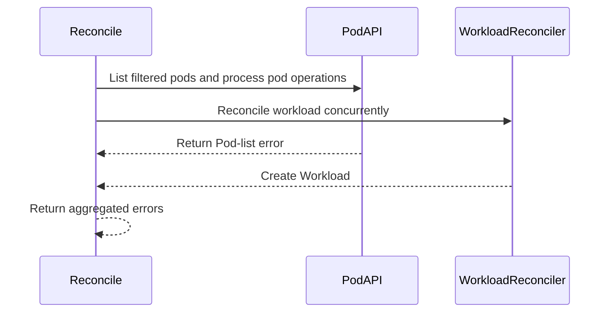

# PR #14361: StatefulSet: don't let a Pod list failure block Workload reconciliation

**Summary**: StatefulSet: don't let a Pod list failure block Workload reconciliation

**Sources**: https://github.com/kubernetes-sigs/kueue/pull/14361

**Last updated**: 2026-09-17T12:29:29Z

---

## Metadata

- **State**: closed
- **Author**: [@pujitha24](https://github.com/pujitha24)
- **Branch**: `auto/issue-14211` → `main`
- **Created**: 2026-08-12T20:49:15Z
- **Updated**: 2026-09-17T12:29:29Z
- **Merged**: —
- **Closed**: 2026-08-22T23:27:36Z
- **Labels**: `kind/bug`, `release-note`, `size/M`, `ok-to-test`, `cncf-cla: yes`
- **Assignees**: [@mimowo](https://github.com/mimowo)
- **Requested reviewers**: [@sohankunkerkar](https://github.com/sohankunkerkar), [@tenzen-y](https://github.com/tenzen-y)
- **Changed files**: 2   **+60 / -11**

## Description

<!--  Thanks for sending a pull request!  Here are some tips for you:

1. If this is your first time, please read our contributor guidelines: https://git.k8s.io/community/contributors/guide/first-contribution.md#your-first-contribution and developer guide https://git.k8s.io/community/contributors/devel/development.md#development-guide
2. Please label this pull request according to what type of issue you are addressing, especially if this is a release targeted pull request. For reference on required PR/issue labels, read here:
https://git.k8s.io/community/contributors/devel/sig-release/release.md#issuepr-kind-label
3. Ensure you have added or ran the appropriate tests for your PR: https://git.k8s.io/community/contributors/devel/sig-testing/testing.md
4. If you want *faster* PR reviews, read how: https://git.k8s.io/community/contributors/guide/pull-requests.md#best-practices-for-faster-reviews
5. If the PR is unfinished, see how to mark it: https://git.k8s.io/community/contributors/guide/pull-requests.md#marking-unfinished-pull-requests
-->

#### What type of PR is this?

/kind bug

#### What this PR does / why we need it:

The StatefulSet reconciler listed the StatefulSet's Pods, and used that list for queue-label sync, before forking into its two independent branches (Pod ungating, and Workload reconciliation). Because `reconcileWorkload` doesn't use the Pod list, a transient error from that `List` call returned from `Reconcile` before the Workload branch ever ran, even though the Workload branch didn't need it. (The workload-name lookup that also ran before the fork is now resolved once and shared by both branches as of #14721, so it doesn't have this problem and this PR doesn't touch it.)

This moves the Pod list and queue-label sync into the Pod-branch goroutine, so a failure there only affects that branch. The Workload branch, which already receives the pre-resolved Workload, now runs independently as intended.

#### Which issue(s) this PR fixes:
<!--
*Automatically closes linked issue when PR is merged.
Usage: `Fixes #<issue number>`, or `Fixes (paste link of issue)`.
_If PR is about `failing-tests or flakes`, please post the related issues/tests in a comment and do not use `Fixes`_*
-->
Fixes #

#### Special notes for your reviewer:

This is the remaining half of the fix the issue describes; the errgroup split between the Pod-finalization branch and the Workload-reconciliation branch was already added by a prior PR. #14721 separately moved the workload-name lookup so it's resolved once, before the fork, and shared by both branches — that lookup no longer needs to be relocated. This change only relocates the Pod list and `syncQueueLabel` call into the Pod-branch goroutine — no other behavior changes.

Validation performed locally:
- `go build ./...`
- `go test ./pkg/controller/jobs/statefulset/...` (all passing, including a new regression test)
- `go test ./pkg/controller/jobs/statefulset/... -race` (passing, confirms no new data race from moving `syncQueueLabel`/Pod list into the goroutine)
- `golangci-lint run ./pkg/controller/jobs/statefulset/...` (0 issues)
- `gofmt -l` and `go vet` on the changed files (clean)

The new test, `TestReconcileCreatesWorkloadDespitePodListFailure`, makes the fake client's Pod `List` call fail and asserts the Workload is still created. I confirmed this test fails on the pre-fix code (Workload not found) and passes after the fix — this is the reproduction for the defect described in the issue. I did not run this against a live cluster or the e2e suite; the defect is a pure control-flow bug in the reconciler's Go code, fully exercised by the existing fake-client-based unit test harness for this package.

#### Does this PR introduce a user-facing change?
<!--
If no, just write "NONE" in the release-note block below.
If yes, a release note is required:
Enter your extended release note in the block below. If the PR requires additional action from users switching to the new release, include the string "action required".
-->
```release-note
StatefulSet: Fixed a bug where a transient Pod list failure during a StatefulSet reconcile could also prevent the associated Workload from being created or reconciled, even though Workload reconciliation does not depend on the Pod list.
```

---
AI assistance: this change was drafted with Claude Code.

Fixes #14211

<!-- This is an auto-generated comment: release notes by coderabbit.ai -->
## Summary by CodeRabbit

* **Bug Fixes**
  * StatefulSet reconciliation now continues workload processing when pod lookup or listing encounters an error.
  * Workloads can be created or updated despite independent pod-related failures.
  * Pod-related errors are still reported for visibility and follow-up.
  * Independent reconciliation tasks proceed concurrently, improving reliability.

* **Tests**
  * Added coverage confirming workloads are created successfully when pod listing fails.
<!-- end of auto-generated comment: release notes by coderabbit.ai -->

## Discussion

### Comment by [@netlify[bot]](https://github.com/apps/netlify) — 2026-08-12T20:49:21Z

### <span aria-hidden="true">✅</span> Deploy Preview for *kubernetes-sigs-kueue* ready!


|  Name | Link |
|:-:|------------------------|
|<span aria-hidden="true">🔨</span> Latest commit | ccaaf13aec6a3e45d7b5bf680649e738ce6127ff |
|<span aria-hidden="true">🔍</span> Latest deploy log | https://app.netlify.com/projects/kubernetes-sigs-kueue/deploys/6a89d1796136660008f33fd0 |
|<span aria-hidden="true">😎</span> Deploy Preview | [https://deploy-preview-14361--kubernetes-sigs-kueue.netlify.app](https://deploy-preview-14361--kubernetes-sigs-kueue.netlify.app) |
|<span aria-hidden="true">📱</span> Preview on mobile | <details><summary> Toggle QR Code... </summary><br /><br /><br /><br />_Use your smartphone camera to open QR code link._</details> |
---
<!-- [kubernetes-sigs-kueue Preview](https://deploy-preview-14361--kubernetes-sigs-kueue.netlify.app) -->
_To edit notification comments on pull requests, go to your [Netlify project configuration](https://app.netlify.com/projects/kubernetes-sigs-kueue/configuration/notifications#deploy-notifications)._

### Comment by [@kubernetes-prow[bot]](https://github.com/apps/kubernetes-prow) — 2026-08-12T20:49:26Z

Hi @pujitha24. Thanks for your PR.

I'm waiting for a [kubernetes-sigs](https://github.com/orgs/kubernetes-sigs/people) member to verify that this patch is reasonable to test. If it is, they should reply with `/ok-to-test` on its own line. Until that is done, I will not automatically test new commits in this PR, but the usual testing commands by org members will still work.

>[!TIP]
>**We noticed you've done this a few times! Consider [joining the org](https://git.k8s.io/community/community-membership.md#member) to skip this step and gain `/lgtm` and other bot rights.** We recommend asking approvers on your previous PRs to sponsor you.

Once the patch is verified, the new status will be reflected by the `ok-to-test` label.

I understand the commands that are listed [here](https://go.k8s.io/bot-commands?repo=kubernetes-sigs%2Fkueue).

<details>

Instructions for interacting with me using PR comments are available [here](https://git.k8s.io/community/contributors/guide/pull-requests.md).  If you have questions or suggestions related to my behavior, please file an issue against the [kubernetes-sigs/prow](https://github.com/kubernetes-sigs/prow/issues/new?title=Prow%20issue:) repository.
</details>

### Comment by [@mimowo](https://github.com/mimowo) — 2026-08-12T20:49:54Z

/ok-to-test

### Comment by [@coderabbitai[bot]](https://github.com/apps/coderabbitai) — 2026-08-12T20:50:01Z

<!-- This is an auto-generated comment: summarize by coderabbit.ai -->
<!-- review_stack_entry_start -->

[](https://app.coderabbit.ai/change-stack/kubernetes-sigs/kueue/pull/14361?utm_source=github_walkthrough&utm_medium=github&utm_campaign=change_stack)

<!-- review_stack_entry_end -->
<!-- recent_review_start -->

No actionable comments were generated in the recent review. 🎉

<details>
<summary>ℹ️ Recent review info</summary>

<details>
<summary>⚙️ Run configuration</summary>

**Configuration used**: Path: .coderabbit.yaml

**Review profile**: CHILL

**Plan**: Pro Plus

**Run ID**: `9085f884-0fc4-4865-a186-80115591c764`

</details>

<details>
<summary>📥 Commits</summary>

Reviewing files that changed from the base of the PR and between 5f544d092ef7872c78b87313a8f89c5b97eb25cb and ccaaf13aec6a3e45d7b5bf680649e738ce6127ff.

</details>

<details>
<summary>📒 Files selected for processing (2)</summary>

* `pkg/controller/jobs/statefulset/statefulset_reconciler.go`
* `pkg/controller/jobs/statefulset/statefulset_reconciler_test.go`

</details>

<details>
<summary>🚧 Files skipped from review as they are similar to previous changes (2)</summary>

* pkg/controller/jobs/statefulset/statefulset_reconciler.go
* pkg/controller/jobs/statefulset/statefulset_reconciler_test.go

</details>

**Included review availability:** Your plan provides up to 8 included reviews per hour; 7 remain after this review.

</details>

---


<!-- recent_review_end -->
<!-- walkthrough_start -->

<details>
<summary>📝 Walkthrough</summary>

## Walkthrough

StatefulSet reconciliation now runs workload processing concurrently with pod operations. Pod errors remain aggregated and returned, while workload creation continues. Tests cover filtered Pod-list failure.

### Changes

**StatefulSet reconciliation**

|Layer / File(s)|Summary|
|---|---|
|**Concurrent workload and pod reconciliation** <br> `pkg/controller/jobs/statefulset/statefulset_reconciler.go`, `pkg/controller/jobs/statefulset/statefulset_reconciler_test.go`|Pod processing runs in one `errgroup` branch while workload reconciliation runs in another. The reconciler returns Pod-list errors while still creating the Workload. Tests configure filtered Pod-list failures and verify the independent workload result.|

**Estimated code review effort:** 3 (Moderate) | ~20 minutes

<!-- final_review_risk_start -->
**Merge Risk:** _⚪ Minimal_ · up to `ccaaf`

This change isolates Pod-list failures from Workload reconciliation, allowing the Workload to continue being created or reconciled when Pod listing temporarily fails. No actionable merge-blocking risk remains beyond normal checks.
<!-- final_review_risk_end -->

**Suggested reviewers:** `sohankunkerkar`, `tenzen-y`

### Sequence Diagram(s)



</details>

<!-- walkthrough_end -->
<!-- pre_merge_checks_walkthrough_start -->

<details>
<summary>🚥 Pre-merge checks | ✅ 4 | ❌ 1</summary>

### ❌ Failed checks (1 warning)

|     Check name     | Status     | Explanation                                                                                                                                                                               | Resolution                                                                         |
| :----------------: | :--------- | :---------------------------------------------------------------------------------------------------------------------------------------------------------------------------------------- | :--------------------------------------------------------------------------------- |
| Docstring Coverage | ⚠️ Warning | Docstring coverage is 0.00% which is insufficient. The required threshold is 80.00%. Docstring coverage is scoped to functions touched by this diff. Analyzed 1 functions across 2 files. | Write docstrings for the functions missing them to satisfy the coverage threshold. |

<details>
<summary>✅ Passed checks (4 passed)</summary>

|         Check name         | Status   | Explanation                                                                                                        |
| :------------------------: | :------- | :----------------------------------------------------------------------------------------------------------------- |
|     Linked Issues check    | ✅ Passed | Check skipped because no linked issues were found for this pull request.                                           |
| Out of Scope Changes check | ✅ Passed | Check skipped because no linked issues were found for this pull request.                                           |
|      Description Check     | ✅ Passed | Check skipped - CodeRabbit’s high-level summary is enabled.                                                        |
|         Title check        | ✅ Passed | The title clearly and concisely describes the main fix: Pod list failures no longer block Workload reconciliation. |

</details>

</details>

<!-- pre_merge_checks_walkthrough_end -->
<!-- finishing_touch_checkbox_start -->

<details>
<summary>✨ Finishing Touches</summary>

<details>
<summary>🧪 Generate unit tests (beta)</summary>

- [ ] <!-- {"checkboxId": "f47ac10b-58cc-4372-a567-0e02b2c3d479", "radioGroupId": "utg-output-choice-group-unknown_comment_id"} -->   Create PR with unit tests

</details>

</details>

<!-- finishing_touch_checkbox_end -->
<!-- tips_start -->

---

Thanks for using [CodeRabbit](https://coderabbit.ai?utm_source=oss&utm_medium=github&utm_campaign=kubernetes-sigs/kueue&utm_content=14361)! It's free for OSS, and your support helps us grow. If you like it, consider giving us a shout-out.

<details>
<summary>❤️ Share</summary>

- [X](https://twitter.com/intent/tweet?text=I%20just%20used%20%40coderabbitai%20for%20my%20code%20review%2C%20and%20it%27s%20fantastic%21%20It%27s%20free%20for%20OSS%20and%20offers%20a%20free%20trial%20for%20the%20proprietary%20code.%20Check%20it%20out%3A&url=https%3A//coderabbit.ai)
- [Mastodon](https://mastodon.social/share?text=I%20just%20used%20%40coderabbitai%20for%20my%20code%20review%2C%20and%20it%27s%20fantastic%21%20It%27s%20free%20for%20OSS%20and%20offers%20a%20free%20trial%20for%20the%20proprietary%20code.%20Check%20it%20out%3A%20https%3A%2F%2Fcoderabbit.ai)
- [Reddit](https://www.reddit.com/submit?title=Great%20tool%20for%20code%20review%20-%20CodeRabbit&text=I%20just%20used%20CodeRabbit%20for%20my%20code%20review%2C%20and%20it%27s%20fantastic%21%20It%27s%20free%20for%20OSS%20and%20offers%20a%20free%20trial%20for%20proprietary%20code.%20Check%20it%20out%3A%20https%3A//coderabbit.ai)
- [LinkedIn](https://www.linkedin.com/sharing/share-offsite/?url=https%3A%2F%2Fcoderabbit.ai&mini=true&title=Great%20tool%20for%20code%20review%20-%20CodeRabbit&summary=I%20just%20used%20CodeRabbit%20for%20my%20code%20review%2C%20and%20it%27s%20fantastic%21%20It%27s%20free%20for%20OSS%20and%20offers%20a%20free%20trial%20for%20proprietary%20code)

</details>


<sub>Comment `@coderabbitai help` to get the list of available commands.</sub>

<!-- tips_end -->

### Comment by [@pujitha24](https://github.com/pujitha24) — 2026-08-17T07:19:53Z

/assign @mimowo

Rebased and green — assigning for review whenever you have a chance.

### Comment by [@kubernetes-prow[bot]](https://github.com/apps/kubernetes-prow) — 2026-08-17T12:45:11Z

[APPROVALNOTIFIER] This PR is **NOT APPROVED**

This pull-request has been approved by: *<a href="https://github.com/kubernetes-sigs/kueue/pull/14361#" title="Author self-approved">pujitha24</a>*
**Once this PR has been reviewed and has the lgtm label**, please ask for approval from [mimowo](https://github.com/mimowo). For more information see [the Code Review Process](https://git.k8s.io/community/contributors/guide/owners.md#the-code-review-process).

The full list of commands accepted by this bot can be found [here](https://go.k8s.io/bot-commands?repo=kubernetes-sigs%2Fkueue).

<details open>
Needs approval from an approver in each of these files:

- **[OWNERS](https://github.com/kubernetes-sigs/kueue/blob/main/OWNERS)**

Approvers can indicate their approval by writing `/approve` in a comment
Approvers can cancel approval by writing `/approve cancel` in a comment
</details>
<!-- META={"approvers":["mimowo"]} -->

### Comment by [@coderabbitai[bot]](https://github.com/apps/coderabbitai) — 2026-08-22T16:42:47Z

<!-- This is an auto-generated comment by CodeRabbit -->
> [!NOTE]
> GitHub couldn't provide a complete incremental comparison for this pull request, so CodeRabbit is performing a full review instead. This review may take a little longer.

### Comment by [@sohankunkerkar](https://github.com/sohankunkerkar) — 2026-08-22T22:21:48Z

Thanks for working on this. Heads up that #14721 merged, so `reconcileWorkload` now takes the Workload instead of resolving it, and the reasoning in the issue and this description doesn't match main anymore. That leaves the Pod list. It comes from the informer cache and never reaches the API server, so I'm having trouble picturing a transient error there in a real cluster. Have you seen one in CI or from a user?

Also, in the case your test sets up, we create the Workload and hold quota while the pods never get ungated, and the reconcile still errors and requeues, so I'm not sure this is better than creating nothing.

### Comment by [@pujitha24](https://github.com/pujitha24) — 2026-08-22T22:30:27Z

You're right that #14721 changes the premise — `reconcileWorkload` now takes the already-resolved `wl`, so there's no second name lookup to duplicate anymore. The only thing left to move into the Pod branch is the List call and `syncQueueLabel`, which is what this PR now does; I'll fix the description to stop claiming it also relocates the workload-name lookup.

On the transient List error: I don't have a CI or user report of this actually happening. The issue this PR closes was written from reading the control flow, not from an observed failure, and you're right that this List goes through the informer cache rather than the API server, so I can't point to a concrete scenario that trips it.

And the quota point is fair — if the List does fail, we now create/admit the Workload while the pods stay gated and the reconcile still errors and requeues, so it's not obviously better than today's behavior. I don't have a good answer for why that's worth the change. Given both of these, I think it's fair to hold off — happy to close this if you'd rather not carry it, or let me know if you see it differently.

### Comment by [@sohankunkerkar](https://github.com/sohankunkerkar) — 2026-08-22T22:41:51Z

 Appreciate you digging into it. Let's close this one.

### Comment by [@pujitha24](https://github.com/pujitha24) — 2026-08-22T23:27:36Z

Sounds good — thanks for the back-and-forth, closing it out.

## Reviews

### Review by [@mbobrovskyi](https://github.com/mbobrovskyi) (commented) — 2026-08-17T12:30:21Z

- **pkg/controller/jobs/statefulset/statefulset_reconciler_test.go:992** by [@mbobrovskyi](https://github.com/mbobrovskyi) — 2026-08-17T12:30:21Z
```diff
@@ -984,3 +984,46 @@ func TestReconcileDoesNotCancelTheWorkloadBranch(t *testing.T) {
 		t.Errorf("created Workload priority = %v, want the class value 100", created.Spec.Priority)
 	}
 }
+
+// TestReconcileCreatesWorkloadDespitePodListFailure pins that a failed Pod
+// list, which only the pod branch (queue-label sync and finalization) needs,
+// does not keep the Workload branch from running: it resolves the workload
+// name itself and does not depend on the Pod list.
+func TestReconcileCreatesWorkloadDespitePodListFailure(t *testing.T) {
```

  Could we extend TestReconciler instead of creating a new test?

### Review by [@mbobrovskyi](https://github.com/mbobrovskyi) (commented) — 2026-08-17T12:31:03Z

- **pkg/controller/jobs/statefulset/statefulset_reconciler.go:101** by [@mbobrovskyi](https://github.com/mbobrovskyi) — 2026-08-17T12:31:03Z
```diff
@@ -89,30 +89,35 @@ func (r *Reconciler) Reconcile(ctx context.Context, req reconcile.Request) (reco
 		return ctrl.Result{}, client.IgnoreNotFound(err)
 	}
 
-	wlName, err := findWorkloadName(ctx, r.client, sts)
-	if err != nil {
-		return ctrl.Result{}, err
-	}
-
-	podList := &corev1.PodList{}
-	if err := r.client.List(ctx, podList, client.InNamespace(req.Namespace), client.MatchingFields{
-		podcontroller.PodGroupNameCacheKey: wlName,
-	}); err != nil {
-		return ctrl.Result{}, err
-	}
-
-	if err := r.syncQueueLabel(ctx, sts, podList.Items); err != nil {
-		return ctrl.Result{}, err
-	}
-
 	// Finalizing pods and reconciling the Workload touch different objects, so
 	// one failing is no reason to abandon the other. A derived context would
 	// cancel it, and its own lookups would then fail as cancelled rather than
 	// for the reason they were about to find. The reconcile context still
 	// carries shutdown and any deadline.
+	//
+	// The Pod list is only needed by the pod branch (queue-label sync and
+	// finalization), so it is fetched inside that branch: a failure there
+	// must not keep the Workload branch, which resolves its own workload
+	// name, from running.
```

  nit: do we need this comment?
