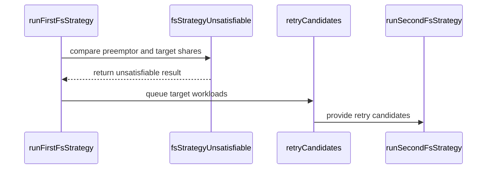

# PR #14490: FairSharing: skip the preemption tournament when the preemptor's share is +Inf

**Summary**: FairSharing: skip the preemption tournament when the preemptor's share is +Inf

**Sources**: https://github.com/kubernetes-sigs/kueue/pull/14490

**Last updated**: 2026-09-30T13:50:17Z

---

## Metadata

- **State**: closed (merged)
- **Author**: [@venuchitta](https://github.com/venuchitta)
- **Branch**: `perf/skip-unsatisfiable-fairsharing-tournament` → `main`
- **Created**: 2026-08-15T01:00:51Z
- **Updated**: 2026-09-30T13:50:17Z
- **Merged**: 2026-08-20T08:01:13Z
- **Closed**: 2026-08-20T08:01:13Z
- **Labels**: `kind/bug`, `release-note`, `size/L`, `lgtm`, `approved`, `ok-to-test`, `cncf-cla: yes`
- **Assignees**: [@kshalot](https://github.com/kshalot), [@tenzen-y](https://github.com/tenzen-y)
- **Requested reviewers**: _none_
- **Changed files**: 2   **+346 / -0**

## Description

Fixes #14487

## What this does

When a FairSharing preemptor's DominantResourceShare is `+Inf` (it borrows while its cohort's fair weight is 0), `CompareDRS` ranks it above every finite-share target, so both default strategies reject every candidate. `runFirstFsStrategy` still evaluates the full per-candidate tournament (each walking to the cohort root) and `runSecondFsStrategy` iterates them again, all provably failing. On a saturated cluster this is `O(candidate workloads)` of wasted work per such preemption attempt, every cycle, and the dominant source of the `Evaluating FairSharing strategy` log at V(4).

`fsStrategyUnsatisfiable` detects the case (preemptor `+Inf`, target not) and skips the per-candidate loop, draining the candidates into `retryCandidates` so rule S2-b still runs on a snapshot the loop may have changed (it does not `DropQueue`). The zero-vs-zero case (target also `+Inf`) is deliberately not skipped: `CompareDRS` falls back to the raw ratio there and preemption can still pass.

Companion to #14348 (which collapses the per-candidate log); here the tournament is removed outright for the unsatisfiable case.

## Tests

`TestFairPreemptions` and `TestFairPreemptionSkipsUnsatisfiableTournament` (map-based, table-driven): the skip fires for +Inf-vs-finite (no preemption), does not fire for zero-vs-zero (preemption still possible), does not fire for a finite preemptor, and skipped candidates still reach the second strategy.

`gofmt`, `go vet`, `golangci-lint`, and `go test ./pkg/scheduler/preemption/...` pass.

## Disclosure

This change, including its description, was written with AI assistance and reviewed before submission.

```release-note
FairSharing: Skip the FairSharing preemption tournament when the preemptor's dominant resource share is +Inf, since no candidate can be preempted, avoiding wasted per-candidate evaluation and its V(4) log volume.
```


<!-- This is an auto-generated comment: release notes by coderabbit.ai -->

## Summary by CodeRabbit

* **Bug Fixes**
  * Improved fair-preemption handling for workloads with zero or infinite sharing weights.
  * Correctly skips unsatisfiable preemption scenarios, preventing unnecessary preemption attempts.
  * Preserves eligible candidates across applicable preemption strategies for more consistent scheduling behavior.

* **Tests**
  * Expanded coverage for zero-weight borrowing and unsatisfiable fair-preemption scenarios.
  * Added validation that skipped scenarios do not produce unintended preemptions.

<!-- end of auto-generated comment: release notes by coderabbit.ai -->

## Discussion

### Comment by [@netlify[bot]](https://github.com/apps/netlify) — 2026-08-15T01:00:57Z

### <span aria-hidden="true">✅</span> Deploy Preview for *kubernetes-sigs-kueue* ready!


|  Name | Link |
|:-:|------------------------|
|<span aria-hidden="true">🔨</span> Latest commit | 453a62b6afb2c096cc2b38f6b69c8c82e2fd5da6 |
|<span aria-hidden="true">🔍</span> Latest deploy log | https://app.netlify.com/projects/kubernetes-sigs-kueue/deploys/6a8242edbe79b9000881d448 |
|<span aria-hidden="true">😎</span> Deploy Preview | [https://deploy-preview-14490--kubernetes-sigs-kueue.netlify.app](https://deploy-preview-14490--kubernetes-sigs-kueue.netlify.app) |
|<span aria-hidden="true">📱</span> Preview on mobile | <details><summary> Toggle QR Code... </summary><br /><br /><br /><br />_Use your smartphone camera to open QR code link._</details> |
---
<!-- [kubernetes-sigs-kueue Preview](https://deploy-preview-14490--kubernetes-sigs-kueue.netlify.app) -->
_To edit notification comments on pull requests, go to your [Netlify project configuration](https://app.netlify.com/projects/kubernetes-sigs-kueue/configuration/notifications#deploy-notifications)._

### Comment by [@kubernetes-prow[bot]](https://github.com/apps/kubernetes-prow) — 2026-08-15T01:01:01Z

Hi @venuchitta. Thanks for your PR.

I'm waiting for a [kubernetes-sigs](https://github.com/orgs/kubernetes-sigs/people) member to verify that this patch is reasonable to test. If it is, they should reply with `/ok-to-test` on its own line. Until that is done, I will not automatically test new commits in this PR, but the usual testing commands by org members will still work.

>[!TIP]
>**We noticed you've done this a few times! Consider [joining the org](https://git.k8s.io/community/community-membership.md#member) to skip this step and gain `/lgtm` and other bot rights.** We recommend asking approvers on your previous PRs to sponsor you.

Once the patch is verified, the new status will be reflected by the `ok-to-test` label.

I understand the commands that are listed [here](https://go.k8s.io/bot-commands?repo=kubernetes-sigs%2Fkueue).

<details>

Instructions for interacting with me using PR comments are available [here](https://git.k8s.io/community/contributors/guide/pull-requests.md).  If you have questions or suggestions related to my behavior, please file an issue against the [kubernetes-sigs/prow](https://github.com/kubernetes-sigs/prow/issues/new?title=Prow%20issue:) repository.
</details>

### Comment by [@coderabbitai[bot]](https://github.com/apps/coderabbitai) — 2026-08-15T01:01:32Z

<!-- This is an auto-generated comment: summarize by coderabbit.ai -->
<!-- review_stack_entry_start -->

[](https://app.coderabbit.ai/change-stack/kubernetes-sigs/kueue/pull/14490?utm_source=github_walkthrough&utm_medium=github&utm_campaign=change_stack)

<!-- review_stack_entry_end -->
<!-- recent_review_start -->

No actionable comments were generated in the recent review. 🎉

<details>
<summary>ℹ️ Recent review info</summary>

<details>
<summary>⚙️ Run configuration</summary>

**Configuration used**: Path: .coderabbit.yaml

**Review profile**: CHILL

**Plan**: Pro Plus

**Run ID**: `1965d29f-d212-48fc-96a1-47a92cf033ba`

</details>

<details>
<summary>📥 Commits</summary>

Reviewing files that changed from the base of the PR and between 22553e5417b21bd0274d862ad366f247227f6ec4 and 453a62b6afb2c096cc2b38f6b69c8c82e2fd5da6.

</details>

<details>
<summary>📒 Files selected for processing (2)</summary>

* `pkg/scheduler/preemption/preemption.go`
* `pkg/scheduler/preemption/preemption_fair_test.go`

</details>

**Included review availability:** Your plan includes up to 8 reviews per rolling hour; 7 remain after this review.

</details>

---


<!-- recent_review_end -->
<!-- walkthrough_start -->

<details>
<summary>📝 Walkthrough</summary>

## Walkthrough

Fair Sharing preemption now detects unsatisfiable infinite-share tournaments before candidate evaluation. It queues affected workloads for retry processing. Tests cover zero-weight borrowing, candidate retention, strategy evaluation counts, and skipped queues.

### Changes

**Fair Sharing preemption optimization**

|Layer / File(s)|Summary|
|---|---|
|**Detect and skip unsatisfiable tournaments** <br> `pkg/scheduler/preemption/preemption.go`|`runFirstFsStrategy` detects infinite preemptor shares with finite target shares, skips per-workload evaluation, and queues workloads for second-strategy processing.|
|**Validate Fair Sharing behavior** <br> `pkg/scheduler/preemption/preemption_fair_test.go`|Tests cover zero-weight and non-zero-weight borrowing, candidate retention across strategies, logging counts, skipped queues, and the absence of preemption targets.|

**Estimated code review effort:** 3 (Moderate) | ~20 minutes

<!-- final_review_risk_start -->
**Merge Risk:** _⚪ Minimal_ · up to `453a6`

The change is localized to FairSharing preemption evaluation and its tests; no actionable merge-blocking risk remains beyond normal checks and review.
<!-- final_review_risk_end -->

### Sequence Diagram(s)



**Possibly related PRs**

- [kubernetes-sigs/kueue#14128](https://github.com/kubernetes-sigs/kueue/pull/14128): Both modify Fair Sharing preemption evaluation and candidate handling.
- [kubernetes-sigs/kueue#14348](https://github.com/kubernetes-sigs/kueue/pull/14348): Both modify Fair Sharing preemption logic and evaluation logging.

**Suggested labels:** `area/fair-sharing`

**Suggested reviewers:** `kshalot`, `tenzen-y`, `mykysha`

</details>

<!-- walkthrough_end -->
<!-- pre_merge_checks_walkthrough_start -->

<details>
<summary>🚥 Pre-merge checks | ✅ 5</summary>

<details>
<summary>✅ Passed checks (5 passed)</summary>

|         Check name         | Status   | Explanation                                                                                                                                          |
| :------------------------: | :------- | :--------------------------------------------------------------------------------------------------------------------------------------------------- |
|     Linked Issues check    | ✅ Passed | The implementation and tests address all coding objectives in issue `#14487`, including +Inf detection, candidate draining, and zero-vs-zero handling. |
| Out of Scope Changes check | ✅ Passed | The production and test changes directly support the linked issue and PR objectives; no unrelated changes are identified.                            |
|     Docstring Coverage     | ✅ Passed | No functions found in the changed files to evaluate docstring coverage. Skipping docstring coverage check.                                           |
|      Description Check     | ✅ Passed | Check skipped - CodeRabbit’s high-level summary is enabled.                                                                                          |
|         Title check        | ✅ Passed | The title clearly and concisely describes the main change: skipping FairSharing preemption when the preemptor's share is +Inf.                       |

</details>

</details>

<!-- pre_merge_checks_walkthrough_end -->
<!-- finishing_touch_checkbox_start -->

<details>
<summary>✨ Finishing Touches</summary>

<details>
<summary>🧪 Generate unit tests (beta)</summary>

- [ ] <!-- {"checkboxId": "f47ac10b-58cc-4372-a567-0e02b2c3d479", "radioGroupId": "utg-output-choice-group-unknown_comment_id"} -->   Create PR with unit tests

</details>

</details>

<!-- finishing_touch_checkbox_end -->
<!-- tips_start -->

---

Thanks for using [CodeRabbit](https://coderabbit.ai?utm_source=oss&utm_medium=github&utm_campaign=kubernetes-sigs/kueue&utm_content=14490)! It's free for OSS, and your support helps us grow. If you like it, consider giving us a shout-out.

<details>
<summary>❤️ Share</summary>

- [X](https://twitter.com/intent/tweet?text=I%20just%20used%20%40coderabbitai%20for%20my%20code%20review%2C%20and%20it%27s%20fantastic%21%20It%27s%20free%20for%20OSS%20and%20offers%20a%20free%20trial%20for%20the%20proprietary%20code.%20Check%20it%20out%3A&url=https%3A//coderabbit.ai)
- [Mastodon](https://mastodon.social/share?text=I%20just%20used%20%40coderabbitai%20for%20my%20code%20review%2C%20and%20it%27s%20fantastic%21%20It%27s%20free%20for%20OSS%20and%20offers%20a%20free%20trial%20for%20the%20proprietary%20code.%20Check%20it%20out%3A%20https%3A%2F%2Fcoderabbit.ai)
- [Reddit](https://www.reddit.com/submit?title=Great%20tool%20for%20code%20review%20-%20CodeRabbit&text=I%20just%20used%20CodeRabbit%20for%20my%20code%20review%2C%20and%20it%27s%20fantastic%21%20It%27s%20free%20for%20OSS%20and%20offers%20a%20free%20trial%20for%20proprietary%20code.%20Check%20it%20out%3A%20https%3A//coderabbit.ai)
- [LinkedIn](https://www.linkedin.com/sharing/share-offsite/?url=https%3A%2F%2Fcoderabbit.ai&mini=true&title=Great%20tool%20for%20code%20review%20-%20CodeRabbit&summary=I%20just%20used%20CodeRabbit%20for%20my%20code%20review%2C%20and%20it%27s%20fantastic%21%20It%27s%20free%20for%20OSS%20and%20offers%20a%20free%20trial%20for%20proprietary%20code)

</details>


<sub>Comment `@coderabbitai help` to get the list of available commands.</sub>

<!-- tips_end -->

### Comment by [@tenzen-y](https://github.com/tenzen-y) — 2026-08-15T08:34:28Z

/ok-to-test

### Comment by [@tenzen-y](https://github.com/tenzen-y) — 2026-08-16T19:12:49Z

@venuchitta can you rebase this PR onto the main branch?

### Comment by [@venuchitta](https://github.com/venuchitta) — 2026-08-16T23:08:50Z

@tenzen-y Rebased onto main. The only conflict was in `runFirstFsStrategy` with #14348; resolved by running the +Inf skip check before the new `newFsStrategyLog`. PTAL.

### Comment by [@venuchitta](https://github.com/venuchitta) — 2026-08-18T16:54:16Z

@tenzen-y PTAL whenever you are free. This would help improve perf for my team at Apple. Thanks!

### Comment by [@tenzen-y](https://github.com/tenzen-y) — 2026-08-18T17:11:29Z

Thank you for your patience.
I am currently getting dozens of review requests.
Give me some time 🙏

### Comment by [@kshalot](https://github.com/kshalot) — 2026-08-19T20:45:26Z

/assign

I'll make the first review pass tomorrow.

### Comment by [@tenzen-y](https://github.com/tenzen-y) — 2026-08-19T21:51:06Z

/cherrypick release-0.18
/cherrypick release-0.19

### Comment by [@k8s-infra-cherrypick-robot](https://github.com/k8s-infra-cherrypick-robot) — 2026-08-19T21:51:08Z

@tenzen-y: once the present PR merges, I will cherry-pick it on top of `release-0.18`, `release-0.19` in new PRs and assign them to you.

<details>

In response to [this](https://github.com/kubernetes-sigs/kueue/pull/14490#issuecomment-5348427372):

>/cherrypick release-0.18
>/cherrypick release-0.19
>


Instructions for interacting with me using PR comments are available [here](https://git.k8s.io/community/contributors/guide/pull-requests.md).  If you have questions or suggestions related to my behavior, please file an issue against the [kubernetes-sigs/prow](https://github.com/kubernetes-sigs/prow/issues/new?title=Prow%20issue:) repository.
</details>

### Comment by [@kubernetes-prow[bot]](https://github.com/apps/kubernetes-prow) — 2026-08-19T22:04:13Z

LGTM label has been added.  <details>Git tree hash: 788a88080f419b4714c58725113b8c3de51653ad</details>

### Comment by [@kubernetes-prow[bot]](https://github.com/apps/kubernetes-prow) — 2026-08-19T22:04:17Z

[APPROVALNOTIFIER] This PR is **APPROVED**

This pull-request has been approved by: *<a href="https://github.com/kubernetes-sigs/kueue/pull/14490#pullrequestreview-4977159808" title="Approved">tenzen-y</a>*, *<a href="https://github.com/kubernetes-sigs/kueue/pull/14490#" title="Author self-approved">venuchitta</a>*

The full list of commands accepted by this bot can be found [here](https://go.k8s.io/bot-commands?repo=kubernetes-sigs%2Fkueue).

The pull request process is described [here](https://git.k8s.io/community/contributors/guide/owners.md#the-code-review-process)

<details >
Needs approval from an approver in each of these files:

- ~~[OWNERS](https://github.com/kubernetes-sigs/kueue/blob/main/OWNERS)~~ [tenzen-y]

Approvers can indicate their approval by writing `/approve` in a comment
Approvers can cancel approval by writing `/approve cancel` in a comment
</details>
<!-- META={"approvers":[]} -->

### Comment by [@k8s-infra-cherrypick-robot](https://github.com/k8s-infra-cherrypick-robot) — 2026-08-20T08:01:54Z

@tenzen-y: #14490 failed to apply on top of branch "release-0.18":
```
Applying: Skip the fair sharing tournament when no candidate can pass
Using index info to reconstruct a base tree...
M	pkg/scheduler/preemption/preemption.go
M	pkg/scheduler/preemption/preemption_fair_test.go
Falling back to patching base and 3-way merge...
Auto-merging pkg/scheduler/preemption/preemption.go
Auto-merging pkg/scheduler/preemption/preemption_fair_test.go
CONFLICT (content): Merge conflict in pkg/scheduler/preemption/preemption_fair_test.go
error: Failed to merge in the changes.
hint: Use 'git am --show-current-patch=diff' to see the failed patch
hint: When you have resolved this problem, run "git am --continue".
hint: If you prefer to skip this patch, run "git am --skip" instead.
hint: To restore the original branch and stop patching, run "git am --abort".
hint: Disable this message with "git config set advice.mergeConflict false"
Patch failed at 0001 Skip the fair sharing tournament when no candidate can pass

```

<details>

In response to [this](https://github.com/kubernetes-sigs/kueue/pull/14490#issuecomment-5348427372):

>/cherrypick release-0.18
>/cherrypick release-0.19
>


Instructions for interacting with me using PR comments are available [here](https://git.k8s.io/community/contributors/guide/pull-requests.md).  If you have questions or suggestions related to my behavior, please file an issue against the [kubernetes-sigs/prow](https://github.com/kubernetes-sigs/prow/issues/new?title=Prow%20issue:) repository.
</details>

### Comment by [@k8s-infra-cherrypick-robot](https://github.com/k8s-infra-cherrypick-robot) — 2026-08-20T08:02:32Z

@tenzen-y: new pull request created: #14671

<details>

In response to [this](https://github.com/kubernetes-sigs/kueue/pull/14490#issuecomment-5348427372):

>/cherrypick release-0.18
>/cherrypick release-0.19
>


Instructions for interacting with me using PR comments are available [here](https://git.k8s.io/community/contributors/guide/pull-requests.md).  If you have questions or suggestions related to my behavior, please file an issue against the [kubernetes-sigs/prow](https://github.com/kubernetes-sigs/prow/issues/new?title=Prow%20issue:) repository.
</details>

### Comment by [@kshalot](https://github.com/kshalot) — 2026-08-20T09:31:02Z

@tenzen-y @venuchitta The 0.18 cherry-pick failed due to conflicts. I opened a manual one so this makes it to the 0.18 patch release on time:
https://github.com/kubernetes-sigs/kueue/pull/14674

### Comment by [@mbobrovskyi](https://github.com/mbobrovskyi) — 2026-08-20T11:03:57Z

/remove-kind cleanup
/kind bug

### Comment by [@tenzen-y](https://github.com/tenzen-y) — 2026-08-20T13:38:45Z

/release-note-edit
```release-note
Scheduling: skip the FairSharing preemption tournament when the preemptor's dominant resource share is +Inf, since no candidate can be preempted, avoiding wasted per-candidate evaluation and its V(4) log volume.
```

### Comment by [@tenzen-y](https://github.com/tenzen-y) — 2026-08-20T13:39:01Z

/release-note-edit
```release-note
FairSharing: skip the FairSharing preemption tournament when the preemptor's dominant resource share is +Inf, since no candidate can be preempted, avoiding wasted per-candidate evaluation and its V(4) log volume.
```

### Comment by [@mbobrovskyi](https://github.com/mbobrovskyi) — 2026-09-30T13:50:17Z

/release-note-edit
```release-note
FairSharing: Skip the FairSharing preemption tournament when the preemptor's dominant resource share is +Inf, since no candidate can be preempted, avoiding wasted per-candidate evaluation and its V(4) log volume.
```

## Reviews

### Review by [@tenzen-y](https://github.com/tenzen-y) (commented) — 2026-08-19T22:04:06Z

@venuchitta Thanks! This perf optimization looks great. I'm not sure why we didn't implement this gate 😓  It's very obvious...

/lgtm
/approve

/hold
for @kshalot

### Review by [@kshalot](https://github.com/kshalot) (commented) — 2026-08-20T07:43:49Z

/unhold

Looks good 👍  I have one nit alternative, but I don't think it's worth considering.

Thanks!

- **pkg/scheduler/preemption/preemption.go:497** by [@kshalot](https://github.com/kshalot) — 2026-08-20T07:41:54Z
```diff
@@ -452,6 +469,33 @@ func runFirstFsStrategy(preemptionCtx *preemptionCtx, candidates []*workload.Inf
 	return false, targets, retryCandidates
 }
 
+// fsStrategyUnsatisfiable reports whether, given the preemptor's and the
+// target's shares before any workload is removed, no candidate workload in
+// the target ClusterQueue can pass either FairSharing strategy. When it
+// returns true the per-candidate simulation in runFirstFsStrategy can be
+// skipped, because every candidate is guaranteed to fail.
+//
+// A DominantResourceShare of +Inf means the node borrows while having a fair
+// weight of 0, which the API defines as an infinite share. It cannot arise any
+// other way, since a non-zero weight is validated to be greater than 10^-9.
+// CompareDRS ranks such a node above every node that is not itself borrowing
+// on a zero weight, so it returns 1. Both strategies require the comparison to
+// be <= 0 or < 0, so both fail:
+//
+//   - LessThanInitialShare compares against targetOldShare directly, which
+//     this function already has.
+//   - LessThanOrEqualToFinalShare compares against the target's share after
+//     the candidate's usage is removed. Removing usage never changes the
+//     target node's fair weight, and the lendable capacity the usage is
+//     compared against is derived from quota alone, so the target's share
+//     after removal is at most its share before removal. A target whose share
+//     is not +Inf before removal is therefore not +Inf after removal either,
+//     and CompareDRS returns 1 for it as well.
+func fsStrategyUnsatisfiable(preemptorNewShare fairsharing.PreemptorNewShare, targetOldShare fairsharing.TargetOldShare) bool {
+	return math.IsInf(schdcache.DRS(preemptorNewShare).PreciseWeightedShare(), 1) &&
+		!math.IsInf(schdcache.DRS(targetOldShare).PreciseWeightedShare(), 1)
+}
```

  Nit: IIUC we could also export this:
  
  https://github.com/kubernetes-sigs/kueue/blob/6a6fba243723a72c47eb96fd2e98ab24df27aa35/pkg/cache/scheduler/fair_sharing.go#L143-L147
  
  and use it here.

### Review by [@tenzen-y](https://github.com/tenzen-y) (commented) — 2026-08-20T09:59:44Z

- **pkg/scheduler/preemption/preemption.go:497** by [@tenzen-y](https://github.com/tenzen-y) — 2026-08-20T09:59:43Z
```diff
@@ -452,6 +469,33 @@ func runFirstFsStrategy(preemptionCtx *preemptionCtx, candidates []*workload.Inf
 	return false, targets, retryCandidates
 }
 
+// fsStrategyUnsatisfiable reports whether, given the preemptor's and the
+// target's shares before any workload is removed, no candidate workload in
+// the target ClusterQueue can pass either FairSharing strategy. When it
+// returns true the per-candidate simulation in runFirstFsStrategy can be
+// skipped, because every candidate is guaranteed to fail.
+//
+// A DominantResourceShare of +Inf means the node borrows while having a fair
+// weight of 0, which the API defines as an infinite share. It cannot arise any
+// other way, since a non-zero weight is validated to be greater than 10^-9.
+// CompareDRS ranks such a node above every node that is not itself borrowing
+// on a zero weight, so it returns 1. Both strategies require the comparison to
+// be <= 0 or < 0, so both fail:
+//
+//   - LessThanInitialShare compares against targetOldShare directly, which
+//     this function already has.
+//   - LessThanOrEqualToFinalShare compares against the target's share after
+//     the candidate's usage is removed. Removing usage never changes the
+//     target node's fair weight, and the lendable capacity the usage is
+//     compared against is derived from quota alone, so the target's share
+//     after removal is at most its share before removal. A target whose share
+//     is not +Inf before removal is therefore not +Inf after removal either,
+//     and CompareDRS returns 1 for it as well.
+func fsStrategyUnsatisfiable(preemptorNewShare fairsharing.PreemptorNewShare, targetOldShare fairsharing.TargetOldShare) bool {
+	return math.IsInf(schdcache.DRS(preemptorNewShare).PreciseWeightedShare(), 1) &&
+		!math.IsInf(schdcache.DRS(targetOldShare).PreciseWeightedShare(), 1)
+}
```

  @coderabbitai Please open a follow-up issue for this thread w/ kind/cleanup label and assign @venuchitta to the issue.

### Review by [@coderabbitai[bot]](https://github.com/apps/coderabbitai) (commented) — 2026-08-20T10:01:05Z

- **pkg/scheduler/preemption/preemption.go:497** by [@coderabbitai[bot]](https://github.com/apps/coderabbitai) — 2026-08-20T10:01:05Z
```diff
@@ -452,6 +469,33 @@ func runFirstFsStrategy(preemptionCtx *preemptionCtx, candidates []*workload.Inf
 	return false, targets, retryCandidates
 }
 
+// fsStrategyUnsatisfiable reports whether, given the preemptor's and the
+// target's shares before any workload is removed, no candidate workload in
+// the target ClusterQueue can pass either FairSharing strategy. When it
+// returns true the per-candidate simulation in runFirstFsStrategy can be
+// skipped, because every candidate is guaranteed to fail.
+//
+// A DominantResourceShare of +Inf means the node borrows while having a fair
+// weight of 0, which the API defines as an infinite share. It cannot arise any
+// other way, since a non-zero weight is validated to be greater than 10^-9.
+// CompareDRS ranks such a node above every node that is not itself borrowing
+// on a zero weight, so it returns 1. Both strategies require the comparison to
+// be <= 0 or < 0, so both fail:
+//
+//   - LessThanInitialShare compares against targetOldShare directly, which
+//     this function already has.
+//   - LessThanOrEqualToFinalShare compares against the target's share after
+//     the candidate's usage is removed. Removing usage never changes the
+//     target node's fair weight, and the lendable capacity the usage is
+//     compared against is derived from quota alone, so the target's share
+//     after removal is at most its share before removal. A target whose share
+//     is not +Inf before removal is therefore not +Inf after removal either,
+//     and CompareDRS returns 1 for it as well.
+func fsStrategyUnsatisfiable(preemptorNewShare fairsharing.PreemptorNewShare, targetOldShare fairsharing.TargetOldShare) bool {
+	return math.IsInf(schdcache.DRS(preemptorNewShare).PreciseWeightedShare(), 1) &&
+		!math.IsInf(schdcache.DRS(targetOldShare).PreciseWeightedShare(), 1)
+}
```

  <details>
  <summary>🧩 Analysis chain</summary>
  
  🏁 Script executed:
  
  ```shell
  #!/bin/bash
  set -euo pipefail
  
  repo="kubernetes-sigs/kueue"
  
  gh issue create \
    --repo "$repo" \
    --title "cleanup: Reuse scheduler DRS infinite-share helper in Fair Sharing preemption" \
    --assignee "venuchitta" \
    --body "$(cat <<'EOF'
  ## Summary
  
  Export the existing scheduler helper for detecting an infinite DominantResourceShare, then use that helper in Fair Sharing preemption.
  
  ## Rationale
  
  `pkg/scheduler/preemption/preemption.go` currently checks `math.IsInf(schdcache.DRS(...).PreciseWeightedShare(), 1)` directly in `fsStrategyUnsatisfiable`. The scheduler cache already has the related infinite-share detection in `pkg/cache/scheduler/fair_sharing.go`. A shared exported helper will keep the meaning of an infinite DominantResourceShare in one location.
  
  ## Affected areas
  
  - `pkg/cache/scheduler/fair_sharing.go`
  - `pkg/scheduler/preemption/preemption.go`
  - Tests for the exported helper and its preemption use
  
  ## Acceptance criteria
  
  - Export a scheduler-cache helper that identifies the relevant `+Inf` DominantResourceShare condition.
  - Replace the direct `math.IsInf` checks in `fsStrategyUnsatisfiable` with the exported helper.
  - Keep the Fair Sharing behavior unchanged.
  - Add or update focused tests as needed.
  
  ## Backlinks
  
  - Pull request: https://github.com/kubernetes-sigs/kueue/pull/14490
  - Review thread: https://github.com/kubernetes-sigs/kueue/pull/14490#discussion_r3819570881
  - Requested by: `@tenzen-y`
  
  AI assistance was used to draft this issue.
  EOF
  )"
  
  # k8s-ci-robot applies the repository's kind label from this visible command.
  /kind cleanup
  ```
  
  Length of output: 1996
  
  ---
  
  🏁 Script executed:
  
  ```shell
  #!/bin/bash
  set -euo pipefail
  
  repo="kubernetes-sigs/kueue"
  issue_number="14675"
  
  gh issue edit "$issue_number" \
    --repo "$repo" \
    --add-label "kind/cleanup"
  
  gh issue view "$issue_number" \
    --repo "$repo" \
    --json url,assignees,labels \
    --jq '{url, assignees: [.assignees[].login], labels: [.labels[].name]}'
  ```
  
  Length of output: 617
  
  ---
  
  🏁 Script executed:
  
  ```shell
  #!/bin/bash
  set -euo pipefail
  
  repo="kubernetes-sigs/kueue"
  issue_number="14675"
  
  gh api \
    --method POST \
    "repos/${repo}/issues/${issue_number}/assignees" \
    -f 'assignees[]=venuchitta' >/dev/null
  
  gh issue view "$issue_number" \
    --repo "$repo" \
    --json url,assignees,labels \
    --jq '{url, assignees: [.assignees[].login], labels: [.labels[].name]}'
  ```
  
  Length of output: 604
  
  ---
  
  </details>
  
  `@tenzen-y`, I created https://github.com/kubernetes-sigs/kueue/issues/14675 and applied `kind/cleanup`.
  
  GitHub did not add `venuchitta` after two assignment requests. The issue remains unassigned. Please assign `@venuchitta` if you have the required repository permission.
  
  AI assistance was used for this issue action.
  
  ---
  
  <details>
  <summary>🧠 Learnings used</summary>
  
  ```
  Learnt from: mimowo
  Repo: kubernetes-sigs/kueue PR: 0
  File: :0-0
  Timestamp: 2026-07-02T09:43:20.176Z
  Learning: Repo: kubernetes-sigs/kueue. To apply a label like `kind/flake` to a GitHub issue, CodeRabbit should include "/kind flake" as a line directly within its own visible chat reply (which is posted via the main chat pipeline and has comment-write access), rather than attempting to post it via the shell capability's `gh issue comment` command, which uses a separate, more restricted GitHub App token that fails with "Resource not accessible by integration (addComment)". k8s-ci-robot will then pick up the "/kind flake" command and apply the label.
  ```
  
  ---
  
  ```
  Learnt from: mimowo
  Repo: kubernetes-sigs/kueue PR: 0
  File: :0-0
  Timestamp: 2026-07-02T09:45:25.778Z
  Learning: Repo: kubernetes-sigs/kueue. Confirmed working approach for labeling GitHub issues: to apply a `/kind <label>` style label (e.g., `kind/flake` for flake-tracking issues), CodeRabbit should include "/kind flake" as a line directly within its own visible chat reply text (not via the shell capability's `gh issue comment` command). The k8s-ci-robot bot monitors issue comments and applies the corresponding label when it sees the "/kind <label>" command. This was verified working on issue `#12708`. Use this skill going forward whenever creating or labeling flake-tracking issues in this repo.
  ```
  
  ---
  
  ```
  Learnt from: mimowo
  Repo: kubernetes-sigs/kueue PR: 0
  File: :0-0
  Timestamp: 2026-07-02T09:39:34.007Z
  Learning: Repo: kubernetes-sigs/kueue. The CodeRabbit GitHub App currently lacks "Issues: Write" permission on this repo, so it cannot post comments (e.g., "/kind flake") or add/edit labels on issues directly — both attempts fail with "GraphQL: Resource not accessible by integration". To apply labels like `kind/flake`, post a comment starting with "/kind flake" (k8s-ci-robot will add the label), but this requires the CodeRabbit GitHub App to have write access to issue comments first.
  ```
  
  </details>
  
  <sub>You are interacting with an AI system.</sub>
  
  <!-- This is an auto-generated reply by CodeRabbit -->
