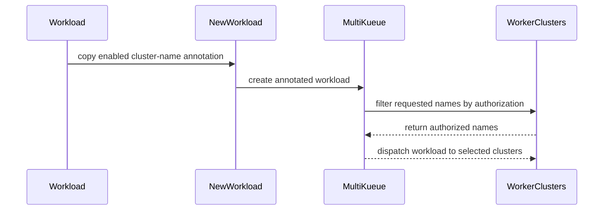

# PR #14539: MultiKueue: let users restrict nominated clusters via annotation

**Summary**: MultiKueue: let users restrict nominated clusters via annotation

**Sources**: https://github.com/kubernetes-sigs/kueue/pull/14539

**Last updated**: 2026-10-20T12:26:06Z

---

## Metadata

- **State**: open
- **Author**: [@kevin85421](https://github.com/kevin85421)
- **Branch**: `poc-mk-user-nominated-clusters` → `main`
- **Created**: 2026-08-16T18:46:08Z
- **Updated**: 2026-10-20T12:26:06Z
- **Merged**: —
- **Closed**: —
- **Labels**: `release-note`, `lifecycle/stale`, `size/L`, `needs-rebase`, `kind/documentation`, `cncf-cla: yes`, `area/multikueue`
- **Assignees**: _none_
- **Requested reviewers**: [@kannon92](https://github.com/kannon92), [@mimowo](https://github.com/mimowo), [@sohankunkerkar](https://github.com/sohankunkerkar), [@PBundyra](https://github.com/PBundyra)
- **Changed files**: 8   **+238 / -6**

## Description

#### What type of PR is this?

/kind feature
/area multikueue

#### What this PR does / why we need it:

Adds an alpha way for a user to restrict, directly on the CR, which MultiKueue
worker clusters a Workload may be dispatched to — without running an external
dispatcher.

- New feature gate `MultiKueueClusterNames` (alpha, off by default).
- New annotation `kueue.x-k8s.io/multikueue-cluster-names`, a comma-separated list
  of `MultiKueueCluster` names. It can be set on a Job (propagated to the Workload)
  or directly on a Workload.
- When set, the MultiKueue dispatcher nominates only the requested clusters,
  **always intersected with the clusters the Workload's ClusterQueue is authorized
  for** (via its `MultiKueueConfig`).

Motivating use case: checkpoint data locality. A training `RayCluster` runs on some
worker cluster; every N steps the caller writes a checkpoint (local to that cluster)
and launches a separate `RayJob` to run an async eval over it. The eval must run on
the cluster where that checkpoint lives — a fixed cluster the caller resolves at
launch time, which must not follow the training job if it is later preempted and
relocated. The external dispatcher is the only per-Workload cluster-selection path
today and is heavyweight for the "caller already knows the target cluster" case.

Alternatives considered:

- **External dispatcher controller.** MultiKueue already supports an `External`
  dispatcher: a custom controller can watch pending Workloads and set
  `Status.NominatedClusterNames` itself. It can implement data locality, but carries
  higher complexity.
- **`nodeSelector` + per-cluster node labels.** This is an intra-cluster mechanism and
  sits at the wrong layer. MultiKueue first picks a worker cluster, then schedules pods
  within it; a `nodeSelector` only affects the second step. It also carries higher
  complexity, requiring per-cluster node labels and matching selectors on every Job.
- **Workload affinity ("run on the same cluster as the training job").** Wrong thing to
  bind to: the eval wants checkpoint **data** locality, not affinity to the training job.
  If the training job is preempted and relocated, the checkpoint stays on the original
  cluster, so the eval must stay there too — naming the cluster directly expresses this.

#### Which issue(s) this PR fixes:

Relates to #14540.

#### Special notes for your reviewer:

AI tools were used to help prepare this change, per the
[Kubernetes AI tool usage policy](https://www.kubernetes.dev/docs/guide/pull-requests/#ai-guidance).

#### Does this PR introduce a user-facing change?

```release-note
MultiKueue: Added an alpha `MultiKueueClusterNames` feature gate and a `kueue.x-k8s.io/multikueue-cluster-names` annotation that lets users restrict which worker clusters a Workload is dispatched to. The requested clusters are intersected with the clusters the Workload's ClusterQueue is authorized for. Off by default.
```


<!-- This is an auto-generated comment: release notes by coderabbit.ai -->
## Summary by CodeRabbit

* **New Features**
  * Added optional workload annotations to restrict MultiKueue dispatch to selected worker clusters.
  * Only authorized clusters are considered; duplicate entries are removed and requests are consistently ordered.
  * Added an alpha feature gate, disabled by default, to control this behavior.

* **Bug Fixes**
  * Workloads remain unscheduled when none of the requested clusters are authorized.
  * Cluster restrictions are preserved when workloads are created from jobs.
  * Avoided unnecessary nomination status updates when cluster assignments are unchanged.
<!-- end of auto-generated comment: release notes by coderabbit.ai -->

## Discussion

### Comment by [@kubernetes-prow[bot]](https://github.com/apps/kubernetes-prow) — 2026-08-16T18:46:10Z

Skipping CI for Draft Pull Request.
If you want CI signal for your change, please convert it to an actual PR.
You can still manually trigger a test run with `/test all`

### Comment by [@netlify[bot]](https://github.com/apps/netlify) — 2026-08-16T18:46:13Z

### <span aria-hidden="true">✅</span> Deploy Preview for *kubernetes-sigs-kueue* canceled.


|  Name | Link |
|:-:|------------------------|
|<span aria-hidden="true">🔨</span> Latest commit | b3b23136f3756c31e7bb1051f5bb00db6b49489c |
|<span aria-hidden="true">🔍</span> Latest deploy log | https://app.netlify.com/projects/kubernetes-sigs-kueue/deploys/6a8696a83a04c800076c685b |

### Comment by [@coderabbitai[bot]](https://github.com/apps/coderabbitai) — 2026-08-16T18:46:16Z

<!-- This is an auto-generated comment: summarize by coderabbit.ai -->
<!-- review_stack_entry_start -->

[](https://app.coderabbit.ai/change-stack/kubernetes-sigs/kueue/pull/14539?utm_source=github_walkthrough&utm_medium=github&utm_campaign=change_stack)

<!-- review_stack_entry_end -->
<!-- This is an auto-generated comment: review paused by coderabbit.ai -->

> [!NOTE]
> ## Reviews paused
> 
> It looks like this branch is under active development. To avoid overwhelming you with review comments due to an influx of new commits, CodeRabbit has automatically paused this review. You can configure this behavior by changing the `reviews.auto_review.auto_pause_after_reviewed_commits` setting.
> 
> Use the following commands to manage reviews:
> - `@coderabbitai resume` to resume automatic reviews.
> - `@coderabbitai review` to trigger a single review.
> 
> Use the checkboxes below for quick actions:
> - [ ] <!-- {"checkboxId": "7f6cc2e2-2e4e-497a-8c31-c9e4573e93d1"} --> ▶️ Resume reviews
> - [ ] <!-- {"checkboxId": "e9bb8d72-00e8-4f67-9cb2-caf3b22574fe"} --> 🔍 Trigger review

<!-- end of auto-generated comment: review paused by coderabbit.ai -->
<!-- recent_review_start -->

No actionable comments were generated in the recent review. 🎉

<details>
<summary>ℹ️ Recent review info</summary>

<details>
<summary>⚙️ Run configuration</summary>

**Configuration used**: Path: .coderabbit.yaml

**Review profile**: CHILL

**Plan**: Pro Plus

**Run ID**: `e381dd8b-b453-4619-82ce-577fa0c03c26`

</details>

<details>
<summary>📥 Commits</summary>

Reviewing files that changed from the base of the PR and between de99f0c3ec3d07920f61ada641d6b488e90303db and d7ca8f16c496df31419f5cef472629fc43932378.

</details>

<details>
<summary>📒 Files selected for processing (1)</summary>

* `pkg/controller/admissionchecks/multikueue/workload.go`

</details>

<details>
<summary>🚧 Files skipped from review as they are similar to previous changes (1)</summary>

* pkg/controller/admissionchecks/multikueue/workload.go

</details>

**Included review availability:** Your plan includes up to 8 reviews per rolling hour; 1 remains after this review.

</details>

---


<!-- recent_review_end -->
<!-- walkthrough_start -->

<details>
<summary>📝 Walkthrough</summary>

## Walkthrough

### Changes

**MultiKueue cluster restriction**

|Layer / File(s)|Summary|
|---|---|
|**Annotation and feature-gate propagation** <br> `apis/kueue/v1beta2/multikueue_types.go`, `pkg/features/kube_features.go`, `pkg/controller/jobframework/utils.go`, `site/data/featuregates/versioned_feature_list.yaml`, `test/compatibility_lifecycle/reference/versioned_feature_list.yaml`|Adds the cluster-name annotation and alpha feature gate. Enabled workloads copy the annotation from the source object. Feature lists record its lifecycle and defaults.|
|**Authorized cluster nomination** <br> `pkg/controller/admissionchecks/multikueue/workload.go`, `pkg/controller/admissionchecks/multikueue/workload_clusternames_test.go`, `pkg/controller/admissionchecks/multikueue/workload_test.go`|Parses requested clusters, removes unauthorized names, sorts and deduplicates results, and applies conditional nomination persistence. Tests cover authorization, feature gates, annotations, and unchanged nominations.|
|**Restricted remote dispatch validation** <br> `test/integration/multikueue/jobs_test.go`|Verifies that an annotated job is nominated and dispatched only to `worker1`.|

**Estimated code review effort:** 3 (Moderate) | ~20 minutes

<!-- final_review_risk_start -->
**Merge Risk:** _⚪ Minimal_ · up to `d7ca8`

The feature is gated off by default and adds a bounded cluster-selection behavior; no actionable merge-blocking risk remains beyond normal checks and review.
<!-- final_review_risk_end -->

### Sequence Diagram(s)



**Possibly related PRs**

- [kubernetes-sigs/kueue#14571](https://github.com/kubernetes-sigs/kueue/pull/14571): Both PRs modify MultiKueue nomination comparison and persistence in `workload.go` and `workload_test.go`.

**Suggested reviewers:** `kannon92`, `sohankunkerkar`, `pbundyra`

</details>

<!-- walkthrough_end -->
<!-- pre_merge_checks_walkthrough_start -->

<details>
<summary>🚥 Pre-merge checks | ✅ 4 | ❌ 1</summary>

### ❌ Failed checks (1 warning)

|     Check name     | Status     | Explanation                                                                           | Resolution                                                                         |
| :----------------: | :--------- | :------------------------------------------------------------------------------------ | :--------------------------------------------------------------------------------- |
| Docstring Coverage | ⚠️ Warning | Docstring coverage is 75.00% which is insufficient. The required threshold is 80.00%. | Write docstrings for the functions missing them to satisfy the coverage threshold. |

<details>
<summary>✅ Passed checks (4 passed)</summary>

|         Check name         | Status   | Explanation                                                                                                                                |
| :------------------------: | :------- | :----------------------------------------------------------------------------------------------------------------------------------------- |
|      Description Check     | ✅ Passed | Check skipped - CodeRabbit’s high-level summary is enabled.                                                                                |
|         Title check        | ✅ Passed | The title clearly and concisely describes the main change: allowing users to restrict nominated MultiKueue clusters through an annotation. |
|     Linked Issues check    | ✅ Passed | Check skipped because no linked issues were found for this pull request.                                                                   |
| Out of Scope Changes check | ✅ Passed | Check skipped because no linked issues were found for this pull request.                                                                   |

</details>

</details>

<!-- pre_merge_checks_walkthrough_end -->
<!-- finishing_touch_checkbox_start -->

<details>
<summary>✨ Finishing Touches</summary>

<details>
<summary>🧪 Generate unit tests (beta)</summary>

- [ ] <!-- {"checkboxId": "f47ac10b-58cc-4372-a567-0e02b2c3d479", "radioGroupId": "utg-output-choice-group-unknown_comment_id"} -->   Create PR with unit tests

</details>

</details>

<!-- finishing_touch_checkbox_end -->
<!-- tips_start -->

---

Thanks for using [CodeRabbit](https://coderabbit.ai?utm_source=oss&utm_medium=github&utm_campaign=kubernetes-sigs/kueue&utm_content=14539)! It's free for OSS, and your support helps us grow. If you like it, consider giving us a shout-out.

<details>
<summary>❤️ Share</summary>

- [X](https://twitter.com/intent/tweet?text=I%20just%20used%20%40coderabbitai%20for%20my%20code%20review%2C%20and%20it%27s%20fantastic%21%20It%27s%20free%20for%20OSS%20and%20offers%20a%20free%20trial%20for%20the%20proprietary%20code.%20Check%20it%20out%3A&url=https%3A//coderabbit.ai)
- [Mastodon](https://mastodon.social/share?text=I%20just%20used%20%40coderabbitai%20for%20my%20code%20review%2C%20and%20it%27s%20fantastic%21%20It%27s%20free%20for%20OSS%20and%20offers%20a%20free%20trial%20for%20the%20proprietary%20code.%20Check%20it%20out%3A%20https%3A%2F%2Fcoderabbit.ai)
- [Reddit](https://www.reddit.com/submit?title=Great%20tool%20for%20code%20review%20-%20CodeRabbit&text=I%20just%20used%20CodeRabbit%20for%20my%20code%20review%2C%20and%20it%27s%20fantastic%21%20It%27s%20free%20for%20OSS%20and%20offers%20a%20free%20trial%20for%20proprietary%20code.%20Check%20it%20out%3A%20https%3A//coderabbit.ai)
- [LinkedIn](https://www.linkedin.com/sharing/share-offsite/?url=https%3A%2F%2Fcoderabbit.ai&mini=true&title=Great%20tool%20for%20code%20review%20-%20CodeRabbit&summary=I%20just%20used%20CodeRabbit%20for%20my%20code%20review%2C%20and%20it%27s%20fantastic%21%20It%27s%20free%20for%20OSS%20and%20offers%20a%20free%20trial%20for%20proprietary%20code)

</details>


<sub>Comment `@coderabbitai help` to get the list of available commands.</sub>

<!-- tips_end -->

### Comment by [@kubernetes-prow[bot]](https://github.com/apps/kubernetes-prow) — 2026-08-16T19:23:29Z

[APPROVALNOTIFIER] This PR is **NOT APPROVED**

This pull-request has been approved by: *<a href="https://github.com/kubernetes-sigs/kueue/pull/14539#" title="Author self-approved">kevin85421</a>*
**Once this PR has been reviewed and has the lgtm label**, please assign [mimowo](https://github.com/mimowo) for approval. For more information see [the Code Review Process](https://git.k8s.io/community/contributors/guide/owners.md#the-code-review-process).

The full list of commands accepted by this bot can be found [here](https://go.k8s.io/bot-commands?repo=kubernetes-sigs%2Fkueue).

<details open>
Needs approval from an approver in each of these files:

- **[OWNERS](https://github.com/kubernetes-sigs/kueue/blob/main/OWNERS)**

Approvers can indicate their approval by writing `/approve` in a comment
Approvers can cancel approval by writing `/approve cancel` in a comment
</details>
<!-- META={"approvers":["mimowo"]} -->

### Comment by [@kevin85421](https://github.com/kevin85421) — 2026-08-17T23:55:37Z

Holding this PR on #14571, which extracts the no-op set-comparison refactor from here. Once #14571 merges I'll rebase this branch onto main (the overlapping cleanup will drop out of the diff) so review can focus on the feature itself.

### Comment by [@mszadkow](https://github.com/mszadkow) — 2026-08-21T08:10:52Z

Interesting alternative to External Controller, thanks for sharing the motivation for this :)

### Comment by [@kevin85421](https://github.com/kevin85421) — 2026-08-21T09:25:05Z

Hi @mszadkow, 

Thank you for reviewing! We can pause the review for now because @tenzen-y, @kannon92, and I did not reach a consensus on this PR during the WG Batch community sync.

Some counter points for this PR:
1. It would be better not to expose an API that allows users (i.e. "callers") to nominate clusters. For example, users might always submit jobs to on-demand worker clusters instead of spot-instance worker clusters, which would conflict with the infrastructure team’s scheduling philosophy. The suggested way is implementing an external dispatcher.
2. An API that allows users to specify cluster names is not ideal. For example, in Kubernetes, if a user schedules a Pod on a specific node, the Pod cannot be rescheduled when that node is removed by the cluster autoscaler.

My thoughts:
* For (1), if the infrastructure team does not want users to misuse this API, they can disable the feature gate. In addition, more infrastructure work is being delegated to coding agents, and an easy-to-use API for "caller" allows these agents to make scheduling and orchestration decisions.
* An external dispatcher would be significantly more complex than this PR, while the two approaches seem nearly identical to me. This PR allows callers to play the role of an "external dispatcher" by nominating clusters. The main difference is that one is user-facing, while the other is not.
* For (2), this concern makes sense when binding a Pod to a specific node because Kubernetes node autoscaling is quite common. However, decommissioning or renaming a worker cluster is relatively rare. In addition, if decommissioning does occur, the agent should be responsible for rescheduling the jobs to other clusters based on the available context (e.g., data from cluster A has already been moved to cluster B). This kind of context is complex and should not be part of the MultiKueue abstraction.

cc @tenzen-y @kannon92 — I want to make sure we are on the same page. If your views align with the "counter points" section above, we can pause this PR until we receive more feedback from other users. In the meantime, I will start exploring https://github.com/kubernetes-sigs/kueue/issues/10766, which @amy mentioned. Thanks!

### Comment by [@mszadkow](https://github.com/mszadkow) — 2026-08-21T12:00:36Z

> Hi @mszadkow,
> 
> Thank you for reviewing! We can pause the review for now because @tenzen-y, @kannon92, and I did not reach a consensus on this PR during the WG Batch community sync.
> 
> Some counter points for this PR:
> 
> 1. It would be better not to expose an API that allows users (i.e. "callers") to nominate clusters. For example, users might always submit jobs to on-demand worker clusters instead of spot-instance worker clusters, which would conflict with the infrastructure team’s scheduling philosophy. The suggested way is implementing an external dispatcher.
> 2. An API that allows users to specify cluster names is not ideal. For example, in Kubernetes, if a user schedules a Pod on a specific node, the Pod cannot be rescheduled when that node is removed by the cluster autoscaler.
> 
> My thoughts:
> 
> * For (1), if the infrastructure team does not want users to misuse this API, they can disable the feature gate. In addition, more infrastructure work is being delegated to coding agents, and an easy-to-use API for "caller" allows these agents to make scheduling and orchestration decisions.
> * An external dispatcher would be significantly more complex than this PR, while the two approaches seem nearly identical to me. This PR allows callers to play the role of an "external dispatcher" by nominating clusters. The main difference is that one is user-facing, while the other is not.
> * For (2), this concern makes sense when binding a Pod to a specific node because Kubernetes node autoscaling is quite common. However, decommissioning or renaming a worker cluster is relatively rare. In addition, if decommissioning does occur, the agent should be responsible for rescheduling the jobs to other clusters based on the available context (e.g., data from cluster A has already been moved to cluster B). This kind of context is complex and should not be part of the MultiKueue abstraction.
> 
> cc @tenzen-y @kannon92 — I want to make sure we are on the same page. If your views align with the "counter points" section above, we can pause this PR until we receive more feedback from other users. In the meantime, I will start exploring #10766, which @amy mentioned. Thanks!

Thanks @kevin85421 👍 
I will not continue with the review then.

### Comment by [@kubernetes-prow[bot]](https://github.com/apps/kubernetes-prow) — 2026-08-26T21:41:47Z

PR needs rebase.

<details>

Instructions for interacting with me using PR comments are available [here](https://git.k8s.io/community/contributors/guide/pull-requests.md).  If you have questions or suggestions related to my behavior, please file an issue against the [kubernetes-sigs/prow](https://github.com/kubernetes-sigs/prow/issues/new?title=Prow%20issue:) repository.
</details>

### Comment by [@kubernetes-prow[bot]](https://github.com/apps/kubernetes-prow) — 2026-09-10T20:26:14Z

@kevin85421: The following tests **failed**, say `/retest` to rerun all failed tests or `/retest-required` to rerun all mandatory failed tests:

Test name | Commit | Details | Required | Rerun command
--- | --- | --- | --- | ---
pull-kueue-test-e2e-baseline-main-1-37 | b3b23136f3756c31e7bb1051f5bb00db6b49489c | [link](https://prow.k8s.io/view/gs/kubernetes-ci-logs/pr-logs/pull/kubernetes-sigs_kueue/14539/pull-kueue-test-e2e-baseline-main-1-37/2092729148454735872) | true | `/test pull-kueue-test-e2e-baseline-main-1-37`
pull-kueue-test-e2e-extended-shard-2-main-1-37 | b3b23136f3756c31e7bb1051f5bb00db6b49489c | [link](https://prow.k8s.io/view/gs/kubernetes-ci-logs/pr-logs/pull/kubernetes-sigs_kueue/14539/pull-kueue-test-e2e-extended-shard-2-main-1-37/2092729148714782720) | true | `/test pull-kueue-test-e2e-extended-shard-2-main-1-37`
pull-kueue-test-e2e-extended-shard-0-main-1-37 | b3b23136f3756c31e7bb1051f5bb00db6b49489c | [link](https://prow.k8s.io/view/gs/kubernetes-ci-logs/pr-logs/pull/kubernetes-sigs_kueue/14539/pull-kueue-test-e2e-extended-shard-0-main-1-37/2092729148555399168) | true | `/test pull-kueue-test-e2e-extended-shard-0-main-1-37`
pull-kueue-test-e2e-extended-shard-1-main-1-37 | b3b23136f3756c31e7bb1051f5bb00db6b49489c | [link](https://prow.k8s.io/view/gs/kubernetes-ci-logs/pr-logs/pull/kubernetes-sigs_kueue/14539/pull-kueue-test-e2e-extended-shard-1-main-1-37/2092729148647673856) | true | `/test pull-kueue-test-e2e-extended-shard-1-main-1-37`
pull-kueue-test-e2e-dra-baseline-main | b3b23136f3756c31e7bb1051f5bb00db6b49489c | [link](https://prow.k8s.io/view/gs/kubernetes-ci-logs/pr-logs/pull/kubernetes-sigs_kueue/14539/pull-kueue-test-e2e-dra-baseline-main/2098145985963233280) | true | `/test pull-kueue-test-e2e-dra-baseline-main`
pull-kueue-test-e2e-dra-capacity-main | b3b23136f3756c31e7bb1051f5bb00db6b49489c | [link](https://prow.k8s.io/view/gs/kubernetes-ci-logs/pr-logs/pull/kubernetes-sigs_kueue/14539/pull-kueue-test-e2e-dra-capacity-main/2098145986051313664) | true | `/test pull-kueue-test-e2e-dra-capacity-main`

[Full PR test history](https://prow.k8s.io/pr-history?org=kubernetes-sigs&repo=kueue&pr=14539). [Your PR dashboard](https://prow.k8s.io/pr?query=is%3Apr%20state%3Aopen%20author%3Akevin85421). Please help us cut down on flakes by [linking to](https://git.k8s.io/community/contributors/devel/sig-testing/flaky-tests.md#filing-issues-for-flaky-tests) an [open issue](https://github.com/kubernetes-sigs/kueue/issues?q=is:issue+is:open) when you hit one in your PR.

<details>

Instructions for interacting with me using PR comments are available [here](https://git.k8s.io/community/contributors/guide/pull-requests.md).  If you have questions or suggestions related to my behavior, please file an issue against the [kubernetes-sigs/prow](https://github.com/kubernetes-sigs/prow/issues/new?title=Prow%20issue:) repository. I understand the commands that are listed [here](https://go.k8s.io/bot-commands).
</details>
<!-- test report -->

### Comment by [@k8s-triage-robot](https://github.com/k8s-triage-robot) — 2026-10-20T12:26:04Z

The Kubernetes project currently lacks enough active contributors to adequately respond to all PRs.

This bot triages PRs according to the following rules:
- After 30d of inactivity, `lifecycle/stale` is applied
- After 30d of inactivity since `lifecycle/stale` was applied, `lifecycle/rotten` is applied
- After 30d of inactivity since `lifecycle/rotten` was applied, the PR is closed

You can:
- Mark this PR as fresh with `/remove-lifecycle stale`
- Close this PR with `/close`
- Offer to help out with [Issue Triage][1]

Please send feedback to us at [Kueue](https://github.com/kubernetes-sigs/kueue/tree/main#community-discussion-contribution-and-support).

/lifecycle stale

[1]: https://www.kubernetes.dev/docs/guide/issue-triage/

## Reviews

### Review by [@mszadkow](https://github.com/mszadkow) (commented) — 2026-08-21T08:20:39Z

- **pkg/controller/jobframework/utils.go:268** by [@mszadkow](https://github.com/mszadkow) — 2026-08-21T08:20:39Z
```diff
@@ -265,6 +265,14 @@ func NewWorkload(name string, obj client.Object, podSets []kueue.PodSet, labelKe
 	if features.Enabled(features.CustomMetricLabels) {
 		maps.Copy(&annotations, maps.FilterKeys(obj.GetAnnotations(), annotationsToCopy.UnsortedList()))
 	}
+	if features.Enabled(features.MultiKueueClusterNames) {
```

  I know it's not related, but suddenly the param `annotationsToCopy` became confusing.
  I would rename it to something more telling that those are annotations for custom labels or something.
  This could be a separate cleanup PR, just leaving the thought here.
