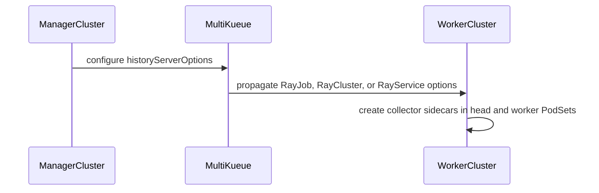

# PR #14670: Ray: support KubeRay v1.7 History Server collectors

**Summary**: Ray: support KubeRay v1.7 History Server collectors

**Sources**: https://github.com/kubernetes-sigs/kueue/pull/14670

**Last updated**: 2026-08-30T13:33:49Z

---

## Metadata

- **State**: open
- **Author**: [@YQ-Wang](https://github.com/YQ-Wang)
- **Branch**: `feat/kuberay-history-server` → `main`
- **Created**: 2026-08-20T07:22:55Z
- **Updated**: 2026-08-30T13:33:49Z
- **Merged**: —
- **Closed**: —
- **Labels**: `kind/feature`, `release-note`, `size/L`, `lgtm`, `ok-to-test`, `cncf-cla: yes`, `area/integrations`, `area/ray-integration`
- **Assignees**: [@kannon92](https://github.com/kannon92), [@tenzen-y](https://github.com/tenzen-y)
- **Requested reviewers**: [@kshalot](https://github.com/kshalot)
- **Changed files**: 5   **+300 / -0**

## Description

#### What type of PR is this?

/kind feature
/area integrations
/area ray-integration
/area multikueue

#### What this PR does / why we need it:

KubeRay v1.7 adds `RayClusterSpec.historyServerOptions` and injects a History Server collector into every Ray head and worker Pod. The KubeRay v1.7 dependency and vendor update landed separately in #14669, so this PR focuses on ensuring Kueue accounts for the collector resources and verifies that the options are preserved by MultiKueue.

This PR:

- accounts for default or user-specified collector resources in every Ray PodSet;
- verifies `historyServerOptions` propagation for RayCluster, RayJob, and RayService through MultiKueue;
- adds unit and integration coverage, including RayService update synchronization;
- documents the KubeRay, Ray, CRD, and feature-gate rollout requirements.

#### Which issue(s) this PR fixes:

Fixes #14668

#### Special notes for your reviewer:

KubeRay only injects the collector when `RayClusterHistoryServer` is enabled. If the field is set while that gate is disabled, KubeRay rejects the RayCluster; Kueue may reserve the collector quota before that validation failure, but it does not undercount or overcommit resources.

Validation performed:

- `go test -race -count=1 ./pkg/controller/jobs/raycluster ./pkg/controller/jobs/rayjob ./pkg/controller/jobs/rayservice`
- `go vet ./pkg/controller/jobs/raycluster ./pkg/controller/jobs/rayjob ./pkg/controller/jobs/rayservice`
- filtered `make test-multikueue-integration` for the KubeRay suite (3/3 specs passed)
- `make fmt-verify`
- targeted `golangci-lint` (0 issues)
- `git diff --check`

AI tools were used to assist with implementation and review. The final diff was manually reviewed and validated.

#### Does this PR introduce a user-facing change?

```release-note
Kueue supports KubeRay v1.7 History Server options in MultiKueue and accounts for collector sidecar resources in Ray workload quotas.
```


<!-- This is an auto-generated comment: release notes by coderabbit.ai -->
## Summary by CodeRabbit

* **New Features**
  * Added support for configuring Ray History Server collector sidecars on RayCluster, RayJob, and RayService workloads.
  * Collector sidecars are added to head and worker pods with default resources or user-specified overrides.
  * Collector settings are propagated across MultiKueue-managed RayJob, RayCluster, and RayService workloads, including updates.

* **Documentation**
  * Added MultiKueue guidance covering History Server requirements, supported versions, CRDs, feature gates, configuration, and resource accounting.
<!-- end of auto-generated comment: release notes by coderabbit.ai -->

## Discussion

### Comment by [@netlify[bot]](https://github.com/apps/netlify) — 2026-08-20T07:23:02Z

### <span aria-hidden="true">✅</span> Deploy Preview for *kubernetes-sigs-kueue* ready!


|  Name | Link |
|:-:|------------------------|
|<span aria-hidden="true">🔨</span> Latest commit | 7f6b53b72cd7b5df1d7cc7e1fccfeacb243a9c6e |
|<span aria-hidden="true">🔍</span> Latest deploy log | https://app.netlify.com/projects/kubernetes-sigs-kueue/deploys/6a8733652e481b0009de4542 |
|<span aria-hidden="true">😎</span> Deploy Preview | [https://deploy-preview-14670--kubernetes-sigs-kueue.netlify.app](https://deploy-preview-14670--kubernetes-sigs-kueue.netlify.app) |
|<span aria-hidden="true">📱</span> Preview on mobile | <details><summary> Toggle QR Code... </summary><br /><br /><br /><br />_Use your smartphone camera to open QR code link._</details> |
---
<!-- [kubernetes-sigs-kueue Preview](https://deploy-preview-14670--kubernetes-sigs-kueue.netlify.app) -->
_To edit notification comments on pull requests, go to your [Netlify project configuration](https://app.netlify.com/projects/kubernetes-sigs-kueue/configuration/notifications#deploy-notifications)._

### Comment by [@kubernetes-prow[bot]](https://github.com/apps/kubernetes-prow) — 2026-08-20T07:23:06Z

Hi @YQ-Wang. Thanks for your PR.

I'm waiting for a [kubernetes-sigs](https://github.com/orgs/kubernetes-sigs/people) member to verify that this patch is reasonable to test. If it is, they should reply with `/ok-to-test` on its own line. Until that is done, I will not automatically test new commits in this PR, but the usual testing commands by org members will still work.

>[!TIP]
>**We noticed you've done this a few times! Consider [joining the org](https://git.k8s.io/community/community-membership.md#member) to skip this step and gain `/lgtm` and other bot rights.** We recommend asking approvers on your previous PRs to sponsor you.

Once the patch is verified, the new status will be reflected by the `ok-to-test` label.

I understand the commands that are listed [here](https://go.k8s.io/bot-commands?repo=kubernetes-sigs%2Fkueue).

<details>

Instructions for interacting with me using PR comments are available [here](https://git.k8s.io/community/contributors/guide/pull-requests.md).  If you have questions or suggestions related to my behavior, please file an issue against the [kubernetes-sigs/prow](https://github.com/kubernetes-sigs/prow/issues/new?title=Prow%20issue:) repository.
</details>

### Comment by [@coderabbitai[bot]](https://github.com/apps/coderabbitai) — 2026-08-20T07:23:06Z

<!-- This is an auto-generated comment: summarize by coderabbit.ai -->
<!-- review_stack_entry_start -->

[](https://app.coderabbit.ai/change-stack/kubernetes-sigs/kueue/pull/14670?utm_source=github_walkthrough&utm_medium=github&utm_campaign=change_stack)

<!-- review_stack_entry_end -->
<!-- recent_review_start -->

No actionable comments were generated in the recent review. 🎉

<details>
<summary>ℹ️ Recent review info</summary>

<details>
<summary>⚙️ Run configuration</summary>

**Configuration used**: Path: .coderabbit.yaml

**Review profile**: CHILL

**Plan**: Pro Plus

**Run ID**: `2f1bb277-6ce5-40aa-8f40-3c8611f9f0eb`

</details>

<details>
<summary>📥 Commits</summary>

Reviewing files that changed from the base of the PR and between c2944e53e30d50a7f140472cf0ca8f7b7bafdf2f and 7f6b53b72cd7b5df1d7cc7e1fccfeacb243a9c6e.

</details>

<details>
<summary>📒 Files selected for processing (1)</summary>

* `site/content/en/docs/tasks/run/multikueue/kuberay.md`

</details>

<details>
<summary>🚧 Files skipped from review as they are similar to previous changes (1)</summary>

* site/content/en/docs/tasks/run/multikueue/kuberay.md

</details>

**Included review availability:** Your plan provides up to 8 included reviews per hour; 7 remain after this review.

</details>

---


<!-- recent_review_end -->
<!-- walkthrough_start -->

<details>
<summary>📝 Walkthrough</summary>

## Walkthrough

`BuildPodSets` now adds configured Ray History Server collector sidecars to head and worker PodSets with default or custom resources. MultiKueue integration tests verify option propagation for RayJob, RayCluster, and RayService. Documentation describes required versions and configuration.

### Changes

**Ray History Server collector accounting**

|Layer / File(s)|Summary|
|---|---|
|**Collector injection and resource accounting** <br> `pkg/controller/jobs/raycluster/common.go`, `pkg/controller/jobs/raycluster/common_test.go`, `pkg/controller/jobs/rayservice/rayservice_controller_test.go`|`BuildPodSets` adds the collector to head and worker PodSets. Default resources apply unless `CollectorOptions.Resources` is set. Unit and RayService tests validate the resulting containers.|
|**MultiKueue propagation validation** <br> `test/integration/multikueue/kuberay_test.go`, `site/content/en/docs/tasks/run/multikueue/kuberay.md`|Integration tests verify History Server option propagation for RayJob, RayCluster, and RayService. Documentation lists version requirements, configuration paths, CRDs, feature gates, and collector resource accounting.|

**Estimated code review effort:** 3 (Moderate) | ~20 minutes

<!-- final_review_risk_start -->
**Merge Risk:** _⚪ Minimal_ · up to `7f6b5`

The PR adds KubeRay History Server resource accounting and MultiKueue option propagation with focused validation and documentation; no actionable merge-blocking risk remains beyond normal checks and review.
<!-- final_review_risk_end -->

### Sequence Diagram(s)



**Suggested reviewers:** `kshalot`, `tenzen-y`

</details>

<!-- walkthrough_end -->
<!-- pre_merge_checks_walkthrough_start -->

<details>
<summary>🚥 Pre-merge checks | ✅ 4 | ❌ 1</summary>

### ❌ Failed checks (1 warning)

|      Check name     | Status     | Explanation                                                                                                                                                     | Resolution                                                                                                                            |
| :-----------------: | :--------- | :-------------------------------------------------------------------------------------------------------------------------------------------------------------- | :------------------------------------------------------------------------------------------------------------------------------------ |
| Linked Issues check | ⚠️ Warning | Collector accounting, integration coverage, and documentation are included, but the required KubeRay dependency bump and propagation implementation are absent. | Include the KubeRay v1.7.0 dependency and vendor updates, or merge this PR only after those changes are present in its target branch. |

<details>
<summary>✅ Passed checks (4 passed)</summary>

|         Check name         | Status   | Explanation                                                                                                           |
| :------------------------: | :------- | :-------------------------------------------------------------------------------------------------------------------- |
| Out of Scope Changes check | ✅ Passed | The code, tests, integration coverage, and documentation changes directly support the linked issue objectives.        |
|     Docstring Coverage     | ✅ Passed | No functions found in the changed files to evaluate docstring coverage. Skipping docstring coverage check.            |
|      Description Check     | ✅ Passed | Check skipped - CodeRabbit’s high-level summary is enabled.                                                           |
|         Title check        | ✅ Passed | The title clearly and concisely describes the main change: adding support for KubeRay v1.7 History Server collectors. |

</details>

</details>

<!-- pre_merge_checks_walkthrough_end -->
<!-- finishing_touch_checkbox_start -->

<details>
<summary>✨ Finishing Touches</summary>

<details>
<summary>🧪 Generate unit tests (beta)</summary>

- [ ] <!-- {"checkboxId": "f47ac10b-58cc-4372-a567-0e02b2c3d479", "radioGroupId": "utg-output-choice-group-unknown_comment_id"} -->   Create PR with unit tests

</details>

</details>

<!-- finishing_touch_checkbox_end -->
<!-- tips_start -->

---

Thanks for using [CodeRabbit](https://coderabbit.ai?utm_source=oss&utm_medium=github&utm_campaign=kubernetes-sigs/kueue&utm_content=14670)! It's free for OSS, and your support helps us grow. If you like it, consider giving us a shout-out.

<details>
<summary>❤️ Share</summary>

- [X](https://twitter.com/intent/tweet?text=I%20just%20used%20%40coderabbitai%20for%20my%20code%20review%2C%20and%20it%27s%20fantastic%21%20It%27s%20free%20for%20OSS%20and%20offers%20a%20free%20trial%20for%20the%20proprietary%20code.%20Check%20it%20out%3A&url=https%3A//coderabbit.ai)
- [Mastodon](https://mastodon.social/share?text=I%20just%20used%20%40coderabbitai%20for%20my%20code%20review%2C%20and%20it%27s%20fantastic%21%20It%27s%20free%20for%20OSS%20and%20offers%20a%20free%20trial%20for%20the%20proprietary%20code.%20Check%20it%20out%3A%20https%3A%2F%2Fcoderabbit.ai)
- [Reddit](https://www.reddit.com/submit?title=Great%20tool%20for%20code%20review%20-%20CodeRabbit&text=I%20just%20used%20CodeRabbit%20for%20my%20code%20review%2C%20and%20it%27s%20fantastic%21%20It%27s%20free%20for%20OSS%20and%20offers%20a%20free%20trial%20for%20proprietary%20code.%20Check%20it%20out%3A%20https%3A//coderabbit.ai)
- [LinkedIn](https://www.linkedin.com/sharing/share-offsite/?url=https%3A%2F%2Fcoderabbit.ai&mini=true&title=Great%20tool%20for%20code%20review%20-%20CodeRabbit&summary=I%20just%20used%20CodeRabbit%20for%20my%20code%20review%2C%20and%20it%27s%20fantastic%21%20It%27s%20free%20for%20OSS%20and%20offers%20a%20free%20trial%20for%20proprietary%20code)

</details>


<sub>Comment `@coderabbitai help` to get the list of available commands.</sub>

<!-- tips_end -->

### Comment by [@kubernetes-prow[bot]](https://github.com/apps/kubernetes-prow) — 2026-08-20T07:23:09Z

[APPROVALNOTIFIER] This PR is **NOT APPROVED**

This pull-request has been approved by: *<a href="https://github.com/kubernetes-sigs/kueue/pull/14670#" title="Author self-approved">YQ-Wang</a>*
**Once this PR has been reviewed and has the lgtm label**, please assign [olekzabl](https://github.com/olekzabl), [tenzen-y](https://github.com/tenzen-y) for approval. For more information see [the Code Review Process](https://git.k8s.io/community/contributors/guide/owners.md#the-code-review-process).

The full list of commands accepted by this bot can be found [here](https://go.k8s.io/bot-commands?repo=kubernetes-sigs%2Fkueue).

<details open>
Needs approval from an approver in each of these files:

- **[OWNERS](https://github.com/kubernetes-sigs/kueue/blob/main/OWNERS)**

Approvers can indicate their approval by writing `/approve` in a comment
Approvers can cancel approval by writing `/approve cancel` in a comment
</details>
<!-- META={"approvers":["olekzabl","tenzen-y"]} -->

### Comment by [@YQ-Wang](https://github.com/YQ-Wang) — 2026-08-20T07:26:20Z

Heads-up: #14669 was opened in parallel and contains the same KubeRay v1.7.0 dependency/vendor bump.

This PR additionally addresses the remaining work from #14668: collector resource accounting for every Ray head/worker PodSet, MultiKueue propagation tests, RayService coverage, and documentation.

I'm happy to rebase this PR onto `main` and drop the duplicate dependency-bump commit once #14669 lands.

### Comment by [@mbobrovskyi](https://github.com/mbobrovskyi) — 2026-08-20T13:42:45Z

/ok-to-test

### Comment by [@kubernetes-prow[bot]](https://github.com/apps/kubernetes-prow) — 2026-08-20T20:59:55Z

LGTM label has been added.  <details>Git tree hash: ca67728c338eeb6f94fc55c6be02d764a92d69db</details>

### Comment by [@YQ-Wang](https://github.com/YQ-Wang) — 2026-08-29T02:22:38Z

Hi @tenzen-y , do you think this PR is ready as-is?

### Comment by [@tenzen-y](https://github.com/tenzen-y) — 2026-08-30T13:33:47Z

/remove-area multikueue

## Reviews

### Review by [@kannon92](https://github.com/kannon92) (commented) — 2026-08-20T15:08:29Z

- **go.mod:23** by [@kannon92](https://github.com/kannon92) — 2026-08-20T15:08:30Z
```diff
@@ -20,7 +20,7 @@ require (
 	github.com/prometheus/client_golang v1.24.1
 	github.com/prometheus/client_model v0.6.2
 	github.com/prometheus/common v0.70.1
-	github.com/ray-project/kuberay/ray-operator v1.6.2
```

  can you rebase? 
  
  This was just merged.

### Review by [@kannon92](https://github.com/kannon92) (commented) — 2026-08-20T16:54:39Z

- **site/content/en/docs/tasks/run/multikueue/kuberay.md:49** by [@kannon92](https://github.com/kannon92) — 2026-08-20T16:54:39Z
```diff
@@ -36,3 +36,18 @@ This allows the KubeRay Operator to ignore the Jobs managed by MultiKueue on the
 The pods are created and the actual computation will happen on the mirror copy of the Job on the selected worker cluster. 
 The mirror copy of the Job does not have the field set.
 {}
+
+{}
+Using [Ray History Server](https://docs.ray.io/en/latest/cluster/kubernetes/user-guides/kuberay-history-server.html)
+with MultiKueue requires KubeRay v1.7.0 or later and Ray v2.55 or later.
+Configure the collector at the path for the workload kind:
+
+- RayCluster: `spec.historyServerOptions`
+- RayJob: `spec.rayClusterSpec.historyServerOptions`
+- RayService: `spec.rayClusterConfig.historyServerOptions`
+
+Install the KubeRay v1.7.0 or later CRDs on the management and worker clusters,
```

  Should there be any enforcement here?
  
  If someone uses KubeRay v1.6, what would happen with the in-tree integration?

### Review by [@YQ-Wang](https://github.com/YQ-Wang) (commented) — 2026-08-20T17:04:22Z

- **site/content/en/docs/tasks/run/multikueue/kuberay.md:49** by [@YQ-Wang](https://github.com/YQ-Wang) — 2026-08-20T17:04:22Z
```diff
@@ -36,3 +36,18 @@ This allows the KubeRay Operator to ignore the Jobs managed by MultiKueue on the
 The pods are created and the actual computation will happen on the mirror copy of the Job on the selected worker cluster. 
 The mirror copy of the Job does not have the field set.
 {}
+
+{}
+Using [Ray History Server](https://docs.ray.io/en/latest/cluster/kubernetes/user-guides/kuberay-history-server.html)
+with MultiKueue requires KubeRay v1.7.0 or later and Ray v2.55 or later.
+Configure the collector at the path for the workload kind:
+
+- RayCluster: `spec.historyServerOptions`
+- RayJob: `spec.rayClusterSpec.historyServerOptions`
+- RayService: `spec.rayClusterConfig.historyServerOptions`
+
+Install the KubeRay v1.7.0 or later CRDs on the management and worker clusters,
```

  The requirement applies only to History Server. Regular MultiKueue workloads continue to work with older supported KubeRay versions.
  
  With v1.6 CRDs, historyServerOptions cannot be persisted, so no collector is injected. I’ve clarified this in the documentation.

### Review by [@kannon92](https://github.com/kannon92) (commented) — 2026-08-20T17:34:31Z

- **pkg/controller/jobs/raycluster/common.go:206** by [@kannon92](https://github.com/kannon92) — 2026-08-20T17:34:31Z
```diff
@@ -184,6 +200,36 @@ func autoscalerContainer(opts *rayv1.AutoscalerOptions) corev1.Container {
 	}
 }
 
+// defaultHistoryServerCollectorResources mirrors the resources KubeRay assigns
+// to the History Server collector when CollectorOptions.Resources is not set
+// (ray-operator/controllers/ray/common/pod.go: BuildCollectorContainer).
+func defaultHistoryServerCollectorResources() corev1.ResourceRequirements {
```

  should this be made configurable?

### Review by [@YQ-Wang](https://github.com/YQ-Wang) (commented) — 2026-08-20T17:39:00Z

- **pkg/controller/jobs/raycluster/common.go:206** by [@YQ-Wang](https://github.com/YQ-Wang) — 2026-08-20T17:39:00Z
```diff
@@ -184,6 +200,36 @@ func autoscalerContainer(opts *rayv1.AutoscalerOptions) corev1.Container {
 	}
 }
 
+// defaultHistoryServerCollectorResources mirrors the resources KubeRay assigns
+// to the History Server collector when CollectorOptions.Resources is not set
+// (ray-operator/controllers/ray/common/pod.go: BuildCollectorContainer).
+func defaultHistoryServerCollectorResources() corev1.ResourceRequirements {
```

  The collector resources are configurable via CollectorOptions.Resources. This helper only mirrors KubeRay’s defaults when no override is provided. A separate Kueue setting could cause quota accounting to diverge from the actual collector resources.

### Review by [@kannon92](https://github.com/kannon92) (commented) — 2026-08-20T20:59:45Z

/lgtm

/assign @tenzen-y

### Review by [@tenzen-y](https://github.com/tenzen-y) (commented) — 2026-08-30T13:33:20Z

@YQ-Wang I left some comments.

- **pkg/controller/jobs/raycluster/common.go:230** by [@tenzen-y](https://github.com/tenzen-y) — 2026-08-30T12:44:24Z
```diff
@@ -184,6 +200,36 @@ func autoscalerContainer(opts *rayv1.AutoscalerOptions) corev1.Container {
 	}
 }
 
+// defaultHistoryServerCollectorResources mirrors the resources KubeRay assigns
+// to the History Server collector when CollectorOptions.Resources is not set
+// (ray-operator/controllers/ray/common/pod.go: BuildCollectorContainer).
+func defaultHistoryServerCollectorResources() corev1.ResourceRequirements {
+	return corev1.ResourceRequirements{
+		Requests: corev1.ResourceList{
+			corev1.ResourceCPU:    resource.MustParse("50m"),
+			corev1.ResourceMemory: resource.MustParse("64Mi"),
+		},
+		Limits: corev1.ResourceList{
+			corev1.ResourceCPU:    resource.MustParse("200m"),
+			corev1.ResourceMemory: resource.MustParse("256Mi"),
+		},
+	}
+}
+
+// historyServerCollectorContainer returns a container mirroring the collector
+// that KubeRay injects into every head and worker Pod when History Server
+// collection is configured.
+func historyServerCollectorContainer(opts *rayv1.CollectorOptions) corev1.Container {
+	resources := defaultHistoryServerCollectorResources()
+	if opts.Resources != nil {
+		resources = *opts.Resources.DeepCopy()
+	}
+	return corev1.Container{
+		Name:      rayutils.CollectorContainerName,
+		Resources: resources,
+	}
```

  Instead of copying the KubeRay resource settings via `defaultHistoryServerCollectorResources`, can you reuse KubeRay side implementations?
  
  Also, we should propagate the image. Otherwise, the ProvisioningRequest integration will fail due to PodSpec validations.
  
  > [!NOTE]
  > We can omit the image via `""` if opts doesn't have image field since KubeRay doesn't start KubeRay Cluster in case of empty collectorOptions.image: https://github.com/ray-project/kuberay/blob/ffec815248ffd4e7ceabd6ed63de5ec7b060696b/ray-operator/controllers/ray/utils/validation.go#L1029-L1035
  
  ```suggestion
  	resources := cmp.Or(opts.Resources, rayctrlcommon.BuildCollectorContainer(&rayv1.CollectorOptions{}, rayv1.RayNodeType(""), "", "", "", nil).Resources)
  	return corev1.Container{
  		Name:      rayutils.CollectorContainerName,
  		Resources: resources.DeepCopy(),
  		Image: ptr.Deref(opts.Image, ""),
  	}
  ```

- **pkg/controller/jobs/raycluster/common.go:217** by [@tenzen-y](https://github.com/tenzen-y) — 2026-08-30T12:45:58Z
```diff
@@ -184,6 +200,36 @@ func autoscalerContainer(opts *rayv1.AutoscalerOptions) corev1.Container {
 	}
 }
 
+// defaultHistoryServerCollectorResources mirrors the resources KubeRay assigns
+// to the History Server collector when CollectorOptions.Resources is not set
+// (ray-operator/controllers/ray/common/pod.go: BuildCollectorContainer).
+func defaultHistoryServerCollectorResources() corev1.ResourceRequirements {
+	return corev1.ResourceRequirements{
+		Requests: corev1.ResourceList{
+			corev1.ResourceCPU:    resource.MustParse("50m"),
+			corev1.ResourceMemory: resource.MustParse("64Mi"),
+		},
+		Limits: corev1.ResourceList{
+			corev1.ResourceCPU:    resource.MustParse("200m"),
+			corev1.ResourceMemory: resource.MustParse("256Mi"),
+		},
+	}
+}
```

  ```suggestion
  ```
  
  See my above comment.

- **pkg/controller/jobs/raycluster/common_test.go:55** by [@tenzen-y](https://github.com/tenzen-y) — 2026-08-30T13:25:44Z
```diff
@@ -47,6 +47,33 @@ import (
 )
 
 func TestBuildPodSets(t *testing.T) {
+	collectorImage := "quay.io/kuberay/collector:v1.7.0"
+	collectorEnv := []corev1.EnvVar{
+		{Name: "STORAGE_BACKEND", Value: "s3"},
+		{Name: "S3_BUCKET", Value: "ray-historyserver"},
+		{Name: "S3_REGION", Value: "us-east-1"},
+	}
```

  ```suggestion
  ```
  
  I don't see any value in using collectorEnv in this test since we have never evaluated these envs when we build PodSet.

- **pkg/controller/jobs/raycluster/common_test.go:65** by [@tenzen-y](https://github.com/tenzen-y) — 2026-08-30T13:27:10Z
```diff
@@ -47,6 +47,33 @@ import (
 )
 
 func TestBuildPodSets(t *testing.T) {
+	collectorImage := "quay.io/kuberay/collector:v1.7.0"
+	collectorEnv := []corev1.EnvVar{
+		{Name: "STORAGE_BACKEND", Value: "s3"},
+		{Name: "S3_BUCKET", Value: "ray-historyserver"},
+		{Name: "S3_REGION", Value: "us-east-1"},
+	}
+	defaultCollectorResources := corev1.ResourceRequirements{
+		Requests: corev1.ResourceList{
+			corev1.ResourceCPU:    resource.MustParse("50m"),
+			corev1.ResourceMemory: resource.MustParse("64Mi"),
+		},
+		Limits: corev1.ResourceList{
+			corev1.ResourceCPU:    resource.MustParse("200m"),
+			corev1.ResourceMemory: resource.MustParse("256Mi"),
+		},
+	}
```

  ```suggestion
  	defaultCollectorResources := rayctrlcommon.BuildCollectorContainer(&rayv1.CollectorOptions{}, rayv1.RayNodeType(""), "", "", "", nil).Resources)
  ```
  
  We should not copy the KubeRay side specifications anywhere.

- **pkg/controller/jobs/raycluster/common_test.go:75** by [@tenzen-y](https://github.com/tenzen-y) — 2026-08-30T13:28:24Z
```diff
@@ -47,6 +47,33 @@ import (
 )
 
 func TestBuildPodSets(t *testing.T) {
+	collectorImage := "quay.io/kuberay/collector:v1.7.0"
+	collectorEnv := []corev1.EnvVar{
+		{Name: "STORAGE_BACKEND", Value: "s3"},
+		{Name: "S3_BUCKET", Value: "ray-historyserver"},
+		{Name: "S3_REGION", Value: "us-east-1"},
+	}
+	defaultCollectorResources := corev1.ResourceRequirements{
+		Requests: corev1.ResourceList{
+			corev1.ResourceCPU:    resource.MustParse("50m"),
+			corev1.ResourceMemory: resource.MustParse("64Mi"),
+		},
+		Limits: corev1.ResourceList{
+			corev1.ResourceCPU:    resource.MustParse("200m"),
+			corev1.ResourceMemory: resource.MustParse("256Mi"),
+		},
+	}
+	customCollectorResources := corev1.ResourceRequirements{
+		Requests: corev1.ResourceList{
+			corev1.ResourceCPU:    resource.MustParse("100m"),
+			corev1.ResourceMemory: resource.MustParse("128Mi"),
+		},
+		Limits: corev1.ResourceList{
+			corev1.ResourceCPU:    resource.MustParse("400m"),
+			corev1.ResourceMemory: resource.MustParse("512Mi"),
+		},
+	}
```

  ```suggestion
  ```
  
  We should not add such test constants just for a single test case.

- **test/integration/multikueue/kuberay_test.go:55** by [@tenzen-y](https://github.com/tenzen-y) — 2026-08-30T13:29:46Z
```diff
@@ -40,6 +40,19 @@ import (
 	"sigs.k8s.io/kueue/test/util"
 )
 
+func testHistoryServerOptions() *rayv1.HistoryServerOptions {
+	return &rayv1.HistoryServerOptions{
+		CollectorOptions: &rayv1.CollectorOptions{
+			Image: new("quay.io/kuberay/collector:v1.7.0"),
+			Env: []corev1.EnvVar{
+				{Name: "STORAGE_BACKEND", Value: "s3"},
+				{Name: "S3_BUCKET", Value: "ray-historyserver"},
+				{Name: "S3_REGION", Value: "us-east-1"},
+			},
+		},
+	}
+}
+
```

  ```suggestion
  ```
  
  We should not introduce such helper construction. Instead of this, please expand wrapper function.

- **pkg/controller/jobs/rayservice/rayservice_controller_test.go:78** by [@tenzen-y](https://github.com/tenzen-y) — 2026-08-30T13:30:47Z
```diff
@@ -56,6 +57,26 @@ func headSpecWithAutoscaler(rayService *RayService) corev1.PodSpec {
 	return *spec
 }
 
+// podSpecWithHistoryServerCollector returns the PodSpec with the History Server
+// collector appended, matching KubeRay's default resources.
+func podSpecWithHistoryServerCollector(spec *corev1.PodSpec) corev1.PodSpec {
+	result := spec.DeepCopy()
+	result.Containers = append(result.Containers, corev1.Container{
+		Name: rayutils.CollectorContainerName,
+		Resources: corev1.ResourceRequirements{
+			Requests: corev1.ResourceList{
+				corev1.ResourceCPU:    resource.MustParse("50m"),
+				corev1.ResourceMemory: resource.MustParse("64Mi"),
+			},
+			Limits: corev1.ResourceList{
+				corev1.ResourceCPU:    resource.MustParse("200m"),
+				corev1.ResourceMemory: resource.MustParse("256Mi"),
+			},
+		},
+	})
+	return *result
+}
```

  ```suggestion
  ```
  
  Implementing wrapper.

- **pkg/controller/jobs/rayservice/rayservice_controller_test.go:177** by [@tenzen-y](https://github.com/tenzen-y) — 2026-08-30T13:32:54Z
```diff
@@ -109,6 +130,53 @@ func TestPodSets(t *testing.T) {
 			},
 			featureGates: map[featuregate.Feature]bool{features.TopologyAwareScheduling: false},
 		},
+		"with history server collector": {
+			rayService: (*RayService)(&rayv1.RayService{
+				ObjectMeta: metav1.ObjectMeta{
+					Name:      "rayservice",
+					Namespace: "ns",
+				},
+				Spec: rayv1.RayServiceSpec{
+					RayClusterSpec: rayv1.RayClusterSpec{
+						HistoryServerOptions: &rayv1.HistoryServerOptions{
+							CollectorOptions: &rayv1.CollectorOptions{
+								Image: new("quay.io/kuberay/collector:v1.7.0"),
+								Env: []corev1.EnvVar{
+									{Name: "STORAGE_BACKEND", Value: "s3"},
+									{Name: "S3_BUCKET", Value: "ray-historyserver"},
+									{Name: "S3_REGION", Value: "us-east-1"},
+								},
+							},
+						},
+						HeadGroupSpec: rayv1.HeadGroupSpec{
+							Template: corev1.PodTemplateSpec{
+								Spec: corev1.PodSpec{Containers: []corev1.Container{{Name: "head_c"}}},
+							},
+						},
+						WorkerGroupSpecs: []rayv1.WorkerGroupSpec{
+							{
+								GroupName: "group1",
+								Replicas:  new(int32(2)),
+								Template: corev1.PodTemplateSpec{
+									Spec: corev1.PodSpec{Containers: []corev1.Container{{Name: "group1_c"}}},
+								},
+							},
+						},
+					},
+				},
+			}),
+			wantPodSets: func(rayService *RayService) []kueue.PodSet {
+				return []kueue.PodSet{
+					*utiltestingapi.MakePodSet(headGroupPodSetName, 1).
+						PodSpec(podSpecWithHistoryServerCollector(&rayService.Spec.RayClusterSpec.HeadGroupSpec.Template.Spec)).
+						Obj(),
+					*utiltestingapi.MakePodSet("group1", 2).
+						PodSpec(podSpecWithHistoryServerCollector(&rayService.Spec.RayClusterSpec.WorkerGroupSpecs[0].Template.Spec)).
+						Obj(),
+				}
+			},
```

  ```suggestion
  			wantPodSets: []kueue.PodSet {{
  				*utiltestingapi.MakePodSet(headGroupPodSetName, 1).
  						PodSpec(). // Need wrapper
  						Obj(),
  				*utiltestingapi.MakePodSet("group1", 2).
  						PodSpec(). // Need wrapper
  					Obj(),
  			}},
  ```
  
  
  Avoid using callback functions and use wrapper.
