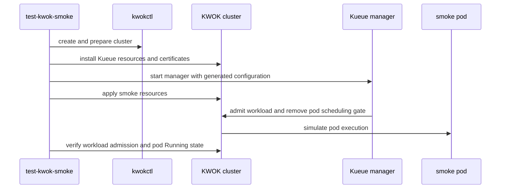

# PR #14733: [NEED TEST]Add KWOK test infrastructure and a minimal smoke test

**Summary**: [NEED TEST]Add KWOK test infrastructure and a minimal smoke test

**Sources**: https://github.com/kubernetes-sigs/kueue/pull/14733

**Last updated**: 2026-10-19T07:36:42Z

---

## Metadata

- **State**: open
- **Author**: [@qiujiaro](https://github.com/qiujiaro)
- **Branch**: `feature/kwok-ci` → `main`
- **Created**: 2026-08-22T20:31:05Z
- **Updated**: 2026-10-19T07:36:42Z
- **Merged**: —
- **Closed**: —
- **Labels**: `kind/feature`, `size/XL`, `needs-rebase`, `ok-to-test`, `do-not-merge/release-note-label-needed`, `cncf-cla: yes`, `area/testing`
- **Assignees**: _none_
- **Requested reviewers**: [@pajakd](https://github.com/pajakd), [@kshalot](https://github.com/kshalot)
- **Changed files**: 10   **+795 / -0**

## Description

#### What type of PR is this?

/kind feature
/area testing

#### What this PR does / why we need it:

This PR introduces the minimum KWOK-based test infrastructure needed by Kueue.

It:

- pins `kwokctl` v0.8.0 in a dedicated Go tools module;
- exposes `kwokctl` as a Makefile-managed binary dependency;
- adds reusable helpers for the KWOK cluster lifecycle, Kueue bootstrap, diagnostics, and cleanup;
- adds `make test-kwok-smoke` as a minimal end-to-end smoke test.

The smoke test verifies that:

- a binary-runtime KWOK cluster starts successfully;
- a simulated Node becomes Ready;
- the real Kueue manager starts against the cluster;
- a gated Pod produces a Workload;
- the Workload becomes Admitted;
- Kueue removes the Pod scheduling gate;
- KWOK reports the Pod as Running.

This establishes a small, reproducible foundation for future KWOK-based scale and performance tests. It intentionally does not add large node counts, latency thresholds, profiling, or ungating benchmarks.

#### Which issue(s) this PR fixes:
Related to #13683 and #14008.

While investigating #14008 , TAS testing had to rely on an ad hoc local cluster setup because Kueue did not provide a reusable KWOK-based test environment. This PR establishes a minimal, repeatable KWOK foundation for similar testing and for the future scale coverage proposed in #13683.

#### Special notes for your reviewer:

`Running` in this test is simulated by KWOK. No container image is pulled or executed.

The test uses KWOK's binary runtime and does not require Docker or another container runtime.

In CI mode, the test collects diagnostics and deletes the cluster and temporary runtime state. In development mode, the cluster can be retained for debugging.

This PR only provides the KWOK infrastructure and smoke test. Prow integration and admitted-to-ungated performance coverage can be added separately.

AI usage disclosure: This PR was prepared with assistance from an AI coding tool. The author reviewed and validated the resulting changes.

#### How was this tested?

```console
make test-kwok-smoke
```

The local smoke test completed successfully, including Workload admission, Pod ungating, KWOK-simulated Running status, and cluster cleanup.

<!-- This is an auto-generated comment: release notes by coderabbit.ai -->

## Summary by CodeRabbit

* **New Features**
  * Added configurable KWOK support for creating lightweight test clusters.
  * Added a `test-kwok-smoke` command to validate Kueue workload admission and simulated pod execution.
  * Added automated cluster setup, resource installation, certificate handling, diagnostics, and cleanup.
  * Added smoke-test resources and configuration for Kueue queues, quotas, and admission gating.
* **Testing**
  * Added an end-to-end smoke test suitable for local development and CI environments.

<!-- end of auto-generated comment: release notes by coderabbit.ai -->

## Discussion

### Comment by [@kubernetes-prow[bot]](https://github.com/apps/kubernetes-prow) — 2026-08-22T20:31:07Z

Adding the "do-not-merge/release-note-label-needed" label because no release-note block was detected, please follow our [release note process](https://git.k8s.io/community/contributors/guide/release-notes.md) to remove it.

<details>

Instructions for interacting with me using PR comments are available [here](https://git.k8s.io/community/contributors/guide/pull-requests.md).  If you have questions or suggestions related to my behavior, please file an issue against the [kubernetes-sigs/prow](https://github.com/kubernetes-sigs/prow/issues/new?title=Prow%20issue:) repository.
</details>

### Comment by [@netlify[bot]](https://github.com/apps/netlify) — 2026-08-22T20:31:11Z

### <span aria-hidden="true">✅</span> Deploy Preview for *kubernetes-sigs-kueue* ready!


|  Name | Link |
|:-:|------------------------|
|<span aria-hidden="true">🔨</span> Latest commit | 384b4a7782e1403e760631166d1afa7b8122ab94 |
|<span aria-hidden="true">🔍</span> Latest deploy log | https://app.netlify.com/projects/kubernetes-sigs-kueue/deploys/6a8a070c5d0d8b0009b80bb1 |
|<span aria-hidden="true">😎</span> Deploy Preview | [https://deploy-preview-14733--kubernetes-sigs-kueue.netlify.app](https://deploy-preview-14733--kubernetes-sigs-kueue.netlify.app) |
|<span aria-hidden="true">📱</span> Preview on mobile | <details><summary> Toggle QR Code... </summary><br /><br /><br /><br />_Use your smartphone camera to open QR code link._</details> |
---
<!-- [kubernetes-sigs-kueue Preview](https://deploy-preview-14733--kubernetes-sigs-kueue.netlify.app) -->
_To edit notification comments on pull requests, go to your [Netlify project configuration](https://app.netlify.com/projects/kubernetes-sigs-kueue/configuration/notifications#deploy-notifications)._

### Comment by [@kubernetes-prow[bot]](https://github.com/apps/kubernetes-prow) — 2026-08-22T20:31:15Z

Hi @qiujiaro. Thanks for your PR.

I'm waiting for a [kubernetes-sigs](https://github.com/orgs/kubernetes-sigs/people) member to verify that this patch is reasonable to test. If it is, they should reply with `/ok-to-test` on its own line. Until that is done, I will not automatically test new commits in this PR, but the usual testing commands by org members will still work.

Regular contributors should [join the org](https://git.k8s.io/community/community-membership.md#member) to skip this step.

Once the patch is verified, the new status will be reflected by the `ok-to-test` label.

I understand the commands that are listed [here](https://go.k8s.io/bot-commands?repo=kubernetes-sigs%2Fkueue).

<details>

Instructions for interacting with me using PR comments are available [here](https://git.k8s.io/community/contributors/guide/pull-requests.md).  If you have questions or suggestions related to my behavior, please file an issue against the [kubernetes-sigs/prow](https://github.com/kubernetes-sigs/prow/issues/new?title=Prow%20issue:) repository.
</details>

### Comment by [@kubernetes-prow[bot]](https://github.com/apps/kubernetes-prow) — 2026-08-22T20:31:16Z

[APPROVALNOTIFIER] This PR is **NOT APPROVED**

This pull-request has been approved by: *<a href="https://github.com/kubernetes-sigs/kueue/pull/14733#" title="Author self-approved">qiujiaro</a>*
**Once this PR has been reviewed and has the lgtm label**, please assign [mbobrovskyi](https://github.com/mbobrovskyi) for approval. For more information see [the Code Review Process](https://git.k8s.io/community/contributors/guide/owners.md#the-code-review-process).

The full list of commands accepted by this bot can be found [here](https://go.k8s.io/bot-commands?repo=kubernetes-sigs%2Fkueue).

<details open>
Needs approval from an approver in each of these files:

- **[hack/OWNERS](https://github.com/kubernetes-sigs/kueue/blob/main/hack/OWNERS)**

Approvers can indicate their approval by writing `/approve` in a comment
Approvers can cancel approval by writing `/approve cancel` in a comment
</details>
<!-- META={"approvers":["mbobrovskyi"]} -->

### Comment by [@coderabbitai[bot]](https://github.com/apps/coderabbitai) — 2026-08-22T20:32:18Z

<!-- This is an auto-generated comment: summarize by coderabbit.ai -->
<!-- review_stack_entry_start -->

[](https://app.coderabbit.ai/change-stack/kubernetes-sigs/kueue/pull/14733?utm_source=github_walkthrough&utm_medium=github&utm_campaign=change_stack)

<!-- review_stack_entry_end -->
<!-- recent_review_start -->

No actionable comments were generated in the recent review. 🎉

<details>
<summary>ℹ️ Recent review info</summary>

<details>
<summary>⚙️ Run configuration</summary>

**Configuration used**: Path: .coderabbit.yaml

**Review profile**: CHILL

**Plan**: Pro Plus

**Run ID**: `8374a456-e22c-464f-9ea3-f1861583fc29`

</details>

<details>
<summary>📥 Commits</summary>

Reviewing files that changed from the base of the PR and between ff69552e79ad21652c36caa97038382e55625cf7 and 384b4a7782e1403e760631166d1afa7b8122ab94.

</details>

<details>
<summary>⛔ Files ignored due to path filters (1)</summary>

* `hack/tools/kwok/go.sum` is excluded by `!**/*.sum`

</details>

<details>
<summary>📒 Files selected for processing (9)</summary>

* `hack/make/deps.mk`
* `hack/make/test.mk`
* `hack/testing/kwok-smoke-test.sh`
* `hack/testing/kwok/bootstrap.yaml`
* `hack/testing/kwok/common.sh`
* `hack/testing/kwok/config.sh`
* `hack/testing/kwok/manager-config.yaml`
* `hack/testing/kwok/smoke/resources.yaml`
* `hack/tools/kwok/go.mod`

</details>

**Included review availability:** Your plan provides up to 8 included reviews per hour; 7 remain after this review.

</details>

---


<!-- recent_review_end -->
<!-- walkthrough_start -->

<details>
<summary>📝 Walkthrough</summary>

## Walkthrough

This change adds KWOK dependency management and a configurable smoke test. The test creates or prepares a KWOK cluster, installs Kueue resources and certificates, starts the Kueue manager, and verifies workload admission and simulated pod execution.

### Changes

**KWOK smoke-test integration**

|Layer / File(s)|Summary|
|---|---|
|**KWOK tooling and Make targets** <br> `hack/tools/kwok/go.mod`, `hack/make/deps.mk`, `hack/make/test.mk`|The repository adds the `kwokctl` Go tool, its binary target, configurable test settings, and the `test-kwok-smoke` target.|
|**Cluster and Kueue harness** <br> `hack/testing/kwok/config.sh`, `hack/testing/kwok/common.sh`, `hack/testing/kwok/bootstrap.yaml`, `hack/testing/kwok/manager-config.yaml`|The harness manages KWOK clusters, cleanup, diagnostics, Kueue resources, webhook certificates, and local manager startup.|
|**Managed pod smoke test** <br> `hack/testing/kwok/smoke/resources.yaml`, `hack/testing/kwok-smoke-test.sh`|The smoke test applies queues and a gated pod, waits for admission and gate removal, and verifies that the simulated pod reaches `Running`.|

**Estimated code review effort:** 4 (Complex) | ~45 minutes

<!-- final_review_risk_start -->
**Merge Risk:** _⚪ Minimal_ · up to `384b4`

The PR adds KWOK-based test infrastructure and a minimal smoke test without any supplied evidence of a concrete merge-blocking issue; no actionable risk remains beyond normal checks and review.
<!-- final_review_risk_end -->

### Sequence Diagram(s)



</details>

<!-- walkthrough_end -->
<!-- pre_merge_checks_walkthrough_start -->

<details>
<summary>🚥 Pre-merge checks | ✅ 4 | ❌ 1</summary>

### ❌ Failed checks (1 warning)

|     Check name     | Status     | Explanation                                                                                                                                                                                               | Resolution                                                                         |
| :----------------: | :--------- | :-------------------------------------------------------------------------------------------------------------------------------------------------------------------------------------------------------- | :--------------------------------------------------------------------------------- |
| Docstring Coverage | ⚠️ Warning | Docstring coverage is 11.11% which is insufficient. The required threshold is 80.00%. Docstring coverage is scoped to functions touched by this diff. Analyzed 18 functions across 3 files. (6 skipped: … | Write docstrings for the functions missing them to satisfy the coverage threshold. |

<details>
<summary>✅ Passed checks (4 passed)</summary>

|         Check name         | Status   | Explanation                                                                                                                                                             |
| :------------------------: | :------- | :---------------------------------------------------------------------------------------------------------------------------------------------------------------------- |
|     Linked Issues check    | ✅ Passed | Check skipped because no linked issues were found for this pull request.                                                                                                |
| Out of Scope Changes check | ✅ Passed | Check skipped because no linked issues were found for this pull request.                                                                                                |
|      Description Check     | ✅ Passed | Check skipped - CodeRabbit’s high-level summary is enabled.                                                                                                             |
|         Title check        | ✅ Passed | The title clearly describes the main change: adding KWOK test infrastructure and a minimal smoke test. The optional [NEED TEST] prefix is relevant to the pull request. |

</details>

<details>
<summary>Full details: Docstring Coverage</summary>

**Explanation**

Docstring coverage is 11.11% which is insufficient. The required threshold is 80.00%. Docstring coverage is scoped to functions touched by this diff. Analyzed 18 functions across 3 files. (6 skipped: 6 unsupported.)

</details>

</details>

<!-- pre_merge_checks_walkthrough_end -->

- [ ] <!-- {"checkboxId":"585bb3f6-faf5-4dbf-96d2-74e382adf19a"} --> Fix all pre-merge checks with AI
<!-- finishing_touch_checkbox_start -->

<details>
<summary>✨ Finishing Touches</summary>

<details>
<summary>🧪 Generate unit tests (beta)</summary>

- [ ] <!-- {"checkboxId": "f47ac10b-58cc-4372-a567-0e02b2c3d479", "radioGroupId": "utg-output-choice-group-unknown_comment_id"} -->   Create PR with unit tests

</details>

</details>

<!-- finishing_touch_checkbox_end -->
<!-- tips_start -->

---

Thanks for using [CodeRabbit](https://coderabbit.ai?utm_source=oss&utm_medium=github&utm_campaign=kubernetes-sigs/kueue&utm_content=14733)! It's free for OSS, and your support helps us grow. If you like it, consider giving us a shout-out.

<details>
<summary>❤️ Share</summary>

- [X](https://twitter.com/intent/tweet?text=I%20just%20used%20%40coderabbitai%20for%20my%20code%20review%2C%20and%20it%27s%20fantastic%21%20It%27s%20free%20for%20OSS%20and%20offers%20a%20free%20trial%20for%20the%20proprietary%20code.%20Check%20it%20out%3A&url=https%3A//coderabbit.ai)
- [Mastodon](https://mastodon.social/share?text=I%20just%20used%20%40coderabbitai%20for%20my%20code%20review%2C%20and%20it%27s%20fantastic%21%20It%27s%20free%20for%20OSS%20and%20offers%20a%20free%20trial%20for%20the%20proprietary%20code.%20Check%20it%20out%3A%20https%3A%2F%2Fcoderabbit.ai)
- [Reddit](https://www.reddit.com/submit?title=Great%20tool%20for%20code%20review%20-%20CodeRabbit&text=I%20just%20used%20CodeRabbit%20for%20my%20code%20review%2C%20and%20it%27s%20fantastic%21%20It%27s%20free%20for%20OSS%20and%20offers%20a%20free%20trial%20for%20proprietary%20code.%20Check%20it%20out%3A%20https%3A//coderabbit.ai)
- [LinkedIn](https://www.linkedin.com/sharing/share-offsite/?url=https%3A%2F%2Fcoderabbit.ai&mini=true&title=Great%20tool%20for%20code%20review%20-%20CodeRabbit&summary=I%20just%20used%20CodeRabbit%20for%20my%20code%20review%2C%20and%20it%27s%20fantastic%21%20It%27s%20free%20for%20OSS%20and%20offers%20a%20free%20trial%20for%20proprietary%20code)

</details>


<sub>Comment `@coderabbitai help` to get the list of available commands.</sub>

<!-- tips_end -->

### Comment by [@mimowo](https://github.com/mimowo) — 2026-10-14T06:33:02Z

/ok-to-test

### Comment by [@kubernetes-prow[bot]](https://github.com/apps/kubernetes-prow) — 2026-10-14T06:33:12Z

PR needs rebase.

<details>

Instructions for interacting with me using PR comments are available [here](https://git.k8s.io/community/contributors/guide/pull-requests.md).  If you have questions or suggestions related to my behavior, please file an issue against the [kubernetes-sigs/prow](https://github.com/kubernetes-sigs/prow/issues/new?title=Prow%20issue:) repository.
</details>

### Comment by [@mimowo](https://github.com/mimowo) — 2026-10-19T07:36:42Z

@qiujiaro  do you want to continue this work? Once rebased it will require reviewer attention, maybe @amy could help
