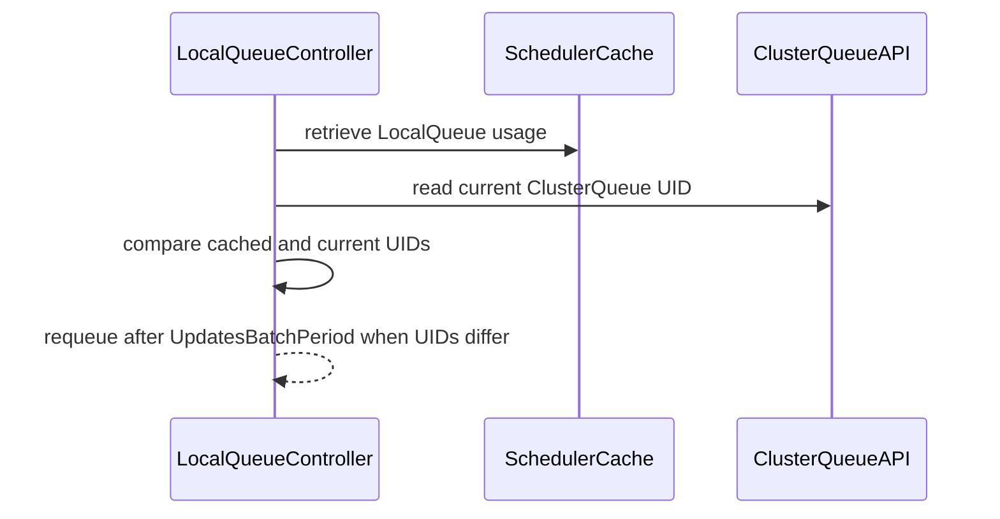

# PR #14735: Prevent mixed LocalQueue status after ClusterQueue recreate

**Summary**: Prevent mixed LocalQueue status after ClusterQueue recreate

**Sources**: https://github.com/kubernetes-sigs/kueue/pull/14735

**Last updated**: 2026-08-26T02:41:15Z

---

## Metadata

- **State**: open
- **Author**: [@YQ-Wang](https://github.com/YQ-Wang)
- **Branch**: `feat/clusterqueue-incarnation-cache-fixes` → `main`
- **Created**: 2026-08-22T21:01:47Z
- **Updated**: 2026-08-26T02:41:15Z
- **Merged**: —
- **Closed**: —
- **Labels**: `kind/bug`, `release-note`, `size/M`, `ok-to-test`, `cncf-cla: yes`
- **Assignees**: _none_
- **Requested reviewers**: [@mimowo](https://github.com/mimowo), [@olekzabl](https://github.com/olekzabl), [@kshalot](https://github.com/kshalot), [@tenzen-y](https://github.com/tenzen-y)
- **Changed files**: 5   **+92 / -2**

## Description

#### What type of PR is this?

/kind bug

#### What this PR does / why we need it:

Follow-up to https://github.com/kubernetes-sigs/kueue/pull/14131. Not a substitute for that PR.

When a ClusterQueue is deleted and recreated under the same name, LocalQueue status can show Ready from the new API object and usage from the previous cache entry.

This PR stores the ClusterQueue UID in the scheduler cache and delays LocalQueue status updates while that UID disagrees with the API object. In-place cache updates that would relabel leftover usage as a new UID are rejected; the existing Delete then Add path still replaces the cache entry.

This does not rebuild quota accounting across a force-recreate. https://github.com/kubernetes-sigs/kueue/pull/14131 remains the deletion-ordering status fix for #13873.

#### Which issue(s) this PR fixes:

Related to #13873. Does not close it.

#### Special notes for your reviewer:

The previous revision of this draft rebuilt scheduler-cache and queue-manager state on UID change. That was larger than the status bug needs. This revision is only the UID publication fence.

It may conflict with #14131 in `LocalQueueUsage` and LocalQueue reconcile.

AI tools were used to assist with implementation and review. The final diff was manually reviewed and validated.

#### Does this PR introduce a user-facing change?

```release-note
LocalQueue: Fixed status showing Ready from a recreated ClusterQueue together with usage from the previous same-named cache entry.
```


<!-- This is an auto-generated comment: release notes by coderabbit.ai -->

## Summary by CodeRabbit

* **Bug Fixes**
  * Improved handling when a ClusterQueue is recreated, preventing stale cached data from affecting LocalQueue status.
  * Reconciliation now safely pauses and retries when ClusterQueue identity changes are detected.
  * LocalQueue usage information now reflects the associated ClusterQueue identity.

<!-- end of auto-generated comment: release notes by coderabbit.ai -->

## Discussion

### Comment by [@netlify[bot]](https://github.com/apps/netlify) — 2026-08-22T21:01:53Z

### <span aria-hidden="true">✅</span> Deploy Preview for *kubernetes-sigs-kueue* ready!


|  Name | Link |
|:-:|------------------------|
|<span aria-hidden="true">🔨</span> Latest commit | 1ce461c3c4075c3643a708570141c71f84672b5b |
|<span aria-hidden="true">🔍</span> Latest deploy log | https://app.netlify.com/projects/kubernetes-sigs-kueue/deploys/6a8ab858d8fbae0008f1dabc |
|<span aria-hidden="true">😎</span> Deploy Preview | [https://deploy-preview-14735--kubernetes-sigs-kueue.netlify.app](https://deploy-preview-14735--kubernetes-sigs-kueue.netlify.app) |
|<span aria-hidden="true">📱</span> Preview on mobile | <details><summary> Toggle QR Code... </summary><br /><br /><br /><br />_Use your smartphone camera to open QR code link._</details> |
---
<!-- [kubernetes-sigs-kueue Preview](https://deploy-preview-14735--kubernetes-sigs-kueue.netlify.app) -->
_To edit notification comments on pull requests, go to your [Netlify project configuration](https://app.netlify.com/projects/kubernetes-sigs-kueue/configuration/notifications#deploy-notifications)._

### Comment by [@coderabbitai[bot]](https://github.com/apps/coderabbitai) — 2026-08-22T21:01:55Z

<!-- This is an auto-generated comment: summarize by coderabbit.ai -->
<!-- review_stack_entry_start -->

[](https://app.coderabbit.ai/change-stack/kubernetes-sigs/kueue/pull/14735?utm_source=github_walkthrough&utm_medium=github&utm_campaign=change_stack)

<!-- review_stack_entry_end -->
<!-- recent_review_start -->

No actionable comments were generated in the recent review. 🎉

<details>
<summary>ℹ️ Recent review info</summary>

<details>
<summary>⚙️ Run configuration</summary>

**Configuration used**: Path: .coderabbit.yaml

**Review profile**: CHILL

**Plan**: Pro Plus

**Run ID**: `57efdaf8-3496-41a4-8077-40dad380f728`

</details>

<details>
<summary>📥 Commits</summary>

Reviewing files that changed from the base of the PR and between ff69552e79ad21652c36caa97038382e55625cf7 and 1ce461c3c4075c3643a708570141c71f84672b5b.

</details>

<details>
<summary>📒 Files selected for processing (5)</summary>

* `pkg/cache/scheduler/cache.go`
* `pkg/cache/scheduler/cache_test.go`
* `pkg/cache/scheduler/clusterqueue.go`
* `pkg/controller/core/localqueue_controller.go`
* `pkg/controller/core/localqueue_controller_test.go`

</details>

**Included review availability:** Your plan provides up to 8 included reviews per hour; 7 remain after this review.

</details>

---


<!-- recent_review_end -->
<!-- walkthrough_start -->

<details>
<summary>📝 Walkthrough</summary>

## Walkthrough

The scheduler cache now tracks ClusterQueue UIDs, validates UID changes, and returns the UID with LocalQueue usage. LocalQueue reconciliation detects stale cached data after ClusterQueue recreation and requeues without updating status.

### Changes

**ClusterQueue UID consistency**

|Layer / File(s)|Summary|
|---|---|
|**Cache UID tracking** <br> `pkg/cache/scheduler/cache.go`, `pkg/cache/scheduler/clusterqueue.go`|Cached ClusterQueues retain their UIDs. Updates reject mismatched non-empty UIDs with `ErrCqUIDMismatch`.|
|**LocalQueue usage UID propagation** <br> `pkg/cache/scheduler/cache.go`, `pkg/cache/scheduler/cache_test.go`|`LocalQueueUsageStats` now includes `ClusterQueueUID`. Tests cover configured and absent ClusterQueues and matching or mismatched updates.|
|**Reconciliation stale UID guard** <br> `pkg/controller/core/localqueue_controller.go`, `pkg/controller/core/localqueue_controller_test.go`|Reconciliation compares cached and current ClusterQueue UIDs. It requeues after `UpdatesBatchPeriod` when the cached UID is stale. Tests cover ClusterQueue recreation.|

**Estimated code review effort:** 3 (Moderate) | ~20 minutes

<!-- final_review_risk_start -->
**Merge Risk:** _⚪ Minimal_ · up to `1ce46`

This change prevents LocalQueue status from combining readiness from a recreated ClusterQueue with usage from the prior object; no actionable merge-blocking risk remains beyond normal checks and review.
<!-- final_review_risk_end -->

### Sequence Diagram(s)



**Suggested reviewers:** `kshalot`, `ole kzabl`, `mbobrovskyi`, `sohankunkerkar`

</details>

<!-- walkthrough_end -->
<!-- pre_merge_checks_walkthrough_start -->

<details>
<summary>🚥 Pre-merge checks | ✅ 5</summary>

<details>
<summary>✅ Passed checks (5 passed)</summary>

|         Check name         | Status   | Explanation                                                                                                       |
| :------------------------: | :------- | :---------------------------------------------------------------------------------------------------------------- |
|      Description Check     | ✅ Passed | Check skipped - CodeRabbit’s high-level summary is enabled.                                                       |
|         Title check        | ✅ Passed | The title clearly and concisely describes the main fix for mixed LocalQueue status after ClusterQueue recreation. |
|     Docstring Coverage     | ✅ Passed | Docstring check was indeterminate for this PR — some files could not be analyzed in time. Not blocking.           |
|     Linked Issues check    | ✅ Passed | Check skipped because no linked issues were found for this pull request.                                          |
| Out of Scope Changes check | ✅ Passed | Check skipped because no linked issues were found for this pull request.                                          |

</details>

</details>

<!-- pre_merge_checks_walkthrough_end -->
<!-- finishing_touch_checkbox_start -->

<details>
<summary>✨ Finishing Touches</summary>

<details>
<summary>🧪 Generate unit tests (beta)</summary>

- [ ] <!-- {"checkboxId": "f47ac10b-58cc-4372-a567-0e02b2c3d479", "radioGroupId": "utg-output-choice-group-unknown_comment_id"} -->   Create PR with unit tests

</details>

</details>

<!-- finishing_touch_checkbox_end -->
<!-- tips_start -->

---

Thanks for using [CodeRabbit](https://coderabbit.ai?utm_source=oss&utm_medium=github&utm_campaign=kubernetes-sigs/kueue&utm_content=14735)! It's free for OSS, and your support helps us grow. If you like it, consider giving us a shout-out.

<details>
<summary>❤️ Share</summary>

- [X](https://twitter.com/intent/tweet?text=I%20just%20used%20%40coderabbitai%20for%20my%20code%20review%2C%20and%20it%27s%20fantastic%21%20It%27s%20free%20for%20OSS%20and%20offers%20a%20free%20trial%20for%20the%20proprietary%20code.%20Check%20it%20out%3A&url=https%3A//coderabbit.ai)
- [Mastodon](https://mastodon.social/share?text=I%20just%20used%20%40coderabbitai%20for%20my%20code%20review%2C%20and%20it%27s%20fantastic%21%20It%27s%20free%20for%20OSS%20and%20offers%20a%20free%20trial%20for%20the%20proprietary%20code.%20Check%20it%20out%3A%20https%3A%2F%2Fcoderabbit.ai)
- [Reddit](https://www.reddit.com/submit?title=Great%20tool%20for%20code%20review%20-%20CodeRabbit&text=I%20just%20used%20CodeRabbit%20for%20my%20code%20review%2C%20and%20it%27s%20fantastic%21%20It%27s%20free%20for%20OSS%20and%20offers%20a%20free%20trial%20for%20proprietary%20code.%20Check%20it%20out%3A%20https%3A//coderabbit.ai)
- [LinkedIn](https://www.linkedin.com/sharing/share-offsite/?url=https%3A%2F%2Fcoderabbit.ai&mini=true&title=Great%20tool%20for%20code%20review%20-%20CodeRabbit&summary=I%20just%20used%20CodeRabbit%20for%20my%20code%20review%2C%20and%20it%27s%20fantastic%21%20It%27s%20free%20for%20OSS%20and%20offers%20a%20free%20trial%20for%20proprietary%20code)

</details>


<sub>Comment `@coderabbitai help` to get the list of available commands.</sub>

<!-- tips_end -->

### Comment by [@kubernetes-prow[bot]](https://github.com/apps/kubernetes-prow) — 2026-08-22T21:01:58Z

Hi @YQ-Wang. Thanks for your PR.

I'm waiting for a [kubernetes-sigs](https://github.com/orgs/kubernetes-sigs/people) member to verify that this patch is reasonable to test. If it is, they should reply with `/ok-to-test` on its own line. Until that is done, I will not automatically test new commits in this PR, but the usual testing commands by org members will still work.

>[!TIP]
>**We noticed you've done this a few times! Consider [joining the org](https://git.k8s.io/community/community-membership.md#member) to skip this step and gain `/lgtm` and other bot rights.** We recommend asking approvers on your previous PRs to sponsor you.

Once the patch is verified, the new status will be reflected by the `ok-to-test` label.

I understand the commands that are listed [here](https://go.k8s.io/bot-commands?repo=kubernetes-sigs%2Fkueue).

<details>

Instructions for interacting with me using PR comments are available [here](https://git.k8s.io/community/contributors/guide/pull-requests.md).  If you have questions or suggestions related to my behavior, please file an issue against the [kubernetes-sigs/prow](https://github.com/kubernetes-sigs/prow/issues/new?title=Prow%20issue:) repository.
</details>

### Comment by [@kubernetes-prow[bot]](https://github.com/apps/kubernetes-prow) — 2026-08-22T21:02:04Z

[APPROVALNOTIFIER] This PR is **NOT APPROVED**

This pull-request has been approved by: *<a href="https://github.com/kubernetes-sigs/kueue/pull/14735#" title="Author self-approved">YQ-Wang</a>*
**Once this PR has been reviewed and has the lgtm label**, please assign [tenzen-y](https://github.com/tenzen-y) for approval. For more information see [the Code Review Process](https://git.k8s.io/community/contributors/guide/owners.md#the-code-review-process).

The full list of commands accepted by this bot can be found [here](https://go.k8s.io/bot-commands?repo=kubernetes-sigs%2Fkueue).

<details open>
Needs approval from an approver in each of these files:

- **[OWNERS](https://github.com/kubernetes-sigs/kueue/blob/main/OWNERS)**

Approvers can indicate their approval by writing `/approve` in a comment
Approvers can cancel approval by writing `/approve cancel` in a comment
</details>
<!-- META={"approvers":["tenzen-y"]} -->

### Comment by [@tenzen-y](https://github.com/tenzen-y) — 2026-08-23T14:47:36Z

/ok-to-test

### Comment by [@YQ-Wang](https://github.com/YQ-Wang) — 2026-08-25T16:05:46Z

Thanks @tomsen02, that relist path is real.

This PR is only a publication fence: do not write Ready from the new API object with usage from the previous cache UID. After a Relist Update with a new UID, UpdateClusterQueue returns ErrCqUIDMismatch, the handler logs it, and LocalQueue keeps requeueing. That avoids mixed status; it does not rebuild the cache, so status can stall until a later Delete/Add or a restart.

A UID-mismatch replacement path was explored earlier and grew past what this status bug needs, so this PR stays the fence only. Replacement can be a follow-up: a small Delete-then-Add on UID mismatch in the ClusterQueue update path, plus a regression test for update-only relist delivery.

### Comment by [@tomsen02](https://github.com/tomsen02) — 2026-08-26T02:41:15Z

Thanks for confirming that the relist path is real. I agree that the publication fence prevents us from exposing a status assembled from different ClusterQueue generations.

My remaining concern is that, in this path, the controller does not appear to converge by itself: the cache keeps the old UID, subsequent LocalQueue reconciliations continue to requeue, and the status may remain stale until another Delete/Add event or a controller restart.

I’m fine with either PR boundary, but I think we should make that trade-off explicit. Would the maintainers prefer:

1. landing this PR as the publication fence and tracking cache replacement/self-recovery in a concrete follow-up issue, or
2. handling the observed UID replacement as part of this PR?

If we choose the follow-up approach, it would also be useful to capture the non-self-healing relist scenario in that issue.

## Reviews

### Review by [@tomsen02](https://github.com/tomsen02) (commented) — 2026-08-25T10:55:56Z

I found one convergence issue in the UID-mismatch path that I think needs addressing before merge.

The current guard appears to assume that a same-name recreation will eventually be delivered as `Delete(old) -> Add(new)`. That is true for the normal watch sequence, but it is not guaranteed after a watch error/relist. In client-go v0.36.3, `DeltaFIFO.Replace` emits `Replaced`/`Sync`, and `processDeltas` calls `OnUpdate(old, new)` whenever the key already exists; it does not split the event into Delete/Add when the UID changed.

In that update-only path:

1. `Cache.UpdateClusterQueue` returns `ErrCqUIDMismatch`.
2. `ClusterQueueReconciler.Update` only logs the error and continues.
3. No cache replacement is scheduled.
4. Every LocalQueue reconcile keeps seeing `apiUID=new, cacheUID=old` and returns `RequeueAfter: UpdatesBatchPeriod`.

I reproduced this locally by feeding the new-UID update and reconciling the LocalQueue three times. All three cache updates returned `ErrCqUIDMismatch`, and all three reconciles requeued after 1s with the cached UID still `old`. The existing test verifies the first requeue, but not that the mismatch can eventually converge.

Could the mismatch path perform or schedule a controlled scheduler-cache/queue-manager replacement, and add a regression test for update-only relist delivery? Merely rejecting the update can otherwise leave the LocalQueue status stalled until a controller restart or a later real Delete/Add event.

AI-assisted review; I traced the client-go relist dispatch and reproduced the repeated update/reconcile path locally against commit `1ce461c3c`.
