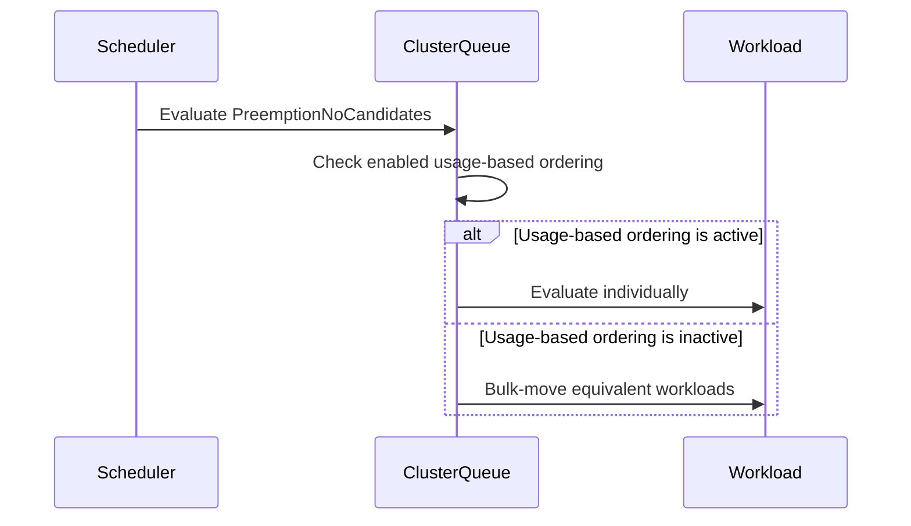

# PR #14775: Fix Scheduling Equivalence Hashing under UsageBasedAdmissionFairSharing

**Summary**: Fix Scheduling Equivalence Hashing under UsageBasedAdmissionFairSharing

**Sources**: https://github.com/kubernetes-sigs/kueue/pull/14775

**Last updated**: 2026-10-16T18:57:11Z

---

## Metadata

- **State**: open
- **Author**: [@Viswalahiri](https://github.com/Viswalahiri)
- **Branch**: `fix/14231-scheduling-equivalence-hashing-usage-based-fair-sharing` → `main`
- **Created**: 2026-08-24T16:34:17Z
- **Updated**: 2026-10-16T18:57:11Z
- **Merged**: —
- **Closed**: —
- **Labels**: `kind/bug`, `release-note`, `size/L`, `ok-to-test`, `cncf-cla: yes`
- **Assignees**: _none_
- **Requested reviewers**: [@mbobrovskyi](https://github.com/mbobrovskyi), [@PBundyra](https://github.com/PBundyra)
- **Changed files**: 4   **+130 / -27**

## Description

<!--  Thanks for sending a pull request!  Here are some tips for you:

1. If this is your first time, please read our contributor guidelines: https://git.k8s.io/community/contributors/guide/first-contribution.md#your-first-contribution and developer guide https://git.k8s.io/community/contributors/devel/development.md#development-guide
2. Please label this pull request according to what type of issue you are addressing, especially if this is a release targeted pull request. For reference on required PR/issue labels, read here:
https://git.k8s.io/community/contributors/devel/sig-release/release.md#issuepr-kind-label
3. Ensure you have added or ran the appropriate tests for your PR: https://git.k8s.io/community/contributors/devel/sig-testing/testing.md
4. If you want *faster* PR reviews, read how: https://git.k8s.io/community/contributors/guide/pull-requests.md#best-practices-for-faster-reviews
5. If the PR is unfinished, see how to mark it: https://git.k8s.io/community/contributors/guide/pull-requests.md#marking-unfinished-pull-requests
-->

#### What type of PR is this?
/kind bug

<!--
Add one of the following kinds:
/kind bug
/kind cleanup
/kind documentation
/kind feature
/kind kep

Optionally add one or more of the following kinds if applicable:
/kind api-change
/kind deprecation
/kind failing-test
/kind flake
/kind regression

Please also consider setting the area:
/area tas
/area was
/area integrations
/area multikueue
/area dashboard
/area localization
/area testing
/area website
-->

#### What this PR does / why we need it:
The scheduling-equivalence hash covers effective priority and pod spec, but not the queue-order timestamp. That timestamp is what UsageBasedAdmissionFairSharing uses to pop pending workloads in creation order, and under LowerOrNewerEqualPriority, it's also what decides whether a workload can preempt an equal-priority victim.

So two workloads can hash identically but carry different timestamps. If a class-wide PreemptionNoCandidates verdict fires under UsageBasedAdmissionFairSharing, it can sweep a workload to inadmissible without ever checking it individually. This is a high impact delay bug.

Fix: when a ClusterQueue's AdmissionScope.AdmissionMode is UsageBasedAdmissionFairSharing, PreemptionNoCandidates no longer applies class-wide. Instead, the workload gets evaluated on its own.

This is gated on whether the ClusterQueue effectively order by LocalQueue usage alone, not on the active preemption policy.

Also updating the Scheduling Equivalence Hashing KEP as requested.

#### Which issue(s) this PR fixes:
<!--
*Automatically closes linked issue when PR is merged.
Usage: `Fixes #<issue number>`, or `Fixes (paste link of issue)`.
_If PR is about `failing-tests or flakes`, please post the related issues/tests in a comment and do not use `Fixes`_*
-->
Fixes #14231

#### Special notes for your reviewer:
I performed a full validation run with `go build ./...`, `go vet ./...`, `gofmt -l` on
  changed files which were all clean. `go test ./pkg/...` also had 0 failures across 89
  packages. Additionally I also ran the real envtest-backed integration suites
  directly via `go test` which passed in all cases.

#### Does this PR introduce a user-facing change?
<!--
If no, just write "NONE" in the release-note block below.
If yes, a release note is required:
Enter your extended release note in the block below. If the PR requires additional action from users switching to the new release, include the string "action required".
-->
```release-note
Scheduling: Fixed a bug where a Workload eligible to preempt could be deferred along with its equivalence class, in BestEffortFIFO ClusterQueues using UsageBasedAdmissionFairSharing with a LowerOrNewerEqualPriority preemption policy. Such Workloads are now evaluated individually.
```

______
Disclosure: AI assistance was used while drafting this change.


<!-- This is an auto-generated comment: release notes by coderabbit.ai -->
## Summary by CodeRabbit

* **Bug Fixes**
  * Improved scheduling behavior when usage-based admission fair sharing is enabled and configured.
  * Workloads affected by preemption without candidates are now evaluated individually instead of moved in bulk.
  * Preserved bulk movement when fair-sharing configuration is not enabled.
  * Corrected quota-waiting outcomes, including cases where no reservation is created.

* **Documentation**
  * Updated scheduling guidance, risk information, version history, and validation coverage.
<!-- end of auto-generated comment: release notes by coderabbit.ai -->

## Discussion

### Comment by [@netlify[bot]](https://github.com/apps/netlify) — 2026-08-24T16:34:23Z

### <span aria-hidden="true">✅</span> Deploy Preview for *kubernetes-sigs-kueue* ready!


|  Name | Link |
|:-:|------------------------|
|<span aria-hidden="true">🔨</span> Latest commit | 4b9461289c64b8f79c9b47581e26d63f93fc122e |
|<span aria-hidden="true">🔍</span> Latest deploy log | https://app.netlify.com/projects/kubernetes-sigs-kueue/deploys/6aa1c14d9f0f4e0008de37a4 |
|<span aria-hidden="true">😎</span> Deploy Preview | [https://deploy-preview-14775--kubernetes-sigs-kueue.netlify.app](https://deploy-preview-14775--kubernetes-sigs-kueue.netlify.app) |
|<span aria-hidden="true">📱</span> Preview on mobile | <details><summary> Toggle QR Code... </summary><br /><br /><br /><br />_Use your smartphone camera to open QR code link._</details> |
---
<!-- [kubernetes-sigs-kueue Preview](https://deploy-preview-14775--kubernetes-sigs-kueue.netlify.app) -->
_To edit notification comments on pull requests, go to your [Netlify project configuration](https://app.netlify.com/projects/kubernetes-sigs-kueue/configuration/notifications#deploy-notifications)._

### Comment by [@kubernetes-prow[bot]](https://github.com/apps/kubernetes-prow) — 2026-08-24T16:34:27Z

Hi @Viswalahiri. Thanks for your PR.

I'm waiting for a [kubernetes-sigs](https://github.com/orgs/kubernetes-sigs/people) member to verify that this patch is reasonable to test. If it is, they should reply with `/ok-to-test` on its own line. Until that is done, I will not automatically test new commits in this PR, but the usual testing commands by org members will still work.

>[!TIP]
>**We noticed you've done this a few times! Consider [joining the org](https://git.k8s.io/community/community-membership.md#member) to skip this step and gain `/lgtm` and other bot rights.** We recommend asking approvers on your previous PRs to sponsor you.

Once the patch is verified, the new status will be reflected by the `ok-to-test` label.

I understand the commands that are listed [here](https://go.k8s.io/bot-commands?repo=kubernetes-sigs%2Fkueue).

<details>

Instructions for interacting with me using PR comments are available [here](https://git.k8s.io/community/contributors/guide/pull-requests.md).  If you have questions or suggestions related to my behavior, please file an issue against the [kubernetes-sigs/prow](https://github.com/kubernetes-sigs/prow/issues/new?title=Prow%20issue:) repository.
</details>

### Comment by [@kubernetes-prow[bot]](https://github.com/apps/kubernetes-prow) — 2026-08-24T16:34:30Z

[APPROVALNOTIFIER] This PR is **NOT APPROVED**

This pull-request has been approved by: *<a href="https://github.com/kubernetes-sigs/kueue/pull/14775#" title="Author self-approved">Viswalahiri</a>*
**Once this PR has been reviewed and has the lgtm label**, please assign [olekzabl](https://github.com/olekzabl), [sohankunkerkar](https://github.com/sohankunkerkar) for approval. For more information see [the Code Review Process](https://git.k8s.io/community/contributors/guide/owners.md#the-code-review-process).

The full list of commands accepted by this bot can be found [here](https://go.k8s.io/bot-commands?repo=kubernetes-sigs%2Fkueue).

<details open>
Needs approval from an approver in each of these files:

- **[OWNERS](https://github.com/kubernetes-sigs/kueue/blob/main/OWNERS)**

Approvers can indicate their approval by writing `/approve` in a comment
Approvers can cancel approval by writing `/approve cancel` in a comment
</details>
<!-- META={"approvers":["olekzabl","sohankunkerkar"]} -->

### Comment by [@coderabbitai[bot]](https://github.com/apps/coderabbitai) — 2026-08-24T16:34:35Z

<!-- This is an auto-generated comment: summarize by coderabbit.ai -->
<!-- review_stack_entry_start -->

[](https://app.coderabbit.ai/change-stack/kubernetes-sigs/kueue/pull/14775?utm_source=github_walkthrough&utm_medium=github&utm_campaign=change_stack)

<!-- review_stack_entry_end -->
<!-- This is an auto-generated comment: review paused by coderabbit.ai -->

> [!NOTE]
> ## Reviews paused
> 
> It looks like this branch is under active development. To avoid overwhelming you with review comments due to an influx of new commits, CodeRabbit has automatically paused this review. You can configure this behavior by changing the `reviews.auto_review.auto_pause_after_reviewed_commits` setting.
> 
> Use the following commands to manage reviews:
> - `@coderabbitai resume` to resume automatic reviews.
> - `@coderabbitai review` to trigger a single review.
> 
> Use the checkboxes below for quick actions:
> - [ ] <!-- {"checkboxId":"7f6cc2e2-2e4e-497a-8c31-c9e4573e93d1"} --> ▶️ Resume reviews
> - [ ] <!-- {"checkboxId":"e9bb8d72-00e8-4f67-9cb2-caf3b22574fe"} --> 🔍 Trigger review

<!-- end of auto-generated comment: review paused by coderabbit.ai -->
<!-- recent_review_start -->

No actionable comments were generated in the recent review. 🎉

<details>
<summary>ℹ️ Recent review info</summary>

<details>
<summary>⚙️ Run configuration</summary>

**Configuration used**: Path: .coderabbit.yaml

**Review profile**: CHILL

**Plan**: Pro Plus

**Run ID**: `f3a98a82-8f41-420d-8944-26fc6753b10c`

</details>

<details>
<summary>📥 Commits</summary>

Reviewing files that changed from the base of the PR and between 5d6622e568165674fdca88cba8baa5a417472cb4 and 68b095089944c7092b813c144e8412903f55dacf.

</details>

<details>
<summary>📒 Files selected for processing (2)</summary>

* `keps/9694-scheduling-equivalence-hashing/README.md`
* `pkg/cache/queue/cluster_queue.go`

</details>

**Included review availability:** Your plan provides up to 8 included reviews per hour; 7 remain after this review.

</details>

---


<!-- recent_review_end -->
<!-- walkthrough_start -->

<details>
<summary>📝 Walkthrough</summary>

## Walkthrough

The change limits `PreemptionNoCandidates` bulk movement to `ClusterQueue` objects without active `UsageBasedAdmissionFairSharing` ordering. Tests and KEP documentation cover the narrowed behavior.

### Changes

**Admission fair-sharing equivalence handling**

|Layer / File(s)|Summary|
|---|---|
|**Admission fair-sharing state and hash behavior** <br> `pkg/cache/queue/cluster_queue.go`|`ClusterQueue` stores immutable fair-sharing state from construction. `PreemptionNoCandidates` avoids class-wide bulk movement when LocalQueue-usage ordering is active.|
|**Queue and scheduler regression coverage** <br> `pkg/cache/queue/cluster_queue_test.go`, `pkg/scheduler/scheduler_afs_test.go`|Tests cover configured and unconfigured fair-sharing cases, `NoFit` hashing, `PreemptionNoCandidates` suppression, and individual workload evaluation.|
|**KEP behavior and graduation updates** <br> `keps/9694-scheduling-equivalence-hashing/README.md`|The KEP records the narrowed mitigation scope, risk status, test coverage, version history, and graduation criteria.|

**Estimated code review effort:** 3 (Moderate) | ~20 minutes

<!-- final_review_risk_start -->
**Merge Risk:** _⚪ Minimal_ · up to `68b09`

The change evaluates affected workloads individually instead of applying the class-wide deferral behavior, with reported validation checks passing; no actionable merge-blocking risk remains.
<!-- final_review_risk_end -->

### Sequence Diagram(s)



**Suggested reviewers:** `mbobrovskyi`, `pbundyra`

</details>

<!-- walkthrough_end -->
<!-- pre_merge_checks_walkthrough_start -->

<details>
<summary>🚥 Pre-merge checks | ✅ 4 | ❌ 1</summary>

### ❌ Failed checks (1 warning)

|     Check name     | Status     | Explanation                                                                                                                                                                                               | Resolution                                                                         |
| :----------------: | :--------- | :-------------------------------------------------------------------------------------------------------------------------------------------------------------------------------------------------------- | :--------------------------------------------------------------------------------- |
| Docstring Coverage | ⚠️ Warning | Docstring coverage is 0.00% which is insufficient. The required threshold is 80.00%. Docstring coverage is scoped to functions touched by this diff. Analyzed 4 functions across 3 files. (1 skipped: 1 … | Write docstrings for the functions missing them to satisfy the coverage threshold. |

<details>
<summary>✅ Passed checks (4 passed)</summary>

|         Check name         | Status   | Explanation                                                                                                                                                                                               |
| :------------------------: | :------- | :-------------------------------------------------------------------------------------------------------------------------------------------------------------------------------------------------------- |
|      Description Check     | ✅ Passed | Check skipped - CodeRabbit’s high-level summary is enabled.                                                                                                                                               |
|         Title check        | ✅ Passed | The title clearly identifies the main change: fixing Scheduling Equivalence Hashing for UsageBasedAdmissionFairSharing.                                                                                   |
|     Linked Issues check    | ✅ Passed | The implementation prevents unsafe class-wide handling for PreemptionNoCandidates when LocalQueue usage ordering and the required fair-sharing configuration are active. The changes add queue and sched… |
| Out of Scope Changes check | ✅ Passed | The changes are limited to the Scheduling Equivalence Hashing implementation, related tests, and KEP documentation. All changes support the objectives in issue `#14231`.                                   |

</details>

<details>
<summary>Full details: Linked Issues check</summary>

**Explanation**

The implementation prevents unsafe class-wide handling for PreemptionNoCandidates when LocalQueue usage ordering and the required fair-sharing configuration are active. The changes add queue and scheduler test coverage and update the KEP risk and mitigation status. These changes satisfy issue `#14231`.

</details>

<details>
<summary>Full details: Docstring Coverage</summary>

**Explanation**

Docstring coverage is 0.00% which is insufficient. The required threshold is 80.00%. Docstring coverage is scoped to functions touched by this diff. Analyzed 4 functions across 3 files. (1 skipped: 1 unsupported.)

</details>

</details>

<!-- pre_merge_checks_walkthrough_end -->
<!-- finishing_touch_checkbox_start -->

<details>
<summary>✨ Finishing Touches</summary>

<details>
<summary>🧪 Generate unit tests (beta)</summary>

- [ ] <!-- {"checkboxId": "f47ac10b-58cc-4372-a567-0e02b2c3d479", "radioGroupId": "utg-output-choice-group-unknown_comment_id"} -->   Create PR with unit tests

</details>

</details>

<!-- finishing_touch_checkbox_end -->
<!-- tips_start -->

---


<sub>Comment `@coderabbitai help` to get the list of available commands.</sub>

<!-- tips_end -->

### Comment by [@sohankunkerkar](https://github.com/sohankunkerkar) — 2026-08-24T17:14:17Z

/ok-to-test

### Comment by [@Viswalahiri](https://github.com/Viswalahiri) — 2026-08-25T05:21:03Z

Hi @sohankunkerkar , were you able to have a chance to review the diff? Please let me know if there are any opportunities to improve the code, comments or description. Thank you!

### Comment by [@Viswalahiri](https://github.com/Viswalahiri) — 2026-08-26T05:23:16Z

Updated the PR Description to address new work. As always, I have verified that the tests pass.

### Comment by [@Viswalahiri](https://github.com/Viswalahiri) — 2026-08-26T05:28:08Z

Also, I found some stale comments in cluster_queue.go after making said changes, will put out a PR to address them

### Comment by [@Viswalahiri](https://github.com/Viswalahiri) — 2026-08-26T05:37:22Z

@sohankunkerkar , I think the recent changes have addressed all the points that you touched on, please let me know if there are any remnants that need to be fixed, either here or as a follow up issue

### Comment by [@Viswalahiri](https://github.com/Viswalahiri) — 2026-08-27T01:32:52Z

@sohankunkerkar, I was able to make a revision, PTAL. Thanks!

### Comment by [@sohankunkerkar](https://github.com/sohankunkerkar) — 2026-08-28T15:08:18Z

/release-note-edit

```release-note
Scheduling: Fixed a bug where a Workload eligible to preempt could be deferred along with its equivalence class, in BestEffortFIFO ClusterQueues using UsageBasedAdmissionFairSharing with a LowerOrNewerEqualPriority preemption policy. Such Workloads are now evaluated individually.
```

### Comment by [@Viswalahiri](https://github.com/Viswalahiri) — 2026-09-04T22:57:42Z

@sohankunkerkar does this need any revisions / changes? If not lets work to get this merged, can you lgtm?

### Comment by [@sohankunkerkar](https://github.com/sohankunkerkar) — 2026-09-08T05:03:16Z

@Viswalahiri could you rebase on top of the main branch?

### Comment by [@Viswalahiri](https://github.com/Viswalahiri) — 2026-09-09T20:31:56Z

@sohankunkerkar  can you PTAL?

### Comment by [@kubernetes-prow[bot]](https://github.com/apps/kubernetes-prow) — 2026-09-10T20:16:47Z

@Viswalahiri: The following tests **failed**, say `/retest` to rerun all failed tests or `/retest-required` to rerun all mandatory failed tests:

Test name | Commit | Details | Required | Rerun command
--- | --- | --- | --- | ---
pull-kueue-test-e2e-dra-baseline-main | 4b9461289c64b8f79c9b47581e26d63f93fc122e | [link](https://prow.k8s.io/view/gs/kubernetes-ci-logs/pr-logs/pull/kubernetes-sigs_kueue/14775/pull-kueue-test-e2e-dra-baseline-main/2098141053793079296) | true | `/test pull-kueue-test-e2e-dra-baseline-main`
pull-kueue-test-e2e-dra-capacity-main | 4b9461289c64b8f79c9b47581e26d63f93fc122e | [link](https://prow.k8s.io/view/gs/kubernetes-ci-logs/pr-logs/pull/kubernetes-sigs_kueue/14775/pull-kueue-test-e2e-dra-capacity-main/2098141053818245120) | true | `/test pull-kueue-test-e2e-dra-capacity-main`

[Full PR test history](https://prow.k8s.io/pr-history?org=kubernetes-sigs&repo=kueue&pr=14775). [Your PR dashboard](https://prow.k8s.io/pr?query=is%3Apr%20state%3Aopen%20author%3AViswalahiri). Please help us cut down on flakes by [linking to](https://git.k8s.io/community/contributors/devel/sig-testing/flaky-tests.md#filing-issues-for-flaky-tests) an [open issue](https://github.com/kubernetes-sigs/kueue/issues?q=is:issue+is:open) when you hit one in your PR.

<details>

Instructions for interacting with me using PR comments are available [here](https://git.k8s.io/community/contributors/guide/pull-requests.md).  If you have questions or suggestions related to my behavior, please file an issue against the [kubernetes-sigs/prow](https://github.com/kubernetes-sigs/prow/issues/new?title=Prow%20issue:) repository. I understand the commands that are listed [here](https://go.k8s.io/bot-commands).
</details>
<!-- test report -->

### Comment by [@sohankunkerkar](https://github.com/sohankunkerkar) — 2026-10-16T12:39:39Z

@Viswalahiri sorry for the delay but could you rebase on top of the main branch for the last time?

### Comment by [@Viswalahiri](https://github.com/Viswalahiri) — 2026-10-16T18:57:10Z

@sohankunkerkar @tenzen-y sure

## Reviews

### Review by [@sohankunkerkar](https://github.com/sohankunkerkar) (commented) — 2026-08-25T14:30:30Z

- **pkg/cache/queue/cluster_queue.go:609** by [@sohankunkerkar](https://github.com/sohankunkerkar) — 2026-08-25T14:29:11Z
```diff
@@ -599,6 +600,16 @@ func (c *ClusterQueue) requeueIfNotPresent(log logr.Logger, wInfo *workload.Info
 	return true
 }
 
+// usesUsageBasedAdmissionFairSharing reports whether this ClusterQueue pops
+// pending workloads ordered by LocalQueue usage instead of the queue-order
+// timestamp. The scheduling-equivalence shape does not encode that timestamp,
+// so a class-wide PreemptionNoCandidates conclusion reached under this mode
+// can incorrectly defer an equivalent workload that is actually eligible to
+// preempt under a LowerOrNewerEqualPriority preemption policy. See Kueue#14231.
+func (c *ClusterQueue) usesUsageBasedAdmissionFairSharing() bool {
```

  This checks whether the spec asks for AFS, but what actually reorders the queue is `enableAdmissionFs` from `afs.ResourceWeights`, which also needs a non-nil afsConfig and the feature gate. So a CQ with admissionMode set but no admissionFairSharing in the Configuration still pops oldest-first. It's safe and loses the bulk-move anyway.
  
  I'd store `options.enableAdmissionFs` on the struct and return that instead, which also drops the need for the new Update() assignment. Heads up that the new unit case passes a nil afsConfig, so it currently only passes because of this gap and would need a real one.

- **keps/9694-scheduling-equivalence-hashing/README.md:186** by [@sohankunkerkar](https://github.com/sohankunkerkar) — 2026-08-25T14:30:19Z
```diff
@@ -184,8 +184,9 @@ trigger, user impact, mitigation, and residual risk for each row.
 3. **Mitigation:** Every new scheduling input must either be represented in the
    shape or cause the affected outcome to be excluded from class-wide handling.
 4. **Residual risk:** The current shape includes Pod placement and effective
```

  This covers the preemption-policy axis nicely. Could it also mention the case where `AdmissionMode` is set but AFS isn't actually enabled in the Configuration? Those queues order by timestamp and were never affected either, so they're a second group losing the optimization.

### Review by [@Viswalahiri](https://github.com/Viswalahiri) (commented) — 2026-08-26T04:35:45Z

- **pkg/cache/queue/cluster_queue.go:609** by [@Viswalahiri](https://github.com/Viswalahiri) — 2026-08-26T04:35:45Z
```diff
@@ -599,6 +600,16 @@ func (c *ClusterQueue) requeueIfNotPresent(log logr.Logger, wInfo *workload.Info
 	return true
 }
 
+// usesUsageBasedAdmissionFairSharing reports whether this ClusterQueue pops
+// pending workloads ordered by LocalQueue usage instead of the queue-order
+// timestamp. The scheduling-equivalence shape does not encode that timestamp,
+// so a class-wide PreemptionNoCandidates conclusion reached under this mode
+// can incorrectly defer an equivalent workload that is actually eligible to
+// preempt under a LowerOrNewerEqualPriority preemption policy. See Kueue#14231.
+func (c *ClusterQueue) usesUsageBasedAdmissionFairSharing() bool {
```

  I'd agree, you are right @sohankunkerkar. I've switched to `enableAdmissionFs` stored on the struct, and dropped the `Update()` assignment.
  
  On further analysis of your suggestion, I see that `UpdateClusterQueue` refreshes the spec without rebuilding the comparator, so reading `AdmissionScope` could actually flip the exclusion on for a queue whose comparator is still ordering using the timestamp. Bindign to `enableAdmissionFs` will mean that only one source of truth is used and shared.
  
  Also, the nil `afsConfig` is doing exactly what you have pointed out. I have worked on addressign that as well.
  
  I wanted to also touch on what feels like a minor deviation from my end, instead of having the helper return the new field, I removed the helper and read `enableAdmissionFs`directly at the calling site. It is only used at that one place. `enableAdmissionFs` is already the name that's being used everywhere else in the file. If you would prefer that it be in the helper, I'm happy to do that. 
  
  Also, `ClusterQueue.AdmissionScope` is unused again now, same as it was before the PR. Follow-up cleanup task that I should pickup later?

### Review by [@Viswalahiri](https://github.com/Viswalahiri) (commented) — 2026-08-26T05:06:29Z

- **keps/9694-scheduling-equivalence-hashing/README.md:186** by [@Viswalahiri](https://github.com/Viswalahiri) — 2026-08-26T05:06:28Z
```diff
@@ -184,8 +184,9 @@ trigger, user impact, mitigation, and residual risk for each row.
 3. **Mitigation:** Every new scheduling input must either be represented in the
    shape or cause the affected outcome to be excluded from class-wide handling.
 4. **Residual risk:** The current shape includes Pod placement and effective
```

  @sohankunkerkar, I think this one in a way got answered by our other comment thread
  
  Once the exclusion keys on `enableAdmissionFs` instead of `AdmissionScope.AdmissionMode`, queues with `admissionMode` set but no `admissionFairSharing` in the Configuration aren't a second group losing the optimization, but rather they keep it, since they were never ordering by usage to start with. 
  
  I wrote it up in the `UsageBasedAdmissionFairSharing` residual risk rather than on this bullet, since that's where the first group is already named. It now covers both, queues that do order by usage but run a preemption policy other than `LowerOrNewerEqualPriority` still lose the bulk move, and also queues with `admissionMode` set but AFS not enabled keep it because they still order by effective priority and then timestamp.
  
  While in there I also fixed the mitigation bullet, risk table, version-history row and stable criteria, which all still described the exclusion as keying on `AdmissionMode`.

### Review by [@sohankunkerkar](https://github.com/sohankunkerkar) (commented) — 2026-08-26T17:22:58Z

- **keps/9694-scheduling-equivalence-hashing/README.md:241** by [@sohankunkerkar](https://github.com/sohankunkerkar) — 2026-08-26T17:22:58Z
```diff
@@ -224,11 +225,29 @@ trigger, user impact, mitigation, and residual risk for each row.
    | V | t1 | admitted | preemption target |
    | B | t2 | pending, evaluated first because it belongs to a lower-usage LocalQueue | cannot preempt V because V is older than B |
 
-3. **Mitigation:** Before stable, either include the queue-order timestamp in
-   the scheduling shape or exclude this feature combination from class-wide
-   handling.
-4. **Residual risk:** Until then, B can record PreemptionNoCandidates and defer
-   A despite A being able to preempt V.
+3. **Mitigation:** When usage-based ordering is in effect for the ClusterQueue,
+   a `PreemptionNoCandidates` result no longer creates a failed-class record or
+   triggers bulk movement; the affected Workload is evaluated individually
+   instead. `NoFit` is unaffected, because quota fit does not depend on
+   queue-order timestamp. The exclusion is keyed on whether the ClusterQueue
+   actually pops by LocalQueue usage, which requires all three of
+   `AdmissionScope.AdmissionMode` set to `UsageBasedAdmissionFairSharing`, an
+   `admissionFairSharing` block in the Configuration, and the
+   `AdmissionFairSharing` feature gate. This is the same value the queue's
+   ordering comparator is built from, so the exclusion cannot disagree with the
+   pop order it protects. It remains a coarser exclusion than gating on the
+   `LowerOrNewerEqualPriority` preemption policy specifically, which is safe
+   under the section's invariant and avoids caching preemption-policy state that
+   this layer does not otherwise track.
```

  The `which` reads as attaching to the precise gating, so it says the opposite of what you mean. And I don't think the caching argument holds as `processEntry` sets this reason with `e.clusterQueueSnapshot` in scope, and that snapshot already carries Preemption, so a precise check needs nothing cached. Happy to keep the coarse exclusion, just worth calling it a choice rather than a constraint.

### Review by [@sohankunkerkar](https://github.com/sohankunkerkar) (commented) — 2026-08-26T17:24:36Z

- **pkg/cache/queue/cluster_queue.go:194** by [@sohankunkerkar](https://github.com/sohankunkerkar) — 2026-08-26T17:24:36Z
```diff
@@ -193,6 +193,13 @@ type ClusterQueue struct {
 
 	AdmissionScope *kueue.AdmissionScope
```

  nit: with the `Update()` assignment gone, this field isn't written or read anywhere now. It was already dead on main, so fold it into your stale-comments follow-up if you want.

### Review by [@Viswalahiri](https://github.com/Viswalahiri) (commented) — 2026-08-27T00:53:07Z

- **pkg/cache/queue/cluster_queue.go:194** by [@Viswalahiri](https://github.com/Viswalahiri) — 2026-08-27T00:53:07Z
```diff
@@ -193,6 +193,13 @@ type ClusterQueue struct {
 
 	AdmissionScope *kueue.AdmissionScope
```

  Sure, removed.

### Review by [@Viswalahiri](https://github.com/Viswalahiri) (commented) — 2026-08-27T00:58:11Z

- **keps/9694-scheduling-equivalence-hashing/README.md:241** by [@Viswalahiri](https://github.com/Viswalahiri) — 2026-08-27T00:58:11Z
```diff
@@ -224,11 +225,29 @@ trigger, user impact, mitigation, and residual risk for each row.
    | V | t1 | admitted | preemption target |
    | B | t2 | pending, evaluated first because it belongs to a lower-usage LocalQueue | cannot preempt V because V is older than B |
 
-3. **Mitigation:** Before stable, either include the queue-order timestamp in
-   the scheduling shape or exclude this feature combination from class-wide
-   handling.
-4. **Residual risk:** Until then, B can record PreemptionNoCandidates and defer
-   A despite A being able to preempt V.
+3. **Mitigation:** When usage-based ordering is in effect for the ClusterQueue,
+   a `PreemptionNoCandidates` result no longer creates a failed-class record or
+   triggers bulk movement; the affected Workload is evaluated individually
+   instead. `NoFit` is unaffected, because quota fit does not depend on
+   queue-order timestamp. The exclusion is keyed on whether the ClusterQueue
+   actually pops by LocalQueue usage, which requires all three of
+   `AdmissionScope.AdmissionMode` set to `UsageBasedAdmissionFairSharing`, an
+   `admissionFairSharing` block in the Configuration, and the
+   `AdmissionFairSharing` feature gate. This is the same value the queue's
+   ordering comparator is built from, so the exclusion cannot disagree with the
+   pop order it protects. It remains a coarser exclusion than gating on the
+   `LowerOrNewerEqualPriority` preemption policy specifically, which is safe
+   under the section's invariant and avoids caching preemption-policy state that
+   this layer does not otherwise track.
```

  Fixed both. Thanks.

### Review by [@sohankunkerkar](https://github.com/sohankunkerkar) (commented) — 2026-08-28T15:39:26Z

- **pkg/cache/queue/cluster_queue.go:194** by [@sohankunkerkar](https://github.com/sohankunkerkar) — 2026-08-28T15:39:26Z
```diff
@@ -193,6 +193,13 @@ type ClusterQueue struct {
 
 	AdmissionScope *kueue.AdmissionScope
```

  We would like to cherry-pick this PR. I'm not sure whether this change can be backported. I don't see any deps as such.
  
  @tenzen-y @mimowo what's your take on this.

### Review by [@tenzen-y](https://github.com/tenzen-y) (commented) — 2026-08-29T16:32:44Z

- **pkg/cache/queue/cluster_queue.go:194** by [@tenzen-y](https://github.com/tenzen-y) — 2026-08-29T16:32:44Z
```diff
@@ -193,6 +193,13 @@ type ClusterQueue struct {
 
 	AdmissionScope *kueue.AdmissionScope
```

  > We would like to cherry-pick this PR. I'm not sure whether this change can be backported. I don't see any deps as such.
  
  Yeah, this is borderline between enhancements and bug fixes, but I believe we can backport this change to the released branch since we have continuously improved scheduling hashing w/ backporting.
  
  Anyway, I will evaluate this PR to determine whether we should add a dedicated feature gate to avoid breaking prod.

### Review by [@sohankunkerkar](https://github.com/sohankunkerkar) (commented) — 2026-08-29T20:53:38Z

- **pkg/cache/queue/cluster_queue.go:194** by [@sohankunkerkar](https://github.com/sohankunkerkar) — 2026-08-29T20:53:38Z
```diff
@@ -193,6 +193,13 @@ type ClusterQueue struct {
 
 	AdmissionScope *kueue.AdmissionScope
```

  @tenzen-y I meant the dropping of this field. I guess the PR can be backported as a bug fix IMO.
