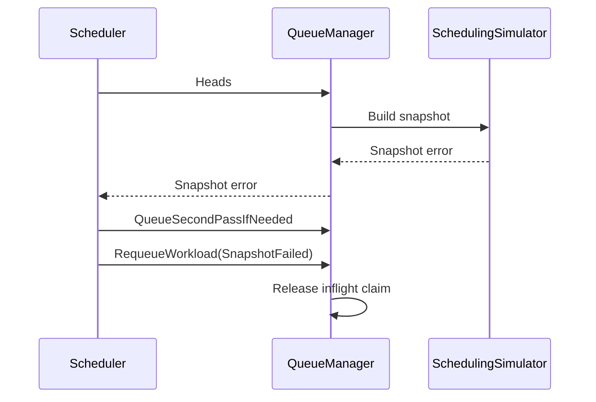

# PR #14912: queue: use cmp.Or for requeueWorkload nil fallback in manager_test.go

**Summary**: queue: use cmp.Or for requeueWorkload nil fallback in manager_test.go

**Sources**: https://github.com/kubernetes-sigs/kueue/pull/14912

**Last updated**: 2026-08-29T22:23:14Z

---

## Metadata

- **State**: closed
- **Author**: [@kavix](https://github.com/kavix)
- **Branch**: `issue-14911` → `main`
- **Created**: 2026-08-29T22:15:24Z
- **Updated**: 2026-08-29T22:23:14Z
- **Merged**: —
- **Closed**: 2026-08-29T22:17:39Z
- **Labels**: `size/L`, `release-note-none`, `kind/cleanup`, `needs-ok-to-test`, `cncf-cla: yes`, `area/testing`
- **Assignees**: _none_
- **Requested reviewers**: [@mbobrovskyi](https://github.com/mbobrovskyi), [@PBundyra](https://github.com/PBundyra)
- **Changed files**: 6   **+314 / -59**

## Description

#### What type of PR is this?

/kind cleanup
/area testing

#### What this PR does / why we need it:

Replaces the explicit nil-fallback pattern for `requeueWorkload` in `TestRequeueWorkload` with the standard-library `cmp.Or`, which expresses the same intent more directly.

Aliases `github.com/google/go-cmp/cmp` as `gocmp` to avoid a name conflict with the newly imported standard-library `cmp` package. Updates all existing `cmp.` references in the file to use the `gocmp` alias.

#### Which issue(s) this PR fixes:

Issue: https://github.com/kubernetes-sigs/kueue/issues/14911

#### Special notes for your reviewer:

This PR depends on (builds on top of) PR kubernetes-sigs/kueue#13885 which introduced the `requeueWorkload` test field. The commits from that PR are included here as prerequisites.

Requested by @tenzen-y in review discussion: https://github.com/kubernetes-sigs/kueue/pull/13885#discussion_r3884707795

AI assistance was used to implement this change.

#### Does this PR introduce a user-facing change?

```release-note
NONE
```

<!-- This is an auto-generated comment: release notes by coderabbit.ai -->

## Summary by CodeRabbit

- **Bug Fixes**
  - Prevented workloads from becoming stuck or disappearing when scheduling snapshot creation fails.
  - Improved workload requeue behavior after failures, including workloads moved, deleted, deactivated, or interrupted during processing.
  - Preserved correct queue placement and processing order across retry scenarios.
  - Improved fair-sharing behavior when queue weights change, including zero-weight cases.
- **Reliability**
  - Added safeguards and recovery coverage for first-pass and second-pass scheduling failures.

<!-- end of auto-generated comment: release notes by coderabbit.ai -->

## Discussion

### Comment by [@netlify[bot]](https://github.com/apps/netlify) — 2026-08-29T22:15:31Z

### <span aria-hidden="true">✅</span> Deploy Preview for *kubernetes-sigs-kueue* ready!


|  Name | Link |
|:-:|------------------------|
|<span aria-hidden="true">🔨</span> Latest commit | 95965cf5716ea8e58685bcea60d2c3be2421efba |
|<span aria-hidden="true">🔍</span> Latest deploy log | https://app.netlify.com/projects/kubernetes-sigs-kueue/deploys/6a935a00aeb1200008063be1 |
|<span aria-hidden="true">😎</span> Deploy Preview | [https://deploy-preview-14912--kubernetes-sigs-kueue.netlify.app](https://deploy-preview-14912--kubernetes-sigs-kueue.netlify.app) |
|<span aria-hidden="true">📱</span> Preview on mobile | <details><summary> Toggle QR Code... </summary><br /><br /><br /><br />_Use your smartphone camera to open QR code link._</details> |
---
<!-- [kubernetes-sigs-kueue Preview](https://deploy-preview-14912--kubernetes-sigs-kueue.netlify.app) -->
_To edit notification comments on pull requests, go to your [Netlify project configuration](https://app.netlify.com/projects/kubernetes-sigs-kueue/configuration/notifications#deploy-notifications)._

### Comment by [@kubernetes-prow[bot]](https://github.com/apps/kubernetes-prow) — 2026-08-29T22:15:36Z

Hi @kavix. Thanks for your PR.

I'm waiting for a [kubernetes-sigs](https://github.com/orgs/kubernetes-sigs/people) member to verify that this patch is reasonable to test. If it is, they should reply with `/ok-to-test` on its own line. Until that is done, I will not automatically test new commits in this PR, but the usual testing commands by org members will still work.

>[!TIP]
>**We noticed you've done this a few times! Consider [joining the org](https://git.k8s.io/community/community-membership.md#member) to skip this step and gain `/lgtm` and other bot rights.** We recommend asking approvers on your previous PRs to sponsor you.

Once the patch is verified, the new status will be reflected by the `ok-to-test` label.

I understand the commands that are listed [here](https://go.k8s.io/bot-commands?repo=kubernetes-sigs%2Fkueue).

<details>

Instructions for interacting with me using PR comments are available [here](https://git.k8s.io/community/contributors/guide/pull-requests.md).  If you have questions or suggestions related to my behavior, please file an issue against the [kubernetes-sigs/prow](https://github.com/kubernetes-sigs/prow/issues/new?title=Prow%20issue:) repository.
</details>

### Comment by [@kubernetes-prow[bot]](https://github.com/apps/kubernetes-prow) — 2026-08-29T22:15:38Z

[APPROVALNOTIFIER] This PR is **NOT APPROVED**

This pull-request has been approved by: *<a href="https://github.com/kubernetes-sigs/kueue/pull/14912#" title="Author self-approved">kavix</a>*
**Once this PR has been reviewed and has the lgtm label**, please assign [sohankunkerkar](https://github.com/sohankunkerkar) for approval. For more information see [the Code Review Process](https://git.k8s.io/community/contributors/guide/owners.md#the-code-review-process).

The full list of commands accepted by this bot can be found [here](https://go.k8s.io/bot-commands?repo=kubernetes-sigs%2Fkueue).

<details open>
Needs approval from an approver in each of these files:

- **[OWNERS](https://github.com/kubernetes-sigs/kueue/blob/main/OWNERS)**

Approvers can indicate their approval by writing `/approve` in a comment
Approvers can cancel approval by writing `/approve cancel` in a comment
</details>
<!-- META={"approvers":["sohankunkerkar"]} -->

### Comment by [@coderabbitai[bot]](https://github.com/apps/coderabbitai) — 2026-08-29T22:17:01Z

<!-- This is an auto-generated comment: summarize by coderabbit.ai -->
<!-- review_stack_entry_start -->

[](https://app.coderabbit.ai/change-stack/kubernetes-sigs/kueue/pull/14912)

<!-- review_stack_entry_end -->
<!-- This is an auto-generated comment: skip review by coderabbit.ai -->

> [!IMPORTANT]
> ## Review skipped
> 
> Auto reviews are limited based on label configuration.
> 
> <details>
> <summary>:no_entry_sign: Review skipped — only excluded labels are configured. (3)</summary>
> 
> * needs-ok-to-test
> * do-not-merge/work-in-progress
> * cncf-cla: no
> 
> </details>
> 
> Please check the settings in the CodeRabbit UI or the `.coderabbit.yaml` file in this repository. To trigger a single review, invoke the `@coderabbitai review` command.
> 
> <details>
> <summary>⚙️ Run configuration</summary>
> 
> **Configuration used**: Path: .coderabbit.yaml
> 
> **Review profile**: CHILL
> 
> **Plan**: Pro Plus
> 
> **Run ID**: `2aa23b83-8956-47fa-ad2e-f5febc63f08b`
> 
> </details>
> 
> You can disable this status message by setting the `reviews.review_status` to `false` in the CodeRabbit configuration file.
> 
> Use the checkbox below for a quick retry:
> - [ ] <!-- {"checkboxId":"e9bb8d72-00e8-4f67-9cb2-caf3b22574fe"} --> 🔍 Trigger review

<!-- end of auto-generated comment: skip review by coderabbit.ai -->

<!-- recent_review_start -->

<details>
<summary>ℹ️ Recent review info</summary>

<details>
<summary>⚙️ Run configuration</summary>

**Configuration used**: Path: .coderabbit.yaml

**Review profile**: CHILL

**Plan**: Pro Plus

**Run ID**: `1ef57f4d-7a1e-46a8-909c-b0d759b0f5a1`

</details>

<details>
<summary>📥 Commits</summary>

Reviewing files that changed from the base of the PR and between 5953056de1228cee5e97c202873d3dd400cc65c1 and 95965cf5716ea8e58685bcea60d2c3be2421efba.

</details>

<details>
<summary>📒 Files selected for processing (6)</summary>

* `pkg/cache/queue/cluster_queue.go`
* `pkg/cache/queue/manager.go`
* `pkg/cache/queue/manager_test.go`
* `pkg/cache/queue/pending_workloads.go`
* `pkg/scheduler/scheduler.go`
* `pkg/scheduler/scheduler_tas_test.go`

</details>

</details>

---


<!-- recent_review_end -->
<!-- walkthrough_start -->

<details>
<summary>📝 Walkthrough</summary>

## Walkthrough

The queue manager now releases stale inflight claims during requeue. Snapshot failures now restore popped workloads, while preserving second-pass behavior. Tests cover requeue recovery, snapshot failures, and fair-sharing heap updates.

### Changes

**Snapshot failure recovery**

|Layer / File(s)|Summary|
|---|---|
|**Queue requeue and inflight cleanup** <br> `pkg/cache/queue/cluster_queue.go`, `pkg/cache/queue/manager.go`, `pkg/cache/queue/pending_workloads.go`, `pkg/cache/queue/manager_test.go`|The queue adds `RequeueReasonSnapshotFailed`, releases inflight claims before workload updates, permits temporarily untracked inflight workloads, and expands requeue and fair-sharing tests.|
|**Scheduler snapshot-error recovery** <br> `pkg/scheduler/scheduler.go`, `pkg/scheduler/scheduler_tas_test.go`|The scheduler requeues popped heads after snapshot errors, keeps eligible second-pass workloads in the second-pass path, and adds failing-simulator tests.|

**Estimated code review effort:** 3 (Moderate) | ~25 minutes

### Sequence Diagram(s)



</details>

<!-- walkthrough_end -->
<!-- finishing_touch_checkbox_start -->

<details>
<summary>✨ Finishing Touches</summary>

<details>
<summary>🧪 Generate unit tests (beta)</summary>

- [ ] <!-- {"checkboxId": "f47ac10b-58cc-4372-a567-0e02b2c3d479", "radioGroupId": "utg-output-choice-group-unknown_comment_id"} -->   Create PR with unit tests

</details>

</details>

<!-- finishing_touch_checkbox_end -->
<!-- tips_start -->

---


<sub>Comment `@coderabbitai help` to get the list of available commands.</sub>

<!-- tips_end -->

### Comment by [@kavix](https://github.com/kavix) — 2026-08-29T22:17:38Z

Closing in favour of a correctly-scoped PR. This PR accidentally included commits from the prerequisite PR kubernetes-sigs/kueue#13885. A new PR will be opened that depends on that PR directly.
