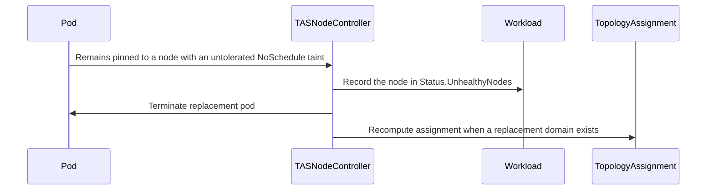

# PR #14918: TAS: record the unhealthy node before terminating pods pinned to it

**Summary**: TAS: record the unhealthy node before terminating pods pinned to it

**Sources**: https://github.com/kubernetes-sigs/kueue/pull/14918

**Last updated**: 2026-08-31T10:27:36Z

---

## Metadata

- **State**: open
- **Author**: [@varunsyal](https://github.com/varunsyal)
- **Branch**: `fix/tas-record-unhealthy-node-before-terminating-pods` → `main`
- **Created**: 2026-08-31T02:57:52Z
- **Updated**: 2026-08-31T10:27:36Z
- **Merged**: —
- **Closed**: —
- **Labels**: `kind/bug`, `release-note`, `size/L`, `do-not-merge/hold`, `ok-to-test`, `cncf-cla: yes`, `area/tas`
- **Assignees**: _none_
- **Requested reviewers**: [@PBundyra](https://github.com/PBundyra)
- **Changed files**: 3   **+306 / -0**

## Description

#### What type of PR is this?

/kind bug
/area tas

#### What this PR does / why we need it:

`checkPodsOnNode` reports a workload healthy whenever another of its pods is still progressing on the node, even when that node carries an untolerated taint and pods are pinned to it awaiting scheduling. `reconcileWorkloadsOnNode` then routes the workload through `handleHealthyNode`, which clears the node from `Status.UnhealthyNodes`. With that field empty the second pass is never asked for a replacement domain and the guard from #14099 is inert, so each recreated pod is ungated back onto the tainted node and terminated
again. #14917 has the full trace.

This PR reports the workload unhealthy in that case, so the node is recorded and the replacement path runs. The doomed pods are still terminated.

It also keeps reporting unhealthy while the node stays recorded and its taints stay untolerated, which goes a little beyond the fix suggested in the issue. Once the node is recorded, #14099's guard holds replacement pods gated, so `podsToTerminate` empties and the next reconcile would fall back to the healthy branch, clear the record, and let the ungater put the following pod straight back onto the tainted node. In an integration run without that second half, the record was written and dropped again 113ms later with the taint unchanged.

The loop needs no non-default feature gate to reproduce, and the fix applies whether `TASFailedNodeReplacementFailFast` is on or off.

#### Which issue(s) this PR fixes:

Fixes #14917

#### Special notes for your reviewer:

Tests, all verified failing without the change and passing with it:

* Two `TestNodeFailureReconciler` cases in `pkg/controller/tas/node_controller_test.go`.  Existing coverage exercised a pinned pod only on an otherwise-empty node, where `hasProgressingPods` is false and the correct branch was already taken.
* Two integration specs in `test/integration/singlecluster/tas/tas_test.go`, one for the assignment moving off the tainted node and one for the record surviving after the pinned pod is terminated. The second taints every node so no replacement domain exists, which is what makes the record's lifetime observable instead of a race against the second pass.

#### Does this PR introduce a user-facing change?

```release-note
Fixed a bug where a TAS workload with a pod still progressing on a tainted node was reported healthy, so the node was never recorded in Status.UnhealthyNodes and every recreated pod was ungated back onto that node and terminated, looping until the pod creator gave up.
```

## Discussion

### Comment by [@netlify[bot]](https://github.com/apps/netlify) — 2026-08-31T02:57:58Z

### <span aria-hidden="true">✅</span> Deploy Preview for *kubernetes-sigs-kueue* canceled.


|  Name | Link |
|:-:|------------------------|
|<span aria-hidden="true">🔨</span> Latest commit | 55f13b64bea26d42df0e264fc42e1b115121b357 |
|<span aria-hidden="true">🔍</span> Latest deploy log | https://app.netlify.com/projects/kubernetes-sigs-kueue/deploys/6a95007f4db65800082b5be6 |

### Comment by [@linux-foundation-easycla[bot]](https://github.com/apps/linux-foundation-easycla) — 2026-08-31T02:58:00Z

<a href="https://easycla.lfx.linuxfoundation.org/#/?version=2"></a><br >The committers listed above are authorized under a signed CLA.<ul><li>:white_check_mark: login: varunsyal / name: varunsyal (55f13b64bea26d42df0e264fc42e1b115121b357)</li></ul>

### Comment by [@kubernetes-prow[bot]](https://github.com/apps/kubernetes-prow) — 2026-08-31T02:58:03Z

Hi @varunsyal. Thanks for your PR.

I'm waiting for a [kubernetes-sigs](https://github.com/orgs/kubernetes-sigs/people) member to verify that this patch is reasonable to test. If it is, they should reply with `/ok-to-test` on its own line. Until that is done, I will not automatically test new commits in this PR, but the usual testing commands by org members will still work.

>[!TIP]
>**We noticed you've done this a few times! Consider [joining the org](https://git.k8s.io/community/community-membership.md#member) to skip this step and gain `/lgtm` and other bot rights.** We recommend asking approvers on your previous PRs to sponsor you.

Once the patch is verified, the new status will be reflected by the `ok-to-test` label.

I understand the commands that are listed [here](https://go.k8s.io/bot-commands?repo=kubernetes-sigs%2Fkueue).

<details>

Instructions for interacting with me using PR comments are available [here](https://git.k8s.io/community/contributors/guide/pull-requests.md).  If you have questions or suggestions related to my behavior, please file an issue against the [kubernetes-sigs/prow](https://github.com/kubernetes-sigs/prow/issues/new?title=Prow%20issue:) repository.
</details>

### Comment by [@kubernetes-prow[bot]](https://github.com/apps/kubernetes-prow) — 2026-08-31T02:58:11Z

[APPROVALNOTIFIER] This PR is **NOT APPROVED**

This pull-request has been approved by: *<a href="https://github.com/kubernetes-sigs/kueue/pull/14918#" title="Author self-approved">varunsyal</a>*
**Once this PR has been reviewed and has the lgtm label**, please assign [mimowo](https://github.com/mimowo) for approval. For more information see [the Code Review Process](https://git.k8s.io/community/contributors/guide/owners.md#the-code-review-process).

The full list of commands accepted by this bot can be found [here](https://go.k8s.io/bot-commands?repo=kubernetes-sigs%2Fkueue).

<details open>
Needs approval from an approver in each of these files:

- **[OWNERS](https://github.com/kubernetes-sigs/kueue/blob/main/OWNERS)**

Approvers can indicate their approval by writing `/approve` in a comment
Approvers can cancel approval by writing `/approve cancel` in a comment
</details>
<!-- META={"approvers":["mimowo"]} -->

### Comment by [@coderabbitai[bot]](https://github.com/apps/coderabbitai) — 2026-08-31T02:59:28Z

<!-- This is an auto-generated comment: summarize by coderabbit.ai -->
<!-- review_stack_entry_start -->

[](https://app.coderabbit.ai/change-stack/kubernetes-sigs/kueue/pull/14918)

<!-- review_stack_entry_end -->
<!-- This is an auto-generated comment: skip review by coderabbit.ai -->

> [!IMPORTANT]
> ## Review skipped
> 
> Auto reviews are limited based on label configuration.
> 
> <details>
> <summary>:no_entry_sign: Excluded labels (none allowed) (3)</summary>
> 
> * needs-ok-to-test
> * do-not-merge/work-in-progress
> * cncf-cla: no
> 
> </details>
> 
> Please check the settings in the CodeRabbit UI or the `.coderabbit.yaml` file in this repository. To trigger a single review, invoke the `@coderabbitai review` command.
> 
> <details>
> <summary>⚙️ Run configuration</summary>
> 
> **Configuration used**: Path: .coderabbit.yaml
> 
> **Review profile**: CHILL
> 
> **Plan**: Pro Plus
> 
> **Run ID**: `eb720935-ba31-4993-b33f-2fc6b4f20d91`
> 
> </details>
> 
> You can disable this status message by setting the `reviews.review_status` to `false` in the CodeRabbit configuration file.
> 
> Use the checkbox below for a quick retry:
> - [ ] <!-- {"checkboxId":"e9bb8d72-00e8-4f67-9cb2-caf3b22574fe"} --> 🔍 Trigger review

<!-- end of auto-generated comment: skip review by coderabbit.ai -->

<!-- recent_review_start -->

No actionable comments were generated in the recent review. 🎉

<details>
<summary>ℹ️ Recent review info</summary>

<details>
<summary>⚙️ Run configuration</summary>

**Configuration used**: Path: .coderabbit.yaml

**Review profile**: CHILL

**Plan**: Pro Plus

**Run ID**: `45b257bf-cac1-48a9-ace2-7ae8189548cd`

</details>

<details>
<summary>📥 Commits</summary>

Reviewing files that changed from the base of the PR and between 7fb805e04276c596b9990c609bb66929d36bcd0d and 27eb991c45ecbda73a65a0fb29fd32361ed6e606.

</details>

<details>
<summary>📒 Files selected for processing (3)</summary>

* `pkg/controller/tas/node_controller.go`
* `pkg/controller/tas/node_controller_test.go`
* `test/integration/singlecluster/tas/tas_test.go`

</details>

**Included review availability:** Your plan provides up to 8 included reviews per hour; 7 remain after this review.

</details>

---


<!-- recent_review_end -->
<!-- walkthrough_start -->

<details>
<summary>📝 Walkthrough</summary>

## Walkthrough

The TAS node controller now marks workloads unhealthy when untolerated taints affect pinned pods. It preserves unhealthy-node status during replacement handling and adds unit and integration coverage for replacement and no-replacement paths.

### Changes

**TAS tainted-node handling**

|Layer / File(s)|Summary|
|---|---|
|**Tainted-node health decision** <br> `pkg/controller/tas/node_controller.go`, `pkg/controller/tas/node_controller_test.go`|The controller records nodes with untolerated taints as unhealthy before terminating affected pods. Tests cover enabled and disabled pod termination.|
|**Replacement path validation** <br> `test/integration/singlecluster/tas/tas_test.go`|Integration tests verify assignment movement when a replacement domain exists and unhealthy-node retention when no replacement exists.|

**Estimated code review effort:** 3 (Moderate) | ~25 minutes

<!-- final_review_risk_start -->
**Merge Risk:** _⚪ Minimal_ · up to `27eb9`

This change keeps unhealthy tainted-node state recorded so replacement pods are not repeatedly returned to the failed node; no actionable merge-blocking risk remains beyond normal checks and review.
<!-- final_review_risk_end -->

### Sequence Diagram(s)



**Suggested reviewers:** `j-skiba`, `mbobrovskyi`

</details>

<!-- walkthrough_end -->
<!-- pre_merge_checks_walkthrough_start -->

<details>
<summary>🚥 Pre-merge checks | ✅ 4 | ❌ 1</summary>

### ❌ Failed checks (1 warning)

|     Check name     | Status     | Explanation                                                                                                                                                                               | Resolution                                                                         |
| :----------------: | :--------- | :---------------------------------------------------------------------------------------------------------------------------------------------------------------------------------------- | :--------------------------------------------------------------------------------- |
| Docstring Coverage | ⚠️ Warning | Docstring coverage is 0.00% which is insufficient. The required threshold is 80.00%. Docstring coverage is scoped to functions touched by this diff. Analyzed 1 functions across 3 files. | Write docstrings for the functions missing them to satisfy the coverage threshold. |

<details>
<summary>✅ Passed checks (4 passed)</summary>

|         Check name         | Status   | Explanation                                                                                                                                                                                               |
| :------------------------: | :------- | :-------------------------------------------------------------------------------------------------------------------------------------------------------------------------------------------------------- |
|     Linked Issues check    | ✅ Passed | The changes satisfy issue `#14917`. They record nodes with untolerated taints as unhealthy before terminating pinned pods, preserve the unhealthy-node record while the taint remains, enable replacement … |
| Out of Scope Changes check | ✅ Passed | All changes are directly related to issue `#14917`. The controller logic, diagnostic logging, unit tests, and integration tests support the unhealthy-node recording and replacement behavior.              |
|      Description Check     | ✅ Passed | Check skipped - CodeRabbit’s high-level summary is enabled.                                                                                                                                               |
|         Title check        | ✅ Passed | The title clearly and concisely summarizes the main change: recording the unhealthy node before terminating pods pinned to it.                                                                            |

</details>

<details>
<summary>Full details: Linked Issues check</summary>

**Explanation**

The changes satisfy issue `#14917`. They record nodes with untolerated taints as unhealthy before terminating pinned pods, preserve the unhealthy-node record while the taint remains, enable replacement handling, and add unit and integration coverage.

</details>

</details>

<!-- pre_merge_checks_walkthrough_end -->
<!-- finishing_touch_checkbox_start -->

<details>
<summary>✨ Finishing Touches 💡 1</summary>

<!-- finishing_touch_suggestion:fix_ci -->
<details open>
<summary>🛠️ Fix failing CI checks 💡</summary>

- [ ] <!-- {"checkboxId": "6d21cfe8-ec3f-40e2-9222-b8318b64d3b0", "radioGroupId": "fix-ci-output-choice-group-unknown_comment_id"} -->   Create stacked PR
- [ ] <!-- {"checkboxId": "9f0d24fb-b419-4f01-baf0-8b26b6424f34", "radioGroupId": "fix-ci-output-choice-group-unknown_comment_id"} -->   Commit on current branch

</details>
<details>
<summary>🧪 Generate unit tests (beta)</summary>

- [ ] <!-- {"checkboxId": "f47ac10b-58cc-4372-a567-0e02b2c3d479", "radioGroupId": "utg-output-choice-group-unknown_comment_id"} -->   Create PR with unit tests

</details>

</details>

<!-- finishing_touch_checkbox_end -->
<!-- tips_start -->

---


<sub>Comment `@coderabbitai help` to get the list of available commands.</sub>

<!-- tips_end -->

### Comment by [@varunsyal](https://github.com/varunsyal) — 2026-08-31T03:26:40Z

cc/ @mimowo @kshalot

### Comment by [@tenzen-y](https://github.com/tenzen-y) — 2026-08-31T04:13:33Z

@varunsyal can you resolve CLA error?

### Comment by [@tenzen-y](https://github.com/tenzen-y) — 2026-08-31T04:13:41Z

/ok-to-test

### Comment by [@varunsyal](https://github.com/varunsyal) — 2026-08-31T04:54:08Z

> @varunsyal can you resolve CLA error?

Fixed @tenzen-y

### Comment by [@mimowo](https://github.com/mimowo) — 2026-08-31T07:32:23Z

/hold
Let me first make sure we don't create the "topology drift" situation here: https://github.com/kubernetes-sigs/kueue/pull/14918#discussion_r3892511232. If that happens we may need to make this opt-in, or brainstorm another approach

## Reviews

### Review by [@tenzen-y](https://github.com/tenzen-y) (commented) — 2026-08-31T07:00:41Z

- **pkg/controller/tas/node_controller.go:491** by [@tenzen-y](https://github.com/tenzen-y) — 2026-08-31T06:51:01Z
```diff
@@ -466,18 +466,57 @@ func (r *nodeReconciler) checkPodsOnNode(
 	hasTASAssignment bool,
 	nodeSelectorAssignedPods []*corev1.Pod,
 ) (workloadHealthCheck, error) {
+	log := ctrl.LoggerFrom(ctx)
 	podsToTerminate, hasProgressingPods, err := r.getPodsToTerminate(ctx, wl, nodeName, nodeSelectorAssignedPods)
 	if err != nil {
 		return workloadHealthCheck{status: workloadHealthUnknown}, fmt.Errorf("failed to get pods to terminate for node %s: %w", nodeName, err)
 	}
 
+	// Reporting the workload healthy leaves the topology assignment pointing at this node and
+	// lets handleHealthyNode clear the node from Status.UnhealthyNodes. Doing so while pods
+	// pinned here are being terminated is the shape of the ungate/terminate loop, so record the
+	// inputs behind the decision - they identify which branch is responsible.
+	logHealthyWhileTerminating := func(reason string) {
+		if len(podsToTerminate) == 0 {
+			return
+		}
+		log.V(2).Info("Reporting workload healthy while terminating pods pinned to this node; topology assignment will not be recomputed",
+			"reason", reason,
+			"node", nodeName,
+			"workload", klog.KObj(wl),
+			"podsToTerminate", len(podsToTerminate),
+			"hasTASAssignment", hasTASAssignment,
+			"hasUntoleratedTaints", hasUntoleratedTaints,
+			"hasProgressingPods", hasProgressingPods)
+	}
```

  ```suggestion
  	logHealthyWhileTerminating := log.V(2).Info("Reporting workload healthy while terminating pods pinned to this node; topology assignment will not be recomputed",
  			"reason", reason,
  			"node", nodeName,
  			"workload", klog.KObj(wl),
  			"podsToTerminate", len(podsToTerminate),
  			"hasTASAssignment", hasTASAssignment,
  			"hasUntoleratedTaints", hasUntoleratedTaints,
  			"hasProgressingPods", hasProgressingPods)
  ```
  
  Can you avoid combining logging and the count mechanism by using a callback function?
  The callback functions can do everything that can be combined into one function, but it's not safe due to anti-separation of concerns.

- **pkg/controller/tas/node_controller.go:516** by [@tenzen-y](https://github.com/tenzen-y) — 2026-08-31T06:56:17Z
```diff
@@ -466,18 +466,57 @@ func (r *nodeReconciler) checkPodsOnNode(
 	hasTASAssignment bool,
 	nodeSelectorAssignedPods []*corev1.Pod,
 ) (workloadHealthCheck, error) {
+	log := ctrl.LoggerFrom(ctx)
 	podsToTerminate, hasProgressingPods, err := r.getPodsToTerminate(ctx, wl, nodeName, nodeSelectorAssignedPods)
 	if err != nil {
 		return workloadHealthCheck{status: workloadHealthUnknown}, fmt.Errorf("failed to get pods to terminate for node %s: %w", nodeName, err)
 	}
 
+	// Reporting the workload healthy leaves the topology assignment pointing at this node and
+	// lets handleHealthyNode clear the node from Status.UnhealthyNodes. Doing so while pods
+	// pinned here are being terminated is the shape of the ungate/terminate loop, so record the
+	// inputs behind the decision - they identify which branch is responsible.
+	logHealthyWhileTerminating := func(reason string) {
+		if len(podsToTerminate) == 0 {
+			return
+		}
+		log.V(2).Info("Reporting workload healthy while terminating pods pinned to this node; topology assignment will not be recomputed",
+			"reason", reason,
+			"node", nodeName,
+			"workload", klog.KObj(wl),
+			"podsToTerminate", len(podsToTerminate),
+			"hasTASAssignment", hasTASAssignment,
+			"hasUntoleratedTaints", hasUntoleratedTaints,
+			"hasProgressingPods", hasProgressingPods)
+	}
+
 	if !hasTASAssignment {
 		// This node is not part of the workload's topology assignment. If pods are assigned
 		// here (e.g., late pods with old node selectors), they are stray and must be terminated.
+		logHealthyWhileTerminating("node is not in the topology assignment")
 		return workloadHealthCheck{status: workloadHealthy, podsToTerminate: podsToTerminate}, nil
 	}
 
+	// A pod pinned here by the topology assignment can never schedule while the node carries
+	// an untolerated taint, and reporting the workload healthy would clear the node from
+	// Status.UnhealthyNodes and let the ungater pin the next pod to it again. Stay unhealthy
+	// once the node is recorded too: the ungater then holds replacements gated, which empties
+	// podsToTerminate and would otherwise send us down the healthy branch below.
+	if alreadyRecorded := workload.HasUnhealthyNode(wl, nodeName); hasUntoleratedTaints && (len(podsToTerminate) > 0 || alreadyRecorded) {
+		// Only on the transition: this branch is re-entered on every reconcile for as long as
+		// the taint lasts, once per workload assigned to the node.
+		if !alreadyRecorded {
+			log.V(2).Info("Recording node as unhealthy; pods pinned to it by the topology assignment cannot tolerate its taints",
+				"node", nodeName,
+				"workload", klog.KObj(wl),
+				"podsToTerminate", len(podsToTerminate),
+				"hasProgressingPods", hasProgressingPods)
+		}
+		return workloadHealthCheck{status: workloadUnhealthy, podsToTerminate: podsToTerminate}, nil
+	}
```

  IIUC, this triggers running workload eviction regardless of NoSchedule taint and toleration when no alternative node in the cluster.
  
  But NoSchedule taint should not trigger eviction, which is the principle of Kubernetes scheduling.

### Review by [@tenzen-y](https://github.com/tenzen-y) (commented) — 2026-08-31T07:08:48Z

- **pkg/controller/tas/node_controller.go:519** by [@tenzen-y](https://github.com/tenzen-y) — 2026-08-31T07:08:48Z
```diff
@@ -466,18 +466,57 @@ func (r *nodeReconciler) checkPodsOnNode(
 	hasTASAssignment bool,
 	nodeSelectorAssignedPods []*corev1.Pod,
 ) (workloadHealthCheck, error) {
+	log := ctrl.LoggerFrom(ctx)
 	podsToTerminate, hasProgressingPods, err := r.getPodsToTerminate(ctx, wl, nodeName, nodeSelectorAssignedPods)
 	if err != nil {
 		return workloadHealthCheck{status: workloadHealthUnknown}, fmt.Errorf("failed to get pods to terminate for node %s: %w", nodeName, err)
 	}
 
+	// Reporting the workload healthy leaves the topology assignment pointing at this node and
+	// lets handleHealthyNode clear the node from Status.UnhealthyNodes. Doing so while pods
+	// pinned here are being terminated is the shape of the ungate/terminate loop, so record the
+	// inputs behind the decision - they identify which branch is responsible.
+	logHealthyWhileTerminating := func(reason string) {
+		if len(podsToTerminate) == 0 {
+			return
+		}
+		log.V(2).Info("Reporting workload healthy while terminating pods pinned to this node; topology assignment will not be recomputed",
+			"reason", reason,
+			"node", nodeName,
+			"workload", klog.KObj(wl),
+			"podsToTerminate", len(podsToTerminate),
+			"hasTASAssignment", hasTASAssignment,
+			"hasUntoleratedTaints", hasUntoleratedTaints,
+			"hasProgressingPods", hasProgressingPods)
+	}
+
 	if !hasTASAssignment {
 		// This node is not part of the workload's topology assignment. If pods are assigned
 		// here (e.g., late pods with old node selectors), they are stray and must be terminated.
+		logHealthyWhileTerminating("node is not in the topology assignment")
 		return workloadHealthCheck{status: workloadHealthy, podsToTerminate: podsToTerminate}, nil
 	}
 
+	// A pod pinned here by the topology assignment can never schedule while the node carries
+	// an untolerated taint, and reporting the workload healthy would clear the node from
+	// Status.UnhealthyNodes and let the ungater pin the next pod to it again. Stay unhealthy
+	// once the node is recorded too: the ungater then holds replacements gated, which empties
+	// podsToTerminate and would otherwise send us down the healthy branch below.
+	if alreadyRecorded := workload.HasUnhealthyNode(wl, nodeName); hasUntoleratedTaints && (len(podsToTerminate) > 0 || alreadyRecorded) {
+		// Only on the transition: this branch is re-entered on every reconcile for as long as
+		// the taint lasts, once per workload assigned to the node.
+		if !alreadyRecorded {
+			log.V(2).Info("Recording node as unhealthy; pods pinned to it by the topology assignment cannot tolerate its taints",
+				"node", nodeName,
+				"workload", klog.KObj(wl),
+				"podsToTerminate", len(podsToTerminate),
+				"hasProgressingPods", hasProgressingPods)
+		}
+		return workloadHealthCheck{status: workloadUnhealthy, podsToTerminate: podsToTerminate}, nil
+	}
+
 	if hasProgressingPods && (!hasUntoleratedTaints || features.Enabled(features.TASReplaceNodeOnPodTermination)) {
+		logHealthyWhileTerminating("pods of this workload are still progressing on the node")
```

  ```suggestion
  		if hasUntoleratedTaints {
  			return workloadHealthCheck{status: workloadHealthy}, nil
  		}
  		logHealthyWhileTerminating("pods of this workload are still progressing on the node")
  ```
  
  Alternatively, I would recommend not returning `podsToTerminate` which allows us not to trigger eviction.
  I guess that this can mitigate your reported issue since Pending Pods will remain Pending instead of failing loop.

### Review by [@mimowo](https://github.com/mimowo) (commented) — 2026-08-31T07:30:27Z

- **test/integration/singlecluster/tas/tas_test.go:3285** by [@mimowo](https://github.com/mimowo) — 2026-08-31T07:30:27Z
```diff
@@ -3275,6 +3275,227 @@ var _ = ginkgo.Describe("Topology Aware Scheduling", ginkgo.Ordered, func() {
 				})
 			})
 
+			// A pod pinned to a node by the TopologyAssignment can never be scheduled while that
+			// node carries a taint the workload does not tolerate. checkPodsOnNode used to report
+			// the workload healthy in that situation whenever another pod of the same workload was
+			// still progressing on the node, which cleared the node from Status.UnhealthyNodes while
+			// still terminating the pinned pod. With that field empty neither the second pass nor
+			// the topology ungater's unhealthy-node guard can engage, so every recreated pod is
+			// ungated onto the same node and terminated again.
+			ginkgo.It("should replace the assigned node when it is tainted while a pod is pinned to it and another pod is still progressing", framework.SlowSpec, func() {
```

  I'm concerned if this could expose us to the topology drift - situation when the old node is still occupied by a progressing node, but the topologyAssignment is moved to the new node. This would be problematic because the capacity coming from the progressing pod (bound to the old node) would no longer be accounted by TAS.
  
  Such topology drift has been a source of bugs in the past. It is particularly problematic for serving workloads, say LWS, because then the drift stays for indefinite amount of time.

### Review by [@mimowo](https://github.com/mimowo) (commented) — 2026-08-31T07:31:10Z

- **test/integration/singlecluster/tas/tas_test.go:3284** by [@mimowo](https://github.com/mimowo) — 2026-08-31T07:31:10Z
```diff
@@ -3275,6 +3275,227 @@ var _ = ginkgo.Describe("Topology Aware Scheduling", ginkgo.Ordered, func() {
 				})
 			})
 
+			// A pod pinned to a node by the TopologyAssignment can never be scheduled while that
+			// node carries a taint the workload does not tolerate. checkPodsOnNode used to report
+			// the workload healthy in that situation whenever another pod of the same workload was
+			// still progressing on the node, which cleared the node from Status.UnhealthyNodes while
+			// still terminating the pinned pod. With that field empty neither the second pass nor
+			// the topology ungater's unhealthy-node guard can engage, so every recreated pod is
+			// ungated onto the same node and terminated again.
```

  Why is the replacement pod guaranteed to fail, but not the progressing Pod?

### Review by [@varunsyal](https://github.com/varunsyal) (commented) — 2026-08-31T09:18:34Z

- **test/integration/singlecluster/tas/tas_test.go:3285** by [@varunsyal](https://github.com/varunsyal) — 2026-08-31T09:18:34Z
```diff
@@ -3275,6 +3275,227 @@ var _ = ginkgo.Describe("Topology Aware Scheduling", ginkgo.Ordered, func() {
 				})
 			})
 
+			// A pod pinned to a node by the TopologyAssignment can never be scheduled while that
+			// node carries a taint the workload does not tolerate. checkPodsOnNode used to report
+			// the workload healthy in that situation whenever another pod of the same workload was
+			// still progressing on the node, which cleared the node from Status.UnhealthyNodes while
+			// still terminating the pinned pod. With that field empty neither the second pass nor
+			// the topology ungater's unhealthy-node guard can engage, so every recreated pod is
+			// ungated onto the same node and terminated again.
+			ginkgo.It("should replace the assigned node when it is tainted while a pod is pinned to it and another pod is still progressing", framework.SlowSpec, func() {
```

  This makes sense. My assumption was that only the terminated pod's replacement will find a new TAS placement, and the progressing pod still stays accounted. However, that may not be the case. 
  
  In that case, I'll defer to you for any different solution proposal. Some ideas top of my head (still new to this code path, so these may not make sense. Happy to hear about anything different) :
  1. try to do partial replacement and merging the topology assignments - valid for unconstrained topology
  2. evict and replace any pods of the workload running on this node to new node
  3. do not trigger termination, and let the workload wait for recoveryTimeout (@tenzen-y's suggestion)

### Review by [@varunsyal](https://github.com/varunsyal) (commented) — 2026-08-31T09:26:51Z

- **pkg/controller/tas/node_controller.go:516** by [@varunsyal](https://github.com/varunsyal) — 2026-08-31T09:26:50Z
```diff
@@ -466,18 +466,57 @@ func (r *nodeReconciler) checkPodsOnNode(
 	hasTASAssignment bool,
 	nodeSelectorAssignedPods []*corev1.Pod,
 ) (workloadHealthCheck, error) {
+	log := ctrl.LoggerFrom(ctx)
 	podsToTerminate, hasProgressingPods, err := r.getPodsToTerminate(ctx, wl, nodeName, nodeSelectorAssignedPods)
 	if err != nil {
 		return workloadHealthCheck{status: workloadHealthUnknown}, fmt.Errorf("failed to get pods to terminate for node %s: %w", nodeName, err)
 	}
 
+	// Reporting the workload healthy leaves the topology assignment pointing at this node and
+	// lets handleHealthyNode clear the node from Status.UnhealthyNodes. Doing so while pods
+	// pinned here are being terminated is the shape of the ungate/terminate loop, so record the
+	// inputs behind the decision - they identify which branch is responsible.
+	logHealthyWhileTerminating := func(reason string) {
+		if len(podsToTerminate) == 0 {
+			return
+		}
+		log.V(2).Info("Reporting workload healthy while terminating pods pinned to this node; topology assignment will not be recomputed",
+			"reason", reason,
+			"node", nodeName,
+			"workload", klog.KObj(wl),
+			"podsToTerminate", len(podsToTerminate),
+			"hasTASAssignment", hasTASAssignment,
+			"hasUntoleratedTaints", hasUntoleratedTaints,
+			"hasProgressingPods", hasProgressingPods)
+	}
+
 	if !hasTASAssignment {
 		// This node is not part of the workload's topology assignment. If pods are assigned
 		// here (e.g., late pods with old node selectors), they are stray and must be terminated.
+		logHealthyWhileTerminating("node is not in the topology assignment")
 		return workloadHealthCheck{status: workloadHealthy, podsToTerminate: podsToTerminate}, nil
 	}
 
+	// A pod pinned here by the topology assignment can never schedule while the node carries
+	// an untolerated taint, and reporting the workload healthy would clear the node from
+	// Status.UnhealthyNodes and let the ungater pin the next pod to it again. Stay unhealthy
+	// once the node is recorded too: the ungater then holds replacements gated, which empties
+	// podsToTerminate and would otherwise send us down the healthy branch below.
+	if alreadyRecorded := workload.HasUnhealthyNode(wl, nodeName); hasUntoleratedTaints && (len(podsToTerminate) > 0 || alreadyRecorded) {
+		// Only on the transition: this branch is re-entered on every reconcile for as long as
+		// the taint lasts, once per workload assigned to the node.
+		if !alreadyRecorded {
+			log.V(2).Info("Recording node as unhealthy; pods pinned to it by the topology assignment cannot tolerate its taints",
+				"node", nodeName,
+				"workload", klog.KObj(wl),
+				"podsToTerminate", len(podsToTerminate),
+				"hasProgressingPods", hasProgressingPods)
+		}
+		return workloadHealthCheck{status: workloadUnhealthy, podsToTerminate: podsToTerminate}, nil
+	}
```

  Sorry, I did not understand this. Triggering eviction is not the intention here. 
  Here the workload already has a pod that cannot run. The sequence is: node got tainted -> one of the 2+ running pods of the workload on this node fail or get terminated -> replacement pod is created for this pod. 
  Now we want this replacement pod to find an untainted node, but the assignment never changes here, and thus the replacement pod gets ungated to the same node, and thus the pod remains un-schedulable.

### Review by [@mimowo](https://github.com/mimowo) (commented) — 2026-08-31T09:39:52Z

- **test/integration/singlecluster/tas/tas_test.go:3285** by [@mimowo](https://github.com/mimowo) — 2026-08-31T09:39:52Z
```diff
@@ -3275,6 +3275,227 @@ var _ = ginkgo.Describe("Topology Aware Scheduling", ginkgo.Ordered, func() {
 				})
 			})
 
+			// A pod pinned to a node by the TopologyAssignment can never be scheduled while that
+			// node carries a taint the workload does not tolerate. checkPodsOnNode used to report
+			// the workload healthy in that situation whenever another pod of the same workload was
+			// still progressing on the node, which cleared the node from Status.UnhealthyNodes while
+			// still terminating the pinned pod. With that field empty neither the second pass nor
+			// the topology ungater's unhealthy-node guard can engage, so every recreated pod is
+			// ungated onto the same node and terminated again.
+			ginkgo.It("should replace the assigned node when it is tainted while a pod is pinned to it and another pod is still progressing", framework.SlowSpec, func() {
```

  > try to do partial replacement and merging the topology assignments - valid for unconstrained topology
  
   IIUC the topologyAssignment for the node "x" will be split. It will still reserve some quota for the old pod, while moving quota to the new node. 
   
  This sounds complex, but reasonable. I guess I would need to see an extended design / prototype to evaluate that. 
  
  > evict and replace any pods of the workload running on this node to new node
  
  That is reasonable too, but Kueue deleting pods is pretty aggressive, so it would need to be opt-in. Either by annotation or some global configuration.
  
  > do not trigger termination, and let the workload wait for recoveryTimeout (@tenzen-y's suggestion)
  
  IIUC this means no changes in Kueue  code? TBH if this situation is a rare outlier for you, then `recoveryTimeout` is exactly designed for such catch-all cases. I would recommend setting `recoveryTimeout` timeout small, like 3min.

### Review by [@varunsyal](https://github.com/varunsyal) (commented) — 2026-08-31T10:08:40Z

- **test/integration/singlecluster/tas/tas_test.go:3285** by [@varunsyal](https://github.com/varunsyal) — 2026-08-31T10:08:39Z
```diff
@@ -3275,6 +3275,227 @@ var _ = ginkgo.Describe("Topology Aware Scheduling", ginkgo.Ordered, func() {
 				})
 			})
 
+			// A pod pinned to a node by the TopologyAssignment can never be scheduled while that
+			// node carries a taint the workload does not tolerate. checkPodsOnNode used to report
+			// the workload healthy in that situation whenever another pod of the same workload was
+			// still progressing on the node, which cleared the node from Status.UnhealthyNodes while
+			// still terminating the pinned pod. With that field empty neither the second pass nor
+			// the topology ungater's unhealthy-node guard can engage, so every recreated pod is
+			// ungated onto the same node and terminated again.
+			ginkgo.It("should replace the assigned node when it is tainted while a pod is pinned to it and another pod is still progressing", framework.SlowSpec, func() {
```

  I believe the 3rd option will still need a small change: https://github.com/kubernetes-sigs/kueue/pull/14918/changes#r3892389885

### Review by [@mimowo](https://github.com/mimowo) (commented) — 2026-08-31T10:27:36Z

- **test/integration/singlecluster/tas/tas_test.go:3285** by [@mimowo](https://github.com/mimowo) — 2026-08-31T10:27:36Z
```diff
@@ -3275,6 +3275,227 @@ var _ = ginkgo.Describe("Topology Aware Scheduling", ginkgo.Ordered, func() {
 				})
 			})
 
+			// A pod pinned to a node by the TopologyAssignment can never be scheduled while that
+			// node carries a taint the workload does not tolerate. checkPodsOnNode used to report
+			// the workload healthy in that situation whenever another pod of the same workload was
+			// still progressing on the node, which cleared the node from Status.UnhealthyNodes while
+			// still terminating the pinned pod. With that field empty neither the second pass nor
+			// the topology ungater's unhealthy-node guard can engage, so every recreated pod is
+			// ungated onto the same node and terminated again.
+			ginkgo.It("should replace the assigned node when it is tainted while a pod is pinned to it and another pod is still progressing", framework.SlowSpec, func() {
```

  Yes, I think so, this sounds reasonable. The only potential concern is if we can still evict quickly in this case if two nodes are affected - because this is our current rule.
  
  Also, a temporary mitigation the pod-creating controller (outside of Kueue) could create them with exponential backoff (standard k8s Job behavior), so that the create-terminate-recreate-terminate is not a hot loop.
