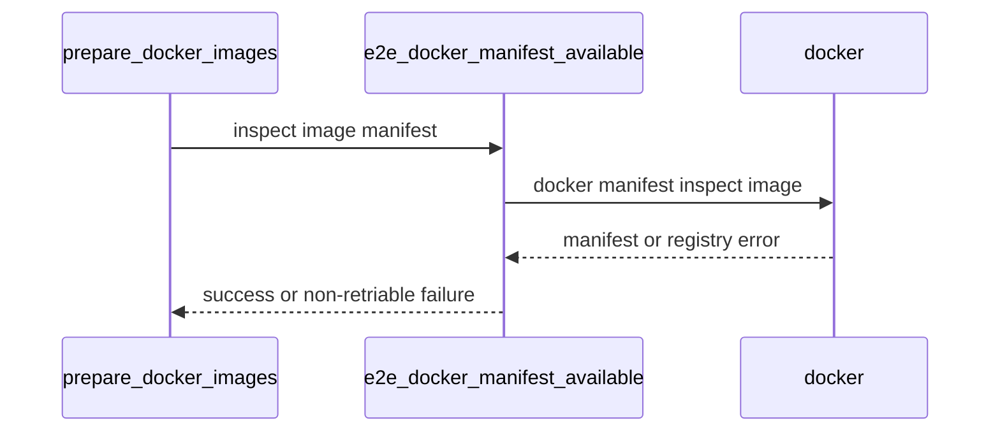

# PR #14946: Retry transient docker manifest inspect failures in e2e prepare_docker_images

**Summary**: Retry transient docker manifest inspect failures in e2e prepare_docker_images

**Sources**: https://github.com/kubernetes-sigs/kueue/pull/14946

**Last updated**: 2026-08-31T17:29:39Z

---

## Metadata

- **State**: closed (merged)
- **Author**: [@ivnovakov](https://github.com/ivnovakov)
- **Branch**: `fix/retry-e2e-manifest-inspect` → `main`
- **Created**: 2026-08-31T16:36:14Z
- **Updated**: 2026-08-31T17:29:39Z
- **Merged**: 2026-08-31T17:18:14Z
- **Closed**: 2026-08-31T17:18:14Z
- **Labels**: `lgtm`, `kind/flake`, `release-note-none`, `approved`, `size/M`, `cncf-cla: yes`
- **Assignees**: [@mimowo](https://github.com/mimowo)
- **Requested reviewers**: [@mbobrovskyi](https://github.com/mbobrovskyi), [@sohankunkerkar](https://github.com/sohankunkerkar)
- **Changed files**: 2   **+70 / -7**

## Description

<!--  Thanks for sending a pull request!  Here are some tips for you:

1. If this is your first time, please read our contributor guidelines: https://git.k8s.io/community/contributors/guide/first-contribution.md#your-first-contribution and developer guide https://git.k8s.io/community/contributors/devel/development.md#development-guide
2. Please label this pull request according to what type of issue you are addressing, especially if this is a release targeted pull request. For reference on required PR/issue labels, read here:
https://git.k8s.io/community/contributors/devel/sig-release/release.md#issuepr-kind-label
3. Ensure you have added or ran the appropriate tests for your PR: https://git.k8s.io/community/contributors/devel/sig-testing/testing.md
4. If you want *faster* PR reviews, read how: https://git.k8s.io/community/contributors/guide/pull-requests.md#best-practices-for-faster-reviews
5. If the PR is unfinished, see how to mark it: https://git.k8s.io/community/contributors/guide/pull-requests.md#marking-unfinished-pull-requests
-->

#### What type of PR is this?

<!--
Add one of the following kinds:
/kind bug
/kind cleanup
/kind documentation
/kind feature
/kind kep

Optionally add one or more of the following kinds if applicable:
/kind api-change
/kind deprecation
/kind failing-test
/kind flake
/kind regression

Please also consider setting the area:
/area tas
/area was
/area integrations
/area multikueue
/area dashboard
/area localization
/area testing
/area website
-->

/kind flake

#### What this PR does / why we need it:
`prepare_docker_images` probes the registry with a single unretried `docker manifest inspect` at both of its call sites, checking `$IMAGE_TAG` and the KubeRay image. That single attempt has no retry, so a transient registry or TLS failure looks identical to a genuinely missing manifest. `prepare_docker_images` then falls back to a local image if one is cached, or fails outright, without ever giving the probe a chance to succeed on retry the way `docker pull` already does.

Both call sites now go through `e2e_docker_manifest_available`, which wraps the probe in `retry.sh` the same way `e2e_docker_pull_if_needed` already wraps the pull, reusing the same non-retriable-error classification so a genuinely missing manifest still fails fast.

#### Which issue(s) this PR fixes:
<!--
*Automatically closes linked issue when PR is merged.
Usage: `Fixes #<issue number>`, or `Fixes (paste link of issue)`.
_If PR is about `failing-tests or flakes`, please post the related issues/tests in a comment and do not use `Fixes`_*
-->
Fixes #14834
Fixes #14924

#### Special notes for your reviewer:
- Follow-up to the review comment on #14823 (https://github.com/kubernetes-sigs/kueue/pull/14823#discussion_r3865644147), which asked for the same retry treatment already given to the pull in that PR.
- `hack/testing/e2e-common_test.sh` now stubs `docker manifest inspect` and asserts a transient TLS handshake timeout is retried until it succeeds, and a genuinely missing manifest fails fast without retrying.
- This PR was written in part with the assistance of generative AI.

#### Does this PR introduce a user-facing change?
<!--
If no, just write "NONE" in the release-note block below.
If yes, a release note is required:
Enter your extended release note in the block below. If the PR requires additional action from users switching to the new release, include the string "action required".
-->
```release-note
NONE
```

<!-- This is an auto-generated comment: release notes by coderabbit.ai -->
## Summary by CodeRabbit

* **Bug Fixes**
  * Improved end-to-end test reliability when checking Docker image manifests by retrying transient registry or network failures.
  * Fails quickly for permanent issues such as missing images, unauthorized access, or unavailable repositories.
  * Docker image preparation now handles temporary registry errors more consistently.
<!-- end of auto-generated comment: release notes by coderabbit.ai -->

## Discussion

### Comment by [@netlify[bot]](https://github.com/apps/netlify) — 2026-08-31T16:36:21Z

### <span aria-hidden="true">✅</span> Deploy Preview for *kubernetes-sigs-kueue* canceled.


|  Name | Link |
|:-:|------------------------|
|<span aria-hidden="true">🔨</span> Latest commit | 7c09154a0db2c828a36e2cb8af82bd74dc2cef6f |
|<span aria-hidden="true">🔍</span> Latest deploy log | https://app.netlify.com/projects/kubernetes-sigs-kueue/deploys/6a95afca6ead3d0007e96581 |

### Comment by [@coderabbitai[bot]](https://github.com/apps/coderabbitai) — 2026-08-31T16:37:53Z

<!-- This is an auto-generated comment: summarize by coderabbit.ai -->
<!-- review_stack_entry_start -->

[](https://app.coderabbit.ai/change-stack/kubernetes-sigs/kueue/pull/14946)

<!-- review_stack_entry_end -->
<!-- recent_review_start -->

No actionable comments were generated in the recent review. 🎉

<details>
<summary>ℹ️ Recent review info</summary>

<details>
<summary>⚙️ Run configuration</summary>

**Configuration used**: Path: .coderabbit.yaml

**Review profile**: CHILL

**Plan**: Pro Plus

**Run ID**: `bcd4e645-652a-4643-94b8-0e82e008e8ce`

</details>

<details>
<summary>📥 Commits</summary>

Reviewing files that changed from the base of the PR and between 5e35cf5d3c035895537b12f5ce4e83f8a1cd6930 and 7c09154a0db2c828a36e2cb8af82bd74dc2cef6f.

</details>

<details>
<summary>📒 Files selected for processing (1)</summary>

* `hack/testing/e2e-common.sh`

</details>

**Included review availability:** Your plan provides up to 8 included reviews per hour; 6 remain after this review.

</details>

---


<!-- recent_review_end -->
<!-- walkthrough_start -->

<details>
<summary>📝 Walkthrough</summary>

## Walkthrough

The E2E image preparation scripts retry transient `docker manifest inspect` failures, stop on known non-retriable errors, and use the shared helper for both image probes. Tests cover retry and fail-fast behavior.

### Changes

**Docker manifest retry flow**

|Layer / File(s)|Summary|
|---|---|
|**Shared retry helper and image preparation wiring** <br> `hack/testing/e2e-common.sh`|A shared non-retriable error pattern supports image pulls and the new `e2e_docker_manifest_available` helper. Both manifest probe paths use the helper.|
|**Manifest retry test coverage** <br> `hack/testing/e2e-common_test.sh`|The fake Docker command simulates transient and missing-manifest errors. Tests verify retry counts and fail-fast behavior.|

**Estimated code review effort:** 3 (Moderate) | ~20 minutes

<!-- final_review_risk_start -->
**Merge Risk:** _⚪ Minimal_ · up to `7c091`

The change retries transient Docker manifest inspection failures while preserving fast failure for missing manifests, improving e2e preparation reliability without introducing an actionable merge-blocking risk; it is merge-ready after normal checks and review.
<!-- final_review_risk_end -->

**Suggested reviewers:** `mbobrovskyi`, `sohankunkerkar`, `apullo777`

### Sequence Diagram(s)



</details>

<!-- walkthrough_end -->
<!-- pre_merge_checks_walkthrough_start -->

<details>
<summary>🚥 Pre-merge checks | ✅ 4 | ❌ 1</summary>

### ❌ Failed checks (1 warning)

|     Check name     | Status     | Explanation                                                                                                                                                                                | Resolution                                                                         |
| :----------------: | :--------- | :----------------------------------------------------------------------------------------------------------------------------------------------------------------------------------------- | :--------------------------------------------------------------------------------- |
| Docstring Coverage | ⚠️ Warning | Docstring coverage is 40.00% which is insufficient. The required threshold is 80.00%. Docstring coverage is scoped to functions touched by this diff. Analyzed 5 functions across 2 files. | Write docstrings for the functions missing them to satisfy the coverage threshold. |

<details>
<summary>✅ Passed checks (4 passed)</summary>

|         Check name         | Status   | Explanation                                                                                                                                                                                               |
| :------------------------: | :------- | :-------------------------------------------------------------------------------------------------------------------------------------------------------------------------------------------------------- |
|     Linked Issues check    | ✅ Passed | The changes satisfy issue `#14834`. They add a shared retry helper, reuse the non-retriable error classification, update both manifest probe paths, and add tests for retryable TLS failures and non-retry… |
| Out of Scope Changes check | ✅ Passed | The changes are limited to the E2E Docker manifest retry helper, its integration at both required call sites, and focused tests. No unrelated changes are identified.                                     |
|      Description Check     | ✅ Passed | Check skipped - CodeRabbit’s high-level summary is enabled.                                                                                                                                               |
|         Title check        | ✅ Passed | The title clearly and concisely describes the main change: retrying transient Docker manifest inspection failures during E2E image preparation.                                                           |

</details>

<details>
<summary>Full details: Linked Issues check</summary>

**Explanation**

The changes satisfy issue `#14834`. They add a shared retry helper, reuse the non-retriable error classification, update both manifest probe paths, and add tests for retryable TLS failures and non-retryable missing manifests.

</details>

</details>

<!-- pre_merge_checks_walkthrough_end -->

- [ ] <!-- {"checkboxId":"585bb3f6-faf5-4dbf-96d2-74e382adf19a"} --> Fix all pre-merge checks with AI
<!-- finishing_touch_checkbox_start -->

<details>
<summary>✨ Finishing Touches</summary>

<details>
<summary>🧪 Generate unit tests (beta)</summary>

- [ ] <!-- {"checkboxId": "f47ac10b-58cc-4372-a567-0e02b2c3d479", "radioGroupId": "utg-output-choice-group-unknown_comment_id"} -->   Create PR with unit tests

</details>

</details>

<!-- finishing_touch_checkbox_end -->
<!-- tips_start -->

---


<sub>Comment `@coderabbitai help` to get the list of available commands.</sub>

<!-- tips_end -->

### Comment by [@kubernetes-prow[bot]](https://github.com/apps/kubernetes-prow) — 2026-08-31T16:49:08Z

LGTM label has been added.  <details>Git tree hash: aab6e969d425809d03f859d9e4ab87db300110be</details>

### Comment by [@mimowo](https://github.com/mimowo) — 2026-08-31T17:16:27Z

/approve
/cherrypick release-0.19
/cherrypick release-0.18

### Comment by [@k8s-infra-cherrypick-robot](https://github.com/k8s-infra-cherrypick-robot) — 2026-08-31T17:16:30Z

@mimowo: once the present PR merges, I will cherry-pick it on top of `release-0.18`, `release-0.19` in new PRs and assign them to you.

<details>

In response to [this](https://github.com/kubernetes-sigs/kueue/pull/14946#issuecomment-5481862679):

>/approve
>/cherrypick release-0.19
>/cherrypick release-0.18


Instructions for interacting with me using PR comments are available [here](https://git.k8s.io/community/contributors/guide/pull-requests.md).  If you have questions or suggestions related to my behavior, please file an issue against the [kubernetes-sigs/prow](https://github.com/kubernetes-sigs/prow/issues/new?title=Prow%20issue:) repository.
</details>

### Comment by [@kubernetes-prow[bot]](https://github.com/apps/kubernetes-prow) — 2026-08-31T17:16:45Z

[APPROVALNOTIFIER] This PR is **APPROVED**

This pull-request has been approved by: *<a href="https://github.com/kubernetes-sigs/kueue/pull/14946#" title="Author self-approved">ivnovakov</a>*, *<a href="https://github.com/kubernetes-sigs/kueue/pull/14946#issuecomment-5481862679" title="Approved">mimowo</a>*

The full list of commands accepted by this bot can be found [here](https://go.k8s.io/bot-commands?repo=kubernetes-sigs%2Fkueue).

The pull request process is described [here](https://git.k8s.io/community/contributors/guide/owners.md#the-code-review-process)

<details >
Needs approval from an approver in each of these files:

- ~~[hack/testing/OWNERS](https://github.com/kubernetes-sigs/kueue/blob/main/hack/testing/OWNERS)~~ [mimowo]

Approvers can indicate their approval by writing `/approve` in a comment
Approvers can cancel approval by writing `/approve cancel` in a comment
</details>
<!-- META={"approvers":[]} -->

### Comment by [@k8s-infra-cherrypick-robot](https://github.com/k8s-infra-cherrypick-robot) — 2026-08-31T17:18:58Z

@mimowo: new pull request created: #14947

<details>

In response to [this](https://github.com/kubernetes-sigs/kueue/pull/14946#issuecomment-5481862679):

>/approve
>/cherrypick release-0.19
>/cherrypick release-0.18


Instructions for interacting with me using PR comments are available [here](https://git.k8s.io/community/contributors/guide/pull-requests.md).  If you have questions or suggestions related to my behavior, please file an issue against the [kubernetes-sigs/prow](https://github.com/kubernetes-sigs/prow/issues/new?title=Prow%20issue:) repository.
</details>

### Comment by [@k8s-infra-cherrypick-robot](https://github.com/k8s-infra-cherrypick-robot) — 2026-08-31T17:19:37Z

@mimowo: new pull request created: #14948

<details>

In response to [this](https://github.com/kubernetes-sigs/kueue/pull/14946#issuecomment-5481862679):

>/approve
>/cherrypick release-0.19
>/cherrypick release-0.18


Instructions for interacting with me using PR comments are available [here](https://git.k8s.io/community/contributors/guide/pull-requests.md).  If you have questions or suggestions related to my behavior, please file an issue against the [kubernetes-sigs/prow](https://github.com/kubernetes-sigs/prow/issues/new?title=Prow%20issue:) repository.
</details>

## Reviews

### Review by [@mimowo](https://github.com/mimowo) (commented) — 2026-08-31T16:40:15Z

- **hack/testing/e2e-common.sh:99** by [@mimowo](https://github.com/mimowo) — 2026-08-31T16:40:16Z
```diff
@@ -91,14 +96,25 @@ function e2e_docker_pull_if_needed {
         return 0
     fi
 
-    local non_retriable_errors="manifest (unknown|for .* not found)|repository does not exist|not found|pull access denied|unauthorized|denied: requested access|no space left on device"
+    local non_retriable_errors="${E2E_NON_RETRIABLE_IMAGE_ERRORS}|no space left on device"
```

  Should we also move "no space left on device" into E2E_NON_RETRIABLE_IMAGE_ERRORS? 
  It would make less code, and also it seems more correct

### Review by [@ivnovakov](https://github.com/ivnovakov) (commented) — 2026-08-31T16:47:01Z

- **hack/testing/e2e-common.sh:99** by [@ivnovakov](https://github.com/ivnovakov) — 2026-08-31T16:47:01Z
```diff
@@ -91,14 +96,25 @@ function e2e_docker_pull_if_needed {
         return 0
     fi
 
-    local non_retriable_errors="manifest (unknown|for .* not found)|repository does not exist|not found|pull access denied|unauthorized|denied: requested access|no space left on device"
+    local non_retriable_errors="${E2E_NON_RETRIABLE_IMAGE_ERRORS}|no space left on device"
```

  Agree, updated the code.

### Review by [@mimowo](https://github.com/mimowo) (commented) — 2026-08-31T16:49:00Z

/lgtm
Thank you 👍
