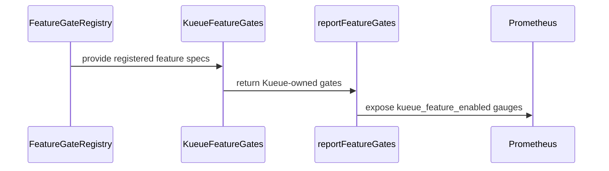

# PR #15001: Add kueue_feature_enabled metric

**Summary**: Add kueue_feature_enabled metric

**Sources**: https://github.com/kubernetes-sigs/kueue/pull/15001

**Last updated**: 2026-11-16T05:32:44Z

---

## Metadata

- **State**: open
- **Author**: [@Viswalahiri](https://github.com/Viswalahiri)
- **Branch**: `fix-14991-feature-gate-enablement-metric` → `main`
- **Created**: 2026-09-02T00:08:35Z
- **Updated**: 2026-11-16T05:32:44Z
- **Merged**: —
- **Closed**: —
- **Labels**: `kind/feature`, `release-note`, `size/L`, `cncf-cla: no`, `ok-to-test`, `area/website`
- **Assignees**: [@kannon92](https://github.com/kannon92), [@mimowo](https://github.com/mimowo), [@sohankunkerkar](https://github.com/sohankunkerkar), [@tenzen-y](https://github.com/tenzen-y)
- **Requested reviewers**: [@kannon92](https://github.com/kannon92), [@mimowo](https://github.com/mimowo), [@sohankunkerkar](https://github.com/sohankunkerkar), [@kshalot](https://github.com/kshalot), [@tenzen-y](https://github.com/tenzen-y)
- **Changed files**: 7   **+209 / -4**

## Description

<!--  Thanks for sending a pull request!  Here are some tips for you:

1. If this is your first time, please read our contributor guidelines: https://git.k8s.io/community/contributors/guide/first-contribution.md#your-first-contribution and developer guide https://git.k8s.io/community/contributors/devel/development.md#development-guide
2. Please label this pull request according to what type of issue you are addressing, especially if this is a release targeted pull request. For reference on required PR/issue labels, read here:
https://git.k8s.io/community/contributors/devel/sig-release/release.md#issuepr-kind-label
3. Ensure you have added or ran the appropriate tests for your PR: https://git.k8s.io/community/contributors/devel/sig-testing/testing.md
4. If you want *faster* PR reviews, read how: https://git.k8s.io/community/contributors/guide/pull-requests.md#best-practices-for-faster-reviews
5. If the PR is unfinished, see how to mark it: https://git.k8s.io/community/contributors/guide/pull-requests.md#marking-unfinished-pull-requests
-->

#### What type of PR is this?
/kind feature
/area website
<!--
Add one of the following kinds:
/kind bug
/kind cleanup
/kind documentation
/kind feature
/kind kep

Optionally add one or more of the following kinds if applicable:
/kind api-change
/kind deprecation
/kind failing-test
/kind flake
/kind regression

Please also consider setting the area:
/area tas
/area was
/area integrations
/area multikueue
/area dashboard
/area localization
/area testing
/area website
-->

#### What this PR does / why we need it:
The manager already logs its gate settings at startup, but a log line is not something one can query or alert on. Checking a live deployment otherwise meant reading the ConfigMap, reading the --feature-gates argument, and working out the defaults by hand for anything neither of them set.

Export one gauge per gate instead, modeled on kubernetes_feature_enabled from component-base: 1 when the gate is enabled, 0 when it is disabled, labeled by name and stage. Disabled gates report 0 rather than being skipped. A gate with no series at all  would imply the binary does not declare that gate, which is a different thing from the gate being off.

Register() seeds the gauge, after the flag and the config file have been merged. Gates cannot change after startup, so one snapshot is enough.

#### Which issue(s) this PR fixes:
<!--
*Automatically closes linked issue when PR is merged.
Usage: `Fixes #<issue number>`, or `Fixes (paste link of issue)`.
_If PR is about `failing-tests or flakes`, please post the related issues/tests in a comment and do not use `Fixes`_*
-->
Fixes #14991 

#### Special notes for your reviewer:

#### Does this PR introduce a user-facing change?
<!--
If no, just write "NONE" in the release-note block below.
If yes, a release note is required:
Enter your extended release note in the block below. If the PR requires additional action from users switching to the new release, include the string "action required".
-->
```release-note
Added the `kueue_feature_enabled` metric, which reports whether each Kueue feature gate is enabled (`1`) or disabled (`0`), labeled by gate `name` and `stage`.
```
______
Disclosure : Some of the tests I created were made with the assistance from AI. Also I used AI to scope out parts of the documentation that needed changes. 

<!-- This is an auto-generated comment: release notes by coderabbit.ai -->
<!-- coderabbit-ai-generated:v1 -->

## AI summary

This PR adds the `kueue_feature_enabled` gauge. It reports the state of each Kueue feature gate.

- Each series has a `name` label (the gate name) and a `stage` label (`ALPHA`, `BETA`, `DEPRECATED`, or empty for generally available gates).
- The value is `1` when the gate is enabled and `0` when it is disabled. Disabled gates are reported, not omitted.
- `Register()` seeds the gauge after feature-gate flags and configuration are merged. The gauge is reset before each snapshot and is not tracked for queue or role cleanup.
- `pkg/features/kube_features.go` adds `KueueFeatureGates()`. It returns the resolved specs for gates declared by Kueue. `LogFeatureGates` uses this list.
- Unit tests check that the metric reports all Kueue gates with the correct values. They exclude the `AllAlpha` and `AllBeta` meta gates. A test also checks that `Register` exposes the expected series.
- The Prometheus e2e test queries `kueue_feature_enabled`. It checks the metric name, stage values, and `0`/`1` values. It requires at least one enabled and one disabled gate.
- The installation guide adds a section named "Check which feature gates are enabled". It includes PromQL examples. It states that the metric is per replica and that gate values change only after controller-manager pods restart.
- The generated metrics reference lists `kueue_feature_enabled`.

This change addresses the operator visibility request in `#14991`. It does not add feature-specific behavior for `DisableWaitForPodsReady`.

### Suggested release note

```release-note
Observability: Added the `kueue_feature_enabled` gauge metric. It reports each Kueue feature gate as `1` when enabled or `0` when disabled. The `name` label identifies the gate, and the `stage` label reports its maturity stage.
```
<!-- end of auto-generated comment: release notes by coderabbit.ai -->

## Discussion

### Comment by [@netlify[bot]](https://github.com/apps/netlify) — 2026-09-02T00:08:41Z

### <span aria-hidden="true">👷</span> Deploy request for *kubernetes-sigs-kueue* pending review.
[Visit the deploys page to approve it](https://app.netlify.com/projects/kubernetes-sigs-kueue/deploys)

|  Name | Link |
|:-:|------------------------|
|<span aria-hidden="true">🔨</span> Latest commit | c718e875bd93fca41f5cd49a4cd463cc637397e6 |

### Comment by [@linux-foundation-easycla[bot]](https://github.com/apps/linux-foundation-easycla) — 2026-09-02T00:08:44Z

<a href="https://api.easycla.lfx.linuxfoundation.org/v2/repository-provider/github/sign/20677499/459870310/15001/#/?version=2"></a><br/><br ><ul><li>:white_check_mark: login: Viswalahiri / name: Viswalahiri Hejeebu (9de4009b6d70f7588edaaddac0e6b2351b252f77)</li><li>:white_check_mark: login: sohankunkerkar / name: Sohan Kunkerkar (293046e0aaf073e8dd3ff70588a6e182d4e9f97a, 2c68b235403a32ff8f77c35cd7c3786da66959ce)</li><li> :x: The email address for the commit (c718e875bd93fca41f5cd49a4cd463cc637397e6, 293046e0aaf073e8dd3ff70588a6e182d4e9f97a, 2c68b235403a32ff8f77c35cd7c3786da66959ce) is not linked to the GitHub account, preventing the EasyCLA check. Consult <a href='https://linuxfoundation.atlassian.net/wiki/spaces/LP/pages/160923756/Missing+ID+on+Commit+but+I+have+an+agreement+on+file' target='_blank'>this Help Article</a> and <a href='https://help.github.com/en/github/committing-changes-to-your-project/why-are-my-commits-linked-to-the-wrong-user' target='_blank'>GitHub Help</a> to resolve. (To view the commit's email address, add .patch at the end of this PR page's URL.) For further assistance with EasyCLA, <a href='https://easycla.lfx.linuxfoundation.org/' target='_blank'>please visit our EasyCLA portal</a> and chat with our support bot.</li></ul>

### Comment by [@kubernetes-prow[bot]](https://github.com/apps/kubernetes-prow) — 2026-09-02T00:08:47Z

Hi @Viswalahiri. Thanks for your PR.

I'm waiting for a [kubernetes-sigs](https://github.com/orgs/kubernetes-sigs/people) member to verify that this patch is reasonable to test. If it is, they should reply with `/ok-to-test` on its own line. Until that is done, I will not automatically test new commits in this PR, but the usual testing commands by org members will still work.

>[!TIP]
>**We noticed you've done this a few times! Consider [joining the org](https://git.k8s.io/community/community-membership.md#member) to skip this step and gain `/lgtm` and other bot rights.** We recommend asking approvers on your previous PRs to sponsor you.

Once the patch is verified, the new status will be reflected by the `ok-to-test` label.

I understand the commands that are listed [here](https://go.k8s.io/bot-commands?repo=kubernetes-sigs%2Fkueue).

<details>

Instructions for interacting with me using PR comments are available [here](https://git.k8s.io/community/contributors/guide/pull-requests.md).  If you have questions or suggestions related to my behavior, please file an issue against the [kubernetes-sigs/prow](https://github.com/kubernetes-sigs/prow/issues/new?title=Prow%20issue:) repository.
</details>

### Comment by [@coderabbitai[bot]](https://github.com/apps/coderabbitai) — 2026-09-02T00:10:18Z

<!-- coderabbit-ai-generated:v1 -->

<!-- This is an auto-generated comment: summarize by coderabbit.ai -->
<!-- review_stack_entry_start -->

<a href="https://app.coderabbit.ai/change-stack/kubernetes-sigs/kueue/pull/15001?scope=ghh_OusAJGA4HG8ljoOV0wJvVx8NmnZIjc2DdjmxOu0xZWA&amp;cs_source=review_comment"><picture><source media="(prefers-color-scheme: dark)" srcset="https://storage.googleapis.com/coderabbit_public_assets/review-stack-buttons-v1/explain-change-dark.svg"><source media="(prefers-color-scheme: light)" srcset="https://storage.googleapis.com/coderabbit_public_assets/review-stack-buttons-v1/explain-change.svg"></picture></a>

<!-- review_stack_entry_end -->
<!-- recent_review_status_start -->

No actionable comments were generated in the recent review.

<!-- recent_review_status_end -->
<!-- walkthrough_start -->

<details>
<summary><strong>Walkthrough</strong></summary>
<dl>
<dd>
<br>

Kueue now exposes each Kueue-owned feature gate through the `kueue_feature_enabled` metric. The metric reports each gate’s enabled state and maturity stage. Unit tests, end-to-end tests, and documentation cover the metric.

**Changes: Feature gate observability**

|Layer / File(s)|Summary|
|:---|:---|
|**Kueue feature-gate inventory** <br> `pkg/features/kube_features.go`, `pkg/features/kube_features_test.go`|Adds `KueueFeatureGates()` and updates `LogFeatureGates` to use it. Tests verify the gate set and the `PartialAdmission` maturity stage.|
|**Feature-gate metric reporting** <br> `pkg/metrics/metrics.go`, `pkg/metrics/metrics_test.go`|Registers `kueue_feature_enabled` and reports each Kueue gate as a 0/1 gauge with a `stage` label. Tests cover enabled and disabled gates, exclude meta gates, and verify the series count.|
|**Metric documentation and end-to-end validation** <br> `site/content/en/docs/getting-started/installation.md`, `site/content/en/docs/reference/metrics.md`, `test/e2e/singlecluster/baseline/prometheus_test.go`|Documents metric labels and PromQL queries. The end-to-end test checks gate names, stages, and values.|

<!-- change_assessment_start -->
**Estimated code review effort:** 3 (Moderate) | ~20 minutes

<!-- change_assessment_commit:"c718e875bd93fca41f5cd49a4cd463cc637397e6" -->
<!-- change_assessment_priority:{"version":1,"urgency":"p2","manual":false} -->
**Change:** Feature
<!-- change_assessment_end -->

**Suggested reviewers:** `mbobrovskyi`

### Sequence Diagram(s)



</dd>
</dl>
</details>

<!-- walkthrough_end -->
<details>
<summary><strong>Merge Risk:</strong> <strong><picture></picture> Minimal</strong> · up to <code>c718e</code></summary>
<dl>
<dd>
<br>

<!-- final_review_risk_start -->
<!-- final_review_risk_label
**Merge Risk:** **⚪ Minimal** · up to `c718e`
-->
<!-- final_review_risk_coverage:{"sourceCommitId":"c718e875bd93fca41f5cd49a4cd463cc637397e6","coveredCommitId":"c718e875bd93fca41f5cd49a4cd463cc637397e6","kind":"reviewed"} -->

This adds an observability metric showing which Kueue feature gates are enabled. It does not change scheduling or admission behavior. No concrete merge-blocking risk was identified. The EasyCLA status needs to be resolved before merge.
<!-- final_review_risk_end -->

</dd>
</dl>
</details>
<!-- pre_merge_checks_walkthrough_start -->

<details>
<summary><strong>Pre-merge checks: <sup><picture></picture></sup> 4</strong></summary>
<dl>
<dd>
<br>

|         Check name         |                                             Status                                             | Explanation                                                                                                                                                                                                     |
| :------------------------ | :--------------------------------------------------------------------------------------------: | :-------------------------------------------------------------------------------------------------------------------------------------------------------------------------------------------------------------- |
|      Description Check     |  | Check skipped - CodeRabbit’s high-level summary is enabled.                                                                                                                                                     |
|         Title check        |  | The title "Add kueue_feature_enabled metric" matches the main change. The changeset adds a process-level kueue_feature_enabled gauge, seeds it in Register, documents it, and tests it. The title names …       |
|     Linked Issues check    |  | Linked issue `#14991` is the only direct target. Its acceptance criteria are: (1) operators can observe enabled or disabled state of feature gates, (2) the mechanism covers all gates consistently withou…       |
| Out of Scope Changes check |  | All changes connect to `#14991` and the PR objective:<br>- pkg/metrics/metrics.go: new gauge, seeding in Register(), and reportFeatureGates(). Directly implements the feature.<br>- pkg/features/kube_features.… |

<details>
<summary><strong>Full details: Title check</strong></summary>
<dl>
<dd>
<br>

**Explanation**

The title "Add kueue_feature_enabled metric" matches the main change. The changeset adds a process-level kueue_feature_enabled gauge, seeds it in Register, documents it, and tests it. The title names the metric but does not mention the supporting KueueFeatureGates helper or the docs, which is expected for a short title.

</dd>
</dl>
</details>

<details>
<summary><strong>Full details: Linked Issues check</strong></summary>
<dl>
<dd>
<br>

**Explanation**

Linked issue `#14991` is the only direct target. Its acceptance criteria are: (1) operators can observe enabled or disabled state of feature gates, (2) the mechanism covers all gates consistently without special-casing DisableWaitForPodsReady, (3) metrics docs and tests describe and validate the behavior.

Criterion 1 and 2: pkg/metrics/metrics.go adds the featureEnabled gauge (kueue_feature_enabled, labels name and stage). reportFeatureGates() iterates features.KueueFeatureGates() and sets 1 when features.Enabled(f) is true and 0 otherwise. No gate is skipped or treated specially, so DisableWaitForPodsReady is not special-cased. Register() calls reportFeatureGates() after flags and config are merged, which matches the issue's need for the resolved state.

Criterion 3: The PR summary reports updates to site/content/en/docs/getting-started/installation.md and docs/reference/metrics.md. It also reports unit tests in pkg/features/kube_features_test.go and pkg/metrics/metrics_test.go, and an e2e check in test/e2e/singlecluster/baseline/prometheus_test.go. I read the metrics.go and kube_features.go diffs directly. I did not read the test or doc hunks, so their content rests on the summary.

No concrete unmet coding requirement was found.

</dd>
</dl>
</details>

<details>
<summary><strong>Full details: Out of Scope Changes check</strong></summary>
<dl>
<dd>
<br>

**Explanation**

All changes connect to `#14991` and the PR objective:
- pkg/metrics/metrics.go: new gauge, seeding in Register(), and reportFeatureGates(). Directly implements the feature.
- pkg/features/kube_features.go: KueueFeatureGates() extracts the filtered gate list. LogFeatureGates() now uses it. This supports the gauge and keeps the log path on the same gate set. Behavior of LogFeatureGates is unchanged apart from the refactor.
- Tests (kube_features_test.go, metrics_test.go, prometheus_test.go): validate the new metric and gate list.
- Docs (installation.md, metrics.md): document the required metric, as the issue requests.

No unrelated change was identified. The change set does not add DisableWaitForPodsReady-specific admission behavior.

</dd>
</dl>
</details>

</dd>
</dl>
</details>

<!-- pre_merge_checks_walkthrough_end -->
<!-- finishing_touch_checkbox_start -->

<details>
<summary><strong>Finishing Touches</strong></summary>
<dl>
<dd>
<br>

<details open>
<summary><strong>Generate unit tests (beta)</strong></summary>
<dl>
<dd>
<br>

- [ ] <!-- {"checkboxId": "f47ac10b-58cc-4372-a567-0e02b2c3d479", "radioGroupId": "utg-output-choice-group-unknown_comment_id"} --> Create a new PR

</dd>
</dl>
</details>

</dd>
</dl>
</details>

<!-- finishing_touch_checkbox_end -->

<!-- autopilot:start -->
- [ ] <!-- {"checkboxId":"2708ad07-9f24-4260-9c11-7dc76a49f2e3"} --> <strong title="Keep fixing CodeRabbit findings and required CI, and resolving merge conflicts">Autofix</strong> · Keep fixing CodeRabbit findings and required CI, and resolving merge conflicts
<!-- autopilot:end -->
<!-- recent_review_start -->

<h6>
<details>
<summary><strong><picture></picture> Recent review info</strong></summary>
<dl>
<dd>
<br>

<!-- review_info_content -->
<details>
<summary><strong><picture><source media="(prefers-color-scheme: dark)" srcset="https://storage.googleapis.com/coderabbit_public_assets/review-comment-icons-v1/cog-dark.svg"></picture> Run configuration</strong></summary>
<dl>
<dd>
<br>

- **Source mode**: Auto
- **Repository**: [kubernetes-sigs/kueue](<https://github.com/kubernetes-sigs/kueue>)
- **Branch**: [main](<https://github.com/kubernetes-sigs/kueue/tree/main>)
- **File**: [.coderabbit.yaml](<https://github.com/kubernetes-sigs/kueue/blob/31a8411e3c701b140baebf82ba3dbcdd1ee98cc6/.coderabbit.yaml>)
- **Commit**: [31a8411](<https://github.com/kubernetes-sigs/kueue/commit/31a8411e3c701b140baebf82ba3dbcdd1ee98cc6>)
- **Layers**: Repository YAML
- **Review profile**: CHILL
- **Plan**: Advanced
- **Run ID**: `7d1cbbae-a9b6-477c-909e-bb6cd514f89a`

</dd>
</dl>
</details>

<details>
<summary><strong><picture><source media="(prefers-color-scheme: dark)" srcset="https://storage.googleapis.com/coderabbit_public_assets/review-comment-icons-v1/git-commit-horizontal-dark.svg"></picture> Commits</strong></summary>
<dl>
<dd>
<br>

Reviewing files that changed from the base of the PR and between bfa43d499dc0fbf4e7aa9a3f665ba9d5f9073dea and c718e875bd93fca41f5cd49a4cd463cc637397e6.

</dd>
</dl>
</details>

<details>
<summary><strong><picture><source media="(prefers-color-scheme: dark)" srcset="https://storage.googleapis.com/coderabbit_public_assets/review-comment-icons-v1/file-plus-corner-dark.svg"></picture> Files selected for processing: 7</strong></summary>
<dl>
<dd>
<br>

* `pkg/features/kube_features.go`
* `pkg/features/kube_features_test.go`
* `pkg/metrics/metrics.go`
* `pkg/metrics/metrics_test.go`
* `site/content/en/docs/getting-started/installation.md`
* `site/content/en/docs/reference/metrics.md`
* `test/e2e/singlecluster/baseline/prometheus_test.go`

</dd>
</dl>
</details>

<details>
<summary><strong><picture><source media="(prefers-color-scheme: dark)" srcset="https://storage.googleapis.com/coderabbit_public_assets/review-comment-icons-v1/file-similar-dark.svg"></picture> Files skipped from review as they are similar to previous changes: 1</strong></summary>
<dl>
<dd>
<br>

* site/content/en/docs/getting-started/installation.md

</dd>
</dl>
</details>

**Included review availability:** This review used your included allowance. Your plan provides up to 8 included reviews per hour; 7 remain after this review.

</dd>
</dl>
</details>
</h6>

<!-- recent_review_end -->

### Comment by [@kannon92](https://github.com/kannon92) — 2026-09-02T00:33:51Z

/ok-to-test

### Comment by [@kubernetes-prow[bot]](https://github.com/apps/kubernetes-prow) — 2026-09-02T17:33:20Z

LGTM label has been added.  <details>Git tree hash: f37793b9b4ad741f4671ee48452b7a994967e01f</details>

### Comment by [@Viswalahiri](https://github.com/Viswalahiri) — 2026-09-04T22:59:07Z

@mimowo , @tenzen-y , @sohankunkerkar can either of you pls take a look and approve, @kannon92 has lgtm'ed. Thx

### Comment by [@kubernetes-prow[bot]](https://github.com/apps/kubernetes-prow) — 2026-09-07T05:13:21Z

New changes are detected. LGTM label has been removed.

### Comment by [@kubernetes-prow[bot]](https://github.com/apps/kubernetes-prow) — 2026-09-07T05:13:27Z

[APPROVALNOTIFIER] This PR is **NOT APPROVED**

This pull-request has been approved by: *<a href="https://github.com/kubernetes-sigs/kueue/pull/15001#" title="Author self-approved">Viswalahiri</a>*
**Once this PR has been reviewed and has the lgtm label**, please ask for approval from [mimowo](https://github.com/mimowo). For more information see [the Code Review Process](https://git.k8s.io/community/contributors/guide/owners.md#the-code-review-process).

The full list of commands accepted by this bot can be found [here](https://go.k8s.io/bot-commands?repo=kubernetes-sigs%2Fkueue).

<details open>
Needs approval from an approver in each of these files:

- **[OWNERS](https://github.com/kubernetes-sigs/kueue/blob/main/OWNERS)**

Approvers can indicate their approval by writing `/approve` in a comment
Approvers can cancel approval by writing `/approve cancel` in a comment
</details>
<!-- META={"approvers":["mimowo"]} -->

### Comment by [@coderabbitai[bot]](https://github.com/apps/coderabbitai) — 2026-09-07T05:13:28Z

<!-- This is an auto-generated comment by CodeRabbit -->
<!-- coderabbit-full-review-fallback-pr-15001-head-975151233aef9d0f9314884bb27aa6552c722208 -->
> [!NOTE]
> GitHub couldn't provide a complete incremental comparison for this pull request, so CodeRabbit is performing a full review instead. This review may take a little longer.

### Comment by [@Viswalahiri](https://github.com/Viswalahiri) — 2026-09-07T06:53:48Z

thanks @sohankunkerkar, i was able to integrate your feedback into the pr and accepted the suggestions you made as commits. this should be good now.

### Comment by [@kannon92](https://github.com/kannon92) — 2026-10-15T03:25:02Z

@Viswalahiri 
can you rebase?

### Comment by [@k8s-triage-robot](https://github.com/k8s-triage-robot) — 2026-11-14T04:07:50Z

The Kubernetes project currently lacks enough active contributors to adequately respond to all PRs.

This bot triages PRs according to the following rules:
- After 30d of inactivity, `lifecycle/stale` is applied
- After 30d of inactivity since `lifecycle/stale` was applied, `lifecycle/rotten` is applied
- After 30d of inactivity since `lifecycle/rotten` was applied, the PR is closed

You can:
- Mark this PR as fresh with `/remove-lifecycle stale`
- Close this PR with `/close`
- Offer to help out with [Issue Triage][1]

Please send feedback to us at [Kueue](https://github.com/kubernetes-sigs/kueue/tree/main#community-discussion-contribution-and-support).

/lifecycle stale

[1]: https://www.kubernetes.dev/docs/guide/issue-triage/

### Comment by [@YevheniiOrlovEngineering](https://github.com/YevheniiOrlovEngineering) — 2026-11-15T23:09:10Z

Hi @Viswalahiri, are you still planning to work on this? If you're busy with other things, I'd be glad to take it over: keep your commits, rebase on main and get the checks green. If you'd like to continue yourself, no problem at all.

cc @kannon92

/remove-lifecycle stale

### Comment by [@Viswalahiri](https://github.com/Viswalahiri) — 2026-11-16T04:47:40Z

@YevheniiOrlovEngineering yes I'll take this forward, thank you.

### Comment by [@Viswalahiri](https://github.com/Viswalahiri) — 2026-11-16T05:23:58Z

@kannon92 , @sohankunkerkar I have rebased my MR. Can you PTAL and approve?

cc @mimowo

### Comment by [@kubernetes-prow[bot]](https://github.com/apps/kubernetes-prow) — 2026-11-16T05:32:43Z

@Viswalahiri: The following test **failed**, say `/retest` to rerun all failed tests or `/retest-required` to rerun all mandatory failed tests:

Test name | Commit | Details | Required | Rerun command
--- | --- | --- | --- | ---
pull-kueue-verify-website-links-preview-main | c718e875bd93fca41f5cd49a4cd463cc637397e6 | [link](https://prow.k8s.io/view/gs/kubernetes-ci-logs/pr-logs/pull/kubernetes-sigs_kueue/15001/pull-kueue-verify-website-links-preview-main/2122198452191367168) | false | `/test pull-kueue-verify-website-links-preview-main`

[Full PR test history](https://prow.k8s.io/pr-history?org=kubernetes-sigs&repo=kueue&pr=15001). [Your PR dashboard](https://prow.k8s.io/pr?query=is%3Apr%20state%3Aopen%20author%3AViswalahiri). Please help us cut down on flakes by [linking to](https://git.k8s.io/community/contributors/devel/sig-testing/flaky-tests.md#filing-issues-for-flaky-tests) an [open issue](https://github.com/kubernetes-sigs/kueue/issues?q=is:issue+is:open) when you hit one in your PR.

<details>

Instructions for interacting with me using PR comments are available [here](https://git.k8s.io/community/contributors/guide/pull-requests.md).  If you have questions or suggestions related to my behavior, please file an issue against the [kubernetes-sigs/prow](https://github.com/kubernetes-sigs/prow/issues/new?title=Prow%20issue:) repository. I understand the commands that are listed [here](https://go.k8s.io/bot-commands).
</details>
<!-- test report -->

## Reviews

### Review by [@kannon92](https://github.com/kannon92) (commented) — 2026-09-02T17:33:10Z

/lgtm

/assign @sohankunkerkar @tenzen-y @mimowo

### Review by [@sohankunkerkar](https://github.com/sohankunkerkar) (commented) — 2026-09-05T22:22:02Z

- **pkg/metrics/metrics_test.go:730** by [@sohankunkerkar](https://github.com/sohankunkerkar) — 2026-09-05T22:22:03Z
```diff
@@ -684,3 +685,52 @@ func TestWorkloadRecoveryWaitTimeMetrics(t *testing.T) {
 	ClearLocalQueueMetrics(lqRef)
 	expectFilteredMetricsCount(t, LocalQueueWorkloadRecoveryWaitTime, 0, "name", "lq-recovery-test", "namespace", "default")
 }
+
+func TestReportFeatureGates(t *testing.T) {
+	// Gates are process-wide, so restore the snapshot the other tests may observe.
+	t.Cleanup(reportFeatureGates)
+
+	features.SetFeatureGateDuringTest(t, features.PartialAdmission, false)
+	reportFeatureGates()
+
+	gates := features.KueueFeatureGates()
+	wantPoints := make([]metrics.MetricDataPoint, 0, len(gates))
+	for f, spec := range gates {
+		value := 0.0
+		if features.Enabled(f) {
+			value = 1.0
+		}
+		wantPoints = append(wantPoints, metrics.MetricDataPoint{
+			Labels: map[string]string{"name": string(f), "stage": string(spec.PreRelease)},
+			Value:  value,
+		})
+	}
+
+	gotPoints := metrics.CollectFilteredGaugeVec(featureEnabled, nil)
+	sortDataPoints := cmpopts.SortSlices(func(a, b metrics.MetricDataPoint) bool { return a.Less(&b) })
+	if diff := cmp.Diff(wantPoints, gotPoints, sortDataPoints); diff != "" {
+		t.Errorf("Unexpected feature gate metrics (-want,+got):\n%s", diff)
+	}
+
+	// A disabled gate is reported as 0 rather than dropped, so that operators can
+	// tell "gate off" apart from "this Kueue is too old to know the gate".
+	disabled := metrics.CollectFilteredGaugeVec(featureEnabled, map[string]string{"name": string(features.PartialAdmission)})
+	if len(disabled) != 1 || disabled[0].Value != 0 {
+		t.Errorf("Disabled gate %q: got %v, want exactly one data point with value 0", features.PartialAdmission, disabled)
+	}
+
+	// The meta gates the apiserver libraries register are not Kueue's to report.
+	expectFilteredMetricsCount(t, featureEnabled, 0, "name", "AllAlpha")
+	expectFilteredMetricsCount(t, featureEnabled, 0, "name", "AllBeta")
+}
+
+func TestFeatureEnabledMetricName(t *testing.T) {
+	// `kueue_feature_enabled` deliberately mirrors upstream `kubernetes_feature_enabled`,
+	// the name operators already grep for; renaming it silently breaks their queries.
+	reportFeatureGates()
```

  nit: If someone deletes the `reportFeatureGates()` call in `Register()`, every unit test still passes. I tried it. Going through Register() here catches it.
  ```suggestion
  	featureEnabled.Reset()
  	Register()
  ```
  The Reset() is needed, otherwise the values `TestReportFeatureGates` leaves behind hide the failure.

### Review by [@sohankunkerkar](https://github.com/sohankunkerkar) (commented) — 2026-09-05T22:25:08Z

- **pkg/metrics/metrics.go:87** by [@sohankunkerkar](https://github.com/sohankunkerkar) — 2026-09-05T22:25:08Z
```diff
@@ -78,6 +78,28 @@ const (
 var (
 	CQStatuses = []ClusterQueueStatus{CQStatusPending, CQStatusActive, CQStatusTerminating}
 
+	// Metrics tied to the Kueue process
+
+	// Unlike the metrics below, this one is built here rather than in InitMetricVectors:
+	// it carries no custom labels, and a re-initialization would swap the registered
+	// vector for an empty one that nothing re-seeds. It is likewise not passed through
+	// trackGaugeVec, because feature gates describe the process, not a queue, so the
+	// values must survive a leader-election role change.
```

  ```suggestion
  	// Unlike the metrics below, this one is built here rather than in InitMetricVectors:
      // init() calls InitMetricVectors before the feature gates are parsed, so seeding it
     // there would record the compile-time defaults instead of the running configuration.
     // It is likewise not passed through trackGaugeVec, because feature gates describe the
     // process, not a queue, so the values must survive a leader-election role change.
  ```
