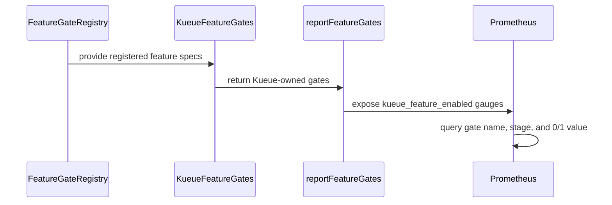

# PR #15001: Add kueue_feature_enabled metric

**Summary**: Add kueue_feature_enabled metric

**Sources**: https://github.com/kubernetes-sigs/kueue/pull/15001

**Last updated**: 2026-09-23T23:23:49Z

---

## Metadata

- **State**: open
- **Author**: [@Viswalahiri](https://github.com/Viswalahiri)
- **Branch**: `fix-14991-feature-gate-enablement-metric` → `main`
- **Created**: 2026-09-02T00:08:35Z
- **Updated**: 2026-09-23T23:23:49Z
- **Merged**: —
- **Closed**: —
- **Labels**: `kind/feature`, `release-note`, `size/L`, `needs-rebase`, `ok-to-test`, `cncf-cla: yes`, `area/website`
- **Assignees**: [@kannon92](https://github.com/kannon92), [@mimowo](https://github.com/mimowo), [@sohankunkerkar](https://github.com/sohankunkerkar), [@tenzen-y](https://github.com/tenzen-y)
- **Requested reviewers**: [@kannon92](https://github.com/kannon92), [@mimowo](https://github.com/mimowo), [@sohankunkerkar](https://github.com/sohankunkerkar), [@kshalot](https://github.com/kshalot), [@tenzen-y](https://github.com/tenzen-y)
- **Changed files**: 7   **+200 / -4**

## Description

<!--  Thanks for sending a pull request!  Here are some tips for you:

1. If this is your first time, please read our contributor guidelines: https://git.k8s.io/community/contributors/guide/first-contribution.md#your-first-contribution and developer guide https://git.k8s.io/community/contributors/devel/development.md#development-guide
2. Please label this pull request according to what type of issue you are addressing, especially if this is a release targeted pull request. For reference on required PR/issue labels, read here:
https://git.k8s.io/community/contributors/devel/sig-release/release.md#issuepr-kind-label
3. Ensure you have added or ran the appropriate tests for your PR: https://git.k8s.io/community/contributors/devel/sig-testing/testing.md
4. If you want *faster* PR reviews, read how: https://git.k8s.io/community/contributors/guide/pull-requests.md#best-practices-for-faster-reviews
5. If the PR is unfinished, see how to mark it: https://git.k8s.io/community/contributors/guide/pull-requests.md#marking-unfinished-pull-requests
-->

#### What type of PR is this?
/kind feature
/area website
<!--
Add one of the following kinds:
/kind bug
/kind cleanup
/kind documentation
/kind feature
/kind kep

Optionally add one or more of the following kinds if applicable:
/kind api-change
/kind deprecation
/kind failing-test
/kind flake
/kind regression

Please also consider setting the area:
/area tas
/area was
/area integrations
/area multikueue
/area dashboard
/area localization
/area testing
/area website
-->

#### What this PR does / why we need it:
The manager already logs its gate settings at startup, but a log line is not something one can query or alert on. Checking a live deployment otherwise meant reading the ConfigMap, reading the --feature-gates argument, and working out the defaults by hand for anything neither of them set.

Export one gauge per gate instead, modeled on kubernetes_feature_enabled from component-base: 1 when the gate is enabled, 0 when it is disabled, labeled by name and stage. Disabled gates report 0 rather than being skipped. A gate with no series at all  would imply the binary does not declare that gate, which is a different thing from the gate being off.

Register() seeds the gauge, after the flag and the config file have been merged. Gates cannot change after startup, so one snapshot is enough.

#### Which issue(s) this PR fixes:
<!--
*Automatically closes linked issue when PR is merged.
Usage: `Fixes #<issue number>`, or `Fixes (paste link of issue)`.
_If PR is about `failing-tests or flakes`, please post the related issues/tests in a comment and do not use `Fixes`_*
-->
Fixes #14991 

#### Special notes for your reviewer:

#### Does this PR introduce a user-facing change?
<!--
If no, just write "NONE" in the release-note block below.
If yes, a release note is required:
Enter your extended release note in the block below. If the PR requires additional action from users switching to the new release, include the string "action required".
-->
```release-note
Added the `kueue_feature_enabled` metric, which reports whether each Kueue feature gate is enabled (`1`) or disabled (`0`), labeled by gate `name` and `stage`.
```
______
Disclosure : Some of the tests I created were made with the assistance from AI. Also I used AI to scope out parts of the documentation that needed changes. 

<!-- This is an auto-generated comment: release notes by coderabbit.ai -->
## Summary by CodeRabbit

## New Features
- Added the `kueue_feature_enabled` Prometheus metric to report each feature gate’s enabled or disabled state and maturity stage.
- Added per-replica visibility to help identify inconsistent feature-gate settings during rollouts.

## Documentation
- Added guidance and PromQL examples for checking enabled feature gates.
- Documented the metric’s `name` and `stage` labels.

## Tests
- Added coverage for feature-gate reporting and end-to-end metric validation.
<!-- end of auto-generated comment: release notes by coderabbit.ai -->

## Discussion

### Comment by [@netlify[bot]](https://github.com/apps/netlify) — 2026-09-02T00:08:41Z

### <span aria-hidden="true">✅</span> Deploy Preview for *kubernetes-sigs-kueue* canceled.


|  Name | Link |
|:-:|------------------------|
|<span aria-hidden="true">🔨</span> Latest commit | bfa43d499dc0fbf4e7aa9a3f665ba9d5f9073dea |
|<span aria-hidden="true">🔍</span> Latest deploy log | https://app.netlify.com/projects/kubernetes-sigs-kueue/deploys/6a9e5e273469930008ed9530 |

### Comment by [@linux-foundation-easycla[bot]](https://github.com/apps/linux-foundation-easycla) — 2026-09-02T00:08:44Z

<a href="https://easycla.lfx.linuxfoundation.org/#/?version=2"></a><br >The committers listed above are authorized under a signed CLA.<ul><li>:white_check_mark: login: Viswalahiri / name: Viswalahiri Hejeebu (9781c0b2be01aba714bc2db7e4bc9128f8e568d4)</li></ul>

### Comment by [@kubernetes-prow[bot]](https://github.com/apps/kubernetes-prow) — 2026-09-02T00:08:47Z

Hi @Viswalahiri. Thanks for your PR.

I'm waiting for a [kubernetes-sigs](https://github.com/orgs/kubernetes-sigs/people) member to verify that this patch is reasonable to test. If it is, they should reply with `/ok-to-test` on its own line. Until that is done, I will not automatically test new commits in this PR, but the usual testing commands by org members will still work.

>[!TIP]
>**We noticed you've done this a few times! Consider [joining the org](https://git.k8s.io/community/community-membership.md#member) to skip this step and gain `/lgtm` and other bot rights.** We recommend asking approvers on your previous PRs to sponsor you.

Once the patch is verified, the new status will be reflected by the `ok-to-test` label.

I understand the commands that are listed [here](https://go.k8s.io/bot-commands?repo=kubernetes-sigs%2Fkueue).

<details>

Instructions for interacting with me using PR comments are available [here](https://git.k8s.io/community/contributors/guide/pull-requests.md).  If you have questions or suggestions related to my behavior, please file an issue against the [kubernetes-sigs/prow](https://github.com/kubernetes-sigs/prow/issues/new?title=Prow%20issue:) repository.
</details>

### Comment by [@coderabbitai[bot]](https://github.com/apps/coderabbitai) — 2026-09-02T00:10:18Z

<!-- This is an auto-generated comment: summarize by coderabbit.ai -->
<!-- review_stack_entry_start -->

[](https://app.coderabbit.ai/change-stack/kubernetes-sigs/kueue/pull/15001)

<!-- review_stack_entry_end -->
<!-- recent_review_start -->

No actionable comments were generated in the recent review. 🎉

<details>
<summary>ℹ️ Recent review info</summary>

<details>
<summary>⚙️ Run configuration</summary>

**Configuration used**: Path: .coderabbit.yaml

**Review profile**: CHILL

**Plan**: Team

**Run ID**: `44965867-b0d7-4991-864a-70a3fcf178ef`

</details>

<details>
<summary>📥 Commits</summary>

Reviewing files that changed from the base of the PR and between 975151233aef9d0f9314884bb27aa6552c722208 and bfa43d499dc0fbf4e7aa9a3f665ba9d5f9073dea.

</details>

<details>
<summary>📒 Files selected for processing (2)</summary>

* `pkg/metrics/metrics.go`
* `pkg/metrics/metrics_test.go`

</details>

<details>
<summary>🚧 Files skipped from review as they are similar to previous changes (1)</summary>

* pkg/metrics/metrics.go

</details>

**Included review availability:** Your plan provides up to 8 included reviews per hour; 7 remain after this review.

</details>

---


<!-- recent_review_end -->
<!-- walkthrough_start -->

<details>
<summary>📝 Walkthrough</summary>

## Walkthrough

Kueue now exposes each Kueue-owned feature gate through `kueue_feature_enabled`. The metric reports enabled state and maturity stage. Unit tests, end-to-end tests, and documentation cover the behavior.

### Changes

**Feature gate observability**

|Layer / File(s)|Summary|
|---|---|
|**Kueue feature-gate inventory** <br> `pkg/features/kube_features.go`, `pkg/features/kube_features_test.go`|Adds `KueueFeatureGates()` and updates `LogFeatureGates` to use it. Tests verify the gate set and maturity stage.|
|**Feature-gate metric reporting** <br> `pkg/metrics/metrics.go`, `pkg/metrics/metrics_test.go`|Registers `kueue_feature_enabled` and reports one 0/1 gauge per Kueue gate with a `stage` label. Tests cover disabled gates and exclude apiserver meta gates.|
|**Metric documentation and end-to-end validation** <br> `site/content/en/docs/getting-started/installation.md`, `site/content/en/docs/reference/metrics.md`, `test/e2e/singlecluster/baseline/prometheus_test.go`|Documents PromQL usage and metric labels. The end-to-end test validates names, stages, and values.|

**Estimated code review effort:** 3 (Moderate) | ~20 minutes

<!-- final_review_risk_start -->
**Merge Risk:** _⚪ Minimal_ · up to `bfa43`
<!-- final_review_risk_coverage:{"sourceCommitId":"bfa43d499dc0fbf4e7aa9a3f665ba9d5f9073dea","coveredCommitId":"bfa43d499dc0fbf4e7aa9a3f665ba9d5f9073dea","kind":"reviewed"} -->

This change adds startup feature-gate enablement metrics with documentation and coverage for enabled and disabled gates. No concrete current-head merge-blocking risk remains.
<!-- final_review_risk_end -->

### Sequence Diagram(s)



</details>

<!-- walkthrough_end -->
<!-- pre_merge_checks_walkthrough_start -->

<details>
<summary>🚥 Pre-merge checks | ✅ 4 | ❌ 1</summary>

### ❌ Failed checks (1 warning)

|     Check name     | Status     | Explanation                                                                                                                                                                                 | Resolution                                                                         |
| :----------------: | :--------- | :------------------------------------------------------------------------------------------------------------------------------------------------------------------------------------------ | :--------------------------------------------------------------------------------- |
| Docstring Coverage | ⚠️ Warning | Docstring coverage is 27.27% which is insufficient. The required threshold is 80.00%. Docstring coverage is scoped to functions touched by this diff. Analyzed 11 functions across 5 files. | Write docstrings for the functions missing them to satisfy the coverage threshold. |

<details>
<summary>✅ Passed checks (4 passed)</summary>

|         Check name         | Status   | Explanation                                                                                                                                                                                               |
| :------------------------: | :------- | :-------------------------------------------------------------------------------------------------------------------------------------------------------------------------------------------------------- |
|      Description Check     | ✅ Passed | Check skipped - CodeRabbit’s high-level summary is enabled.                                                                                                                                               |
|         Title check        | ✅ Passed | The title clearly identifies the primary change: adding the kueue_feature_enabled metric.                                                                                                                 |
|     Linked Issues check    | ✅ Passed | The pull request satisfies issue `#14991`. It exposes the enabled state of all Kueue feature gates through kueue_feature_enabled, reports both enabled and disabled gates without special-casing DisableWa… |
| Out of Scope Changes check | ✅ Passed | The changes remain within scope. They implement feature-gate discovery, metric reporting, tests, end-to-end validation, and related documentation for the linked issue. No unrelated code changes are id… |

</details>

</details>

<!-- pre_merge_checks_walkthrough_end -->

- [ ] <!-- {"checkboxId":"585bb3f6-faf5-4dbf-96d2-74e382adf19a"} --> Fix all pre-merge checks with AI
<!-- finishing_touch_checkbox_start -->

<details>
<summary>✨ Finishing Touches</summary>

<details>
<summary>🧪 Generate unit tests (beta)</summary>

- [ ] <!-- {"checkboxId": "f47ac10b-58cc-4372-a567-0e02b2c3d479", "radioGroupId": "utg-output-choice-group-unknown_comment_id"} -->   Create PR with unit tests

</details>

</details>

<!-- finishing_touch_checkbox_end -->
<!-- tips_start -->

---


<sub>Comment `@coderabbitai help` to get the list of available commands.</sub>

<!-- tips_end -->

### Comment by [@kannon92](https://github.com/kannon92) — 2026-09-02T00:33:51Z

/ok-to-test

### Comment by [@kubernetes-prow[bot]](https://github.com/apps/kubernetes-prow) — 2026-09-02T17:33:20Z

LGTM label has been added.  <details>Git tree hash: f37793b9b4ad741f4671ee48452b7a994967e01f</details>

### Comment by [@Viswalahiri](https://github.com/Viswalahiri) — 2026-09-04T22:59:07Z

@mimowo , @tenzen-y , @sohankunkerkar can either of you pls take a look and approve, @kannon92 has lgtm'ed. Thx

### Comment by [@kubernetes-prow[bot]](https://github.com/apps/kubernetes-prow) — 2026-09-07T05:13:21Z

New changes are detected. LGTM label has been removed.

### Comment by [@kubernetes-prow[bot]](https://github.com/apps/kubernetes-prow) — 2026-09-07T05:13:27Z

[APPROVALNOTIFIER] This PR is **NOT APPROVED**

This pull-request has been approved by: *<a href="https://github.com/kubernetes-sigs/kueue/pull/15001#" title="Author self-approved">Viswalahiri</a>*
**Once this PR has been reviewed and has the lgtm label**, please ask for approval from [mimowo](https://github.com/mimowo). For more information see [the Code Review Process](https://git.k8s.io/community/contributors/guide/owners.md#the-code-review-process).

The full list of commands accepted by this bot can be found [here](https://go.k8s.io/bot-commands?repo=kubernetes-sigs%2Fkueue).

<details open>
Needs approval from an approver in each of these files:

- **[OWNERS](https://github.com/kubernetes-sigs/kueue/blob/main/OWNERS)**

Approvers can indicate their approval by writing `/approve` in a comment
Approvers can cancel approval by writing `/approve cancel` in a comment
</details>
<!-- META={"approvers":["mimowo"]} -->

### Comment by [@coderabbitai[bot]](https://github.com/apps/coderabbitai) — 2026-09-07T05:13:28Z

<!-- This is an auto-generated comment by CodeRabbit -->
<!-- coderabbit-full-review-fallback-pr-15001-head-975151233aef9d0f9314884bb27aa6552c722208 -->
> [!NOTE]
> GitHub couldn't provide a complete incremental comparison for this pull request, so CodeRabbit is performing a full review instead. This review may take a little longer.

### Comment by [@Viswalahiri](https://github.com/Viswalahiri) — 2026-09-07T06:53:48Z

thanks @sohankunkerkar, i was able to integrate your feedback into the pr and accepted the suggestions you made as commits. this should be good now.

### Comment by [@kubernetes-prow[bot]](https://github.com/apps/kubernetes-prow) — 2026-09-10T20:01:22Z

@Viswalahiri: The following tests **failed**, say `/retest` to rerun all failed tests or `/retest-required` to rerun all mandatory failed tests:

Test name | Commit | Details | Required | Rerun command
--- | --- | --- | --- | ---
pull-kueue-test-unit-shard-0-main | bfa43d499dc0fbf4e7aa9a3f665ba9d5f9073dea | [link](https://prow.k8s.io/view/gs/kubernetes-ci-logs/pr-logs/pull/kubernetes-sigs_kueue/15001/pull-kueue-test-unit-shard-0-main/2096853078924857344) | true | `/test pull-kueue-test-unit-shard-0-main`
pull-kueue-verify-main | bfa43d499dc0fbf4e7aa9a3f665ba9d5f9073dea | [link](https://prow.k8s.io/view/gs/kubernetes-ci-logs/pr-logs/pull/kubernetes-sigs_kueue/15001/pull-kueue-verify-main/2096853123434811392) | true | `/test pull-kueue-verify-main`
pull-kueue-test-e2e-dra-baseline-main | bfa43d499dc0fbf4e7aa9a3f665ba9d5f9073dea | [link](https://prow.k8s.io/view/gs/kubernetes-ci-logs/pr-logs/pull/kubernetes-sigs_kueue/15001/pull-kueue-test-e2e-dra-baseline-main/2098137178130354176) | true | `/test pull-kueue-test-e2e-dra-baseline-main`
pull-kueue-test-e2e-dra-capacity-main | bfa43d499dc0fbf4e7aa9a3f665ba9d5f9073dea | [link](https://prow.k8s.io/view/gs/kubernetes-ci-logs/pr-logs/pull/kubernetes-sigs_kueue/15001/pull-kueue-test-e2e-dra-capacity-main/2098137178218434560) | true | `/test pull-kueue-test-e2e-dra-capacity-main`

[Full PR test history](https://prow.k8s.io/pr-history?org=kubernetes-sigs&repo=kueue&pr=15001). [Your PR dashboard](https://prow.k8s.io/pr?query=is%3Apr%20state%3Aopen%20author%3AViswalahiri). Please help us cut down on flakes by [linking to](https://git.k8s.io/community/contributors/devel/sig-testing/flaky-tests.md#filing-issues-for-flaky-tests) an [open issue](https://github.com/kubernetes-sigs/kueue/issues?q=is:issue+is:open) when you hit one in your PR.

<details>

Instructions for interacting with me using PR comments are available [here](https://git.k8s.io/community/contributors/guide/pull-requests.md).  If you have questions or suggestions related to my behavior, please file an issue against the [kubernetes-sigs/prow](https://github.com/kubernetes-sigs/prow/issues/new?title=Prow%20issue:) repository. I understand the commands that are listed [here](https://go.k8s.io/bot-commands).
</details>
<!-- test report -->

### Comment by [@kubernetes-prow[bot]](https://github.com/apps/kubernetes-prow) — 2026-09-23T23:23:49Z

PR needs rebase.

<details>

Instructions for interacting with me using PR comments are available [here](https://git.k8s.io/community/contributors/guide/pull-requests.md).  If you have questions or suggestions related to my behavior, please file an issue against the [kubernetes-sigs/prow](https://github.com/kubernetes-sigs/prow/issues/new?title=Prow%20issue:) repository.
</details>

## Reviews

### Review by [@kannon92](https://github.com/kannon92) (commented) — 2026-09-02T17:33:10Z

/lgtm

/assign @sohankunkerkar @tenzen-y @mimowo

### Review by [@sohankunkerkar](https://github.com/sohankunkerkar) (commented) — 2026-09-05T22:22:02Z

- **pkg/metrics/metrics_test.go:730** by [@sohankunkerkar](https://github.com/sohankunkerkar) — 2026-09-05T22:22:03Z
```diff
@@ -684,3 +685,52 @@ func TestWorkloadRecoveryWaitTimeMetrics(t *testing.T) {
 	ClearLocalQueueMetrics(lqRef)
 	expectFilteredMetricsCount(t, LocalQueueWorkloadRecoveryWaitTime, 0, "name", "lq-recovery-test", "namespace", "default")
 }
+
+func TestReportFeatureGates(t *testing.T) {
+	// Gates are process-wide, so restore the snapshot the other tests may observe.
+	t.Cleanup(reportFeatureGates)
+
+	features.SetFeatureGateDuringTest(t, features.PartialAdmission, false)
+	reportFeatureGates()
+
+	gates := features.KueueFeatureGates()
+	wantPoints := make([]metrics.MetricDataPoint, 0, len(gates))
+	for f, spec := range gates {
+		value := 0.0
+		if features.Enabled(f) {
+			value = 1.0
+		}
+		wantPoints = append(wantPoints, metrics.MetricDataPoint{
+			Labels: map[string]string{"name": string(f), "stage": string(spec.PreRelease)},
+			Value:  value,
+		})
+	}
+
+	gotPoints := metrics.CollectFilteredGaugeVec(featureEnabled, nil)
+	sortDataPoints := cmpopts.SortSlices(func(a, b metrics.MetricDataPoint) bool { return a.Less(&b) })
+	if diff := cmp.Diff(wantPoints, gotPoints, sortDataPoints); diff != "" {
+		t.Errorf("Unexpected feature gate metrics (-want,+got):\n%s", diff)
+	}
+
+	// A disabled gate is reported as 0 rather than dropped, so that operators can
+	// tell "gate off" apart from "this Kueue is too old to know the gate".
+	disabled := metrics.CollectFilteredGaugeVec(featureEnabled, map[string]string{"name": string(features.PartialAdmission)})
+	if len(disabled) != 1 || disabled[0].Value != 0 {
+		t.Errorf("Disabled gate %q: got %v, want exactly one data point with value 0", features.PartialAdmission, disabled)
+	}
+
+	// The meta gates the apiserver libraries register are not Kueue's to report.
+	expectFilteredMetricsCount(t, featureEnabled, 0, "name", "AllAlpha")
+	expectFilteredMetricsCount(t, featureEnabled, 0, "name", "AllBeta")
+}
+
+func TestFeatureEnabledMetricName(t *testing.T) {
+	// `kueue_feature_enabled` deliberately mirrors upstream `kubernetes_feature_enabled`,
+	// the name operators already grep for; renaming it silently breaks their queries.
+	reportFeatureGates()
```

  nit: If someone deletes the `reportFeatureGates()` call in `Register()`, every unit test still passes. I tried it. Going through Register() here catches it.
  ```suggestion
  	featureEnabled.Reset()
  	Register()
  ```
  The Reset() is needed, otherwise the values `TestReportFeatureGates` leaves behind hide the failure.

### Review by [@sohankunkerkar](https://github.com/sohankunkerkar) (commented) — 2026-09-05T22:25:08Z

- **pkg/metrics/metrics.go:87** by [@sohankunkerkar](https://github.com/sohankunkerkar) — 2026-09-05T22:25:08Z
```diff
@@ -78,6 +78,28 @@ const (
 var (
 	CQStatuses = []ClusterQueueStatus{CQStatusPending, CQStatusActive, CQStatusTerminating}
 
+	// Metrics tied to the Kueue process
+
+	// Unlike the metrics below, this one is built here rather than in InitMetricVectors:
+	// it carries no custom labels, and a re-initialization would swap the registered
+	// vector for an empty one that nothing re-seeds. It is likewise not passed through
+	// trackGaugeVec, because feature gates describe the process, not a queue, so the
+	// values must survive a leader-election role change.
```

  ```suggestion
  	// Unlike the metrics below, this one is built here rather than in InitMetricVectors:
      // init() calls InitMetricVectors before the feature gates are parsed, so seeding it
     // there would record the compile-time defaults instead of the running configuration.
     // It is likewise not passed through trackGaugeVec, because feature gates describe the
     // process, not a queue, so the values must survive a leader-election role change.
  ```
