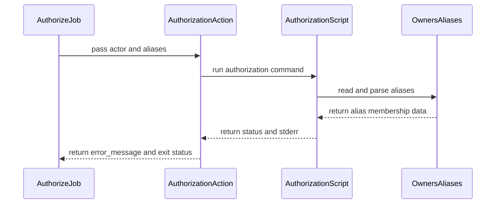

# PR #15048: refactor: extract authorize-release-actor action and scripts

**Summary**: refactor: extract authorize-release-actor action and scripts

**Sources**: https://github.com/kubernetes-sigs/kueue/pull/15048

**Last updated**: 2026-09-15T11:35:23Z

---

## Metadata

- **State**: closed (merged)
- **Author**: [@yuluo-yx](https://github.com/yuluo-yx)
- **Branch**: `feat/authorize-release-actor` → `main`
- **Created**: 2026-09-02T14:43:21Z
- **Updated**: 2026-09-15T11:35:23Z
- **Merged**: 2026-09-15T11:35:21Z
- **Closed**: 2026-09-15T11:35:21Z
- **Labels**: `kind/feature`, `size/L`, `lgtm`, `release-note-none`, `approved`, `cncf-cla: yes`
- **Assignees**: [@mbobrovskyi](https://github.com/mbobrovskyi), [@Singularity23x0](https://github.com/Singularity23x0)
- **Requested reviewers**: [@kannon92](https://github.com/kannon92), [@olekzabl](https://github.com/olekzabl)
- **Changed files**: 7   **+363 / -19**

## Description

#### What type of PR is this?

/kind cleanup

#### What this PR does / why we need it:

Extracts release actor authorization from the inline `release-utils` workflow step into a reusable composite action and a testable Python utility.

The PR intentionally keeps existing release command behavior unchanged. It only:

- adds the reusable authorization action and utility;
- replaces the existing inline authorization check with that action;
- adds hash-pinned PyYAML installation and unit tests wired into `make verify`; and
- registers the new runtime files in the existing `validate-actions` check.

This is the authorization half split out from #14126, so the `/set-release-note` workflow can reuse the same authorization logic.

#### Which issue(s) this PR fixes:

Part of #13890.

Prerequisite for #14126.

#### Special notes for your reviewer:

The branch was rebased onto the latest `main`. Unrelated changes from the previous revision—including `/prepare-pull`, checkout behavior, action validation, command logging, and OpenVEX/SBOM generation—were reverted.

Local validation:

- `make release-utils-test`
- YAML parsing for the workflow and composite action
- `git diff --check upstream/main...HEAD`

**AI usage disclosure:** Codex was used to help identify unrelated changes, clean up the branch, review the authorization code, and run local validation. The author reviewed the resulting diff.

#### Does this PR introduce a user-facing change?

```release-note
None
```


<!-- This is an auto-generated comment: release notes by coderabbit.ai -->
## AI summary

- Extracted release actor authorization into a reusable composite action and testable Python utility.
- Added hash-pinned PyYAML dependencies and release utility tests to `make verify`.
- Registered the new runtime files with `validate-actions`.
- Preserved existing release command behavior.

### Suggested release note

NONE
<!-- end of auto-generated comment: release notes by coderabbit.ai -->

## Discussion

### Comment by [@netlify[bot]](https://github.com/apps/netlify) — 2026-09-02T14:43:27Z

### <span aria-hidden="true">✅</span> Deploy Preview for *kubernetes-sigs-kueue* canceled.


|  Name | Link |
|:-:|------------------------|
|<span aria-hidden="true">🔨</span> Latest commit | 17a746ca51bd46a8c407a8be33c4e8b3c22d0496 |
|<span aria-hidden="true">🔍</span> Latest deploy log | https://app.netlify.com/projects/kubernetes-sigs-kueue/deploys/6aa813e38dad3c0008b4da39 |

### Comment by [@coderabbitai[bot]](https://github.com/apps/coderabbitai) — 2026-09-02T14:45:21Z

<!-- This is an auto-generated comment: summarize by coderabbit.ai -->
<!-- review_stack_entry_start -->

<a href="https://app.coderabbit.ai/change-stack/kubernetes-sigs/kueue/pull/15048#gh-light-mode-only"></a><a href="https://app.coderabbit.ai/change-stack/kubernetes-sigs/kueue/pull/15048#gh-dark-mode-only"></a>

<!-- review_stack_entry_end -->
<!-- This is an auto-generated comment: review paused by coderabbit.ai -->

> [!NOTE]
> ## Reviews paused
> 
> It looks like this branch is under active development. To avoid overwhelming you with review comments due to an influx of new commits, CodeRabbit has automatically paused this review. You can configure this behavior by changing the `reviews.auto_review.auto_pause_after_reviewed_commits` setting.
> 
> Use the following commands to manage reviews:
> - `@coderabbitai resume` to resume automatic reviews.
> - `@coderabbitai review` to trigger a single review.
> 
> Use the checkboxes below for quick actions:
> - [ ] <!-- {"checkboxId":"7f6cc2e2-2e4e-497a-8c31-c9e4573e93d1"} --> ▶️ Resume reviews
> - [ ] <!-- {"checkboxId":"e9bb8d72-00e8-4f67-9cb2-caf3b22574fe"} --> 🔍 Trigger review

<!-- end of auto-generated comment: review paused by coderabbit.ai -->
<!-- recent_review_start -->

No actionable comments were generated in the recent review. 🎉

<details>
<summary>ℹ️ Recent review info</summary>

<details>
<summary>⚙️ Run configuration</summary>

**Configuration used**: Path: .coderabbit.yaml

**Review profile**: CHILL

**Plan**: Advanced

**Run ID**: `fd3b5aa9-2171-4093-a1f6-33f69c9b442d`

</details>

<details>
<summary>📥 Commits</summary>

Reviewing files that changed from the base of the PR and between 83577a6473b272a74865bd62f3b5b217c2852e61 and 17a746ca51bd46a8c407a8be33c4e8b3c22d0496.

</details>

<details>
<summary>📒 Files selected for processing (3)</summary>

* `.github/dependabot.yml`
* `hack/releasing/authorize_release_actor.py`
* `hack/releasing/authorize_release_actor_test.py`

</details>

<details>
<summary>🚧 Files skipped from review as they are similar to previous changes (2)</summary>

* .github/dependabot.yml
* hack/releasing/authorize_release_actor.py

</details>

**Included review availability:** Your plan provides up to 8 included reviews per hour; 7 remain after this review.

</details>

---


<!-- recent_review_end -->
<!-- walkthrough_start -->

<details>
<summary>📝 Walkthrough</summary>

## Walkthrough

The pull request adds Python-based release-actor authorization, packages it as a composite action, integrates it into the release workflow, and runs release utility unit tests through new make targets.

### Changes

**Release automation**

|Layer / File(s)|Summary|
|---|---|
|**Authorization tooling** <br> `hack/releasing/authorize_release_actor.py`, `hack/releasing/authorize_release_actor_test.py`, `hack/releasing/requirements.txt`, `.github/dependabot.yml`|The Python module validates `OWNERS_ALIASES` data and returns authorization status. Tests cover authorization, invalid configuration, YAML errors, and CLI exit codes. PyYAML is pinned with hashes, and Dependabot checks the release tooling directory weekly.|
|**Composite authorization action** <br> `.github/actions/authorize-release-actor/action.yml`|The action installs Python dependencies, invokes the authorization module, and maps authorization and configuration failures to the `error_message` output.|
|**Release workflow and verification** <br> `.github/workflows/release-utils.yml`, `hack/make/verify.mk`|The workflow validates required authorization files and uses the composite action with the `release-team` and `kueue-approvers` aliases. Make targets run release utility tests in a temporary hash-verified virtual environment, and `verify-checks` includes the new target.|

<!-- change_assessment_start -->
**Priority:** ⬇️ Low

**Estimated code review effort:** 3 (Moderate) | ~25 minutes

<!-- change_assessment_commit:"17a746ca51bd46a8c407a8be33c4e8b3c22d0496" -->
**Change:** Refactor
<!-- change_assessment_end -->

### Sequence Diagram(s)



**Suggested reviewers:** `mbobrovskyi`

</details>

<!-- walkthrough_end -->
<!-- final_review_risk_start -->
**Merge Risk:** _⚪ Minimal_ · up to `17a74`
<!-- final_review_risk_coverage:{"sourceCommitId":"17a746ca51bd46a8c407a8be33c4e8b3c22d0496","coveredCommitId":"17a746ca51bd46a8c407a8be33c4e8b3c22d0496","kind":"reviewed"} -->

The authorization tests are included in the release utility test target, and no current merge-blocking risk was established.
<!-- final_review_risk_end -->
<!-- pre_merge_checks_walkthrough_start -->

<details>
<summary>🚥 Pre-merge checks | ✅ 4 | ❌ 1</summary>

### ❌ Failed checks (1 warning)

|     Check name     | Status     | Explanation                                                                                                                                                                                               | Resolution                                                                         |
| :----------------: | :--------- | :-------------------------------------------------------------------------------------------------------------------------------------------------------------------------------------------------------- | :--------------------------------------------------------------------------------- |
| Docstring Coverage | ⚠️ Warning | Docstring coverage is 33.33% which is insufficient. The required threshold is 80.00%. Docstring coverage is scoped to functions touched by this diff. Analyzed 6 functions across 2 files. (1 skipped: 1… | Write docstrings for the functions missing them to satisfy the coverage threshold. |

<details>
<summary>✅ Passed checks (4 passed)</summary>

|         Check name         | Status   | Explanation                                                                                                                                            |
| :------------------------: | :------- | :----------------------------------------------------------------------------------------------------------------------------------------------------- |
|      Description Check     | ✅ Passed | Check skipped - CodeRabbit’s high-level summary is enabled.                                                                                            |
|         Title check        | ✅ Passed | The title clearly summarizes the main change: extracting the authorize-release-actor action and supporting scripts into reusable, testable components. |
|     Linked Issues check    | ✅ Passed | Check skipped because no linked issues were found for this pull request.                                                                               |
| Out of Scope Changes check | ✅ Passed | Check skipped because no linked issues were found for this pull request.                                                                               |

</details>

<details>
<summary>Full details: Docstring Coverage</summary>

**Explanation**

Docstring coverage is 33.33% which is insufficient. The required threshold is 80.00%. Docstring coverage is scoped to functions touched by this diff. Analyzed 6 functions across 2 files. (1 skipped: 1 unsupported.)

</details>

</details>

<!-- pre_merge_checks_walkthrough_end -->

- [ ] <!-- {"checkboxId":"585bb3f6-faf5-4dbf-96d2-74e382adf19a"} --> Fix all pre-merge checks with AI
<!-- finishing_touch_checkbox_start -->

<details>
<summary>✨ Finishing Touches</summary>

<details>
<summary>🧪 Generate unit tests (beta)</summary>

- [ ] <!-- {"checkboxId": "f47ac10b-58cc-4372-a567-0e02b2c3d479", "radioGroupId": "utg-output-choice-group-unknown_comment_id"} -->   Create PR with unit tests

</details>

</details>

<!-- finishing_touch_checkbox_end -->
<!-- tips_start -->

---


<sub>Comment `@coderabbitai help` to get the list of available commands.</sub>

<!-- tips_end -->

### Comment by [@mimowo](https://github.com/mimowo) — 2026-09-02T14:54:53Z

c. @Singularity23x0 @mbobrovskyi ptal

### Comment by [@mbobrovskyi](https://github.com/mbobrovskyi) — 2026-09-02T20:24:38Z

I see a lot of unrelated changes. @yuluo-yx, could you please revert the changes that aren't related to this PR?

### Comment by [@Singularity23x0](https://github.com/Singularity23x0) — 2026-09-15T06:58:54Z

/lgtm
@mimowo or @mbobrovskyi - leaving the approve to you to have two pairs of eyes on it =D

### Comment by [@kubernetes-prow[bot]](https://github.com/apps/kubernetes-prow) — 2026-09-15T06:59:03Z

LGTM label has been added.  <details>Git tree hash: 24786391baa7cac707ae860a10d9ed1eb96ffd83</details>

### Comment by [@mimowo](https://github.com/mimowo) — 2026-09-15T07:21:01Z

/approve
 I'm happy to see the authorization logic extracted to a testable script 👍 


Let me hold in case @mbobrovskyi has some more comments.
/hold

### Comment by [@mbobrovskyi](https://github.com/mbobrovskyi) — 2026-09-15T11:18:40Z

Thank you!

/lgtm
/approve
/unhold

### Comment by [@kubernetes-prow[bot]](https://github.com/apps/kubernetes-prow) — 2026-09-15T11:18:53Z

[APPROVALNOTIFIER] This PR is **APPROVED**

This pull-request has been approved by: *<a href="https://github.com/kubernetes-sigs/kueue/pull/15048#issuecomment-5679305951" title="Approved">mbobrovskyi</a>*, *<a href="https://github.com/kubernetes-sigs/kueue/pull/15048#issuecomment-5676361812" title="Approved">mimowo</a>*, *<a href="https://github.com/kubernetes-sigs/kueue/pull/15048#" title="Author self-approved">yuluo-yx</a>*

The full list of commands accepted by this bot can be found [here](https://go.k8s.io/bot-commands?repo=kubernetes-sigs%2Fkueue).

The pull request process is described [here](https://git.k8s.io/community/contributors/guide/owners.md#the-code-review-process)

<details >
Needs approval from an approver in each of these files:

- ~~[OWNERS](https://github.com/kubernetes-sigs/kueue/blob/main/OWNERS)~~ [mbobrovskyi,mimowo]

Approvers can indicate their approval by writing `/approve` in a comment
Approvers can cancel approval by writing `/approve cancel` in a comment
</details>
<!-- META={"approvers":[]} -->

## Reviews

### Review by [@mwielgus](https://github.com/mwielgus) (commented) — 2026-09-02T19:31:45Z

Can you provide more description what is being extaracted? When quickly skimmed the PR it seemed that python scripts were a new thing, not refactored/moved from elsewhere.

### Review by [@mbobrovskyi](https://github.com/mbobrovskyi) (commented) — 2026-09-02T20:18:24Z

- **.github/workflows/release-utils.yml:11** by [@mbobrovskyi](https://github.com/mbobrovskyi) — 2026-09-02T20:18:24Z
```diff
@@ -7,109 +7,48 @@ concurrency:
   cancel-in-progress: false
 
 jobs:
-  validate-actions:
-    name: Validate Automation Actions
+  authorize:
+    name: Authorize and Parse Command
```

  Why this changes?

### Review by [@mimowo](https://github.com/mimowo) (commented) — 2026-09-03T16:58:43Z

- **hack/releasing/requirements.txt:22** by [@mimowo](https://github.com/mimowo) — 2026-09-03T16:58:43Z
```diff
@@ -0,0 +1,22 @@
+# Copyright 2026 The Kubernetes Authors.
+#
+# Licensed under the Apache License, Version 2.0 (the "License");
+# you may not use this file except in compliance with the License.
+# You may obtain a copy of the License at
+#
+#     http://www.apache.org/licenses/LICENSE-2.0
+#
+# Unless required by applicable law or agreed to in writing, software
+# distributed under the License is distributed on an "AS IS" BASIS,
+# WITHOUT WARRANTIES OR CONDITIONS OF ANY KIND, either express or implied.
+# See the License for the specific language governing permissions and
+# limitations under the License.
+
+# Safely parse release authorization aliases from OWNERS_ALIASES.
+PyYAML==6.0.3 \
+    --hash=sha256:0f29edc409a6392443abf94b9cf89ce99889a1dd5376d94316ae5145dfedd5d6 \
+    --hash=sha256:2283a07e2c21a2aa78d9c4442724ec1eb15f5e42a723b99cb3d822d48f5f7ad1 \
+    --hash=sha256:b8bb0864c5a28024fac8a632c443c87c5aa6f215c0b126c449ae1a150412f31d \
+    --hash=sha256:ba1cc08a7ccde2d2ec775841541641e4548226580ab850948cbfda66a1befcdc \
+    --hash=sha256:c458b6d084f9b935061bc36216e8a69a7e293a2f1e68bf956dcd9e6cbcd143f5 \
+    --hash=sha256:d76623373421df22fb4cf8817020cbb7ef15c725b9d5e45f17e189bfc384190f
```

  That is ok, but could we maintain this via dependabot?
  
  Otherwise  I'm wondering maybe the image has "py" we could just call from python without installing pyyaml, wdyt?

### Review by [@Singularity23x0](https://github.com/Singularity23x0) (commented) — 2026-09-14T10:35:26Z

- **hack/releasing/authorize_release_actor.py:36** by [@Singularity23x0](https://github.com/Singularity23x0) — 2026-09-14T10:35:26Z
```diff
@@ -0,0 +1,66 @@
+#!/usr/bin/env python3
+
+# Copyright 2026 The Kubernetes Authors.
+#
+# Licensed under the Apache License, Version 2.0 (the "License");
+# you may not use this file except in compliance with the License.
+# You may obtain a copy of the License at
+#
+#     http://www.apache.org/licenses/LICENSE-2.0
+#
+# Unless required by applicable law or agreed to in writing, software
+# distributed under the License is distributed on an "AS IS" BASIS,
+# WITHOUT WARRANTIES OR CONDITIONS OF ANY KIND, either express or implied.
+# See the License for the specific language governing permissions and
+# limitations under the License.
+
+import argparse
+from pathlib import Path
+from typing import Any
+
+import yaml
+
+
+def is_authorized(
+    actor: str, owners_aliases: str, authorized_aliases: list[str]
+) -> bool:
+    """Return whether the actor belongs to an alias allowed to run release operations."""
+    document: Any = yaml.safe_load(owners_aliases)
+    if not isinstance(document, dict) or not isinstance(document.get("aliases"), dict):
+        raise ValueError("OWNERS_ALIASES must contain an aliases mapping.")
+
+    aliases = document["aliases"]
+    authorized = False
+    for alias in authorized_aliases:
+        if alias not in aliases:
+            raise ValueError(f"OWNERS_ALIASES must define alias {alias!r}.")
```

  Nit:
  ```suggestion
              raise ValueError(f"Alias {alias!r} not listed in OWNERS_ALIASES.")
  ```

### Review by [@Singularity23x0](https://github.com/Singularity23x0) (commented) — 2026-09-14T10:36:10Z

- **hack/releasing/authorize_release_actor.py:45** by [@Singularity23x0](https://github.com/Singularity23x0) — 2026-09-14T10:36:10Z
```diff
@@ -0,0 +1,66 @@
+#!/usr/bin/env python3
+
+# Copyright 2026 The Kubernetes Authors.
+#
+# Licensed under the Apache License, Version 2.0 (the "License");
+# you may not use this file except in compliance with the License.
+# You may obtain a copy of the License at
+#
+#     http://www.apache.org/licenses/LICENSE-2.0
+#
+# Unless required by applicable law or agreed to in writing, software
+# distributed under the License is distributed on an "AS IS" BASIS,
+# WITHOUT WARRANTIES OR CONDITIONS OF ANY KIND, either express or implied.
+# See the License for the specific language governing permissions and
+# limitations under the License.
+
+import argparse
+from pathlib import Path
+from typing import Any
+
+import yaml
+
+
+def is_authorized(
+    actor: str, owners_aliases: str, authorized_aliases: list[str]
+) -> bool:
+    """Return whether the actor belongs to an alias allowed to run release operations."""
+    document: Any = yaml.safe_load(owners_aliases)
+    if not isinstance(document, dict) or not isinstance(document.get("aliases"), dict):
+        raise ValueError("OWNERS_ALIASES must contain an aliases mapping.")
+
+    aliases = document["aliases"]
+    authorized = False
+    for alias in authorized_aliases:
+        if alias not in aliases:
+            raise ValueError(f"OWNERS_ALIASES must define alias {alias!r}.")
+        members = aliases[alias]
+        if not isinstance(members, list) or not all(
+            isinstance(member, str) for member in members
+        ):
+            raise ValueError(
+                f"OWNERS_ALIASES alias {alias!r} must contain a list of names."
+            )
+        if actor in members:
+            authorized = True
```

  Nit: We can simply return True at this moment, then return false at the end.

### Review by [@Singularity23x0](https://github.com/Singularity23x0) (commented) — 2026-09-14T10:37:59Z

- **hack/releasing/authorize_release_actor_test.py:110** by [@Singularity23x0](https://github.com/Singularity23x0) — 2026-09-14T10:37:59Z
```diff
@@ -0,0 +1,100 @@
+#!/usr/bin/env python3
+
+# Copyright 2026 The Kubernetes Authors.
+#
+# Licensed under the Apache License, Version 2.0 (the "License");
+# you may not use this file except in compliance with the License.
+# You may obtain a copy of the License at
+#
+#     http://www.apache.org/licenses/LICENSE-2.0
+#
+# Unless required by applicable law or agreed to in writing, software
+# distributed under the License is distributed on an "AS IS" BASIS,
+# WITHOUT WARRANTIES OR CONDITIONS OF ANY KIND, either express or implied.
+# See the License for the specific language governing permissions and
+# limitations under the License.
+
+import subprocess
+import sys
+import tempfile
+import unittest
+from pathlib import Path
+
+import yaml
+
+import authorize_release_actor
+
+
+class AuthorizationTest(unittest.TestCase):
+    def test_authorization(self) -> None:
+        owners = "aliases:\n  release-team: [alice]\n  approvers: [bob]\n  empty: []\n"
+        cases = [
+            ("first alias", "alice", ["release-team", "approvers"], True),
+            ("second alias", "bob", ["release-team", "approvers"], True),
+            ("outside requested alias", "bob", ["release-team"], False),
+            ("unknown actor", "eve", ["release-team", "approvers"], False),
+            ("case sensitive", "Alice", ["release-team"], False),
+            ("empty membership", "alice", ["empty"], False),
+        ]
+        for name, actor, aliases, expected in cases:
+            with self.subTest(name=name):
+                self.assertEqual(
+                    expected,
+                    authorize_release_actor.is_authorized(actor, owners, aliases),
+                )
+
+    def test_invalid_configuration(self) -> None:
+        cases = [
+            ("empty document", "", ["release-team"], ValueError),
+            ("sequence document", "[]", ["release-team"], ValueError),
+            ("missing aliases", "{}", ["release-team"], ValueError),
+            ("null aliases", "aliases: null", ["release-team"], ValueError),
+            ("sequence aliases", "aliases: []", ["release-team"], ValueError),
+            ("missing alias", "aliases: {}", ["release-team"], ValueError),
+            ("scalar members", "aliases: {release-team: alice}", ["release-team"], ValueError),
+            ("null members", "aliases: {release-team: null}", ["release-team"], ValueError),
+            ("non-string member", "aliases: {release-team: [alice, 1]}", ["release-team"], ValueError),
+            ("malformed YAML", "aliases: [", ["release-team"], yaml.YAMLError),
+            # 命中前一个别名后仍需检查后续配置，避免配置错误被提前返回掩盖。
+            ("later alias missing", "aliases: {release-team: [alice]}", ["release-team", "approvers"], ValueError),
+            ("later alias invalid", "aliases: {release-team: [alice], approvers: bob}", ["release-team", "approvers"], ValueError),
+        ]
```

  We should also validate error message text for each of these cases. This will also help ensure we have covered all key error paths.

### Review by [@yuluo-yx](https://github.com/yuluo-yx) (commented) — 2026-09-14T15:29:09Z

- **hack/releasing/authorize_release_actor.py:36** by [@yuluo-yx](https://github.com/yuluo-yx) — 2026-09-14T15:29:09Z
```diff
@@ -0,0 +1,66 @@
+#!/usr/bin/env python3
+
+# Copyright 2026 The Kubernetes Authors.
+#
+# Licensed under the Apache License, Version 2.0 (the "License");
+# you may not use this file except in compliance with the License.
+# You may obtain a copy of the License at
+#
+#     http://www.apache.org/licenses/LICENSE-2.0
+#
+# Unless required by applicable law or agreed to in writing, software
+# distributed under the License is distributed on an "AS IS" BASIS,
+# WITHOUT WARRANTIES OR CONDITIONS OF ANY KIND, either express or implied.
+# See the License for the specific language governing permissions and
+# limitations under the License.
+
+import argparse
+from pathlib import Path
+from typing import Any
+
+import yaml
+
+
+def is_authorized(
+    actor: str, owners_aliases: str, authorized_aliases: list[str]
+) -> bool:
+    """Return whether the actor belongs to an alias allowed to run release operations."""
+    document: Any = yaml.safe_load(owners_aliases)
+    if not isinstance(document, dict) or not isinstance(document.get("aliases"), dict):
+        raise ValueError("OWNERS_ALIASES must contain an aliases mapping.")
+
+    aliases = document["aliases"]
+    authorized = False
+    for alias in authorized_aliases:
+        if alias not in aliases:
+            raise ValueError(f"OWNERS_ALIASES must define alias {alias!r}.")
```

  I updated the error message as suggested and added exact-message coverage for this path.

### Review by [@yuluo-yx](https://github.com/yuluo-yx) (commented) — 2026-09-14T15:29:25Z

- **hack/releasing/authorize_release_actor.py:45** by [@yuluo-yx](https://github.com/yuluo-yx) — 2026-09-14T15:29:25Z
```diff
@@ -0,0 +1,66 @@
+#!/usr/bin/env python3
+
+# Copyright 2026 The Kubernetes Authors.
+#
+# Licensed under the Apache License, Version 2.0 (the "License");
+# you may not use this file except in compliance with the License.
+# You may obtain a copy of the License at
+#
+#     http://www.apache.org/licenses/LICENSE-2.0
+#
+# Unless required by applicable law or agreed to in writing, software
+# distributed under the License is distributed on an "AS IS" BASIS,
+# WITHOUT WARRANTIES OR CONDITIONS OF ANY KIND, either express or implied.
+# See the License for the specific language governing permissions and
+# limitations under the License.
+
+import argparse
+from pathlib import Path
+from typing import Any
+
+import yaml
+
+
+def is_authorized(
+    actor: str, owners_aliases: str, authorized_aliases: list[str]
+) -> bool:
+    """Return whether the actor belongs to an alias allowed to run release operations."""
+    document: Any = yaml.safe_load(owners_aliases)
+    if not isinstance(document, dict) or not isinstance(document.get("aliases"), dict):
+        raise ValueError("OWNERS_ALIASES must contain an aliases mapping.")
+
+    aliases = document["aliases"]
+    authorized = False
+    for alias in authorized_aliases:
+        if alias not in aliases:
+            raise ValueError(f"OWNERS_ALIASES must define alias {alias!r}.")
+        members = aliases[alias]
+        if not isinstance(members, list) or not all(
+            isinstance(member, str) for member in members
+        ):
+            raise ValueError(
+                f"OWNERS_ALIASES alias {alias!r} must contain a list of names."
+            )
+        if actor in members:
+            authorized = True
```

  I intentionally keep iterating over all requested aliases so that a membership match cannot mask a missing or malformed later alias. Returning early here would turn an invalid authorization configuration into a successful authorization. The "later alias missing" and "later alias invalid" cases cover this fail-closed behavior.

### Review by [@yuluo-yx](https://github.com/yuluo-yx) (commented) — 2026-09-14T15:30:45Z

- **hack/releasing/authorize_release_actor_test.py:110** by [@yuluo-yx](https://github.com/yuluo-yx) — 2026-09-14T15:30:45Z
```diff
@@ -0,0 +1,100 @@
+#!/usr/bin/env python3
+
+# Copyright 2026 The Kubernetes Authors.
+#
+# Licensed under the Apache License, Version 2.0 (the "License");
+# you may not use this file except in compliance with the License.
+# You may obtain a copy of the License at
+#
+#     http://www.apache.org/licenses/LICENSE-2.0
+#
+# Unless required by applicable law or agreed to in writing, software
+# distributed under the License is distributed on an "AS IS" BASIS,
+# WITHOUT WARRANTIES OR CONDITIONS OF ANY KIND, either express or implied.
+# See the License for the specific language governing permissions and
+# limitations under the License.
+
+import subprocess
+import sys
+import tempfile
+import unittest
+from pathlib import Path
+
+import yaml
+
+import authorize_release_actor
+
+
+class AuthorizationTest(unittest.TestCase):
+    def test_authorization(self) -> None:
+        owners = "aliases:\n  release-team: [alice]\n  approvers: [bob]\n  empty: []\n"
+        cases = [
+            ("first alias", "alice", ["release-team", "approvers"], True),
+            ("second alias", "bob", ["release-team", "approvers"], True),
+            ("outside requested alias", "bob", ["release-team"], False),
+            ("unknown actor", "eve", ["release-team", "approvers"], False),
+            ("case sensitive", "Alice", ["release-team"], False),
+            ("empty membership", "alice", ["empty"], False),
+        ]
+        for name, actor, aliases, expected in cases:
+            with self.subTest(name=name):
+                self.assertEqual(
+                    expected,
+                    authorize_release_actor.is_authorized(actor, owners, aliases),
+                )
+
+    def test_invalid_configuration(self) -> None:
+        cases = [
+            ("empty document", "", ["release-team"], ValueError),
+            ("sequence document", "[]", ["release-team"], ValueError),
+            ("missing aliases", "{}", ["release-team"], ValueError),
+            ("null aliases", "aliases: null", ["release-team"], ValueError),
+            ("sequence aliases", "aliases: []", ["release-team"], ValueError),
+            ("missing alias", "aliases: {}", ["release-team"], ValueError),
+            ("scalar members", "aliases: {release-team: alice}", ["release-team"], ValueError),
+            ("null members", "aliases: {release-team: null}", ["release-team"], ValueError),
+            ("non-string member", "aliases: {release-team: [alice, 1]}", ["release-team"], ValueError),
+            ("malformed YAML", "aliases: [", ["release-team"], yaml.YAMLError),
+            # 命中前一个别名后仍需检查后续配置，避免配置错误被提前返回掩盖。
+            ("later alias missing", "aliases: {release-team: [alice]}", ["release-team", "approvers"], ValueError),
+            ("later alias invalid", "aliases: {release-team: [alice], approvers: bob}", ["release-team", "approvers"], ValueError),
+        ]
```

  The invalid-configuration table now verifies the exact messages produced by our validation code. The malformed-YAML case checks a stable parser diagnostic instead of depending on PyYAML's full line-and-column formatting.

### Review by [@mimowo](https://github.com/mimowo) (commented) — 2026-09-14T15:32:54Z

- **.github/dependabot.yml:4** by [@mimowo](https://github.com/mimowo) — 2026-09-14T15:32:54Z
```diff
@@ -1,6 +1,17 @@
 version: 2
 updates:
 
+  # 维护发布脚本的 Python 依赖及哈希。
```

  Don't use Chienese here :)

### Review by [@yuluo-yx](https://github.com/yuluo-yx) (commented) — 2026-09-14T15:35:25Z

- **.github/dependabot.yml:4** by [@yuluo-yx](https://github.com/yuluo-yx) — 2026-09-14T15:35:24Z
```diff
@@ -1,6 +1,17 @@
 version: 2
 updates:
 
+  # 维护发布脚本的 Python 依赖及哈希。
```

  I fixed it
