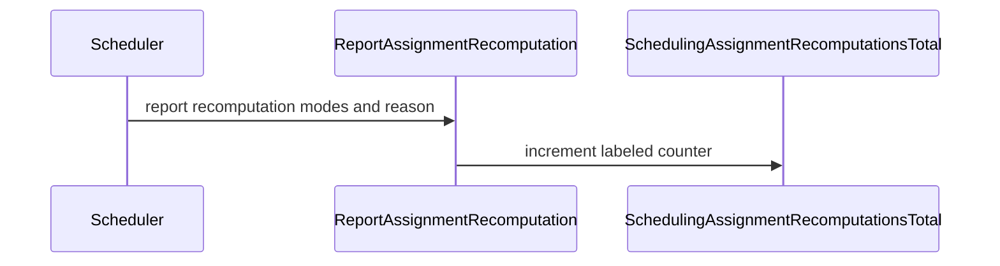

# PR #15065: Add generic in-cycle assignment recomputation metrics

**Summary**: Add generic in-cycle assignment recomputation metrics

**Sources**: https://github.com/kubernetes-sigs/kueue/pull/15065

**Last updated**: 2026-10-17T03:35:58Z

---

## Metadata

- **State**: open
- **Author**: [@sheldon-lang](https://github.com/sheldon-lang)
- **Branch**: `feat/scheduling-assignment-recomputations` → `main`
- **Created**: 2026-09-03T01:23:40Z
- **Updated**: 2026-10-17T03:35:58Z
- **Merged**: —
- **Closed**: —
- **Labels**: `kind/feature`, `release-note`, `size/L`, `ok-to-test`, `cncf-cla: yes`
- **Assignees**: _none_
- **Requested reviewers**: [@olekzabl](https://github.com/olekzabl), [@tenzen-y](https://github.com/tenzen-y)
- **Changed files**: 8   **+215 / -3**

## Description

#### What type of PR is this?

/kind feature

#### What this PR does / why we need it:

Adds `kueue_scheduling_assignment_recomputations_total` to observe in-cycle assignment recomputations by `before_mode`, `after_mode`, and `reason`, alongside the existing ClusterQueue, replica-role, and custom labels.

The initial reasons are `NoTAS` and `OverlappingPreemptionTargets`, matching the paths currently implemented on the base revision. Each actual recomputation is counted once, even if the mode stays unchanged. Overlap takes precedence when both enabled conditions hold, matching the existing scheduler branch order. The final mode includes the `DeferredFit` adjustment; it is not an admission-success indicator.

The dedicated `kueue_preemption_target_recomputations_total` metric remains unchanged. This PR adds metric lifecycle tests, assertions in existing scheduling scenarios, and generated metric documentation without changing scheduling decisions. Reasons for future recomputation paths can be added separately.

#### Which issue(s) this PR fixes:

Addresses #14205 for the currently implemented recomputation paths, following the scope discussion in https://github.com/kubernetes-sigs/kueue/issues/14205#issuecomment-5511167190.

#### Special notes for your reviewer:

This PR was written in part with the assistance of generative AI. AI assistance was used for implementation, tests, local verification, and this description.

Local validation on macOS arm64 with Go 1.26.0:

- `go test ./pkg/metrics ./pkg/scheduler/... -count=1 -timeout=10m`: passed.
- Focused `go test -race` for the metric reporting tests and affected scheduling scenarios: passed.
- Project-pinned golangci-lint 2.13.2 on `./pkg/metrics ./pkg/scheduler`: 0 issues.
- New scheduling assertions failed without instrumentation and passed after instrumentation was added.
- Metric documentation regenerated with the repository metricsdoc tool; repeated generation produced identical output.
- `git diff --check`: passed.

Full `make verify`, integration tests, and E2E tests were not run locally. The documentation generator was invoked directly because the Makefile requires GNU sed, which is not installed in the local environment.

#### Does this PR introduce a user-facing change?

```release-note
Observability: Added `kueue_scheduling_assignment_recomputations_total` to track in-cycle assignment recomputations by reason and assignment mode before and after recomputation, helping operators diagnose scheduling contention.
```


<!-- This is an auto-generated comment: release notes by coderabbit.ai -->
## AI summary

Added the `kueue_scheduling_assignment_recomputations_total` metric. It tracks scheduling assignment recomputations by ClusterQueue, before and after assignment modes, reason, replica role, and configured custom ClusterQueue labels. The metric covers `NoTAS` and `OverlappingPreemptionTargets` recomputations. The documentation describes how recomputations are counted and how overlapping targets take precedence when both reasons apply.

### Suggested release note

- **Detailed:** Observability: Added `kueue_scheduling_assignment_recomputations_total` to help operators monitor in-cycle assignment recomputations by mode and reason.
- **Concise:** Observability: Added a metric for in-cycle assignment recomputations.
- **Balanced:** Observability: Added `kueue_scheduling_assignment_recomputations_total` to show in-cycle assignment recomputations by mode and reason.
- **Rationale:** `Observability` is the narrowest accurate scope. The change adds an operator-visible metric without changing scheduling decisions. No upgrade action is required.
<!-- end of auto-generated comment: release notes by coderabbit.ai -->

## Discussion

### Comment by [@netlify[bot]](https://github.com/apps/netlify) — 2026-09-03T01:23:46Z

### <span aria-hidden="true">✅</span> Deploy Preview for *kubernetes-sigs-kueue* ready!


|  Name | Link |
|:-:|------------------------|
|<span aria-hidden="true">🔨</span> Latest commit | b7f1b5f0f14e9eb518fea51d4d4a3bcb10cdb6df |
|<span aria-hidden="true">🔍</span> Latest deploy log | https://app.netlify.com/projects/kubernetes-sigs-kueue/deploys/6ad2eb0142620ae7ec517d82 |
|<span aria-hidden="true">😎</span> Deploy Preview | [https://deploy-preview-15065--kubernetes-sigs-kueue.netlify.app](https://deploy-preview-15065--kubernetes-sigs-kueue.netlify.app) |
|<span aria-hidden="true">📱</span> Preview on mobile | <details><summary> Toggle QR Code... </summary><br /><br /><br /><br />_Use your smartphone camera to open QR code link._</details> |
---
<!-- [kubernetes-sigs-kueue Preview](https://deploy-preview-15065--kubernetes-sigs-kueue.netlify.app) -->
_To edit notification comments on pull requests, go to your [Netlify project configuration](https://app.netlify.com/projects/kubernetes-sigs-kueue/configuration/notifications#deploy-notifications)._

### Comment by [@linux-foundation-easycla[bot]](https://github.com/apps/linux-foundation-easycla) — 2026-09-03T01:23:48Z

<a href="https://easycla.lfx.linuxfoundation.org/#/?version=2"></a><br >The committers listed above are authorized under a signed CLA.<ul><li>:white_check_mark: login: sheldon-lang / name: sheldon-lang (bc0bc264f709b15e6c9197b369c31321cdd1613a)</li></ul>

### Comment by [@kubernetes-prow[bot]](https://github.com/apps/kubernetes-prow) — 2026-09-03T01:23:49Z

Welcome @sheldon-lang! <br><br>It looks like this is your first PR to <a href='https://github.com/kubernetes-sigs/kueue'>kubernetes-sigs/kueue</a> 🎉. Please refer to our [pull request process documentation](https://www.kubernetes.dev/docs/guide/pull-requests/) to help your PR have a smooth ride to approval. <br><br>You will be prompted by a bot to use commands during the review process. Do not be afraid to follow the prompts! It is okay to experiment. [Here is the bot commands documentation](https://go.k8s.io/bot-commands). <br><br>You can also check if kubernetes-sigs/kueue has [its own contribution guidelines](https://github.com/kubernetes-sigs/kueue/tree/master/CONTRIBUTING.md). <br><br>You may want to refer to our [testing guide](https://git.k8s.io/community/contributors/devel/sig-testing/testing.md) if you run into trouble with your tests not passing. <br><br>If you are having difficulty getting your pull request seen, please follow the [recommended escalation practices](https://www.kubernetes.dev/docs/guide/pull-requests/#why-is-my-pull-request-not-getting-reviewed). Also, for tips and tricks in the contribution process you may want to read the [Kubernetes contributor cheat sheet](https://www.kubernetes.dev/docs/contributor-cheatsheet/). We want to make sure your contribution gets all the attention it needs! <br><br>Thank you, and welcome to Kubernetes. :smiley:

### Comment by [@kubernetes-prow[bot]](https://github.com/apps/kubernetes-prow) — 2026-09-03T01:23:50Z

Hi @sheldon-lang. Thanks for your PR.

I'm waiting for a [kubernetes-sigs](https://github.com/orgs/kubernetes-sigs/people) member to verify that this patch is reasonable to test. If it is, they should reply with `/ok-to-test` on its own line. Until that is done, I will not automatically test new commits in this PR, but the usual testing commands by org members will still work.

Regular contributors should [join the org](https://git.k8s.io/community/community-membership.md#member) to skip this step.

Once the patch is verified, the new status will be reflected by the `ok-to-test` label.

I understand the commands that are listed [here](https://go.k8s.io/bot-commands?repo=kubernetes-sigs%2Fkueue).

<details>

Instructions for interacting with me using PR comments are available [here](https://git.k8s.io/community/contributors/guide/pull-requests.md).  If you have questions or suggestions related to my behavior, please file an issue against the [kubernetes-sigs/prow](https://github.com/kubernetes-sigs/prow/issues/new?title=Prow%20issue:) repository.
</details>

### Comment by [@kubernetes-prow[bot]](https://github.com/apps/kubernetes-prow) — 2026-09-03T01:23:59Z

[APPROVALNOTIFIER] This PR is **NOT APPROVED**

This pull-request has been approved by: *<a href="https://github.com/kubernetes-sigs/kueue/pull/15065#" title="Author self-approved">sheldon-lang</a>*
**Once this PR has been reviewed and has the lgtm label**, please assign [mbobrovskyi](https://github.com/mbobrovskyi), [olekzabl](https://github.com/olekzabl), [sohankunkerkar](https://github.com/sohankunkerkar) for approval. For more information see [the Code Review Process](https://git.k8s.io/community/contributors/guide/owners.md#the-code-review-process).

The full list of commands accepted by this bot can be found [here](https://go.k8s.io/bot-commands?repo=kubernetes-sigs%2Fkueue).

<details open>
Needs approval from an approver in each of these files:

- **[OWNERS](https://github.com/kubernetes-sigs/kueue/blob/main/OWNERS)**

Approvers can indicate their approval by writing `/approve` in a comment
Approvers can cancel approval by writing `/approve cancel` in a comment
</details>
<!-- META={"approvers":["mbobrovskyi","olekzabl","sohankunkerkar"]} -->

### Comment by [@coderabbitai[bot]](https://github.com/apps/coderabbitai) — 2026-09-03T01:25:28Z

<!-- This is an auto-generated comment: summarize by coderabbit.ai -->
<!-- review_stack_entry_start -->

<a href="https://app.coderabbit.ai/change-stack/kubernetes-sigs/kueue/pull/15065?scope=ghh_OusAJGA4HG8ljoOV0wJvVx8NmnZIjc2DdjmxOu0xZWA&amp;cs_source=review_comment"><picture><source media="(prefers-color-scheme: dark)" srcset="https://storage.googleapis.com/coderabbit_public_assets/review-stack-in-coderabbit-ui-dark.svg?v=3"><source media="(prefers-color-scheme: light)" srcset="https://storage.googleapis.com/coderabbit_public_assets/review-stack-in-coderabbit-ui.svg?v=3"></picture></a>

<!-- review_stack_entry_end -->
<!-- recent_review_start -->

No actionable comments were generated in the recent review. 🎉

<details>
<summary><strong>ℹ️ Recent review info</strong></summary>
<dl>
<dd>

<details>
<summary><strong>⚙️ Run configuration</strong></summary>
<dl>
<dd>

- **Configuration used**: Repository: kubernetes-sigs/kueue/.coderabbit.yaml
- **Review profile**: CHILL
- **Plan**: Advanced
- **Run ID**: `97de581e-22bb-4f9f-9dc4-a45030daa7b4`

</dd>
</dl>
</details>

<details>
<summary><strong>📥 Commits</strong></summary>
<dl>
<dd>

Reviewing files that changed from the base of the PR and between 98397cfcf83ae320ecdce258d9b1e078ef4acd0c and b7f1b5f0f14e9eb518fea51d4d4a3bcb10cdb6df.

</dd>
</dl>
</details>

<details>
<summary><strong>📒 Files selected for processing: 1</strong></summary>
<dl>
<dd>

* `pkg/scheduler/scheduler_tas_test.go`

</dd>
</dl>
</details>

**Included review availability:** This review used your included allowance. Your plan provides up to 8 included reviews per hour; 7 remain after this review.

</dd>
</dl>
</details>


<!-- recent_review_end -->
<!-- walkthrough_start -->

<details>
<summary><strong>📝 Walkthrough</strong></summary>
<dl>
<dd>

The PR adds a Prometheus counter for assignment recomputations. The scheduler reports recomputation reasons and modes before and after recomputation. Metrics and scheduler tests check labels, cleanup, and expected counts. The metrics reference documents the counter.

**Changes: Assignment recomputation metrics**

|Layer / File(s)|Summary|
|:---|:---|
|**Metric contract and reporting** <br> `pkg/metrics/metrics.go`, `pkg/metrics/assignment_recomputation_test.go`|Defines recomputation reasons and the `SchedulingAssignmentRecomputationsTotal` counter. Reports labels for ClusterQueue, modes, reason, replica role, and configured custom labels. Tests check counts, labels, and ClusterQueue cleanup.|
|**Scheduler recomputation reporting** <br> `pkg/scheduler/scheduler.go`|Classifies recomputations, captures the mode before recomputation, and reports the mode after recomputation with the reason.|
|**Scheduler validation and metric documentation** <br> `pkg/scheduler/scheduler_recomputation_metrics_test.go`, `pkg/scheduler/scheduler_recompute_preemption_test.go`, `pkg/scheduler/scheduler_tas_test.go`, `pkg/scheduler/scheduler_test.go`, `site/content/en/docs/reference/metrics.md`|Adds metric assertions for preemption, TAS, and scheduling scenarios, including DeferredFit and disabled-recomputation cases. Documents the counter and its labels.|

<!-- change_assessment_start -->
**Priority:** ➖ Normal

**Estimated code review effort:** 3 (Moderate) | ~20 minutes

<!-- change_assessment_commit:"b7f1b5f0f14e9eb518fea51d4d4a3bcb10cdb6df" -->
**Change:** Feature
<!-- change_assessment_end -->

### Sequence Diagram(s)



**Suggested reviewers:** `singularity23x0`

</dd>
</dl>
</details>

<!-- walkthrough_end -->
<details>
<summary><strong>Merge Risk:</strong> <strong>⚪ Minimal</strong> · up to <code>b7f1b</code></summary>
<dl>
<dd>

<!-- final_review_risk_start -->
<!-- final_review_risk_label
**Merge Risk:** **⚪ Minimal** · up to `b7f1b`
-->
<!-- final_review_risk_coverage:{"sourceCommitId":"b7f1b5f0f14e9eb518fea51d4d4a3bcb10cdb6df","coveredCommitId":"b7f1b5f0f14e9eb518fea51d4d4a3bcb10cdb6df","kind":"reviewed"} -->

The change adds a labeled scheduling-recomputation metric without an established change to scheduling decisions. No actionable merge-blocking risk is supported by the available evidence.
<!-- final_review_risk_end -->

</dd>
</dl>
</details>
<!-- architecture_review_start -->
### Architecture Summary

**Architecture risk:** **🔵 Low** · up to `b7f1b`

The change affects 2 systems.

**Changed systems:** `pkg`, `site`

**Architecture concerns**
No architecture-level concerns identified.

<details>
<summary><strong>Review details</strong></summary>
<dl>
<dd>

**Systems and components**
- _observed_ — pkg (job) was modified; 7 changed files map to changed impact.
- _observed_ — site (service) was modified; 1 changed file maps to changed impact.

**Before / after behavior**
- _observed_ — Modified behavior in pkg/scheduler/scheduler_recomputation_metrics_test.go: Added the scheduler metrics test file, including `assignmentRecomputationLabels` and `checkAssignmentRecomputations`, which validates standalone replica-role labels and compares collected assignment recomputation gauge values with expected results.
- _observed_ — Modified behavior in pkg/scheduler/scheduler.go: Introduces a local value to track the reason for assignment recomputation.
- _observed_ — Modified behavior in pkg/scheduler/scheduler.go: The overlapping-preemption and no-TAS branches now assign distinct recomputation reasons. The overlap branch still simulates other preemptions; both existing recomputation paths remain unchanged otherwise.
- _observed_ — Modified behavior in pkg/scheduler/scheduler.go: Captures the assignment mode before recomputation for reporting.


</dd>
</dl>
</details>

<!-- architecture_review_end -->
<!-- pre_merge_checks_walkthrough_start -->

<details>
<summary><strong>Pre-merge checks: <sup><picture></picture></sup> 4 · <sup><picture></picture></sup> 1</strong></summary>
<dl>
<dd>

<strong><sup><picture></picture></sup> Failed checks: 1 inconclusive</strong>

|     Check name     |                                                   Status                                                   | Explanation                                                                                                                                                                                               | Resolution                                                                         |
| :---------------- | :--------------------------------------------------------------------------------------------------------: | :-------------------------------------------------------------------------------------------------------------------------------------------------------------------------------------------------------- | :--------------------------------------------------------------------------------- |
| Docstring Coverage |  | Docstring coverage is 27.27% which is insufficient. The required threshold is 80.00%. Docstring coverage is scoped to functions touched by this diff. Analyzed 11 functions across 6 files. (1 skipped: … | Write docstrings for the functions missing them to satisfy the coverage threshold. |

<details>
<summary><strong><sup><picture></picture></sup> Passed checks: 4 passed</strong></summary>
<dl>
<dd>

|         Check name         |                                             Status                                             | Explanation                                                                                                               |
| :------------------------ | :--------------------------------------------------------------------------------------------: | :------------------------------------------------------------------------------------------------------------------------ |
|      Description Check     |  | Check skipped - CodeRabbit’s high-level summary is enabled.                                                               |
|         Title check        |  | The title clearly and concisely describes the main change: adding generic metrics for in-cycle assignment recomputations. |
|     Linked Issues check    |  | Check skipped because no linked issues were found for this pull request.                                                  |
| Out of Scope Changes check |  | Check skipped because no linked issues were found for this pull request.                                                  |

</dd>
</dl>
</details>

<details>
<summary><strong>Full details: Docstring Coverage</strong></summary>
<dl>
<dd>

**Explanation**

Docstring coverage is 27.27% which is insufficient. The required threshold is 80.00%. Docstring coverage is scoped to functions touched by this diff. Analyzed 11 functions across 6 files. (1 skipped: 1 too large.)

**Resolution**

Write docstrings for the functions missing them to satisfy the coverage threshold.

</dd>
</dl>
</details>

</dd>
</dl>
</details>

<!-- pre_merge_checks_walkthrough_end -->
<!-- finishing_touch_checkbox_start -->

<details>
<summary><strong>✨ Finishing Touches</strong></summary>
<dl>
<dd>

<details open>
<summary><strong>🧪 Generate unit tests (beta)</strong></summary>
<dl>
<dd>

- [ ] <!-- {"checkboxId": "f47ac10b-58cc-4372-a567-0e02b2c3d479", "radioGroupId": "utg-output-choice-group-unknown_comment_id"} --> Create a new PR

</dd>
</dl>
</details>

</dd>
</dl>
</details>

<!-- finishing_touch_checkbox_end -->
<!-- tips_start -->


<sub>Comment `@coderabbitai help` to get the list of available commands.</sub>

<!-- tips_end -->

### Comment by [@tenzen-y](https://github.com/tenzen-y) — 2026-09-03T02:38:14Z

/ok-to-test

### Comment by [@sheldon-lang](https://github.com/sheldon-lang) — 2026-09-13T13:51:23Z

/retest-required

### Comment by [@sheldon-lang](https://github.com/sheldon-lang) — 2026-10-10T03:34:23Z

Rebased onto the latest `main` (`e6922ce7f`), resolved the scheduler and TAS test conflicts, and verified the update with:

- `go test ./pkg/metrics ./pkg/scheduler`
- the repository's `metricsdoc` generator (no generated diff)

PTAL @tenzen-y @olekzabl when you have time.

AI disclosure: This update was prepared with AI assistance.

### Comment by [@sheldon-lang](https://github.com/sheldon-lang) — 2026-10-17T03:27:00Z

Rebased onto the latest `main` (`0ad490c21`) and resolved the TAS test conflict by retaining the new `featureGates`/`simulatorOverride` fields together with the assignment-recomputation expectations. Verified with `go test ./pkg/metrics ./pkg/scheduler`; I also ran the repository `metricsdoc` tool directly and confirmed there is no generated documentation diff. PTAL @tenzen-y @olekzabl when convenient. AI disclosure: this synchronization and conflict resolution used AI-assisted tooling; I reviewed the resulting diff and test output.
