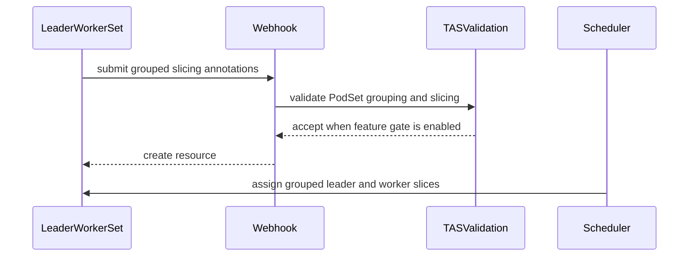

# PR #15111: TAS: Enable PodSet slicing alongside PodSet grouping

**Summary**: TAS: Enable PodSet slicing alongside PodSet grouping

**Sources**: https://github.com/kubernetes-sigs/kueue/pull/15111

**Last updated**: 2026-09-30T16:00:30Z

---

## Metadata

- **State**: closed (merged)
- **Author**: [@pajakd](https://github.com/pajakd)
- **Branch**: `lws_tas` → `main`
- **Created**: 2026-09-03T12:20:41Z
- **Updated**: 2026-09-30T16:00:30Z
- **Merged**: 2026-09-04T15:32:21Z
- **Closed**: 2026-09-04T15:32:21Z
- **Labels**: `kind/feature`, `release-note`, `lgtm`, `size/XXL`, `approved`, `cncf-cla: yes`, `area/tas`
- **Assignees**: [@mimowo](https://github.com/mimowo)
- **Requested reviewers**: [@mbobrovskyi](https://github.com/mbobrovskyi), [@tenzen-y](https://github.com/tenzen-y)
- **Changed files**: 11   **+1053 / -21**

## Description

<!--  Thanks for sending a pull request!  Here are some tips for you:

1. If this is your first time, please read our contributor guidelines: https://git.k8s.io/community/contributors/guide/first-contribution.md#your-first-contribution and developer guide https://git.k8s.io/community/contributors/devel/development.md#development-guide
2. Please label this pull request according to what type of issue you are addressing, especially if this is a release targeted pull request. For reference on required PR/issue labels, read here:
https://git.k8s.io/community/contributors/devel/sig-release/release.md#issuepr-kind-label
3. Ensure you have added or ran the appropriate tests for your PR: https://git.k8s.io/community/contributors/devel/sig-testing/testing.md
4. If you want *faster* PR reviews, read how: https://git.k8s.io/community/contributors/guide/pull-requests.md#best-practices-for-faster-reviews
5. If the PR is unfinished, see how to mark it: https://git.k8s.io/community/contributors/guide/pull-requests.md#marking-unfinished-pull-requests
-->

#### What type of PR is this?
/kind feature
/area tas

<!--
Add one of the following kinds:
/kind bug
/kind cleanup
/kind documentation
/kind feature
/kind kep

Optionally add one or more of the following kinds if applicable:
/kind api-change
/kind deprecation
/kind failing-test
/kind flake
/kind regression

Please also consider setting the area:
/area tas
/area was
/area integrations
/area multikueue
/area dashboard
/area localization
/area testing
/area website
-->

#### What this PR does / why we need it:
Previously (see #6242), `ValidateTASPodSetRequest` explicitly rejected workloads combining PodSet grouping (`kueue.x-k8s.io/podset-group-name`) with PodSet slicing (`kueue.x-k8s.io/podset-slice-size` or `kueue.x-k8s.io/podset-slice-required-topology`).
However, the underlying TAS scheduling algorithm already natively supports scheduling grouped PodSets alongside sliced PodSets (for example, a LeaderWorkerSet workload where leader and workers share a required or preferred group domain at a parent level such as `cloud.com/block`, but workers are additionally sliced at an inner level such as `kubernetes.io/hostname`).
This PR:
1. Removes the validation restriction in `ValidateTASPodSetRequest` (`pkg/controller/jobframework/tas_validation.go`) that prevented grouping from being specified alongside slicing.
2. Updates unit and integration webhook tests to verify that combining grouping with slicing is accepted on LeaderWorkerSet.
3. Adds TAS scheduler unit tests (`pkg/cache/scheduler/tas_cache_test.go`) covering:
   - Hostname-level slicing with lower leader requirement (e.g. leader 1 CPU + 2 workers 2 CPU each fit on a 5 CPU node, while 3 workers 6 CPU do not).
   - Node failure replacement where an unhealthy node hosting sliced workers is replaced on a qualified node while preserving co-location with the intact leader and remaining workers.
4. Adds integration tests (`test/integration/singlecluster/tas/tas_test.go`) covering 2-level TAS with PodSet grouping:
   - Placement of leader and workers in a required block domain with workers sliced evenly ($10 + 10$) across hostnames.
   - Best-fit block selection (e.g., 1 leader + 19 workers with slice size 5 choosing block `b2` over `b1`).
   - Leader requiring no GPUs co-located with GPU-sliced workers.
   - Admission rejection when leader + sliced workers cannot fit within any single required block domain.
   - Multi-workload placement across distinct block domains.
   - Preferred block topology fallback across multiple blocks while strictly respecting required hostname slicing.
5. Adds an extended E2E test (`test/e2e/tas/extended/leaderworkerset_test.go`) verifying end-to-end placement, admission, and execution for LeaderWorkerSet with grouped and sliced PodSets.

#### Which issue(s) this PR fixes:
<!--
*Automatically closes linked issue when PR is merged.
Usage: `Fixes #<issue number>`, or `Fixes (paste link of issue)`.
_If PR is about `failing-tests or flakes`, please post the related issues/tests in a comment and do not use `Fixes`_*
-->
Fixes #

#### Special notes for your reviewer:
Parts of this PR were prepared with the assistance of an AI.

#### Does this PR introduce a user-facing change?
<!--
If no, just write "NONE" in the release-note block below.
If yes, a release note is required:
Enter your extended release note in the block below. If the PR requires additional action from users switching to the new release, include the string "action required".
-->
```release-note
TAS: Added support for PodSet slicing alongside PodSet grouping, allowing workloads such as LeaderWorkerSet to co-locate grouped leader PodSets with sliced worker PodSets. Controlled by the `TASGroupedPodSetSlicing` feature gate (Beta, enabled by default in v0.20).
```


<!-- This is an auto-generated comment: release notes by coderabbit.ai -->
## Summary by CodeRabbit

* **New Features**
  * Added support for grouping leader and worker workloads when using pod slicing.
  * LeaderWorkerSets can combine unsliced leaders with sliced workers while sharing placement constraints.
  * Added multi-level topology slicing for grouped workloads.
  * Improved topology-aware scheduling to preserve slice sizes, select suitable placement blocks, and recover across nodes when needed.
  * Grouped slicing support is enabled by default.

* **Bug Fixes**
  * Updated validation to allow valid grouped workloads that use slicing with required or preferred topology constraints.
  * Invalid combinations remain rejected when grouped slicing support is disabled.
<!-- end of auto-generated comment: release notes by coderabbit.ai -->

## Discussion

### Comment by [@netlify[bot]](https://github.com/apps/netlify) — 2026-09-03T12:20:49Z

### <span aria-hidden="true">✅</span> Deploy Preview for *kubernetes-sigs-kueue* canceled.


|  Name | Link |
|:-:|------------------------|
|<span aria-hidden="true">🔨</span> Latest commit | 03ce7cbbd6307652f6a4bf72ce3cca3433f52a91 |
|<span aria-hidden="true">🔍</span> Latest deploy log | https://app.netlify.com/projects/kubernetes-sigs-kueue/deploys/6a9ab1ce71ee6d0008d4498d |

### Comment by [@coderabbitai[bot]](https://github.com/apps/coderabbitai) — 2026-09-03T12:23:04Z

<!-- This is an auto-generated comment: summarize by coderabbit.ai -->
<!-- review_stack_entry_start -->

[](https://app.coderabbit.ai/change-stack/kubernetes-sigs/kueue/pull/15111)

<!-- review_stack_entry_end -->
<!-- recent_review_start -->

No actionable comments were generated in the recent review. 🎉

<details>
<summary>ℹ️ Recent review info</summary>

<details>
<summary>⚙️ Run configuration</summary>

**Configuration used**: Path: .coderabbit.yaml

**Review profile**: CHILL

**Plan**: Team

**Run ID**: `6315d8ff-cf75-4261-87be-ffb7479d5fdb`

</details>

<details>
<summary>📥 Commits</summary>

Reviewing files that changed from the base of the PR and between 1b65b743be3d4211490f4e062ab914459ed280f5 and 03ce7cbbd6307652f6a4bf72ce3cca3433f52a91.

</details>

<details>
<summary>📒 Files selected for processing (1)</summary>

* `pkg/config/validation_test.go`

</details>

**Included review availability:** Your plan provides up to 8 included reviews per hour; 6 remain after this review.

</details>

---


<!-- recent_review_end -->
<!-- walkthrough_start -->

<details>
<summary>📝 Walkthrough</summary>

## Walkthrough

Grouped PodSets can combine an unsliced leader with sliced workers when `TASGroupedPodSetSlicing` is enabled. Validation, webhook, scheduler placement, integration, and end-to-end tests cover topology-constrained grouping.

### Changes

**Grouped TAS slicing**

|Layer / File(s)|Summary|
|---|---|
|**Grouped slicing validation** <br> `pkg/controller/jobframework/tas_validation.go`, `pkg/controller/jobframework/tas_validation_test.go`, `pkg/config/validation_test.go`, `site/data/featuregates/versioned_feature_list.yaml`, `test/compatibility_lifecycle/reference/versioned_feature_list.yaml`|`TASGroupedPodSetSlicing` enables grouped PodSet slicing. Validation accepts valid topology configurations, enforces the `TopologyAwareScheduling` dependency, and rejects unsupported or incomplete annotations.|
|**Grouped sliced placement** <br> `pkg/cache/scheduler/tas_cache_test.go`, `test/integration/singlecluster/tas/tas_test.go`|Tests cover grouped placement across nodes and blocks, zero-resource leaders, unavailable-node replacement, slice-size preservation, separate workloads, preferred-topology fallback, and pending workloads.|
|**LeaderWorkerSet webhook verification** <br> `pkg/controller/jobs/leaderworkerset/leaderworkerset_webhook_test.go`, `test/integration/singlecluster/webhook/jobs/leaderworkerset_webhook_test.go`|Webhook tests accept grouped LeaderWorkerSets with sliced workers and reject grouping with slicing when the feature gate is disabled.|
|**LeaderWorkerSet end-to-end verification** <br> `test/e2e/tas/extended/leaderworkerset_test.go`|An end-to-end test verifies grouped LeaderWorkerSet scheduling with rack-constrained worker slices and expected rank-to-node assignments.|

**Estimated code review effort:** 4 (Complex) | ~45 minutes

<!-- final_review_risk_start -->
**Merge Risk:** _⚪ Minimal_ · up to `03ce7`
<!-- final_review_risk_coverage:{"sourceCommitId":"03ce7cbbd6307652f6a4bf72ce3cca3433f52a91","coveredCommitId":"03ce7cbbd6307652f6a4bf72ce3cca3433f52a91","kind":"reviewed"} -->

Grouped PodSet slicing feature-gate validation coverage is added without introducing an identified merge-blocking risk.
<!-- final_review_risk_end -->

### Sequence Diagram(s)



</details>

<!-- walkthrough_end -->
<!-- pre_merge_checks_walkthrough_start -->

<details>
<summary>🚥 Pre-merge checks | ✅ 4 | ❌ 1</summary>

### ❌ Failed checks (1 warning)

|     Check name     | Status     | Explanation                                                                                                                                                                                | Resolution                                                                         |
| :----------------: | :--------- | :----------------------------------------------------------------------------------------------------------------------------------------------------------------------------------------- | :--------------------------------------------------------------------------------- |
| Docstring Coverage | ⚠️ Warning | Docstring coverage is 12.50% which is insufficient. The required threshold is 80.00%. Docstring coverage is scoped to functions touched by this diff. Analyzed 8 functions across 9 files. | Write docstrings for the functions missing them to satisfy the coverage threshold. |

<details>
<summary>✅ Passed checks (4 passed)</summary>

|         Check name         | Status   | Explanation                                                                                                             |
| :------------------------: | :------- | :---------------------------------------------------------------------------------------------------------------------- |
|      Description Check     | ✅ Passed | Check skipped - CodeRabbit’s high-level summary is enabled.                                                             |
|         Title check        | ✅ Passed | The title clearly and concisely describes the primary change: enabling PodSet slicing alongside PodSet grouping in TAS. |
|     Linked Issues check    | ✅ Passed | Check skipped because no linked issues were found for this pull request.                                                |
| Out of Scope Changes check | ✅ Passed | Check skipped because no linked issues were found for this pull request.                                                |

</details>

</details>

<!-- pre_merge_checks_walkthrough_end -->

- [ ] <!-- {"checkboxId":"585bb3f6-faf5-4dbf-96d2-74e382adf19a"} --> Fix all pre-merge checks with AI
<!-- finishing_touch_checkbox_start -->

<details>
<summary>✨ Finishing Touches</summary>

<details>
<summary>🧪 Generate unit tests (beta)</summary>

- [ ] <!-- {"checkboxId": "f47ac10b-58cc-4372-a567-0e02b2c3d479", "radioGroupId": "utg-output-choice-group-unknown_comment_id"} -->   Create PR with unit tests

</details>

</details>

<!-- finishing_touch_checkbox_end -->
<!-- tips_start -->

---


<sub>Comment `@coderabbitai help` to get the list of available commands.</sub>

<!-- tips_end -->

### Comment by [@kubernetes-prow[bot]](https://github.com/apps/kubernetes-prow) — 2026-09-04T15:00:33Z

LGTM label has been added.  <details>Git tree hash: 0d56662446dbf8203895d89be6820081f30a3f66</details>

### Comment by [@kubernetes-prow[bot]](https://github.com/apps/kubernetes-prow) — 2026-09-04T15:00:37Z

[APPROVALNOTIFIER] This PR is **APPROVED**

This pull-request has been approved by: *<a href="https://github.com/kubernetes-sigs/kueue/pull/15111#pullrequestreview-5114592213" title="Approved">mimowo</a>*, *<a href="https://github.com/kubernetes-sigs/kueue/pull/15111#" title="Author self-approved">pajakd</a>*

The full list of commands accepted by this bot can be found [here](https://go.k8s.io/bot-commands?repo=kubernetes-sigs%2Fkueue).

The pull request process is described [here](https://git.k8s.io/community/contributors/guide/owners.md#the-code-review-process)

<details >
Needs approval from an approver in each of these files:

- ~~[OWNERS](https://github.com/kubernetes-sigs/kueue/blob/main/OWNERS)~~ [mimowo]

Approvers can indicate their approval by writing `/approve` in a comment
Approvers can cancel approval by writing `/approve cancel` in a comment
</details>
<!-- META={"approvers":[]} -->

### Comment by [@mimowo](https://github.com/mimowo) — 2026-09-04T15:02:33Z

This is a new feature, but it is only relaxing validation. @pajakd will prepare the cherrypicks because the limitation is problematic for our users. The tests demonstrate the implementation already behaves correctly in known cases.

### Comment by [@mbobrovskyi](https://github.com/mbobrovskyi) — 2026-09-10T09:53:27Z

/release-note-edit
```release-note
TAS: Added support for PodSet slicing alongside PodSet grouping, allowing workloads such as LeaderWorkerSet to co-locate grouped leader PodSets with sliced worker PodSets. This behavior is gated by the TASGroupedPodSetSlicing feature gate.
```

### Comment by [@mbobrovskyi](https://github.com/mbobrovskyi) — 2026-09-30T16:00:28Z

/release-note-edit
```release-note
TAS: Added support for PodSet slicing alongside PodSet grouping, allowing workloads such as LeaderWorkerSet to co-locate grouped leader PodSets with sliced worker PodSets. Controlled by the `TASGroupedPodSetSlicing` feature gate (Beta, enabled by default in v0.20).
```

## Reviews

### Review by [@mimowo](https://github.com/mimowo) (commented) — 2026-09-03T17:06:48Z

- **pkg/controller/jobframework/tas_validation.go:82** by [@mimowo](https://github.com/mimowo) — 2026-09-03T17:06:48Z
```diff
@@ -73,14 +73,6 @@ func ValidateTASPodSetRequest(replicaPath *field.Path, replicaMetadata *metav1.O
 	if podSetGroupNameFound {
 		allErrs = append(allErrs, validatePodSetGroupNameAnnotation(podSetGroupNameValue, annotationsPath.Key(kueue.PodSetGroupName))...)
 
-		if sliceSizeFound {
-			allErrs = append(allErrs, field.Forbidden(annotationsPath.Key(kueue.PodSetGroupName), fmt.Sprintf("may not be set when '%s' is specified", kueue.PodSetSliceSizeAnnotation)))
-		}
-
-		if sliceRequiredFound {
-			allErrs = append(allErrs, field.Forbidden(annotationsPath.Key(kueue.PodSetGroupName), fmt.Sprintf("may not be set when '%s' is specified", kueue.PodSetSliceRequiredTopologyAnnotation)))
-		}
```

  I think we should also relax validation for the SliceRequiredTopologyConstraintsAnnotation.

### Review by [@mimowo](https://github.com/mimowo) (commented) — 2026-09-03T17:07:52Z

- **pkg/controller/jobframework/tas_validation.go:76** by [@mimowo](https://github.com/mimowo) — 2026-09-03T17:07:52Z
```diff
@@ -73,14 +73,6 @@ func ValidateTASPodSetRequest(replicaPath *field.Path, replicaMetadata *metav1.O
 	if podSetGroupNameFound {
 		allErrs = append(allErrs, validatePodSetGroupNameAnnotation(podSetGroupNameValue, annotationsPath.Key(kueue.PodSetGroupName))...)
 
-		if sliceSizeFound {
```

  Let's also introduce a Beta level FG for this since this is a new sub-feature of TAS

### Review by [@kshalot](https://github.com/kshalot) (commented) — 2026-09-04T10:00:22Z

- **pkg/controller/jobs/leaderworkerset/leaderworkerset_webhook_test.go:417** by [@kshalot](https://github.com/kshalot) — 2026-09-04T10:00:22Z
```diff
@@ -414,7 +414,7 @@ func TestValidateCreate(t *testing.T) {
 					Key("kueue.x-k8s.io/podset-slice-size"), "must be set when 'kueue.x-k8s.io/podset-slice-required-topology' is specified"),
 			}.ToAggregate(),
 		},
-		"invalid slice topology request - grouping requested together with slicing": {
+		"valid slice topology request - grouping requested together with slicing": {
```

  This test specifies slice requirements for **both** the worker and the leader. Is that something we want to support?   In the exact scenario in this test, both templates specify slice size = 1. So since the leader template is first in the spec it will become the worker (I think).
  
  I'm wondering whether this is something we want to explicitly validate against so we don't have to reason about such cases. I'm not sure whether this actually breaks anything though

### Review by [@pajakd](https://github.com/pajakd) (commented) — 2026-09-04T11:26:29Z

- **pkg/controller/jobframework/tas_validation.go:82** by [@pajakd](https://github.com/pajakd) — 2026-09-04T11:26:28Z
```diff
@@ -73,14 +73,6 @@ func ValidateTASPodSetRequest(replicaPath *field.Path, replicaMetadata *metav1.O
 	if podSetGroupNameFound {
 		allErrs = append(allErrs, validatePodSetGroupNameAnnotation(podSetGroupNameValue, annotationsPath.Key(kueue.PodSetGroupName))...)
 
-		if sliceSizeFound {
-			allErrs = append(allErrs, field.Forbidden(annotationsPath.Key(kueue.PodSetGroupName), fmt.Sprintf("may not be set when '%s' is specified", kueue.PodSetSliceSizeAnnotation)))
-		}
-
-		if sliceRequiredFound {
-			allErrs = append(allErrs, field.Forbidden(annotationsPath.Key(kueue.PodSetGroupName), fmt.Sprintf("may not be set when '%s' is specified", kueue.PodSetSliceRequiredTopologyAnnotation)))
-		}
```

  Ok. Relaxed that in 1b65b743 and also added a (unit) test.

### Review by [@pajakd](https://github.com/pajakd) (commented) — 2026-09-04T11:26:57Z

- **pkg/controller/jobframework/tas_validation.go:76** by [@pajakd](https://github.com/pajakd) — 2026-09-04T11:26:56Z
```diff
@@ -73,14 +73,6 @@ func ValidateTASPodSetRequest(replicaPath *field.Path, replicaMetadata *metav1.O
 	if podSetGroupNameFound {
 		allErrs = append(allErrs, validatePodSetGroupNameAnnotation(podSetGroupNameValue, annotationsPath.Key(kueue.PodSetGroupName))...)
 
-		if sliceSizeFound {
```

  Done, added a FG `TASGroupedPodSetSlicing`

### Review by [@mimowo](https://github.com/mimowo) (commented) — 2026-09-04T11:27:52Z

- **pkg/controller/jobs/leaderworkerset/leaderworkerset_webhook_test.go:417** by [@mimowo](https://github.com/mimowo) — 2026-09-04T11:27:51Z
```diff
@@ -414,7 +414,7 @@ func TestValidateCreate(t *testing.T) {
 					Key("kueue.x-k8s.io/podset-slice-size"), "must be set when 'kueue.x-k8s.io/podset-slice-required-topology' is specified"),
 			}.ToAggregate(),
 		},
-		"invalid slice topology request - grouping requested together with slicing": {
+		"valid slice topology request - grouping requested together with slicing": {
```

  +1, maybe we ensure that the slice-size is the same value for leader and worker which are combined by the podset-group, wdyt?

### Review by [@pajakd](https://github.com/pajakd) (commented) — 2026-09-04T11:42:31Z

- **pkg/controller/jobs/leaderworkerset/leaderworkerset_webhook_test.go:417** by [@pajakd](https://github.com/pajakd) — 2026-09-04T11:42:30Z
```diff
@@ -414,7 +414,7 @@ func TestValidateCreate(t *testing.T) {
 					Key("kueue.x-k8s.io/podset-slice-size"), "must be set when 'kueue.x-k8s.io/podset-slice-required-topology' is specified"),
 			}.ToAggregate(),
 		},
-		"invalid slice topology request - grouping requested together with slicing": {
+		"valid slice topology request - grouping requested together with slicing": {
```

  > So since the leader template is first in the spec it will become the worker (I think).
  
  I think its not the case. It will create 2 podsets: leader (1 pod) and worker (3 pods)
  
  https://github.com/kubernetes-sigs/kueue/blob/83c563edfcd017d7c3ea3e7618aed8f5fe12a3b9/pkg/controller/jobs/leaderworkerset/leaderworkerset_reconciler.go#L402-L433
  
  and then it will figure out the there has to be more workers than leaders and assign first podset to be leader podset
  
  https://github.com/kubernetes-sigs/kueue/blob/83c563edfcd017d7c3ea3e7618aed8f5fe12a3b9/pkg/cache/scheduler/tas_flavor_snapshot.go#L668-L681
  
  > I'm not sure whether this actually breaks anything though
  
  I think it does not break anything, we actually validate the that slicesize is at most size of podset (ValidateSliceSizeAnnotationUpperBound). So, someone might set slicing for the leader but it can be only 1.

### Review by [@kshalot](https://github.com/kshalot) (commented) — 2026-09-04T11:54:17Z

- **pkg/controller/jobs/leaderworkerset/leaderworkerset_webhook_test.go:417** by [@kshalot](https://github.com/kshalot) — 2026-09-04T11:54:17Z
```diff
@@ -414,7 +414,7 @@ func TestValidateCreate(t *testing.T) {
 					Key("kueue.x-k8s.io/podset-slice-size"), "must be set when 'kueue.x-k8s.io/podset-slice-required-topology' is specified"),
 			}.ToAggregate(),
 		},
-		"invalid slice topology request - grouping requested together with slicing": {
+		"valid slice topology request - grouping requested together with slicing": {
```

  > I think its not the case. It will create 2 podsets: leader (1 pod) and worker (3 pods)
  
  Okay you are right about 3 pods, but I got confused and missed the `Size(4)`. But if this test had `Size(2)` then my point stands I think - the leader podset would be treated as the worker in code.

### Review by [@kshalot](https://github.com/kshalot) (commented) — 2026-09-04T11:54:54Z

- **pkg/controller/jobs/leaderworkerset/leaderworkerset_webhook_test.go:417** by [@kshalot](https://github.com/kshalot) — 2026-09-04T11:54:54Z
```diff
@@ -414,7 +414,7 @@ func TestValidateCreate(t *testing.T) {
 					Key("kueue.x-k8s.io/podset-slice-size"), "must be set when 'kueue.x-k8s.io/podset-slice-required-topology' is specified"),
 			}.ToAggregate(),
 		},
-		"invalid slice topology request - grouping requested together with slicing": {
+		"valid slice topology request - grouping requested together with slicing": {
```

  Because the counts are identical, `trs[0]` will be `workers`.

### Review by [@pajakd](https://github.com/pajakd) (commented) — 2026-09-04T12:09:03Z

- **pkg/controller/jobs/leaderworkerset/leaderworkerset_webhook_test.go:417** by [@pajakd](https://github.com/pajakd) — 2026-09-04T12:09:02Z
```diff
@@ -414,7 +414,7 @@ func TestValidateCreate(t *testing.T) {
 					Key("kueue.x-k8s.io/podset-slice-size"), "must be set when 'kueue.x-k8s.io/podset-slice-required-topology' is specified"),
 			}.ToAggregate(),
 		},
-		"invalid slice topology request - grouping requested together with slicing": {
+		"valid slice topology request - grouping requested together with slicing": {
```

  The way I think about it is that we are not slicing the leader podset. So we should (if any) validate that the SliceSize it not set for the leader. But currently we allow for the leader podset to have the SliceSize, but only equal to 1, which is a noop, which actually is reasonable. 
  
  So, in the current validation, no invalid configuration is permitted (unless I'm missing sth). We could update this test as normally I guess the users will set the slice size only on the workers.

### Review by [@pajakd](https://github.com/pajakd) (commented) — 2026-09-04T12:51:35Z

- **pkg/controller/jobs/leaderworkerset/leaderworkerset_webhook_test.go:417** by [@pajakd](https://github.com/pajakd) — 2026-09-04T12:51:35Z
```diff
@@ -414,7 +414,7 @@ func TestValidateCreate(t *testing.T) {
 					Key("kueue.x-k8s.io/podset-slice-size"), "must be set when 'kueue.x-k8s.io/podset-slice-required-topology' is specified"),
 			}.ToAggregate(),
 		},
-		"invalid slice topology request - grouping requested together with slicing": {
+		"valid slice topology request - grouping requested together with slicing": {
```

  > Because the counts are identical, `trs[0]` will be `workers`.
  
  Yes, in this case we would confuse leaders and workers. But in both cases we would validate both podsets requiring sliceSize is equal to 1. And we will try to schedule both pods on the same node.
  
  Compare it with the case (1 leader + 1 worker) **not requesting** slicesize. This is accepted, right? I think this swap already occurs prior to this PR.
  
  I think this is harmless. We could figure out a better way of identifying leader and worker podsets but now I think this is outside of scope of this PR.

### Review by [@kshalot](https://github.com/kshalot) (commented) — 2026-09-04T13:20:09Z

- **pkg/controller/jobs/leaderworkerset/leaderworkerset_webhook_test.go:417** by [@kshalot](https://github.com/kshalot) — 2026-09-04T13:20:09Z
```diff
@@ -414,7 +414,7 @@ func TestValidateCreate(t *testing.T) {
 					Key("kueue.x-k8s.io/podset-slice-size"), "must be set when 'kueue.x-k8s.io/podset-slice-required-topology' is specified"),
 			}.ToAggregate(),
 		},
-		"invalid slice topology request - grouping requested together with slicing": {
+		"valid slice topology request - grouping requested together with slicing": {
```

  > Compare it with the case (1 leader + 1 worker) not requesting slicesize. This is accepted, right? I think this swap already occurs prior to this PR.
  
  Yeah you are right here. But IIUC the slicing is only used from the worker template, like here:
  https://github.com/kubernetes-sigs/kueue/blob/f24b076c5f105d0399a58cbee5498d78b256c08e/pkg/cache/scheduler/tas_flavor_snapshot.go#L957-L959
  
  So if you set the slice size to X and Y for leader and worker respectively, if we flip the leader/worker in code then X and Y will also be flipped. But you are right that the only valid scenario is X=Y=1 so it doesn't really matter... Still, it's kind of weird. Maybe we could persist it as a follow-up (not to be done immediately, but maybe some good soul from the community will want to consider alternatives for this sometime).

### Review by [@mimowo](https://github.com/mimowo) (commented) — 2026-09-04T15:00:25Z

/lgtm
/approve
Thank you 👍
