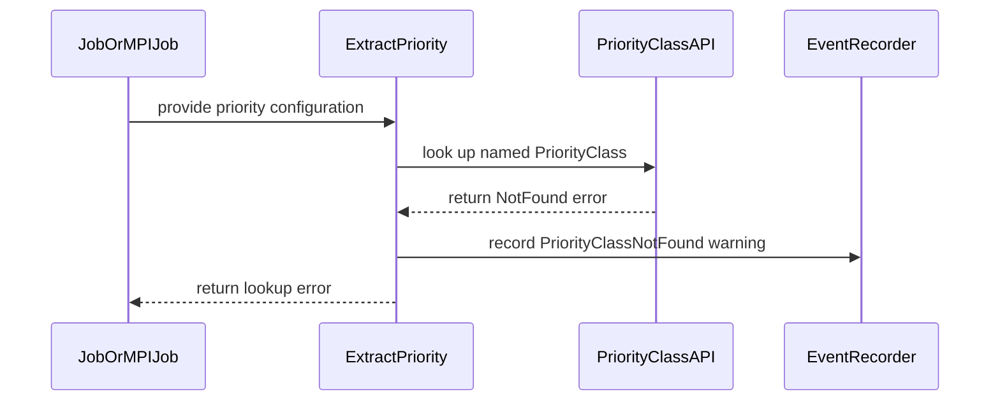

# PR #15175: Raise a warning event when a PriorityClass is not found

**Summary**: Raise a warning event when a PriorityClass is not found

**Sources**: https://github.com/kubernetes-sigs/kueue/pull/15175

**Last updated**: 2026-10-20T11:26:06Z

---

## Metadata

- **State**: open
- **Author**: [@Viswalahiri](https://github.com/Viswalahiri)
- **Branch**: `fix-15171` → `main`
- **Created**: 2026-09-04T09:05:13Z
- **Updated**: 2026-10-20T11:26:06Z
- **Merged**: —
- **Closed**: —
- **Labels**: `kind/feature`, `release-note`, `lifecycle/stale`, `size/L`, `ok-to-test`, `cncf-cla: yes`, `area/integrations`, `area/website`
- **Assignees**: _none_
- **Requested reviewers**: [@kannon92](https://github.com/kannon92), [@pajakd](https://github.com/pajakd)
- **Changed files**: 7   **+310 / -22**

## Description

<!--  Thanks for sending a pull request!  Here are some tips for you:

1. If this is your first time, please read our contributor guidelines: https://git.k8s.io/community/contributors/guide/first-contribution.md#your-first-contribution and developer guide https://git.k8s.io/community/contributors/devel/development.md#development-guide
2. Please label this pull request according to what type of issue you are addressing, especially if this is a release targeted pull request. For reference on required PR/issue labels, read here:
https://git.k8s.io/community/contributors/devel/sig-release/release.md#issuepr-kind-label
3. Ensure you have added or ran the appropriate tests for your PR: https://git.k8s.io/community/contributors/devel/sig-testing/testing.md
4. If you want *faster* PR reviews, read how: https://git.k8s.io/community/contributors/guide/pull-requests.md#best-practices-for-faster-reviews
5. If the PR is unfinished, see how to mark it: https://git.k8s.io/community/contributors/guide/pull-requests.md#marking-unfinished-pull-requests
-->

#### What type of PR is this?
/kind feature
/area integrations
/area website

<!--
Add one of the following kinds:
/kind bug
/kind cleanup
/kind documentation
/kind feature
/kind kep

Optionally add one or more of the following kinds if applicable:
/kind api-change
/kind deprecation
/kind failing-test
/kind flake
/kind regression

Please also consider setting the area:
/area tas
/area was
/area integrations
/area multikueue
/area dashboard
/area localization
/area testing
/area website
-->

#### What this PR does / why we need it:
A job that names a scheduling.k8s.io PriorityClass that does not exist stalls in reconciliation. Without a priority there is no Workload, so the job stays suspended and unqueued, and nothing reports why. ExtractPriority now reports that miss as a Warning event on the object, alongside the WorkloadPriorityClassNotFound event it already reports, so one call site covers every path that reaches the lookup.

#### Which issue(s) this PR fixes:
<!--
*Automatically closes linked issue when PR is merged.
Usage: `Fixes #<issue number>`, or `Fixes (paste link of issue)`.
_If PR is about `failing-tests or flakes`, please post the related issues/tests in a comment and do not use `Fixes`_*
-->
Fixes #15171 

#### Special notes for your reviewer:

#### Does this PR introduce a user-facing change?
<!--
If no, just write "NONE" in the release-note block below.
If yes, a release note is required:
Enter your extended release note in the block below. If the PR requires additional action from users switching to the new release, include the string "action required".
-->
```release-note
Added a `Warning` event with reason `PriorityClassNotFound` when Kueue cannot resolve the `scheduling.k8s.io` `PriorityClass` a job names, making it visible why a suspended job stays unqueued with no `Workload` created.
```

____
Disclosure: AI assistance was used in the drafting of tests


<!-- This is an auto-generated comment: release notes by coderabbit.ai -->

## Summary by CodeRabbit

* **New Features**
  * Added warning events when referenced Kubernetes `PriorityClass` objects are missing.
  * Workload creation is delayed until a missing priority class becomes available.
  * Priority resolution now consistently reports missing classes across supported workload types.

* **Documentation**
  * Documented priority class references, missing-class behavior, warning events, and workload-specific effects.

* **Bug Fixes**
  * Improved priority propagation and error handling for Jobs, Pods, and MPIJobs using unavailable priority classes.

<!-- end of auto-generated comment: release notes by coderabbit.ai -->

## Discussion

### Comment by [@netlify[bot]](https://github.com/apps/netlify) — 2026-09-04T09:05:23Z

### <span aria-hidden="true">✅</span> Deploy Preview for *kubernetes-sigs-kueue* ready!


|  Name | Link |
|:-:|------------------------|
|<span aria-hidden="true">🔨</span> Latest commit | 2a5e0c85d8ba8efc580cee4e2645e00daec8af6b |
|<span aria-hidden="true">🔍</span> Latest deploy log | https://app.netlify.com/projects/kubernetes-sigs-kueue/deploys/6a9a89cc0e6613000815fce1 |
|<span aria-hidden="true">😎</span> Deploy Preview | [https://deploy-preview-15175--kubernetes-sigs-kueue.netlify.app](https://deploy-preview-15175--kubernetes-sigs-kueue.netlify.app) |
|<span aria-hidden="true">📱</span> Preview on mobile | <details><summary> Toggle QR Code... </summary><br /><br /><br /><br />_Use your smartphone camera to open QR code link._</details> |
---
<!-- [kubernetes-sigs-kueue Preview](https://deploy-preview-15175--kubernetes-sigs-kueue.netlify.app) -->
_To edit notification comments on pull requests, go to your [Netlify project configuration](https://app.netlify.com/projects/kubernetes-sigs-kueue/configuration/notifications#deploy-notifications)._

### Comment by [@kubernetes-prow[bot]](https://github.com/apps/kubernetes-prow) — 2026-09-04T09:05:24Z

Hi @Viswalahiri. Thanks for your PR.

I'm waiting for a [kubernetes-sigs](https://github.com/orgs/kubernetes-sigs/people) member to verify that this patch is reasonable to test. If it is, they should reply with `/ok-to-test` on its own line. Until that is done, I will not automatically test new commits in this PR, but the usual testing commands by org members will still work.

>[!TIP]
>**We noticed you've done this a few times! Consider [joining the org](https://git.k8s.io/community/community-membership.md#member) to skip this step and gain `/lgtm` and other bot rights.** We recommend asking approvers on your previous PRs to sponsor you.

Once the patch is verified, the new status will be reflected by the `ok-to-test` label.

I understand the commands that are listed [here](https://go.k8s.io/bot-commands?repo=kubernetes-sigs%2Fkueue).

<details>

Instructions for interacting with me using PR comments are available [here](https://git.k8s.io/community/contributors/guide/pull-requests.md).  If you have questions or suggestions related to my behavior, please file an issue against the [kubernetes-sigs/prow](https://github.com/kubernetes-sigs/prow/issues/new?title=Prow%20issue:) repository.
</details>

### Comment by [@kubernetes-prow[bot]](https://github.com/apps/kubernetes-prow) — 2026-09-04T09:05:32Z

[APPROVALNOTIFIER] This PR is **NOT APPROVED**

This pull-request has been approved by: *<a href="https://github.com/kubernetes-sigs/kueue/pull/15175#" title="Author self-approved">Viswalahiri</a>*
**Once this PR has been reviewed and has the lgtm label**, please assign [sohankunkerkar](https://github.com/sohankunkerkar) for approval. For more information see [the Code Review Process](https://git.k8s.io/community/contributors/guide/owners.md#the-code-review-process).

The full list of commands accepted by this bot can be found [here](https://go.k8s.io/bot-commands?repo=kubernetes-sigs%2Fkueue).

<details open>
Needs approval from an approver in each of these files:

- **[OWNERS](https://github.com/kubernetes-sigs/kueue/blob/main/OWNERS)**

Approvers can indicate their approval by writing `/approve` in a comment
Approvers can cancel approval by writing `/approve cancel` in a comment
</details>
<!-- META={"approvers":["sohankunkerkar"]} -->

### Comment by [@coderabbitai[bot]](https://github.com/apps/coderabbitai) — 2026-09-04T09:06:26Z

<!-- This is an auto-generated comment: summarize by coderabbit.ai -->
<!-- review_stack_entry_start -->

[](https://app.coderabbit.ai/change-stack/kubernetes-sigs/kueue/pull/15175)

<!-- review_stack_entry_end -->
<!-- recent_review_start -->

No actionable comments were generated in the recent review. 🎉

<details>
<summary>ℹ️ Recent review info</summary>

<details>
<summary>⚙️ Run configuration</summary>

**Configuration used**: Path: .coderabbit.yaml

**Review profile**: CHILL

**Plan**: Team

**Run ID**: `c4b307ee-eac8-4ca2-bcf5-a1fd9cc54c91`

</details>

<details>
<summary>📥 Commits</summary>

Reviewing files that changed from the base of the PR and between 90ae430e57c47f783456d404d35694750f185432 and 2a5e0c85d8ba8efc580cee4e2645e00daec8af6b.

</details>

<details>
<summary>📒 Files selected for processing (7)</summary>

* `pkg/controller/jobframework/events.go`
* `pkg/controller/jobframework/reconciler.go`
* `pkg/controller/jobframework/workload_priority_test.go`
* `pkg/controller/jobs/job/job_controller_test.go`
* `pkg/controller/jobs/mpijob/mpijob_controller_test.go`
* `site/content/en/docs/concepts/workload_priority_class.md`
* `test/integration/singlecluster/controller/jobs/job/job_controller_test.go`

</details>

**Included review availability:** Your plan provides up to 8 included reviews per hour; 7 remain after this review.

</details>

---


<!-- recent_review_end -->
<!-- walkthrough_start -->

<details>
<summary>📝 Walkthrough</summary>

## Walkthrough

### Changes

**PriorityClass event handling**

|Layer / File(s)|Summary|
|---|---|
|**Priority resolution and event emission** <br> `pkg/controller/jobframework/events.go`, `pkg/controller/jobframework/reconciler.go`|Adds the `PriorityClassNotFound` event reason. `ExtractPriority` records a warning when a named `PriorityClass` is missing while returning the lookup error.|
|**Priority resolution test matrix** <br> `pkg/controller/jobframework/workload_priority_test.go`|Tests priority resolution precedence, missing classes, cluster defaults, and non-NotFound errors.|
|**Controller behavior and documentation** <br> `pkg/controller/jobs/job/job_controller_test.go`, `pkg/controller/jobs/mpijob/mpijob_controller_test.go`, `test/integration/singlecluster/controller/jobs/job/job_controller_test.go`, `site/content/en/docs/concepts/workload_priority_class.md`|Tests warning events, unchanged objects, workload retry, priority propagation, and documented missing-class behavior.|

**Estimated code review effort:** 3 (Moderate) | ~20 minutes

<!-- final_review_risk_start -->
**Merge Risk:** _⚪ Minimal_ · up to `2a5e0`
<!-- final_review_risk_coverage:{"sourceCommitId":"2a5e0c85d8ba8efc580cee4e2645e00daec8af6b","coveredCommitId":"2a5e0c85d8ba8efc580cee4e2645e00daec8af6b","kind":"reviewed"} -->

This change reports a warning when a referenced Kubernetes PriorityClass is missing while preserving priority-resolution errors and retry behavior. The covered Job and MPIJob paths retain existing behavior aside from the new visibility event.
<!-- final_review_risk_end -->

### Sequence Diagram(s)



**Suggested reviewers:** `thc1006`, `ivnovakov`, `mbobrovskyi`

</details>

<!-- walkthrough_end -->
<!-- pre_merge_checks_walkthrough_start -->

<details>
<summary>🚥 Pre-merge checks | ✅ 4 | ❌ 1</summary>

### ❌ Failed checks (1 warning)

|     Check name     | Status     | Explanation                                                                                                                                                                                               | Resolution                                                                         |
| :----------------: | :--------- | :-------------------------------------------------------------------------------------------------------------------------------------------------------------------------------------------------------- | :--------------------------------------------------------------------------------- |
| Docstring Coverage | ⚠️ Warning | Docstring coverage is 50.00% which is insufficient. The required threshold is 80.00%. Docstring coverage is scoped to functions touched by this diff. Analyzed 6 functions across 6 files. (1 skipped: 1… | Write docstrings for the functions missing them to satisfy the coverage threshold. |

<details>
<summary>✅ Passed checks (4 passed)</summary>

|         Check name         | Status   | Explanation                                                                                                                                                                                               |
| :------------------------: | :------- | :-------------------------------------------------------------------------------------------------------------------------------------------------------------------------------------------------------- |
|     Linked Issues check    | ✅ Passed | The implementation satisfies issue `#15171`. It emits PriorityClassNotFound warnings for missing scheduling.k8s.io PriorityClass references, covers the relevant lookup paths, adds tests, and updates the… |
| Out of Scope Changes check | ✅ Passed | All changes support issue `#15171`. The code, tests, event constant, and documentation are directly related to missing PriorityClass reporting.                                                             |
|      Description Check     | ✅ Passed | Check skipped - CodeRabbit’s high-level summary is enabled.                                                                                                                                               |
|         Title check        | ✅ Passed | The title clearly and concisely describes the main change: emitting a warning event when a referenced PriorityClass is not found.                                                                         |

</details>

<details>
<summary>Full details: Docstring Coverage</summary>

**Explanation**

Docstring coverage is 50.00% which is insufficient. The required threshold is 80.00%. Docstring coverage is scoped to functions touched by this diff. Analyzed 6 functions across 6 files. (1 skipped: 1 unsupported.)

</details>

</details>

<!-- pre_merge_checks_walkthrough_end -->

- [ ] <!-- {"checkboxId":"585bb3f6-faf5-4dbf-96d2-74e382adf19a"} --> Fix all pre-merge checks with AI
<!-- finishing_touch_checkbox_start -->

<details>
<summary>✨ Finishing Touches</summary>

<details>
<summary>🧪 Generate unit tests (beta)</summary>

- [ ] <!-- {"checkboxId": "f47ac10b-58cc-4372-a567-0e02b2c3d479", "radioGroupId": "utg-output-choice-group-unknown_comment_id"} -->   Create PR with unit tests

</details>

</details>

<!-- finishing_touch_checkbox_end -->
<!-- tips_start -->

---


<sub>Comment `@coderabbitai help` to get the list of available commands.</sub>

<!-- tips_end -->

### Comment by [@mimowo](https://github.com/mimowo) — 2026-09-04T09:10:22Z

/ok-to-test

### Comment by [@Viswalahiri](https://github.com/Viswalahiri) — 2026-09-04T23:00:13Z

@mimowo I believe tests have passed, can we move this forward or are any revisions needed iyo?

### Comment by [@kubernetes-prow[bot]](https://github.com/apps/kubernetes-prow) — 2026-09-10T19:49:46Z

@Viswalahiri: The following tests **failed**, say `/retest` to rerun all failed tests or `/retest-required` to rerun all mandatory failed tests:

Test name | Commit | Details | Required | Rerun command
--- | --- | --- | --- | ---
pull-kueue-test-e2e-dra-baseline-main | 2a5e0c85d8ba8efc580cee4e2645e00daec8af6b | [link](https://prow.k8s.io/view/gs/kubernetes-ci-logs/pr-logs/pull/kubernetes-sigs_kueue/15175/pull-kueue-test-e2e-dra-baseline-main/2098134359600009216) | true | `/test pull-kueue-test-e2e-dra-baseline-main`
pull-kueue-test-e2e-dra-capacity-main | 2a5e0c85d8ba8efc580cee4e2645e00daec8af6b | [link](https://prow.k8s.io/view/gs/kubernetes-ci-logs/pr-logs/pull/kubernetes-sigs_kueue/15175/pull-kueue-test-e2e-dra-capacity-main/2098134359679700992) | true | `/test pull-kueue-test-e2e-dra-capacity-main`

[Full PR test history](https://prow.k8s.io/pr-history?org=kubernetes-sigs&repo=kueue&pr=15175). [Your PR dashboard](https://prow.k8s.io/pr?query=is%3Apr%20state%3Aopen%20author%3AViswalahiri). Please help us cut down on flakes by [linking to](https://git.k8s.io/community/contributors/devel/sig-testing/flaky-tests.md#filing-issues-for-flaky-tests) an [open issue](https://github.com/kubernetes-sigs/kueue/issues?q=is:issue+is:open) when you hit one in your PR.

<details>

Instructions for interacting with me using PR comments are available [here](https://git.k8s.io/community/contributors/guide/pull-requests.md).  If you have questions or suggestions related to my behavior, please file an issue against the [kubernetes-sigs/prow](https://github.com/kubernetes-sigs/prow/issues/new?title=Prow%20issue:) repository. I understand the commands that are listed [here](https://go.k8s.io/bot-commands).
</details>
<!-- test report -->

### Comment by [@thc1006](https://github.com/thc1006) — 2026-10-19T20:20:07Z

Dear @Viswalahiri, I'm sorry I missed your PTAL on #15171.

On today's main the two new integration specs no longer build (`undefined: util`), since the test helpers moved from `test/util` to `test/util/behavioral` in early October. Could you rebase and change their `util.` calls to `behavioral.`? With that change both specs pass for me, and the warning one fails without the new event. The two DRA e2e failures from September will rerun with the push.

The rest looks good to me, and I'll /lgtm once it's rebased.

### Comment by [@k8s-triage-robot](https://github.com/k8s-triage-robot) — 2026-10-20T11:26:04Z

The Kubernetes project currently lacks enough active contributors to adequately respond to all PRs.

This bot triages PRs according to the following rules:
- After 30d of inactivity, `lifecycle/stale` is applied
- After 30d of inactivity since `lifecycle/stale` was applied, `lifecycle/rotten` is applied
- After 30d of inactivity since `lifecycle/rotten` was applied, the PR is closed

You can:
- Mark this PR as fresh with `/remove-lifecycle stale`
- Close this PR with `/close`
- Offer to help out with [Issue Triage][1]

Please send feedback to us at [Kueue](https://github.com/kubernetes-sigs/kueue/tree/main#community-discussion-contribution-and-support).

/lifecycle stale

[1]: https://www.kubernetes.dev/docs/guide/issue-triage/
