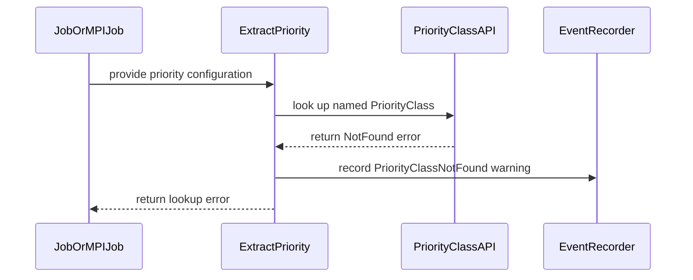

# PR #15175: Raise a warning event when a PriorityClass is not found

**Summary**: Raise a warning event when a PriorityClass is not found

**Sources**: https://github.com/kubernetes-sigs/kueue/pull/15175

**Last updated**: 2026-11-16T09:41:44Z

---

## Metadata

- **State**: open
- **Author**: [@Viswalahiri](https://github.com/Viswalahiri)
- **Branch**: `fix-15171` → `main`
- **Created**: 2026-09-04T09:05:13Z
- **Updated**: 2026-11-16T09:41:44Z
- **Merged**: —
- **Closed**: —
- **Labels**: `kind/feature`, `release-note`, `size/L`, `lgtm`, `ok-to-test`, `cncf-cla: yes`, `area/integrations`, `area/website`
- **Assignees**: [@thc1006](https://github.com/thc1006)
- **Requested reviewers**: [@kannon92](https://github.com/kannon92), [@pajakd](https://github.com/pajakd)
- **Changed files**: 7   **+310 / -22**

## Description

<!--  Thanks for sending a pull request!  Here are some tips for you:

1. If this is your first time, please read our contributor guidelines: https://git.k8s.io/community/contributors/guide/first-contribution.md#your-first-contribution and developer guide https://git.k8s.io/community/contributors/devel/development.md#development-guide
2. Please label this pull request according to what type of issue you are addressing, especially if this is a release targeted pull request. For reference on required PR/issue labels, read here:
https://git.k8s.io/community/contributors/devel/sig-release/release.md#issuepr-kind-label
3. Ensure you have added or ran the appropriate tests for your PR: https://git.k8s.io/community/contributors/devel/sig-testing/testing.md
4. If you want *faster* PR reviews, read how: https://git.k8s.io/community/contributors/guide/pull-requests.md#best-practices-for-faster-reviews
5. If the PR is unfinished, see how to mark it: https://git.k8s.io/community/contributors/guide/pull-requests.md#marking-unfinished-pull-requests
-->

#### What type of PR is this?
/kind feature
/area integrations
/area website

<!--
Add one of the following kinds:
/kind bug
/kind cleanup
/kind documentation
/kind feature
/kind kep

Optionally add one or more of the following kinds if applicable:
/kind api-change
/kind deprecation
/kind failing-test
/kind flake
/kind regression

Please also consider setting the area:
/area tas
/area was
/area integrations
/area multikueue
/area dashboard
/area localization
/area testing
/area website
-->

#### What this PR does / why we need it:
If a job names a `scheduling.k8s.io` `PriorityClass` that doesn't exist, it gets stuck in reconciliation. There's no priority, so no Workload gets created, the job stays suspended and unqueued, and nothing tells the user why. `ExtractPriority` now records a `Warning` event with reason `PriorityClassNotFound` on the object, the same way it already does for `WorkloadPriorityClassNotFound`. Since it's in `ExtractPriority`, every path that does the lookup gets it.

#### Which issue(s) this PR fixes:
<!--
*Automatically closes linked issue when PR is merged.
Usage: `Fixes #<issue number>`, or `Fixes (paste link of issue)`.
_If PR is about `failing-tests or flakes`, please post the related issues/tests in a comment and do not use `Fixes`_*
-->
Fixes #15171 

#### Special notes for your reviewer:

#### Does this PR introduce a user-facing change?
<!--
If no, just write "NONE" in the release-note block below.
If yes, a release note is required:
Enter your extended release note in the block below. If the PR requires additional action from users switching to the new release, include the string "action required".
-->
```release-note
Added a `Warning` event with reason `PriorityClassNotFound` when Kueue cannot resolve the `scheduling.k8s.io` `PriorityClass` a job names, making it visible why a suspended job stays unqueued with no `Workload` created.
```

____
Disclosure: AI assistance was used in the drafting of tests


<!-- This is an auto-generated comment: release notes by coderabbit.ai -->
<!-- coderabbit-ai-generated:v1 -->

## AI summary

This change makes Kueue report a missing Kubernetes `PriorityClass` to users. Before this change, a suspended Job that named a missing `scheduling.k8s.io` `PriorityClass` gave no event on the Job. Kueue returned only a reconcile error.

- Adds the event reason constant `ReasonPriorityClassNotFound` with value `PriorityClassNotFound` in `pkg/controller/jobframework/events.go`.
- Changes `ExtractPriority` in `pkg/controller/jobframework/reconciler.go`. When a named Kubernetes `PriorityClass` lookup returns NotFound, it emits a `Warning` event with reason `PriorityClassNotFound` and still returns the lookup error. An empty class name emits no event.
- Resolves the class name from the integration-provided priority-class accessor when one exists. Otherwise, it uses the first PodSet template's class name.
- Adds a "Referencing a PriorityClass" section to `site/content/en/docs/concepts/workload_priority_class.md`. It states that the class must exist before Kueue creates the Workload. It also states that the Job remains suspended until then, and that CRDs such as `MPIJob` can name a class that no Pod spec contains.
- Adds unit tests in `workload_priority_test.go` for missing, existing, integration-provided, and forbidden class lookups. It also adds reconciler tests for the Job and MPIJob controllers, and integration tests for Job `PriorityClass` lookup.

### Suggested release note

```release-note
Observability: Kueue now emits a `PriorityClassNotFound` Warning event on a Job, or other workload object, that references a `scheduling.k8s.io` PriorityClass that does not exist. Kueue does not create the Workload until the PriorityClass exists. Previously, the failure was not reported on suspended Jobs.
```
<!-- end of auto-generated comment: release notes by coderabbit.ai -->

## Discussion

### Comment by [@netlify[bot]](https://github.com/apps/netlify) — 2026-09-04T09:05:23Z

### <span aria-hidden="true">👷</span> Deploy request for *kubernetes-sigs-kueue* pending review.
[Visit the deploys page to approve it](https://app.netlify.com/projects/kubernetes-sigs-kueue/deploys)

|  Name | Link |
|:-:|------------------------|
|<span aria-hidden="true">🔨</span> Latest commit | 9fea52d85fa441aee5bdc33aaf243e6981cbda04 |

### Comment by [@kubernetes-prow[bot]](https://github.com/apps/kubernetes-prow) — 2026-09-04T09:05:24Z

Hi @Viswalahiri. Thanks for your PR.

I'm waiting for a [kubernetes-sigs](https://github.com/orgs/kubernetes-sigs/people) member to verify that this patch is reasonable to test. If it is, they should reply with `/ok-to-test` on its own line. Until that is done, I will not automatically test new commits in this PR, but the usual testing commands by org members will still work.

>[!TIP]
>**We noticed you've done this a few times! Consider [joining the org](https://git.k8s.io/community/community-membership.md#member) to skip this step and gain `/lgtm` and other bot rights.** We recommend asking approvers on your previous PRs to sponsor you.

Once the patch is verified, the new status will be reflected by the `ok-to-test` label.

I understand the commands that are listed [here](https://go.k8s.io/bot-commands?repo=kubernetes-sigs%2Fkueue).

<details>

Instructions for interacting with me using PR comments are available [here](https://git.k8s.io/community/contributors/guide/pull-requests.md).  If you have questions or suggestions related to my behavior, please file an issue against the [kubernetes-sigs/prow](https://github.com/kubernetes-sigs/prow/issues/new?title=Prow%20issue:) repository.
</details>

### Comment by [@coderabbitai[bot]](https://github.com/apps/coderabbitai) — 2026-09-04T09:06:26Z

<!-- coderabbit-ai-generated:v1 -->

<!-- This is an auto-generated comment: summarize by coderabbit.ai -->
<!-- review_stack_entry_start -->

<a href="https://app.coderabbit.ai/change-stack/kubernetes-sigs/kueue/pull/15175?scope=ghh_OusAJGA4HG8ljoOV0wJvVx8NmnZIjc2DdjmxOu0xZWA&amp;cs_source=review_comment"><picture><source media="(prefers-color-scheme: dark)" srcset="https://storage.googleapis.com/coderabbit_public_assets/review-stack-buttons-v1/explain-change-dark.svg"><source media="(prefers-color-scheme: light)" srcset="https://storage.googleapis.com/coderabbit_public_assets/review-stack-buttons-v1/explain-change.svg"></picture></a>

<!-- review_stack_entry_end -->
<!-- recent_review_status_start -->

No actionable comments were generated in the recent review.

<!-- recent_review_status_end -->
<!-- walkthrough_start -->

<details>
<summary><strong>Walkthrough</strong></summary>
<dl>
<dd>
<br>

### Changes

**PriorityClass event handling**

|Layer / File(s)|Summary|
|:---|:---|
|**Priority resolution and event emission** <br> `pkg/controller/jobframework/events.go`, `pkg/controller/jobframework/reconciler.go`|Adds the `PriorityClassNotFound` event reason. `ExtractPriority` records a warning when a named Kubernetes `PriorityClass` is missing and returns the lookup error.|
|**Priority resolution test coverage** <br> `pkg/controller/jobframework/workload_priority_test.go`|Covers missing and existing classes, integration-selected names, cluster defaults, and other lookup failures.|
|**Controller behavior and documentation** <br> `pkg/controller/jobs/job/job_controller_test.go`, `pkg/controller/jobs/mpijob/mpijob_controller_test.go`, `test/integration/singlecluster/controller/jobs/job/job_controller_test.go`, `site/content/en/docs/concepts/workload_priority_class.md`|Tests warning events, missing-class reconciliation, retry after class creation, and priority propagation. Documentation describes missing-class behavior.|

<!-- change_assessment_start -->


**Estimated code review effort:** 3 (Moderate) | ~20 minutes

<!-- change_assessment_commit:"9fea52d85fa441aee5bdc33aaf243e6981cbda04" -->
<!-- change_assessment_priority:{"version":1,"urgency":"p2","manual":false} -->
**Change:** Feature · **Severity of issue fixed:** Medium
<!-- change_assessment_end -->

### Sequence Diagram(s)



**Suggested reviewers:** `thc1006`, `mbobrovskyi`

</dd>
</dl>
</details>

<!-- walkthrough_end -->
<details>
<summary><strong>Merge Risk:</strong> <strong><picture></picture> Minimal</strong> · up to <code>9fea5</code></summary>
<dl>
<dd>
<br>

<!-- final_review_risk_start -->
<!-- final_review_risk_label
**Merge Risk:** **⚪ Minimal** · up to `9fea5`
-->
<!-- final_review_risk_coverage:{"sourceCommitId":"9fea52d85fa441aee5bdc33aaf243e6981cbda04","coveredCommitId":"9fea52d85fa441aee5bdc33aaf243e6981cbda04","kind":"reviewed"} -->

The change adds a PriorityClassNotFound warning event when a job names a PriorityClass that does not exist, so users can see why a suspended job has no Workload. Existing error behavior is kept, and the change has unit, controller and integration test coverage plus documentation. No merge-blocking risk was found.
<!-- final_review_risk_end -->

</dd>
</dl>
</details>
<!-- pre_merge_checks_walkthrough_start -->

<details>
<summary><strong>Pre-merge checks: <sup><picture></picture></sup> 4</strong></summary>
<dl>
<dd>
<br>

|         Check name         |                                             Status                                             | Explanation                                                                                                                                                                                               |
| :------------------------ | :--------------------------------------------------------------------------------------------: | :-------------------------------------------------------------------------------------------------------------------------------------------------------------------------------------------------------- |
|         Title check        |  | The title states the main change: Kueue now raises a Warning event when a PriorityClass cannot be found. The raw summary confirms a new PriorityClassNotFound event emitted from ExtractPriority when a … |
|     Linked Issues check    |  | [`#15171`] Requires a Warning event when Kueue cannot resolve a scheduling.k8s.io PriorityClass for a job, in paths where no Pod is created. At head 9fea52d, ExtractPriority in pkg/controller/jobframewo… |
| Out of Scope Changes check |  | All changed files relate to `#15171`. reconciler.go holds the new event logic. events.go adds the reason constant that the event uses. workload_priority_test.go, the Job and MPIJob controller unit tests… |
|      Description Check     |  | Check skipped - CodeRabbit’s high-level summary is enabled.                                                                                                                                               |

<details>
<summary><strong>Full details: Title check</strong></summary>
<dl>
<dd>
<br>

**Explanation**

The title states the main change: Kueue now raises a Warning event when a PriorityClass cannot be found. The raw summary confirms a new PriorityClassNotFound event emitted from ExtractPriority when a named Kubernetes PriorityClass lookup returns NotFound, and the objectives describe the same goal. The title is specific and matches the changeset.

</dd>
</dl>
</details>

<details>
<summary><strong>Full details: Linked Issues check</strong></summary>
<dl>
<dd>
<br>

**Explanation**

[`#15171`] Requires a Warning event when Kueue cannot resolve a scheduling.k8s.io PriorityClass for a job, in paths where no Pod is created. At head 9fea52d, ExtractPriority in pkg/controller/jobframework/reconciler.go resolves the integration accessor (customPriorityClassFunc) or the first PodSet template class. When the named class returns NotFound, it emits a Warning event with reason ReasonPriorityClassNotFound (new constant in events.go). The error is still returned, so the reconcile fails and no Workload is created until the class exists. An empty name does not emit the event, which matches the cluster-default case. The change covers the MPIJob path that the issue names, where the accessor can return a name no Pod carries. Unit tests (workload_priority_test.go, TestExtractPriorityReportsMissingClass), reconciler tests for Job and MPIJob, and integration tests in test/integration/singlecluster/controller/jobs/job cover the new behavior. The docs update, which the issue marks complete, is present in site/content/en/docs/concepts/workload_priority_class.md. The design doc and API change checkboxes are non-coding and do not apply. Scope uncertainty: I read only the reconciler.go diff. I did not run the tests, so test pass status is not established here.

</dd>
</dl>
</details>

<details>
<summary><strong>Full details: Out of Scope Changes check</strong></summary>
<dl>
<dd>
<br>

**Explanation**

All changed files relate to `#15171`. reconciler.go holds the new event logic. events.go adds the reason constant that the event uses. workload_priority_test.go, the Job and MPIJob controller unit tests, and the Job integration tests cover the new event and the unchanged return-error behavior. workload_priority_class.md documents the new warning, which the issue marks as a completed docs item. No change in the summary falls outside the issue's scope. I did not inspect the non-reconciler diffs in detail, so this verdict relies on the raw summary for those files.

</dd>
</dl>
</details>

</dd>
</dl>
</details>

<!-- pre_merge_checks_walkthrough_end -->
<!-- finishing_touch_checkbox_start -->

<details>
<summary><strong>Finishing Touches</strong></summary>
<dl>
<dd>
<br>

<details open>
<summary><strong>Generate unit tests (beta)</strong></summary>
<dl>
<dd>
<br>

- [ ] <!-- {"checkboxId": "f47ac10b-58cc-4372-a567-0e02b2c3d479", "radioGroupId": "utg-output-choice-group-unknown_comment_id"} --> Create a new PR

</dd>
</dl>
</details>

</dd>
</dl>
</details>

<!-- finishing_touch_checkbox_end -->

<!-- autopilot:start -->
- [ ] <!-- {"checkboxId":"2708ad07-9f24-4260-9c11-7dc76a49f2e3"} --> <strong title="Keep fixing CodeRabbit findings and required CI, and resolving merge conflicts">Autofix</strong> · Keep fixing CodeRabbit findings and required CI, and resolving merge conflicts
<!-- autopilot:end -->
<!-- recent_review_start -->

<h6>
<details>
<summary><strong><picture></picture> Recent review info</strong></summary>
<dl>
<dd>
<br>

<!-- review_info_content -->
<details>
<summary><strong><picture><source media="(prefers-color-scheme: dark)" srcset="https://storage.googleapis.com/coderabbit_public_assets/review-comment-icons-v1/cog-dark.svg"></picture> Run configuration</strong></summary>
<dl>
<dd>
<br>

- **Source mode**: Auto
- **Repository**: [kubernetes-sigs/kueue](<https://github.com/kubernetes-sigs/kueue>)
- **Branch**: [main](<https://github.com/kubernetes-sigs/kueue/tree/main>)
- **File**: [.coderabbit.yaml](<https://github.com/kubernetes-sigs/kueue/blob/31a8411e3c701b140baebf82ba3dbcdd1ee98cc6/.coderabbit.yaml>)
- **Commit**: [31a8411](<https://github.com/kubernetes-sigs/kueue/commit/31a8411e3c701b140baebf82ba3dbcdd1ee98cc6>)
- **Layers**: Repository YAML
- **Review profile**: CHILL
- **Plan**: Advanced
- **Run ID**: `6d85f0d6-1d1b-4094-bc99-09a810e8ca1c`

</dd>
</dl>
</details>

<details>
<summary><strong><picture><source media="(prefers-color-scheme: dark)" srcset="https://storage.googleapis.com/coderabbit_public_assets/review-comment-icons-v1/git-commit-horizontal-dark.svg"></picture> Commits</strong></summary>
<dl>
<dd>
<br>

Reviewing files that changed from the base of the PR and between 2a5e0c85d8ba8efc580cee4e2645e00daec8af6b and 9fea52d85fa441aee5bdc33aaf243e6981cbda04.

</dd>
</dl>
</details>

<details>
<summary><strong><picture><source media="(prefers-color-scheme: dark)" srcset="https://storage.googleapis.com/coderabbit_public_assets/review-comment-icons-v1/file-plus-corner-dark.svg"></picture> Files selected for processing: 6</strong></summary>
<dl>
<dd>
<br>

* `pkg/controller/jobframework/reconciler.go`
* `pkg/controller/jobframework/workload_priority_test.go`
* `pkg/controller/jobs/job/job_controller_test.go`
* `pkg/controller/jobs/mpijob/mpijob_controller_test.go`
* `site/content/en/docs/concepts/workload_priority_class.md`
* `test/integration/singlecluster/controller/jobs/job/job_controller_test.go`

</dd>
</dl>
</details>

<details>
<summary><strong><picture><source media="(prefers-color-scheme: dark)" srcset="https://storage.googleapis.com/coderabbit_public_assets/review-comment-icons-v1/file-similar-dark.svg"></picture> Files skipped from review as they are similar to previous changes: 1</strong></summary>
<dl>
<dd>
<br>

* site/content/en/docs/concepts/workload_priority_class.md

</dd>
</dl>
</details>

**Included review availability:** This review used your included allowance. Your plan provides up to 8 included reviews per hour; 7 remain after this review.

</dd>
</dl>
</details>
</h6>

<!-- recent_review_end -->

### Comment by [@mimowo](https://github.com/mimowo) — 2026-09-04T09:10:22Z

/ok-to-test

### Comment by [@Viswalahiri](https://github.com/Viswalahiri) — 2026-09-04T23:00:13Z

@mimowo I believe tests have passed, can we move this forward or are any revisions needed iyo?

### Comment by [@thc1006](https://github.com/thc1006) — 2026-10-19T20:20:07Z

Dear @Viswalahiri, I'm sorry I missed your PTAL on #15171.

On today's main the two new integration specs no longer build (`undefined: util`), since the test helpers moved from `test/util` to `test/util/behavioral` in early October. Could you rebase and change their `util.` calls to `behavioral.`? With that change both specs pass for me, and the warning one fails without the new event. The two DRA e2e failures from September will rerun with the push.

The rest looks good to me, and I'll /lgtm once it's rebased.

### Comment by [@k8s-triage-robot](https://github.com/k8s-triage-robot) — 2026-10-20T11:26:04Z

The Kubernetes project currently lacks enough active contributors to adequately respond to all PRs.

This bot triages PRs according to the following rules:
- After 30d of inactivity, `lifecycle/stale` is applied
- After 30d of inactivity since `lifecycle/stale` was applied, `lifecycle/rotten` is applied
- After 30d of inactivity since `lifecycle/rotten` was applied, the PR is closed

You can:
- Mark this PR as fresh with `/remove-lifecycle stale`
- Close this PR with `/close`
- Offer to help out with [Issue Triage][1]

Please send feedback to us at [Kueue](https://github.com/kubernetes-sigs/kueue/tree/main#community-discussion-contribution-and-support).

/lifecycle stale

[1]: https://www.kubernetes.dev/docs/guide/issue-triage/

### Comment by [@YevheniiOrlovEngineering](https://github.com/YevheniiOrlovEngineering) — 2026-11-15T23:09:09Z

Hi @Viswalahiri, are you still planning to finish this? @thc1006 offered to /lgtm once it's rebased and the two integration specs use `behavioral.` instead of `util.`. If you don't have time for it, I'd be glad to take it over: keep your commits, rebase and make that change. If you'd rather finish it yourself, no problem at all.

/remove-lifecycle stale

### Comment by [@Viswalahiri](https://github.com/Viswalahiri) — 2026-11-16T01:12:21Z

Sure, I'll finish this thanks.

### Comment by [@kubernetes-prow[bot]](https://github.com/apps/kubernetes-prow) — 2026-11-16T02:06:59Z

[APPROVALNOTIFIER] This PR is **NOT APPROVED**

This pull-request has been approved by: *<a href="https://github.com/kubernetes-sigs/kueue/pull/15175#" title="Author self-approved">Viswalahiri</a>*
**Once this PR has been reviewed and has the lgtm label**, please assign [tenzen-y](https://github.com/tenzen-y) for approval. For more information see [the Code Review Process](https://git.k8s.io/community/contributors/guide/owners.md#the-code-review-process).

The full list of commands accepted by this bot can be found [here](https://go.k8s.io/bot-commands?repo=kubernetes-sigs%2Fkueue).

<details open>
Needs approval from an approver in each of these files:

- **[OWNERS](https://github.com/kubernetes-sigs/kueue/blob/main/OWNERS)**

Approvers can indicate their approval by writing `/approve` in a comment
Approvers can cancel approval by writing `/approve cancel` in a comment
</details>
<!-- META={"approvers":["tenzen-y"]} -->

### Comment by [@Viswalahiri](https://github.com/Viswalahiri) — 2026-11-16T02:15:38Z

@thc1006 I've rebased on main and switched the two integration specs to behavioral. Unit tests, the integration specs, make ci-lint and make verify all pass locally. CI is rerunning now. PTAL when you get a chance.

cc @tenzen-y

### Comment by [@thc1006](https://github.com/thc1006) — 2026-11-16T09:30:48Z

/lgtm

### Comment by [@thc1006](https://github.com/thc1006) — 2026-11-16T09:30:55Z

/test pull-kueue-verify-website-links-preview-main

### Comment by [@kubernetes-prow[bot]](https://github.com/apps/kubernetes-prow) — 2026-11-16T09:30:58Z

LGTM label has been added.  <details>Git tree hash: 765a4afb5b4912be57cebfbe295d4a386064fade</details>

### Comment by [@kubernetes-prow[bot]](https://github.com/apps/kubernetes-prow) — 2026-11-16T09:41:43Z

@Viswalahiri: The following test **failed**, say `/retest` to rerun all failed tests or `/retest-required` to rerun all mandatory failed tests:

Test name | Commit | Details | Required | Rerun command
--- | --- | --- | --- | ---
pull-kueue-verify-website-links-preview-main | 9fea52d85fa441aee5bdc33aaf243e6981cbda04 | [link](https://prow.k8s.io/view/gs/kubernetes-ci-logs/pr-logs/pull/kubernetes-sigs_kueue/15175/pull-kueue-verify-website-links-preview-main/2122261134428868608) | false | `/test pull-kueue-verify-website-links-preview-main`

[Full PR test history](https://prow.k8s.io/pr-history?org=kubernetes-sigs&repo=kueue&pr=15175). [Your PR dashboard](https://prow.k8s.io/pr?query=is%3Apr%20state%3Aopen%20author%3AViswalahiri). Please help us cut down on flakes by [linking to](https://git.k8s.io/community/contributors/devel/sig-testing/flaky-tests.md#filing-issues-for-flaky-tests) an [open issue](https://github.com/kubernetes-sigs/kueue/issues?q=is:issue+is:open) when you hit one in your PR.

<details>

Instructions for interacting with me using PR comments are available [here](https://git.k8s.io/community/contributors/guide/pull-requests.md).  If you have questions or suggestions related to my behavior, please file an issue against the [kubernetes-sigs/prow](https://github.com/kubernetes-sigs/prow/issues/new?title=Prow%20issue:) repository. I understand the commands that are listed [here](https://go.k8s.io/bot-commands).
</details>
<!-- test report -->
