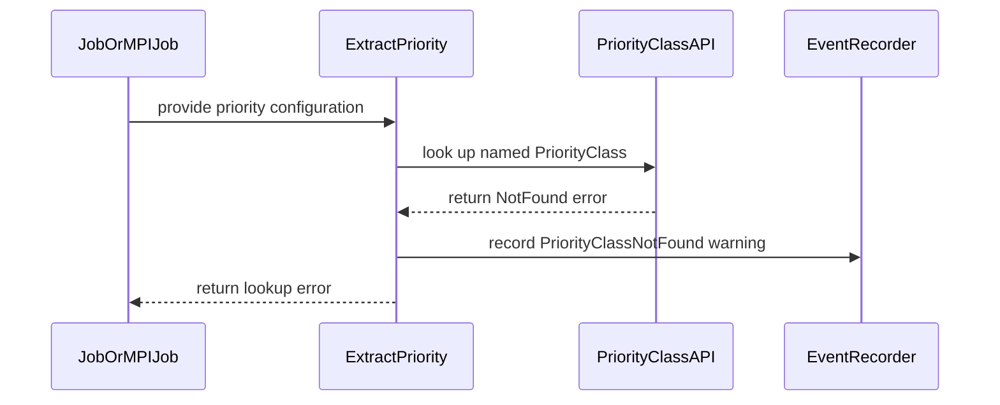

# PR #15175: Raise a warning event when a PriorityClass is not found

**Summary**: Raise a warning event when a PriorityClass is not found

**Sources**: https://github.com/kubernetes-sigs/kueue/pull/15175

**Last updated**: 2026-11-17T16:58:34Z

---

## Metadata

- **State**: closed (merged)
- **Author**: [@Viswalahiri](https://github.com/Viswalahiri)
- **Branch**: `fix-15171` → `main`
- **Created**: 2026-09-04T09:05:13Z
- **Updated**: 2026-11-17T16:58:34Z
- **Merged**: 2026-11-17T16:58:30Z
- **Closed**: 2026-11-17T16:58:30Z
- **Labels**: `kind/feature`, `release-note`, `size/L`, `lgtm`, `approved`, `ok-to-test`, `cncf-cla: yes`, `area/integrations`, `area/website`
- **Assignees**: [@mimowo](https://github.com/mimowo), [@thc1006](https://github.com/thc1006)
- **Requested reviewers**: [@kannon92](https://github.com/kannon92), [@pajakd](https://github.com/pajakd), [@thc1006](https://github.com/thc1006)
- **Changed files**: 7   **+314 / -22**

## Description

<!--  Thanks for sending a pull request!  Here are some tips for you:

1. If this is your first time, please read our contributor guidelines: https://git.k8s.io/community/contributors/guide/first-contribution.md#your-first-contribution and developer guide https://git.k8s.io/community/contributors/devel/development.md#development-guide
2. Please label this pull request according to what type of issue you are addressing, especially if this is a release targeted pull request. For reference on required PR/issue labels, read here:
https://git.k8s.io/community/contributors/devel/sig-release/release.md#issuepr-kind-label
3. Ensure you have added or ran the appropriate tests for your PR: https://git.k8s.io/community/contributors/devel/sig-testing/testing.md
4. If you want *faster* PR reviews, read how: https://git.k8s.io/community/contributors/guide/pull-requests.md#best-practices-for-faster-reviews
5. If the PR is unfinished, see how to mark it: https://git.k8s.io/community/contributors/guide/pull-requests.md#marking-unfinished-pull-requests
-->

#### What type of PR is this?
/kind feature
/area integrations
/area website

<!--
Add one of the following kinds:
/kind bug
/kind cleanup
/kind documentation
/kind feature
/kind kep

Optionally add one or more of the following kinds if applicable:
/kind api-change
/kind deprecation
/kind failing-test
/kind flake
/kind regression

Please also consider setting the area:
/area tas
/area was
/area integrations
/area multikueue
/area dashboard
/area localization
/area testing
/area website
-->

#### What this PR does / why we need it:
If a job names a `scheduling.k8s.io` `PriorityClass` that doesn't exist, it gets stuck in reconciliation. There's no priority, so no Workload gets created, the job stays suspended and unqueued, and nothing tells the user why. `ExtractPriority` now records a `Warning` event with reason `PriorityClassNotFound` on the object, the same way it already does for `WorkloadPriorityClassNotFound`. Since it's in `ExtractPriority`, every path that does the lookup gets it.

#### Which issue(s) this PR fixes:
<!--
*Automatically closes linked issue when PR is merged.
Usage: `Fixes #<issue number>`, or `Fixes (paste link of issue)`.
_If PR is about `failing-tests or flakes`, please post the related issues/tests in a comment and do not use `Fixes`_*
-->
Fixes #15171 

#### Special notes for your reviewer:

#### Does this PR introduce a user-facing change?
<!--
If no, just write "NONE" in the release-note block below.
If yes, a release note is required:
Enter your extended release note in the block below. If the PR requires additional action from users switching to the new release, include the string "action required".
-->
```release-note
Added a `Warning` event with reason `PriorityClassNotFound` when Kueue cannot resolve the `scheduling.k8s.io` `PriorityClass` a job names, making it visible why a suspended job stays unqueued with no `Workload` created.
```

____
Disclosure: AI assistance was used in the drafting of tests


<!-- This is an auto-generated comment: release notes by coderabbit.ai -->
<!-- coderabbit-ai-generated:v1 -->

## AI summary

This change makes Kueue report a missing Kubernetes `PriorityClass` to users. Before this change, a suspended Job that named a missing `scheduling.k8s.io` `PriorityClass` produced no event on the Job. Kueue returned only a reconcile error.

- Adds the event reason constant `ReasonPriorityClassNotFound` with value `PriorityClassNotFound` in `pkg/controller/jobframework/events.go`.
- Changes `ExtractPriority` in `pkg/controller/jobframework/reconciler.go`. When a named Kubernetes `PriorityClass` lookup returns NotFound, it emits a `Warning` event with reason `PriorityClassNotFound` and still returns the lookup error. An empty class name emits no event.
- Resolves the class name from the integration-provided priority-class accessor when one exists. Otherwise, it uses the first PodSet template's class name.
- Adds a "Referencing a PriorityClass" section to `site/content/en/docs/concepts/workload_priority_class.md`. It states that the class must exist before Kueue creates the Workload. It also states that the Job remains suspended until then. It notes that CRDs such as `MPIJob` can name a class that no Pod spec contains.
- Adds unit tests in `workload_priority_test.go` for missing, existing, integration-provided, and forbidden class lookups. It also adds reconciler tests for the Job and MPIJob controllers, and integration tests for Job `PriorityClass` lookup.

### Suggested release note

```release-note
Observability: Kueue now emits a `PriorityClassNotFound` Warning event on a Job, or other workload object, that references a `scheduling.k8s.io` PriorityClass that does not exist. Kueue does not create the Workload until the PriorityClass exists. Previously, the failure was not reported on suspended Jobs.
```
<!-- end of auto-generated comment: release notes by coderabbit.ai -->

## Discussion

### Comment by [@netlify[bot]](https://github.com/apps/netlify) — 2026-09-04T09:05:23Z

### <span aria-hidden="true">👷</span> Deploy request for *kubernetes-sigs-kueue* pending review.
[Visit the deploys page to approve it](https://app.netlify.com/projects/kubernetes-sigs-kueue/deploys)

|  Name | Link |
|:-:|------------------------|
|<span aria-hidden="true">🔨</span> Latest commit | 6991e021ee134997b80dd8e56d278c6458b7ce24 |

### Comment by [@kubernetes-prow[bot]](https://github.com/apps/kubernetes-prow) — 2026-09-04T09:05:24Z

Hi @Viswalahiri. Thanks for your PR.

I'm waiting for a [kubernetes-sigs](https://github.com/orgs/kubernetes-sigs/people) member to verify that this patch is reasonable to test. If it is, they should reply with `/ok-to-test` on its own line. Until that is done, I will not automatically test new commits in this PR, but the usual testing commands by org members will still work.

>[!TIP]
>**We noticed you've done this a few times! Consider [joining the org](https://git.k8s.io/community/community-membership.md#member) to skip this step and gain `/lgtm` and other bot rights.** We recommend asking approvers on your previous PRs to sponsor you.

Once the patch is verified, the new status will be reflected by the `ok-to-test` label.

I understand the commands that are listed [here](https://go.k8s.io/bot-commands?repo=kubernetes-sigs%2Fkueue).

<details>

Instructions for interacting with me using PR comments are available [here](https://git.k8s.io/community/contributors/guide/pull-requests.md).  If you have questions or suggestions related to my behavior, please file an issue against the [kubernetes-sigs/prow](https://github.com/kubernetes-sigs/prow/issues/new?title=Prow%20issue:) repository.
</details>

### Comment by [@coderabbitai[bot]](https://github.com/apps/coderabbitai) — 2026-09-04T09:06:26Z

<!-- coderabbit-ai-generated:v1 -->

<!-- This is an auto-generated comment: summarize by coderabbit.ai -->
<!-- review_stack_entry_start -->

<a href="https://app.coderabbit.ai/change-stack/kubernetes-sigs/kueue/pull/15175?scope=ghh_OusAJGA4HG8ljoOV0wJvVx8NmnZIjc2DdjmxOu0xZWA&amp;cs_source=review_comment"><picture><source media="(prefers-color-scheme: dark)" srcset="https://storage.googleapis.com/coderabbit_public_assets/review-stack-buttons-v1/explain-change-dark.svg"><source media="(prefers-color-scheme: light)" srcset="https://storage.googleapis.com/coderabbit_public_assets/review-stack-buttons-v1/explain-change.svg"></picture></a>

<!-- review_stack_entry_end -->
<!-- recent_review_status_start -->

No actionable comments were generated in the recent review.

<!-- recent_review_status_end -->
<!-- walkthrough_start -->

<details>
<summary><strong>Walkthrough</strong></summary>
<dl>
<dd>
<br>

`ExtractPriority` now emits a warning when a named Kubernetes `PriorityClass` cannot be found and returns the lookup error. Unit and controller tests cover lookup outcomes and reconciliation. Documentation describes the missing-class behavior and subsequent reconciliation after the class exists.

**Changes: PriorityClass event handling**

|Layer / File(s)|Summary|
|:---|:---|
|**Priority resolution and event emission** <br> `pkg/controller/jobframework/events.go`, `pkg/controller/jobframework/reconciler.go`|Adds the `PriorityClassNotFound` event reason. `ExtractPriority` records a warning when a named Kubernetes `PriorityClass` is missing and returns the lookup error.|
|**Priority resolution test coverage** <br> `pkg/controller/jobframework/workload_priority_test.go`|Covers missing and existing classes, integration-selected names, cluster defaults, and lookup failures that do not identify a named missing class.|
|**Controller behavior and documentation** <br> `pkg/controller/jobs/job/job_controller_test.go`, `pkg/controller/jobs/mpijob/mpijob_controller_test.go`, `test/integration/singlecluster/controller/jobs/job/job_controller_test.go`, `site/content/en/docs/concepts/workload_priority_class.md`|Tests warning events, missing-class reconciliation, retry after class creation, and priority propagation. Documentation describes missing-class behavior.|

<!-- change_assessment_start -->
**Estimated code review effort:** 3 (Moderate) | ~20 minutes

<!-- change_assessment_commit:"6991e021ee134997b80dd8e56d278c6458b7ce24" -->
<!-- change_assessment_priority:{"version":1,"urgency":"p2","manual":false} -->
**Change:** Feature · **Severity of issue fixed:** Medium
<!-- change_assessment_end -->

### Sequence Diagram(s)



</dd>
</dl>
</details>

<!-- walkthrough_end -->
<details>
<summary><strong>Merge Risk:</strong> <strong><picture></picture> Minimal</strong> · up to <code>6991e</code></summary>
<dl>
<dd>
<br>

<!-- final_review_risk_start -->
<!-- final_review_risk_label
**Merge Risk:** **⚪ Minimal** · up to `6991e`
-->
<!-- final_review_risk_coverage:{"sourceCommitId":"6991e021ee134997b80dd8e56d278c6458b7ce24","coveredCommitId":"6991e021ee134997b80dd8e56d278c6458b7ce24","kind":"reviewed"} -->

This change adds a visible Warning event when a job references a PriorityClass that does not exist. The behavior is additive and well covered by tests. No merge-blocking risk is evident.
<!-- final_review_risk_end -->

</dd>
</dl>
</details>
<!-- pre_merge_checks_walkthrough_start -->

<details>
<summary><strong>Pre-merge checks: <sup><picture></picture></sup> 4</strong></summary>
<dl>
<dd>
<br>

|         Check name         |                                             Status                                             | Explanation                                                                                                                                                                                               |
| :------------------------ | :--------------------------------------------------------------------------------------------: | :-------------------------------------------------------------------------------------------------------------------------------------------------------------------------------------------------------- |
|      Description Check     |  | Check skipped - CodeRabbit’s high-level summary is enabled.                                                                                                                                               |
|         Title check        |  | The title names the main change: Kueue now records a Warning event when a PriorityClass named by a job cannot be found. The raw summary and PR objectives both center on this event, and the title is sh… |
|     Linked Issues check    |  | [`#15171`] requires a Warning event when Kueue cannot resolve a scheduling.k8s.io PriorityClass on paths where no Pod is created. The whole-PR diff of pkg/controller/jobframework/reconciler.go (merge ba… |
| Out of Scope Changes check |  | All changed files relate to `#15171`. The reconciler.go diff contains the ExtractPriority event logic, the resolvePriorityClassName helper that the event path uses, and their doc comments. The helper's … |

<details>
<summary><strong>Full details: Title check</strong></summary>
<dl>
<dd>
<br>

**Explanation**

The title names the main change: Kueue now records a Warning event when a PriorityClass named by a job cannot be found. The raw summary and PR objectives both center on this event, and the title is short and specific. It does not describe the missing-WorkloadPriorityClass or PodSet refactoring details, which is acceptable.

</dd>
</dl>
</details>

<details>
<summary><strong>Full details: Linked Issues check</strong></summary>
<dl>
<dd>
<br>

**Explanation**

[`#15171`] requires a Warning event when Kueue cannot resolve a scheduling.k8s.io PriorityClass on paths where no Pod is created. The whole-PR diff of pkg/controller/jobframework/reconciler.go (merge base to head) shows that ExtractPriority now calls resolvePriorityClassName, which returns the integration accessor result (customPriorityClassFunc) or the first PodSet template class. It then calls GetPriorityFromPriorityClass. When the name is non-empty and the error is NotFound, it calls r.Eventf with type Warning, reason ReasonPriorityClassNotFound, and message 'PriorityClass %q not found'. The error is returned unchanged, so the reconcile still fails and no Workload is created until the class exists. An empty name emits no event, which matches the cluster-default case. The MPIJob accessor path named in the issue goes through the same branch. The reason constant is added in events.go. Tests cover the new event: workload_priority_test.go (TestExtractPriorityReportsMissingClass), job_controller_test.go, mpijob_controller_test.go, and the integration spec in test/integration/singlecluster/controller/jobs/job/job_controller_test.go. The docs item marked complete in the issue is covered by workload_priority_class.md. The design doc and API change checkboxes are not coding requirements of this PR. Uncertainty: I did not run the tests. Author and reviewer test results are not verified here.

</dd>
</dl>
</details>

<details>
<summary><strong>Full details: Out of Scope Changes check</strong></summary>
<dl>
<dd>
<br>

**Explanation**

All changed files relate to `#15171`. The reconciler.go diff contains the ExtractPriority event logic, the resolvePriorityClassName helper that the event path uses, and their doc comments. The helper's extraction is a refactor that supports the new branch. events.go adds the reason constant used by that event. The unit, reconciler, and integration tests exercise the new event. workload_priority_class.md documents the new warning. No changed hunk lacks a connection to the issue. Uncertainty: I inspected only the reconciler.go diff in this pass. The verdicts for test and documentation files rely on the change summary.

</dd>
</dl>
</details>

</dd>
</dl>
</details>

<!-- pre_merge_checks_walkthrough_end -->
<!-- finishing_touch_checkbox_start -->

<details>
<summary><strong>Finishing Touches</strong></summary>
<dl>
<dd>
<br>

<details open>
<summary><strong>Generate unit tests (beta)</strong></summary>
<dl>
<dd>
<br>

- [ ] <!-- {"checkboxId": "f47ac10b-58cc-4372-a567-0e02b2c3d479", "radioGroupId": "utg-output-choice-group-unknown_comment_id"} --> Create a new PR

</dd>
</dl>
</details>

</dd>
</dl>
</details>

<!-- finishing_touch_checkbox_end -->

<!-- autopilot:start -->
- [ ] <!-- {"checkboxId":"2708ad07-9f24-4260-9c11-7dc76a49f2e3"} --> <strong title="Keep fixing CodeRabbit findings and required CI, and resolving merge conflicts">Autofix</strong> · Keep fixing CodeRabbit findings and required CI, and resolving merge conflicts
<!-- autopilot:end -->
<!-- recent_review_start -->

<h6>
<details>
<summary><strong><picture></picture> Recent review info</strong></summary>
<dl>
<dd>
<br>

<!-- review_info_content -->
<details>
<summary><strong><picture><source media="(prefers-color-scheme: dark)" srcset="https://storage.googleapis.com/coderabbit_public_assets/review-comment-icons-v1/cog-dark.svg"></picture> Run configuration</strong></summary>
<dl>
<dd>
<br>

- **Source mode**: Auto
- **Repository**: [kubernetes-sigs/kueue](<https://github.com/kubernetes-sigs/kueue>)
- **Branch**: [main](<https://github.com/kubernetes-sigs/kueue/tree/main>)
- **File**: [.coderabbit.yaml](<https://github.com/kubernetes-sigs/kueue/blob/aaaeee94a273658451047a6853724438b923d907/.coderabbit.yaml>)
- **Commit**: [aaaeee9](<https://github.com/kubernetes-sigs/kueue/commit/aaaeee94a273658451047a6853724438b923d907>)
- **Layers**: Repository YAML
- **Review profile**: CHILL
- **Plan**: Advanced
- **Run ID**: `21ee9a19-0bcd-4010-97f3-faeb87c57de6`

</dd>
</dl>
</details>

<details>
<summary><strong><picture><source media="(prefers-color-scheme: dark)" srcset="https://storage.googleapis.com/coderabbit_public_assets/review-comment-icons-v1/git-commit-horizontal-dark.svg"></picture> Commits</strong></summary>
<dl>
<dd>
<br>

Reviewing files that changed from the base of the PR and between 9fea52d85fa441aee5bdc33aaf243e6981cbda04 and 6991e021ee134997b80dd8e56d278c6458b7ce24.

</dd>
</dl>
</details>

<details>
<summary><strong><picture><source media="(prefers-color-scheme: dark)" srcset="https://storage.googleapis.com/coderabbit_public_assets/review-comment-icons-v1/file-plus-corner-dark.svg"></picture> Files selected for processing: 1</strong></summary>
<dl>
<dd>
<br>

* `pkg/controller/jobframework/reconciler.go`

</dd>
</dl>
</details>

**Included review availability:** This review used your included allowance. Your plan provides up to 8 included reviews per hour; 7 remain after this review.

</dd>
</dl>
</details>
</h6>

<!-- recent_review_end -->

### Comment by [@mimowo](https://github.com/mimowo) — 2026-09-04T09:10:22Z

/ok-to-test

### Comment by [@Viswalahiri](https://github.com/Viswalahiri) — 2026-09-04T23:00:13Z

@mimowo I believe tests have passed, can we move this forward or are any revisions needed iyo?

### Comment by [@thc1006](https://github.com/thc1006) — 2026-10-19T20:20:07Z

Dear @Viswalahiri, I'm sorry I missed your PTAL on #15171.

On today's main the two new integration specs no longer build (`undefined: util`), since the test helpers moved from `test/util` to `test/util/behavioral` in early October. Could you rebase and change their `util.` calls to `behavioral.`? With that change both specs pass for me, and the warning one fails without the new event. The two DRA e2e failures from September will rerun with the push.

The rest looks good to me, and I'll /lgtm once it's rebased.

### Comment by [@k8s-triage-robot](https://github.com/k8s-triage-robot) — 2026-10-20T11:26:04Z

The Kubernetes project currently lacks enough active contributors to adequately respond to all PRs.

This bot triages PRs according to the following rules:
- After 30d of inactivity, `lifecycle/stale` is applied
- After 30d of inactivity since `lifecycle/stale` was applied, `lifecycle/rotten` is applied
- After 30d of inactivity since `lifecycle/rotten` was applied, the PR is closed

You can:
- Mark this PR as fresh with `/remove-lifecycle stale`
- Close this PR with `/close`
- Offer to help out with [Issue Triage][1]

Please send feedback to us at [Kueue](https://github.com/kubernetes-sigs/kueue/tree/main#community-discussion-contribution-and-support).

/lifecycle stale

[1]: https://www.kubernetes.dev/docs/guide/issue-triage/

### Comment by [@YevheniiOrlovEngineering](https://github.com/YevheniiOrlovEngineering) — 2026-11-15T23:09:09Z

Hi @Viswalahiri, are you still planning to finish this? @thc1006 offered to /lgtm once it's rebased and the two integration specs use `behavioral.` instead of `util.`. If you don't have time for it, I'd be glad to take it over: keep your commits, rebase and make that change. If you'd rather finish it yourself, no problem at all.

/remove-lifecycle stale

### Comment by [@Viswalahiri](https://github.com/Viswalahiri) — 2026-11-16T01:12:21Z

Sure, I'll finish this thanks.

### Comment by [@Viswalahiri](https://github.com/Viswalahiri) — 2026-11-16T02:15:38Z

@thc1006 I've rebased on main and switched the two integration specs to behavioral. Unit tests, the integration specs, make ci-lint and make verify all pass locally. CI is rerunning now. PTAL when you get a chance.

cc @tenzen-y

### Comment by [@thc1006](https://github.com/thc1006) — 2026-11-16T09:30:48Z

/lgtm

### Comment by [@thc1006](https://github.com/thc1006) — 2026-11-16T09:30:55Z

/test pull-kueue-verify-website-links-preview-main

### Comment by [@kubernetes-prow[bot]](https://github.com/apps/kubernetes-prow) — 2026-11-16T09:30:58Z

LGTM label has been added.  <details>Git tree hash: 765a4afb5b4912be57cebfbe295d4a386064fade</details>

### Comment by [@kubernetes-prow[bot]](https://github.com/apps/kubernetes-prow) — 2026-11-16T09:41:43Z

@Viswalahiri: The following test **failed**, say `/retest` to rerun all failed tests or `/retest-required` to rerun all mandatory failed tests:

Test name | Commit | Details | Required | Rerun command
--- | --- | --- | --- | ---
pull-kueue-verify-website-links-preview-main | 9fea52d85fa441aee5bdc33aaf243e6981cbda04 | [link](https://prow.k8s.io/view/gs/kubernetes-ci-logs/pr-logs/pull/kubernetes-sigs_kueue/15175/pull-kueue-verify-website-links-preview-main/2122261134428868608) | false | `/test pull-kueue-verify-website-links-preview-main`

[Full PR test history](https://prow.k8s.io/pr-history?org=kubernetes-sigs&repo=kueue&pr=15175). [Your PR dashboard](https://prow.k8s.io/pr?query=is%3Apr%20state%3Aopen%20author%3AViswalahiri). Please help us cut down on flakes by [linking to](https://git.k8s.io/community/contributors/devel/sig-testing/flaky-tests.md#filing-issues-for-flaky-tests) an [open issue](https://github.com/kubernetes-sigs/kueue/issues?q=is:issue+is:open) when you hit one in your PR.

<details>

Instructions for interacting with me using PR comments are available [here](https://git.k8s.io/community/contributors/guide/pull-requests.md).  If you have questions or suggestions related to my behavior, please file an issue against the [kubernetes-sigs/prow](https://github.com/kubernetes-sigs/prow/issues/new?title=Prow%20issue:) repository. I understand the commands that are listed [here](https://go.k8s.io/bot-commands).
</details>
<!-- test report -->

### Comment by [@Viswalahiri](https://github.com/Viswalahiri) — 2026-11-16T19:58:45Z

@thc1006 an accidental 'Update branch' cleared the lgtm.

I've force-pushed back to the exact commit you reviewed. Could you re-lgtm?

@mimowo if you could approve, that would be great

### Comment by [@Viswalahiri](https://github.com/Viswalahiri) — 2026-11-16T21:05:52Z

@mimowo I have pushed a new commit, can you PTAL?

### Comment by [@thc1006](https://github.com/thc1006) — 2026-11-17T15:50:20Z

/lgtm

### Comment by [@kubernetes-prow[bot]](https://github.com/apps/kubernetes-prow) — 2026-11-17T15:50:31Z

LGTM label has been added.  <details>Git tree hash: 10b53dfdaa9e83fc3a77088799247822fabad763</details>

### Comment by [@Viswalahiri](https://github.com/Viswalahiri) — 2026-11-17T16:36:13Z

@mimowo can you please approve?

### Comment by [@kubernetes-prow[bot]](https://github.com/apps/kubernetes-prow) — 2026-11-17T16:38:54Z

[APPROVALNOTIFIER] This PR is **APPROVED**

This pull-request has been approved by: *<a href="https://github.com/kubernetes-sigs/kueue/pull/15175#pullrequestreview-5942571594" title="Approved">mimowo</a>*, *<a href="https://github.com/kubernetes-sigs/kueue/pull/15175#" title="Author self-approved">Viswalahiri</a>*

The full list of commands accepted by this bot can be found [here](https://go.k8s.io/bot-commands?repo=kubernetes-sigs%2Fkueue).

The pull request process is described [here](https://git.k8s.io/community/contributors/guide/owners.md#the-code-review-process)

<details >
Needs approval from an approver in each of these files:

- ~~[OWNERS](https://github.com/kubernetes-sigs/kueue/blob/main/OWNERS)~~ [mimowo]

Approvers can indicate their approval by writing `/approve` in a comment
Approvers can cancel approval by writing `/approve cancel` in a comment
</details>
<!-- META={"approvers":[]} -->

## Reviews

### Review by [@mimowo](https://github.com/mimowo) (commented) — 2026-11-16T20:28:21Z

- **pkg/controller/jobframework/reconciler.go:2372** by [@mimowo](https://github.com/mimowo) — 2026-11-16T20:28:21Z
```diff
@@ -2334,19 +2350,34 @@ func ExtractPriority(
 ) (*kueue.PriorityClassRef, int32, error) {
 	if workloadPriorityClass := WorkloadPriorityClassName(obj); len(workloadPriorityClass) > 0 {
 		ref, priority, err := utilpriority.GetPriorityFromWorkloadPriorityClass(ctx, c, workloadPriorityClass)
-		// Reported here rather than from the error, which the callers
-		// aggregate and can drop. Only reached when the label named a class,
-		// so a NotFound is that class and not one of the fallbacks below.
 		if apierrors.IsNotFound(err) {
 			r.Eventf(obj, nil, corev1.EventTypeWarning, ReasonWorkloadPriorityClassNotFound,
 				"WorkloadPriorityClassNotFound", "WorkloadPriorityClass %q not found", workloadPriorityClass)
 		}
 		return ref, priority, err
 	}
+
+	// The integration's own accessor wins over the PodSets, and can name a class
+	// that no Pod template carries: MPIJob and the Kubeflow jobs read
+	// .spec.runPolicy.schedulingPolicy.priorityClass ahead of their replica
+	// templates, so nothing else in the cluster ever resolves that name. Even a
+	// name that does come from a Pod template is only refused by the API server
+	// once a Pod is created, which a suspended job never does, so this lookup is
+	// where a missing class has to be noticed.
+	var priorityClassName string
 	if customPriorityClassFunc != nil {
-		return utilpriority.GetPriorityFromPriorityClass(ctx, c, customPriorityClassFunc())
+		priorityClassName = customPriorityClassFunc()
+	} else {
+		priorityClassName = extractPriorityFromPodSets(podSets)
+	}
```

  I would suggest to offload this to a helper like resolvePriorityClassName, wdyt?

### Review by [@Viswalahiri](https://github.com/Viswalahiri) (commented) — 2026-11-16T20:42:49Z

- **pkg/controller/jobframework/reconciler.go:2372** by [@Viswalahiri](https://github.com/Viswalahiri) — 2026-11-16T20:42:49Z
```diff
@@ -2334,19 +2350,34 @@ func ExtractPriority(
 ) (*kueue.PriorityClassRef, int32, error) {
 	if workloadPriorityClass := WorkloadPriorityClassName(obj); len(workloadPriorityClass) > 0 {
 		ref, priority, err := utilpriority.GetPriorityFromWorkloadPriorityClass(ctx, c, workloadPriorityClass)
-		// Reported here rather than from the error, which the callers
-		// aggregate and can drop. Only reached when the label named a class,
-		// so a NotFound is that class and not one of the fallbacks below.
 		if apierrors.IsNotFound(err) {
 			r.Eventf(obj, nil, corev1.EventTypeWarning, ReasonWorkloadPriorityClassNotFound,
 				"WorkloadPriorityClassNotFound", "WorkloadPriorityClass %q not found", workloadPriorityClass)
 		}
 		return ref, priority, err
 	}
+
+	// The integration's own accessor wins over the PodSets, and can name a class
+	// that no Pod template carries: MPIJob and the Kubeflow jobs read
+	// .spec.runPolicy.schedulingPolicy.priorityClass ahead of their replica
+	// templates, so nothing else in the cluster ever resolves that name. Even a
+	// name that does come from a Pod template is only refused by the API server
+	// once a Pod is created, which a suspended job never does, so this lookup is
+	// where a missing class has to be noticed.
+	var priorityClassName string
 	if customPriorityClassFunc != nil {
-		return utilpriority.GetPriorityFromPriorityClass(ctx, c, customPriorityClassFunc())
+		priorityClassName = customPriorityClassFunc()
+	} else {
+		priorityClassName = extractPriorityFromPodSets(podSets)
+	}
```

  sure i can do that, its a good idea

### Review by [@Viswalahiri](https://github.com/Viswalahiri) (commented) — 2026-11-16T21:05:23Z

- **pkg/controller/jobframework/reconciler.go:2372** by [@Viswalahiri](https://github.com/Viswalahiri) — 2026-11-16T21:05:23Z
```diff
@@ -2334,19 +2350,34 @@ func ExtractPriority(
 ) (*kueue.PriorityClassRef, int32, error) {
 	if workloadPriorityClass := WorkloadPriorityClassName(obj); len(workloadPriorityClass) > 0 {
 		ref, priority, err := utilpriority.GetPriorityFromWorkloadPriorityClass(ctx, c, workloadPriorityClass)
-		// Reported here rather than from the error, which the callers
-		// aggregate and can drop. Only reached when the label named a class,
-		// so a NotFound is that class and not one of the fallbacks below.
 		if apierrors.IsNotFound(err) {
 			r.Eventf(obj, nil, corev1.EventTypeWarning, ReasonWorkloadPriorityClassNotFound,
 				"WorkloadPriorityClassNotFound", "WorkloadPriorityClass %q not found", workloadPriorityClass)
 		}
 		return ref, priority, err
 	}
+
+	// The integration's own accessor wins over the PodSets, and can name a class
+	// that no Pod template carries: MPIJob and the Kubeflow jobs read
+	// .spec.runPolicy.schedulingPolicy.priorityClass ahead of their replica
+	// templates, so nothing else in the cluster ever resolves that name. Even a
+	// name that does come from a Pod template is only refused by the API server
+	// once a Pod is created, which a suspended job never does, so this lookup is
+	// where a missing class has to be noticed.
+	var priorityClassName string
 	if customPriorityClassFunc != nil {
-		return utilpriority.GetPriorityFromPriorityClass(ctx, c, customPriorityClassFunc())
+		priorityClassName = customPriorityClassFunc()
+	} else {
+		priorityClassName = extractPriorityFromPodSets(podSets)
+	}
```

  @mimowo ExtractPriority now only does the lookup and raises the event.

### Review by [@mimowo](https://github.com/mimowo) (commented) — 2026-11-17T16:38:36Z

/lgtm
/approve
Thanks 👍
