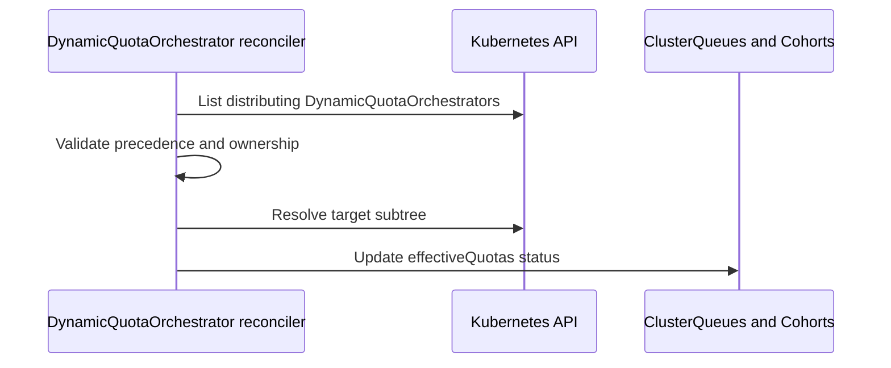

# PR #15283: Implement quota distribution logic and soft validation for DynamicQuotaOrchestrator

**Summary**: Implement quota distribution logic and soft validation for DynamicQuotaOrchestrator

**Sources**: https://github.com/kubernetes-sigs/kueue/pull/15283

**Last updated**: 2026-09-30T11:12:36Z

---

## Metadata

- **State**: closed (merged)
- **Author**: [@pajakd](https://github.com/pajakd)
- **Branch**: `dqo-phase2-part2-distribution-logic` → `main`
- **Created**: 2026-09-08T09:07:56Z
- **Updated**: 2026-09-30T11:12:36Z
- **Merged**: 2026-09-08T10:08:31Z
- **Closed**: 2026-09-08T10:08:31Z
- **Labels**: `kind/feature`, `release-note`, `lgtm`, `size/XXL`, `approved`, `cncf-cla: yes`
- **Assignees**: [@mimowo](https://github.com/mimowo)
- **Requested reviewers**: [@amy](https://github.com/amy), [@sohankunkerkar](https://github.com/sohankunkerkar)
- **Changed files**: 4   **+1581 / -46**

## Description

#### What type of PR is this?

/kind feature

#### What this PR does / why we need it?

Part of #12382

This PR implements Phase 2 (Capacity Distribution) logic and soft validation for the `DynamicQuotaOrchestrator` controller. It builds on the field indexers added in #15260 (Part 1).

Key capabilities implemented in this PR:
1. **Subtree Resolution & Inverted Indexing**:
   - Traverses the quota hierarchy downward from `spec.capacityDistribution.subtreeRootQuotaRef` (Cohort or ClusterQueue) with cycle protection.
   - Builds an inverted index of participants (`Cohort` and `ClusterQueue`) mapped by `(flavor, resource)` pair in a single pass to enable efficient proportional distribution.
2. **Deterministic Proportional Allocation (Largest-Remainder Method)**:
   - Distributes discovered capacity among subtree participants using the largest-remainder (Hamilton-Hare) method per KEP-12382.
   - Resource scale-aware: uses milliCPU (scale 3, 1m) for CPU, and integer units (scale 0) for other resources.
   - Exact integer remainder arithmetic using `inf.Dec` to avoid floating-point imprecision and 64-bit overflow.
   - Resolves equal remainder ties deterministically using object UIDs.
3. **Quota Construction & Capping**:
   - Constructs `status.effectiveQuotas.resourceGroups` by overlaying nominal quotas for distributed flavors/resources while preserving unmanaged resources from `spec.resourceGroups`.
   - Caps non-null `lendingLimit` at effective nominal quota on `ClusterQueue`, while preserving `Cohort.lendingLimit` unchanged.
4. **Soft Validation & Multi-DQO Conflict Rules**:
   - Detects conflicts with ancestor DQOs and older instances on the same root; deactivates conflicting DQO with condition `Distributed=False` (`Reason: ConflictingDynamicQuotaOrchestrator`).
   - Detects ownership conflicts on target objects (`Reason: EffectiveQuotasConflict`), while permitting takeover when the prior manager is deactivated or no longer distributing.
   - Retains previously written `status.effectiveQuotas` as stale when a participant leaves the subtree or a DQO stops distributing.
5. **Testing**:
   - Adds 22 table-driven unit tests in `dynamicquotaorchestrator_controller_test.go` covering distribution to single/multiple CQs, cohort hierarchies, lendingLimit capping, discovery-only transitions, and soft validation conflict paths.

This is part 2 of the 3-part DQO Phase 2 stack:
- [x] **Part 1**: Indexers and test client builder (#15260 - merged)
- [x] **Part 2**: Distribution logic, inverted index, largest-remainder math, soft validation, and unit tests (this PR)
- [ ] **Part 3**: Reconciler watches, event mappers, and integration tests

#### Useful notes for your reviewer

- Proportional distribution logic is isolated in `distributeCapacityProportionally` and thoroughly tested in unit tests with scale 3 (CPU) and scale 0 (Memory) test cases.
- Reconciler watches and Ginkgo integration tests are intentionally deferred to Part 3 to keep review sizes manageable.

#### Release note

```release-note
DynamicQuotaOrchestration: Added distribution of discovered capacity among Cohorts and ClusterQueues in the configured subtree, in proportion to their nominal quotas. Kueue writes the resulting quotas to status.effectiveQuotas. Conflicting orchestrators report Distributed=False and do not distribute quotas. Requires the DynamicQuotaOrchestration feature gate.
```

---
*AI usage disclosure: Assisted by AI agent (Antigravity) in refactoring, math verification, documentation, and unit tests per the Kubernetes AI Tool Usage Policy.*


<!-- This is an auto-generated comment: release notes by coderabbit.ai -->

## Summary

- Adds Phase 2 capacity distribution for `DynamicQuotaOrchestrator`.
- Traverses quota subtrees with cycle protection and indexes participants by flavor and resource.
- Uses deterministic largest-remainder allocation with exact integer arithmetic.
- Builds effective quotas and applies `ClusterQueue` lending-limit caps.
- Adds conflict detection, takeover rules, and stale quota retention.
- Adds 22 table-driven tests and testing helpers.

## Release note assessment

No `release-note` block was provided for review. Suggested release note:

> DynamicQuotaOrchestrator: Add proportional capacity distribution and soft validation for Cohorts and ClusterQueues.

Please verify this note and update the canonical `release-note` block in the PR description.

<!-- end of auto-generated comment: release notes by coderabbit.ai -->

## Discussion

### Comment by [@netlify[bot]](https://github.com/apps/netlify) — 2026-09-08T09:08:03Z

### <span aria-hidden="true">✅</span> Deploy Preview for *kubernetes-sigs-kueue* ready!


|  Name | Link |
|:-:|------------------------|
|<span aria-hidden="true">🔨</span> Latest commit | 3fe7a0383635e460b250568330c2328fe81aef05 |
|<span aria-hidden="true">🔍</span> Latest deploy log | https://app.netlify.com/projects/kubernetes-sigs-kueue/deploys/6a9fd06f75770100085dd7a1 |
|<span aria-hidden="true">😎</span> Deploy Preview | [https://deploy-preview-15283--kubernetes-sigs-kueue.netlify.app](https://deploy-preview-15283--kubernetes-sigs-kueue.netlify.app) |
|<span aria-hidden="true">📱</span> Preview on mobile | <details><summary> Toggle QR Code... </summary><br /><br /><br /><br />_Use your smartphone camera to open QR code link._</details> |
---
<!-- [kubernetes-sigs-kueue Preview](https://deploy-preview-15283--kubernetes-sigs-kueue.netlify.app) -->
_To edit notification comments on pull requests, go to your [Netlify project configuration](https://app.netlify.com/projects/kubernetes-sigs-kueue/configuration/notifications#deploy-notifications)._

### Comment by [@coderabbitai[bot]](https://github.com/apps/coderabbitai) — 2026-09-08T09:10:03Z

<!-- This is an auto-generated comment: summarize by coderabbit.ai -->
<!-- review_stack_entry_start -->

<a href="https://app.coderabbit.ai/change-stack/kubernetes-sigs/kueue/pull/15283#gh-light-mode-only"></a><a href="https://app.coderabbit.ai/change-stack/kubernetes-sigs/kueue/pull/15283#gh-dark-mode-only"></a>

<!-- review_stack_entry_end -->
<!-- recent_review_start -->

No actionable comments were generated in the recent review. 🎉

<details>
<summary>ℹ️ Recent review info</summary>

<details>
<summary>⚙️ Run configuration</summary>

**Configuration used**: Path: .coderabbit.yaml

**Review profile**: CHILL

**Plan**: Advanced

**Run ID**: `0a52885a-bf6f-40f3-b431-332685880e59`

</details>

<details>
<summary>📥 Commits</summary>

Reviewing files that changed from the base of the PR and between 3e99c331214c9cf2da2b15b79531dd6fcb7711bc and 3fe7a0383635e460b250568330c2328fe81aef05.

</details>

<details>
<summary>📒 Files selected for processing (4)</summary>

* `pkg/controller/core/dynamicquotaorchestrator_controller.go`
* `pkg/controller/core/dynamicquotaorchestrator_controller_test.go`
* `pkg/util/testing/v1alpha1/wrappers.go`
* `pkg/util/testing/v1beta2/wrappers.go`

</details>

**Included review availability:** Your plan provides up to 8 included reviews per hour; 7 remain after this review.

</details>

---


<!-- recent_review_end -->
<!-- walkthrough_start -->

<details>
<summary>📝 Walkthrough</summary>

## Walkthrough

The DynamicQuotaOrchestrator reconciler now discovers capacity and distributes effective quotas across ClusterQueues and Cohorts. It validates orchestrator conflicts, calculates proportional allocations, applies lending limits, updates status conditions, and adds test helpers and coverage.

### Changes

**Dynamic quota distribution**

|Layer / File(s)|Summary|
|---|---|
|**Reconciliation and conflict handling** <br> `pkg/controller/core/dynamicquotaorchestrator_controller.go`|Reconciliation validates distribution settings, resolves ClusterQueue or Cohort subtrees, applies orchestrator precedence, checks ownership, and updates the `Distributed` condition.|
|**Quota allocation and status updates** <br> `pkg/controller/core/dynamicquotaorchestrator_controller.go`|The controller distributes quotas with largest-remainder arithmetic, deterministic UID tie-breaking, CPU scaling, lending-limit capping, and effective-quota status updates.|
|**Distribution reconciliation and allocation tests** <br> `pkg/controller/core/dynamicquotaorchestrator_controller_test.go`, `pkg/util/testing/v1alpha1/wrappers.go`, `pkg/util/testing/v1beta2/wrappers.go`|Tests cover distribution, conflicts, precedence, readiness, stale quotas, feature gates, and proportional allocation. Test wrappers support creation timestamps and effective quota status.|
  
**Estimated code review effort:** 4 (Complex) | ~60 minutes

<!-- final_review_risk_start -->
**Merge Risk:** _⚪ Minimal_ · up to `3fe7a`
<!-- final_review_risk_coverage:{"sourceCommitId":"3fe7a0383635e460b250568330c2328fe81aef05","coveredCommitId":"3fe7a0383635e460b250568330c2328fe81aef05","kind":"reviewed"} -->

The change adds effective quota distribution with conflict handling and targeted unit coverage; no actionable merge-blocking risk is currently established.
<!-- final_review_risk_end -->

### Sequence Diagram(s)



**Suggested reviewers:** `j-skiba`

</details>

<!-- walkthrough_end -->
<!-- pre_merge_checks_walkthrough_start -->

<details>
<summary>🚥 Pre-merge checks | ✅ 4 | ❌ 1</summary>

### ❌ Failed checks (1 warning)

|     Check name     | Status     | Explanation                                                                                                                                                                                | Resolution                                                                         |
| :----------------: | :--------- | :----------------------------------------------------------------------------------------------------------------------------------------------------------------------------------------- | :--------------------------------------------------------------------------------- |
| Docstring Coverage | ⚠️ Warning | Docstring coverage is 77.78% which is insufficient. The required threshold is 80.00%. Docstring coverage is scoped to functions touched by this diff. Analyzed 9 functions across 4 files. | Write docstrings for the functions missing them to satisfy the coverage threshold. |

<details>
<summary>✅ Passed checks (4 passed)</summary>

|         Check name         | Status   | Explanation                                                                                                                            |
| :------------------------: | :------- | :------------------------------------------------------------------------------------------------------------------------------------- |
|      Description Check     | ✅ Passed | Check skipped - CodeRabbit’s high-level summary is enabled.                                                                            |
|         Title check        | ✅ Passed | The title clearly and concisely describes the main changes: quota distribution logic and soft validation for DynamicQuotaOrchestrator. |
|     Linked Issues check    | ✅ Passed | Check skipped because no linked issues were found for this pull request.                                                               |
| Out of Scope Changes check | ✅ Passed | Check skipped because no linked issues were found for this pull request.                                                               |

</details>

</details>

<!-- pre_merge_checks_walkthrough_end -->

- [ ] <!-- {"checkboxId":"585bb3f6-faf5-4dbf-96d2-74e382adf19a"} --> Fix all pre-merge checks with AI
<!-- finishing_touch_checkbox_start -->

<details>
<summary>✨ Finishing Touches</summary>

<details>
<summary>🧪 Generate unit tests (beta)</summary>

- [ ] <!-- {"checkboxId": "f47ac10b-58cc-4372-a567-0e02b2c3d479", "radioGroupId": "utg-output-choice-group-unknown_comment_id"} -->   Create PR with unit tests

</details>

</details>

<!-- finishing_touch_checkbox_end -->
<!-- tips_start -->

---


<sub>Comment `@coderabbitai help` to get the list of available commands.</sub>

<!-- tips_end -->

### Comment by [@kubernetes-prow[bot]](https://github.com/apps/kubernetes-prow) — 2026-09-08T10:07:00Z

LGTM label has been added.  <details>Git tree hash: 124a8e455677de267c808039709141fea8fcaf84</details>

### Comment by [@kubernetes-prow[bot]](https://github.com/apps/kubernetes-prow) — 2026-09-08T10:07:04Z

[APPROVALNOTIFIER] This PR is **APPROVED**

This pull-request has been approved by: *<a href="https://github.com/kubernetes-sigs/kueue/pull/15283#pullrequestreview-5140319251" title="Approved">mimowo</a>*, *<a href="https://github.com/kubernetes-sigs/kueue/pull/15283#" title="Author self-approved">pajakd</a>*

The full list of commands accepted by this bot can be found [here](https://go.k8s.io/bot-commands?repo=kubernetes-sigs%2Fkueue).

The pull request process is described [here](https://git.k8s.io/community/contributors/guide/owners.md#the-code-review-process)

<details >
Needs approval from an approver in each of these files:

- ~~[OWNERS](https://github.com/kubernetes-sigs/kueue/blob/main/OWNERS)~~ [mimowo]

Approvers can indicate their approval by writing `/approve` in a comment
Approvers can cancel approval by writing `/approve cancel` in a comment
</details>
<!-- META={"approvers":[]} -->

### Comment by [@mimowo](https://github.com/mimowo) — 2026-09-30T11:12:36Z

/release-note-edit
```release-note
DynamicQuotaOrchestration: Added distribution of discovered capacity among Cohorts and ClusterQueues in the configured subtree, in proportion to their nominal quotas. Kueue writes the resulting quotas to status.effectiveQuotas. Conflicting orchestrators report Distributed=False and do not distribute quotas. Requires the DynamicQuotaOrchestration feature gate.
```

## Reviews

### Review by [@mimowo](https://github.com/mimowo) (commented) — 2026-09-08T10:06:51Z

/lgtm
/approve
Thank you 👍 

One thing I would like to do in a follow up is to decompose the DQO reconciler helpers, by: new subpackage for dqo, and files dedicated to distribution and discovery.

So, dqo_distribution.go, and dqo_discovery.go

### Review by [@mimowo](https://github.com/mimowo) (commented) — 2026-09-08T11:46:51Z

- **pkg/controller/core/dynamicquotaorchestrator_controller_test.go:40** by [@mimowo](https://github.com/mimowo) — 2026-09-08T11:46:51Z
```diff
@@ -29,20 +30,30 @@ import (
 	"sigs.k8s.io/controller-runtime/pkg/reconcile"
 
 	kueuealpha "sigs.k8s.io/kueue/apis/kueue/v1alpha1"
+	kueue "sigs.k8s.io/kueue/apis/kueue/v1beta2"
 	"sigs.k8s.io/kueue/pkg/features"
 	utiltesting "sigs.k8s.io/kueue/pkg/util/testing"
 	utiltestingalpha "sigs.k8s.io/kueue/pkg/util/testing/v1alpha1"
+	utiltestingapi "sigs.k8s.io/kueue/pkg/util/testing/v1beta2"
 )
 
 func TestDynamicQuotaOrchestratorReconcile(t *testing.T) {
```

  Follow up question: what is the coverage with the unit tests, do they cover all successful code paths in code? If not let's open a follow up PR or Issue to track the progress of covering the paths
