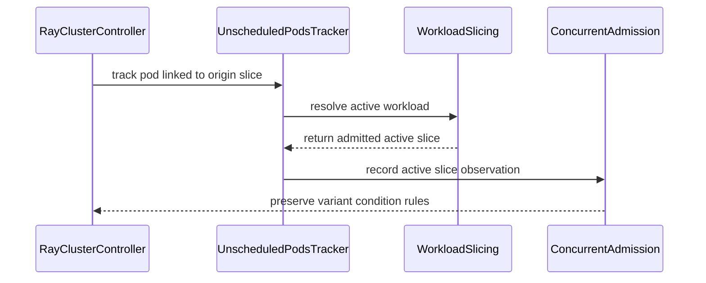

# PR #15531: KEP-13502: Tracker controller should identify active WorkloadSlice

**Summary**: KEP-13502: Tracker controller should identify active WorkloadSlice

**Sources**: https://github.com/kubernetes-sigs/kueue/pull/15531

**Last updated**: 2026-09-15T16:58:18Z

---

## Metadata

- **State**: closed (merged)
- **Author**: [@tenzen-y](https://github.com/tenzen-y)
- **Branch**: `track-active-workload-slice` → `main`
- **Created**: 2026-09-12T18:59:28Z
- **Updated**: 2026-09-15T16:58:18Z
- **Merged**: 2026-09-14T07:51:26Z
- **Closed**: 2026-09-14T07:51:26Z
- **Labels**: `kind/feature`, `lgtm`, `release-note-none`, `size/XL`, `approved`, `cncf-cla: yes`
- **Assignees**: [@mimowo](https://github.com/mimowo)
- **Requested reviewers**: [@kannon92](https://github.com/kannon92), [@amy](https://github.com/amy)
- **Changed files**: 5   **+628 / -13**

## Description

<!-- Thank you for contributing! Check CONTRIBUTING.md for details. -->

#### What type of PR is this?

/kind feature


<!-- Consider setting the area:
/area tas
/area was
/area integrations
/area multikueue
/area dashboard
/area localization
/area testing
/area website
-->


#### What this PR does / why we need it?

I implemented a tracking mechanism for the WorkloadSlices (ElasticJobsViaWorkloadSlices).
Since this PR, the tracker controller appropriately tracks only active WorkloadSlices.

Also, I implemented integration tests for UnscheduledTimeout and KubeRay to verify this Workload Slicing behavior.

<!--
Use `Fixes #123` for an issue addressed by this PR; it will be closed when the PR merges.
Use `Related:` or `Part of:` to reference an issue without closing it.
-->
part-of https://github.com/kubernetes-sigs/kueue/issues/13502

#### Useful notes for your reviewer


#### Release note

<!-- Describe the behavior change accurately from the user's perspective. Hints:
- Do not leave this block blank.
- Use "NONE" when there is no user-facing change.
- When feasible use a prefix for the sub-component or feature, e.g. "FairSharing:" or "MultiKueue:".
- If upgrade steps are required, include an "ACTION REQUIRED:" section.
You may consider AI assistance using the skill: cmd/experimental/skills/kueue-release-notes/SKILL.md.
-->
```release-note
NONE
```


<!-- This is an auto-generated comment: release notes by coderabbit.ai -->

## AI summary

- Track pods against only active WorkloadSlices.
- Add unit and integration tests for slice replacement, deletion, unscheduled timeouts, and ConcurrentAdmission.
- Extend RayCluster test setup for the related feature gates and tracker.

### Suggested release note

**Detailed:** ElasticJobsViaWorkloadSlices: Fixed a bug where pod tracking could follow a completed or deleted WorkloadSlice instead of the active slice. Kueue now tracks pods against the active WorkloadSlice.

**Concise:** ElasticJobsViaWorkloadSlices: Fixed pod tracking after WorkloadSlice replacement or deletion.

**Balanced:** ElasticJobsViaWorkloadSlices: Fixed pod tracking when an origin WorkloadSlice is replaced or deleted. Kueue now follows the active WorkloadSlice.

**Rationale:** This is a bug fix scoped to ElasticJobsViaWorkloadSlices. The note describes the user-visible tracking behavior and does not require user action.

<!-- end of auto-generated comment: release notes by coderabbit.ai -->

## Discussion

### Comment by [@netlify[bot]](https://github.com/apps/netlify) — 2026-09-12T18:59:34Z

### <span aria-hidden="true">✅</span> Deploy Preview for *kubernetes-sigs-kueue* ready!


|  Name | Link |
|:-:|------------------------|
|<span aria-hidden="true">🔨</span> Latest commit | b82e20d5312f16d060d4bb7ad3a06f7197550393 |
|<span aria-hidden="true">🔍</span> Latest deploy log | https://app.netlify.com/projects/kubernetes-sigs-kueue/deploys/6aa5a113b3e980000826e361 |
|<span aria-hidden="true">😎</span> Deploy Preview | [https://deploy-preview-15531--kubernetes-sigs-kueue.netlify.app](https://deploy-preview-15531--kubernetes-sigs-kueue.netlify.app) |
|<span aria-hidden="true">📱</span> Preview on mobile | <details><summary> Toggle QR Code... </summary><br /><br /><br /><br />_Use your smartphone camera to open QR code link._</details> |
---
<!-- [kubernetes-sigs-kueue Preview](https://deploy-preview-15531--kubernetes-sigs-kueue.netlify.app) -->
_To edit notification comments on pull requests, go to your [Netlify project configuration](https://app.netlify.com/projects/kubernetes-sigs-kueue/configuration/notifications#deploy-notifications)._

### Comment by [@coderabbitai[bot]](https://github.com/apps/coderabbitai) — 2026-09-12T19:00:23Z

<!-- This is an auto-generated comment: summarize by coderabbit.ai -->
<!-- review_stack_entry_start -->

<a href="https://app.coderabbit.ai/change-stack/kubernetes-sigs/kueue/pull/15531#gh-light-mode-only"></a><a href="https://app.coderabbit.ai/change-stack/kubernetes-sigs/kueue/pull/15531#gh-dark-mode-only"></a>

<!-- review_stack_entry_end -->
<!-- recent_review_start -->

No actionable comments were generated in the recent review. 🎉

<details>
<summary>ℹ️ Recent review info</summary>

<details>
<summary>⚙️ Run configuration</summary>

**Configuration used**: Path: .coderabbit.yaml

**Review profile**: CHILL

**Plan**: Advanced

**Run ID**: `8042eb8a-f15f-4e4d-b1b9-a7869338db31`

</details>

<details>
<summary>📥 Commits</summary>

Reviewing files that changed from the base of the PR and between e6fffc2f78a01c1a65f3593a305f8c221a4234b5 and b82e20d5312f16d060d4bb7ad3a06f7197550393.

</details>

<details>
<summary>📒 Files selected for processing (5)</summary>

* `pkg/controller/unscheduledpods/tracker.go`
* `pkg/controller/unscheduledpods/tracker_test.go`
* `pkg/workloadslicing/workloadslicing_test.go`
* `test/integration/singlecluster/controller/jobs/raycluster/raycluster_controller_test.go`
* `test/integration/singlecluster/controller/jobs/raycluster/suite_test.go`

</details>

**Included review availability:** Your plan provides up to 8 included reviews per hour; 7 remain after this review.

</details>

---


<!-- recent_review_end -->
<!-- walkthrough_start -->

<details>
<summary>📝 Walkthrough</summary>

## Walkthrough

The tracker now resolves active workloads before recording pod scheduling observations. Tests cover elastic slice redirects, admission-gate variant selection, and RayCluster behavior after origin slice deletion under concurrent admission.

### Changes

**Workload tracking and slice admission**

|Layer / File(s)|Summary|
|---|---|
|**Active workload resolution and redirect tests** <br> `pkg/controller/unscheduledpods/tracker.go`, `pkg/controller/unscheduledpods/tracker_test.go`|`Reconcile` uses `FindActiveWorkload` and handles missing workloads through its result. Tests cover redirects from finished, replaced, and deleted origin slices.|
|**Admission variant selection tests** <br> `pkg/workloadslicing/workloadslicing_test.go`|Tests cover variant selection with the scheduling and concurrent admission feature gates enabled or disabled.|
|**Integration controller setup** <br> `test/integration/singlecluster/controller/jobs/raycluster/suite_test.go`|The integration setup passes configuration to controllers and conditionally enables pod indexing, concurrent admission, and unscheduled pod tracking.|
|**Concurrent admission deletion scenario** <br> `test/integration/singlecluster/controller/jobs/raycluster/raycluster_controller_test.go`|The RayCluster test verifies active slice tracking, pod ungating after origin deletion, and missing `WorkloadPodsScheduled` conditions on concurrent admission variants.|

<!-- change_assessment_start -->
**Priority:** ⬇️ Low

**Estimated code review effort:** 3 (Moderate) | ~25 minutes

<!-- change_assessment_commit:"b82e20d5312f16d060d4bb7ad3a06f7197550393" -->
**Change:** Feature
<!-- change_assessment_end -->

### Sequence Diagram(s)



**Suggested reviewers:** `thc1006`

</details>

<!-- walkthrough_end -->
<!-- final_review_risk_start -->
**Merge Risk:** _⚪ Minimal_ · up to `b82e2`
<!-- final_review_risk_coverage:{"sourceCommitId":"b82e20d5312f16d060d4bb7ad3a06f7197550393","coveredCommitId":"b82e20d5312f16d060d4bb7ad3a06f7197550393","kind":"reviewed"} -->

The active workload tracking changes and associated test setup do not leave a concrete merge-blocking risk.
<!-- final_review_risk_end -->
<!-- pre_merge_checks_walkthrough_start -->

<details>
<summary>🚥 Pre-merge checks | ✅ 4 | ❌ 1</summary>

### ❌ Failed checks (1 warning)

|     Check name     | Status     | Explanation                                                                                                                                                                               | Resolution                                                                         |
| :----------------: | :--------- | :---------------------------------------------------------------------------------------------------------------------------------------------------------------------------------------- | :--------------------------------------------------------------------------------- |
| Docstring Coverage | ⚠️ Warning | Docstring coverage is 0.00% which is insufficient. The required threshold is 80.00%. Docstring coverage is scoped to functions touched by this diff. Analyzed 5 functions across 5 files. | Write docstrings for the functions missing them to satisfy the coverage threshold. |

<details>
<summary>✅ Passed checks (4 passed)</summary>

|         Check name         | Status   | Explanation                                                                                                                                                          |
| :------------------------: | :------- | :------------------------------------------------------------------------------------------------------------------------------------------------------------------- |
|      Description Check     | ✅ Passed | Check skipped - CodeRabbit’s high-level summary is enabled.                                                                                                          |
|         Title check        | ✅ Passed | The title clearly identifies the main change: updating the tracker controller to identify active WorkloadSlices. It matches the pull request objectives and changes. |
|     Linked Issues check    | ✅ Passed | Check skipped because no linked issues were found for this pull request.                                                                                             |
| Out of Scope Changes check | ✅ Passed | Check skipped because no linked issues were found for this pull request.                                                                                             |

</details>

</details>

<!-- pre_merge_checks_walkthrough_end -->

- [ ] <!-- {"checkboxId":"585bb3f6-faf5-4dbf-96d2-74e382adf19a"} --> Fix all pre-merge checks with AI
<!-- finishing_touch_checkbox_start -->

<details>
<summary>✨ Finishing Touches</summary>

<details>
<summary>🧪 Generate unit tests (beta)</summary>

- [ ] <!-- {"checkboxId": "f47ac10b-58cc-4372-a567-0e02b2c3d479", "radioGroupId": "utg-output-choice-group-unknown_comment_id"} -->   Create PR with unit tests

</details>

</details>

<!-- finishing_touch_checkbox_end -->
<!-- tips_start -->

---


<sub>Comment `@coderabbitai help` to get the list of available commands.</sub>

<!-- tips_end -->

### Comment by [@kubernetes-prow[bot]](https://github.com/apps/kubernetes-prow) — 2026-09-14T07:21:35Z

LGTM label has been added.  <details>Git tree hash: 740d7e6391a44bce30fe7bd3b922ba21b924ed44</details>

### Comment by [@kubernetes-prow[bot]](https://github.com/apps/kubernetes-prow) — 2026-09-14T07:21:39Z

[APPROVALNOTIFIER] This PR is **APPROVED**

This pull-request has been approved by: *<a href="https://github.com/kubernetes-sigs/kueue/pull/15531#pullrequestreview-5194923230" title="Approved">mimowo</a>*, *<a href="https://github.com/kubernetes-sigs/kueue/pull/15531#" title="Author self-approved">tenzen-y</a>*

The full list of commands accepted by this bot can be found [here](https://go.k8s.io/bot-commands?repo=kubernetes-sigs%2Fkueue).

The pull request process is described [here](https://git.k8s.io/community/contributors/guide/owners.md#the-code-review-process)

<details >
Needs approval from an approver in each of these files:

- ~~[OWNERS](https://github.com/kubernetes-sigs/kueue/blob/main/OWNERS)~~ [mimowo,tenzen-y]

Approvers can indicate their approval by writing `/approve` in a comment
Approvers can cancel approval by writing `/approve cancel` in a comment
</details>
<!-- META={"approvers":[]} -->

### Comment by [@tenzen-y](https://github.com/tenzen-y) — 2026-09-15T16:57:43Z

@mimowo, thank you for leaving some comments. I will address those soon.

@coderabbitai Please open a follow-up issue to address @mimowo 's test refactoring w/ kind/cleanup.

### Comment by [@coderabbitai[bot]](https://github.com/apps/coderabbitai) — 2026-09-15T16:58:17Z

<!-- This is an auto-generated reply by CodeRabbit -->
> [!TIP]
> For best results, initiate chat on the files or code changes.

<details>
<summary>🧩 Analysis chain</summary>

🏁 Script executed:

```shell
#!/bin/bash
set -euo pipefail

repo="kubernetes-sigs/kueue"
pr_number="15531"

echo "== Review comments by mimowo =="
gh api --paginate "repos/${repo}/pulls/${pr_number}/comments" \
  --jq '.[] | select(.user.login == "mimowo") | {id, path, line, body, html_url}'

echo "== Pull request conversation comments by mimowo =="
gh api --paginate "repos/${repo}/issues/${pr_number}/comments" \
  --jq '.[] | select(.user.login == "mimowo") | {id, body, html_url}'
```

Length of output: 1703

---

🏁 Script executed:

```shell
#!/bin/bash
set -euo pipefail

repo="kubernetes-sigs/kueue"
issue_url=$(gh issue create \
  --repo "$repo" \
  --assignee "tenzen-y" \
  --title "Refactor RayCluster concurrent-admission test lookups into helpers" \
  --body "$(cat <<'EOF'
## Summary

Refactor the Concurrent Admission lookup and assertion code in the RayCluster integration tests. The current test repeats WorkloadSlice and Concurrent Admission parent selection logic.

## Required changes

- Add a test helper such as `FindVariants()` for variant WorkloadSlice lookup.
- Add a test helper such as `FindConcurrentAdmissionParent()` for Concurrent Admission parent lookup.
- Consider an active-only helper such as `FindActiveConcurrentAdmissionParent()` when the test requires a non-finished parent.
- Move repeated parent-finished assertions outside helper calls when that gives clearer test intent.
- Clean up repeated lookup code in the Concurrent Admission test path.

## Affected area

- `test/integration/singlecluster/controller/jobs/raycluster/raycluster_controller_test.go`

## Rationale

Dedicated helpers reduce repeated selector logic and make the test assertions easier to read and maintain.

## Acceptance criteria

- The RayCluster Concurrent Admission integration test uses shared helpers for repeated variant and parent lookups.
- The helper names and behavior make active versus finished parent selection explicit.
- The refactoring preserves the existing test behavior.

## Backlinks

- Pull request: https://github.com/kubernetes-sigs/kueue/pull/15531
- Review comment: https://github.com/kubernetes-sigs/kueue/pull/15531#discussion_r4002949465
- Review comment: https://github.com/kubernetes-sigs/kueue/pull/15531#discussion_r4002954957
- Review comment: https://github.com/kubernetes-sigs/kueue/pull/15531#discussion_r4002961230

Requested by: `@tenzen-y`
EOF
)")
echo "$issue_url"
```

Length of output: 2063

---

</details>

`@tenzen-y` Created follow-up issue `#15618` for the RayCluster test helper refactoring and cleanup. It is assigned to you.

_You are interacting with an AI system._

## Reviews

### Review by [@mimowo](https://github.com/mimowo) (commented) — 2026-09-14T07:21:26Z

/lgtm
/approve
Thank you! I think the test helpers can be handled independently, and in that PR we could also look for options to commonize with the pre-existing helpers.

- **test/integration/singlecluster/controller/jobs/raycluster/raycluster_controller_test.go:1224** by [@mimowo](https://github.com/mimowo) — 2026-09-14T07:18:20Z
```diff
@@ -1073,4 +1074,153 @@ var _ = ginkgo.Describe("RayCluster with elastic jobs via workload-slices suppor
 				corev1.PodSchedulingGate{Name: kueue.ElasticJobSchedulingGate}))
 		}, util.Timeout, util.Interval).Should(gomega.Succeed())
 	})
+
+	ginkgo.It("Should track chain pods across origin slice deletion with Concurrent Admission", framework.SlowSpec, func() {
+		fwk.StopManager(ctx)
+		features.SetFeatureGateDuringTest(ginkgo.GinkgoTB(), features.WaitForPodsReadyUnscheduledTimeout, true)
+		features.SetFeatureGateDuringTest(ginkgo.GinkgoTB(), features.ConcurrentAdmission, true)
+		waitForPodsReady := &configapi.WaitForPodsReady{
+			Timeout:            metav1.Duration{Duration: 5 * time.Minute},
+			UnscheduledTimeout: &metav1.Duration{Duration: time.Minute},
+			BlockAdmission:     new(false),
+		}
+		fwk.StartManager(ctx, cfg, managerAndSchedulerSetupWithConfig(
+			&configapi.Configuration{WaitForPodsReady: waitForPodsReady},
+			jobframework.WithWaitForPodsReady(waitForPodsReady),
+		))
+		ginkgo.DeferCleanup(fwk.StopManager, ctx)
+		gomega.Eventually(func(g gomega.Gomega) {
+			g.Expect(k8sClient.Get(ctx, client.ObjectKeyFromObject(clusterQueue), clusterQueue)).To(gomega.Succeed())
+			clusterQueue.Spec.ConcurrentAdmissionPolicy = utiltestingapi.MakeClusterQueue(clusterQueue.Name).
+				ConcurrentAdmissionPolicy(kueue.ConcurrentAdmissionTryPreferredFlavors).
+				Obj().Spec.ConcurrentAdmissionPolicy
+			g.Expect(k8sClient.Update(ctx, clusterQueue)).To(gomega.Succeed())
+		}, util.Timeout, util.Interval).Should(gomega.Succeed())
+
+		testRayCluster := testingraycluster.MakeCluster("foo", ns.Name).
+			SetAnnotation(workloadslicing.EnabledAnnotationKey, workloadslicing.EnabledAnnotationValue).
+			Queue(localQueue.Name).
+			Request(rayv1.HeadNode, corev1.ResourceCPU, "1").
+			RequestWorkerGroup(corev1.ResourceCPU, "1").
+			WithEnableAutoscaling(new(true)).
+			ScaleFirstWorkerGroup(1).
+			Obj()
+
+		ginkgo.By("creating and admitting the raycluster's origin workload slice")
+		util.MustCreate(ctx, k8sClient, testRayCluster)
+		var originSlice *kueue.Workload
+		gomega.Eventually(func(g gomega.Gomega) {
+			workloads := &kueue.WorkloadList{}
+			g.Expect(k8sClient.List(ctx, workloads, client.InNamespace(ns.Name))).Should(gomega.Succeed())
+			originSlice = nil
+			for i := range workloads.Items {
+				if !concurrentadmission.IsVariant(&workloads.Items[i]) {
+					originSlice = &workloads.Items[i]
+				}
+			}
+			g.Expect(originSlice).ShouldNot(gomega.BeNil())
+			g.Expect(workload.IsAdmitted(originSlice)).Should(gomega.BeTrue())
+		}, util.Timeout, util.Interval).Should(gomega.Succeed())
+		originSliceName := originSlice.Name
+
+		ginkgo.By("scaling up the worker replicas to create a second (active) slice")
+		gomega.Eventually(func(g gomega.Gomega) {
+			g.Expect(k8sClient.Get(ctx, client.ObjectKeyFromObject(testRayCluster), testRayCluster)).Should(gomega.Succeed())
+			testRayCluster.Spec.WorkerGroupSpecs[0].Replicas = new(int32(2))
+			g.Expect(k8sClient.Update(ctx, testRayCluster)).Should(gomega.Succeed())
+		}, util.Timeout, util.Interval).Should(gomega.Succeed())
+
+		var activeSlice *kueue.Workload
+		gomega.Eventually(func(g gomega.Gomega) {
+			workloads := &kueue.WorkloadList{}
+			g.Expect(k8sClient.List(ctx, workloads, client.InNamespace(ns.Name))).Should(gomega.Succeed())
+			activeSlice = nil
+			for i := range workloads.Items {
+				if !concurrentadmission.IsVariant(&workloads.Items[i]) && !workloadfinish.IsFinished(&workloads.Items[i]) {
+					activeSlice = &workloads.Items[i]
+				}
+			}
+			g.Expect(activeSlice).ShouldNot(gomega.BeNil())
+			g.Expect(activeSlice.Name).ShouldNot(gomega.Equal(originSliceName))
+			g.Expect(workload.IsAdmitted(activeSlice)).Should(gomega.BeTrue())
+			g.Expect(workloads.Items).To(gomega.ContainElement(gomega.Satisfy(func(wl kueue.Workload) bool {
+				return concurrentadmission.IsVariant(&wl) && workload.IsAdmitted(&wl) && !workloadfinish.IsFinished(&wl)
+			})))
+			g.Expect(k8sClient.Get(ctx, client.ObjectKeyFromObject(originSlice), originSlice)).To(gomega.Succeed())
+			g.Expect(workloadfinish.IsFinished(originSlice)).To(gomega.BeTrue())
+		}, util.Timeout, util.Interval).Should(gomega.Succeed())
+
+		ginkgo.By("tracking incomplete scheduling from a pod linked to the finished origin")
+		scheduledWorker := testingpod.MakePod("worker-1", ns.Name).
+			Annotation(kueue.WorkloadAnnotation, originSliceName).
+			Annotation(kueue.WorkloadSliceNameAnnotation, originSliceName).
+			Label(constants.PodSetLabel, string(activeSlice.Spec.PodSets[1].Name)).
+			Obj()
+		util.MustCreate(ctx, k8sClient, scheduledWorker)
+		util.BindPodWithNode(ctx, k8sClient, "node-a", scheduledWorker)
+		gomega.Eventually(func(g gomega.Gomega) {
+			g.Expect(k8sClient.Get(ctx, client.ObjectKeyFromObject(activeSlice), activeSlice)).To(gomega.Succeed())
+			g.Expect(activeSlice.Status.Conditions).To(utiltesting.HaveConditionStatusAndReason(
+				kueue.WorkloadPodsScheduled, metav1.ConditionFalse, kueue.WorkloadWaitForScheduling))
+			g.Expect(activeSlice.Status.Conditions).To(utiltesting.HaveConditionStatusAndReason(
+				kueue.WorkloadPodsReady, metav1.ConditionFalse, kueue.WorkloadWaitForScheduling))
+			g.Expect(k8sClient.Get(ctx, client.ObjectKeyFromObject(originSlice), originSlice)).To(gomega.Succeed())
+			g.Expect(apimeta.FindStatusCondition(originSlice.Status.Conditions, kueue.WorkloadPodsScheduled)).To(gomega.BeNil())
+		}, util.Timeout, util.Interval).Should(gomega.Succeed())
+
+		ginkgo.By("deleting the origin slice to emulate a RayService rollout GC of the old RayCluster's workloads")
+		util.DeleteWorkloadSliceAndAwaitDeletion(ctx, k8sClient, types.NamespacedName{Namespace: ns.Name, Name: originSliceName})
+
+		ginkgo.By("creating a still-gated pod that points at the now-deleted origin slice, owned by the RayCluster")
+		gatedPod := testingpod.MakePod("worker-0", ns.Name).
+			Annotation(kueue.WorkloadAnnotation, originSliceName).
+			Annotation(kueue.WorkloadSliceNameAnnotation, originSliceName).
+			Label(constants.PodSetLabel, string(activeSlice.Spec.PodSets[1].Name)).
+			Gate(kueue.ElasticJobSchedulingGate).
+			Obj()
+		gatedPod.OwnerReferences = []metav1.OwnerReference{{
+			APIVersion:         rayv1.SchemeGroupVersion.String(),
+			Kind:               "RayCluster",
+			Name:               testRayCluster.Name,
+			UID:                testRayCluster.UID,
+			Controller:         new(true),
+			BlockOwnerDeletion: new(true),
+		}}
+		util.MustCreate(ctx, k8sClient, gatedPod)
+
+		ginkgo.By("the ungater removes the elastic scheduling gate despite the origin slice being gone")
+		gomega.Eventually(func(g gomega.Gomega) {
+			var got corev1.Pod
+			g.Expect(k8sClient.Get(ctx, client.ObjectKeyFromObject(gatedPod), &got)).To(gomega.Succeed())
+			g.Expect(got.Spec.SchedulingGates).ShouldNot(gomega.ContainElement(
+				corev1.PodSchedulingGate{Name: kueue.ElasticJobSchedulingGate}))
+		}, util.Timeout, util.Interval).Should(gomega.Succeed())
+
+		ginkgo.By("observing all required pods scheduled through events linked to the deleted origin")
+		headPod := testingpod.MakePod("head", ns.Name).
+			Annotation(kueue.WorkloadAnnotation, originSliceName).
+			Annotation(kueue.WorkloadSliceNameAnnotation, originSliceName).
+			Label(constants.PodSetLabel, string(activeSlice.Spec.PodSets[0].Name)).
+			Obj()
+		util.MustCreate(ctx, k8sClient, headPod)
+		util.BindPodWithNode(ctx, k8sClient, "node-a", headPod, gatedPod)
+		gomega.Eventually(func(g gomega.Gomega) {
+			g.Expect(k8sClient.Get(ctx, client.ObjectKeyFromObject(activeSlice), activeSlice)).To(gomega.Succeed())
+			g.Expect(activeSlice.Status.Conditions).To(utiltesting.HaveConditionStatusAndReason(
+				kueue.WorkloadPodsScheduled, metav1.ConditionTrue, kueue.WorkloadAllRequiredPodsScheduled))
+			g.Expect(activeSlice.Status.Conditions).To(utiltesting.HaveConditionStatusAndReason(
+				kueue.WorkloadPodsReady, metav1.ConditionFalse, kueue.WorkloadWaitForStart))
+		}, util.Timeout, util.Interval).Should(gomega.Succeed())
+
+		ginkgo.By("keeping scheduling observations off Concurrent Admission variants")
+		gomega.Consistently(func(g gomega.Gomega) {
+			workloads := &kueue.WorkloadList{}
+			g.Expect(k8sClient.List(ctx, workloads, client.InNamespace(ns.Name))).To(gomega.Succeed())
+			for _, wl := range workloads.Items {
+				if concurrentadmission.IsVariant(&wl) {
+					g.Expect(apimeta.FindStatusCondition(wl.Status.Conditions, kueue.WorkloadPodsScheduled)).To(gomega.BeNil(), "variant %s", wl.Name)
+				}
+			}
+		}, util.LongConsistentDuration, util.Interval).Should(gomega.Succeed())
```

  nit, I think we should have a helper function for this, like FindVariants()

- **test/integration/singlecluster/controller/jobs/raycluster/raycluster_controller_test.go:1121** by [@mimowo](https://github.com/mimowo) — 2026-09-14T07:19:19Z
```diff
@@ -1073,4 +1074,153 @@ var _ = ginkgo.Describe("RayCluster with elastic jobs via workload-slices suppor
 				corev1.PodSchedulingGate{Name: kueue.ElasticJobSchedulingGate}))
 		}, util.Timeout, util.Interval).Should(gomega.Succeed())
 	})
+
+	ginkgo.It("Should track chain pods across origin slice deletion with Concurrent Admission", framework.SlowSpec, func() {
+		fwk.StopManager(ctx)
+		features.SetFeatureGateDuringTest(ginkgo.GinkgoTB(), features.WaitForPodsReadyUnscheduledTimeout, true)
+		features.SetFeatureGateDuringTest(ginkgo.GinkgoTB(), features.ConcurrentAdmission, true)
+		waitForPodsReady := &configapi.WaitForPodsReady{
+			Timeout:            metav1.Duration{Duration: 5 * time.Minute},
+			UnscheduledTimeout: &metav1.Duration{Duration: time.Minute},
+			BlockAdmission:     new(false),
+		}
+		fwk.StartManager(ctx, cfg, managerAndSchedulerSetupWithConfig(
+			&configapi.Configuration{WaitForPodsReady: waitForPodsReady},
+			jobframework.WithWaitForPodsReady(waitForPodsReady),
+		))
+		ginkgo.DeferCleanup(fwk.StopManager, ctx)
+		gomega.Eventually(func(g gomega.Gomega) {
+			g.Expect(k8sClient.Get(ctx, client.ObjectKeyFromObject(clusterQueue), clusterQueue)).To(gomega.Succeed())
+			clusterQueue.Spec.ConcurrentAdmissionPolicy = utiltestingapi.MakeClusterQueue(clusterQueue.Name).
+				ConcurrentAdmissionPolicy(kueue.ConcurrentAdmissionTryPreferredFlavors).
+				Obj().Spec.ConcurrentAdmissionPolicy
+			g.Expect(k8sClient.Update(ctx, clusterQueue)).To(gomega.Succeed())
+		}, util.Timeout, util.Interval).Should(gomega.Succeed())
+
+		testRayCluster := testingraycluster.MakeCluster("foo", ns.Name).
+			SetAnnotation(workloadslicing.EnabledAnnotationKey, workloadslicing.EnabledAnnotationValue).
+			Queue(localQueue.Name).
+			Request(rayv1.HeadNode, corev1.ResourceCPU, "1").
+			RequestWorkerGroup(corev1.ResourceCPU, "1").
+			WithEnableAutoscaling(new(true)).
+			ScaleFirstWorkerGroup(1).
+			Obj()
+
+		ginkgo.By("creating and admitting the raycluster's origin workload slice")
+		util.MustCreate(ctx, k8sClient, testRayCluster)
+		var originSlice *kueue.Workload
+		gomega.Eventually(func(g gomega.Gomega) {
+			workloads := &kueue.WorkloadList{}
+			g.Expect(k8sClient.List(ctx, workloads, client.InNamespace(ns.Name))).Should(gomega.Succeed())
+			originSlice = nil
+			for i := range workloads.Items {
+				if !concurrentadmission.IsVariant(&workloads.Items[i]) {
+					originSlice = &workloads.Items[i]
+				}
+			}
+			g.Expect(originSlice).ShouldNot(gomega.BeNil())
```

  Here too, I think we should have a helper for tests like `FindCAParent()`, or `FindConcurrectAdmissionParent`

- **test/integration/singlecluster/controller/jobs/raycluster/raycluster_controller_test.go:1142** by [@mimowo](https://github.com/mimowo) — 2026-09-14T07:20:27Z
```diff
@@ -1073,4 +1074,153 @@ var _ = ginkgo.Describe("RayCluster with elastic jobs via workload-slices suppor
 				corev1.PodSchedulingGate{Name: kueue.ElasticJobSchedulingGate}))
 		}, util.Timeout, util.Interval).Should(gomega.Succeed())
 	})
+
+	ginkgo.It("Should track chain pods across origin slice deletion with Concurrent Admission", framework.SlowSpec, func() {
+		fwk.StopManager(ctx)
+		features.SetFeatureGateDuringTest(ginkgo.GinkgoTB(), features.WaitForPodsReadyUnscheduledTimeout, true)
+		features.SetFeatureGateDuringTest(ginkgo.GinkgoTB(), features.ConcurrentAdmission, true)
+		waitForPodsReady := &configapi.WaitForPodsReady{
+			Timeout:            metav1.Duration{Duration: 5 * time.Minute},
+			UnscheduledTimeout: &metav1.Duration{Duration: time.Minute},
+			BlockAdmission:     new(false),
+		}
+		fwk.StartManager(ctx, cfg, managerAndSchedulerSetupWithConfig(
+			&configapi.Configuration{WaitForPodsReady: waitForPodsReady},
+			jobframework.WithWaitForPodsReady(waitForPodsReady),
+		))
+		ginkgo.DeferCleanup(fwk.StopManager, ctx)
+		gomega.Eventually(func(g gomega.Gomega) {
+			g.Expect(k8sClient.Get(ctx, client.ObjectKeyFromObject(clusterQueue), clusterQueue)).To(gomega.Succeed())
+			clusterQueue.Spec.ConcurrentAdmissionPolicy = utiltestingapi.MakeClusterQueue(clusterQueue.Name).
+				ConcurrentAdmissionPolicy(kueue.ConcurrentAdmissionTryPreferredFlavors).
+				Obj().Spec.ConcurrentAdmissionPolicy
+			g.Expect(k8sClient.Update(ctx, clusterQueue)).To(gomega.Succeed())
+		}, util.Timeout, util.Interval).Should(gomega.Succeed())
+
+		testRayCluster := testingraycluster.MakeCluster("foo", ns.Name).
+			SetAnnotation(workloadslicing.EnabledAnnotationKey, workloadslicing.EnabledAnnotationValue).
+			Queue(localQueue.Name).
+			Request(rayv1.HeadNode, corev1.ResourceCPU, "1").
+			RequestWorkerGroup(corev1.ResourceCPU, "1").
+			WithEnableAutoscaling(new(true)).
+			ScaleFirstWorkerGroup(1).
+			Obj()
+
+		ginkgo.By("creating and admitting the raycluster's origin workload slice")
+		util.MustCreate(ctx, k8sClient, testRayCluster)
+		var originSlice *kueue.Workload
+		gomega.Eventually(func(g gomega.Gomega) {
+			workloads := &kueue.WorkloadList{}
+			g.Expect(k8sClient.List(ctx, workloads, client.InNamespace(ns.Name))).Should(gomega.Succeed())
+			originSlice = nil
+			for i := range workloads.Items {
+				if !concurrentadmission.IsVariant(&workloads.Items[i]) {
+					originSlice = &workloads.Items[i]
+				}
+			}
+			g.Expect(originSlice).ShouldNot(gomega.BeNil())
+			g.Expect(workload.IsAdmitted(originSlice)).Should(gomega.BeTrue())
+		}, util.Timeout, util.Interval).Should(gomega.Succeed())
+		originSliceName := originSlice.Name
+
+		ginkgo.By("scaling up the worker replicas to create a second (active) slice")
+		gomega.Eventually(func(g gomega.Gomega) {
+			g.Expect(k8sClient.Get(ctx, client.ObjectKeyFromObject(testRayCluster), testRayCluster)).Should(gomega.Succeed())
+			testRayCluster.Spec.WorkerGroupSpecs[0].Replicas = new(int32(2))
+			g.Expect(k8sClient.Update(ctx, testRayCluster)).Should(gomega.Succeed())
+		}, util.Timeout, util.Interval).Should(gomega.Succeed())
+
+		var activeSlice *kueue.Workload
+		gomega.Eventually(func(g gomega.Gomega) {
+			workloads := &kueue.WorkloadList{}
+			g.Expect(k8sClient.List(ctx, workloads, client.InNamespace(ns.Name))).Should(gomega.Succeed())
+			activeSlice = nil
+			for i := range workloads.Items {
+				if !concurrentadmission.IsVariant(&workloads.Items[i]) && !workloadfinish.IsFinished(&workloads.Items[i]) {
+					activeSlice = &workloads.Items[i]
+				}
+			}
```

  Here too, I imagie we could use a helper like `FindConcurrentAdmissionParent` and verify it is not finished outside, or have `FindActiveConcurrentAdmissionParent`.
