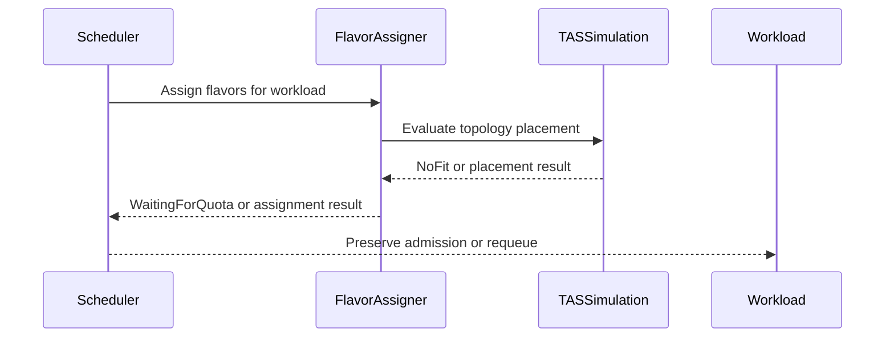

# PR #15561: TAS: don't preempt others when seeking a failed-node replacement

**Summary**: TAS: don't preempt others when seeking a failed-node replacement

**Sources**: https://github.com/kubernetes-sigs/kueue/pull/15561

**Last updated**: 2026-10-20T15:49:25Z

---

## Metadata

- **State**: open
- **Author**: [@anguszzzz](https://github.com/anguszzzz)
- **Branch**: `fix/15337-tas-preempt-unhealthy-nodes` → `main`
- **Created**: 2026-09-14T17:43:18Z
- **Updated**: 2026-10-20T15:49:25Z
- **Merged**: —
- **Closed**: —
- **Labels**: `release-note`, `size/L`, `needs-rebase`, `do-not-merge/hold`, `ok-to-test`, `cncf-cla: yes`
- **Assignees**: _none_
- **Requested reviewers**: [@olekzabl](https://github.com/olekzabl), [@tenzen-y](https://github.com/tenzen-y)
- **Changed files**: 3   **+346 / -23**

## Description

   #### What type of PR is this?
   /kind bug
   /area tas

   #### What this PR does / why we need it:

   A workload carrying status.unhealthyNodes whose evaluation needs preemption got committed
   with a flavors-only admission: both branches that compute topologyAssignment were skipped —
   the Fit branch gates on Fit mode, and the simulate-empty Preempt branch was gated out by the
   `!HasUnhealthyNodes` guard whose comment promises "don't preempt when looking for a failed
   node replacement". The guard suppressed the assignment but not the Preempt mode, so
   preemptions were issued anyway, and once they completed the flavors-only admission was
   committed and unhealthyNodes cleared. The workload becomes permanently non-TAS on a
   TAS-only ClusterQueue: no hostname pin, invisible to the TAS cache → double-booked nodes.

   Now, when RepresentativeMode() is Preempt and the workload is marked, it is reported
   NoFit with an explicit reason ("awaiting free capacity to replace unhealthy node(s) ...;
   not preempting other workloads", structured reason WaitingForQuota under
   UnadmittedWorkloadsObservability) and retried via the existing second-pass backoff until
   free capacity hosts the replacement. This makes the guard's documented intent real.

   Behavior preserved:
   - unmarked Preempt workloads: unchanged (simulate-empty TA still computed)
   - Fit-mode second-pass replacement: unchanged
   - TASFailedNodeReplacementFailFast: still evicts (mode != Fit), unchanged; the bug only
     affects fleets with the gate disabled (default false in v0.13, default true since v0.14)

   Alternative considered: letting marked workloads preempt with a proper simulate-empty TA.
   Rejected: a still-admitted workload seeking replacement holds most of its reservation;
   preempting complete third-party workloads to patch one failed domain risks eviction
   cascades during correlated node failures.

   #### Which issue(s) this PR fixes:
   Fixes #15337

   #### Does this PR introduce a user-facing change?

```release-note
TAS: Fixed a bug where a workload replacing a failed node that needed preemption could be committed without a topology assignment, losing its TAS placement; it now stays pending until free capacity hosts the replacement, instead of preempting other workloads or being admitted flavors-only
```

<!-- This is an auto-generated comment: release notes by coderabbit.ai -->

## AI summary

TAS workloads with `status.unhealthyNodes` that require preemption now remain pending with `NoFit` until replacement capacity is available. Kueue no longer commits flavors-only admissions or preempts other workloads in this case. Existing admissions and other preemption paths remain unchanged. Regression tests cover these scenarios.

### Suggested release note

**Balanced:** TAS: Fixed a bug that caused workloads with unhealthy nodes to receive flavors-only admissions when preemption was required. Kueue now keeps them pending until replacement capacity is available.

**Detailed:** TAS: Fixed a bug where workloads with unhealthy nodes could receive flavors-only admissions when their replacement required preemption, causing them to lose topology placement. Kueue now reports `NoFit` and waits for replacement capacity.

**Concise:** TAS: Fixed flavors-only admission for workloads requiring preemption to replace unhealthy nodes.

**Rationale:** `TAS` is the narrowest accurate scope. The change fixes incorrect workload admission behavior and requires no user action.

<!-- end of auto-generated comment: release notes by coderabbit.ai -->

#### Special notes for your reviewer:

- Independent fix for the same issue was posted at #15536; it takes a different policy (computes a real assignment against current free capacity and still allows quota-driven preemption). This PR instead never preempts while marks are present, and adds unit + scheduler-level regression coverage for both the admitted and pending marked shapes. Happy to converge either way.
- The scheduler-side admission invariant (reject TA-less admissions for TAS-requesting podsets) is intentionally left as a follow-up.

#### Does this PR introduce a user-facing change?

```release-note
TAS: Fixed a bug where a workload replacing a failed node that needed preemption could be committed without a topology assignment, losing its TAS placement; it now stays pending until free capacity hosts the replacement, instead of preempting other workloads or being admitted flavors-only
```

## Discussion

### Comment by [@netlify[bot]](https://github.com/apps/netlify) — 2026-09-14T17:43:26Z

### <span aria-hidden="true">✅</span> Deploy Preview for *kubernetes-sigs-kueue* canceled.


|  Name | Link |
|:-:|------------------------|
|<span aria-hidden="true">🔨</span> Latest commit | 05131929689729a879b4f7e2c5ff0b86c91cb7e9 |
|<span aria-hidden="true">🔍</span> Latest deploy log | https://app.netlify.com/projects/kubernetes-sigs-kueue/deploys/6aa98aa031b7c4000827752e |

### Comment by [@kubernetes-prow[bot]](https://github.com/apps/kubernetes-prow) — 2026-09-14T17:43:30Z

Hi @anguszzzz. Thanks for your PR.

I'm waiting for a [kubernetes-sigs](https://github.com/orgs/kubernetes-sigs/people) member to verify that this patch is reasonable to test. If it is, they should reply with `/ok-to-test` on its own line. Until that is done, I will not automatically test new commits in this PR, but the usual testing commands by org members will still work.

>[!TIP]
>**We noticed you've done this a few times! Consider [joining the org](https://git.k8s.io/community/community-membership.md#member) to skip this step and gain `/lgtm` and other bot rights.** We recommend asking approvers on your previous PRs to sponsor you.

Once the patch is verified, the new status will be reflected by the `ok-to-test` label.

I understand the commands that are listed [here](https://go.k8s.io/bot-commands?repo=kubernetes-sigs%2Fkueue).

<details>

Instructions for interacting with me using PR comments are available [here](https://git.k8s.io/community/contributors/guide/pull-requests.md).  If you have questions or suggestions related to my behavior, please file an issue against the [kubernetes-sigs/prow](https://github.com/kubernetes-sigs/prow/issues/new?title=Prow%20issue:) repository.
</details>

### Comment by [@kubernetes-prow[bot]](https://github.com/apps/kubernetes-prow) — 2026-09-14T17:43:31Z

[APPROVALNOTIFIER] This PR is **NOT APPROVED**

This pull-request has been approved by: *<a href="https://github.com/kubernetes-sigs/kueue/pull/15561#" title="Author self-approved">anguszzzz</a>*
**Once this PR has been reviewed and has the lgtm label**, please assign [tenzen-y](https://github.com/tenzen-y) for approval. For more information see [the Code Review Process](https://git.k8s.io/community/contributors/guide/owners.md#the-code-review-process).

The full list of commands accepted by this bot can be found [here](https://go.k8s.io/bot-commands?repo=kubernetes-sigs%2Fkueue).

<details open>
Needs approval from an approver in each of these files:

- **[OWNERS](https://github.com/kubernetes-sigs/kueue/blob/main/OWNERS)**

Approvers can indicate their approval by writing `/approve` in a comment
Approvers can cancel approval by writing `/approve cancel` in a comment
</details>
<!-- META={"approvers":["tenzen-y"]} -->

### Comment by [@coderabbitai[bot]](https://github.com/apps/coderabbitai) — 2026-09-14T17:44:28Z

<!-- This is an auto-generated comment: summarize by coderabbit.ai -->
<!-- review_stack_entry_start -->

<a href="https://app.coderabbit.ai/change-stack/kubernetes-sigs/kueue/pull/15561#gh-light-mode-only"></a><a href="https://app.coderabbit.ai/change-stack/kubernetes-sigs/kueue/pull/15561#gh-dark-mode-only"></a>

<!-- review_stack_entry_end -->
<!-- recent_review_start -->

No actionable comments were generated in the recent review. 🎉

<details>
<summary>ℹ️ Recent review info</summary>

<details>
<summary>⚙️ Run configuration</summary>

**Configuration used**: Path: .coderabbit.yaml

**Review profile**: CHILL

**Plan**: Advanced

**Run ID**: `ce3c82b6-a5b0-455f-b299-b74d4338bd84`

</details>

<details>
<summary>📥 Commits</summary>

Reviewing files that changed from the base of the PR and between 6657303a7364c4c99e2319d58165e69e801e6619 and 793d39e251ebb3b4aae8cc42cbfcdb2031d798f9.

</details>

<details>
<summary>📒 Files selected for processing (3)</summary>

* `pkg/scheduler/flavorassigner/flavorassigner.go`
* `pkg/scheduler/flavorassigner/flavorassigner_test.go`
* `pkg/scheduler/scheduler_tas_test.go`

</details>

**Included review availability:** Your plan provides up to 8 included reviews per hour; 7 remain after this review.

</details>

---


<!-- recent_review_end -->
<!-- walkthrough_start -->

<details>
<summary>📝 Walkthrough</summary>

## Walkthrough

### Changes

The TAS flavor assigner now treats unhealthy-node replacement separately from ordinary preemption. Affected workloads remain `NoFit` and wait for quota instead of preempting other workloads without a topology assignment. Tests cover assignment and scheduler outcomes.

**TAS unhealthy-node preemption**

|Layer / File(s)|Summary|
|---|---|
|**Assignment handling** <br> `pkg/scheduler/flavorassigner/flavorassigner.go`|Unhealthy-node workloads are marked `NoFit`, record a waiting-for-quota result, and do not preempt other workloads. Healthy workloads continue through empty-capacity TAS simulation.|
|**Regression coverage** <br> `pkg/scheduler/flavorassigner/flavorassigner_test.go`, `pkg/scheduler/scheduler_tas_test.go`|Tests verify preserved or absent topology assignments, unchanged occupants, `WaitingForQuota` status, and updated `SecondPassFailed` messages.|

<!-- change_assessment_start -->
**Priority:** ⬆️ High


**Estimated code review effort:** 3 (Moderate) | ~25 minutes

<!-- change_assessment_commit:"793d39e251ebb3b4aae8cc42cbfcdb2031d798f9" -->
**Change:** Bug fix · **Severity of issue fixed:** High
<!-- change_assessment_end -->

**Suggested reviewers:** `j-skiba`

### Sequence Diagram(s)



</details>

<!-- walkthrough_end -->
<!-- final_review_risk_start -->
**Merge Risk:** _⚪ Minimal_ · up to `793d3`
<!-- final_review_risk_coverage:{"sourceCommitId":"793d39e251ebb3b4aae8cc42cbfcdb2031d798f9","coveredCommitId":"793d39e251ebb3b4aae8cc42cbfcdb2031d798f9","kind":"reviewed"} -->

Unhealthy-node replacements now remain pending without evicting occupants or committing a topology-free admission. No merge-blocking risk was identified.
<!-- final_review_risk_end -->
<!-- pre_merge_checks_walkthrough_start -->

<details>
<summary>🚥 Pre-merge checks | ✅ 4 | ❌ 1</summary>

### ❌ Failed checks (1 warning)

|     Check name     | Status     | Explanation                                                                                                                                                                                | Resolution                                                                         |
| :----------------: | :--------- | :----------------------------------------------------------------------------------------------------------------------------------------------------------------------------------------- | :--------------------------------------------------------------------------------- |
| Docstring Coverage | ⚠️ Warning | Docstring coverage is 25.00% which is insufficient. The required threshold is 80.00%. Docstring coverage is scoped to functions touched by this diff. Analyzed 4 functions across 3 files. | Write docstrings for the functions missing them to satisfy the coverage threshold. |

<details>
<summary>✅ Passed checks (4 passed)</summary>

|         Check name         | Status   | Explanation                                                                                                                                                                                               |
| :------------------------: | :------- | :-------------------------------------------------------------------------------------------------------------------------------------------------------------------------------------------------------- |
|     Linked Issues check    | ✅ Passed | The changes satisfy the coding requirements in [`#15337`]. When the representative mode is `Preempt` and `unhealthyNodes` is non-empty, `assignFlavors` sets each affected PodSet to `NoFit`, records an e… |
| Out of Scope Changes check | ✅ Passed | The changed implementation is limited to TAS preemption handling in `pkg/scheduler/flavorassigner/flavorassigner.go`. The added tests directly cover issue [`#15337`] in the flavor assigner and scheduler… |
|      Description Check     | ✅ Passed | Check skipped - CodeRabbit’s high-level summary is enabled.                                                                                                                                               |
|         Title check        | ✅ Passed | The title clearly and concisely describes the main change: TAS workloads seeking failed-node replacement no longer preempt other workloads.                                                               |

</details>

</details>

<!-- pre_merge_checks_walkthrough_end -->

- [ ] <!-- {"checkboxId":"585bb3f6-faf5-4dbf-96d2-74e382adf19a"} --> Fix all pre-merge checks with AI
<!-- finishing_touch_checkbox_start -->

<details>
<summary>✨ Finishing Touches</summary>

<details>
<summary>🧪 Generate unit tests (beta)</summary>

- [ ] <!-- {"checkboxId": "f47ac10b-58cc-4372-a567-0e02b2c3d479", "radioGroupId": "utg-output-choice-group-unknown_comment_id"} -->   Create PR with unit tests

</details>

</details>

<!-- finishing_touch_checkbox_end -->
<!-- tips_start -->

---


<sub>Comment `@coderabbitai help` to get the list of available commands.</sub>

<!-- tips_end -->

### Comment by [@mimowo](https://github.com/mimowo) — 2026-09-14T17:47:14Z

/ok-to-test

### Comment by [@mimowo](https://github.com/mimowo) — 2026-09-17T20:16:10Z

@anguszzzz I see this PR https://github.com/kubernetes-sigs/kueue/pull/15536, is trying to solve the same problem. I'm still reading them both, and they seem to have some pros and cons. However, since the other one was posted earlier maybe we could try to focus both on reviewing that one? 

Let me hold for now.  I will be happy to resume if the other author is not responding to comments, but I think that would be cleaner.

/hold

### Comment by [@anguszzzz](https://github.com/anguszzzz) — 2026-09-17T22:09:00Z

> @anguszzzz I see this PR #15536, is trying to solve the same problem. I'm still reading them both, and they seem to have some pros and cons. However, since the other one was posted earlier maybe we could try to focus both on reviewing that one?
> 
> Let me hold for now. I will be happy to resume if the other author is not responding to comments, but I think that would be cleaner.
> 
> /hold

Thanks @mimowo, yes, I commented in the other PR, I will hold and close this PR once that https://github.com/kubernetes-sigs/kueue/pull/15536 merged, I think it contains more angles after iterations

### Comment by [@kubernetes-prow[bot]](https://github.com/apps/kubernetes-prow) — 2026-09-18T03:23:37Z

PR needs rebase.

<details>

Instructions for interacting with me using PR comments are available [here](https://git.k8s.io/community/contributors/guide/pull-requests.md).  If you have questions or suggestions related to my behavior, please file an issue against the [kubernetes-sigs/prow](https://github.com/kubernetes-sigs/prow/issues/new?title=Prow%20issue:) repository.
</details>

### Comment by [@k8s-triage-robot](https://github.com/k8s-triage-robot) — 2026-10-20T15:26:01Z

The Kubernetes project currently lacks enough active contributors to adequately respond to all PRs.

This bot triages PRs according to the following rules:
- After 30d of inactivity, `lifecycle/stale` is applied
- After 30d of inactivity since `lifecycle/stale` was applied, `lifecycle/rotten` is applied
- After 30d of inactivity since `lifecycle/rotten` was applied, the PR is closed

You can:
- Mark this PR as fresh with `/remove-lifecycle stale`
- Close this PR with `/close`
- Offer to help out with [Issue Triage][1]

Please send feedback to us at [Kueue](https://github.com/kubernetes-sigs/kueue/tree/main#community-discussion-contribution-and-support).

/lifecycle stale

[1]: https://www.kubernetes.dev/docs/guide/issue-triage/

### Comment by [@mimowo](https://github.com/mimowo) — 2026-10-20T15:48:28Z

/remove-lifecycle stale

### Comment by [@mimowo](https://github.com/mimowo) — 2026-10-20T15:49:25Z

The PR is temporarily replaced by https://github.com/kubernetes-sigs/kueue/pull/15536, but we may return here if the other one is stalled.
