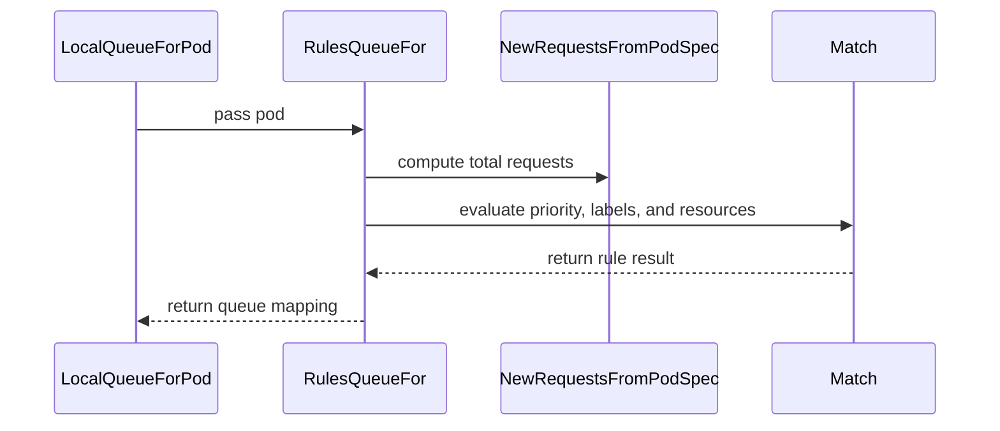

# PR #15573: importer: allow mapping rules to match on pod resource requests

**Summary**: importer: allow mapping rules to match on pod resource requests

**Sources**: https://github.com/kubernetes-sigs/kueue/pull/15573

**Last updated**: 2026-09-17T09:44:56Z

---

## Metadata

- **State**: closed (merged)
- **Author**: [@Huang-Wei](https://github.com/Huang-Wei)
- **Branch**: `worktree-feat-exclude-pods` → `main`
- **Created**: 2026-09-14T23:05:51Z
- **Updated**: 2026-09-17T09:44:56Z
- **Merged**: 2026-09-16T20:07:32Z
- **Closed**: 2026-09-16T20:07:32Z
- **Labels**: `kind/feature`, `release-note`, `size/L`, `lgtm`, `approved`, `cncf-cla: yes`
- **Assignees**: [@mimowo](https://github.com/mimowo)
- **Requested reviewers**: [@mbobrovskyi](https://github.com/mbobrovskyi), [@PBundyra](https://github.com/PBundyra)
- **Changed files**: 6   **+193 / -12**

## Description

#### What type of PR is this?

/kind feature

#### What this PR does / why we need it:

The importer selects Pods with only two mechanisms: `--namespace`, and the queue-mapping rules, which match on `labels` and `priorityClassName` only. A single label selector routinely covers both accelerator and CPU-only Pods, and today there is no way to import just one of those groups.

This adds a `resources` list to the mapping `match` block. A rule matches when the Pod's total requests contain a non-zero amount of **all** the listed resources, AND-ed with the existing `labels` and `priorityClassName` conditions. An absent or empty list matches any Pod, so existing mapping files behave exactly as before.

Because rules are evaluated in order and `skip: true` already exists, exclusion needs no new concept:

```yaml
- match:
    labels:
      src.lbl: src-val
    resources:
    - nvidia.com/gpu
  toLocalQueue: gpu-queue
- match:
    labels:
      src.lbl: src-val
  skip: true
```

Requests are totaled with `resources.NewRequestsFromPodSpec`, so init and sidecar containers (KEP-753), pod-level resources and pod overhead are all accounted for. Pods filtered out this way are counted in the existing `skipped` counter of the check and import summaries.

#### Which issue(s) this PR fixes:

None — filing directly as a small importer enhancement. Happy to open an issue first if that is preferred.

#### Special notes for your reviewer:

- **No new CLI flag.** The filter lives in the mapping file, so it is reachable via `--queuemapping-file` only, not via the simple `--queuelabel`/`--queuemapping` pair. Happy to add a flag for the simple path as well if that is wanted.
- **`Rules.QueueFor` now takes the `*corev1.Pod`** instead of `(priorityClassName, labels)`, so the Pod's total requests are computed once per Pod rather than once per rule. `cache.Load`, `pod.Check`, `pod.Import` and `pod.ListPods` signatures are unchanged; `cache.ImportCache.LocalQueue` is the only production call site.
- **`resources` uses AND semantics**, mirroring how `match.labels` already behaves. To match Pods requesting *any* of several resources, use one rule per resource pointing at the same LocalQueue.
- Testing: new unit cases in `cmd/importer/mapping` (all-of matching, partial match, zero quantity, YAML round-trip) and in `cmd/importer/pod` (check and import both skip the non-matching Pod). The existing `test/integration/singlecluster/importer` suite passes unchanged.

#### Does this PR introduce a user-facing change?

```release-note
CLI: The importer mapping file now supports a `resources` list in the `match` block, selecting only the Pods that request a non-zero amount of all the listed resources.
```


<!-- This is an auto-generated comment: release notes by coderabbit.ai -->
## AI summary

Adds resource-based matching to importer mapping rules. Rules can require Pods to request non-zero amounts of specified resources, while existing label and `priorityClassName` conditions still apply. An absent or empty `resources` list preserves catch-all behavior.

Matching includes init and sidecar containers, pod-level resources, and pod overhead. The feature applies to mappings used with `--queuemapping-file`. Documentation and tests cover matching, YAML round-tripping, checking, importing, and skipped-Pod accounting.

### Suggested release note

Importer: Added resource-based Pod filtering to mapping rules used with `--queuemapping-file`.
<!-- end of auto-generated comment: release notes by coderabbit.ai -->

## Discussion

### Comment by [@netlify[bot]](https://github.com/apps/netlify) — 2026-09-14T23:05:58Z

### <span aria-hidden="true">✅</span> Deploy Preview for *kubernetes-sigs-kueue* ready!


|  Name | Link |
|:-:|------------------------|
|<span aria-hidden="true">🔨</span> Latest commit | dec95bd3df0e44934c40b6fd6bf1f0adf7f72a23 |
|<span aria-hidden="true">🔍</span> Latest deploy log | https://app.netlify.com/projects/kubernetes-sigs-kueue/deploys/6aaadac366f6f400087ac571 |
|<span aria-hidden="true">😎</span> Deploy Preview | [https://deploy-preview-15573--kubernetes-sigs-kueue.netlify.app](https://deploy-preview-15573--kubernetes-sigs-kueue.netlify.app) |
|<span aria-hidden="true">📱</span> Preview on mobile | <details><summary> Toggle QR Code... </summary><br /><br /><br /><br />_Use your smartphone camera to open QR code link._</details> |
---
<!-- [kubernetes-sigs-kueue Preview](https://deploy-preview-15573--kubernetes-sigs-kueue.netlify.app) -->
_To edit notification comments on pull requests, go to your [Netlify project configuration](https://app.netlify.com/projects/kubernetes-sigs-kueue/configuration/notifications#deploy-notifications)._

### Comment by [@coderabbitai[bot]](https://github.com/apps/coderabbitai) — 2026-09-14T23:07:01Z

<!-- This is an auto-generated comment: summarize by coderabbit.ai -->
<!-- review_stack_entry_start -->

<a href="https://app.coderabbit.ai/change-stack/kubernetes-sigs/kueue/pull/15573#gh-light-mode-only"></a><a href="https://app.coderabbit.ai/change-stack/kubernetes-sigs/kueue/pull/15573#gh-dark-mode-only"></a>

<!-- review_stack_entry_end -->
<!-- recent_review_start -->

No actionable comments were generated in the recent review. 🎉

<details>
<summary>ℹ️ Recent review info</summary>

<details>
<summary>⚙️ Run configuration</summary>

**Configuration used**: Path: .coderabbit.yaml

**Review profile**: CHILL

**Plan**: Advanced

**Run ID**: `6beedcb0-1c17-49ae-9ee9-98f322b279ac`

</details>

<details>
<summary>📥 Commits</summary>

Reviewing files that changed from the base of the PR and between 2a5b49fe47bf3739efdce29d0d757355fafd4c5f and dec95bd3df0e44934c40b6fd6bf1f0adf7f72a23.

</details>

<details>
<summary>📒 Files selected for processing (2)</summary>

* `cmd/importer/pod/check_test.go`
* `cmd/importer/pod/import_test.go`

</details>

**Included review availability:** Your plan provides up to 8 included reviews per hour; 7 remain after this review.

</details>

---


<!-- recent_review_end -->
<!-- walkthrough_start -->

<details>
<summary>📝 Walkthrough</summary>

## Walkthrough

### Changes

The importer now supports resource-based pod matching. Mapping rules compute total pod requests and require a positive request for every listed resource. Pod-based queue resolution, tests, and README examples use the new behavior.

**Resource-aware importer mapping**

|Layer / File(s)|Summary|
|---|---|
|**Resource matching contract** <br> `cmd/importer/mapping/mapping.go`, `cmd/importer/cache/cache.go`|`Match` supports resource names. `Rules.QueueFor` accepts a pod and computes its requests. `LocalQueueForPod` passes the complete pod to `Rules.QueueFor`.|
|**Mapping contract validation** <br> `cmd/importer/mapping/mapping_test.go`|Tests construct pods with resource requests and cover complete, partial, non-listed, and zero-quantity requests.|
|**Importer behavior validation and documentation** <br> `cmd/importer/pod/check_test.go`, `cmd/importer/pod/import_test.go`, `cmd/importer/README.md`|Tests cover skipped CPU-only pods and imported GPU workloads. The README documents resource filtering, ordered rules, and skipped counters.|

<!-- change_assessment_start -->
**Priority:** ➖ Normal

**Estimated code review effort:** 3 (Moderate) | ~20 minutes

<!-- change_assessment_commit:"dec95bd3df0e44934c40b6fd6bf1f0adf7f72a23" -->
**Change:** Feature
<!-- change_assessment_end -->

### Sequence Diagram(s)



</details>

<!-- walkthrough_end -->
<!-- final_review_risk_start -->
**Merge Risk:** _⚪ Minimal_ · up to `dec95`
<!-- final_review_risk_coverage:{"sourceCommitId":"dec95bd3df0e44934c40b6fd6bf1f0adf7f72a23","coveredCommitId":"dec95bd3df0e44934c40b6fd6bf1f0adf7f72a23","kind":"reviewed"} -->

The resource-aware mapping change has no identified merge-blocking risk.
<!-- final_review_risk_end -->
<!-- pre_merge_checks_walkthrough_start -->

<details>
<summary>🚥 Pre-merge checks | ✅ 4 | ❌ 1</summary>

### ❌ Failed checks (1 warning)

|     Check name     | Status     | Explanation                                                                                                                                                                                | Resolution                                                                         |
| :----------------: | :--------- | :----------------------------------------------------------------------------------------------------------------------------------------------------------------------------------------- | :--------------------------------------------------------------------------------- |
| Docstring Coverage | ⚠️ Warning | Docstring coverage is 25.00% which is insufficient. The required threshold is 80.00%. Docstring coverage is scoped to functions touched by this diff. Analyzed 4 functions across 5 files. | Write docstrings for the functions missing them to satisfy the coverage threshold. |

<details>
<summary>✅ Passed checks (4 passed)</summary>

|         Check name         | Status   | Explanation                                                                                                            |
| :------------------------: | :------- | :--------------------------------------------------------------------------------------------------------------------- |
|      Description Check     | ✅ Passed | Check skipped - CodeRabbit’s high-level summary is enabled.                                                            |
|         Title check        | ✅ Passed | The title clearly and concisely describes the main change: importer mapping rules can match Pods by resource requests. |
|     Linked Issues check    | ✅ Passed | Check skipped because no linked issues were found for this pull request.                                               |
| Out of Scope Changes check | ✅ Passed | Check skipped because no linked issues were found for this pull request.                                               |

</details>

</details>

<!-- pre_merge_checks_walkthrough_end -->

- [ ] <!-- {"checkboxId":"585bb3f6-faf5-4dbf-96d2-74e382adf19a"} --> Fix all pre-merge checks with AI
<!-- finishing_touch_checkbox_start -->

<details>
<summary>✨ Finishing Touches</summary>

<details>
<summary>🧪 Generate unit tests (beta)</summary>

- [ ] <!-- {"checkboxId": "f47ac10b-58cc-4372-a567-0e02b2c3d479", "radioGroupId": "utg-output-choice-group-unknown_comment_id"} -->   Create PR with unit tests

</details>

</details>

<!-- finishing_touch_checkbox_end -->
<!-- tips_start -->

---


<sub>Comment `@coderabbitai help` to get the list of available commands.</sub>

<!-- tips_end -->

### Comment by [@kubernetes-prow[bot]](https://github.com/apps/kubernetes-prow) — 2026-09-16T19:43:21Z

LGTM label has been added.  <details>Git tree hash: d6dc3d058a6314b9343b045f8ab0f412714ce509</details>

### Comment by [@kubernetes-prow[bot]](https://github.com/apps/kubernetes-prow) — 2026-09-16T19:43:24Z

[APPROVALNOTIFIER] This PR is **APPROVED**

This pull-request has been approved by: *<a href="https://github.com/kubernetes-sigs/kueue/pull/15573#" title="Author self-approved">Huang-Wei</a>*, *<a href="https://github.com/kubernetes-sigs/kueue/pull/15573#pullrequestreview-5227528620" title="Approved">mimowo</a>*

The full list of commands accepted by this bot can be found [here](https://go.k8s.io/bot-commands?repo=kubernetes-sigs%2Fkueue).

The pull request process is described [here](https://git.k8s.io/community/contributors/guide/owners.md#the-code-review-process)

<details >
Needs approval from an approver in each of these files:

- ~~[OWNERS](https://github.com/kubernetes-sigs/kueue/blob/main/OWNERS)~~ [mimowo]

Approvers can indicate their approval by writing `/approve` in a comment
Approvers can cancel approval by writing `/approve cancel` in a comment
</details>
<!-- META={"approvers":[]} -->

### Comment by [@mimowo](https://github.com/mimowo) — 2026-09-16T20:08:03Z

/cherrypick release-0.19
/cherrypick release-0.18

### Comment by [@k8s-infra-cherrypick-robot](https://github.com/k8s-infra-cherrypick-robot) — 2026-09-16T20:08:46Z

@mimowo: new pull request created: #15662

<details>

In response to [this](https://github.com/kubernetes-sigs/kueue/pull/15573#issuecomment-5703805541):

>/cherrypick release-0.19
>/cherrypick release-0.18


Instructions for interacting with me using PR comments are available [here](https://git.k8s.io/community/contributors/guide/pull-requests.md).  If you have questions or suggestions related to my behavior, please file an issue against the [kubernetes-sigs/prow](https://github.com/kubernetes-sigs/prow/issues/new?title=Prow%20issue:) repository.
</details>

### Comment by [@k8s-infra-cherrypick-robot](https://github.com/k8s-infra-cherrypick-robot) — 2026-09-16T20:09:25Z

@mimowo: new pull request created: #15663

<details>

In response to [this](https://github.com/kubernetes-sigs/kueue/pull/15573#issuecomment-5703805541):

>/cherrypick release-0.19
>/cherrypick release-0.18


Instructions for interacting with me using PR comments are available [here](https://git.k8s.io/community/contributors/guide/pull-requests.md).  If you have questions or suggestions related to my behavior, please file an issue against the [kubernetes-sigs/prow](https://github.com/kubernetes-sigs/prow/issues/new?title=Prow%20issue:) repository.
</details>

### Comment by [@tenzen-y](https://github.com/tenzen-y) — 2026-09-17T09:44:56Z

/release-note-edit
```release-note
CLI: The importer mapping file now supports a `resources` list in the `match` block, selecting only the Pods that request a non-zero amount of all the listed resources.
```

## Reviews

### Review by [@mimowo](https://github.com/mimowo) (commented) — 2026-09-16T19:43:12Z

/lgtm
/approve
Nice one, thank you for returning to Kueue ❤️ 
/cherrypick release-0.19
/cherrypick release-0.18
