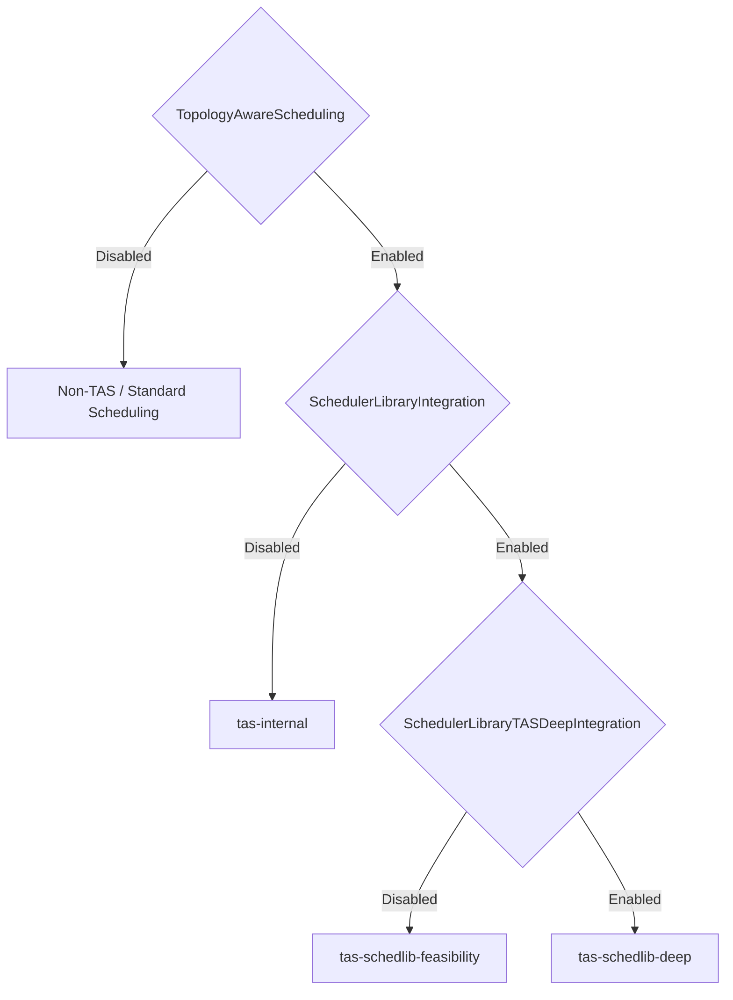

# PR #15584: Draft FG

**Summary**: Draft FG

**Sources**: https://github.com/kubernetes-sigs/kueue/pull/15584

**Last updated**: 2026-10-19T08:51:11Z

---

## Metadata

- **State**: closed
- **Author**: [@Singularity23x0](https://github.com/Singularity23x0)
- **Branch**: `15333-feature-gate` → `main`
- **Created**: 2026-09-15T07:48:39Z
- **Updated**: 2026-10-19T08:51:11Z
- **Merged**: —
- **Closed**: 2026-10-19T08:51:10Z
- **Labels**: `release-note-none`, `needs-rebase`, `do-not-merge/work-in-progress`, `cncf-cla: yes`, `size/S`, `area/tas`, `area/was`
- **Assignees**: _none_
- **Requested reviewers**: [@pajakd](https://github.com/pajakd)
- **Changed files**: 1   **+10 / -0**

## Description

<!-- Thank you for contributing! Check CONTRIBUTING.md for details. -->

#### What type of PR is this?
/area tas
/area was
<!-- Choose one of the following kinds:
/kind bug
/kind cleanup
/kind documentation
/kind feature
/kind kep
-->


<!-- Optionally choose one or more of the following kinds:
/kind api-change
/kind deprecation
/kind failing-test
/kind flake
/kind regression
-->


<!-- Consider setting the area:
/area tas
/area was
/area integrations
/area multikueue
/area dashboard
/area localization
/area testing
/area website
-->


#### What this PR does / why we need it?
Introduces a FG to turn the TAS + SchedulerLibrary Deep Integration.

<!--
Use `Fixes #123` for an issue addressed by this PR; it will be closed when the PR merges.
Use `Related:` or `Part of:` to reference an issue without closing it.
-->
Contributes to https://github.com/kubernetes-sigs/kueue/issues/15333

#### Useful notes for your reviewer
The FG will steed the WAS-TAS integration as follows:



#### Release note

<!-- Describe the behavior change accurately from the user's perspective. Hints:
- Do not leave this block blank.
- Use "NONE" when there is no user-facing change.
- When feasible use a prefix for the sub-component or feature, e.g. "FairSharing:" or "MultiKueue:".
- If upgrade steps are required, include an "ACTION REQUIRED:" section.
You may consider AI assistance using the skill: cmd/experimental/skills/kueue-release-notes/SKILL.md.
-->
```release-note
NONE

```

## Discussion

### Comment by [@kubernetes-prow[bot]](https://github.com/apps/kubernetes-prow) — 2026-09-15T07:48:43Z

Skipping CI for Draft Pull Request.
If you want CI signal for your change, please convert it to an actual PR.
You can still manually trigger a test run with `/test all`

### Comment by [@coderabbitai[bot]](https://github.com/apps/coderabbitai) — 2026-09-15T07:48:46Z

<!-- This is an auto-generated comment: summarize by coderabbit.ai -->
<!-- This is an auto-generated comment: skip review by coderabbit.ai -->

> [!IMPORTANT]
> ## Review skipped
> 
> Auto reviews are limited based on label configuration.
> 
> <details>
> <summary>:no_entry_sign: Review skipped — only excluded labels are configured. (3)</summary>
> 
> * needs-ok-to-test
> * do-not-merge/work-in-progress
> * cncf-cla: no
> 
> </details>
> 
> Please check the settings in the CodeRabbit UI or the `.coderabbit.yaml` file in this repository. To trigger a single review, invoke the `@coderabbitai review` command.
> 
> <details>
> <summary>⚙️ Run configuration</summary>
> 
> **Configuration used**: Path: .coderabbit.yaml
> 
> **Review profile**: CHILL
> 
> **Plan**: Advanced
> 
> **Run ID**: `6bcb2291-8177-4f3d-9bdf-702cba9cfd00`
> 
> </details>
> 
> You can disable this status message by setting the `reviews.review_status` to `false` in the CodeRabbit configuration file.
> 
> Use the checkbox below for a quick retry:
> - [ ] <!-- {"checkboxId":"e9bb8d72-00e8-4f67-9cb2-caf3b22574fe"} --> 🔍 Trigger review

<!-- end of auto-generated comment: skip review by coderabbit.ai -->

<!-- tips_start -->

---


<sub>Comment `@coderabbitai help` to get the list of available commands.</sub>

<!-- tips_end -->

### Comment by [@netlify[bot]](https://github.com/apps/netlify) — 2026-09-15T07:48:47Z

### <span aria-hidden="true">✅</span> Deploy Preview for *kubernetes-sigs-kueue* ready!


|  Name | Link |
|:-:|------------------------|
|<span aria-hidden="true">🔨</span> Latest commit | c015347d2a1558309f9da892d01ef7c5d7cc5215 |
|<span aria-hidden="true">🔍</span> Latest deploy log | https://app.netlify.com/projects/kubernetes-sigs-kueue/deploys/6aa8f85a68c0ea0008ee6ff3 |
|<span aria-hidden="true">😎</span> Deploy Preview | [https://deploy-preview-15584--kubernetes-sigs-kueue.netlify.app](https://deploy-preview-15584--kubernetes-sigs-kueue.netlify.app) |
|<span aria-hidden="true">📱</span> Preview on mobile | <details><summary> Toggle QR Code... </summary><br /><br /><br /><br />_Use your smartphone camera to open QR code link._</details> |
---
<!-- [kubernetes-sigs-kueue Preview](https://deploy-preview-15584--kubernetes-sigs-kueue.netlify.app) -->
_To edit notification comments on pull requests, go to your [Netlify project configuration](https://app.netlify.com/projects/kubernetes-sigs-kueue/configuration/notifications#deploy-notifications)._

### Comment by [@kubernetes-prow[bot]](https://github.com/apps/kubernetes-prow) — 2026-09-15T07:48:56Z

[APPROVALNOTIFIER] This PR is **NOT APPROVED**

This pull-request has been approved by: *<a href="https://github.com/kubernetes-sigs/kueue/pull/15584#" title="Author self-approved">Singularity23x0</a>*
**Once this PR has been reviewed and has the lgtm label**, please assign [tenzen-y](https://github.com/tenzen-y) for approval. For more information see [the Code Review Process](https://git.k8s.io/community/contributors/guide/owners.md#the-code-review-process).

The full list of commands accepted by this bot can be found [here](https://go.k8s.io/bot-commands?repo=kubernetes-sigs%2Fkueue).

<details open>
Needs approval from an approver in each of these files:

- **[OWNERS](https://github.com/kubernetes-sigs/kueue/blob/main/OWNERS)**

Approvers can indicate their approval by writing `/approve` in a comment
Approvers can cancel approval by writing `/approve cancel` in a comment
</details>
<!-- META={"approvers":["tenzen-y"]} -->

### Comment by [@olekzabl](https://github.com/olekzabl) — 2026-09-15T20:22:52Z

I like the diagram :heart:

Side thought (not for this PR, to keep it focused): should we also officially declare that `SchedulerLibraryIntegration` depends on `TAS`?
The diagram suggests so, and indeed I believe we'd ignore the former when the latter is off.

### Comment by [@kubernetes-prow[bot]](https://github.com/apps/kubernetes-prow) — 2026-09-18T04:04:16Z

PR needs rebase.

<details>

Instructions for interacting with me using PR comments are available [here](https://git.k8s.io/community/contributors/guide/pull-requests.md).  If you have questions or suggestions related to my behavior, please file an issue against the [kubernetes-sigs/prow](https://github.com/kubernetes-sigs/prow/issues/new?title=Prow%20issue:) repository.
</details>

### Comment by [@olekzabl](https://github.com/olekzabl) — 2026-10-14T08:55:26Z

@Singularity23x0 can we close this now that #16347 is merged?

### Comment by [@Singularity23x0](https://github.com/Singularity23x0) — 2026-10-19T08:51:04Z

/close

### Comment by [@kubernetes-prow[bot]](https://github.com/apps/kubernetes-prow) — 2026-10-19T08:51:11Z

@Singularity23x0: Closed this PR.

<details>

In response to [this](https://github.com/kubernetes-sigs/kueue/pull/15584#issuecomment-6263397399):

>/close


Instructions for interacting with me using PR comments are available [here](https://git.k8s.io/community/contributors/guide/pull-requests.md).  If you have questions or suggestions related to my behavior, please file an issue against the [kubernetes-sigs/prow](https://github.com/kubernetes-sigs/prow/issues/new?title=Prow%20issue:) repository.
</details>

## Reviews

### Review by [@olekzabl](https://github.com/olekzabl) (commented) — 2026-09-15T20:34:23Z

- **pkg/features/kube_features.go:658** by [@olekzabl](https://github.com/olekzabl) — 2026-09-15T20:32:15Z
```diff
@@ -661,6 +652,11 @@ const (
 	//
 	// Reuse clientConnection (QPS and Burst) for MultiKueue worker clusters instead of creating a new client for each request.
 	MultiKueueReuseClientConnectionConfigForWorkers featuregate.Feature = "MultiKueueReuseClientConnectionConfigForWorkers"
+
+	// owner: @dpastuszka
+	//
+	// Replace TAS topology assignment and followup preemption strategy with SchedulerLibrary's ScheduleWorkload.
```

  I'd like these comments (both on this FG and on the previous `SchedulerLibraryIntegration`) to possiby clearly guide readers - even those new to the topic - about what these features do.
  
  How about this:
  
  - here:
    ```
    Determine TAS topology assignment and preemption targets 
    by calling the ScheduleWorkload() method
    from https://github.com/kubernetes-sigs/scheduler-library.
    ```
  
  - for the old FG, add this:
    ```
    The basic integration uses the library to answer questions like
    "can the given pods fit on a given node".
    A deeper mode of integration can be enabled
    via the SchedulerLibraryTASDeepIntegration feature gate.
    ```
