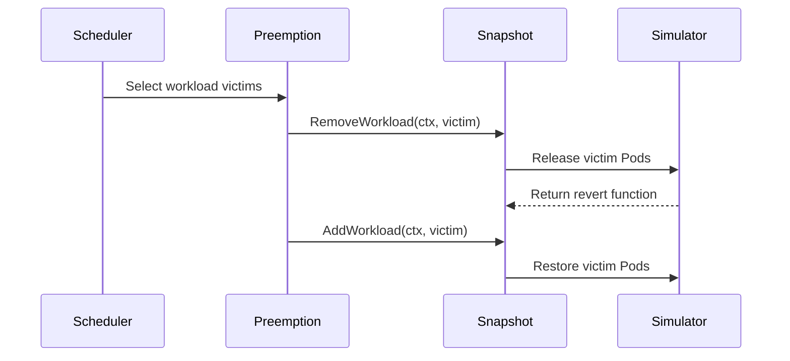

# PR #15612: TAS: release a preemption candidate's Pods from the scheduling simulator during the search loop

**Summary**: TAS: release a preemption candidate's Pods from the scheduling simulator during the search loop

**Sources**: https://github.com/kubernetes-sigs/kueue/pull/15612

**Last updated**: 2026-10-20T15:26:02Z

---

## Metadata

- **State**: open
- **Author**: [@adibmbrk](https://github.com/adibmbrk)
- **Branch**: `tas-simulator-preemption-fix` → `main`
- **Created**: 2026-09-15T14:07:35Z
- **Updated**: 2026-10-20T15:26:02Z
- **Merged**: —
- **Closed**: —
- **Labels**: `lifecycle/stale`, `size/L`, `release-note-none`, `needs-rebase`, `kind/cleanup`, `ok-to-test`, `cncf-cla: yes`, `area/tas`
- **Assignees**: _none_
- **Requested reviewers**: [@amy](https://github.com/amy), [@mbobrovskyi](https://github.com/mbobrovskyi)
- **Changed files**: 8   **+246 / -78**

## Description

<!-- AI-assisted: drafted with Claude Code; reviewed and tested by the author. -->

#### What type of PR is this?
/kind bug

/kind cleanup

/area tas

#### What this PR does / why we need it?

`Snapshot.RemoveWorkload`/`AddWorkload` only adjusted quota accounting, so during the classical-preemption candidate search loop a candidate's Pods stayed tracked in the real scheduling simulator even after being provisionally "removed". Any TAS feasibility check run mid-search therefore still saw the candidate's node as occupied (e.g. by a held host port), so a genuinely blocked node never became feasible and no preemption target was ever found — only the *final* TAS re-check released the simulator's Pods, too late to help the search itself.

`RemoveWorkload`/`AddWorkload` now also release/restore the workload's Pods in the `SimulatorSnapshot` when one is configured, so every caller — including the search loop — sees consistent simulator state.

This also resolves #15546: the `recordingSimulator` fake in `scheduler_tas_test.go` no longer reimplements feasibility. It now wraps the real WAS scheduling simulator and only adds call-recording instrumentation, and a new test case exercises a genuine host-port conflict end to end.

#### Useful notes for your reviewer

- `go test ./pkg/cache/scheduler/... ./pkg/scheduler/...` passes.
- `make ci-lint` reports 0 issues.
- Verified the new regression test fails without the `RemoveWorkload`/`AddWorkload` fix and passes with it.

Fixes #15546

#### Release note

```release-note
NONE
```

<!-- This is an auto-generated comment: release notes by coderabbit.ai -->

## AI summary

- Fixed TAS classical-preemption simulation so candidate workload Pods are released and restored during feasibility checks.
- Preserved Pod-level constraints, including held host ports.
- Replaced the standalone `recordingSimulator` fake with a recorder around the real scheduling simulator.
- Updated APIs, call sites, and regression tests.

### Suggested release note

**Detailed:** TAS: Fixed a bug where classical-preemption feasibility checks could ignore Pods held by candidate workloads, including host-port constraints. TAS now releases those Pods during simulation.

**Concise:** TAS: Fixed classical-preemption checks that ignored candidate workload Pods and their host-port constraints.

**Balanced:** TAS: Fixed a bug that caused classical-preemption feasibility checks to ignore candidate workload Pods. TAS now evaluates host-port and other Pod-level constraints correctly.

**Rationale:** `TAS:` is the narrowest accurate scope. This is a user-visible scheduling bug fix. No user action is required.

<!-- end of auto-generated comment: release notes by coderabbit.ai -->

## Discussion

### Comment by [@netlify[bot]](https://github.com/apps/netlify) — 2026-09-15T14:07:44Z

### <span aria-hidden="true">✅</span> Deploy Preview for *kubernetes-sigs-kueue* canceled.


|  Name | Link |
|:-:|------------------------|
|<span aria-hidden="true">🔨</span> Latest commit | a1aa1df84c7be9c4b7aae9a1b508321b99149e2c |
|<span aria-hidden="true">🔍</span> Latest deploy log | https://app.netlify.com/projects/kubernetes-sigs-kueue/deploys/6aa952f7cc52b900080594a4 |

### Comment by [@kubernetes-prow[bot]](https://github.com/apps/kubernetes-prow) — 2026-09-15T14:07:47Z

Hi @adibmbrk. Thanks for your PR.

I'm waiting for a [kubernetes-sigs](https://github.com/orgs/kubernetes-sigs/people) member to verify that this patch is reasonable to test. If it is, they should reply with `/ok-to-test` on its own line. Until that is done, I will not automatically test new commits in this PR, but the usual testing commands by org members will still work.

>[!TIP]
>**We noticed you've done this a few times! Consider [joining the org](https://git.k8s.io/community/community-membership.md#member) to skip this step and gain `/lgtm` and other bot rights.** We recommend asking approvers on your previous PRs to sponsor you.

Once the patch is verified, the new status will be reflected by the `ok-to-test` label.

I understand the commands that are listed [here](https://go.k8s.io/bot-commands?repo=kubernetes-sigs%2Fkueue).

<details>

Instructions for interacting with me using PR comments are available [here](https://git.k8s.io/community/contributors/guide/pull-requests.md).  If you have questions or suggestions related to my behavior, please file an issue against the [kubernetes-sigs/prow](https://github.com/kubernetes-sigs/prow/issues/new?title=Prow%20issue:) repository.
</details>

### Comment by [@kubernetes-prow[bot]](https://github.com/apps/kubernetes-prow) — 2026-09-15T14:07:55Z

[APPROVALNOTIFIER] This PR is **NOT APPROVED**

This pull-request has been approved by: *<a href="https://github.com/kubernetes-sigs/kueue/pull/15612#" title="Author self-approved">adibmbrk</a>*
**Once this PR has been reviewed and has the lgtm label**, please assign [mbobrovskyi](https://github.com/mbobrovskyi), [mimowo](https://github.com/mimowo), [olekzabl](https://github.com/olekzabl) for approval. For more information see [the Code Review Process](https://git.k8s.io/community/contributors/guide/owners.md#the-code-review-process).

The full list of commands accepted by this bot can be found [here](https://go.k8s.io/bot-commands?repo=kubernetes-sigs%2Fkueue).

<details open>
Needs approval from an approver in each of these files:

- **[OWNERS](https://github.com/kubernetes-sigs/kueue/blob/main/OWNERS)**

Approvers can indicate their approval by writing `/approve` in a comment
Approvers can cancel approval by writing `/approve cancel` in a comment
</details>
<!-- META={"approvers":["mbobrovskyi","mimowo","olekzabl"]} -->

### Comment by [@coderabbitai[bot]](https://github.com/apps/coderabbitai) — 2026-09-15T14:08:42Z

<!-- This is an auto-generated comment: summarize by coderabbit.ai -->
<!-- review_stack_entry_start -->

<a href="https://app.coderabbit.ai/change-stack/kubernetes-sigs/kueue/pull/15612#gh-light-mode-only"></a><a href="https://app.coderabbit.ai/change-stack/kubernetes-sigs/kueue/pull/15612#gh-dark-mode-only"></a>

<!-- review_stack_entry_end -->
<!-- recent_review_start -->

No actionable comments were generated in the recent review. 🎉

<details>
<summary>ℹ️ Recent review info</summary>

<details>
<summary>⚙️ Run configuration</summary>

**Configuration used**: Path: .coderabbit.yaml

**Review profile**: CHILL

**Plan**: Advanced

**Run ID**: `86c0698c-a13c-4322-825f-cc8fa9008eeb`

</details>

<details>
<summary>📥 Commits</summary>

Reviewing files that changed from the base of the PR and between eca88132b697ffd65098489741e7796ad9cc5f9a and 04c1bd69aac74db946505c63db2df9b04604a942.

</details>

<details>
<summary>📒 Files selected for processing (8)</summary>

* `pkg/cache/scheduler/fair_sharing_test.go`
* `pkg/cache/scheduler/snapshot.go`
* `pkg/cache/scheduler/snapshot_test.go`
* `pkg/scheduler/preemption/preemption.go`
* `pkg/scheduler/preemption/preemption_test.go`
* `pkg/scheduler/scheduler.go`
* `pkg/scheduler/scheduler_tas_test.go`
* `pkg/scheduler/scheduler_test.go`

</details>

**Included review availability:** Your plan provides up to 8 included reviews per hour; 7 remain after this review.

</details>

---


<!-- recent_review_end -->
<!-- walkthrough_start -->

<details>
<summary>📝 Walkthrough</summary>

## Walkthrough

### Changes

**Simulator-backed workload preemption**

|Layer / File(s)|Summary|
|---|---|
|**Snapshot simulator synchronization** <br> `pkg/cache/scheduler/snapshot.go`, `pkg/cache/scheduler/snapshot_test.go`|`Snapshot` now releases and restores workload Pods in the simulator during workload removal and restoration. Context is required by the affected methods.|
|**Preemption context propagation** <br> `pkg/scheduler/scheduler.go`, `pkg/scheduler/preemption/preemption.go`|Scheduler and preemption paths pass context to workload simulation, removal, addition, and restoration operations.|
|**Simulator-backed test coverage** <br> `pkg/scheduler/scheduler_tas_test.go`, `pkg/scheduler/preemption/preemption_test.go`, `pkg/cache/scheduler/*_test.go`, `pkg/scheduler/scheduler_test.go`|TAS tests use the real WAS simulator through a recording wrapper. Tests cover release and revert tracking, host-port scheduling, repeated preemption requests, and updated method signatures.|

<!-- change_assessment_start -->
**Priority:** ➖ Normal


**Estimated code review effort:** 4 (Complex) | ~45 minutes

<!-- change_assessment_commit:"04c1bd69aac74db946505c63db2df9b04604a942" -->
**Change:** Bug fix
<!-- change_assessment_end -->

### Sequence Diagram(s)



**Suggested reviewers:** `kshalot`, `sohankunkerkar`

</details>

<!-- walkthrough_end -->
<!-- final_review_risk_start -->
**Merge Risk:** _⚪ Minimal_ · up to `04c1b`
<!-- final_review_risk_coverage:{"sourceCommitId":"04c1bd69aac74db946505c63db2df9b04604a942","coveredCommitId":"04c1bd69aac74db946505c63db2df9b04604a942","kind":"reviewed"} -->

No concrete merge-blocking issue remains in the simulator synchronization changes.
<!-- final_review_risk_end -->
<!-- pre_merge_checks_walkthrough_start -->

<details>
<summary>🚥 Pre-merge checks | ✅ 3 | ❌ 2</summary>

### ❌ Failed checks (2 warnings)

|      Check name     | Status     | Explanation                                                                                                                                                                                               | Resolution                                                                                                                                                                                                                                        |
| :-----------------: | :--------- | :-------------------------------------------------------------------------------------------------------------------------------------------------------------------------------------------------------- | :------------------------------------------------------------------------------------------------------------------------------------------------------------------------------------------------------------------------------------------------ |
| Linked Issues check | ⚠️ Warning | Issue `#15546` requires removal of `recordingSimulator` and its related fake snapshot implementation from `pkg/scheduler/scheduler_tas_test.go`. The diff keeps both `recordingSimulator` and `recordingSi… | Remove `recordingSimulator` and `recordingSimulatorSnapshot` from `pkg/scheduler/scheduler_tas_test.go`. Use a production-backed test path that does not retain this test double, while preserving deterministic assertions for preemption reque… |
|  Docstring Coverage | ⚠️ Warning | Docstring coverage is 30.77% which is insufficient. The required threshold is 80.00%. Docstring coverage is scoped to functions touched by this diff. Analyzed 13 functions across 8 files.               | Write docstrings for the functions missing them to satisfy the coverage threshold.                                                                                                                                                                |

<details>
<summary>✅ Passed checks (3 passed)</summary>

|         Check name         | Status   | Explanation                                                                                                                                                                                               |
| :------------------------: | :------- | :-------------------------------------------------------------------------------------------------------------------------------------------------------------------------------------------------------- |
| Out of Scope Changes check | ✅ Passed | The changes stay connected to Issue `#15546`. The `Snapshot` changes release and restore workload Pods during simulated preemption, and the updated call sites and tests support the production-backed TAS… |
|      Description Check     | ✅ Passed | Check skipped - CodeRabbit’s high-level summary is enabled.                                                                                                                                               |
|         Title check        | ✅ Passed | The title clearly and specifically describes the main change: releasing a preemption candidate's Pods from the scheduling simulator during the search loop.                                               |

</details>

<details>
<summary>Full details: Linked Issues check</summary>

**Explanation**

Issue `#15546` requires removal of `recordingSimulator` and its related fake snapshot implementation from `pkg/scheduler/scheduler_tas_test.go`. The diff keeps both `recordingSimulator` and `recordingSimulatorSnapshot`; it changes the simulator to wrap `was.NewWASSimulator` but still overrides `PreemptWorkload` to record and simulate failures. The new tests use the real WAS simulator for feasibility and preserve deterministic preemption and revert assertions, but the explicit removal requirement is unmet.

**Resolution**

Remove `recordingSimulator` and `recordingSimulatorSnapshot` from `pkg/scheduler/scheduler_tas_test.go`. Use a production-backed test path that does not retain this test double, while preserving deterministic assertions for preemption requests and revert behavior.

</details>

</details>

<!-- pre_merge_checks_walkthrough_end -->

- [ ] <!-- {"checkboxId":"585bb3f6-faf5-4dbf-96d2-74e382adf19a"} --> Fix all pre-merge checks with AI
<!-- finishing_touch_checkbox_start -->

<details>
<summary>✨ Finishing Touches</summary>

<details>
<summary>🧪 Generate unit tests (beta)</summary>

- [ ] <!-- {"checkboxId": "f47ac10b-58cc-4372-a567-0e02b2c3d479", "radioGroupId": "utg-output-choice-group-unknown_comment_id"} -->   Create PR with unit tests

</details>

</details>

<!-- finishing_touch_checkbox_end -->
<!-- tips_start -->

---


<sub>Comment `@coderabbitai help` to get the list of available commands.</sub>

<!-- tips_end -->

### Comment by [@mimowo](https://github.com/mimowo) — 2026-09-15T14:50:39Z

Cc @sohankunkerkar

### Comment by [@Vaishnav88sk](https://github.com/Vaishnav88sk) — 2026-09-15T15:39:51Z

/ok-to-test

### Comment by [@sohankunkerkar](https://github.com/sohankunkerkar) — 2026-09-15T17:13:45Z

/remove-kind bug
/kind cleanup

### Comment by [@sohankunkerkar](https://github.com/sohankunkerkar) — 2026-09-15T17:14:49Z

As we haven't released the 0.20 version yet and it was introduced by https://github.com/kubernetes-sigs/kueue/pull/15436 (which is still there on main)

### Comment by [@kubernetes-prow[bot]](https://github.com/apps/kubernetes-prow) — 2026-09-15T17:14:51Z

@sohankunkerkar: you can only set the release note label to release-note-none if the release-note block in the PR body text is empty or "none".

<details>

In response to [this](https://github.com/kubernetes-sigs/kueue/pull/15612#issuecomment-5684700617):

>/release-note-none
>As we haven't released the 0.20 version yet and it was introduced by https://github.com/kubernetes-sigs/kueue/pull/15436 (which is still there on main)


Instructions for interacting with me using PR comments are available [here](https://git.k8s.io/community/contributors/guide/pull-requests.md).  If you have questions or suggestions related to my behavior, please file an issue against the [kubernetes-sigs/prow](https://github.com/kubernetes-sigs/prow/issues/new?title=Prow%20issue:) repository.
</details>

### Comment by [@kubernetes-prow[bot]](https://github.com/apps/kubernetes-prow) — 2026-09-18T03:21:21Z

PR needs rebase.

<details>

Instructions for interacting with me using PR comments are available [here](https://git.k8s.io/community/contributors/guide/pull-requests.md).  If you have questions or suggestions related to my behavior, please file an issue against the [kubernetes-sigs/prow](https://github.com/kubernetes-sigs/prow/issues/new?title=Prow%20issue:) repository.
</details>

### Comment by [@k8s-triage-robot](https://github.com/k8s-triage-robot) — 2026-10-20T15:26:00Z

The Kubernetes project currently lacks enough active contributors to adequately respond to all PRs.

This bot triages PRs according to the following rules:
- After 30d of inactivity, `lifecycle/stale` is applied
- After 30d of inactivity since `lifecycle/stale` was applied, `lifecycle/rotten` is applied
- After 30d of inactivity since `lifecycle/rotten` was applied, the PR is closed

You can:
- Mark this PR as fresh with `/remove-lifecycle stale`
- Close this PR with `/close`
- Offer to help out with [Issue Triage][1]

Please send feedback to us at [Kueue](https://github.com/kubernetes-sigs/kueue/tree/main#community-discussion-contribution-and-support).

/lifecycle stale

[1]: https://www.kubernetes.dev/docs/guide/issue-triage/

## Reviews

### Review by [@sohankunkerkar](https://github.com/sohankunkerkar) (commented) — 2026-09-15T17:28:24Z

- **pkg/cache/scheduler/snapshot.go:84** by [@sohankunkerkar](https://github.com/sohankunkerkar) — 2026-09-15T17:22:38Z
```diff
@@ -59,22 +59,57 @@ type Snapshot struct {
 	// hostnameLeafTASFlavors holds the flavor snapshots sharing topology
 	// capacity, fixed once the snapshot is built.
 	hostnameLeafTASFlavors map[kueue.ResourceFlavorReference]*TASFlavorSnapshot
+
+	simulatedPreemptions map[workload.Reference]func() error
 }
 
 // RemoveWorkload removes a workload from its corresponding ClusterQueue and
 // updates resource usage.
-func (s *Snapshot) RemoveWorkload(wl *workload.Info) {
+func (s *Snapshot) RemoveWorkload(ctx context.Context, wl *workload.Info) {
 	cq := s.ClusterQueue(wl.ClusterQueue)
 	delete(cq.Workloads, workload.Key(wl.Obj))
 	s.removeUsage(cq, wl.Usage())
+	s.simulatePodRemoval(ctx, wl)
 }
 
 // AddWorkload adds a workload to its corresponding ClusterQueue and
 // updates resource usage.
-func (s *Snapshot) AddWorkload(wl *workload.Info) {
+func (s *Snapshot) AddWorkload(ctx context.Context, wl *workload.Info) {
 	cq := s.ClusterQueue(wl.ClusterQueue)
 	cq.Workloads[workload.Key(wl.Obj)] = wl
 	s.AddUsage(cq, wl.Usage())
+	s.revertSimulatedPodRemoval(ctx, wl)
+}
+
+func (s *Snapshot) simulatePodRemoval(ctx context.Context, wl *workload.Info) {
```

  #15436 already added a `simulatePodRemoval` in scheduler.go and it's still used. I'd keep one, not two.

- **pkg/cache/scheduler/snapshot.go:109** by [@sohankunkerkar](https://github.com/sohankunkerkar) — 2026-09-15T17:23:49Z
```diff
@@ -59,22 +59,57 @@ type Snapshot struct {
 	// hostnameLeafTASFlavors holds the flavor snapshots sharing topology
 	// capacity, fixed once the snapshot is built.
 	hostnameLeafTASFlavors map[kueue.ResourceFlavorReference]*TASFlavorSnapshot
+
+	simulatedPreemptions map[workload.Reference]func() error
 }
 
 // RemoveWorkload removes a workload from its corresponding ClusterQueue and
 // updates resource usage.
-func (s *Snapshot) RemoveWorkload(wl *workload.Info) {
+func (s *Snapshot) RemoveWorkload(ctx context.Context, wl *workload.Info) {
 	cq := s.ClusterQueue(wl.ClusterQueue)
 	delete(cq.Workloads, workload.Key(wl.Obj))
 	s.removeUsage(cq, wl.Usage())
+	s.simulatePodRemoval(ctx, wl)
 }
 
 // AddWorkload adds a workload to its corresponding ClusterQueue and
 // updates resource usage.
-func (s *Snapshot) AddWorkload(wl *workload.Info) {
+func (s *Snapshot) AddWorkload(ctx context.Context, wl *workload.Info) {
 	cq := s.ClusterQueue(wl.ClusterQueue)
 	cq.Workloads[workload.Key(wl.Obj)] = wl
 	s.AddUsage(cq, wl.Usage())
+	s.revertSimulatedPodRemoval(ctx, wl)
+}
+
+func (s *Snapshot) simulatePodRemoval(ctx context.Context, wl *workload.Info) {
+	if s.SimulatorSnapshot == nil || !features.Enabled(features.SchedulerLibraryIntegration) {
+		return
+	}
+	revert, err := s.SimulatorSnapshot.PreemptWorkload(ctx, client.ObjectKeyFromObject(wl.Obj))
+	if err != nil {
+		ctrl.LoggerFrom(ctx).V(2).Info("Could not remove a Workload from the scheduling simulator",
+			"workload", klog.KObj(wl.Obj), "error", err)
+		return
+	}
+	if s.simulatedPreemptions == nil {
+		s.simulatedPreemptions = make(map[workload.Reference]func() error)
+	}
+	s.simulatedPreemptions[workload.Key(wl.Obj)] = revert
+	s.ForgetSimulatedFeasibility()
+}
+
+func (s *Snapshot) revertSimulatedPodRemoval(ctx context.Context, wl *workload.Info) {
+	key := workload.Key(wl.Obj)
+	revert, ok := s.simulatedPreemptions[key]
+	if !ok {
+		return
+	}
+	delete(s.simulatedPreemptions, key)
+	if err := revert(); err != nil {
+		ctrl.LoggerFrom(ctx).V(2).Info("Could not restore a Workload in the scheduling simulator",
```

  If this revert fails, the Pods stay out of the simulator, so nodes look emptier than they are and we can admit too much. A failed `PreemptWorkload` is the safe direction, this one isn't. Worth a comment saying so, and you can bump the log level since it shouldn't happen.

- **pkg/cache/scheduler/snapshot.go:98** by [@sohankunkerkar](https://github.com/sohankunkerkar) — 2026-09-15T17:27:17Z
```diff
@@ -59,22 +59,57 @@ type Snapshot struct {
 	// hostnameLeafTASFlavors holds the flavor snapshots sharing topology
 	// capacity, fixed once the snapshot is built.
 	hostnameLeafTASFlavors map[kueue.ResourceFlavorReference]*TASFlavorSnapshot
+
+	simulatedPreemptions map[workload.Reference]func() error
 }
 
 // RemoveWorkload removes a workload from its corresponding ClusterQueue and
 // updates resource usage.
-func (s *Snapshot) RemoveWorkload(wl *workload.Info) {
+func (s *Snapshot) RemoveWorkload(ctx context.Context, wl *workload.Info) {
 	cq := s.ClusterQueue(wl.ClusterQueue)
 	delete(cq.Workloads, workload.Key(wl.Obj))
 	s.removeUsage(cq, wl.Usage())
+	s.simulatePodRemoval(ctx, wl)
 }
 
 // AddWorkload adds a workload to its corresponding ClusterQueue and
 // updates resource usage.
-func (s *Snapshot) AddWorkload(wl *workload.Info) {
+func (s *Snapshot) AddWorkload(ctx context.Context, wl *workload.Info) {
 	cq := s.ClusterQueue(wl.ClusterQueue)
 	cq.Workloads[workload.Key(wl.Obj)] = wl
 	s.AddUsage(cq, wl.Usage())
+	s.revertSimulatedPodRemoval(ctx, wl)
+}
+
+func (s *Snapshot) simulatePodRemoval(ctx context.Context, wl *workload.Info) {
+	if s.SimulatorSnapshot == nil || !features.Enabled(features.SchedulerLibraryIntegration) {
+		return
+	}
+	revert, err := s.SimulatorSnapshot.PreemptWorkload(ctx, client.ObjectKeyFromObject(wl.Obj))
+	if err != nil {
+		ctrl.LoggerFrom(ctx).V(2).Info("Could not remove a Workload from the scheduling simulator",
+			"workload", klog.KObj(wl.Obj), "error", err)
+		return
+	}
+	if s.simulatedPreemptions == nil {
+		s.simulatedPreemptions = make(map[workload.Reference]func() error)
+	}
+	s.simulatedPreemptions[workload.Key(wl.Obj)] = revert
+	s.ForgetSimulatedFeasibility()
```

  `RemoveWorkload` runs once per candidate here, so we now throw away the feasibility cache on every candidate instead of once per cycle. Clearing it is cheap, recomputing isn't. Did you measure this with a lot of CQs and flavors?
