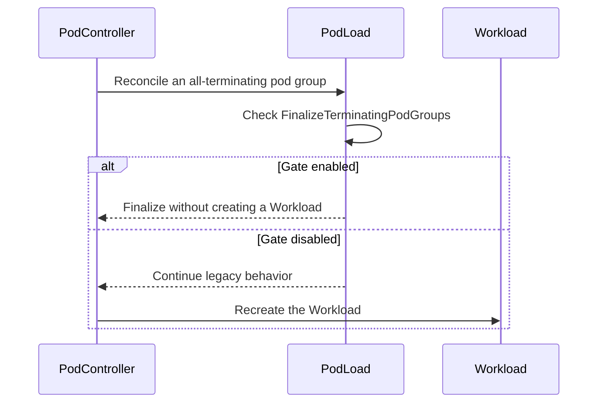

# PR #15628: pod: guard all-terminating group finalization with FinalizeTerminatin…

**Summary**: pod: guard all-terminating group finalization with FinalizeTerminatin…

**Sources**: https://github.com/kubernetes-sigs/kueue/pull/15628

**Last updated**: 2026-09-17T11:54:49Z

---

## Metadata

- **State**: closed (merged)
- **Author**: [@anguszzzz](https://github.com/anguszzzz)
- **Branch**: `feat/finalize-terminating-podgroups-gate` → `main`
- **Created**: 2026-09-15T23:02:41Z
- **Updated**: 2026-09-17T11:54:49Z
- **Merged**: 2026-09-16T19:09:25Z
- **Closed**: 2026-09-16T19:09:25Z
- **Labels**: `release-note`, `size/L`, `lgtm`, `approved`, `ok-to-test`, `cncf-cla: yes`
- **Assignees**: [@mimowo](https://github.com/mimowo)
- **Requested reviewers**: [@pajakd](https://github.com/pajakd), [@sohankunkerkar](https://github.com/sohankunkerkar)
- **Changed files**: 6   **+199 / -17**

## Description

<!-- Thank you for contributing! Check CONTRIBUTING.md for details. -->

   #### What type of PR is this?
   <!-- Choose one of the following kinds:
   /kind bug
   /kind cleanup
   /kind documentation
   /kind feature
   /kind kep
   -->
   /kind feature

   <!-- Optionally choose one or more of the following kinds:
   /kind api-change
   /kind deprecation
   /kind failing-test
   /kind flake
   /kind regression
   -->

   <!-- Consider setting the area:
   /area tas
   /area was
   /area integrations
   /area multikueue
   /area dashboard
   /area localization
   /area testing
   /area website
   -->
   /area integrations

   #### What this PR does / why we need it?

   Post-merge follow-up to #15154, requested by @tenzen-y in https://github.com/kubernetes-sigs/kueue/pull/15154#discussion_r4020064560: the all-terminating pod-group finalization introduced there is now guarded behind a dedicated Alpha feature gate, `FinalizeTerminatingPodGroups` (default off), ahead of the
 upcoming patch releases.

   - Gate enabled: a pod group whose pods are all terminating is finalized once no Workload remains for the group name (the #15154 behavior).
   - Gate disabled: `Pod.Load` returns the legacy result and a Workload is re-created for the group (pre-#15154 behavior).

   <!--
   Use `Fixes #123` for an issue addressed by this PR; it will be closed when the PR merges.
   Use `Related:` or `Part of:` to reference an issue without closing it.
   -->
   Related: #15148

   #### Useful notes for your reviewer

   - Gate-off keeps only the finalization logic disabled; #15154's removal of the reconcile-request key rewrite (`key.Name = p.pod.Name`) stays ungated as an independent fix.
   - Tests: #15154's unit and integration cases now run with the gate ON; new gate-OFF cases in both suites pin the legacy Workload re-creation. `go test ./pkg/features/ ./pkg/controller/jobs/pod/ ./pkg/controller/jobframework/` green; pod integration suite passes.
   - The total-count question from the #15154 thread stays open: whether finalization should also require `len(p.list.Items)` to satisfy the `pod-group-total-count` annotation. I suggest resolving it as a follow-up — a strict count requirement trades a self-healing misdecision for the pre-#15154 compose-error state
 on permanently underfilled groups — then promoting the gate.
   - Written in part with generative AI assistance; I have reviewed and verified every change.

   #### Release note

   <!-- Describe the behavior change accurately from the user's perspective. Hints:
   - Do not leave this block blank.
   - Use "NONE" when there is no user-facing change.
   - When feasible use a prefix for the sub-component or feature, e.g. "FairSharing:" or "MultiKueue:".
   - If upgrade steps are required, include an "ACTION REQUIRED:" section.
   You may consider AI assistance using the skill: cmd/experimental/skills/kueue-release-notes/SKILL.md.
   -->
```release-note
Pod: added Alpha feature gate FinalizeTerminatingPodGroups (disabled by default); when enabled, an all-terminating pod group with no remaining Workload is finalized instead of re-creating a Workload (the #15154 behavior, opt-in on this branch).
 ```
 
<!-- This is an auto-generated comment: release notes by coderabbit.ai -->
## AI summary

Adds the `FinalizeTerminatingPodGroups` feature gate. When enabled, Kueue finalizes all-terminating pod groups without recreating their `Workload`. When disabled, Kueue preserves legacy `Workload` recreation. Adds unit and integration coverage and registers the gate for v0.20.

### Suggested release note

`Pod:` Added gated support for finalizing all-terminating pod groups without recreating their `Workload`. This behavior is controlled by `FinalizeTerminatingPodGroups`.
<!-- end of auto-generated comment: release notes by coderabbit.ai -->

## Discussion

### Comment by [@netlify[bot]](https://github.com/apps/netlify) — 2026-09-15T23:02:48Z

### <span aria-hidden="true">✅</span> Deploy Preview for *kubernetes-sigs-kueue* ready!


|  Name | Link |
|:-:|------------------------|
|<span aria-hidden="true">🔨</span> Latest commit | 48a80912311954eff9084182dba54fe08cb08d48 |
|<span aria-hidden="true">🔍</span> Latest deploy log | https://app.netlify.com/projects/kubernetes-sigs-kueue/deploys/6aaae2c9430eb8000959578b |
|<span aria-hidden="true">😎</span> Deploy Preview | [https://deploy-preview-15628--kubernetes-sigs-kueue.netlify.app](https://deploy-preview-15628--kubernetes-sigs-kueue.netlify.app) |
|<span aria-hidden="true">📱</span> Preview on mobile | <details><summary> Toggle QR Code... </summary><br /><br /><br /><br />_Use your smartphone camera to open QR code link._</details> |
---
<!-- [kubernetes-sigs-kueue Preview](https://deploy-preview-15628--kubernetes-sigs-kueue.netlify.app) -->
_To edit notification comments on pull requests, go to your [Netlify project configuration](https://app.netlify.com/projects/kubernetes-sigs-kueue/configuration/notifications#deploy-notifications)._

### Comment by [@kubernetes-prow[bot]](https://github.com/apps/kubernetes-prow) — 2026-09-15T23:02:52Z

Hi @anguszzzz. Thanks for your PR.

I'm waiting for a [kubernetes-sigs](https://github.com/orgs/kubernetes-sigs/people) member to verify that this patch is reasonable to test. If it is, they should reply with `/ok-to-test` on its own line. Until that is done, I will not automatically test new commits in this PR, but the usual testing commands by org members will still work.

>[!TIP]
>**We noticed you've done this a few times! Consider [joining the org](https://git.k8s.io/community/community-membership.md#member) to skip this step and gain `/lgtm` and other bot rights.** We recommend asking approvers on your previous PRs to sponsor you.

Once the patch is verified, the new status will be reflected by the `ok-to-test` label.

I understand the commands that are listed [here](https://go.k8s.io/bot-commands?repo=kubernetes-sigs%2Fkueue).

<details>

Instructions for interacting with me using PR comments are available [here](https://git.k8s.io/community/contributors/guide/pull-requests.md).  If you have questions or suggestions related to my behavior, please file an issue against the [kubernetes-sigs/prow](https://github.com/kubernetes-sigs/prow/issues/new?title=Prow%20issue:) repository.
</details>

### Comment by [@coderabbitai[bot]](https://github.com/apps/coderabbitai) — 2026-09-15T23:03:50Z

<!-- This is an auto-generated comment: summarize by coderabbit.ai -->
<!-- review_stack_entry_start -->

<a href="https://app.coderabbit.ai/change-stack/kubernetes-sigs/kueue/pull/15628#gh-light-mode-only"></a><a href="https://app.coderabbit.ai/change-stack/kubernetes-sigs/kueue/pull/15628#gh-dark-mode-only"></a>

<!-- review_stack_entry_end -->
<!-- recent_review_start -->

No actionable comments were generated in the recent review. 🎉

<details>
<summary>ℹ️ Recent review info</summary>

<details>
<summary>⚙️ Run configuration</summary>

**Configuration used**: Path: .coderabbit.yaml

**Review profile**: CHILL

**Plan**: Advanced

**Run ID**: `1690fdd4-f6a0-4581-ab13-22fd0a79d6be`

</details>

<details>
<summary>📥 Commits</summary>

Reviewing files that changed from the base of the PR and between 0e76184519da3e8fe2539fdd0e062fe9ac391a1f and 48a80912311954eff9084182dba54fe08cb08d48.

</details>

<details>
<summary>📒 Files selected for processing (4)</summary>

* `pkg/controller/jobs/pod/pod_controller_test.go`
* `pkg/features/kube_features.go`
* `site/data/featuregates/versioned_feature_list.yaml`
* `test/compatibility_lifecycle/reference/versioned_feature_list.yaml`

</details>

**Included review availability:** Your plan provides up to 8 included reviews per hour; 7 remain after this review.

</details>

---


<!-- recent_review_end -->
<!-- walkthrough_start -->

<details>
<summary>📝 Walkthrough</summary>

## Walkthrough

### Changes

**Terminating Pod Group Finalization**

|Layer / File(s)|Summary|
|---|---|
|**Feature gate registration** <br> `pkg/features/kube_features.go`, `site/data/featuregates/versioned_feature_list.yaml`, `test/compatibility_lifecycle/reference/versioned_feature_list.yaml`|Adds the Beta `FinalizeTerminatingPodGroups` gate with a default value of `true` for version 0.20.|
|**Conditional pod group finalization** <br> `pkg/controller/jobs/pod/pod_controller.go`|`Pod.Load` finalizes an all-terminating pod group without creating a Workload only when the gate is enabled.|
|**Controller test coverage** <br> `pkg/controller/jobs/pod/pod_controller_test.go`, `test/integration/singlecluster/controller/jobs/pod/pod_controller_test.go`|Updates enabled-gate cases and adds coverage for Workload recreation when the gate is disabled.|

<!-- change_assessment_start -->
**Priority:** ⬇️ Low

**Estimated code review effort:** 3 (Moderate) | ~20 minutes

<!-- change_assessment_commit:"48a80912311954eff9084182dba54fe08cb08d48" -->
**Change:** Feature
<!-- change_assessment_end -->

### Sequence Diagram(s)



</details>

<!-- walkthrough_end -->
<!-- final_review_risk_start -->
**Merge Risk:** _⚪ Minimal_ · up to `48a80`
<!-- final_review_risk_coverage:{"sourceCommitId":"48a80912311954eff9084182dba54fe08cb08d48","coveredCommitId":"48a80912311954eff9084182dba54fe08cb08d48","kind":"reviewed"} -->

The feature gate’s rollout configuration matches the current v0.20 contract, with coverage for both enabled and disabled behavior. No merge-blocking risk remains.
<!-- final_review_risk_end -->
<!-- pre_merge_checks_walkthrough_start -->

<details>
<summary>🚥 Pre-merge checks | ✅ 5</summary>

<details>
<summary>✅ Passed checks (5 passed)</summary>

|         Check name         | Status   | Explanation                                                                                                                                                                                               |
| :------------------------: | :------- | :-------------------------------------------------------------------------------------------------------------------------------------------------------------------------------------------------------- |
|      Description Check     | ✅ Passed | Check skipped - CodeRabbit’s high-level summary is enabled.                                                                                                                                               |
|         Title check        | ✅ Passed | The title clearly identifies the Pod change and the feature gate that now controls all-terminating group finalization.                                                                                    |
|     Docstring Coverage     | ✅ Passed | Docstring coverage is 100.00% which is sufficient. The required threshold is 80.00%. Docstring coverage is scoped to functions touched by this diff. Analyzed 1 functions across 4 files. (2 skipped: 2 … |
|     Linked Issues check    | ✅ Passed | Check skipped because no linked issues were found for this pull request.                                                                                                                                  |
| Out of Scope Changes check | ✅ Passed | Check skipped because no linked issues were found for this pull request.                                                                                                                                  |

</details>

</details>

<!-- pre_merge_checks_walkthrough_end -->
<!-- finishing_touch_checkbox_start -->

<details>
<summary>✨ Finishing Touches</summary>

<details>
<summary>🧪 Generate unit tests (beta)</summary>

- [ ] <!-- {"checkboxId": "f47ac10b-58cc-4372-a567-0e02b2c3d479", "radioGroupId": "utg-output-choice-group-unknown_comment_id"} -->   Create PR with unit tests

</details>

</details>

<!-- finishing_touch_checkbox_end -->
<!-- tips_start -->

---


<sub>Comment `@coderabbitai help` to get the list of available commands.</sub>

<!-- tips_end -->

### Comment by [@tenzen-y](https://github.com/tenzen-y) — 2026-09-15T23:46:02Z

/ok-to-test

### Comment by [@anguszzzz](https://github.com/anguszzzz) — 2026-09-16T17:06:52Z

@tenzen-y @mimowo want to follow up and see whether we want this FG for the incoming release, thanks

### Comment by [@kubernetes-prow[bot]](https://github.com/apps/kubernetes-prow) — 2026-09-16T18:45:06Z

LGTM label has been added.  <details>Git tree hash: aea980922ecd5a7644a155cd53a1b585f517e032</details>

### Comment by [@kubernetes-prow[bot]](https://github.com/apps/kubernetes-prow) — 2026-09-16T18:45:11Z

[APPROVALNOTIFIER] This PR is **APPROVED**

This pull-request has been approved by: *<a href="https://github.com/kubernetes-sigs/kueue/pull/15628#" title="Author self-approved">anguszzzz</a>*, *<a href="https://github.com/kubernetes-sigs/kueue/pull/15628#pullrequestreview-5226916275" title="Approved">mimowo</a>*

The full list of commands accepted by this bot can be found [here](https://go.k8s.io/bot-commands?repo=kubernetes-sigs%2Fkueue).

The pull request process is described [here](https://git.k8s.io/community/contributors/guide/owners.md#the-code-review-process)

<details >
Needs approval from an approver in each of these files:

- ~~[OWNERS](https://github.com/kubernetes-sigs/kueue/blob/main/OWNERS)~~ [mimowo]

Approvers can indicate their approval by writing `/approve` in a comment
Approvers can cancel approval by writing `/approve cancel` in a comment
</details>
<!-- META={"approvers":[]} -->

### Comment by [@mimowo](https://github.com/mimowo) — 2026-09-16T19:47:44Z

@anguszzzz friendly ping about the CPs are we will release the patches tomorrow

### Comment by [@anguszzzz](https://github.com/anguszzzz) — 2026-09-16T20:34:31Z

> @anguszzzz friendly ping about the CPs are we will release the patches tomorrow

@mimowo working on the CPs right now, just finished some meetings, should be ready in a few mins

### Comment by [@anguszzzz](https://github.com/anguszzzz) — 2026-09-16T20:46:56Z

https://github.com/kubernetes-sigs/kueue/pull/15665 and https://github.com/kubernetes-sigs/kueue/pull/15666 CPs out

### Comment by [@tenzen-y](https://github.com/tenzen-y) — 2026-09-16T23:03:02Z

@anguszzzz Please let us know if you face any issues or edge cases after you deploy this change to your prod. I hope that this feature gate can mitigate the risks even when you face the problem.

### Comment by [@anguszzzz](https://github.com/anguszzzz) — 2026-09-16T23:05:02Z

> @anguszzzz Please let us know if you face any issues or edge cases after you deploy this change to your prod. I hope that this feature gate can mitigate the risks even when you face the problem.

Sure, thanks, I will report back if I see any other poison pill like issues after this in our prod

## Reviews

### Review by [@mimowo](https://github.com/mimowo) (commented) — 2026-09-16T18:00:30Z

- **pkg/features/kube_features.go:891** by [@mimowo](https://github.com/mimowo) — 2026-09-16T18:00:30Z
```diff
@@ -879,6 +887,9 @@ var defaultVersionedFeatureGates = map[featuregate.Feature]featuregate.Versioned
 	FastQuotaReleaseInPodIntegration: {
 		{Version: version.MustParse("0.17"), Default: false, PreRelease: featuregate.Alpha},
 	},
+	FinalizeTerminatingPodGroups: {
+		{Version: version.MustParse("0.20"), Default: false, PreRelease: featuregate.Alpha},
```

  I would like to make this Beta and enabled by default.
  
  When we prepare cherrypicks then please backport as Alpha (disabled by default)

### Review by [@anguszzzz](https://github.com/anguszzzz) (commented) — 2026-09-16T18:28:24Z

- **pkg/features/kube_features.go:891** by [@anguszzzz](https://github.com/anguszzzz) — 2026-09-16T18:28:24Z
```diff
@@ -879,6 +887,9 @@ var defaultVersionedFeatureGates = map[featuregate.Feature]featuregate.Versioned
 	FastQuotaReleaseInPodIntegration: {
 		{Version: version.MustParse("0.17"), Default: false, PreRelease: featuregate.Alpha},
 	},
+	FinalizeTerminatingPodGroups: {
+		{Version: version.MustParse("0.20"), Default: false, PreRelease: featuregate.Alpha},
```

  ok makes sense, let me change it

### Review by [@tenzen-y](https://github.com/tenzen-y) (commented) — 2026-09-16T18:34:37Z

- **pkg/features/kube_features.go:891** by [@tenzen-y](https://github.com/tenzen-y) — 2026-09-16T18:34:37Z
```diff
@@ -879,6 +887,9 @@ var defaultVersionedFeatureGates = map[featuregate.Feature]featuregate.Versioned
 	FastQuotaReleaseInPodIntegration: {
 		{Version: version.MustParse("0.17"), Default: false, PreRelease: featuregate.Alpha},
 	},
+	FinalizeTerminatingPodGroups: {
+		{Version: version.MustParse("0.20"), Default: false, PreRelease: featuregate.Alpha},
```

  @mimowo and @tenzen-y reached an agreement on enabling by default and backporting it as alpha.

### Review by [@mimowo](https://github.com/mimowo) (commented) — 2026-09-16T18:44:57Z

/lgtm
/approve
please preparw the cps
