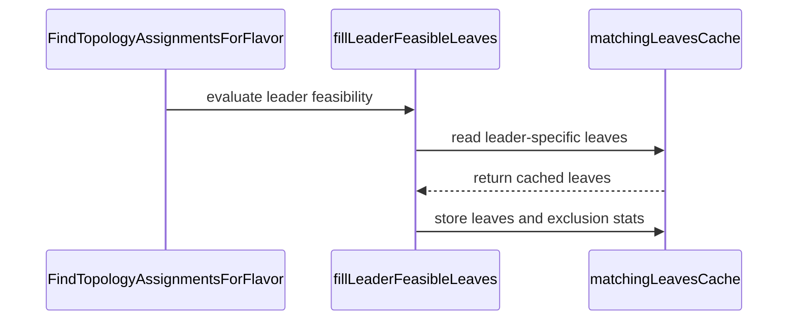

# PR #15689: TAS: cache the leader's feasible leaves with the workers'

**Summary**: TAS: cache the leader's feasible leaves with the workers'

**Sources**: https://github.com/kubernetes-sigs/kueue/pull/15689

**Last updated**: 2026-09-17T23:54:03Z

---

## Metadata

- **State**: closed (merged)
- **Author**: [@sohankunkerkar](https://github.com/sohankunkerkar)
- **Branch**: `tas-leader-feasibility-cache` → `main`
- **Created**: 2026-09-17T03:38:15Z
- **Updated**: 2026-09-17T23:54:03Z
- **Merged**: 2026-09-17T23:53:22Z
- **Closed**: 2026-09-17T23:53:22Z
- **Labels**: `kind/bug`, `size/L`, `lgtm`, `release-note-none`, `approved`, `cncf-cla: yes`
- **Assignees**: [@tenzen-y](https://github.com/tenzen-y)
- **Requested reviewers**: [@PBundyra](https://github.com/PBundyra)
- **Changed files**: 4   **+267 / -17**

## Description

<!-- Thank you for contributing! Check CONTRIBUTING.md for details. -->

#### What type of PR is this?
<!-- Choose one of the following kinds:
/kind bug
/kind cleanup
/kind documentation
/kind feature
/kind kep
-->
/kind bug

<!-- Optionally choose one or more of the following kinds:
/kind api-change
/kind deprecation
/kind failing-test
/kind flake
/kind regression
-->


<!-- Consider setting the area:
/area tas
/area was
/area integrations
/area multikueue
/area dashboard
/area localization
/area testing
/area website
-->


#### What this PR does / why we need it?


<!--
Use `Fixes #123` for an issue addressed by this PR; it will be closed when the PR merges.
Use `Related:` or `Part of:` to reference an issue without closing it.
-->
Fixes https://github.com/kubernetes-sigs/kueue/issues/15685

#### Useful notes for your reviewer
`BenchmarkTASLeaderFeasibility`, median of 3, same run:

| nodes | before | after |
|---|---|---|
| 500 | 348us, 155KB, 1695 allocs | 243us, 104KB, 702 allocs |
| 2500 | 1.88ms, 717KB, 7717 allocs | 1.26ms, 421KB, 2720 allocs |

The tests are in `tas_flavor_snapshot_test.go` rather than `TestFindTopologyAssignments`: they assert through the same exported `FindTopologyAssignmentsForFlavor`, but that table calls it once per case, so it never reads the cache. Row 3 above is the evidence  and the whole table passes when a cache hit returns nothing.

#### Release note

<!-- Describe the behavior change accurately from the user's perspective. Hints:
- Do not leave this block blank.
- Use "NONE" when there is no user-facing change.
- When feasible use a prefix for the sub-component or feature, e.g. "FairSharing:" or "MultiKueue:".
- If upgrade steps are required, include an "ACTION REQUIRED:" section.
You may consider AI assistance using the skill: cmd/experimental/skills/kueue-release-notes/SKILL.md.
-->
```release-note
NONE
```


<!-- This is an auto-generated comment: release notes by coderabbit.ai -->
## AI summary

- Cache TAS leader PodSet feasible leaves separately from worker results.
- Reuse valid cached leader feasibility during preemption simulations.
- Add benchmarks and tests for cache correctness and repeated feasibility evaluation.

### Suggested release note

TAS: Improved scheduling performance by avoiding repeated leader feasibility evaluation during preemption simulations.
<!-- end of auto-generated comment: release notes by coderabbit.ai -->

## Discussion

### Comment by [@netlify[bot]](https://github.com/apps/netlify) — 2026-09-17T03:38:21Z

### <span aria-hidden="true">✅</span> Deploy Preview for *kubernetes-sigs-kueue* ready!


|  Name | Link |
|:-:|------------------------|
|<span aria-hidden="true">🔨</span> Latest commit | 592668efb5586dd0c2955b1b9b69ce2d3143fc39 |
|<span aria-hidden="true">🔍</span> Latest deploy log | https://app.netlify.com/projects/kubernetes-sigs-kueue/deploys/6aac5a9bcfddf70008c896ec |
|<span aria-hidden="true">😎</span> Deploy Preview | [https://deploy-preview-15689--kubernetes-sigs-kueue.netlify.app](https://deploy-preview-15689--kubernetes-sigs-kueue.netlify.app) |
|<span aria-hidden="true">📱</span> Preview on mobile | <details><summary> Toggle QR Code... </summary><br /><br /><br /><br />_Use your smartphone camera to open QR code link._</details> |
---
<!-- [kubernetes-sigs-kueue Preview](https://deploy-preview-15689--kubernetes-sigs-kueue.netlify.app) -->
_To edit notification comments on pull requests, go to your [Netlify project configuration](https://app.netlify.com/projects/kubernetes-sigs-kueue/configuration/notifications#deploy-notifications)._

### Comment by [@coderabbitai[bot]](https://github.com/apps/coderabbitai) — 2026-09-17T03:39:30Z

<!-- This is an auto-generated comment: summarize by coderabbit.ai -->
<!-- review_stack_entry_start -->

<a href="https://app.coderabbit.ai/change-stack/kubernetes-sigs/kueue/pull/15689#gh-light-mode-only"></a><a href="https://app.coderabbit.ai/change-stack/kubernetes-sigs/kueue/pull/15689#gh-dark-mode-only"></a>

<!-- review_stack_entry_end -->
<!-- recent_review_start -->

No actionable comments were generated in the recent review. 🎉

<details>
<summary>ℹ️ Recent review info</summary>

<details>
<summary>⚙️ Run configuration</summary>

**Configuration used**: Path: .coderabbit.yaml

**Review profile**: CHILL

**Plan**: Advanced

**Run ID**: `83fe32fc-ea39-4096-bccc-c26786e20996`

</details>

<details>
<summary>📥 Commits</summary>

Reviewing files that changed from the base of the PR and between f92b1aa2e51971ecab67c6a0c9f6610928cd3ac0 and 592668efb5586dd0c2955b1b9b69ce2d3143fc39.

</details>

<details>
<summary>📒 Files selected for processing (4)</summary>

* `pkg/cache/scheduler/tas_flavor_snapshot.go`
* `pkg/cache/scheduler/tas_flavor_snapshot_bench_test.go`
* `pkg/cache/scheduler/tas_flavor_snapshot_test.go`
* `pkg/cache/scheduler/tas_flavor_snapshot_was_test.go`

</details>

**Included review availability:** Your plan provides up to 8 included reviews per hour; 6 remain after this review.

</details>

---


<!-- recent_review_end -->
<!-- walkthrough_start -->

<details>
<summary>📝 Walkthrough</summary>

## Walkthrough

The TAS flavor snapshot now uses a leader-specific cache key for feasible leaves. Leader results and exclusion statistics use shared cache storage. Tests cover cache separation and repeated simulated-empty checks. A benchmark measures leader feasibility across separate node pools.

### Changes

**TAS leader feasibility**

|Layer / File(s)|Summary|
|---|---|
|**Leader matching cache** <br> `pkg/cache/scheduler/tas_flavor_snapshot.go`|Leader feasible leaves use a distinct cache key. Cached leader results can bypass simulator evaluation. Shared storage handles leader and worker cache entries.|
|**Cache behavior validation** <br> `pkg/cache/scheduler/tas_flavor_snapshot_test.go`, `pkg/cache/scheduler/tas_flavor_snapshot_was_test.go`|Tests verify separate leader and worker results, cached and uncached assignment equivalence, and repeated simulated-empty evaluations with a workload key.|
|**Leader feasibility benchmark** <br> `pkg/cache/scheduler/tas_flavor_snapshot_bench_test.go`|The benchmark creates separate leader and worker pools and repeatedly evaluates leader feasibility with node-match caching enabled.|

<!-- change_assessment_start -->
**Priority:** ➖ Normal

**Estimated code review effort:** 3 (Moderate) | ~20 minutes

<!-- change_assessment_commit:"592668efb5586dd0c2955b1b9b69ce2d3143fc39" -->
**Change:** Bug fix
<!-- change_assessment_end -->

### Sequence Diagram(s)



**Suggested reviewers:** `j-skiba`, `alien1403`

</details>

<!-- walkthrough_end -->
<!-- final_review_risk_start -->
**Merge Risk:** _⚪ Minimal_ · up to `59266`
<!-- final_review_risk_coverage:{"sourceCommitId":"592668efb5586dd0c2955b1b9b69ce2d3143fc39","coveredCommitId":"592668efb5586dd0c2955b1b9b69ce2d3143fc39","kind":"reviewed"} -->

No concrete correctness or availability risk remains from the leader feasibility cache change.
<!-- final_review_risk_end -->
<!-- pre_merge_checks_walkthrough_start -->

<details>
<summary>🚥 Pre-merge checks | ✅ 4 | ❌ 1</summary>

### ❌ Failed checks (1 warning)

|     Check name     | Status     | Explanation                                                                                                                                                                                | Resolution                                                                         |
| :----------------: | :--------- | :----------------------------------------------------------------------------------------------------------------------------------------------------------------------------------------- | :--------------------------------------------------------------------------------- |
| Docstring Coverage | ⚠️ Warning | Docstring coverage is 66.67% which is insufficient. The required threshold is 80.00%. Docstring coverage is scoped to functions touched by this diff. Analyzed 6 functions across 4 files. | Write docstrings for the functions missing them to satisfy the coverage threshold. |

<details>
<summary>✅ Passed checks (4 passed)</summary>

|         Check name         | Status   | Explanation                                                                                                                                                                                               |
| :------------------------: | :------- | :-------------------------------------------------------------------------------------------------------------------------------------------------------------------------------------------------------- |
|      Description Check     | ✅ Passed | Check skipped - CodeRabbit’s high-level summary is enabled.                                                                                                                                               |
|         Title check        | ✅ Passed | The title clearly describes the main change: caching the TAS leader PodSet's feasible leaves with the workers' cached leaves.                                                                             |
|     Linked Issues check    | ✅ Passed | The changes satisfy the coding requirements in issue `#15685`. `podSetMatchKey.Leader` separates leader cache entries from worker entries. `fillLeaderFeasibleLeaves` reuses cached leader feasible leaves… |
| Out of Scope Changes check | ✅ Passed | The changes remain within issue `#15685`. Production changes optimize TAS leader feasibility caching. Tests and the benchmark verify that optimization. No unrelated production behavior or public API cha… |

</details>

</details>

<!-- pre_merge_checks_walkthrough_end -->

- [ ] <!-- {"checkboxId":"585bb3f6-faf5-4dbf-96d2-74e382adf19a"} --> Fix all pre-merge checks with AI
<!-- finishing_touch_checkbox_start -->

<details>
<summary>✨ Finishing Touches</summary>

<details>
<summary>🧪 Generate unit tests (beta)</summary>

- [ ] <!-- {"checkboxId": "f47ac10b-58cc-4372-a567-0e02b2c3d479", "radioGroupId": "utg-output-choice-group-unknown_comment_id"} --> Create a new PR

</details>

</details>

<!-- finishing_touch_checkbox_end -->
<!-- tips_start -->

---


<sub>Comment `@coderabbitai help` to get the list of available commands.</sub>

<!-- tips_end -->

### Comment by [@kubernetes-prow[bot]](https://github.com/apps/kubernetes-prow) — 2026-09-17T23:36:04Z

LGTM label has been added.  <details>Git tree hash: a4c935df8803cfee45f28a747572a6c239a09bfc</details>

### Comment by [@kubernetes-prow[bot]](https://github.com/apps/kubernetes-prow) — 2026-09-17T23:36:09Z

[APPROVALNOTIFIER] This PR is **APPROVED**

This pull-request has been approved by: *<a href="https://github.com/kubernetes-sigs/kueue/pull/15689#" title="Author self-approved">sohankunkerkar</a>*, *<a href="https://github.com/kubernetes-sigs/kueue/pull/15689#pullrequestreview-5242442405" title="Approved">tenzen-y</a>*

The full list of commands accepted by this bot can be found [here](https://go.k8s.io/bot-commands?repo=kubernetes-sigs%2Fkueue).

The pull request process is described [here](https://git.k8s.io/community/contributors/guide/owners.md#the-code-review-process)

<details >
Needs approval from an approver in each of these files:

- ~~[OWNERS](https://github.com/kubernetes-sigs/kueue/blob/main/OWNERS)~~ [sohankunkerkar,tenzen-y]

Approvers can indicate their approval by writing `/approve` in a comment
Approvers can cancel approval by writing `/approve cancel` in a comment
</details>
<!-- META={"approvers":[]} -->

### Comment by [@tenzen-y](https://github.com/tenzen-y) — 2026-09-17T23:36:39Z

@coderabbitai Please open a cleanup issue for https://github.com/kubernetes-sigs/kueue/pull/15689#pullrequestreview-5242442405 review comments, but no one should be assigned to the issue. @coderabbitai has to follow AGENTS.md.

### Comment by [@coderabbitai[bot]](https://github.com/apps/coderabbitai) — 2026-09-17T23:44:36Z

<!-- This is an auto-generated reply by CodeRabbit -->
> [!TIP]
> For best results, initiate chat on the files or code changes.

<details>
<summary>🧩 Analysis chain</summary>

🏁 Script executed:

```shell
#!/bin/bash
set -euo pipefail

fd -HI '^AGENTS\.md$' . -x sh -c '
  echo "===== $1 ====="
  cat "$1"
' sh {} 

echo "===== Review 5242442405 ====="
gh api repos/kubernetes-sigs/kueue/pulls/15689/reviews/5242442405 \
  --jq '{id, user: .user.login, state, body, submitted_at, html_url}'

echo "===== Review comments ====="
gh api --paginate 'repos/kubernetes-sigs/kueue/pulls/15689/comments?per_page=100' \
  --jq '.[] | select(.pull_request_review_id == 5242442405) | {id, path, line, side, body, html_url, user: .user.login}'
```

Length of output: 6599

---

🏁 Script executed:

```shell
#!/bin/bash
set -euo pipefail

for file in \
  cmd/experimental/skills/kueue-pr-issue-workflow/SKILL.md \
  cmd/experimental/skills/kueue-pr-issue-workflow/AGENTS.md
do
  if [ -f "$file" ]; then
    echo "===== $file ====="
    cat "$file"
  fi
done

echo "===== Candidate benchmark context ====="
sed -n '340,425p' pkg/cache/scheduler/tas_flavor_snapshot_bench_test.go
```

Length of output: 5484

---

🏁 Script executed:

```shell
#!/bin/bash
set -euo pipefail

echo "===== Issue templates ====="
fd -HI . .github/ISSUE_TEMPLATE -t f -x sh -c 'echo "===== $1 ====="; cat "$1"' sh {}
```

Length of output: 8788

---

🏁 Script executed:

```shell
#!/bin/bash
set -euo pipefail

repo="kubernetes-sigs/kueue"
title="🧹 Clean up TAS leader feasibility benchmark setup"
body=$(cat <<'EOF'
**What would you like to be cleaned**:

Clean up `pkg/cache/scheduler/tas_flavor_snapshot_bench_test.go`.

Move the TAS leader feasibility benchmark object definitions into `BenchmarkTASLeaderFeasibility`. Define `groupName` once in that benchmark. Remove the helper and duplicated definitions that can be overwritten by another PodSet.

**Why is this needed**:

This makes the benchmark setup local, avoids duplicate state, and prevents accidental PodSet overwrites.

Requested by `@tenzen-y`.
AI assistance was used to file this issue.

Backlinks:
- Pull request: https://github.com/kubernetes-sigs/kueue/pull/15689
- Request comment: https://github.com/kubernetes-sigs/kueue/pull/15689#pullrequestreview-5242442405
EOF
)

gh issue create \
  --repo "$repo" \
  --title "$title" \
  --body "$body" \
  --label "kind/cleanup"
```

Length of output: 1156

---

</details>

Kueue Development  
`@tenzen-y` Opened unassigned cleanup issue `#15767` for the requested review comments. The issue uses the cleanup template and includes the required backlinks and AI-use disclosure.

_You are interacting with an AI system._

### Comment by [@tenzen-y](https://github.com/tenzen-y) — 2026-09-17T23:49:49Z

/cherrypick release-0.19

### Comment by [@k8s-infra-cherrypick-robot](https://github.com/k8s-infra-cherrypick-robot) — 2026-09-17T23:49:52Z

@tenzen-y: once the present PR merges, I will cherry-pick it on top of `release-0.19` in a new PR and assign it to you.

<details>

In response to [this](https://github.com/kubernetes-sigs/kueue/pull/15689#issuecomment-5722785180):

>/cherrypick release-0.19


Instructions for interacting with me using PR comments are available [here](https://git.k8s.io/community/contributors/guide/pull-requests.md).  If you have questions or suggestions related to my behavior, please file an issue against the [kubernetes-sigs/prow](https://github.com/kubernetes-sigs/prow/issues/new?title=Prow%20issue:) repository.
</details>

### Comment by [@k8s-infra-cherrypick-robot](https://github.com/k8s-infra-cherrypick-robot) — 2026-09-17T23:54:03Z

@tenzen-y: #15689 failed to apply on top of branch "release-0.19":
```
Applying: TAS: cache the leader's feasible leaves with the workers'
Using index info to reconstruct a base tree...
M	pkg/cache/scheduler/tas_flavor_snapshot.go
M	pkg/cache/scheduler/tas_flavor_snapshot_bench_test.go
M	pkg/cache/scheduler/tas_flavor_snapshot_test.go
A	pkg/cache/scheduler/tas_flavor_snapshot_was_test.go
Falling back to patching base and 3-way merge...
Auto-merging pkg/cache/scheduler/tas_flavor_snapshot.go
CONFLICT (content): Merge conflict in pkg/cache/scheduler/tas_flavor_snapshot.go
Auto-merging pkg/cache/scheduler/tas_flavor_snapshot_bench_test.go
CONFLICT (content): Merge conflict in pkg/cache/scheduler/tas_flavor_snapshot_bench_test.go
Auto-merging pkg/cache/scheduler/tas_flavor_snapshot_test.go
CONFLICT (content): Merge conflict in pkg/cache/scheduler/tas_flavor_snapshot_test.go
CONFLICT (modify/delete): pkg/cache/scheduler/tas_flavor_snapshot_was_test.go deleted in HEAD and modified in TAS: cache the leader's feasible leaves with the workers'.  Version TAS: cache the leader's feasible leaves with the workers' of pkg/cache/scheduler/tas_flavor_snapshot_was_test.go left in tree.
error: Failed to merge in the changes.
hint: Use 'git am --show-current-patch=diff' to see the failed patch
hint: When you have resolved this problem, run "git am --continue".
hint: If you prefer to skip this patch, run "git am --skip" instead.
hint: To restore the original branch and stop patching, run "git am --abort".
hint: Disable this message with "git config set advice.mergeConflict false"
Patch failed at 0001 TAS: cache the leader's feasible leaves with the workers'

```

<details>

In response to [this](https://github.com/kubernetes-sigs/kueue/pull/15689#issuecomment-5722785180):

>/cherrypick release-0.19


Instructions for interacting with me using PR comments are available [here](https://git.k8s.io/community/contributors/guide/pull-requests.md).  If you have questions or suggestions related to my behavior, please file an issue against the [kubernetes-sigs/prow](https://github.com/kubernetes-sigs/prow/issues/new?title=Prow%20issue:) repository.
</details>

## Reviews

### Review by [@copilot-pull-request-reviewer[bot]](https://github.com/apps/copilot-pull-request-reviewer) (commented) — 2026-09-17T03:41:16Z

### 🟢 Approval recommended

The change is correctness-preserving, keyed to avoid leader/worker cache collisions, and is backed by targeted regression tests plus a benchmark demonstrating the intended performance improvement.

<details>
<summary>Pull request overview</summary>

This PR optimizes TAS leader PodSet feasibility evaluation by caching the leader’s feasible leaf set separately from (but alongside) the workers’ cached match results, avoiding repeated full-leaf feasibility scans during preemption simulations while preserving correctness.

**Changes:**
- Extend the matching-leaves cache key with a `Leader` discriminator and cache leader feasible leaves under that distinct key.
- Reuse cached leader feasible leaves in `fillLeaderFeasibleLeaves` to avoid recomputing feasibility per simulation cycle.
- Add/adjust tests to ensure caching remains correct across leader/worker queries and simulate-empty vs normal queries; add a benchmark to quantify the improvement.
</details>

<details>
<summary>File summaries</summary>

| File | Description |
| ---- | ----------- |
| pkg/cache/scheduler/tas_flavor_snapshot.go | Adds a leader-specific cache key bit and uses it to store/retrieve cached leader feasible leaves; refactors leaf-cache storage into a helper. |
| pkg/cache/scheduler/tas_flavor_snapshot_was_test.go | Strengthens the scheduler-library-backed test to exercise cache behavior across repeated cycles with a Workload key. |
| pkg/cache/scheduler/tas_flavor_snapshot_test.go | Adds correctness tests ensuring leader/worker cache separation and cache “invisibility” (cached vs uncached results match). |
| pkg/cache/scheduler/tas_flavor_snapshot_bench_test.go | Adds a benchmark focused on leader feasibility cost to demonstrate reduced allocations/time after caching. |
</details>

<details>
<summary>Review details</summary>

- **Files reviewed:** 4/4 changed files
- **Comments generated:** 0
- **Review effort level:** Lite
</details>

---

💡 <a href="/kubernetes-sigs/kueue/new/main?filename=.github/skills/code-review/SKILL.md" class="Link--inTextBlock" target="_blank" rel="noopener noreferrer">Add a `code-review` agent skill</a> or configure MCP servers for context-aware, tailored reviews. <a href="https://docs.github.com/copilot/how-tos/use-copilot-agents/request-a-code-review/use-code-review?tool=webui#mcp-servers-and-agent-skills" class="Link--inTextBlock" target="_blank" rel="noopener noreferrer">Learn more in the docs.</a>

### Review by [@tenzen-y](https://github.com/tenzen-y) (commented) — 2026-09-17T06:09:32Z

Overall LGTM, thank you

- **pkg/cache/scheduler/tas_flavor_snapshot_bench_test.go:409** by [@tenzen-y](https://github.com/tenzen-y) — 2026-09-17T05:55:49Z
```diff
@@ -339,3 +339,94 @@ func BenchmarkTASFlavorSnapshotWithWorkloadUsage(b *testing.B) {
 		}
 	}
 }
+
+// benchPoolLabel splits the cluster so the workers and the leader want different
+// nodes. Without that split every node is feasible for both and the leader pass
+// costs the same however it is written, which is what the cases above measure.
+const benchPoolLabel = "bench.kueue.x-k8s.io/pool"
+
+// BenchmarkTASLeaderFeasibility measures a PodSet group whose leader only fits on
+// nodes the workers cannot use. The leader pass has to consider every leaf, not just
+// the workers', so this is where the cost of that pass shows up; the workers' pass is
+// served from matchingLeavesCache after the first cycle, so what is left is the
+// leader's.
+func BenchmarkTASLeaderFeasibility(b *testing.B) {
+	features.SetFeatureGateDuringTest(b, features.TASNodeFeasibilityForAllLevels, true)
+	features.SetFeatureGateDuringTest(b, features.TASLeaderPodSetFeasibility, true)
+	features.SetFeatureGateDuringTest(b, features.TASCacheNodeMatchResults, true)
+
+	for _, nodeCount := range []int{500, 2500} {
+		b.Run(fmt.Sprintf("nodes=%d", nodeCount), func(b *testing.B) {
+			b.ReportAllocs()
+			_, log := utiltesting.ContextWithLog(b)
+			topo := benchTopology{nodes: nodeCount, nodesPerRack: 16, racksPerBlock: 16}
+			nodes := buildBenchNodes(topo)
+			for i := range nodes {
+				pool := "workers"
+				if i >= len(nodes)-topo.nodesPerRack {
+					pool = "leader"
+				}
+				nodes[i].Labels[benchPoolLabel] = pool
+			}
+
+			tasCache := NewTASCache(nil, newDefaultSimulator(), resources.NewResourceFormatter())
+			for i := range nodes {
+				tasCache.SyncNode(&nodes[i])
+			}
+			flavorCache := tasCache.NewTASFlavorCache(
+				topologyInformation{Levels: []string{benchBlockLabel, benchRackLabel, benchHostLabel}},
+				flavorInformation{TopologyName: "default"},
+			)
+			snapshot, err := flavorCache.snapshot(b.Context(), log, newDefaultSimulatorSnapshot(), nil)
+			if err != nil {
+				b.Fatalf("TASFlavorSnapshot creation failed: %v", err)
+			}
+
+			requests := leaderFeasibilityBenchRequests()
+			// Production always passes a Workload, and matchingLeavesCache is keyed by
+			// its UID, so omitting it would measure an uncached cluster.
+			wl := &kueue.Workload{ObjectMeta: metav1.ObjectMeta{
+				Namespace: "default", Name: "bench", UID: "bench-uid",
+			}}
+			result := snapshot.FindTopologyAssignmentsForFlavor(b.Context(), requests, WithWorkload(wl))
+			if failure := result.Failure(); failure != nil {
+				b.Fatalf("leader feasibility preflight failed: %s", failure.Reason)
+			}
+
+			for b.Loop() {
+				result = snapshot.FindTopologyAssignmentsForFlavor(b.Context(), requests, WithWorkload(wl))
+			}
+			if failure := result.Failure(); failure != nil {
+				b.Fatalf("repeated leader feasibility failed: %s", failure.Reason)
+			}
+		})
+	}
+}
+
+func leaderFeasibilityBenchRequests() FlavorTASRequests {
+	groupName := "benchmark-group"
+	unconstrained := true
+	podSet := func(name, pool string, count int32, cpu int64) TASPodSetRequests {
```

  We should use wrapper instead of call back function. And clone it in FlavorTASRequests constructions.

- **pkg/cache/scheduler/tas_flavor_snapshot_test.go:2637** by [@tenzen-y](https://github.com/tenzen-y) — 2026-09-17T05:58:31Z
```diff
@@ -2528,3 +2529,130 @@ func testPodSetUpdatesReachTheTemplate(t *testing.T, gateOn bool) {
 		}
 	}
 }
+
+// Both entries of a group are keyed by the workers' PodSet name, so the one answering
+// the leader's filters has to be kept apart from the one answering the workers'. Serving
+// the workers' leaves to the leader puts it on a node its own nodeSelector forbids.
+func TestMatchingLeavesCacheSeparatesLeaderFromWorkers(t *testing.T) {
+	features.SetFeatureGateDuringTest(t, features.TASNodeFeasibilityForAllLevels, true)
+	features.SetFeatureGateDuringTest(t, features.TASLeaderPodSetFeasibility, true)
+	features.SetFeatureGateDuringTest(t, features.TASCacheNodeMatchResults, true)
+	ctx, snapshot := newLeaderGroupSnapshot(t)
+	requests := leaderGroupRequests(leaderGroupBlockLabel, "workers", "leader", 2)
+	wl := &kueue.Workload{ObjectMeta: metav1.ObjectMeta{Namespace: "default", Name: "wl", UID: "wl-uid"}}
+
+	// The second cycle is the one that reads the cache.
+	for _, cycle := range []string{"first", "second"} {
+		result := snapshot.FindTopologyAssignmentsForFlavor(ctx, requests, WithWorkload(wl))
+		if failure := result.Failure(); failure != nil {
+			t.Fatalf("%s cycle: FindTopologyAssignmentsForFlavor() = %v, want a fit", cycle, failure)
+		}
+		for podSet, wantNode := range map[kueue.PodSetReference]string{"workers": "n1", "leader": "n2"} {
+			got := result[podSet].TopologyAssignment.Domains[0].Values
+			if diff := cmp.Diff([]string{wantNode}, got); diff != "" {
+				t.Errorf("%s cycle: PodSet %s placed wrong (-want,+got): %s", cycle, podSet, diff)
+			}
+		}
+	}
+}
+
+// Caching is meant to be invisible: for the same inputs the answer must not depend on
+// whether matchingLeavesCache served it. TASCacheNodeMatchResults turns the cache off
+// entirely, so running both ways and demanding identical assignments rejects divergence
+// no fixture was written for.
+func TestMatchingLeavesCacheIsInvisible(t *testing.T) {
+	features.SetFeatureGateDuringTest(t, features.TASNodeFeasibilityForAllLevels, true)
+	features.SetFeatureGateDuringTest(t, features.TASLeaderPodSetFeasibility, true)
+
+	cases := map[string]struct {
+		workerPool string
+		leaderPool string
+		workers    int32
+		required   string
+	}{
+		"leader and workers want different nodes":  {workerPool: "workers", leaderPool: "leader", workers: 2, required: leaderGroupBlockLabel},
+		"leader and workers want the same node":    {workerPool: "workers", leaderPool: "workers", workers: 1, required: leaderGroupBlockLabel},
+		"leader wants a node the workers can fill": {workerPool: "workers", leaderPool: "workers", workers: 4, required: leaderGroupBlockLabel},
+		"required at the rack level":               {workerPool: "workers", leaderPool: "leader", workers: 2, required: leaderGroupRackLabel},
+	}
+	for name, tc := range cases {
+		t.Run(name, func(t *testing.T) {
+			// One snapshot per cache setting, so neither run sees the other's state.
+			run := func(cacheEnabled bool) (TASAssignmentsResult, TASAssignmentsResult) {
+				features.SetFeatureGateDuringTest(t, features.TASCacheNodeMatchResults, cacheEnabled)
+				ctx, snapshot := newLeaderGroupSnapshot(t)
+				requests := leaderGroupRequests(tc.required, tc.workerPool, tc.leaderPool, tc.workers)
+				wl := &kueue.Workload{ObjectMeta: metav1.ObjectMeta{Namespace: "default", Name: "wl", UID: "wl-uid"}}
+
+				// Twice, because the cache only answers from the second cycle. Both
+				// questions are asked each time, the way the flavor assigner does, so
+				// an entry that answered one of them cannot serve the other.
+				var normal, empty TASAssignmentsResult
+				for range 2 {
+					normal = snapshot.FindTopologyAssignmentsForFlavor(ctx, requests, WithWorkload(wl))
+					empty = snapshot.FindTopologyAssignmentsForFlavor(ctx, requests, WithWorkload(wl), WithSimulateEmpty(true))
+				}
+				return normal, empty
+			}
+
+			cachedNormal, cachedEmpty := run(true)
+			uncachedNormal, uncachedEmpty := run(false)
+			if diff := cmp.Diff(uncachedNormal, cachedNormal, cmpopts.EquateEmpty()); diff != "" {
+				t.Errorf("caching changed the assignment (-uncached,+cached):\n%s", diff)
+			}
+			if diff := cmp.Diff(uncachedEmpty, cachedEmpty, cmpopts.EquateEmpty()); diff != "" {
+				t.Errorf("caching changed the empty-cluster assignment (-uncached,+cached):\n%s", diff)
+			}
+		})
+	}
+}
+
+const (
+	leaderGroupBlockLabel = "cloud.provider.com/topology-block"
+	leaderGroupRackLabel  = "cloud.provider.com/topology-rack"
+)
+
+// newLeaderGroupSnapshot builds one rack of two nodes, each in its own "pool", and
+// declares the hostname level. A group whose PodSets select different pools then has one
+// node each, so a PodSet served the other's cached leaves names the wrong node.
+func newLeaderGroupSnapshot(t *testing.T) (context.Context, *TASFlavorSnapshot) {
+	t.Helper()
+	ctx, log := utiltesting.ContextWithLog(t)
+	rackNode := node.MakeNode("").
+		StatusAllocatable(corev1.ResourceList{
+			corev1.ResourceCPU:  resource.MustParse("5"),
+			corev1.ResourcePods: resource.MustParse("10"),
+		}).Ready()
+	nodes := []*corev1.Node{
+		rackNode.Clone().Name("n1").Label(leaderGroupBlockLabel, "b1").Label(leaderGroupRackLabel, "r1").
+			Label(corev1.LabelHostname, "n1").Label("pool", "workers").Obj(),
+		rackNode.Clone().Name("n2").Label(leaderGroupBlockLabel, "b1").Label(leaderGroupRackLabel, "r1").
+			Label(corev1.LabelHostname, "n2").Label("pool", "leader").Obj(),
+	}
+	tree := newTopologyTree([]string{leaderGroupBlockLabel, leaderGroupRackLabel, corev1.LabelHostname}, nodes, 0)
+	return ctx, newTASFlavorSnapshot(log, flavorInformation{TopologyName: "tas-topology"}, tree,
+		newDefaultSimulatorSnapshot())
+}
+
+func leaderGroupRequests(required, workerPool, leaderPool string, workers int32) FlavorTASRequests {
```

  I would propose to remove this helper since we have to implement test for test helper to guarantee the test behaviors.

- **pkg/cache/scheduler/tas_flavor_snapshot_test.go:2618** by [@tenzen-y](https://github.com/tenzen-y) — 2026-09-17T05:58:57Z
```diff
@@ -2528,3 +2529,130 @@ func testPodSetUpdatesReachTheTemplate(t *testing.T, gateOn bool) {
 		}
 	}
 }
+
+// Both entries of a group are keyed by the workers' PodSet name, so the one answering
+// the leader's filters has to be kept apart from the one answering the workers'. Serving
+// the workers' leaves to the leader puts it on a node its own nodeSelector forbids.
+func TestMatchingLeavesCacheSeparatesLeaderFromWorkers(t *testing.T) {
+	features.SetFeatureGateDuringTest(t, features.TASNodeFeasibilityForAllLevels, true)
+	features.SetFeatureGateDuringTest(t, features.TASLeaderPodSetFeasibility, true)
+	features.SetFeatureGateDuringTest(t, features.TASCacheNodeMatchResults, true)
+	ctx, snapshot := newLeaderGroupSnapshot(t)
+	requests := leaderGroupRequests(leaderGroupBlockLabel, "workers", "leader", 2)
+	wl := &kueue.Workload{ObjectMeta: metav1.ObjectMeta{Namespace: "default", Name: "wl", UID: "wl-uid"}}
+
+	// The second cycle is the one that reads the cache.
+	for _, cycle := range []string{"first", "second"} {
+		result := snapshot.FindTopologyAssignmentsForFlavor(ctx, requests, WithWorkload(wl))
+		if failure := result.Failure(); failure != nil {
+			t.Fatalf("%s cycle: FindTopologyAssignmentsForFlavor() = %v, want a fit", cycle, failure)
+		}
+		for podSet, wantNode := range map[kueue.PodSetReference]string{"workers": "n1", "leader": "n2"} {
+			got := result[podSet].TopologyAssignment.Domains[0].Values
+			if diff := cmp.Diff([]string{wantNode}, got); diff != "" {
+				t.Errorf("%s cycle: PodSet %s placed wrong (-want,+got): %s", cycle, podSet, diff)
+			}
+		}
+	}
+}
+
+// Caching is meant to be invisible: for the same inputs the answer must not depend on
+// whether matchingLeavesCache served it. TASCacheNodeMatchResults turns the cache off
+// entirely, so running both ways and demanding identical assignments rejects divergence
+// no fixture was written for.
+func TestMatchingLeavesCacheIsInvisible(t *testing.T) {
+	features.SetFeatureGateDuringTest(t, features.TASNodeFeasibilityForAllLevels, true)
+	features.SetFeatureGateDuringTest(t, features.TASLeaderPodSetFeasibility, true)
+
+	cases := map[string]struct {
+		workerPool string
+		leaderPool string
+		workers    int32
+		required   string
+	}{
+		"leader and workers want different nodes":  {workerPool: "workers", leaderPool: "leader", workers: 2, required: leaderGroupBlockLabel},
+		"leader and workers want the same node":    {workerPool: "workers", leaderPool: "workers", workers: 1, required: leaderGroupBlockLabel},
+		"leader wants a node the workers can fill": {workerPool: "workers", leaderPool: "workers", workers: 4, required: leaderGroupBlockLabel},
+		"required at the rack level":               {workerPool: "workers", leaderPool: "leader", workers: 2, required: leaderGroupRackLabel},
+	}
+	for name, tc := range cases {
+		t.Run(name, func(t *testing.T) {
+			// One snapshot per cache setting, so neither run sees the other's state.
+			run := func(cacheEnabled bool) (TASAssignmentsResult, TASAssignmentsResult) {
+				features.SetFeatureGateDuringTest(t, features.TASCacheNodeMatchResults, cacheEnabled)
+				ctx, snapshot := newLeaderGroupSnapshot(t)
+				requests := leaderGroupRequests(tc.required, tc.workerPool, tc.leaderPool, tc.workers)
+				wl := &kueue.Workload{ObjectMeta: metav1.ObjectMeta{Namespace: "default", Name: "wl", UID: "wl-uid"}}
+
+				// Twice, because the cache only answers from the second cycle. Both
+				// questions are asked each time, the way the flavor assigner does, so
+				// an entry that answered one of them cannot serve the other.
+				var normal, empty TASAssignmentsResult
+				for range 2 {
+					normal = snapshot.FindTopologyAssignmentsForFlavor(ctx, requests, WithWorkload(wl))
+					empty = snapshot.FindTopologyAssignmentsForFlavor(ctx, requests, WithWorkload(wl), WithSimulateEmpty(true))
+				}
+				return normal, empty
+			}
+
+			cachedNormal, cachedEmpty := run(true)
+			uncachedNormal, uncachedEmpty := run(false)
+			if diff := cmp.Diff(uncachedNormal, cachedNormal, cmpopts.EquateEmpty()); diff != "" {
+				t.Errorf("caching changed the assignment (-uncached,+cached):\n%s", diff)
+			}
+			if diff := cmp.Diff(uncachedEmpty, cachedEmpty, cmpopts.EquateEmpty()); diff != "" {
+				t.Errorf("caching changed the empty-cluster assignment (-uncached,+cached):\n%s", diff)
+			}
+		})
+	}
+}
+
+const (
+	leaderGroupBlockLabel = "cloud.provider.com/topology-block"
+	leaderGroupRackLabel  = "cloud.provider.com/topology-rack"
+)
+
+// newLeaderGroupSnapshot builds one rack of two nodes, each in its own "pool", and
+// declares the hostname level. A group whose PodSets select different pools then has one
+// node each, so a PodSet served the other's cached leaves names the wrong node.
+func newLeaderGroupSnapshot(t *testing.T) (context.Context, *TASFlavorSnapshot) {
```

  Ditto about removal of helpers.

- **pkg/cache/scheduler/tas_flavor_snapshot_test.go:2596** by [@tenzen-y](https://github.com/tenzen-y) — 2026-09-17T06:07:27Z
```diff
@@ -2528,3 +2529,130 @@ func testPodSetUpdatesReachTheTemplate(t *testing.T, gateOn bool) {
 		}
 	}
 }
+
+// Both entries of a group are keyed by the workers' PodSet name, so the one answering
+// the leader's filters has to be kept apart from the one answering the workers'. Serving
+// the workers' leaves to the leader puts it on a node its own nodeSelector forbids.
+func TestMatchingLeavesCacheSeparatesLeaderFromWorkers(t *testing.T) {
+	features.SetFeatureGateDuringTest(t, features.TASNodeFeasibilityForAllLevels, true)
+	features.SetFeatureGateDuringTest(t, features.TASLeaderPodSetFeasibility, true)
+	features.SetFeatureGateDuringTest(t, features.TASCacheNodeMatchResults, true)
+	ctx, snapshot := newLeaderGroupSnapshot(t)
+	requests := leaderGroupRequests(leaderGroupBlockLabel, "workers", "leader", 2)
+	wl := &kueue.Workload{ObjectMeta: metav1.ObjectMeta{Namespace: "default", Name: "wl", UID: "wl-uid"}}
+
+	// The second cycle is the one that reads the cache.
+	for _, cycle := range []string{"first", "second"} {
+		result := snapshot.FindTopologyAssignmentsForFlavor(ctx, requests, WithWorkload(wl))
+		if failure := result.Failure(); failure != nil {
+			t.Fatalf("%s cycle: FindTopologyAssignmentsForFlavor() = %v, want a fit", cycle, failure)
+		}
+		for podSet, wantNode := range map[kueue.PodSetReference]string{"workers": "n1", "leader": "n2"} {
+			got := result[podSet].TopologyAssignment.Domains[0].Values
+			if diff := cmp.Diff([]string{wantNode}, got); diff != "" {
+				t.Errorf("%s cycle: PodSet %s placed wrong (-want,+got): %s", cycle, podSet, diff)
+			}
+		}
+	}
+}
+
+// Caching is meant to be invisible: for the same inputs the answer must not depend on
+// whether matchingLeavesCache served it. TASCacheNodeMatchResults turns the cache off
+// entirely, so running both ways and demanding identical assignments rejects divergence
+// no fixture was written for.
+func TestMatchingLeavesCacheIsInvisible(t *testing.T) {
+	features.SetFeatureGateDuringTest(t, features.TASNodeFeasibilityForAllLevels, true)
+	features.SetFeatureGateDuringTest(t, features.TASLeaderPodSetFeasibility, true)
+
+	cases := map[string]struct {
+		workerPool string
+		leaderPool string
+		workers    int32
+		required   string
+	}{
+		"leader and workers want different nodes":  {workerPool: "workers", leaderPool: "leader", workers: 2, required: leaderGroupBlockLabel},
+		"leader and workers want the same node":    {workerPool: "workers", leaderPool: "workers", workers: 1, required: leaderGroupBlockLabel},
+		"leader wants a node the workers can fill": {workerPool: "workers", leaderPool: "workers", workers: 4, required: leaderGroupBlockLabel},
+		"required at the rack level":               {workerPool: "workers", leaderPool: "leader", workers: 2, required: leaderGroupRackLabel},
+	}
+	for name, tc := range cases {
+		t.Run(name, func(t *testing.T) {
+			// One snapshot per cache setting, so neither run sees the other's state.
+			run := func(cacheEnabled bool) (TASAssignmentsResult, TASAssignmentsResult) {
+				features.SetFeatureGateDuringTest(t, features.TASCacheNodeMatchResults, cacheEnabled)
+				ctx, snapshot := newLeaderGroupSnapshot(t)
+				requests := leaderGroupRequests(tc.required, tc.workerPool, tc.leaderPool, tc.workers)
+				wl := &kueue.Workload{ObjectMeta: metav1.ObjectMeta{Namespace: "default", Name: "wl", UID: "wl-uid"}}
+
+				// Twice, because the cache only answers from the second cycle. Both
+				// questions are asked each time, the way the flavor assigner does, so
+				// an entry that answered one of them cannot serve the other.
+				var normal, empty TASAssignmentsResult
+				for range 2 {
+					normal = snapshot.FindTopologyAssignmentsForFlavor(ctx, requests, WithWorkload(wl))
+					empty = snapshot.FindTopologyAssignmentsForFlavor(ctx, requests, WithWorkload(wl), WithSimulateEmpty(true))
+				}
+				return normal, empty
+			}
```

  Remove this callback, and use iteration like https://github.com/kubernetes-sigs/kueue/blob/71e1f5f12b1dcc75203de7532f5301d7689de3fb/pkg/workload/patching/patching_test.go#L595

- **pkg/cache/scheduler/tas_flavor_snapshot_test.go:2536** by [@tenzen-y](https://github.com/tenzen-y) — 2026-09-17T06:09:10Z
```diff
@@ -2528,3 +2529,130 @@ func testPodSetUpdatesReachTheTemplate(t *testing.T, gateOn bool) {
 		}
 	}
 }
+
+// Both entries of a group are keyed by the workers' PodSet name, so the one answering
+// the leader's filters has to be kept apart from the one answering the workers'. Serving
+// the workers' leaves to the leader puts it on a node its own nodeSelector forbids.
+func TestMatchingLeavesCacheSeparatesLeaderFromWorkers(t *testing.T) {
```

  Why can't we consolidate this into TestMatchingLeavesCacheIsInvisible?

### Review by [@sohankunkerkar](https://github.com/sohankunkerkar) (commented) — 2026-09-17T13:13:02Z

- **pkg/cache/scheduler/tas_flavor_snapshot_bench_test.go:409** by [@sohankunkerkar](https://github.com/sohankunkerkar) — 2026-09-17T13:13:02Z
```diff
@@ -339,3 +339,94 @@ func BenchmarkTASFlavorSnapshotWithWorkloadUsage(b *testing.B) {
 		}
 	}
 }
+
+// benchPoolLabel splits the cluster so the workers and the leader want different
+// nodes. Without that split every node is feasible for both and the leader pass
+// costs the same however it is written, which is what the cases above measure.
+const benchPoolLabel = "bench.kueue.x-k8s.io/pool"
+
+// BenchmarkTASLeaderFeasibility measures a PodSet group whose leader only fits on
+// nodes the workers cannot use. The leader pass has to consider every leaf, not just
+// the workers', so this is where the cost of that pass shows up; the workers' pass is
+// served from matchingLeavesCache after the first cycle, so what is left is the
+// leader's.
+func BenchmarkTASLeaderFeasibility(b *testing.B) {
+	features.SetFeatureGateDuringTest(b, features.TASNodeFeasibilityForAllLevels, true)
+	features.SetFeatureGateDuringTest(b, features.TASLeaderPodSetFeasibility, true)
+	features.SetFeatureGateDuringTest(b, features.TASCacheNodeMatchResults, true)
+
+	for _, nodeCount := range []int{500, 2500} {
+		b.Run(fmt.Sprintf("nodes=%d", nodeCount), func(b *testing.B) {
+			b.ReportAllocs()
+			_, log := utiltesting.ContextWithLog(b)
+			topo := benchTopology{nodes: nodeCount, nodesPerRack: 16, racksPerBlock: 16}
+			nodes := buildBenchNodes(topo)
+			for i := range nodes {
+				pool := "workers"
+				if i >= len(nodes)-topo.nodesPerRack {
+					pool = "leader"
+				}
+				nodes[i].Labels[benchPoolLabel] = pool
+			}
+
+			tasCache := NewTASCache(nil, newDefaultSimulator(), resources.NewResourceFormatter())
+			for i := range nodes {
+				tasCache.SyncNode(&nodes[i])
+			}
+			flavorCache := tasCache.NewTASFlavorCache(
+				topologyInformation{Levels: []string{benchBlockLabel, benchRackLabel, benchHostLabel}},
+				flavorInformation{TopologyName: "default"},
+			)
+			snapshot, err := flavorCache.snapshot(b.Context(), log, newDefaultSimulatorSnapshot(), nil)
+			if err != nil {
+				b.Fatalf("TASFlavorSnapshot creation failed: %v", err)
+			}
+
+			requests := leaderFeasibilityBenchRequests()
+			// Production always passes a Workload, and matchingLeavesCache is keyed by
+			// its UID, so omitting it would measure an uncached cluster.
+			wl := &kueue.Workload{ObjectMeta: metav1.ObjectMeta{
+				Namespace: "default", Name: "bench", UID: "bench-uid",
+			}}
+			result := snapshot.FindTopologyAssignmentsForFlavor(b.Context(), requests, WithWorkload(wl))
+			if failure := result.Failure(); failure != nil {
+				b.Fatalf("leader feasibility preflight failed: %s", failure.Reason)
+			}
+
+			for b.Loop() {
+				result = snapshot.FindTopologyAssignmentsForFlavor(b.Context(), requests, WithWorkload(wl))
+			}
+			if failure := result.Failure(); failure != nil {
+				b.Fatalf("repeated leader feasibility failed: %s", failure.Reason)
+			}
+		})
+	}
+}
+
+func leaderFeasibilityBenchRequests() FlavorTASRequests {
+	groupName := "benchmark-group"
+	unconstrained := true
+	podSet := func(name, pool string, count int32, cpu int64) TASPodSetRequests {
```

  I switched to the wrapper but skipped the clone since the two PodSets differ in name and PodSetWrapper has no name setter, so there's no shared base to clone from and two separate MakePodSet calls can't alias anyway. Let me know if you meant something else.

### Review by [@tenzen-y](https://github.com/tenzen-y) (commented) — 2026-09-17T23:35:56Z

Thank you
/lgtm
/approve

- **pkg/cache/scheduler/tas_flavor_snapshot_bench_test.go:411** by [@tenzen-y](https://github.com/tenzen-y) — 2026-09-17T23:33:16Z
```diff
@@ -343,3 +344,91 @@ func BenchmarkTASFlavorSnapshotWithWorkloadUsage(b *testing.B) {
 		}
 	}
 }
+
+// benchPoolLabel splits the cluster so the workers and the leader want different
+// nodes. Without that split every node is feasible for both and the leader pass
+// costs the same however it is written, which is what the cases above measure.
+const benchPoolLabel = "bench.kueue.x-k8s.io/pool"
+
+// BenchmarkTASLeaderFeasibility measures a PodSet group whose leader only fits on
+// nodes the workers cannot use. The leader pass has to consider every leaf, not just
+// the workers', so this is where the cost of that pass shows up; the workers' pass is
+// served from matchingLeavesCache after the first cycle, so what is left is the
+// leader's.
+func BenchmarkTASLeaderFeasibility(b *testing.B) {
+	features.SetFeatureGateDuringTest(b, features.TASNodeFeasibilityForAllLevels, true)
+	features.SetFeatureGateDuringTest(b, features.TASLeaderPodSetFeasibility, true)
+	features.SetFeatureGateDuringTest(b, features.TASCacheNodeMatchResults, true)
+
+	for _, nodeCount := range []int{500, 2500} {
+		b.Run(fmt.Sprintf("nodes=%d", nodeCount), func(b *testing.B) {
+			b.ReportAllocs()
+			_, log := utiltesting.ContextWithLog(b)
+			topo := benchTopology{nodes: nodeCount, nodesPerRack: 16, racksPerBlock: 16}
+			nodes := buildBenchNodes(topo)
+			for i := range nodes {
+				pool := "workers"
+				if i >= len(nodes)-topo.nodesPerRack {
+					pool = "leader"
+				}
+				nodes[i].Labels[benchPoolLabel] = pool
+			}
+
+			tasCache := NewTASCache(nil, newDefaultSimulator(), resources.NewResourceFormatter())
+			for i := range nodes {
+				tasCache.SyncNode(&nodes[i])
+			}
+			flavorCache := tasCache.NewTASFlavorCache(
+				topologyInformation{Levels: []string{benchBlockLabel, benchRackLabel, benchHostLabel}},
+				flavorInformation{TopologyName: "default"},
+			)
+			snapshot, err := flavorCache.snapshot(b.Context(), log, newDefaultSimulatorSnapshot(), nil)
+			if err != nil {
+				b.Fatalf("TASFlavorSnapshot creation failed: %v", err)
+			}
+
+			requests := leaderFeasibilityBenchRequests()
+			// Production always passes a Workload, and matchingLeavesCache is keyed by
+			// its UID, so omitting it would measure an uncached cluster.
+			wl := workload.NewInfo(log, &kueue.Workload{ObjectMeta: metav1.ObjectMeta{
+				Namespace: "default", Name: "bench", UID: "bench-uid",
+			}})
+			result := snapshot.FindTopologyAssignmentsForFlavor(b.Context(), requests, WithWorkloadInfo(wl))
+			if failure := result.Failure(); failure != nil {
+				b.Fatalf("leader feasibility preflight failed: %s", failure.Reason)
+			}
+
+			for b.Loop() {
+				result = snapshot.FindTopologyAssignmentsForFlavor(b.Context(), requests, WithWorkloadInfo(wl))
+			}
+			if failure := result.Failure(); failure != nil {
+				b.Fatalf("repeated leader feasibility failed: %s", failure.Reason)
+			}
+		})
+	}
+}
+
+func leaderFeasibilityBenchRequests() FlavorTASRequests {
```

  This function should be removed, and object definitions should be moved to BenchmarkTASLeaderFeasibility.
  
  But, I'm ok w/ a follow-up.

- **pkg/cache/scheduler/tas_flavor_snapshot_bench_test.go:362** by [@tenzen-y](https://github.com/tenzen-y) — 2026-09-17T23:34:11Z
```diff
@@ -343,3 +344,91 @@ func BenchmarkTASFlavorSnapshotWithWorkloadUsage(b *testing.B) {
 		}
 	}
 }
+
+// benchPoolLabel splits the cluster so the workers and the leader want different
+// nodes. Without that split every node is feasible for both and the leader pass
+// costs the same however it is written, which is what the cases above measure.
+const benchPoolLabel = "bench.kueue.x-k8s.io/pool"
+
+// BenchmarkTASLeaderFeasibility measures a PodSet group whose leader only fits on
+// nodes the workers cannot use. The leader pass has to consider every leaf, not just
+// the workers', so this is where the cost of that pass shows up; the workers' pass is
+// served from matchingLeavesCache after the first cycle, so what is left is the
+// leader's.
+func BenchmarkTASLeaderFeasibility(b *testing.B) {
+	features.SetFeatureGateDuringTest(b, features.TASNodeFeasibilityForAllLevels, true)
+	features.SetFeatureGateDuringTest(b, features.TASLeaderPodSetFeasibility, true)
+	features.SetFeatureGateDuringTest(b, features.TASCacheNodeMatchResults, true)
+
```

  ```suggestion
  
  	const groupName = "benchmark-group"
  ```

- **pkg/cache/scheduler/tas_flavor_snapshot_bench_test.go:413** by [@tenzen-y](https://github.com/tenzen-y) — 2026-09-17T23:35:00Z
```diff
@@ -343,3 +344,91 @@ func BenchmarkTASFlavorSnapshotWithWorkloadUsage(b *testing.B) {
 		}
 	}
 }
+
+// benchPoolLabel splits the cluster so the workers and the leader want different
+// nodes. Without that split every node is feasible for both and the leader pass
+// costs the same however it is written, which is what the cases above measure.
+const benchPoolLabel = "bench.kueue.x-k8s.io/pool"
+
+// BenchmarkTASLeaderFeasibility measures a PodSet group whose leader only fits on
+// nodes the workers cannot use. The leader pass has to consider every leaf, not just
+// the workers', so this is where the cost of that pass shows up; the workers' pass is
+// served from matchingLeavesCache after the first cycle, so what is left is the
+// leader's.
+func BenchmarkTASLeaderFeasibility(b *testing.B) {
+	features.SetFeatureGateDuringTest(b, features.TASNodeFeasibilityForAllLevels, true)
+	features.SetFeatureGateDuringTest(b, features.TASLeaderPodSetFeasibility, true)
+	features.SetFeatureGateDuringTest(b, features.TASCacheNodeMatchResults, true)
+
+	for _, nodeCount := range []int{500, 2500} {
+		b.Run(fmt.Sprintf("nodes=%d", nodeCount), func(b *testing.B) {
+			b.ReportAllocs()
+			_, log := utiltesting.ContextWithLog(b)
+			topo := benchTopology{nodes: nodeCount, nodesPerRack: 16, racksPerBlock: 16}
+			nodes := buildBenchNodes(topo)
+			for i := range nodes {
+				pool := "workers"
+				if i >= len(nodes)-topo.nodesPerRack {
+					pool = "leader"
+				}
+				nodes[i].Labels[benchPoolLabel] = pool
+			}
+
+			tasCache := NewTASCache(nil, newDefaultSimulator(), resources.NewResourceFormatter())
+			for i := range nodes {
+				tasCache.SyncNode(&nodes[i])
+			}
+			flavorCache := tasCache.NewTASFlavorCache(
+				topologyInformation{Levels: []string{benchBlockLabel, benchRackLabel, benchHostLabel}},
+				flavorInformation{TopologyName: "default"},
+			)
+			snapshot, err := flavorCache.snapshot(b.Context(), log, newDefaultSimulatorSnapshot(), nil)
+			if err != nil {
+				b.Fatalf("TASFlavorSnapshot creation failed: %v", err)
+			}
+
+			requests := leaderFeasibilityBenchRequests()
+			// Production always passes a Workload, and matchingLeavesCache is keyed by
+			// its UID, so omitting it would measure an uncached cluster.
+			wl := workload.NewInfo(log, &kueue.Workload{ObjectMeta: metav1.ObjectMeta{
+				Namespace: "default", Name: "bench", UID: "bench-uid",
+			}})
+			result := snapshot.FindTopologyAssignmentsForFlavor(b.Context(), requests, WithWorkloadInfo(wl))
+			if failure := result.Failure(); failure != nil {
+				b.Fatalf("leader feasibility preflight failed: %s", failure.Reason)
+			}
+
+			for b.Loop() {
+				result = snapshot.FindTopologyAssignmentsForFlavor(b.Context(), requests, WithWorkloadInfo(wl))
+			}
+			if failure := result.Failure(); failure != nil {
+				b.Fatalf("repeated leader feasibility failed: %s", failure.Reason)
+			}
+		})
+	}
+}
+
+func leaderFeasibilityBenchRequests() FlavorTASRequests {
+	const groupName = "benchmark-group"
+	eightCPU := resources.NewRequestsFromMap(map[corev1.ResourceName]int64{corev1.ResourceCPU: 8000})
```

  I guess this will be accidentally overwritten by another PodSet.
  ```suggestion
  ```

- **pkg/cache/scheduler/tas_flavor_snapshot_bench_test.go:390** by [@tenzen-y](https://github.com/tenzen-y) — 2026-09-17T23:35:46Z
```diff
@@ -343,3 +344,91 @@ func BenchmarkTASFlavorSnapshotWithWorkloadUsage(b *testing.B) {
 		}
 	}
 }
+
+// benchPoolLabel splits the cluster so the workers and the leader want different
+// nodes. Without that split every node is feasible for both and the leader pass
+// costs the same however it is written, which is what the cases above measure.
+const benchPoolLabel = "bench.kueue.x-k8s.io/pool"
+
+// BenchmarkTASLeaderFeasibility measures a PodSet group whose leader only fits on
+// nodes the workers cannot use. The leader pass has to consider every leaf, not just
+// the workers', so this is where the cost of that pass shows up; the workers' pass is
+// served from matchingLeavesCache after the first cycle, so what is left is the
+// leader's.
+func BenchmarkTASLeaderFeasibility(b *testing.B) {
+	features.SetFeatureGateDuringTest(b, features.TASNodeFeasibilityForAllLevels, true)
+	features.SetFeatureGateDuringTest(b, features.TASLeaderPodSetFeasibility, true)
+	features.SetFeatureGateDuringTest(b, features.TASCacheNodeMatchResults, true)
+
+	for _, nodeCount := range []int{500, 2500} {
+		b.Run(fmt.Sprintf("nodes=%d", nodeCount), func(b *testing.B) {
+			b.ReportAllocs()
+			_, log := utiltesting.ContextWithLog(b)
+			topo := benchTopology{nodes: nodeCount, nodesPerRack: 16, racksPerBlock: 16}
+			nodes := buildBenchNodes(topo)
+			for i := range nodes {
+				pool := "workers"
+				if i >= len(nodes)-topo.nodesPerRack {
+					pool = "leader"
+				}
+				nodes[i].Labels[benchPoolLabel] = pool
+			}
+
+			tasCache := NewTASCache(nil, newDefaultSimulator(), resources.NewResourceFormatter())
+			for i := range nodes {
+				tasCache.SyncNode(&nodes[i])
+			}
+			flavorCache := tasCache.NewTASFlavorCache(
+				topologyInformation{Levels: []string{benchBlockLabel, benchRackLabel, benchHostLabel}},
+				flavorInformation{TopologyName: "default"},
+			)
+			snapshot, err := flavorCache.snapshot(b.Context(), log, newDefaultSimulatorSnapshot(), nil)
+			if err != nil {
+				b.Fatalf("TASFlavorSnapshot creation failed: %v", err)
+			}
+
+			requests := leaderFeasibilityBenchRequests()
```

  ```suggestion
  			requests := FlavorTASRequests{
  		{
  			PodSet: utiltestingapi.MakePodSet("workers", 64).
  				UnconstrainedTopologyRequest().
  				PodSetGroup(groupName).
  				NodeSelector(map[string]string{benchPoolLabel: "workers"}).Obj(),
  			SinglePodRequests: resources.NewRequestsFromMap(map[corev1.ResourceName]int64{corev1.ResourceCPU: 8000}),
  			Count:             64,
  			PodSetGroupName:   new(groupName),
  		},
  		{
  			PodSet: utiltestingapi.MakePodSet("leader", 1).
  				UnconstrainedTopologyRequest().
  				PodSetGroup(groupName).
  				NodeSelector(map[string]string{benchPoolLabel: "leader"}).Obj(),
  			SinglePodRequests: resources.NewRequestsFromMap(map[corev1.ResourceName]int64{corev1.ResourceCPU: 8000}),
  			Count:             1,
  			PodSetGroupName:   new(groupName),
  		},
  	}
  ```
