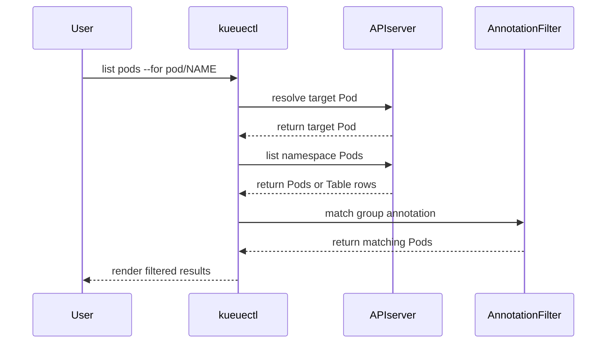

# PR #15739: kueuectl: Fix list pods --for pod/NAME for annotation-based Pod groups

**Summary**: kueuectl: Fix list pods --for pod/NAME for annotation-based Pod groups

**Sources**: https://github.com/kubernetes-sigs/kueue/pull/15739

**Last updated**: 2026-09-17T20:32:42Z

---

## Metadata

- **State**: closed (merged)
- **Author**: [@henry3260](https://github.com/henry3260)
- **Branch**: `fix-kueuectl-list-pods-annotation-group` → `main`
- **Created**: 2026-09-17T18:15:22Z
- **Updated**: 2026-09-17T20:32:42Z
- **Merged**: 2026-09-17T20:31:24Z
- **Closed**: 2026-09-17T20:31:24Z
- **Labels**: `kind/bug`, `release-note`, `size/L`, `lgtm`, `approved`, `ok-to-test`, `cncf-cla: yes`
- **Assignees**: [@mimowo](https://github.com/mimowo)
- **Requested reviewers**: [@mimowo](https://github.com/mimowo), [@pajakd](https://github.com/pajakd), [@mbobrovskyi](https://github.com/mbobrovskyi), [@sohankunkerkar](https://github.com/sohankunkerkar)
- **Changed files**: 2   **+161 / -19**

## Description

#### What type of PR is this?

/kind bug

#### What this PR does / why we need it?

`kueuectl list pods --for pod/NAME` printed `No resources found` instead of the group members, when the group name is stored in the `kueue.x-k8s.io/pod-group-name` annotation rather than the label. The Pod is correctly recognized as a group member, but `Pod.PodLabelSelector()` builds the selector from the label only, so it produced `kueue.x-k8s.io/pod-group-name=` with an empty value and the API server matched nothing.

kueuectl now reads the group name annotation directly. Since label selectors cannot match annotations, the group members are listed without a pod group selector and filtered client-side.

Fixes #15709

#### Useful notes for your reviewer


#### Release note

```release-note
CLI: Fixed a bug where `kueuectl list pods --for pod/NAME` printed `No resources found` instead of listing the group members, when the Pod group name was stored in the `kueue.x-k8s.io/pod-group-name` annotation rather than the label.
```

<!-- This is an auto-generated comment: release notes by coderabbit.ai -->

## AI summary

`kueuectl list pods --for pod/NAME` now supports annotation-based Pod groups. It lists namespace Pods and filters them by the Pod group annotation without sending an empty label selector. Existing label-based group and standalone Pod behavior remains unchanged. Tests cover filtering, selectors, JSON output, and empty results.

### Suggested release note

**CLI:** Fixed a bug that caused `kueuectl list pods --for pod/NAME` to return incomplete results for annotation-based Pod groups. The command now lists all Pods in the group.

<!-- end of auto-generated comment: release notes by coderabbit.ai -->

## Discussion

### Comment by [@netlify[bot]](https://github.com/apps/netlify) — 2026-09-17T18:15:35Z

### <span aria-hidden="true">✅</span> Deploy Preview for *kubernetes-sigs-kueue* ready!


|  Name | Link |
|:-:|------------------------|
|<span aria-hidden="true">🔨</span> Latest commit | 6f975adfc326f2fa9971a85306bdca5aac017279 |
|<span aria-hidden="true">🔍</span> Latest deploy log | https://app.netlify.com/projects/kubernetes-sigs-kueue/deploys/6aac2e400a9a8a0008a77ae8 |
|<span aria-hidden="true">😎</span> Deploy Preview | [https://deploy-preview-15739--kubernetes-sigs-kueue.netlify.app](https://deploy-preview-15739--kubernetes-sigs-kueue.netlify.app) |
|<span aria-hidden="true">📱</span> Preview on mobile | <details><summary> Toggle QR Code... </summary><br /><br /><br /><br />_Use your smartphone camera to open QR code link._</details> |
---
<!-- [kubernetes-sigs-kueue Preview](https://deploy-preview-15739--kubernetes-sigs-kueue.netlify.app) -->
_To edit notification comments on pull requests, go to your [Netlify project configuration](https://app.netlify.com/projects/kubernetes-sigs-kueue/configuration/notifications#deploy-notifications)._

### Comment by [@kubernetes-prow[bot]](https://github.com/apps/kubernetes-prow) — 2026-09-17T18:15:35Z

Hi @henry3260. Thanks for your PR.

I'm waiting for a [kubernetes-sigs](https://github.com/orgs/kubernetes-sigs/people) member to verify that this patch is reasonable to test. If it is, they should reply with `/ok-to-test` on its own line. Until that is done, I will not automatically test new commits in this PR, but the usual testing commands by org members will still work.

>[!TIP]
>**We noticed you've done this a few times! Consider [joining the org](https://git.k8s.io/community/community-membership.md#member) to skip this step and gain `/lgtm` and other bot rights.** We recommend asking approvers on your previous PRs to sponsor you.

Once the patch is verified, the new status will be reflected by the `ok-to-test` label.

I understand the commands that are listed [here](https://go.k8s.io/bot-commands?repo=kubernetes-sigs%2Fkueue).

<details>

Instructions for interacting with me using PR comments are available [here](https://git.k8s.io/community/contributors/guide/pull-requests.md).  If you have questions or suggestions related to my behavior, please file an issue against the [kubernetes-sigs/prow](https://github.com/kubernetes-sigs/prow/issues/new?title=Prow%20issue:) repository.
</details>

### Comment by [@coderabbitai[bot]](https://github.com/apps/coderabbitai) — 2026-09-17T18:16:47Z

<!-- This is an auto-generated comment: summarize by coderabbit.ai -->
<!-- review_stack_entry_start -->

<a href="https://app.coderabbit.ai/change-stack/kubernetes-sigs/kueue/pull/15739#gh-light-mode-only"></a><a href="https://app.coderabbit.ai/change-stack/kubernetes-sigs/kueue/pull/15739#gh-dark-mode-only"></a>

<!-- review_stack_entry_end -->
<!-- recent_review_start -->

No actionable comments were generated in the recent review. 🎉

<details>
<summary>ℹ️ Recent review info</summary>

<details>
<summary>⚙️ Run configuration</summary>

**Configuration used**: Path: .coderabbit.yaml

**Review profile**: CHILL

**Plan**: Advanced

**Run ID**: `a2e98c02-a1ae-4391-80d6-d405425d34fe`

</details>

<details>
<summary>📥 Commits</summary>

Reviewing files that changed from the base of the PR and between 7fd201111743b639f7b353e66d1999cb5399f87a and 6f975adfc326f2fa9971a85306bdca5aac017279.

</details>

<details>
<summary>📒 Files selected for processing (2)</summary>

* `cmd/kueuectl/app/list/list_pods.go`
* `cmd/kueuectl/app/list/list_pods_test.go`

</details>

**Included review availability:** Your plan provides up to 8 included reviews per hour; 7 remain after this review.

</details>

---


<!-- recent_review_end -->
<!-- walkthrough_start -->

<details>
<summary>📝 Walkthrough</summary>

## Walkthrough

### Changes

**Pod group selection**

|Layer / File(s)|Summary|
|---|---|
|**Selector resolution** <br> `cmd/kueuectl/app/list/list_pods.go`|`PodOptions` accepts annotation selectors. Pod listing resolves label-based groups, annotation-based groups, and standalone Pods with the corresponding selectors.|
|**Annotation filtering and validation** <br> `cmd/kueuectl/app/list/list_pods.go`, `cmd/kueuectl/app/list/list_pods_test.go`|Retrieved Pods and Table rows are filtered by group annotation. Tests cover non-member Pods, JSON output, empty results, and request classification in the mock client.|

<!-- change_assessment_start -->
**Priority:** ➖ Normal


**Estimated code review effort:** 3 (Moderate) | ~25 minutes

<!-- change_assessment_commit:"6f975adfc326f2fa9971a85306bdca5aac017279" -->
**Change:** Bug fix · **Severity of issue fixed:** Medium
<!-- change_assessment_end -->

### Sequence Diagram(s)



**Suggested reviewers:** `weizhoublue`

</details>

<!-- walkthrough_end -->
<!-- final_review_risk_start -->
**Merge Risk:** _⚪ Minimal_ · up to `6f975`
<!-- final_review_risk_coverage:{"sourceCommitId":"6f975adfc326f2fa9971a85306bdca5aac017279","coveredCommitId":"6f975adfc326f2fa9971a85306bdca5aac017279","kind":"reviewed"} -->

Annotation-based Pod groups are listed and filtered before output without sending an empty group label selector. No concrete merge-blocking risk remains.
<!-- final_review_risk_end -->
<!-- pre_merge_checks_walkthrough_start -->

<details>
<summary>🚥 Pre-merge checks | ✅ 4 | ❌ 1</summary>

### ❌ Failed checks (1 warning)

|     Check name     | Status     | Explanation                                                                                                                                                                                | Resolution                                                                         |
| :----------------: | :--------- | :----------------------------------------------------------------------------------------------------------------------------------------------------------------------------------------- | :--------------------------------------------------------------------------------- |
| Docstring Coverage | ⚠️ Warning | Docstring coverage is 40.00% which is insufficient. The required threshold is 80.00%. Docstring coverage is scoped to functions touched by this diff. Analyzed 5 functions across 2 files. | Write docstrings for the functions missing them to satisfy the coverage threshold. |

<details>
<summary>✅ Passed checks (4 passed)</summary>

|         Check name         | Status   | Explanation                                                                                                                                                                                               |
| :------------------------: | :------- | :-------------------------------------------------------------------------------------------------------------------------------------------------------------------------------------------------------- |
|     Linked Issues check    | ✅ Passed | Issue `#15709` requires annotation-based Pod group listing, no empty group label selector, preserved label and standalone behavior, and tests. `completePodSelectors` reads `podconstants.GroupNameAnnotat… |
| Out of Scope Changes check | ✅ Passed | The reviewed changes are limited to `list_pods.go` and its tests. The production changes implement annotation-based Pod group detection, client-side filtering, selector construction, and Table handlin… |
|      Description Check     | ✅ Passed | Check skipped - CodeRabbit’s high-level summary is enabled.                                                                                                                                               |
|         Title check        | ✅ Passed | The title clearly and concisely describes the main change: fixing `kueuectl list pods --for pod/NAME` for annotation-based Pod groups.                                                                    |

</details>

</details>

<!-- pre_merge_checks_walkthrough_end -->

- [ ] <!-- {"checkboxId":"585bb3f6-faf5-4dbf-96d2-74e382adf19a"} --> Fix all pre-merge checks with AI
<!-- finishing_touch_checkbox_start -->

<details>
<summary>✨ Finishing Touches</summary>

<details>
<summary>🧪 Generate unit tests (beta)</summary>

- [ ] <!-- {"checkboxId": "f47ac10b-58cc-4372-a567-0e02b2c3d479", "radioGroupId": "utg-output-choice-group-unknown_comment_id"} --> Create a new PR

</details>

</details>

<!-- finishing_touch_checkbox_end -->
<!-- tips_start -->

---


<sub>Comment `@coderabbitai help` to get the list of available commands.</sub>

<!-- tips_end -->

### Comment by [@mimowo](https://github.com/mimowo) — 2026-09-17T18:42:46Z

/ok-to-test

### Comment by [@KR-Ravindra](https://github.com/KR-Ravindra) — 2026-09-17T19:22:38Z

One point on the description rather than the code.

The root cause as written does not match what `main` does. `WorkloadIdentifierAnnotations` defaults to true (Beta since 0.18, `pkg/features/kube_features.go`) and kueuectl never overrides feature gates, so `utilpod.IsPodGroup` already returns true for an annotation-only Pod. That is why the existing case `list pods of a pod group identified by annotation is not treated as standalone` (added in #15435) asserts an empty `fieldSelector` on `main`.

The pre-PR failure is therefore the one #15709 describes: `Pod.PodLabelSelector()` produces `kueue.x-k8s.io/pod-group-name=` with an empty value, the API server matches nothing, and the command prints `No resources found`. It did not fall back to selecting the Pod by name, and it did not list "only the given Pod"; that would only happen with the gate turned off, which the CLI cannot do.

The code change is right either way, since it stops depending on both the gate and the label. Could you reword the second paragraph and the release note to describe the empty-selector behaviour instead?

### Comment by [@henry3260](https://github.com/henry3260) — 2026-09-17T19:35:47Z

> One point on the description rather than the code.
> 
> The root cause as written does not match what `main` does. `WorkloadIdentifierAnnotations` defaults to true (Beta since 0.18, `pkg/features/kube_features.go`) and kueuectl never overrides feature gates, so `utilpod.IsPodGroup` already returns true for an annotation-only Pod. That is why the existing case `list pods of a pod group identified by annotation is not treated as standalone` (added in #15435) asserts an empty `fieldSelector` on `main`.
> 
> The pre-PR failure is therefore the one #15709 describes: `Pod.PodLabelSelector()` produces `kueue.x-k8s.io/pod-group-name=` with an empty value, the API server matches nothing, and the command prints `No resources found`. It did not fall back to selecting the Pod by name, and it did not list "only the given Pod"; that would only happen with the gate turned off, which the CLI cannot do.
> 
> The code change is right either way, since it stops depending on both the gate and the label. Could you reword the second paragraph and the release note to describe the empty-selector behaviour instead?

I will update pr description. Thanks!

### Comment by [@mimowo](https://github.com/mimowo) — 2026-09-17T19:40:00Z

/lgtm
/approve
/cherrypick release-0.19
/cherrypick release-0.18
Thank you 👍

### Comment by [@k8s-infra-cherrypick-robot](https://github.com/k8s-infra-cherrypick-robot) — 2026-09-17T19:40:04Z

@mimowo: once the present PR merges, I will cherry-pick it on top of `release-0.18`, `release-0.19` in new PRs and assign them to you.

<details>

In response to [this](https://github.com/kubernetes-sigs/kueue/pull/15739#issuecomment-5720165083):

>/lgtm
>/approve
>/cherrypick release-0.19
>/cherrypick release-0.18
>Thank you 👍 


Instructions for interacting with me using PR comments are available [here](https://git.k8s.io/community/contributors/guide/pull-requests.md).  If you have questions or suggestions related to my behavior, please file an issue against the [kubernetes-sigs/prow](https://github.com/kubernetes-sigs/prow/issues/new?title=Prow%20issue:) repository.
</details>

### Comment by [@kubernetes-prow[bot]](https://github.com/apps/kubernetes-prow) — 2026-09-17T19:40:10Z

LGTM label has been added.  <details>Git tree hash: 02addfefbe3574b8cef919c078502a31d3e39b21</details>

### Comment by [@kubernetes-prow[bot]](https://github.com/apps/kubernetes-prow) — 2026-09-17T19:40:14Z

[APPROVALNOTIFIER] This PR is **APPROVED**

This pull-request has been approved by: *<a href="https://github.com/kubernetes-sigs/kueue/pull/15739#" title="Author self-approved">henry3260</a>*, *<a href="https://github.com/kubernetes-sigs/kueue/pull/15739#issuecomment-5720165083" title="Approved">mimowo</a>*

The full list of commands accepted by this bot can be found [here](https://go.k8s.io/bot-commands?repo=kubernetes-sigs%2Fkueue).

The pull request process is described [here](https://git.k8s.io/community/contributors/guide/owners.md#the-code-review-process)

<details >
Needs approval from an approver in each of these files:

- ~~[OWNERS](https://github.com/kubernetes-sigs/kueue/blob/main/OWNERS)~~ [mimowo]

Approvers can indicate their approval by writing `/approve` in a comment
Approvers can cancel approval by writing `/approve cancel` in a comment
</details>
<!-- META={"approvers":[]} -->

### Comment by [@henry3260](https://github.com/henry3260) — 2026-09-17T20:11:00Z

/retest

### Comment by [@henry3260](https://github.com/henry3260) — 2026-09-17T20:27:38Z

/retest

### Comment by [@k8s-infra-cherrypick-robot](https://github.com/k8s-infra-cherrypick-robot) — 2026-09-17T20:32:05Z

@mimowo: #15739 failed to apply on top of branch "release-0.19":
```
Applying: kueuectl: Fix list pods --for pod/NAME for annotation-based Pod groups
Using index info to reconstruct a base tree...
M	cmd/kueuectl/app/list/list_pods.go
M	cmd/kueuectl/app/list/list_pods_test.go
Falling back to patching base and 3-way merge...
Auto-merging cmd/kueuectl/app/list/list_pods.go
CONFLICT (content): Merge conflict in cmd/kueuectl/app/list/list_pods.go
Auto-merging cmd/kueuectl/app/list/list_pods_test.go
CONFLICT (content): Merge conflict in cmd/kueuectl/app/list/list_pods_test.go
error: Failed to merge in the changes.
hint: Use 'git am --show-current-patch=diff' to see the failed patch
hint: When you have resolved this problem, run "git am --continue".
hint: If you prefer to skip this patch, run "git am --skip" instead.
hint: To restore the original branch and stop patching, run "git am --abort".
hint: Disable this message with "git config set advice.mergeConflict false"
Patch failed at 0001 kueuectl: Fix list pods --for pod/NAME for annotation-based Pod groups

```

<details>

In response to [this](https://github.com/kubernetes-sigs/kueue/pull/15739#issuecomment-5720165083):

>/lgtm
>/approve
>/cherrypick release-0.19
>/cherrypick release-0.18
>Thank you 👍 


Instructions for interacting with me using PR comments are available [here](https://git.k8s.io/community/contributors/guide/pull-requests.md).  If you have questions or suggestions related to my behavior, please file an issue against the [kubernetes-sigs/prow](https://github.com/kubernetes-sigs/prow/issues/new?title=Prow%20issue:) repository.
</details>

### Comment by [@k8s-infra-cherrypick-robot](https://github.com/k8s-infra-cherrypick-robot) — 2026-09-17T20:32:42Z

@mimowo: #15739 failed to apply on top of branch "release-0.18":
```
Applying: kueuectl: Fix list pods --for pod/NAME for annotation-based Pod groups
Using index info to reconstruct a base tree...
M	cmd/kueuectl/app/list/list_pods.go
M	cmd/kueuectl/app/list/list_pods_test.go
Falling back to patching base and 3-way merge...
Auto-merging cmd/kueuectl/app/list/list_pods.go
CONFLICT (content): Merge conflict in cmd/kueuectl/app/list/list_pods.go
Auto-merging cmd/kueuectl/app/list/list_pods_test.go
CONFLICT (content): Merge conflict in cmd/kueuectl/app/list/list_pods_test.go
error: Failed to merge in the changes.
hint: Use 'git am --show-current-patch=diff' to see the failed patch
hint: When you have resolved this problem, run "git am --continue".
hint: If you prefer to skip this patch, run "git am --skip" instead.
hint: To restore the original branch and stop patching, run "git am --abort".
hint: Disable this message with "git config set advice.mergeConflict false"
Patch failed at 0001 kueuectl: Fix list pods --for pod/NAME for annotation-based Pod groups

```

<details>

In response to [this](https://github.com/kubernetes-sigs/kueue/pull/15739#issuecomment-5720165083):

>/lgtm
>/approve
>/cherrypick release-0.19
>/cherrypick release-0.18
>Thank you 👍 


Instructions for interacting with me using PR comments are available [here](https://git.k8s.io/community/contributors/guide/pull-requests.md).  If you have questions or suggestions related to my behavior, please file an issue against the [kubernetes-sigs/prow](https://github.com/kubernetes-sigs/prow/issues/new?title=Prow%20issue:) repository.
</details>
