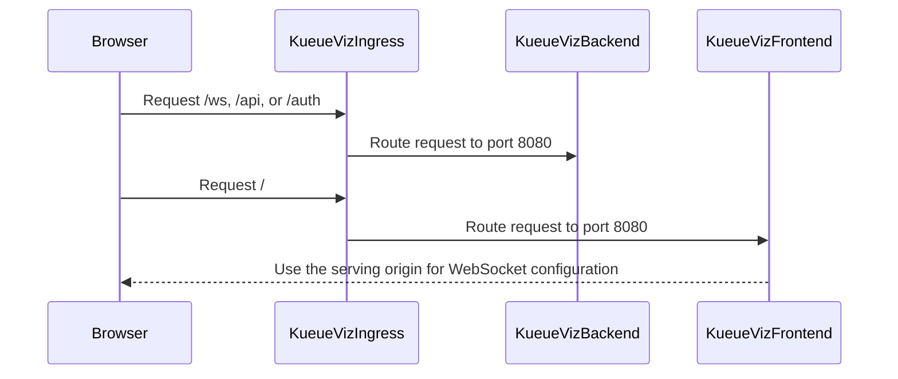

# PR #15863: KueueViz: Generate a shared Ingress from config

**Summary**: KueueViz: Generate a shared Ingress from config

**Sources**: https://github.com/kubernetes-sigs/kueue/pull/15863

**Last updated**: 2026-09-21T21:59:39Z

---

## Metadata

- **State**: closed (merged)
- **Author**: [@HsiuChuanHsu](https://github.com/HsiuChuanHsu)
- **Branch**: `kueueviz-shared-ingress-from-config` → `main`
- **Created**: 2026-09-20T12:41:01Z
- **Updated**: 2026-09-21T21:59:39Z
- **Merged**: 2026-09-21T00:05:59Z
- **Closed**: 2026-09-21T00:05:59Z
- **Labels**: `release-note`, `size/L`, `lgtm`, `approved`, `kind/cleanup`, `ok-to-test`, `cncf-cla: yes`
- **Assignees**: [@tenzen-y](https://github.com/tenzen-y)
- **Requested reviewers**: [@kannon92](https://github.com/kannon92), [@kshalot](https://github.com/kshalot)
- **Changed files**: 12   **+195 / -73**

## Description

<!-- Thank you for contributing! Check CONTRIBUTING.md for details. -->

#### What type of PR is this?
/kind cleanup
<!-- Choose one of the following kinds:
/kind bug
/kind cleanup
/kind documentation
/kind feature
/kind kep
-->


<!-- Optionally choose one or more of the following kinds:
/kind api-change
/kind deprecation
/kind failing-test
/kind flake
/kind regression
-->


<!-- Consider setting the area:
/area tas
/area was
/area integrations
/area multikueue
/area dashboard
/area localization
/area testing
/area website
-->


#### What this PR does / why we need it?
Generate the KueueViz shared Ingress configuration from the configuration directory. Keep the generated configuration usable for installations outside Helm.

<!--
Use `Fixes #123` for an issue addressed by this PR; it will be closed when the PR merges.
Use `Related:` or `Part of:` to reference an issue without closing it.
-->
Fixes #15669

#### Useful notes for your reviewer


#### Release note

<!-- Describe the behavior change accurately from the user's perspective. Hints:
- Do not leave this block blank.
- Use "NONE" when there is no user-facing change.
- When feasible use a prefix for the sub-component or feature, e.g. "FairSharing:" or "MultiKueue:".
- If upgrade steps are required, include an "ACTION REQUIRED:" section.
You may consider AI assistance using the skill: cmd/experimental/skills/kueue-release-notes/SKILL.md.
-->
```release-note
KueueViz: Support a single comprehensive Ingress usage for non-Helm installations.
```


<!-- This is an auto-generated comment: release notes by coderabbit.ai -->
## AI summary

Adds a generated single-host KueueViz manifest for non-Helm installations. The manifest routes `/ws`, `/api`, and `/auth` to the backend and `/` to the frontend. Helm generation now uses the shared Ingress configuration. Documentation includes host, TLS, and migration instructions.

### Suggested release note

KueueViz: Added a single-host manifest that serves the dashboard and backend through one path-routed Ingress.
<!-- end of auto-generated comment: release notes by coderabbit.ai -->

## Discussion

### Comment by [@netlify[bot]](https://github.com/apps/netlify) — 2026-09-20T12:41:08Z

### <span aria-hidden="true">✅</span> Deploy Preview for *kubernetes-sigs-kueue* canceled.


|  Name | Link |
|:-:|------------------------|
|<span aria-hidden="true">🔨</span> Latest commit | 3058826c6c93c32c425eb3eb65095c8164246a8e |
|<span aria-hidden="true">🔍</span> Latest deploy log | https://app.netlify.com/projects/kubernetes-sigs-kueue/deploys/6ab06eb7721c6d0008193c48 |

### Comment by [@kubernetes-prow[bot]](https://github.com/apps/kubernetes-prow) — 2026-09-20T12:41:12Z

Hi @HsiuChuanHsu. Thanks for your PR.

I'm waiting for a [kubernetes-sigs](https://github.com/orgs/kubernetes-sigs/people) member to verify that this patch is reasonable to test. If it is, they should reply with `/ok-to-test` on its own line. Until that is done, I will not automatically test new commits in this PR, but the usual testing commands by org members will still work.

>[!TIP]
>**We noticed you've done this a few times! Consider [joining the org](https://git.k8s.io/community/community-membership.md#member) to skip this step and gain `/lgtm` and other bot rights.** We recommend asking approvers on your previous PRs to sponsor you.

Once the patch is verified, the new status will be reflected by the `ok-to-test` label.

I understand the commands that are listed [here](https://go.k8s.io/bot-commands?repo=kubernetes-sigs%2Fkueue).

<details>

Instructions for interacting with me using PR comments are available [here](https://git.k8s.io/community/contributors/guide/pull-requests.md).  If you have questions or suggestions related to my behavior, please file an issue against the [kubernetes-sigs/prow](https://github.com/kubernetes-sigs/prow/issues/new?title=Prow%20issue:) repository.
</details>

### Comment by [@coderabbitai[bot]](https://github.com/apps/coderabbitai) — 2026-09-20T12:42:16Z

<!-- This is an auto-generated comment: summarize by coderabbit.ai -->
<!-- review_stack_entry_start -->

<a href="https://app.coderabbit.ai/change-stack/kubernetes-sigs/kueue/pull/15863#gh-light-mode-only"></a><a href="https://app.coderabbit.ai/change-stack/kubernetes-sigs/kueue/pull/15863#gh-dark-mode-only"></a>

<!-- review_stack_entry_end -->
<!-- recent_review_start -->

No actionable comments were generated in the recent review. 🎉

<details>
<summary>ℹ️ Recent review info</summary>

<details>
<summary>⚙️ Run configuration</summary>

**Configuration used**: Repository: kubernetes-sigs/kueue/.coderabbit.yaml

**Review profile**: CHILL

**Plan**: Advanced

**Run ID**: `b65e0124-14a8-442c-b654-463364c7e7c6`

</details>

<details>
<summary>📥 Commits</summary>

Reviewing files that changed from the base of the PR and between 62bfb56d63a79897340105e2a3fb831c745eed79 and 3058826c6c93c32c425eb3eb65095c8164246a8e.

</details>

<details>
<summary>📒 Files selected for processing (1)</summary>

* `config/components/kueueviz/kustomization.yaml`

</details>

**Included review availability:** Your plan provides up to 8 included reviews per hour; 7 remain after this review.

</details>

---


<!-- recent_review_end -->
<!-- walkthrough_start -->

<details>
<summary>📝 Walkthrough</summary>

## Walkthrough

The PR adds a single-host KueueViz Kustomize manifest with path-based routing. It adds Helm processing for the shared Ingress, preserves separate-host overlays, generates the manifest as an artifact, and updates deployment documentation.

### Changes

**KueueViz single-host deployment**

|Layer / File(s)|Summary|
|---|---|
|**Single-host manifest and routing** <br> `config/components/kueueviz/...`, `config/kueueviz-single-host/...`|Adds one Ingress that routes `/ws`, `/api`, and `/auth` to the backend and `/` to the frontend. The overlay removes the separate component Ingresses and clears frontend backend URLs.|
|**Helm ingress processing** <br> `charts/kueue/templates/kueueviz/ingress.yaml`, `hack/processing-plan.yaml`|Regenerates the Helm Ingress template and adds configurable host, ingress class, TLS, annotations, and conditional rendering for the shared Ingress.|
|**Separate-host overlay compatibility** <br> `config/kueueviz/kustomization.yaml`, `config/kueueviz/remove_shared_ingress.yaml`|Removes the shared Ingress from the existing separate-host overlay.|
|**Artifact and deployment documentation** <br> `Makefile`, `site/content/en/docs/tasks/manage/enable_kueueviz.md`|Builds `kueueviz-single-host.yaml` and documents installation, host and TLS changes, migration, and the rewrite-target warning.|

<!-- change_assessment_start -->
**Priority:** ⬇️ Low

**Estimated code review effort:** 3 (Moderate) | ~25 minutes

<!-- change_assessment_commit:"3058826c6c93c32c425eb3eb65095c8164246a8e" -->
**Change:** Feature
<!-- change_assessment_end -->

**Suggested reviewers:** `mbobrovskyi`

### Sequence Diagram(s)



</details>

<!-- walkthrough_end -->
<!-- pre_merge_checks_walkthrough_start -->

<details>
<summary>🚥 Pre-merge checks | ✅ 5</summary>

<details>
<summary>✅ Passed checks (5 passed)</summary>

|         Check name         | Status   | Explanation                                                                                                                                                                                               |
| :------------------------: | :------- | :-------------------------------------------------------------------------------------------------------------------------------------------------------------------------------------------------------- |
|      Description Check     | ✅ Passed | Check skipped - CodeRabbit’s high-level summary is enabled.                                                                                                                                               |
|         Title check        | ✅ Passed | The title clearly and concisely describes the primary change: generating a shared KueueViz Ingress from configuration.                                                                                    |
|     Linked Issues check    | ✅ Passed | The PR meets the coding requirements in issue `#15669`. `config/components/kueueviz/ingress.yaml` defines `kueueviz-ingress` with `/ws`, `/api`, and `/auth` routed to `kueueviz-backend:8080`, and `/` ro… |
| Out of Scope Changes check | ✅ Passed | The changes stay within issue `#15669`. The single-host overlay, deletion patches for the separate Ingress objects, frontend environment patch, Makefile artifact entry, documentation update, and removal… |
|     Docstring Coverage     | ✅ Passed | No functions found in the changed files to evaluate docstring coverage. Skipping docstring coverage check. Docstring coverage is scoped to functions touched by this diff. Analyzed 0 functions across 0… |

</details>

</details>

<!-- pre_merge_checks_walkthrough_end -->
<!-- finishing_touch_checkbox_start -->

<details>
<summary>✨ Finishing Touches</summary>

<details open>
<summary>🧪 Generate unit tests (beta)</summary>

- [ ] <!-- {"checkboxId": "f47ac10b-58cc-4372-a567-0e02b2c3d479", "radioGroupId": "utg-output-choice-group-unknown_comment_id"} --> Create a new PR

</details>

</details>

<!-- finishing_touch_checkbox_end -->
<!-- tips_start -->

---


<sub>Comment `@coderabbitai help` to get the list of available commands.</sub>

<!-- tips_end -->

### Comment by [@tenzen-y](https://github.com/tenzen-y) — 2026-09-20T22:38:27Z

/ok-to-test

### Comment by [@kubernetes-prow[bot]](https://github.com/apps/kubernetes-prow) — 2026-09-21T00:04:46Z

LGTM label has been added.  <details>Git tree hash: 7926a464174f254a77f5997a4c5435fb9e6971fa</details>

### Comment by [@kubernetes-prow[bot]](https://github.com/apps/kubernetes-prow) — 2026-09-21T00:04:51Z

[APPROVALNOTIFIER] This PR is **APPROVED**

This pull-request has been approved by: *<a href="https://github.com/kubernetes-sigs/kueue/pull/15863#" title="Author self-approved">HsiuChuanHsu</a>*, *<a href="https://github.com/kubernetes-sigs/kueue/pull/15863#pullrequestreview-5262222991" title="Approved">tenzen-y</a>*

The full list of commands accepted by this bot can be found [here](https://go.k8s.io/bot-commands?repo=kubernetes-sigs%2Fkueue).

The pull request process is described [here](https://git.k8s.io/community/contributors/guide/owners.md#the-code-review-process)

<details >
Needs approval from an approver in each of these files:

- ~~[OWNERS](https://github.com/kubernetes-sigs/kueue/blob/main/OWNERS)~~ [tenzen-y]

Approvers can indicate their approval by writing `/approve` in a comment
Approvers can cancel approval by writing `/approve cancel` in a comment
</details>
<!-- META={"approvers":[]} -->

### Comment by [@tenzen-y](https://github.com/tenzen-y) — 2026-09-21T00:07:07Z

IIUC, this is just automation and brings the Helm ingress to the config.

### Comment by [@tenzen-y](https://github.com/tenzen-y) — 2026-09-21T00:09:34Z

/release-note-edit
```release-note
KueueViz: Support a single comprehensive Ingress usage for non-Helm installations.
```

### Comment by [@HsiuChuanHsu](https://github.com/HsiuChuanHsu) — 2026-09-21T02:46:53Z

> IIUC, this is just automation and brings the Helm ingress to the config.

Yes. Thanks for the review.

## Reviews

### Review by [@tenzen-y](https://github.com/tenzen-y) (commented) — 2026-09-21T00:04:39Z

Thank you!
/lgtm
/approve
