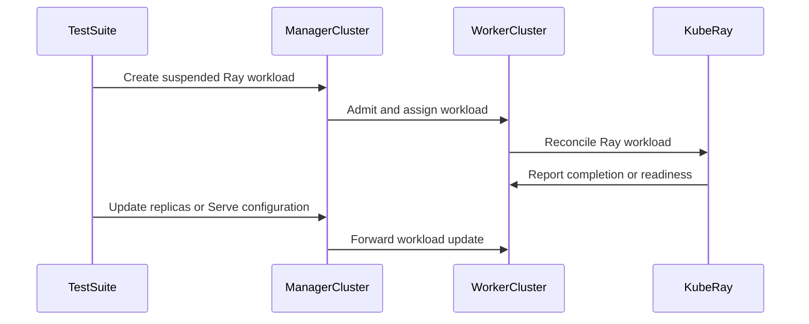

# PR #15872: test: split KubeRay MultiKueue E2E tests

**Summary**: test: split KubeRay MultiKueue E2E tests

**Sources**: https://github.com/kubernetes-sigs/kueue/pull/15872

**Last updated**: 2026-09-21T01:17:24Z

---

## Metadata

- **State**: closed (merged)
- **Author**: [@kevin85421](https://github.com/kevin85421)
- **Branch**: `codex/split-kuberay-e2e-tests` → `main`
- **Created**: 2026-09-20T23:24:01Z
- **Updated**: 2026-09-21T01:17:24Z
- **Merged**: 2026-09-21T01:16:08Z
- **Closed**: 2026-09-21T01:16:08Z
- **Labels**: `lgtm`, `release-note-none`, `size/XL`, `approved`, `kind/cleanup`, `cncf-cla: yes`, `area/multikueue`, `area/testing`
- **Assignees**: [@tenzen-y](https://github.com/tenzen-y)
- **Requested reviewers**: [@pajakd](https://github.com/pajakd), [@olekzabl](https://github.com/olekzabl)
- **Changed files**: 2   **+380 / -316**

## Description

#### What type of PR is this?

/kind cleanup
/area testing
/area multikueue

#### What this PR does / why we need it:

Moves the existing KubeRay MultiKueue E2E specs into a dedicated `kuberay_test.go` file, following the integration-specific organization used by the extended suite.

The shared MultiKueue fixtures and cleanup lifecycle remain unchanged in `e2e_test.go`. KubeRay-specific imports and test registration are colocated with the KubeRay specs. Test behavior, labels, ordering, and cleanup scope remain unchanged.

This PR was prepared with assistance from OpenAI Codex.

#### Which issue(s) this PR fixes:

Part of #15757

#### Special notes for your reviewer:

Validated with:

```
go test ./test/e2e/multikueue/extended -run '^$'
go test -v ./test/e2e/multikueue/extended -run TestAPIs -args -ginkgo.dry-run -ginkgo.label-filter=feature:kuberay -ginkgo.v
```

The dry run registered all four existing `feature:kuberay` specs.

#### Does this PR introduce a user-facing change?

```release-note
NONE
```


<!-- This is an auto-generated comment: release notes by coderabbit.ai -->

## AI summary

Moved the four existing KubeRay MultiKueue E2E specifications into `kuberay_test.go`. Shared fixtures remain in `e2e_test.go`; KubeRay registration, imports, and RayService cleanup are colocated with the tests. Test behavior, labels, and ordering are unchanged.

Validation included compilation and a Ginkgo dry run confirming all four `feature:kuberay` specifications.

### Suggested release note

NONE

<!-- end of auto-generated comment: release notes by coderabbit.ai -->

## Discussion

### Comment by [@netlify[bot]](https://github.com/apps/netlify) — 2026-09-20T23:24:08Z

### <span aria-hidden="true">✅</span> Deploy Preview for *kubernetes-sigs-kueue* canceled.


|  Name | Link |
|:-:|------------------------|
|<span aria-hidden="true">🔨</span> Latest commit | f92ded27dd3896fae0134bf01747ba9eb68c08fd |
|<span aria-hidden="true">🔍</span> Latest deploy log | https://app.netlify.com/projects/kubernetes-sigs-kueue/deploys/6ab0796425c49c00089b3fca |

### Comment by [@coderabbitai[bot]](https://github.com/apps/coderabbitai) — 2026-09-20T23:25:23Z

<!-- This is an auto-generated comment: summarize by coderabbit.ai -->
<!-- review_stack_entry_start -->

<a href="https://app.coderabbit.ai/change-stack/kubernetes-sigs/kueue/pull/15872#gh-light-mode-only"></a><a href="https://app.coderabbit.ai/change-stack/kubernetes-sigs/kueue/pull/15872#gh-dark-mode-only"></a>

<!-- review_stack_entry_end -->
<!-- recent_review_start -->

No actionable comments were generated in the recent review. 🎉

<details>
<summary>ℹ️ Recent review info</summary>

<details>
<summary>⚙️ Run configuration</summary>

**Configuration used**: Repository: kubernetes-sigs/kueue/.coderabbit.yaml

**Review profile**: CHILL

**Plan**: Advanced

**Run ID**: `83265256-2277-4e7c-ae18-f1b183148ef7`

</details>

<details>
<summary>📥 Commits</summary>

Reviewing files that changed from the base of the PR and between 0bc18065dbc86429c9f5db12fcb6e8f42533816a and f92ded27dd3896fae0134bf01747ba9eb68c08fd.

</details>

<details>
<summary>📒 Files selected for processing (2)</summary>

* `test/e2e/multikueue/extended/e2e_test.go`
* `test/e2e/multikueue/extended/kuberay_test.go`

</details>

<details>
<summary>💤 Files with no reviewable changes (1)</summary>

* test/e2e/multikueue/extended/kuberay_test.go

</details>

**Included review availability:** Your plan provides up to 8 included reviews per hour; 6 remain after this review.

</details>

---


<!-- recent_review_end -->
<!-- walkthrough_start -->

<details>
<summary>📝 Walkthrough</summary>

## Walkthrough

The change moves MultiKueue Ray tests into a dedicated KubeRay test file. It adds RayJob, RayCluster, elastic scaling, and RayService end-to-end coverage with shared cluster setup and cleanup.

### Changes

**KubeRay MultiKueue integration**

|Layer / File(s)|Summary|
|---|---|
|**KubeRay test registration and shared setup** <br> `test/e2e/multikueue/extended/e2e_test.go`, `test/e2e/multikueue/extended/kuberay_test.go`|The inline Ray integrations and related imports are removed. The extended suite registers KubeRay tests with shared namespaces, queues, admission checks, and Kubernetes clients. Cleanup removes RayService ConfigMaps and resources before namespace deletion.|
|**RayJob and RayCluster admission tests** <br> `test/e2e/multikueue/extended/kuberay_test.go`|The tests verify RayJob admission, completion, and worker cleanup. RayCluster admission is checked against desired, ready, and available worker replica counts.|
|**Elastic scaling and RayService updates** <br> `test/e2e/multikueue/extended/kuberay_test.go`|The elastic RayCluster test changes worker replicas from one to three and back to one. The RayService test updates Serve configuration from one to two replicas and verifies that the existing worker object retains its UID without re-admission.|

<!-- change_assessment_start -->
**Priority:** ⬇️ Low


**Estimated code review effort:** 4 (Complex) | ~45 minutes

<!-- change_assessment_commit:"f92ded27dd3896fae0134bf01747ba9eb68c08fd" -->
**Change:** Refactor
<!-- change_assessment_end -->

### Sequence Diagram(s)



**Suggested reviewers:** `sohankunkerkar`

</details>

<!-- walkthrough_end -->
<!-- pre_merge_checks_walkthrough_start -->

<details>
<summary>🚥 Pre-merge checks | ✅ 4 | ❌ 1</summary>

### ❌ Failed checks (1 warning)

|     Check name     | Status     | Explanation                                                                                                                                                                               | Resolution                                                                         |
| :----------------: | :--------- | :---------------------------------------------------------------------------------------------------------------------------------------------------------------------------------------- | :--------------------------------------------------------------------------------- |
| Docstring Coverage | ⚠️ Warning | Docstring coverage is 0.00% which is insufficient. The required threshold is 80.00%. Docstring coverage is scoped to functions touched by this diff. Analyzed 1 functions across 2 files. | Write docstrings for the functions missing them to satisfy the coverage threshold. |

<details>
<summary>✅ Passed checks (4 passed)</summary>

|         Check name         | Status   | Explanation                                                                                                                            |
| :------------------------: | :------- | :------------------------------------------------------------------------------------------------------------------------------------- |
|     Linked Issues check    | ✅ Passed | Check skipped because no linked issues were found for this pull request.                                                               |
| Out of Scope Changes check | ✅ Passed | Check skipped because no linked issues were found for this pull request.                                                               |
|      Description Check     | ✅ Passed | Check skipped - CodeRabbit’s high-level summary is enabled.                                                                            |
|         Title check        | ✅ Passed | The title accurately and concisely describes the main change: splitting the KubeRay MultiKueue end-to-end tests into a dedicated file. |

</details>

</details>

<!-- pre_merge_checks_walkthrough_end -->

- [ ] <!-- {"checkboxId":"585bb3f6-faf5-4dbf-96d2-74e382adf19a"} --> Fix all pre-merge checks with AI
<!-- finishing_touch_checkbox_start -->

<details>
<summary>✨ Finishing Touches</summary>

<details open>
<summary>🧪 Generate unit tests (beta)</summary>

- [ ] <!-- {"checkboxId": "f47ac10b-58cc-4372-a567-0e02b2c3d479", "radioGroupId": "utg-output-choice-group-unknown_comment_id"} --> Create a new PR

</details>

</details>

<!-- finishing_touch_checkbox_end -->
<!-- tips_start -->

---


<sub>Comment `@coderabbitai help` to get the list of available commands.</sub>

<!-- tips_end -->

### Comment by [@kubernetes-prow[bot]](https://github.com/apps/kubernetes-prow) — 2026-09-21T00:56:32Z

LGTM label has been added.  <details>Git tree hash: c674109039dabb91460f09f519896becf83b703f</details>

### Comment by [@kubernetes-prow[bot]](https://github.com/apps/kubernetes-prow) — 2026-09-21T00:56:37Z

[APPROVALNOTIFIER] This PR is **APPROVED**

This pull-request has been approved by: *<a href="https://github.com/kubernetes-sigs/kueue/pull/15872#" title="Author self-approved">kevin85421</a>*, *<a href="https://github.com/kubernetes-sigs/kueue/pull/15872#pullrequestreview-5262357412" title="Approved">tenzen-y</a>*

The full list of commands accepted by this bot can be found [here](https://go.k8s.io/bot-commands?repo=kubernetes-sigs%2Fkueue).

The pull request process is described [here](https://git.k8s.io/community/contributors/guide/owners.md#the-code-review-process)

<details >
Needs approval from an approver in each of these files:

- ~~[test/OWNERS](https://github.com/kubernetes-sigs/kueue/blob/main/test/OWNERS)~~ [tenzen-y]

Approvers can indicate their approval by writing `/approve` in a comment
Approvers can cancel approval by writing `/approve cancel` in a comment
</details>
<!-- META={"approvers":[]} -->

### Comment by [@tenzen-y](https://github.com/tenzen-y) — 2026-09-21T00:57:33Z

/cherrypick release-0.18
/cherrypick release-0.19

### Comment by [@k8s-infra-cherrypick-robot](https://github.com/k8s-infra-cherrypick-robot) — 2026-09-21T00:57:36Z

@tenzen-y: once the present PR merges, I will cherry-pick it on top of `release-0.18`, `release-0.19` in new PRs and assign them to you.

<details>

In response to [this](https://github.com/kubernetes-sigs/kueue/pull/15872#issuecomment-5754042904):

>/cherrypick release-0.18
>/cherrypick release-0.19


Instructions for interacting with me using PR comments are available [here](https://git.k8s.io/community/contributors/guide/pull-requests.md).  If you have questions or suggestions related to my behavior, please file an issue against the [kubernetes-sigs/prow](https://github.com/kubernetes-sigs/prow/issues/new?title=Prow%20issue:) repository.
</details>

### Comment by [@k8s-infra-cherrypick-robot](https://github.com/k8s-infra-cherrypick-robot) — 2026-09-21T01:16:48Z

@tenzen-y: #15872 failed to apply on top of branch "release-0.18":
```
Applying: test: split KubeRay MultiKueue E2E tests
Using index info to reconstruct a base tree...
M	test/e2e/multikueue/extended/e2e_test.go
Falling back to patching base and 3-way merge...
Auto-merging test/e2e/multikueue/extended/e2e_test.go
CONFLICT (content): Merge conflict in test/e2e/multikueue/extended/e2e_test.go
error: Failed to merge in the changes.
hint: Use 'git am --show-current-patch=diff' to see the failed patch
hint: When you have resolved this problem, run "git am --continue".
hint: If you prefer to skip this patch, run "git am --skip" instead.
hint: To restore the original branch and stop patching, run "git am --abort".
hint: Disable this message with "git config set advice.mergeConflict false"
Patch failed at 0001 test: split KubeRay MultiKueue E2E tests

```

<details>

In response to [this](https://github.com/kubernetes-sigs/kueue/pull/15872#issuecomment-5754042904):

>/cherrypick release-0.18
>/cherrypick release-0.19


Instructions for interacting with me using PR comments are available [here](https://git.k8s.io/community/contributors/guide/pull-requests.md).  If you have questions or suggestions related to my behavior, please file an issue against the [kubernetes-sigs/prow](https://github.com/kubernetes-sigs/prow/issues/new?title=Prow%20issue:) repository.
</details>

### Comment by [@k8s-infra-cherrypick-robot](https://github.com/k8s-infra-cherrypick-robot) — 2026-09-21T01:17:24Z

@tenzen-y: #15872 failed to apply on top of branch "release-0.19":
```
Applying: test: split KubeRay MultiKueue E2E tests
Using index info to reconstruct a base tree...
M	test/e2e/multikueue/extended/e2e_test.go
Falling back to patching base and 3-way merge...
Auto-merging test/e2e/multikueue/extended/e2e_test.go
CONFLICT (content): Merge conflict in test/e2e/multikueue/extended/e2e_test.go
error: Failed to merge in the changes.
hint: Use 'git am --show-current-patch=diff' to see the failed patch
hint: When you have resolved this problem, run "git am --continue".
hint: If you prefer to skip this patch, run "git am --skip" instead.
hint: To restore the original branch and stop patching, run "git am --abort".
hint: Disable this message with "git config set advice.mergeConflict false"
Patch failed at 0001 test: split KubeRay MultiKueue E2E tests

```

<details>

In response to [this](https://github.com/kubernetes-sigs/kueue/pull/15872#issuecomment-5754042904):

>/cherrypick release-0.18
>/cherrypick release-0.19


Instructions for interacting with me using PR comments are available [here](https://git.k8s.io/community/contributors/guide/pull-requests.md).  If you have questions or suggestions related to my behavior, please file an issue against the [kubernetes-sigs/prow](https://github.com/kubernetes-sigs/prow/issues/new?title=Prow%20issue:) repository.
</details>

## Reviews

### Review by [@tenzen-y](https://github.com/tenzen-y) (commented) — 2026-09-21T00:56:25Z

Thank you!
/lgtm
/approve
