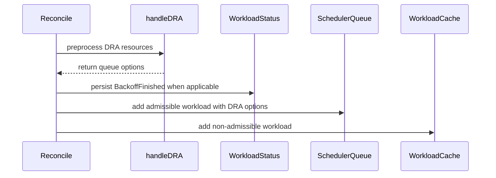

# PR #15961: Replace in-memory condition removal with persisted transitions in DRA Path

**Summary**: Replace in-memory condition removal with persisted transitions in DRA Path

**Sources**: https://github.com/kubernetes-sigs/kueue/pull/15961

**Last updated**: 2026-09-25T23:32:31Z

---

## Metadata

- **State**: closed (merged)
- **Author**: [@PannagaRao](https://github.com/PannagaRao)
- **Branch**: `fix-inmemory-condition-cleanup` → `main`
- **Created**: 2026-09-22T05:36:48Z
- **Updated**: 2026-09-25T23:32:31Z
- **Merged**: 2026-09-25T23:32:29Z
- **Closed**: 2026-09-25T23:32:29Z
- **Labels**: `size/L`, `lgtm`, `release-note-none`, `approved`, `kind/cleanup`, `cncf-cla: yes`
- **Assignees**: [@sohankunkerkar](https://github.com/sohankunkerkar)
- **Requested reviewers**: [@mbobrovskyi](https://github.com/mbobrovskyi), [@PBundyra](https://github.com/PBundyra)
- **Changed files**: 3   **+65 / -55**

## Description

<!-- Thank you for contributing! Check CONTRIBUTING.md for details. -->

#### What type of PR is this?
/kind cleanup

<!-- Choose one of the following kinds:
/kind bug
/kind cleanup
/kind documentation
/kind feature
/kind kep
-->


<!-- Optionally choose one or more of the following kinds:
/kind api-change
/kind deprecation
/kind failing-test
/kind flake
/kind regression
-->


<!-- Consider setting the area:
/area tas
/area was
/area integrations
/area multikueue
/area dashboard
/area localization
/area testing
/area website
-->


#### What this PR does / why we need it?
Removes in-memory-only condition mutations from the DRA workload controller.

<!--
Use `Fixes #123` for an issue addressed by this PR; it will be closed when the PR merges.
Use `Related:` or `Part of:` to reference an issue without closing it.
-->
Fixes # https://github.com/kubernetes-sigs/kueue/issues/15936 and https://github.com/kubernetes-sigs/kueue/issues/14035

#### Useful notes for your reviewer
This PR folds https://github.com/kubernetes-sigs/kueue/pull/14791 into itself. 

#### Release note

<!-- Describe the behavior change accurately from the user's perspective. Hints:
- Do not leave this block blank.
- Use "NONE" when there is no user-facing change.
- When feasible use a prefix for the sub-component or feature, e.g. "FairSharing:" or "MultiKueue:".
- If upgrade steps are required, include an "ACTION REQUIRED:" section.
You may consider AI assistance using the skill: cmd/experimental/skills/kueue-release-notes/SKILL.md.
-->
```release-note
NONE
```


<!-- This is an auto-generated comment: release notes by coderabbit.ai -->

## AI summary

DRA reconciliation now preprocesses workloads before queueing and persists `Requeued` condition transitions. This keeps queue and cache decisions aligned with the workload’s persisted state, including when a workload leaves backoff.

### Suggested release note

DRA: Fixed a bug where workloads with resolved DRA resources could retain stale requeue state and fail to re-enter the scheduler queue. Kueue now persists the requeue transition before queueing the workload.

<!-- end of auto-generated comment: release notes by coderabbit.ai -->

## Discussion

### Comment by [@coderabbitai[bot]](https://github.com/apps/coderabbitai) — 2026-09-22T05:36:54Z

<!-- This is an auto-generated comment: summarize by coderabbit.ai -->
<!-- review_stack_entry_start -->

<a href="https://app.coderabbit.ai/change-stack/kubernetes-sigs/kueue/pull/15961"></a>

Navigate logical layers of code changes, visualize relationships, and explore their blast radius.

<!-- review_stack_entry_end -->
<!-- recent_review_start -->

No actionable comments were generated in the recent review. 🎉

<details>
<summary>ℹ️ Recent review info</summary>

<details>
<summary>⚙️ Run configuration</summary>

**Configuration used**: Repository: kubernetes-sigs/kueue/.coderabbit.yaml

**Review profile**: CHILL

**Plan**: Advanced

**Run ID**: `05c79397-1eee-4e47-9d94-0a88c4795652`

</details>

<details>
<summary>📥 Commits</summary>

Reviewing files that changed from the base of the PR and between 55fecae82361c8f69c300c15374758fc04ac39bb and e8a10a85a4390f2ab02c1b2bab1b2c483d4d3c6c.

</details>

<details>
<summary>📒 Files selected for processing (3)</summary>

* `pkg/controller/core/effective_resources_test.go`
* `pkg/controller/core/workload_controller.go`
* `pkg/controller/core/workload_controller_dra_test.go`

</details>

**Included review availability:** This review used your included allowance. Your plan provides up to 8 included reviews per hour; 7 remain after this review.

</details>

---


<!-- recent_review_end -->
<!-- walkthrough_start -->

<details>
<summary>📝 Walkthrough</summary>

## Walkthrough

DRA preprocessing now returns queue options to `Reconcile` instead of queueing workloads directly. `Reconcile` handles queue and cache updates, including backoff completion conditions. Tests now exercise these paths through reconciliation.

### Changes

**DRA workload reconciliation**

|Layer / File(s)|Summary|
|---|---|
|**DRA preprocessing and queue options** <br> `pkg/controller/core/workload_controller.go`|`handleDRA` preprocesses resources and returns queue options without queueing the workload. `Reconcile` retains those options. The controller updates `Requeued` only when its reason is `Inadmissible`.|
|**Backoff and queue updates** <br> `pkg/controller/core/workload_controller.go`, `pkg/controller/core/workload_controller_dra_test.go`, `pkg/controller/core/effective_resources_test.go`|When DRA-preprocessed workloads leave backoff, `Reconcile` persists `Requeued=True` with reason `BackoffFinished` before queueing. It adds non-admitted workloads to the scheduler queue when admissible and to the cache otherwise. Tests cover these paths and use `Reconcile` for effective-resource cases.|

<!-- change_assessment_start -->
**Priority:** ⬇️ Low

**Estimated code review effort:** 3 (Moderate) | ~20 minutes

<!-- change_assessment_commit:"e8a10a85a4390f2ab02c1b2bab1b2c483d4d3c6c" -->
**Change:** Bug fix
<!-- change_assessment_end -->

### Sequence Diagram(s)



**Suggested reviewers:** `yuluo-yx`

</details>

<!-- walkthrough_end -->
<!-- final_review_risk_start -->
**Merge Risk:** _⚪ Minimal_ · up to `e8a10`
<!-- final_review_risk_coverage:{"sourceCommitId":"e8a10a85a4390f2ab02c1b2bab1b2c483d4d3c6c","coveredCommitId":"e8a10a85a4390f2ab02c1b2bab1b2c483d4d3c6c","kind":"reviewed"} -->

No actionable merge-blocking issue is established. The change is mergeable after normal checks.
<!-- final_review_risk_end -->
<!-- architecture_review_start -->
### Security Architecture Review

**Security architecture risk:** _🔵 Low_ · up to `e8a10`

The scheduling path retains its workload eligibility checks, and no new security bypass was established. Persisting status before updating the in-memory queue creates an interruption window, but workload events provide a recovery path. Runtime recovery coverage remains incomplete.

**Retained concerns**
No architecture-level concerns identified.

<details>
<summary>Security review details</summary>

**Security Blast Radius**
- _inferred_ — The relevant exposure is scheduling of DRA Workloads through the controller, queue manager, and cache; the inspected path does not establish a new authorization, credential, or cross-service privilege boundary.

**Trust Boundaries and Controls**
- _observed_ — The moved queue call still derives workload and local-queue identity from the Workload and remains behind controller and queue-manager eligibility checks.

**Resilience and Maintainability Implications**
- _inferred_ — Persisted status and queue membership have a non-atomic interval. Error retries and event-driven reconciliation mitigate it, while recovery after every possible interruption remains unverified; no resulting security-control bypass was established.

**Hardening Proposals**
- _proposed_ — Validate restart and event-replay recovery specifically after a successful status patch but before queue insertion, including repeated reconciliation of the same DRA Workload.

</details>

<!-- architecture_review_end -->
<!-- pre_merge_checks_walkthrough_start -->

<details>
<summary>🚥 Pre-merge checks | ✅ 4 | ❌ 1</summary>

### ❌ Failed checks (1 warning)

|     Check name     | Status     | Explanation                                                                                                                                                                                | Resolution                                                                         |
| :----------------: | :--------- | :----------------------------------------------------------------------------------------------------------------------------------------------------------------------------------------- | :--------------------------------------------------------------------------------- |
| Docstring Coverage | ⚠️ Warning | Docstring coverage is 50.00% which is insufficient. The required threshold is 80.00%. Docstring coverage is scoped to functions touched by this diff. Analyzed 2 functions across 3 files. | Write docstrings for the functions missing them to satisfy the coverage threshold. |

<details>
<summary>✅ Passed checks (4 passed)</summary>

|         Check name         | Status   | Explanation                                                                                                                                  |
| :------------------------: | :------- | :------------------------------------------------------------------------------------------------------------------------------------------- |
|      Description Check     | ✅ Passed | Check skipped - CodeRabbit’s high-level summary is enabled.                                                                                  |
|         Title check        | ✅ Passed | The title clearly and concisely describes the main change: replacing in-memory condition removal with persisted transitions in the DRA path. |
|     Linked Issues check    | ✅ Passed | Check skipped because no linked issues were found for this pull request.                                                                     |
| Out of Scope Changes check | ✅ Passed | Check skipped because no linked issues were found for this pull request.                                                                     |

</details>

</details>

<!-- pre_merge_checks_walkthrough_end -->

- [ ] <!-- {"checkboxId":"585bb3f6-faf5-4dbf-96d2-74e382adf19a"} --> Fix all pre-merge checks with AI
<!-- finishing_touch_checkbox_start -->

<details>
<summary>✨ Finishing Touches</summary>

<details open>
<summary>🧪 Generate unit tests (beta)</summary>

- [ ] <!-- {"checkboxId": "f47ac10b-58cc-4372-a567-0e02b2c3d479", "radioGroupId": "utg-output-choice-group-unknown_comment_id"} --> Create a new PR

</details>

</details>

<!-- finishing_touch_checkbox_end -->
<!-- tips_start -->

---


<sub>Comment `@coderabbitai help` to get the list of available commands.</sub>

<!-- tips_end -->

### Comment by [@netlify[bot]](https://github.com/apps/netlify) — 2026-09-22T05:36:55Z

### <span aria-hidden="true">✅</span> Deploy Preview for *kubernetes-sigs-kueue* canceled.


|  Name | Link |
|:-:|------------------------|
|<span aria-hidden="true">🔨</span> Latest commit | e8a10a85a4390f2ab02c1b2bab1b2c483d4d3c6c |
|<span aria-hidden="true">🔍</span> Latest deploy log | https://app.netlify.com/projects/kubernetes-sigs-kueue/deploys/6ab6edc052316d0008ead37f |

### Comment by [@sohankunkerkar](https://github.com/sohankunkerkar) — 2026-09-24T19:18:30Z

one nit but overall LGTM
Worth closing #14791

### Comment by [@PannagaRao](https://github.com/PannagaRao) — 2026-09-25T21:57:04Z

@mimowo This PR addresses the in-memory condition cleanup you requested as follow-up in #15888. Could you take a look when you get a chance? Thanks!

### Comment by [@mimowo](https://github.com/mimowo) — 2026-09-25T22:10:04Z

i can, but Im also happy to leave it to @sohankunkerkar

### Comment by [@kubernetes-prow[bot]](https://github.com/apps/kubernetes-prow) — 2026-09-25T23:31:06Z

LGTM label has been added.  <details>Git tree hash: 78f1d0e7e6b5940d65c38d1c1359bf71f2b7f39c</details>

### Comment by [@kubernetes-prow[bot]](https://github.com/apps/kubernetes-prow) — 2026-09-25T23:31:10Z

[APPROVALNOTIFIER] This PR is **APPROVED**

This pull-request has been approved by: *<a href="https://github.com/kubernetes-sigs/kueue/pull/15961#" title="Author self-approved">PannagaRao</a>*, *<a href="https://github.com/kubernetes-sigs/kueue/pull/15961#pullrequestreview-5323559791" title="LGTM">sohankunkerkar</a>*

The full list of commands accepted by this bot can be found [here](https://go.k8s.io/bot-commands?repo=kubernetes-sigs%2Fkueue).

The pull request process is described [here](https://git.k8s.io/community/contributors/guide/owners.md#the-code-review-process)

<details >
Needs approval from an approver in each of these files:

- ~~[OWNERS](https://github.com/kubernetes-sigs/kueue/blob/main/OWNERS)~~ [sohankunkerkar]

Approvers can indicate their approval by writing `/approve` in a comment
Approvers can cancel approval by writing `/approve cancel` in a comment
</details>
<!-- META={"approvers":[]} -->

## Reviews

### Review by [@sohankunkerkar](https://github.com/sohankunkerkar) (commented) — 2026-09-24T19:08:48Z

- **pkg/controller/core/workload_controller.go:807** by [@sohankunkerkar](https://github.com/sohankunkerkar) — 2026-09-24T19:08:48Z
```diff
@@ -808,6 +803,20 @@ func (r *WorkloadReconciler) Reconcile(ctx context.Context, req ctrl.Request) (r
 		}
 	}
 
+	// Queue the DRA-preprocessed workload with the options from handleDRA. The
+	// backoff-requeue path above already queues and returns early, so only one of
```

  nit: I suspect this comment isn't right. The backoff path has an `!IsAdmissible` branch that returns without queuing, so there is a case where neither call site runs. I'd reword it, or move the queueing so the invariant holds by construction rather than by comment.

### Review by [@PannagaRao](https://github.com/PannagaRao) (commented) — 2026-09-25T21:56:33Z

- **pkg/controller/core/workload_controller.go:807** by [@PannagaRao](https://github.com/PannagaRao) — 2026-09-25T21:56:33Z
```diff
@@ -808,6 +803,20 @@ func (r *WorkloadReconciler) Reconcile(ctx context.Context, req ctrl.Request) (r
 		}
 	}
 
+	// Queue the DRA-preprocessed workload with the options from handleDRA. The
+	// backoff-requeue path above already queues and returns early, so only one of
```

  I have re-worded the comment. PTAL!

### Review by [@sohankunkerkar](https://github.com/sohankunkerkar) (commented) — 2026-09-25T23:30:57Z

/approve
/lgtm
