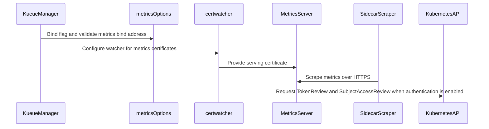

# PR #16035: Allow optional metrics authentication for loopback HTTPS scraping

**Summary**: Allow optional metrics authentication for loopback HTTPS scraping

**Sources**: https://github.com/kubernetes-sigs/kueue/pull/16035

**Last updated**: 2026-09-23T07:08:22Z

---

## Metadata

- **State**: open
- **Author**: [@ankushbbbr](https://github.com/ankushbbbr)
- **Branch**: `metrics-authentication-v0.19.5` → `main`
- **Created**: 2026-09-23T05:00:48Z
- **Updated**: 2026-09-23T07:08:22Z
- **Merged**: —
- **Closed**: —
- **Labels**: `kind/feature`, `release-note`, `size/XL`, `ok-to-test`, `cncf-cla: yes`
- **Assignees**: _none_
- **Requested reviewers**: [@pajakd](https://github.com/pajakd), [@olekzabl](https://github.com/olekzabl), [@sohankunkerkar](https://github.com/sohankunkerkar), [@tenzen-y](https://github.com/tenzen-y)
- **Changed files**: 5   **+576 / -18**

## Description

#### What type of PR is this?

/kind feature

#### What this PR does / why we need it?

Kueue currently requires TokenReview/SubjectAccessReview-based authentication and authorization for metrics. A trusted sidecar scraper may not have a bearer token, even when the controller authenticates to Kubernetes using client certificates.

Add `--metrics-authentication`, defaulting to `true`. Setting it to `false` removes the metrics authentication/authorization filter while retaining HTTPS. The opt-out requires `metrics.bindAddress` to contain an explicit IPv4 or IPv6 loopback IP and numeric port; unsafe or malformed addresses fail at startup. The existing `"0"` disable sentinel is preserved.

For example:

```sh
/manager --config=/etc/kueue/config/controller_manager_config.yaml \
  --metrics-authentication=false
```

```yaml
metrics:
  bindAddress: "127.0.0.1:8443"
```

Fixes #16029

#### Useful notes for your reviewer

- Targets `main` first. The implementation was originally verified on exact v0.19.5 and has been rebased onto upstream `main` (`bab477d742ec58427ce10e1888839a5bcdc100fc`). A release-0.19 cherry-pick should follow after the mainline PR merges.
- HTTPS remains enabled in both modes. Existing metrics certificate loading/rotation, `internalCertManagement.enable: false`, webhook behavior, authenticated Helm defaults and upstream RBAC manifests are preserved. Build/run targets now compile the manager package to include the new helper file.
- Loopback is a pod-level boundary: all containers in the pod can access this endpoint. Host-networked pods share the node network namespace. Scrapers must trust the serving CA and verify a certificate-matching TLS server name. A DNS-only serving certificate does not automatically validate against a loopback IP. Scraper TLS wiring and downstream removal of unused metrics-auth RBAC remain separate deployment changes.
- Passed on current `main` with Go 1.27.0: `go test -race -timeout 420s ./cmd/kueue ./pkg/config ./pkg/util/cert ./pkg/util/tlsconfig ./apis/config/v1beta1 ./apis/config/v1beta2`. Tests run real IPv4/IPv6 HTTPS servers and recording review API servers, cover authenticated/unauthenticated requests, prove zero review calls when disabled, reject unsafe startup configurations, and verify TLS trust/name checks and certificate rotation.
- Passed on current `main`: full `make ci-lint` using the pinned v2.13.2 linter through `go run`, `make fmt-verify`, and `git diff --check`. The original v0.19.5 implementation also passed these checks and `make build` compilation.
- Full `make verify` was rerun on `main` with a 420-second timeout and reported an unavailable Docker daemon and signal-9 termination of the compatibility-lifecycle generator; full verification remains incomplete. On the original v0.19.5 base, `make lint-api` also failed before analysis because the host killed the custom-linter build tool. No Kubernetes/cert-manager end-to-end suite was run. All test/check commands used 420-second outer timeouts.
- AI disclosure: This change and PR description were prepared with assistance from OpenAI Codex.

#### Release note

```release-note
Observability: Added `--metrics-authentication=false` for trusted sidecar scrapers to access metrics over HTTPS without bearer-token authentication. The opt-out requires an explicit loopback IP and port; authentication remains enabled by default.
```


<!-- This is an auto-generated comment: release notes by coderabbit.ai -->

## AI summary

Added `--metrics-authentication`, which defaults to `true` and preserves authenticated metrics access. When set to `false`, Kueue serves metrics over HTTPS without authentication or authorization only when `metrics.bindAddress` is an explicit loopback IP and port. The existing `"0"` value still disables metrics. Documentation explains the pod-level loopback boundary and the TLS trust and server-name requirements for sidecar scrapers.

### Suggested release note

Observability: Added `--metrics-authentication=false` to allow unauthenticated HTTPS metrics scraping from loopback addresses. Kueue rejects other addresses in this mode and keeps authentication enabled by default.

<!-- end of auto-generated comment: release notes by coderabbit.ai -->

## Discussion

### Comment by [@netlify[bot]](https://github.com/apps/netlify) — 2026-09-23T05:00:55Z

### <span aria-hidden="true">✅</span> Deploy Preview for *kubernetes-sigs-kueue* ready!


|  Name | Link |
|:-:|------------------------|
|<span aria-hidden="true">🔨</span> Latest commit | 1482002aefeec399c68bebeff61480287263e05f |
|<span aria-hidden="true">🔍</span> Latest deploy log | https://app.netlify.com/projects/kubernetes-sigs-kueue/deploys/6ab365a59b53ce0008f5d971 |
|<span aria-hidden="true">😎</span> Deploy Preview | [https://deploy-preview-16035--kubernetes-sigs-kueue.netlify.app](https://deploy-preview-16035--kubernetes-sigs-kueue.netlify.app) |
|<span aria-hidden="true">📱</span> Preview on mobile | <details><summary> Toggle QR Code... </summary><br /><br /><br /><br />_Use your smartphone camera to open QR code link._</details> |
---
<!-- [kubernetes-sigs-kueue Preview](https://deploy-preview-16035--kubernetes-sigs-kueue.netlify.app) -->
_To edit notification comments on pull requests, go to your [Netlify project configuration](https://app.netlify.com/projects/kubernetes-sigs-kueue/configuration/notifications#deploy-notifications)._

### Comment by [@coderabbitai[bot]](https://github.com/apps/coderabbitai) — 2026-09-23T05:00:56Z

<!-- This is an auto-generated comment: summarize by coderabbit.ai -->
<!-- review_stack_entry_start -->

<a href="https://app.coderabbit.ai/change-stack/kubernetes-sigs/kueue/pull/16035"></a>

Navigate logical layers of code changes, visualize relationships, and explore their blast radius.

<!-- review_stack_entry_end -->
<!-- recent_review_start -->

No actionable comments were generated in the recent review. 🎉

<details>
<summary>ℹ️ Recent review info</summary>

<details>
<summary>⚙️ Run configuration</summary>

**Configuration used**: Repository: kubernetes-sigs/kueue/.coderabbit.yaml

**Review profile**: CHILL

**Plan**: Advanced

**Run ID**: `cc43e03a-c80d-42cc-821f-5d90ba43f96e`

</details>

<details>
<summary>📥 Commits</summary>

Reviewing files that changed from the base of the PR and between bab477d742ec58427ce10e1888839a5bcdc100fc and 1482002aefeec399c68bebeff61480287263e05f.

</details>

<details>
<summary>📒 Files selected for processing (5)</summary>

* `Makefile`
* `cmd/kueue/main.go`
* `cmd/kueue/metrics.go`
* `cmd/kueue/metrics_test.go`
* `site/content/en/docs/tasks/manage/observability/setup_prometheus.md`

</details>

**Included review availability:** Your plan provides up to 8 included reviews per hour; 7 remain after this review.

</details>

---


<!-- recent_review_end -->
<!-- walkthrough_start -->

<details>
<summary>📝 Walkthrough</summary>

## Walkthrough

The manager adds a flag to disable metrics authentication for loopback HTTPS scraping. It validates the bind address, retains secure serving and certificate watching, and documents sidecar configuration and TLS requirements.

### Changes

**Metrics authentication and loopback scraping**

|Layer / File(s)|Summary|
|---|---|
|**Metrics options and bind-address validation** <br> `cmd/kueue/metrics.go`|Adds `--metrics-authentication`, enabled by default. When disabled, metrics use no authentication filter, and the bind address must be a loopback IP with a numeric port unless it is `"0"`. HTTPS remains enabled.|
|**Manager wiring and certificate setup** <br> `cmd/kueue/main.go`, `cmd/kueue/metrics.go`, `Makefile`|The manager binds the new flag and obtains metrics server options through `metricsOptions`. Certificate watcher setup moves to a helper. The Makefile build and run targets use the `./cmd/kueue` package path.|
|**Metrics behavior tests and scraping guidance** <br> `cmd/kueue/metrics_test.go`, `site/content/en/docs/tasks/manage/observability/setup_prometheus.md`|Tests cover address validation, startup rejection, authentication behavior, TLS, certificate rotation, and certificate loading errors. Documentation describes sidecar scraping over loopback and the TLS requirements.|

<!-- change_assessment_start -->
**Priority:** ➖ Normal

**Estimated code review effort:** 3 (Moderate) | ~25 minutes

<!-- change_assessment_commit:"1482002aefeec399c68bebeff61480287263e05f" -->
**Change:** Feature · **Severity of issue fixed:** Medium
<!-- change_assessment_end -->

### Sequence Diagram(s)



</details>

<!-- walkthrough_end -->
<!-- final_review_risk_start -->
**Merge Risk:** _⚪ Minimal_ · up to `14820`
<!-- final_review_risk_coverage:{"sourceCommitId":"1482002aefeec399c68bebeff61480287263e05f","coveredCommitId":"1482002aefeec399c68bebeff61480287263e05f","kind":"reviewed"} -->

The change adds an opt-out, `--metrics-authentication=false`, for trusted in-pod scrapers. Authentication remains on by default. With the opt-out, startup fails unless the metrics endpoint is bound to an explicit loopback address and port. HTTPS and certificate rotation work as before. No concrete defect was found, and the change appears ready to merge once the author's remaining test runs pass.
<!-- final_review_risk_end -->
<!-- pre_merge_checks_walkthrough_start -->

<details>
<summary>🚥 Pre-merge checks | ✅ 4 | ❌ 1</summary>

### ❌ Failed checks (1 warning)

|     Check name     | Status     | Explanation                                                                                                                                                                                               | Resolution                                                                         |
| :----------------: | :--------- | :-------------------------------------------------------------------------------------------------------------------------------------------------------------------------------------------------------- | :--------------------------------------------------------------------------------- |
| Docstring Coverage | ⚠️ Warning | Docstring coverage is 7.14% which is insufficient. The required threshold is 80.00%. Docstring coverage is scoped to functions touched by this diff. Analyzed 14 functions across 3 files. (2 skipped: 2… | Write docstrings for the functions missing them to satisfy the coverage threshold. |

<details>
<summary>✅ Passed checks (4 passed)</summary>

|         Check name         | Status   | Explanation                                                                                                                                                                                               |
| :------------------------: | :------- | :-------------------------------------------------------------------------------------------------------------------------------------------------------------------------------------------------------- |
|      Description Check     | ✅ Passed | Check skipped - CodeRabbit’s high-level summary is enabled.                                                                                                                                               |
|         Title check        | ✅ Passed | The title clearly and concisely describes the main change: enabling optional metrics authentication for loopback HTTPS scraping.                                                                          |
|     Linked Issues check    | ✅ Passed | PR `#16035` satisfies the coding requirements in directly linked issue `#16029`. `--metrics-authentication` defaults to `true`, preserves `filters.WithAuthenticationAndAuthorization` when enabled, and omi… |
| Out of Scope Changes check | ✅ Passed | The changes remain within issue `#16029`. The Makefile and `main.go` changes support moving metrics option and certificate-watcher setup into package code. The new tests verify the requested behavior. T… |

</details>

<details>
<summary>Full details: Docstring Coverage</summary>

**Explanation**

Docstring coverage is 7.14% which is insufficient. The required threshold is 80.00%. Docstring coverage is scoped to functions touched by this diff. Analyzed 14 functions across 3 files. (2 skipped: 2 unsupported.)

</details>

</details>

<!-- pre_merge_checks_walkthrough_end -->

- [ ] <!-- {"checkboxId":"585bb3f6-faf5-4dbf-96d2-74e382adf19a"} --> Fix all pre-merge checks with AI
<!-- finishing_touch_checkbox_start -->

<details>
<summary>✨ Finishing Touches</summary>

<details open>
<summary>🧪 Generate unit tests (beta)</summary>

- [ ] <!-- {"checkboxId": "f47ac10b-58cc-4372-a567-0e02b2c3d479", "radioGroupId": "utg-output-choice-group-unknown_comment_id"} --> Create a new PR

</details>

</details>

<!-- finishing_touch_checkbox_end -->
<!-- tips_start -->

---


<sub>Comment `@coderabbitai help` to get the list of available commands.</sub>

<!-- tips_end -->

### Comment by [@kubernetes-prow[bot]](https://github.com/apps/kubernetes-prow) — 2026-09-23T05:00:58Z

Welcome @ankushbbbr! <br><br>It looks like this is your first PR to <a href='https://github.com/kubernetes-sigs/kueue'>kubernetes-sigs/kueue</a> 🎉. Please refer to our [pull request process documentation](https://www.kubernetes.dev/docs/guide/pull-requests/) to help your PR have a smooth ride to approval. <br><br>You will be prompted by a bot to use commands during the review process. Do not be afraid to follow the prompts! It is okay to experiment. [Here is the bot commands documentation](https://go.k8s.io/bot-commands). <br><br>You can also check if kubernetes-sigs/kueue has [its own contribution guidelines](https://github.com/kubernetes-sigs/kueue/tree/master/CONTRIBUTING.md). <br><br>You may want to refer to our [testing guide](https://git.k8s.io/community/contributors/devel/sig-testing/testing.md) if you run into trouble with your tests not passing. <br><br>If you are having difficulty getting your pull request seen, please follow the [recommended escalation practices](https://www.kubernetes.dev/docs/guide/pull-requests/#why-is-my-pull-request-not-getting-reviewed). Also, for tips and tricks in the contribution process you may want to read the [Kubernetes contributor cheat sheet](https://www.kubernetes.dev/docs/contributor-cheatsheet/). We want to make sure your contribution gets all the attention it needs! <br><br>Thank you, and welcome to Kubernetes. :smiley:

### Comment by [@linux-foundation-easycla[bot]](https://github.com/apps/linux-foundation-easycla) — 2026-09-23T05:00:59Z

<a href="https://easycla.lfx.linuxfoundation.org/#/?version=2"></a><br >The committers listed above are authorized under a signed CLA.<ul><li>:white_check_mark: login: ababbar-stripe / name: Ankush Babbar (1482002aefeec399c68bebeff61480287263e05f)</li></ul>

### Comment by [@kubernetes-prow[bot]](https://github.com/apps/kubernetes-prow) — 2026-09-23T05:01:00Z

Hi @ankushbbbr. Thanks for your PR.

I'm waiting for a [kubernetes-sigs](https://github.com/orgs/kubernetes-sigs/people) member to verify that this patch is reasonable to test. If it is, they should reply with `/ok-to-test` on its own line. Until that is done, I will not automatically test new commits in this PR, but the usual testing commands by org members will still work.

Regular contributors should [join the org](https://git.k8s.io/community/community-membership.md#member) to skip this step.

Once the patch is verified, the new status will be reflected by the `ok-to-test` label.

I understand the commands that are listed [here](https://go.k8s.io/bot-commands?repo=kubernetes-sigs%2Fkueue).

<details>

Instructions for interacting with me using PR comments are available [here](https://git.k8s.io/community/contributors/guide/pull-requests.md).  If you have questions or suggestions related to my behavior, please file an issue against the [kubernetes-sigs/prow](https://github.com/kubernetes-sigs/prow/issues/new?title=Prow%20issue:) repository.
</details>

### Comment by [@kubernetes-prow[bot]](https://github.com/apps/kubernetes-prow) — 2026-09-23T05:01:05Z

[APPROVALNOTIFIER] This PR is **NOT APPROVED**

This pull-request has been approved by: *<a href="https://github.com/kubernetes-sigs/kueue/pull/16035#" title="Author self-approved">ankushbbbr</a>*
**Once this PR has been reviewed and has the lgtm label**, please assign [olekzabl](https://github.com/olekzabl), [pbundyra](https://github.com/pbundyra), [tenzen-y](https://github.com/tenzen-y) for approval. For more information see [the Code Review Process](https://git.k8s.io/community/contributors/guide/owners.md#the-code-review-process).

The full list of commands accepted by this bot can be found [here](https://go.k8s.io/bot-commands?repo=kubernetes-sigs%2Fkueue).

<details open>
Needs approval from an approver in each of these files:

- **[OWNERS](https://github.com/kubernetes-sigs/kueue/blob/release-0.19/OWNERS)**

Approvers can indicate their approval by writing `/approve` in a comment
Approvers can cancel approval by writing `/approve cancel` in a comment
</details>
<!-- META={"approvers":["olekzabl","pbundyra","tenzen-y"]} -->

### Comment by [@mimowo](https://github.com/mimowo) — 2026-09-23T05:22:15Z

/ok-to-test
please open the PR against main. the provess is to merge to main first then cherrypick
