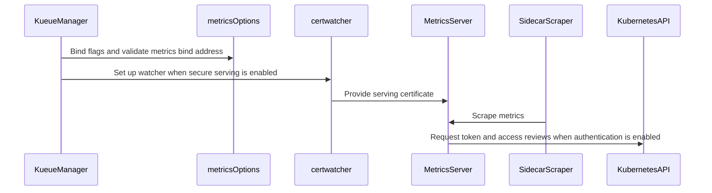

# PR #16035: Allow optional metrics authentication and HTTP for loopback scrapers

**Summary**: Allow optional metrics authentication and HTTP for loopback scrapers

**Sources**: https://github.com/kubernetes-sigs/kueue/pull/16035

**Last updated**: 2026-10-08T17:28:59Z

---

## Metadata

- **State**: open
- **Author**: [@ankushbbbr](https://github.com/ankushbbbr)
- **Branch**: `metrics-authentication-v0.19.5` → `main`
- **Created**: 2026-09-23T05:00:48Z
- **Updated**: 2026-10-08T17:28:59Z
- **Merged**: —
- **Closed**: —
- **Labels**: `kind/feature`, `release-note`, `size/XL`, `ok-to-test`, `do-not-merge/work-in-progress`, `cncf-cla: yes`
- **Assignees**: _none_
- **Requested reviewers**: [@pajakd](https://github.com/pajakd), [@olekzabl](https://github.com/olekzabl), [@sohankunkerkar](https://github.com/sohankunkerkar), [@tenzen-y](https://github.com/tenzen-y)
- **Changed files**: 5   **+689 / -22**

## Description

#### What type of PR is this?

/kind feature

#### What this PR does / why we need it?

Kueue requires TokenReview/SubjectAccessReview-based authentication and authorization for metrics. A trusted sidecar scraper may not have a bearer token, even when the controller authenticates to Kubernetes using client certificates. Some pod-local scrapers also need an explicit HTTP option without serving certificates.

Add `--metrics-authentication` and `--metrics-secure`, both defaulting to `true`:

| Secure | Authentication | Behavior |
| --- | --- | --- |
| `true` | `true` | Existing authenticated HTTPS |
| `true` | `false` | Unauthenticated, loopback-only HTTPS |
| `false` | `false` | Unauthenticated, loopback-only HTTP |
| `false` | `true` | Startup error when metrics are enabled |

Disabling authentication requires `metrics.bindAddress` to contain an explicit IPv4 or IPv6 loopback IP and numeric port. Wildcards, hostnames, non-loopback IPs, and malformed addresses fail at startup. The existing `"0"` disable sentinel works with all flag combinations.

For HTTP scraping:

```sh
/manager --config=/etc/kueue/config/controller_manager_config.yaml \
  --metrics-authentication=false \
  --metrics-secure=false
```

```yaml
metrics:
  bindAddress: "127.0.0.1:8443"
```

Scrape `http://127.0.0.1:8443/metrics`. Omit `--metrics-secure=false` to retain HTTPS.

Fixes #16029

#### Useful notes for your reviewer

- Targets `main` first; a release-0.19 cherry-pick follows after mainline merge. The original authentication change was based on exact v0.19.5, then rebased onto `main`. This HTTP extension is tested on the PR's main-based branch.
- HTTP skips metrics certificate loading and watching, including with `internalCertManagement.enable: false`. HTTPS retains `/etc/kueue/metrics/certs/tls.crt` and `tls.key` loading and rotation. Webhook TLS/certificates, authenticated HTTPS Helm/ServiceMonitor defaults, and upstream RBAC manifests are unchanged. Build/run targets compile the manager package to include the new helper file.
- Loopback is a pod-level boundary: all containers in the pod can reach this endpoint. Host-networked pods share the node network namespace. HTTP is unencrypted and intended only for trusted processes sharing that namespace. External ServiceMonitors cannot reach a pod's loopback listener through its Service or pod IP.
- For HTTPS, scrapers must trust the serving CA and verify a matching TLS server name. A service-registry-only DNS certificate does not automatically validate against `127.0.0.1`. Scraper scheme/TLS configuration and downstream removal of unused metrics-auth RBAC are separate deployment changes.
- Passed with Go 1.27.0: `go test -race -timeout 420s ./cmd/kueue ./pkg/config ./pkg/util/cert ./pkg/util/tlsconfig ./apis/config/v1beta1 ./apis/config/v1beta2`. Tests use real IPv4/IPv6 HTTP and HTTPS servers, validate authenticated defaults and startup rejections, prove zero review API calls with authentication disabled, exercise HTTP without certificate files, and preserve TLS CA/hostname rejection and certificate rotation/loading checks.
- Passed: full `make ci-lint` using the pinned v2.13.2 linter via `go run`, `make fmt-verify`, manager build, and `git diff --check`.
- Full `make verify` is incomplete: the compatibility-lifecycle generator was terminated with signal 9 (exit 137); the remaining `make` processes stalled with no child jobs and were stopped after that failure. A separate `make lint-api` attempt was also terminated with signal 9 while launching the custom linter, before API analysis. These are local tooling failures; no full-verification pass is claimed.
- No full-controller kind/cert-manager end-to-end suite was run. Checks use 420-second outer timeouts.
- AI disclosure: This change and PR description were prepared with assistance from OpenAI Codex.

#### Release note

```release-note
Observability: Added `--metrics-authentication=false` for unauthenticated loopback metrics scraping and `--metrics-secure=false` for optional HTTP when authentication is disabled. Both flags default to true, preserving authenticated HTTPS. Unauthenticated serving requires an explicit loopback IP and port.
```


<!-- This is an auto-generated comment: release notes by coderabbit.ai -->

## AI summary

Added `--metrics-authentication`, which defaults to `true`. When set to `false`, Kueue allows unauthenticated HTTPS metrics scraping only from an explicit IPv4 or IPv6 loopback address and port. The `"0"` bind address still disables metrics. Documentation explains the pod-level loopback boundary and TLS trust and server-name requirements for sidecar scrapers.

### Suggested release note

Observability: Added `--metrics-authentication=false` to allow trusted pod-local scrapers to collect metrics over HTTPS without bearer-token authentication. Kueue requires a loopback IP and port in this mode; authentication remains enabled by default.

<!-- end of auto-generated comment: release notes by coderabbit.ai -->

## Discussion

### Comment by [@netlify[bot]](https://github.com/apps/netlify) — 2026-09-23T05:00:55Z

### <span aria-hidden="true">✅</span> Deploy Preview for *kubernetes-sigs-kueue* canceled.


|  Name | Link |
|:-:|------------------------|
|<span aria-hidden="true">🔨</span> Latest commit | 3a138ab749121e6506b6450de10dc29e9608c9a8 |
|<span aria-hidden="true">🔍</span> Latest deploy log | https://app.netlify.com/projects/kubernetes-sigs-kueue/deploys/6abf4b849252070008882645 |

### Comment by [@coderabbitai[bot]](https://github.com/apps/coderabbitai) — 2026-09-23T05:00:56Z

<!-- This is an auto-generated comment: summarize by coderabbit.ai -->
<!-- review_stack_entry_start -->

<a href="https://app.coderabbit.ai/change-stack/kubernetes-sigs/kueue/pull/16035?cs_source=review_comment"></a>

<!-- review_stack_entry_end -->
<!-- This is an auto-generated comment: skip review by coderabbit.ai -->

> [!IMPORTANT]
> ## Review skipped
> 
> Auto reviews are limited based on label configuration.
> 
> <details>
> <summary>:no_entry_sign: Review skipped — only excluded labels are configured. (3)</summary>
> 
> * needs-ok-to-test
> * do-not-merge/work-in-progress
> * cncf-cla: no
> 
> </details>
> 
> Please check the settings in the CodeRabbit UI or the `.coderabbit.yaml` file in this repository. To trigger a single review, invoke the `@coderabbitai review` command.
> 
> <details>
> <summary>⚙️ Run configuration</summary>
> 
> - **Configuration used**: Repository: kubernetes-sigs/kueue/.coderabbit.yaml
> - **Review profile**: CHILL
> - **Plan**: Advanced
> - **Run ID**: `f8bb74a4-5427-4b17-ba48-d79a3f56e636`
> 
> </details>
> 
> You can disable this status message by setting the `reviews.review_status` to `false` in the CodeRabbit configuration file.
> 
> Use the checkbox below for a quick retry:
> - [ ] <!-- {"checkboxId":"e9bb8d72-00e8-4f67-9cb2-caf3b22574fe"} --> 🔍 Trigger review

<!-- end of auto-generated comment: skip review by coderabbit.ai -->

<!-- recent_review_start -->

No actionable comments were generated in the recent review. 🎉

<details>
<summary>ℹ️ Recent review info</summary>

<details>
<summary>⚙️ Run configuration</summary>

**Configuration used**: Repository: kubernetes-sigs/kueue/.coderabbit.yaml

**Review profile**: CHILL

**Plan**: Advanced

**Run ID**: `da10dd41-03d7-4584-85d0-7c19c4b0df31`

</details>

<details>
<summary>📥 Commits</summary>

Reviewing files that changed from the base of the PR and between 1482002aefeec399c68bebeff61480287263e05f and 3a138ab749121e6506b6450de10dc29e9608c9a8.

</details>

<details>
<summary>📒 Files selected for processing (4)</summary>

* `cmd/kueue/main.go`
* `cmd/kueue/metrics.go`
* `cmd/kueue/metrics_test.go`
* `site/content/en/docs/tasks/manage/observability/setup_prometheus.md`

</details>

**Included review availability:** This review used your included allowance. Your plan provides up to 8 included reviews per hour; 7 remain after this review.

</details>

---


<!-- recent_review_end -->
<!-- walkthrough_start -->

<details>
<summary>📝 Walkthrough</summary>

## Walkthrough

The manager adds configurable metrics authentication and secure serving. When authentication is disabled, active metrics must bind to a loopback IP and explicit port. Tests and documentation cover serving behavior, certificate handling, and sidecar configuration.

### Changes

**Metrics authentication and loopback scraping**

|Layer / File(s)|Summary|
|:---|:---|
|**Metrics options and bind-address validation** <br> `cmd/kueue/metrics.go`|Adds authentication and secure-serving flags, both enabled by default. Authentication controls the server filter and whether HTTP is allowed. When authentication is disabled, active metrics require a loopback IP and explicit port.|
|**Manager wiring and certificate setup** <br> `cmd/kueue/main.go`, `cmd/kueue/metrics.go`, `Makefile`|The manager binds metrics flags, obtains server options, and delegates certificate-watcher setup. The Makefile build and run targets use `./cmd/kueue`.|
|**Serving tests and scraping guidance** <br> `cmd/kueue/metrics_test.go`, `site/content/en/docs/tasks/manage/observability/setup_prometheus.md`|Tests cover option parsing, bind-address validation, startup rejection, HTTP and HTTPS serving, and certificate handling. Documentation describes sidecar scraping, loopback boundaries, TLS settings, and deployment configuration.|

<!-- change_assessment_start -->
**Priority:** ➖ Normal


**Estimated code review effort:** 3 (Moderate) | ~25 minutes

<!-- change_assessment_commit:"3a138ab749121e6506b6450de10dc29e9608c9a8" -->
**Change:** Feature · **Severity of issue fixed:** Medium
<!-- change_assessment_end -->

### Sequence Diagram(s)



</details>

<!-- walkthrough_end -->
<!-- final_review_risk_start -->
**Merge Risk:** _⚪ Minimal_ · up to `3a138`
<!-- final_review_risk_coverage:{"sourceCommitId":"3a138ab749121e6506b6450de10dc29e9608c9a8","coveredCommitId":"3a138ab749121e6506b6450de10dc29e9608c9a8","kind":"reviewed"} -->

No actionable merge-blocking issue remains. The change preserves authenticated HTTPS defaults while allowing explicitly configured loopback scraping; merge after normal checks pass.
<!-- final_review_risk_end -->
<!-- architecture_review_start -->
### Security Architecture Review

**Security architecture risk:** _🔵 Low_ · up to `3a138`

Authenticated HTTPS remains the default, and unsafe unauthenticated bind addresses fail startup. The deliberate opt-out nevertheless grants metrics access to every process sharing the network namespace, not just the intended scraper; host networking extends that scope to node-local processes. Deployment-specific exposure and certificate failure recovery are not fully verified.

**Retained concerns**
- **Low · security · observed:** Disabling authentication deliberately replaces scraper identity and authorization checks with trust in the entire network namespace. Every colocated container can read metrics without a token; if host networking is used, node-local and other host-networked processes also gain access. This is a conditional exposure introduced by the opt-out, not evidence that host networking is deployed or that defaults are insecure.

<details>
<summary>Security review details</summary>

**Security Blast Radius**
- _inferred_ — After an operator enables the opt-out, a compromised colocated container can retrieve the manager's exported metrics without Kubernetes authorization. With host networking, the same access extends to processes sharing node loopback. The evidenced outcome is metrics disclosure, not acquisition of controller credentials or Kubernetes administrative authority.

**Security Findings and Attack Paths**
- _observed_ — The unauthenticated mode intentionally accepts metrics requests regardless of bearer-token identity and omits review-API calls. Plain HTTP is a separate explicit opt-out of transport protection, not an automatic consequence of disabling authentication. Test definitions exercise both contracts; they were not run during this review.

**Trust Boundaries and Controls**
- _observed_ — The principal compensating control is startup-enforced explicit loopback binding. Empty, wildcard, hostname, malformed and non-loopback addresses are rejected before serving. Active authenticated HTTP is also rejected, and the disabled-server sentinel does not construct a metrics server.

**Resilience and Maintainability Implications**
- _observed_ — Secure serving continues to use a certificate-watcher provider that preserves other TLS options. Initial certificate setup errors terminate startup rather than downgrading transport. Internal bootstrap and rotation remain separate and unchanged; their webhook certificate directory does not itself establish the dependency-owned metrics certificate source.


</details>

<!-- architecture_review_end -->
<!-- pre_merge_checks_walkthrough_start -->

<details>
<summary>🚥 Pre-merge checks | ✅ 2 | ❌ 3</summary>

### ❌ Failed checks (3 warnings)

|         Check name         | Status     | Explanation                                                                                                                                                                                               | Resolution                                                                                                                                                                                                                                        |
| :------------------------ | :--------- | :-------------------------------------------------------------------------------------------------------------------------------------------------------------------------------------------------------- | :------------------------------------------------------------------------------------------------------------------------------------------------------------------------------------------------------------------------------------------------ |
|     Linked Issues check    | ⚠️ Warning | The PR implements the main requirements in [`#16029`]. `--metrics-authentication` defaults to `true`, authenticated mode keeps `filters.WithAuthenticationAndAuthorization`, unauthenticated mode requires… | Remove the `--metrics-secure=false` HTTP mode from the implementation, tests, and documentation. Keep metrics HTTPS when metrics are enabled, including when `--metrics-authentication=false`. Retain the `"0"` disabled-metrics sentinel.        |
| Out of Scope Changes check | ⚠️ Warning | The unauthenticated HTTP mode is unrelated to the directly linked objective in [`#16029`]. `cmd/kueue/metrics.go` adds the `--metrics-secure` opt-out, `cmd/kueue/metrics_test.go` tests HTTP serving, and… | Remove the HTTP opt-out implementation and its associated tests and documentation. Limit the change to unauthenticated HTTPS on validated loopback addresses, while preserving authenticated HTTPS defaults and the `"0"` metrics-disable behavi… |
|     Docstring Coverage     | ⚠️ Warning | Docstring coverage is 6.67% which is insufficient. The required threshold is 80.00%. Docstring coverage is scoped to functions touched by this diff. Analyzed 15 functions across 3 files. (1 skipped: 1… | Write docstrings for the functions missing them to satisfy the coverage threshold.                                                                                                                                                                |

<details>
<summary>✅ Passed checks (2 passed)</summary>

|     Check name    | Status   | Explanation                                                                                                              |
| :--------------- | :------- | :----------------------------------------------------------------------------------------------------------------------- |
| Description Check | ✅ Passed | Check skipped - CodeRabbit’s high-level summary is enabled.                                                              |
|    Title check    | ✅ Passed | The title clearly summarizes the primary change: optional metrics authentication and HTTP support for loopback scrapers. |

</details>

<details>
<summary>Full details: Linked Issues check</summary>

**Explanation**

The PR implements the main requirements in [`#16029`]. `--metrics-authentication` defaults to `true`, authenticated mode keeps `filters.WithAuthenticationAndAuthorization`, unauthenticated mode requires an explicit loopback IP and numeric port, and `"0"` still disables metrics. Tests cover IPv4, IPv6, startup rejection, review API calls, TLS verification, certificate loading, and rotation. The PR does not preserve TLS in all enabled metrics modes. It adds `--metrics-secure=false` and serves unauthenticated metrics over HTTP, which conflicts with [`#16029`]'s requirement to keep TLS enabled in both modes.

</details>

<details>
<summary>Full details: Out of Scope Changes check</summary>

**Explanation**

The unauthenticated HTTP mode is unrelated to the directly linked objective in [`#16029`]. `cmd/kueue/metrics.go` adds the `--metrics-secure` opt-out, `cmd/kueue/metrics_test.go` tests HTTP serving, and `setup_prometheus.md` documents HTTP scraping. The issue requests an HTTPS-only authentication opt-out and explicitly requires TLS in both modes.

**Resolution**

Remove the HTTP opt-out implementation and its associated tests and documentation. Limit the change to unauthenticated HTTPS on validated loopback addresses, while preserving authenticated HTTPS defaults and the `"0"` metrics-disable behavior.

</details>

<details>
<summary>Full details: Docstring Coverage</summary>

**Explanation**

Docstring coverage is 6.67% which is insufficient. The required threshold is 80.00%. Docstring coverage is scoped to functions touched by this diff. Analyzed 15 functions across 3 files. (1 skipped: 1 unsupported.)

</details>

</details>

<!-- pre_merge_checks_walkthrough_end -->
<!-- finishing_touch_checkbox_start -->

<details>
<summary>✨ Finishing Touches</summary>

<details open>
<summary>🧪 Generate unit tests (beta)</summary>

- [ ] <!-- {"checkboxId": "f47ac10b-58cc-4372-a567-0e02b2c3d479", "radioGroupId": "utg-output-choice-group-unknown_comment_id"} --> Create a new PR

</details>

</details>

<!-- finishing_touch_checkbox_end -->
<!-- tips_start -->

---


<sub>Comment `@coderabbitai help` to get the list of available commands.</sub>

<!-- tips_end -->

### Comment by [@kubernetes-prow[bot]](https://github.com/apps/kubernetes-prow) — 2026-09-23T05:00:58Z

Welcome @ankushbbbr! <br><br>It looks like this is your first PR to <a href='https://github.com/kubernetes-sigs/kueue'>kubernetes-sigs/kueue</a> 🎉. Please refer to our [pull request process documentation](https://www.kubernetes.dev/docs/guide/pull-requests/) to help your PR have a smooth ride to approval. <br><br>You will be prompted by a bot to use commands during the review process. Do not be afraid to follow the prompts! It is okay to experiment. [Here is the bot commands documentation](https://go.k8s.io/bot-commands). <br><br>You can also check if kubernetes-sigs/kueue has [its own contribution guidelines](https://github.com/kubernetes-sigs/kueue/tree/master/CONTRIBUTING.md). <br><br>You may want to refer to our [testing guide](https://git.k8s.io/community/contributors/devel/sig-testing/testing.md) if you run into trouble with your tests not passing. <br><br>If you are having difficulty getting your pull request seen, please follow the [recommended escalation practices](https://www.kubernetes.dev/docs/guide/pull-requests/#why-is-my-pull-request-not-getting-reviewed). Also, for tips and tricks in the contribution process you may want to read the [Kubernetes contributor cheat sheet](https://www.kubernetes.dev/docs/contributor-cheatsheet/). We want to make sure your contribution gets all the attention it needs! <br><br>Thank you, and welcome to Kubernetes. :smiley:

### Comment by [@linux-foundation-easycla[bot]](https://github.com/apps/linux-foundation-easycla) — 2026-09-23T05:00:59Z

<a href="https://easycla.lfx.linuxfoundation.org/#/?version=2"></a><br >The committers listed above are authorized under a signed CLA.<ul><li>:white_check_mark: login: ababbar-stripe / name: Ankush Babbar (1482002aefeec399c68bebeff61480287263e05f, 3a138ab749121e6506b6450de10dc29e9608c9a8)</li></ul>

### Comment by [@kubernetes-prow[bot]](https://github.com/apps/kubernetes-prow) — 2026-09-23T05:01:00Z

Hi @ankushbbbr. Thanks for your PR.

I'm waiting for a [kubernetes-sigs](https://github.com/orgs/kubernetes-sigs/people) member to verify that this patch is reasonable to test. If it is, they should reply with `/ok-to-test` on its own line. Until that is done, I will not automatically test new commits in this PR, but the usual testing commands by org members will still work.

Regular contributors should [join the org](https://git.k8s.io/community/community-membership.md#member) to skip this step.

Once the patch is verified, the new status will be reflected by the `ok-to-test` label.

I understand the commands that are listed [here](https://go.k8s.io/bot-commands?repo=kubernetes-sigs%2Fkueue).

<details>

Instructions for interacting with me using PR comments are available [here](https://git.k8s.io/community/contributors/guide/pull-requests.md).  If you have questions or suggestions related to my behavior, please file an issue against the [kubernetes-sigs/prow](https://github.com/kubernetes-sigs/prow/issues/new?title=Prow%20issue:) repository.
</details>

### Comment by [@mimowo](https://github.com/mimowo) — 2026-09-23T05:22:15Z

/ok-to-test
please open the PR against main. the provess is to merge to main first then cherrypick

### Comment by [@ankushbbbr](https://github.com/ankushbbbr) — 2026-09-30T19:56:29Z

> /ok-to-test please open the PR against main. the provess is to merge to main first then cherrypick

@mimowo Can you please review this PR, I have moved it to main.
Metrics collection is currently blocking completion of our Kueue rollout at Stripe.

We have Kueue v0.19.5 running successfully on a certificate-authenticated k8s platform that does not support ServiceAccount bearer tokens. Our metrics scraper runs in the same pod as a sidecar and scrapes https://localhost:8443/metrics, but fails with 401 Unauthorized without Bearer token auth.

Could you review the proposed approach of making metrics authentication optional or suggest an alternative you would accept?

### Comment by [@kubernetes-prow[bot]](https://github.com/apps/kubernetes-prow) — 2026-09-30T23:40:59Z

[APPROVALNOTIFIER] This PR is **NOT APPROVED**

This pull-request has been approved by: *<a href="https://github.com/kubernetes-sigs/kueue/pull/16035#" title="Author self-approved">ankushbbbr</a>*
**Once this PR has been reviewed and has the lgtm label**, please assign [olekzabl](https://github.com/olekzabl), [pbundyra](https://github.com/pbundyra), [tenzen-y](https://github.com/tenzen-y) for approval. For more information see [the Code Review Process](https://git.k8s.io/community/contributors/guide/owners.md#the-code-review-process).

The full list of commands accepted by this bot can be found [here](https://go.k8s.io/bot-commands?repo=kubernetes-sigs%2Fkueue).

<details open>
Needs approval from an approver in each of these files:

- **[OWNERS](https://github.com/kubernetes-sigs/kueue/blob/main/OWNERS)**

Approvers can indicate their approval by writing `/approve` in a comment
Approvers can cancel approval by writing `/approve cancel` in a comment
</details>
<!-- META={"approvers":["olekzabl","pbundyra","tenzen-y"]} -->

### Comment by [@sohankunkerkar](https://github.com/sohankunkerkar) — 2026-10-02T02:36:57Z

could you open a KEP first covering the problem (no SA tokens, so 401), why auth can't be configured instead, and the opt-out shape? I'd also drop the HTTP mode since TLS already works for you. Same as the earlier discussion in #4841.

### Comment by [@ankushbbbr](https://github.com/ankushbbbr) — 2026-10-02T05:17:14Z

> could you open a KEP first covering the problem (no SA tokens, so 401), why auth can't be configured instead, and the opt-out shape? I'd also drop the HTTP mode since TLS already works for you. Same as the earlier discussion in #4841.

Will do. I added the option to disable TLS as our deployment uses a trusted sidecar to scrape metrics over the pod’s loopback interface. Our platform has workload-identity certificates, but their SANs are centrally controlled and do not include `localhost` for loopback IP addresses, so I had to disable TLS validation in the metrics scraper client to get it working and add also had to mount a cert at [hardcoded](https://github.com/kubernetes-sigs/kueue/blob/v0.19.5/cmd/kueue/main.go#L217) metricsCertPath (/etc/kueue/metrics/certs), just to make Kueue start up. Otherwise the manager crashes (with internalCertManagement disabled).

So instead, it would be better to have TLS optional for such deployment setups

### Comment by [@ankushbbbr](https://github.com/ankushbbbr) — 2026-10-02T05:44:02Z

> could you open a KEP first covering the problem (no SA tokens, so 401), why auth can't be configured instead, and the opt-out shape? I'd also drop the HTTP mode since TLS already works for you. Same as the earlier discussion in #4841.

@sohankunkerkar Opened  [KEP-16029](https://github.com/kubernetes-sigs/kueue/pull/16535). I have also included rational for making TLS optional for /metrics endpoint (to eliminate metrics cert dependency for trusted sidecar scrapers accessing Kueue exclusively over pod-local loopback)

## Reviews

### Review by [@mimowo](https://github.com/mimowo) (commented) — 2026-10-01T10:05:40Z

This LGTM (direction to make the metrics configurable, haven't read the code in detail yet), but I would like to get also green light from @tenzen-y and @sohankunkerkar

### Review by [@mimowo](https://github.com/mimowo) (commented) — 2026-10-01T10:07:37Z

- **cmd/kueue/main.go:124** by [@mimowo](https://github.com/mimowo) — 2026-10-01T10:07:37Z
```diff
@@ -124,6 +120,9 @@ func init() {
 }
 
 func main() {
+	var metricsOpts metricsOptions
+	metricsOpts.bindFlags(flag.CommandLine)
```

  Could you summarize what flags are expose by that? I'm not sure if we want/need all of them

### Review by [@ankushbbbr](https://github.com/ankushbbbr) (commented) — 2026-10-02T01:05:32Z

- **cmd/kueue/main.go:124** by [@ankushbbbr](https://github.com/ankushbbbr) — 2026-10-02T01:05:32Z
```diff
@@ -124,6 +120,9 @@ func init() {
 }
 
 func main() {
+	var metricsOpts metricsOptions
+	metricsOpts.bindFlags(flag.CommandLine)
```

  
  bindFlags exposes two boolean flags, both defaulting to true:
  
  --metrics-authentication: controls TokenReview authentication and SubjectAccessReview authorization. Disabling it requires an explicit loopback IP and port.
  --metrics-secure: controls HTTPS versus HTTP. HTTP requires authentication disabled and the same loopback restriction.
