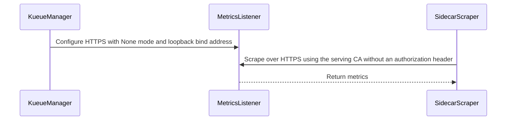

# PR #16035: Add configurable metrics access control for loopback scraping

**Summary**: Add configurable metrics access control for loopback scraping

**Sources**: https://github.com/kubernetes-sigs/kueue/pull/16035

**Last updated**: 2026-10-21T06:22:12Z

---

## Metadata

- **State**: closed (merged)
- **Author**: [@ankushbbbr](https://github.com/ankushbbbr)
- **Branch**: `metrics-authentication-v0.19.5` → `main`
- **Created**: 2026-09-23T05:00:48Z
- **Updated**: 2026-10-21T06:22:12Z
- **Merged**: 2026-10-21T06:22:09Z
- **Closed**: 2026-10-21T06:22:09Z
- **Labels**: `kind/feature`, `release-note`, `lgtm`, `size/XXL`, `approved`, `ok-to-test`, `cncf-cla: yes`
- **Assignees**: [@mimowo](https://github.com/mimowo)
- **Requested reviewers**: [@kannon92](https://github.com/kannon92), [@pajakd](https://github.com/pajakd), [@olekzabl](https://github.com/olekzabl), [@sohankunkerkar](https://github.com/sohankunkerkar), [@tenzen-y](https://github.com/tenzen-y)
- **Changed files**: 17   **+1126 / -9**

## Description

#### What type of PR is this?

/kind feature
/kind api-change

#### What this PR does / why we need it?

Implement the metrics access-control design in https://github.com/kubernetes-sigs/kueue/pull/16535. Trusted sidecar scrapers can collect metrics without bearer tokens while Kueue continues serving HTTPS.

Add `metrics.accessControlMode` to the v1beta2 configuration API. Setting this field requires the alpha `MetricsAccessControl` feature gate:

- `Delegated` (default) retains Kubernetes TokenReview/SubjectAccessReview authentication and authorization.
- `None` disables both checks for the metrics listener. When metrics are enabled, this requires an explicit literal loopback IP with a numeric port from 1 to 65535.

```yaml
featureGates:
  MetricsAccessControl: true
metrics:
  accessControlMode: None
  bindAddress: "127.0.0.1:8443"
```

IPv4, IPv6, and IPv4-mapped loopback addresses are accepted. Unsafe or malformed addresses, hostnames, missing ports, and port zero fail validation. With the gate enabled, omitted/null modes default to `Delegated`; empty/unknown modes fail validation. `metrics.bindAddress: "0"` disables metrics and bypasses address checks, while still validating the enum. With the gate disabled, the field stays unset by default, explicit values are rejected, and delegated authentication remains in effect.

Fixes #16029

#### Useful notes for your reviewer

- Replaces the earlier command-line flag and HTTP prototype with the KEP's configuration API. HTTPS remains mandatory; existing TLS options and certificate loading/rotation are retained. The alpha gate defaults to false in v0.21.
- Enabled `None` logs a startup warning about tenant information and the shared network namespace. Loopback permits access by every container in the Pod, and node-local processes with `hostNetwork`; suitable execution or port-forward permissions can relay access.
- Gates metrics-mode defaulting, runtime opt-out, and validation. Defaults are reapplied after configured feature gates load so the alpha field is defaulted only when enabled.
- Adds a sidecar scraping guide covering external serving certificates, CA trust, TLS server-name verification, and the network-namespace boundary. External ServiceMonitors cannot reach a Pod's loopback listener through its Service or Pod IP.
- AI disclosure: This change and PR description were prepared with assistance from OpenAI Codex.

#### Test

Latest review follow-up (2026-10-20):

- Updated the authenticated restoration check to use `expectMetricsToBeAvailableWithTimeout` with `behavioral.MediumTimeout`. Reviewed the one-line change and reran the focused cert-manager e2e test on the existing kind cluster: **1 passed, 0 failed, 5 skipped** (22.77 seconds), including restoration of authenticated scraping. Package lint and formatting/diff checks passed.

- Made sidecar insertion idempotent across deployment-update retries, extended anonymous HTTPS scrape retries to `behavioral.LongTimeout`, and retried Pod-IP connection-refused verification with `behavioral.MediumTimeout`. Moved metrics mode resolution below the gate-off return.
- Reviewed the diff before pushing; no remaining findings. Passed `go test ./pkg/config -run '^TestValidate$' -count=1`, formatting/diff checks, and lint for `./pkg/config/...` and `./test/e2e/certmanager/...` (0 issues).
- Reran the updated focused cert-manager e2e spec on the existing three-node kind cluster with its previously deployed PR image `kueue-metrics-test:374b6115a`: **1 passed, 0 failed, 5 skipped** (24.23 seconds). Verified anonymous HTTPS scraping, Pod-IP connection refusal, and restoration of authenticated scraping. This run validates the revised e2e test; the manager image was not rebuilt for this test-only follow-up.

Review follow-up validation (2026-10-20):

- Passed `go test -race -timeout 420s ./pkg/config ./apis/config/v1beta2 ./pkg/features ./cmd/kueue` with Go 1.27.0. Regression cases cover gated defaulting, defaulting after configured gates load, rejection of explicit modes with the gate disabled (including disabled metrics), and retention of the authentication filter even if the options helper is called directly with `None` while the gate is off.
- Added three integration specs to the existing core suite, which is discovered by the integration presubmit shards. Passed all three using Linux ARM64 envtest v1.36.2 in Docker: `None` permits anonymous verified HTTPS (200), delegated mode rejects anonymous requests (401), rejects a valid token lacking `/metrics` RBAC (403), and permits an authorized ServiceAccount token (200). Explicit delegated mode with the gate enabled also rejects anonymous requests.
- Regenerated the configuration API reference. Passed `make fmt-verify` and full `make ci-lint`, using the pinned v2.14.0 linter through `go run`.
- `make verify` remains blocked by the local compatibility-lifecycle generator being killed with signal 9 (exit 137).

Focused integration command (with envtest assets and suite prerequisites prepared):

```sh
go test -v -timeout 8m ./test/integration/singlecluster/controller/core -args \
  '-ginkgo.focus=Metrics access control' \
  -ginkgo.v
```

Earlier validation (2026-10-15):

- Adds defaulting, configuration-loading, validation, and metrics-options tests. Adds a serial cert-manager e2e spec that scrapes from a sidecar over verified HTTPS without an Authorization header, checks that the manager Pod IP refuses connections, and restores the original authenticated configuration.
- Passed with Go 1.27.0: `go test -race -timeout 420s ./pkg/config ./apis/config/v1beta2 ./pkg/features ./cmd/kueue ./pkg/util/cert ./pkg/util/tlsconfig`, manager build, e2e package compilation, `make fmt-verify`, and full `make ci-lint` using the pinned v2.14.0 linter through `go run`.
- Local `make verify`, `make lint-api`, and `make generate` could not complete because installed generator/custom-linter binaries were killed with signal 9. Required deepcopy, API reference, and feature-gate artifacts were regenerated successfully through `go run`. The API-reference generator emits a whitespace-only line; non-generated files pass `git diff --check`.

Live kind validation (2026-10-15, before the review follow-up):

- Three-node kind cluster running Kubernetes v1.36.4, cert-manager v1.21.2, and the PR image.
- Enabled `MetricsAccessControl` with `metrics.accessControlMode: None` and `metrics.bindAddress: "127.0.0.1:8443"`.
- The nonroot sidecar scraped `/metrics` over HTTPS with CA and server-name verification, without an Authorization header. A separate curl check returned **HTTP 200** with **TLS verification result 0** and no bearer token.
- Access through the manager Pod IP was refused (curl exit 7).
- Cleanup restored the original authenticated configuration and verified authenticated scraping still worked.
- The corrected e2e test passed without manual intervention: **1 passed, 0 failed, 5 skipped** (35.15 seconds).

Focused e2e command (against the prepared cert-manager cluster):

```sh
go test -v -timeout 15m ./test/e2e/certmanager -args \
  -ginkgo.label-filter=feature:metrics \
  '-ginkgo.focus=Metrics access control' \
  -ginkgo.v
```

#### Release note

```release-note
Observability: Added the alpha MetricsAccessControl feature gate and metrics.accessControlMode configuration. The default Delegated mode preserves authenticated HTTPS. With the gate enabled, None allows unauthenticated HTTPS metrics scraping on an explicit loopback IP and port for trusted sidecars.
```

<!-- This is an auto-generated comment: release notes by coderabbit.ai -->
## AI summary

Adds feature-gated metrics access control through `metrics.accessControlMode`.

- `Delegated` preserves TokenReview and SubjectAccessReview checks.
- `None` allows unauthenticated HTTPS metrics access on valid loopback IP addresses.
- `"0"` continues to disable metrics.
- Adds validation, warnings, documentation, and integration tests.

### Suggested release note

`Observability:` Add feature-gated support for unauthenticated HTTPS metrics scraping with `metrics.accessControlMode: None` on loopback addresses. `Delegated` preserves authenticated access.
<!-- end of auto-generated comment: release notes by coderabbit.ai -->

## Discussion

### Comment by [@netlify[bot]](https://github.com/apps/netlify) — 2026-09-23T05:00:55Z

### <span aria-hidden="true">✅</span> Deploy Preview for *kubernetes-sigs-kueue* canceled.


|  Name | Link |
|:-:|------------------------|
|<span aria-hidden="true">🔨</span> Latest commit | c81955e569466087a8d000da667588f7d2996323 |
|<span aria-hidden="true">🔍</span> Latest deploy log | https://app.netlify.com/projects/kubernetes-sigs-kueue/deploys/6ad7d57417fdc74ac0a4e64d |

### Comment by [@coderabbitai[bot]](https://github.com/apps/coderabbitai) — 2026-09-23T05:00:56Z

<!-- coderabbit-ai-generated:v1 -->

<!-- This is an auto-generated comment: summarize by coderabbit.ai -->
<!-- review_stack_entry_start -->

<a href="https://app.coderabbit.ai/change-stack/kubernetes-sigs/kueue/pull/16035?scope=ghh_OusAJGA4HG8ljoOV0wJvVx8NmnZIjc2DdjmxOu0xZWA&amp;cs_source=review_comment"><picture><source media="(prefers-color-scheme: dark)" srcset="https://storage.googleapis.com/coderabbit_public_assets/review-stack-in-coderabbit-ui-dark.svg?v=3"><source media="(prefers-color-scheme: light)" srcset="https://storage.googleapis.com/coderabbit_public_assets/review-stack-in-coderabbit-ui.svg?v=3"></picture></a>

<!-- review_stack_entry_end -->
<!-- This is an auto-generated comment: review paused by coderabbit.ai -->

> [!NOTE]
> ## Reviews paused
> 
> It looks like this branch is under active development. To avoid overwhelming you with review comments due to an influx of new commits, CodeRabbit has automatically paused this review. You can configure this behavior by changing the `reviews.auto_review.auto_pause_after_reviewed_commits` setting.
> 
> - Last reviewed commit: 08e4c526e7d93dc2086c49583e82e85844d6e8f2
> - Latest commit, not reviewed: c81955e569466087a8d000da667588f7d2996323
> 
> Use the following commands to manage reviews:
> - `@coderabbitai resume` to resume automatic reviews.
> - `@coderabbitai review` to trigger a single review.
> 
> Use the checkboxes below for quick actions:
> - [ ] <!-- {"checkboxId":"7f6cc2e2-2e4e-497a-8c31-c9e4573e93d1"} --> ▶️ Resume reviews
> - [ ] <!-- {"checkboxId":"e9bb8d72-00e8-4f67-9cb2-caf3b22574fe"} --> 🔍 Trigger review

<!-- end of auto-generated comment: review paused by coderabbit.ai -->
<!-- recent_review_start -->

No actionable comments were generated in the recent review. 🎉

<details>
<summary><strong>ℹ️ Recent review info</strong></summary>
<dl>
<dd>

<details>
<summary><strong>⚙️ Run configuration</strong></summary>
<dl>
<dd>

- **Configuration used**: Repository: kubernetes-sigs/kueue/.coderabbit.yaml
- **Review profile**: CHILL
- **Plan**: Advanced
- **Run ID**: `3ae1b890-3316-4363-b93d-b45a0a1022a1`

</dd>
</dl>
</details>

<details>
<summary><strong>📥 Commits</strong></summary>
<dl>
<dd>

Reviewing files that changed from the base of the PR and between ab6f5ff0d1b02ef2f0c8ec602c3853534cc2f96d and 08e4c526e7d93dc2086c49583e82e85844d6e8f2.

</dd>
</dl>
</details>

<details>
<summary><strong>📒 Files selected for processing: 11</strong></summary>
<dl>
<dd>

* `apis/config/v1beta2/configuration_types.go`
* `apis/config/v1beta2/defaults.go`
* `apis/config/v1beta2/defaults_test.go`
* `cmd/kueue/main.go`
* `pkg/config/metrics.go`
* `pkg/config/metrics_test.go`
* `pkg/config/validation.go`
* `pkg/config/validation_test.go`
* `site/content/en/docs/reference/kueue-config.v1beta2.md`
* `site/content/en/docs/tasks/manage/observability/metrics_access_control.md`
* `test/integration/singlecluster/controller/core/metrics_access_control_test.go`

</dd>
</dl>
</details>

<details>
<summary><strong>🚧 Files skipped from review as they are similar to previous changes: 1</strong></summary>
<dl>
<dd>

* apis/config/v1beta2/configuration_types.go

</dd>
</dl>
</details>

**Included review availability:** This review used your included allowance. Your plan provides up to 8 included reviews per hour; 7 remain after this review.

</dd>
</dl>
</details>


<!-- recent_review_end -->
<!-- walkthrough_start -->

<details>
<summary><strong>📝 Walkthrough</strong></summary>
<dl>
<dd>

Adds a feature-gated metrics access-control mode. Delegated authentication remains the default. The `None` mode disables authentication and authorization and requires a loopback bind address when metrics are enabled. HTTPS serving remains enabled.

**Changes: Metrics authentication and loopback scraping**

|Layer / File(s)|Summary|
|:---|:---|
|**Access-control configuration and feature gate** <br> `apis/config/v1beta2/configuration_types.go`, `apis/config/v1beta2/defaults.go`, `apis/config/v1beta2/defaults_test.go`, `pkg/features/kube_features.go`, `site/data/featuregates/versioned_feature_list.yaml`, `test/compatibility_lifecycle/reference/versioned_feature_list.yaml`, `site/content/en/docs/reference/kueue-config.v1beta2.md`|Adds `MetricsAccessControlMode` with `Delegated` and `None` values. When the feature gate is enabled, unset mode defaults to `Delegated`. Registers the alpha feature gate and documents the configuration.|
|**Metrics options and configuration validation** <br> `pkg/config/metrics.go`, `pkg/config/metrics_test.go`, `pkg/config/validation.go`, `pkg/config/validation_test.go`, `cmd/kueue/main.go`|Adds metrics server option construction and validates feature-gate use, supported modes, and loopback bind addresses for `None`. The manager applies configuration defaults before validation. Tests cover options, configuration loading, and validation cases.|
|**Sidecar scraping verification and guidance** <br> `test/integration/singlecluster/controller/core/metrics_access_control_test.go`, `test/e2e/certmanager/metrics_access_control_test.go`, `site/content/en/docs/tasks/manage/observability/metrics_access_control.md`, `site/content/en/docs/tasks/manage/observability/setup_prometheus.md`|Adds integration and end-to-end coverage for unauthenticated HTTPS scraping from a sidecar and rejection of pod-IP connections. Adds setup guidance for TLS, listener reachability, and trust boundaries.|

<!-- change_assessment_start -->
**Priority:** ➖ Normal


**Estimated code review effort:** 3 (Moderate) | ~25 minutes

<!-- change_assessment_commit:"08e4c526e7d93dc2086c49583e82e85844d6e8f2" -->
**Change:** Feature · **Severity of issue fixed:** Medium
<!-- change_assessment_end -->

### Sequence Diagram(s)



</dd>
</dl>
</details>

<!-- walkthrough_end -->
<details>
<summary><strong>Merge Risk:</strong> <strong>⚪ Minimal</strong> · up to <code>08e4c</code></summary>
<dl>
<dd>

<!-- final_review_risk_start -->
<!-- final_review_risk_label
**Merge Risk:** **⚪ Minimal** · up to `08e4c`
-->
<!-- final_review_risk_coverage:{"sourceCommitId":"08e4c526e7d93dc2086c49583e82e85844d6e8f2","coveredCommitId":"08e4c526e7d93dc2086c49583e82e85844d6e8f2","kind":"reviewed"} -->

The metrics access-control change is mergeable after normal checks; no actionable issue remains from this review.
<!-- final_review_risk_end -->

</dd>
</dl>
</details>

<details>
<summary><strong>Security architecture risk:</strong> <strong>🔵 Low</strong> · up to <code>08e4c</code></summary>
<dl>
<dd>

<!-- architecture_review_start -->
<!-- architecture_review_label
### Security Architecture Review

**Security architecture risk:** **🔵 Low** · up to `08e4c`
-->

Delegated authentication remains the default. Unauthenticated access requires an explicit feature gate and a validated loopback address, while HTTPS remains enabled. The intentional residual exposure is to all processes that can reach or forward that loopback listener, not exclusively the designated scraper. Production-specific forwarding behavior remains unverified.

**Retained concerns**
No architecture-level concerns identified.

<details>
<summary><strong>Security review details</strong></summary>
<dl>
<dd>

**Security Blast Radius**
- _inferred_ — After explicit opt-in, a process able to reach or relay the loopback socket can obtain manager metrics without a bearer token or metrics RBAC permission. Potential disclosure includes namespace and queue names, pending-workload information and resource usage. Exposure is therefore not confined to information owned by the scraping container.

**Security Findings and Attack Paths**
- _inferred_ — The supported exposure path requires access to the loopback network namespace or suitable forwarding authority after an administrator enables None. This is the documented authorization-policy change, not an established validation bypass. Static tracing found no production path that enables None on an unvalidated non-loopback address.

**Trust Boundaries and Controls**
- _observed_ — The production controls combine explicit gate activation, mode validation, literal-address parsing and loopback enforcement before listener construction. Delegated mode retains authentication and authorization denial paths. None removes the filter from the metrics listener as a whole, including any extra handlers registered there.

**Resilience and Maintainability Implications**
- _observed_ — MetricsServerOptions explicitly assumes prior validation and does not independently enforce the loopback restriction. The reviewed production caller satisfies that precondition. Preserving this ordering is necessary for future consumers to retain the same security guarantee.

</dd>
</dl>
</details>
<!-- architecture_review_end -->

</dd>
</dl>
</details>
<!-- pre_merge_checks_walkthrough_start -->

<details>
<summary><strong>Pre-merge checks: <sup><picture></picture></sup> 4 · <sup><picture></picture></sup> 1</strong></summary>
<dl>
<dd>

<strong><sup><picture></picture></sup> Failed checks: 1 warning</strong>

|     Check name     |                                              Status                                              | Explanation                                                                                                                                                                                               | Resolution                                                                         |
| :---------------- | :----------------------------------------------------------------------------------------------: | :-------------------------------------------------------------------------------------------------------------------------------------------------------------------------------------------------------- | :--------------------------------------------------------------------------------- |
| Docstring Coverage |  | Docstring coverage is 20.00% which is insufficient. The required threshold is 80.00%. Docstring coverage is scoped to functions touched by this diff. Analyzed 25 functions across 14 files. (2 skipped:… | Write docstrings for the functions missing them to satisfy the coverage threshold. |

<details>
<summary><strong><sup><picture></picture></sup> Passed checks: 4 passed</strong></summary>
<dl>
<dd>

|         Check name         |                                             Status                                             | Explanation                                                                                                                                                                                               |
| :------------------------ | :--------------------------------------------------------------------------------------------: | :-------------------------------------------------------------------------------------------------------------------------------------------------------------------------------------------------------- |
|         Title check        |  | The title clearly and concisely summarizes the main change: configurable metrics access control for loopback scraping.                                                                                    |
|     Linked Issues check    |  | The PR meets the applicable coding requirements in [`#16029`]. It adds the gated v1beta2 `metrics.accessControlMode` API. `Delegated` preserves HTTPS and the TokenReview/SubjectAccessReview filter. `Non… |
| Out of Scope Changes check |  | The changes remain within [`#16029`]. The API, feature gate, defaulting, validation, metrics-server wiring, tests, generated reference, and observability documentation implement or verify the metrics ac… |
|      Description Check     |  | Check skipped - CodeRabbit’s high-level summary is enabled.                                                                                                                                               |

<details>
<summary><strong>Full details: Linked Issues check</strong></summary>
<dl>
<dd>

**Explanation**

The PR meets the applicable coding requirements in [`#16029`]. It adds the gated v1beta2 `metrics.accessControlMode` API. `Delegated` preserves HTTPS and the TokenReview/SubjectAccessReview filter. `None` removes that filter while retaining HTTPS and requires a literal loopback address with a valid numeric port. Validation and tests cover loopback forms, unsafe addresses, disabled metrics (`"0"`), feature-gate behavior, verified HTTPS, authorization outcomes, and certificate-based scraping. Documentation covers pod and host-network boundaries, forwarding risks, CA trust, and TLS server-name configuration. The issue identifies optional HTTP as a separate design decision, so this HTTPS-only implementation does not leave an applicable requirement unmet.

</dd>
</dl>
</details>

<details>
<summary><strong>Full details: Out of Scope Changes check</strong></summary>
<dl>
<dd>

**Explanation**

The changes remain within [`#16029`]. The API, feature gate, defaulting, validation, metrics-server wiring, tests, generated reference, and observability documentation implement or verify the metrics access-control objective. The end-to-end and integration coverage support the same behavior. No unrelated implementation is demonstrated.

</dd>
</dl>
</details>

</dd>
</dl>
</details>

<details>
<summary><strong>Full details: Docstring Coverage</strong></summary>
<dl>
<dd>

**Explanation**

Docstring coverage is 20.00% which is insufficient. The required threshold is 80.00%. Docstring coverage is scoped to functions touched by this diff. Analyzed 25 functions across 14 files. (2 skipped: 2 unsupported.)

**Resolution**

Write docstrings for the functions missing them to satisfy the coverage threshold.

</dd>
</dl>
</details>

</dd>
</dl>
</details>

<!-- pre_merge_checks_walkthrough_end -->
<!-- finishing_touch_checkbox_start -->

<details>
<summary><strong>✨ Finishing Touches</strong></summary>
<dl>
<dd>

<details open>
<summary><strong>🧪 Generate unit tests (beta)</strong></summary>
<dl>
<dd>

- [ ] <!-- {"checkboxId": "f47ac10b-58cc-4372-a567-0e02b2c3d479", "radioGroupId": "utg-output-choice-group-unknown_comment_id"} --> Create a new PR

</dd>
</dl>
</details>

</dd>
</dl>
</details>

<!-- finishing_touch_checkbox_end -->
<!-- tips_start -->


<sub>Comment `@coderabbitai help` to get the list of available commands.</sub>

<!-- tips_end -->

### Comment by [@kubernetes-prow[bot]](https://github.com/apps/kubernetes-prow) — 2026-09-23T05:00:58Z

Welcome @ankushbbbr! <br><br>It looks like this is your first PR to <a href='https://github.com/kubernetes-sigs/kueue'>kubernetes-sigs/kueue</a> 🎉. Please refer to our [pull request process documentation](https://www.kubernetes.dev/docs/guide/pull-requests/) to help your PR have a smooth ride to approval. <br><br>You will be prompted by a bot to use commands during the review process. Do not be afraid to follow the prompts! It is okay to experiment. [Here is the bot commands documentation](https://go.k8s.io/bot-commands). <br><br>You can also check if kubernetes-sigs/kueue has [its own contribution guidelines](https://github.com/kubernetes-sigs/kueue/tree/master/CONTRIBUTING.md). <br><br>You may want to refer to our [testing guide](https://git.k8s.io/community/contributors/devel/sig-testing/testing.md) if you run into trouble with your tests not passing. <br><br>If you are having difficulty getting your pull request seen, please follow the [recommended escalation practices](https://www.kubernetes.dev/docs/guide/pull-requests/#why-is-my-pull-request-not-getting-reviewed). Also, for tips and tricks in the contribution process you may want to read the [Kubernetes contributor cheat sheet](https://www.kubernetes.dev/docs/contributor-cheatsheet/). We want to make sure your contribution gets all the attention it needs! <br><br>Thank you, and welcome to Kubernetes. :smiley:

### Comment by [@linux-foundation-easycla[bot]](https://github.com/apps/linux-foundation-easycla) — 2026-09-23T05:00:59Z

<a href="https://easycla.lfx.linuxfoundation.org/#/?version=2"></a><br >The committers listed above are authorized under a signed CLA.<ul><li>:white_check_mark: login: ababbar-stripe / name: Ankush Babbar (1482002aefeec399c68bebeff61480287263e05f, 374b6115aef917a0de2da9162f18bcc26b25c696, 3a138ab749121e6506b6450de10dc29e9608c9a8, cdfcd9876835528ef49eb79b7003e7e88f0c5c1f)</li></ul>

### Comment by [@kubernetes-prow[bot]](https://github.com/apps/kubernetes-prow) — 2026-09-23T05:01:00Z

Hi @ankushbbbr. Thanks for your PR.

I'm waiting for a [kubernetes-sigs](https://github.com/orgs/kubernetes-sigs/people) member to verify that this patch is reasonable to test. If it is, they should reply with `/ok-to-test` on its own line. Until that is done, I will not automatically test new commits in this PR, but the usual testing commands by org members will still work.

Regular contributors should [join the org](https://git.k8s.io/community/community-membership.md#member) to skip this step.

Once the patch is verified, the new status will be reflected by the `ok-to-test` label.

I understand the commands that are listed [here](https://go.k8s.io/bot-commands?repo=kubernetes-sigs%2Fkueue).

<details>

Instructions for interacting with me using PR comments are available [here](https://git.k8s.io/community/contributors/guide/pull-requests.md).  If you have questions or suggestions related to my behavior, please file an issue against the [kubernetes-sigs/prow](https://github.com/kubernetes-sigs/prow/issues/new?title=Prow%20issue:) repository.
</details>

### Comment by [@mimowo](https://github.com/mimowo) — 2026-09-23T05:22:15Z

/ok-to-test
please open the PR against main. the provess is to merge to main first then cherrypick

### Comment by [@ankushbbbr](https://github.com/ankushbbbr) — 2026-09-30T19:56:29Z

> /ok-to-test please open the PR against main. the provess is to merge to main first then cherrypick

@mimowo Can you please review this PR, I have moved it to main.
Metrics collection is currently blocking completion of our Kueue rollout at Stripe.

We have Kueue v0.19.5 running successfully on a certificate-authenticated k8s platform that does not support ServiceAccount bearer tokens. Our metrics scraper runs in the same pod as a sidecar and scrapes https://localhost:8443/metrics, but fails with 401 Unauthorized without Bearer token auth.

Could you review the proposed approach of making metrics authentication optional or suggest an alternative you would accept?

### Comment by [@sohankunkerkar](https://github.com/sohankunkerkar) — 2026-10-02T02:36:57Z

could you open a KEP first covering the problem (no SA tokens, so 401), why auth can't be configured instead, and the opt-out shape? I'd also drop the HTTP mode since TLS already works for you. Same as the earlier discussion in #4841.

### Comment by [@ankushbbbr](https://github.com/ankushbbbr) — 2026-10-02T05:17:14Z

> could you open a KEP first covering the problem (no SA tokens, so 401), why auth can't be configured instead, and the opt-out shape? I'd also drop the HTTP mode since TLS already works for you. Same as the earlier discussion in #4841.

Will do. I added the option to disable TLS as our deployment uses a trusted sidecar to scrape metrics over the pod’s loopback interface. Our platform has workload-identity certificates, but their SANs are centrally controlled and do not include `localhost` for loopback IP addresses, so I had to disable TLS validation in the metrics scraper client to get it working and add also had to mount a cert at [hardcoded](https://github.com/kubernetes-sigs/kueue/blob/v0.19.5/cmd/kueue/main.go#L217) metricsCertPath (/etc/kueue/metrics/certs), just to make Kueue start up. Otherwise the manager crashes (with internalCertManagement disabled).

So instead, it would be better to have TLS optional for such deployment setups

### Comment by [@ankushbbbr](https://github.com/ankushbbbr) — 2026-10-02T05:44:02Z

> could you open a KEP first covering the problem (no SA tokens, so 401), why auth can't be configured instead, and the opt-out shape? I'd also drop the HTTP mode since TLS already works for you. Same as the earlier discussion in #4841.

@sohankunkerkar Opened  [KEP-16029](https://github.com/kubernetes-sigs/kueue/pull/16535). I have also included rational for making TLS optional for /metrics endpoint (to eliminate metrics cert dependency for trusted sidecar scrapers accessing Kueue exclusively over pod-local loopback)

### Comment by [@mimowo](https://github.com/mimowo) — 2026-10-14T15:57:39Z

@ankushbbbr do you have cycles to work on the PR and align it with the KEP?

### Comment by [@ankushbbbr](https://github.com/ankushbbbr) — 2026-10-14T16:54:54Z

> @ankushbbbr do you have cycles to work on the PR and align it with the KEP?

Yes @mimowo, I will be working on it this week

### Comment by [@mimowo](https://github.com/mimowo) — 2026-10-19T18:14:41Z

> Yes @mimowo, I will be working on it this week

@ankushbbbr is this now considered "ready for review" ?

### Comment by [@ankushbbbr](https://github.com/ankushbbbr) — 2026-10-19T21:30:47Z

> > Yes @mimowo, I will be working on it this week
> 
> @ankushbbbr is this now considered "ready for review" ?

Yes, its ready for review. But @AaronLiChen proposed another amendment (https://github.com/kubernetes-sigs/kueue/pull/17433) to support client certificate metrics authentication. Should we proceed with this PR based upon https://github.com/kubernetes-sigs/kueue/pull/16535 or wait for the client certificate auth KEP?

### Comment by [@mimowo](https://github.com/mimowo) — 2026-10-19T21:46:54Z

We will proceed in independently ( this can be merged once reviewed), but will coordinate the next extension. Would you like to also help reviewing the extension KEP, that would be great

### Comment by [@ankushbbbr](https://github.com/ankushbbbr) — 2026-10-19T22:04:02Z

> We will proceed in independently ( this can be merged once reviewed), but will coordinate the next extension. Would you like to also help reviewing the extension KEP, that would be great

Ok sure. I can also review the KEP PR

### Comment by [@mimowo](https://github.com/mimowo) — 2026-10-21T06:06:42Z

/lgtm
/approve
Thank you 👍

### Comment by [@kubernetes-prow[bot]](https://github.com/apps/kubernetes-prow) — 2026-10-21T06:06:53Z

LGTM label has been added.  <details>Git tree hash: 59e220640aa62e5e9e4f56fb084f2184399c5f66</details>

### Comment by [@kubernetes-prow[bot]](https://github.com/apps/kubernetes-prow) — 2026-10-21T06:06:56Z

[APPROVALNOTIFIER] This PR is **APPROVED**

This pull-request has been approved by: *<a href="https://github.com/kubernetes-sigs/kueue/pull/16035#" title="Author self-approved">ankushbbbr</a>*, *<a href="https://github.com/kubernetes-sigs/kueue/pull/16035#issuecomment-6309304735" title="Approved">mimowo</a>*

The full list of commands accepted by this bot can be found [here](https://go.k8s.io/bot-commands?repo=kubernetes-sigs%2Fkueue).

The pull request process is described [here](https://git.k8s.io/community/contributors/guide/owners.md#the-code-review-process)

<details >
Needs approval from an approver in each of these files:

- ~~[OWNERS](https://github.com/kubernetes-sigs/kueue/blob/main/OWNERS)~~ [mimowo]

Approvers can indicate their approval by writing `/approve` in a comment
Approvers can cancel approval by writing `/approve cancel` in a comment
</details>
<!-- META={"approvers":[]} -->

## Reviews

### Review by [@mimowo](https://github.com/mimowo) (commented) — 2026-10-01T10:05:40Z

This LGTM (direction to make the metrics configurable, haven't read the code in detail yet), but I would like to get also green light from @tenzen-y and @sohankunkerkar

### Review by [@mimowo](https://github.com/mimowo) (commented) — 2026-10-01T10:07:37Z

- **cmd/kueue/main.go:124** by [@mimowo](https://github.com/mimowo) — 2026-10-01T10:07:37Z
```diff
@@ -124,6 +120,9 @@ func init() {
 }
 
 func main() {
+	var metricsOpts metricsOptions
+	metricsOpts.bindFlags(flag.CommandLine)
```

  Could you summarize what flags are expose by that? I'm not sure if we want/need all of them

### Review by [@ankushbbbr](https://github.com/ankushbbbr) (commented) — 2026-10-02T01:05:32Z

- **cmd/kueue/main.go:124** by [@ankushbbbr](https://github.com/ankushbbbr) — 2026-10-02T01:05:32Z
```diff
@@ -124,6 +120,9 @@ func init() {
 }
 
 func main() {
+	var metricsOpts metricsOptions
+	metricsOpts.bindFlags(flag.CommandLine)
```

  
  bindFlags exposes two boolean flags, both defaulting to true:
  
  --metrics-authentication: controls TokenReview authentication and SubjectAccessReview authorization. Disabling it requires an explicit loopback IP and port.
  --metrics-secure: controls HTTPS versus HTTP. HTTP requires authentication disabled and the same loopback restriction.

### Review by [@mimowo](https://github.com/mimowo) (commented) — 2026-10-20T10:35:25Z

- **apis/config/v1beta2/defaults.go:75** by [@mimowo](https://github.com/mimowo) — 2026-10-20T10:35:25Z
```diff
@@ -72,6 +72,9 @@ func SetDefaults_Configuration(cfg *Configuration) {
 	cfg.Namespace = cmp.Or(cfg.Namespace, new(getOperatorNamespace()))
 	cfg.Webhook.Port = cmp.Or(cfg.Webhook.Port, new(DefaultWebhookPort))
 	cfg.Webhook.CertDir = cmp.Or(cfg.Webhook.CertDir, DefaultWebhookCertDir)
+	if cfg.Metrics.AccessControlMode == nil {
```

  nit, I would rather keep the defaulting under FG so that we don't change configuration by rolling Alpha feature.

### Review by [@mimowo](https://github.com/mimowo) (commented) — 2026-10-20T10:36:30Z

- **pkg/config/metrics.go:35** by [@mimowo](https://github.com/mimowo) — 2026-10-20T10:36:30Z
```diff
@@ -0,0 +1,46 @@
+/*
+Copyright The Kubernetes Authors.
+
+Licensed under the Apache License, Version 2.0 (the "License");
+you may not use this file except in compliance with the License.
+You may obtain a copy of the License at
+
+    http://www.apache.org/licenses/LICENSE-2.0
+
+Unless required by applicable law or agreed to in writing, software
+distributed under the License is distributed on an "AS IS" BASIS,
+WITHOUT WARRANTIES OR CONDITIONS OF ANY KIND, either express or implied.
+See the License for the specific language governing permissions and
+limitations under the License.
+*/
+
+package config
+
+import (
+	"github.com/go-logr/logr"
+	"k8s.io/utils/ptr"
+	"sigs.k8s.io/controller-runtime/pkg/metrics/filters"
+	metricsserver "sigs.k8s.io/controller-runtime/pkg/metrics/server"
+
+	configapi "sigs.k8s.io/kueue/apis/config/v1beta2"
+)
+
+// MetricsServerOptions constructs HTTPS metrics options after configuration validation.
+func MetricsServerOptions(log logr.Logger, metrics configapi.ControllerMetrics) metricsserver.Options {
+	options := metricsserver.Options{
+		BindAddress:    metrics.BindAddress,
+		SecureServing:  true,
+		FilterProvider: filters.WithAuthenticationAndAuthorization,
+	}
+	if ptr.Deref(metrics.AccessControlMode, configapi.MetricsAccessControlModeDelegated) == configapi.MetricsAccessControlModeNone {
```

  Check for the FG also

### Review by [@mimowo](https://github.com/mimowo) (commented) — 2026-10-20T10:38:15Z

- **pkg/config/validation.go:992** by [@mimowo](https://github.com/mimowo) — 2026-10-20T10:38:15Z
```diff
@@ -963,3 +965,26 @@ func validateCIdentifier(id string, fldPath *field.Path) field.ErrorList {
 	}
 	return allErrs
 }
+
+func validateMetrics(metrics configapi.ControllerMetrics) field.ErrorList {
+	mode := ptr.Deref(metrics.AccessControlMode, configapi.MetricsAccessControlModeDelegated)
+	modePath := field.NewPath("metrics", "accessControlMode")
+	if mode != configapi.MetricsAccessControlModeDelegated && mode != configapi.MetricsAccessControlModeNone {
+		return field.ErrorList{field.NotSupported(modePath, mode, []configapi.MetricsAccessControlMode{
+			configapi.MetricsAccessControlModeDelegated, configapi.MetricsAccessControlModeNone,
+		})}
+	}
+	if mode != configapi.MetricsAccessControlModeNone || metrics.BindAddress == "0" {
+		return nil
+	}
+	var allErrs field.ErrorList
+	if !features.Enabled(features.MetricsAccessControl) {
+		allErrs = append(allErrs, field.Forbidden(modePath, "None requires the MetricsAccessControl feature gate; enable it or use Delegated"))
+	}
+	address, err := netip.ParseAddrPort(metrics.BindAddress)
+	if err != nil || !address.Addr().Unmap().IsLoopback() || address.Port() == 0 {
+		allErrs = append(allErrs, field.Invalid(field.NewPath("metrics", "bindAddress"), metrics.BindAddress,
+			"accessControlMode None requires a literal loopback IP and numeric port in the range 1–65535 (for example 127.0.0.1:8443 or [::1]:8443); use Delegated for other addresses"))
+	}
+	return allErrs
```

  Make sure the new validation is behind the FG, only the setting of the `metrics.accessControlMode` should be behind the negation of the FG

### Review by [@mimowo](https://github.com/mimowo) (commented) — 2026-10-20T10:38:48Z

LGTM, I left rather nits to make sure we have a good separation of the new code and the pre-existing code.

### Review by [@mimowo](https://github.com/mimowo) (commented) — 2026-10-20T10:40:18Z

- **test/e2e/certmanager/metrics_access_control_test.go:39** by [@mimowo](https://github.com/mimowo) — 2026-10-20T10:40:18Z
```diff
@@ -0,0 +1,137 @@
+/*
+Copyright The Kubernetes Authors.
+
+Licensed under the Apache License, Version 2.0 (the "License");
+you may not use this file except in compliance with the License.
+You may obtain a copy of the License at
+
+    http://www.apache.org/licenses/LICENSE-2.0
+
+Unless required by applicable law or agreed to in writing, software
+distributed under the License is distributed on an "AS IS" BASIS,
+WITHOUT WARRANTIES OR CONDITIONS OF ANY KIND, either express or implied.
+See the License for the specific language governing permissions and
+limitations under the License.
+*/
+
+package certmanager
+
+import (
+	"fmt"
+	"net"
+	"os"
+	"slices"
+	"time"
+
+	"github.com/onsi/ginkgo/v2"
+	"github.com/onsi/gomega"
+	appsv1 "k8s.io/api/apps/v1"
+	corev1 "k8s.io/api/core/v1"
+	rbacv1 "k8s.io/api/rbac/v1"
+	"sigs.k8s.io/controller-runtime/pkg/client"
+
+	configapi "sigs.k8s.io/kueue/apis/config/v1beta2"
+	testingjobspod "sigs.k8s.io/kueue/pkg/util/testingjobs/pod"
+	"sigs.k8s.io/kueue/test/util/behavioral"
+	"sigs.k8s.io/kueue/test/util/behavioral/e2e"
+)
+
+// Serial isolates shared configuration changes; priority also puts this spec last in single-process runs.
```

  Would it be feasible to add an integration test also or instead ?

### Review by [@mimowo](https://github.com/mimowo) (commented) — 2026-10-20T10:40:44Z

cc @vladikkuzn would you like to give it a pass?

### Review by [@mimowo](https://github.com/mimowo) (commented) — 2026-10-20T17:16:50Z

- **pkg/config/validation.go:970** by [@mimowo](https://github.com/mimowo) — 2026-10-20T17:16:51Z
```diff
@@ -963,3 +965,29 @@ func validateCIdentifier(id string, fldPath *field.Path) field.ErrorList {
 	}
 	return allErrs
 }
+
+func validateMetrics(metrics configapi.ControllerMetrics) field.ErrorList {
+	mode := ptr.Deref(metrics.AccessControlMode, configapi.MetricsAccessControlModeDelegated)
```

  nit, this could be moved down where needed

### Review by [@mimowo](https://github.com/mimowo) (commented) — 2026-10-20T17:48:02Z

- **test/e2e/certmanager/metrics_access_control_test.go:100** by [@mimowo](https://github.com/mimowo) — 2026-10-20T17:48:02Z
```diff
@@ -0,0 +1,137 @@
+/*
+Copyright The Kubernetes Authors.
+
+Licensed under the Apache License, Version 2.0 (the "License");
+you may not use this file except in compliance with the License.
+You may obtain a copy of the License at
+
+    http://www.apache.org/licenses/LICENSE-2.0
+
+Unless required by applicable law or agreed to in writing, software
+distributed under the License is distributed on an "AS IS" BASIS,
+WITHOUT WARRANTIES OR CONDITIONS OF ANY KIND, either express or implied.
+See the License for the specific language governing permissions and
+limitations under the License.
+*/
+
+package certmanager
+
+import (
+	"fmt"
+	"net"
+	"os"
+	"slices"
+	"time"
+
+	"github.com/onsi/ginkgo/v2"
+	"github.com/onsi/gomega"
+	appsv1 "k8s.io/api/apps/v1"
+	corev1 "k8s.io/api/core/v1"
+	rbacv1 "k8s.io/api/rbac/v1"
+	"sigs.k8s.io/controller-runtime/pkg/client"
+
+	configapi "sigs.k8s.io/kueue/apis/config/v1beta2"
+	testingjobspod "sigs.k8s.io/kueue/pkg/util/testingjobs/pod"
+	"sigs.k8s.io/kueue/test/util/behavioral"
+	"sigs.k8s.io/kueue/test/util/behavioral/e2e"
+)
+
+// Serial isolates shared configuration changes; priority also puts this spec last in single-process runs.
+var _ = ginkgo.Describe("Metrics access control", ginkgo.Serial, ginkgo.SpecPriority(-1), ginkgo.Label("feature:metrics"), func() {
+	ginkgo.It("should allow verified HTTPS scraping from a sidecar without a token and refuse the pod IP", func() {
+		deploymentKey := client.ObjectKey{Namespace: kueueNS, Name: "kueue-controller-manager"}
+		originalDeployment := &appsv1.Deployment{}
+		gomega.Expect(k8sClient.Get(ctx, deploymentKey, originalDeployment)).To(gomega.Succeed())
+		originalConfig := e2e.GetKueueConfiguration(ctx, k8sClient)
+		gomega.Expect(originalConfig.InternalCertManagement).NotTo(gomega.BeNil())
+		gomega.Expect(originalConfig.InternalCertManagement.Enable).To(gomega.HaveValue(gomega.BeFalse()))
+		clusterName := os.Getenv("KIND_CLUSTER_NAME")
+
+		curlPod := testingjobspod.MakePod("curl-loopback-metrics", kueueNS).
+			ServiceAccountName(serviceAccountName).
+			Image(e2e.GetAgnHostImage(), e2e.BehaviorWaitForDeletion).
+			TerminationGracePeriod(1).Obj()
+		curlPod.Spec.Volumes = []corev1.Volume{{Name: "metrics-certs", Secret: &corev1.SecretVolumeSource{SecretName: certSecretName}}}
+		curlPod.Spec.Containers[0].VolumeMounts = []corev1.VolumeMount{{Name: "metrics-certs", MountPath: certMountPath, ReadOnly: true}}
+		// Copy the sidecar before Pod admission adds a token volume mount.
+		sidecar := *curlPod.Spec.Containers[0].DeepCopy()
+		sidecar.Name = "metrics-scraper"
+		sidecar.SecurityContext = &corev1.SecurityContext{RunAsUser: new(int64(65532))}
+		ginkgo.DeferCleanup(func() {
+			behavioral.ExpectObjectToBeDeletedWithTimeout(ctx, k8sClient, curlPod, true, behavioral.LongTimeout)
+		})
+		behavioral.MustCreate(ctx, k8sClient, curlPod)
+		e2e.WaitForPodRunning(ctx, k8sClient, curlPod)
+		curlContainer := curlPod.Spec.Containers[0].Name
+
+		binding := &rbacv1.ClusterRoleBinding{
+			Name:     "loopback-metrics-reader",
+			Subjects: []rbacv1.Subject{{Kind: "ServiceAccount", Name: serviceAccountName, Namespace: kueueNS}},
+			RoleRef:  rbacv1.RoleRef{APIGroup: rbacv1.GroupName, Kind: "ClusterRole", Name: metricsReaderClusterRoleName},
+		}
+		ginkgo.DeferCleanup(func() { behavioral.ExpectObjectToBeDeleted(ctx, k8sClient, binding, true) })
+		behavioral.MustCreate(ctx, k8sClient, binding)
+
+		// Register restoration before changing either shared resource. LIFO cleanup keeps
+		// the authenticated scraper and its RBAC available until restoration is verified.
+		ginkgo.DeferCleanup(func() {
+			e2e.UpdateKueueConfiguration(ctx, k8sClient, originalConfig)
+			e2e.UpdateDeploymentAndWaitForProgressing(ctx, k8sClient, deploymentKey, clusterName, func(deployment *appsv1.Deployment) {
+				deployment.Spec = *originalDeployment.Spec.DeepCopy()
+				if deployment.Spec.Template.Annotations == nil {
+					deployment.Spec.Template.Annotations = make(map[string]string)
+				}
+				deployment.Spec.Template.Annotations["kubectl.kubernetes.io/restartedAt"] = time.Now().Format(time.RFC3339Nano)
+			})
+			e2e.WaitForKueueAvailabilityNoRestartCountCheck(ctx, k8sClient)
+			expectMetricsToBeAvailable(curlPod.Name, curlContainer, [][]string{{"go_gc_duration_seconds"}})
+		})
+
+		ginkgo.By("enabling loopback metrics with external serving certificates")
+		e2e.UpdateKueueConfiguration(ctx, k8sClient, originalConfig, func(configuration *configapi.Configuration) {
+			if configuration.FeatureGates == nil {
+				configuration.FeatureGates = make(map[string]bool)
+			}
+			configuration.FeatureGates["MetricsAccessControl"] = true
+			configuration.Metrics.AccessControlMode = new(configapi.MetricsAccessControlModeNone)
+			configuration.Metrics.BindAddress = "127.0.0.1:8443"
+		})
+		e2e.UpdateDeploymentAndWaitForProgressing(ctx, k8sClient, deploymentKey, clusterName, func(deployment *appsv1.Deployment) {
+			deployment.Spec.Template.Spec.Containers = append(deployment.Spec.Template.Spec.Containers, sidecar)
```

  This code adds the sidecar unconditionally, but the ongoing UpdateDeploymentAndWaitForProgressing will keep re-doing the body of this function in case of a failure (retry). I think think it would be better to do it only if not present already - as guarded below for Volumes.

### Review by [@mimowo](https://github.com/mimowo) (commented) — 2026-10-20T17:49:51Z

- **test/e2e/certmanager/metrics_access_control_test.go:133** by [@mimowo](https://github.com/mimowo) — 2026-10-20T17:49:51Z
```diff
@@ -0,0 +1,137 @@
+/*
+Copyright The Kubernetes Authors.
+
+Licensed under the Apache License, Version 2.0 (the "License");
+you may not use this file except in compliance with the License.
+You may obtain a copy of the License at
+
+    http://www.apache.org/licenses/LICENSE-2.0
+
+Unless required by applicable law or agreed to in writing, software
+distributed under the License is distributed on an "AS IS" BASIS,
+WITHOUT WARRANTIES OR CONDITIONS OF ANY KIND, either express or implied.
+See the License for the specific language governing permissions and
+limitations under the License.
+*/
+
+package certmanager
+
+import (
+	"fmt"
+	"net"
+	"os"
+	"slices"
+	"time"
+
+	"github.com/onsi/ginkgo/v2"
+	"github.com/onsi/gomega"
+	appsv1 "k8s.io/api/apps/v1"
+	corev1 "k8s.io/api/core/v1"
+	rbacv1 "k8s.io/api/rbac/v1"
+	"sigs.k8s.io/controller-runtime/pkg/client"
+
+	configapi "sigs.k8s.io/kueue/apis/config/v1beta2"
+	testingjobspod "sigs.k8s.io/kueue/pkg/util/testingjobs/pod"
+	"sigs.k8s.io/kueue/test/util/behavioral"
+	"sigs.k8s.io/kueue/test/util/behavioral/e2e"
+)
+
+// Serial isolates shared configuration changes; priority also puts this spec last in single-process runs.
+var _ = ginkgo.Describe("Metrics access control", ginkgo.Serial, ginkgo.SpecPriority(-1), ginkgo.Label("feature:metrics"), func() {
+	ginkgo.It("should allow verified HTTPS scraping from a sidecar without a token and refuse the pod IP", func() {
+		deploymentKey := client.ObjectKey{Namespace: kueueNS, Name: "kueue-controller-manager"}
+		originalDeployment := &appsv1.Deployment{}
+		gomega.Expect(k8sClient.Get(ctx, deploymentKey, originalDeployment)).To(gomega.Succeed())
+		originalConfig := e2e.GetKueueConfiguration(ctx, k8sClient)
+		gomega.Expect(originalConfig.InternalCertManagement).NotTo(gomega.BeNil())
+		gomega.Expect(originalConfig.InternalCertManagement.Enable).To(gomega.HaveValue(gomega.BeFalse()))
+		clusterName := os.Getenv("KIND_CLUSTER_NAME")
+
+		curlPod := testingjobspod.MakePod("curl-loopback-metrics", kueueNS).
+			ServiceAccountName(serviceAccountName).
+			Image(e2e.GetAgnHostImage(), e2e.BehaviorWaitForDeletion).
+			TerminationGracePeriod(1).Obj()
+		curlPod.Spec.Volumes = []corev1.Volume{{Name: "metrics-certs", Secret: &corev1.SecretVolumeSource{SecretName: certSecretName}}}
+		curlPod.Spec.Containers[0].VolumeMounts = []corev1.VolumeMount{{Name: "metrics-certs", MountPath: certMountPath, ReadOnly: true}}
+		// Copy the sidecar before Pod admission adds a token volume mount.
+		sidecar := *curlPod.Spec.Containers[0].DeepCopy()
+		sidecar.Name = "metrics-scraper"
+		sidecar.SecurityContext = &corev1.SecurityContext{RunAsUser: new(int64(65532))}
+		ginkgo.DeferCleanup(func() {
+			behavioral.ExpectObjectToBeDeletedWithTimeout(ctx, k8sClient, curlPod, true, behavioral.LongTimeout)
+		})
+		behavioral.MustCreate(ctx, k8sClient, curlPod)
+		e2e.WaitForPodRunning(ctx, k8sClient, curlPod)
+		curlContainer := curlPod.Spec.Containers[0].Name
+
+		binding := &rbacv1.ClusterRoleBinding{
+			Name:     "loopback-metrics-reader",
+			Subjects: []rbacv1.Subject{{Kind: "ServiceAccount", Name: serviceAccountName, Namespace: kueueNS}},
+			RoleRef:  rbacv1.RoleRef{APIGroup: rbacv1.GroupName, Kind: "ClusterRole", Name: metricsReaderClusterRoleName},
+		}
+		ginkgo.DeferCleanup(func() { behavioral.ExpectObjectToBeDeleted(ctx, k8sClient, binding, true) })
+		behavioral.MustCreate(ctx, k8sClient, binding)
+
+		// Register restoration before changing either shared resource. LIFO cleanup keeps
+		// the authenticated scraper and its RBAC available until restoration is verified.
+		ginkgo.DeferCleanup(func() {
+			e2e.UpdateKueueConfiguration(ctx, k8sClient, originalConfig)
+			e2e.UpdateDeploymentAndWaitForProgressing(ctx, k8sClient, deploymentKey, clusterName, func(deployment *appsv1.Deployment) {
+				deployment.Spec = *originalDeployment.Spec.DeepCopy()
+				if deployment.Spec.Template.Annotations == nil {
+					deployment.Spec.Template.Annotations = make(map[string]string)
+				}
+				deployment.Spec.Template.Annotations["kubectl.kubernetes.io/restartedAt"] = time.Now().Format(time.RFC3339Nano)
+			})
+			e2e.WaitForKueueAvailabilityNoRestartCountCheck(ctx, k8sClient)
+			expectMetricsToBeAvailable(curlPod.Name, curlContainer, [][]string{{"go_gc_duration_seconds"}})
+		})
+
+		ginkgo.By("enabling loopback metrics with external serving certificates")
+		e2e.UpdateKueueConfiguration(ctx, k8sClient, originalConfig, func(configuration *configapi.Configuration) {
+			if configuration.FeatureGates == nil {
+				configuration.FeatureGates = make(map[string]bool)
+			}
+			configuration.FeatureGates["MetricsAccessControl"] = true
+			configuration.Metrics.AccessControlMode = new(configapi.MetricsAccessControlModeNone)
+			configuration.Metrics.BindAddress = "127.0.0.1:8443"
+		})
+		e2e.UpdateDeploymentAndWaitForProgressing(ctx, k8sClient, deploymentKey, clusterName, func(deployment *appsv1.Deployment) {
+			deployment.Spec.Template.Spec.Containers = append(deployment.Spec.Template.Spec.Containers, sidecar)
+			if !slices.ContainsFunc(deployment.Spec.Template.Spec.Volumes, func(volume corev1.Volume) bool { return volume.Name == "metrics-certs" }) {
+				deployment.Spec.Template.Spec.Volumes = append(deployment.Spec.Template.Spec.Volumes, curlPod.Spec.Volumes...)
+			}
+		})
+		e2e.WaitForKueueAvailabilityNoRestartCountCheck(ctx, k8sClient)
+
+		serverName := fmt.Sprintf("%s.%s.svc.cluster.local", metricsServiceName, kueueNS)
+		var pods corev1.PodList
+		gomega.Eventually(func(g gomega.Gomega) {
+			g.Expect(k8sClient.List(ctx, &pods, client.InNamespace(kueueNS), client.MatchingLabels(originalDeployment.Spec.Selector.MatchLabels))).To(gomega.Succeed())
+			g.Expect(pods.Items).To(gomega.HaveLen(int(*originalDeployment.Spec.Replicas)))
+			for _, pod := range pods.Items {
+				g.Expect(pod.DeletionTimestamp).To(gomega.BeNil())
+				g.Expect(slices.ContainsFunc(pod.Spec.Containers, func(container corev1.Container) bool { return container.Name == sidecar.Name })).To(gomega.BeTrue())
+			}
+		}, behavioral.LongTimeout, behavioral.Interval).Should(gomega.Succeed())
+
+		for _, pod := range pods.Items {
+			ginkgo.By("scraping over verified HTTPS without an Authorization header from " + pod.Name)
+			gomega.Eventually(func(g gomega.Gomega) {
+				output, _, err := e2e.KExecute(ctx, cfg, restClient, kueueNS, pod.Name, sidecar.Name, []string{
+					"curl", "--silent", "--show-error", "--fail", "--noproxy", "*", "--connect-timeout", "5", "--max-time", "15",
+					"--cacert", certMountPath + "/ca.crt", "--resolve", serverName + ":8443:127.0.0.1", "https://" + serverName + ":8443/metrics",
+				})
+				g.Expect(err).NotTo(gomega.HaveOccurred())
+				g.Expect(string(output)).To(gomega.ContainSubstring("go_gc_duration_seconds"))
+			}, behavioral.Timeout, behavioral.Interval).Should(gomega.Succeed())
+
+			ginkgo.By("confirming the manager pod IP refuses metrics connections")
+			_, _, err := e2e.KExecute(ctx, cfg, restClient, kueueNS, curlPod.Name, curlContainer, []string{
+				"/bin/sh", "-c", `curl --silent --show-error --noproxy '*' --connect-timeout 5 --max-time 15 "$1"; result=$?; test "$result" -eq 7`,
+				"sh", "https://" + net.JoinHostPort(pod.Status.PodIP, "8443") + "/metrics",
+			})
```

  Wrap with Eventullly using behavioral.MediumTimeout. This is to account for any temporary failures which may not necessarily indicate a problem, just to ensure it doesn't flake.

### Review by [@mimowo](https://github.com/mimowo) (commented) — 2026-10-20T17:50:54Z

- **test/e2e/certmanager/metrics_access_control_test.go:127** by [@mimowo](https://github.com/mimowo) — 2026-10-20T17:50:54Z
```diff
@@ -0,0 +1,137 @@
+/*
+Copyright The Kubernetes Authors.
+
+Licensed under the Apache License, Version 2.0 (the "License");
+you may not use this file except in compliance with the License.
+You may obtain a copy of the License at
+
+    http://www.apache.org/licenses/LICENSE-2.0
+
+Unless required by applicable law or agreed to in writing, software
+distributed under the License is distributed on an "AS IS" BASIS,
+WITHOUT WARRANTIES OR CONDITIONS OF ANY KIND, either express or implied.
+See the License for the specific language governing permissions and
+limitations under the License.
+*/
+
+package certmanager
+
+import (
+	"fmt"
+	"net"
+	"os"
+	"slices"
+	"time"
+
+	"github.com/onsi/ginkgo/v2"
+	"github.com/onsi/gomega"
+	appsv1 "k8s.io/api/apps/v1"
+	corev1 "k8s.io/api/core/v1"
+	rbacv1 "k8s.io/api/rbac/v1"
+	"sigs.k8s.io/controller-runtime/pkg/client"
+
+	configapi "sigs.k8s.io/kueue/apis/config/v1beta2"
+	testingjobspod "sigs.k8s.io/kueue/pkg/util/testingjobs/pod"
+	"sigs.k8s.io/kueue/test/util/behavioral"
+	"sigs.k8s.io/kueue/test/util/behavioral/e2e"
+)
+
+// Serial isolates shared configuration changes; priority also puts this spec last in single-process runs.
+var _ = ginkgo.Describe("Metrics access control", ginkgo.Serial, ginkgo.SpecPriority(-1), ginkgo.Label("feature:metrics"), func() {
+	ginkgo.It("should allow verified HTTPS scraping from a sidecar without a token and refuse the pod IP", func() {
+		deploymentKey := client.ObjectKey{Namespace: kueueNS, Name: "kueue-controller-manager"}
+		originalDeployment := &appsv1.Deployment{}
+		gomega.Expect(k8sClient.Get(ctx, deploymentKey, originalDeployment)).To(gomega.Succeed())
+		originalConfig := e2e.GetKueueConfiguration(ctx, k8sClient)
+		gomega.Expect(originalConfig.InternalCertManagement).NotTo(gomega.BeNil())
+		gomega.Expect(originalConfig.InternalCertManagement.Enable).To(gomega.HaveValue(gomega.BeFalse()))
+		clusterName := os.Getenv("KIND_CLUSTER_NAME")
+
+		curlPod := testingjobspod.MakePod("curl-loopback-metrics", kueueNS).
+			ServiceAccountName(serviceAccountName).
+			Image(e2e.GetAgnHostImage(), e2e.BehaviorWaitForDeletion).
+			TerminationGracePeriod(1).Obj()
+		curlPod.Spec.Volumes = []corev1.Volume{{Name: "metrics-certs", Secret: &corev1.SecretVolumeSource{SecretName: certSecretName}}}
+		curlPod.Spec.Containers[0].VolumeMounts = []corev1.VolumeMount{{Name: "metrics-certs", MountPath: certMountPath, ReadOnly: true}}
+		// Copy the sidecar before Pod admission adds a token volume mount.
+		sidecar := *curlPod.Spec.Containers[0].DeepCopy()
+		sidecar.Name = "metrics-scraper"
+		sidecar.SecurityContext = &corev1.SecurityContext{RunAsUser: new(int64(65532))}
+		ginkgo.DeferCleanup(func() {
+			behavioral.ExpectObjectToBeDeletedWithTimeout(ctx, k8sClient, curlPod, true, behavioral.LongTimeout)
+		})
+		behavioral.MustCreate(ctx, k8sClient, curlPod)
+		e2e.WaitForPodRunning(ctx, k8sClient, curlPod)
+		curlContainer := curlPod.Spec.Containers[0].Name
+
+		binding := &rbacv1.ClusterRoleBinding{
+			Name:     "loopback-metrics-reader",
+			Subjects: []rbacv1.Subject{{Kind: "ServiceAccount", Name: serviceAccountName, Namespace: kueueNS}},
+			RoleRef:  rbacv1.RoleRef{APIGroup: rbacv1.GroupName, Kind: "ClusterRole", Name: metricsReaderClusterRoleName},
+		}
+		ginkgo.DeferCleanup(func() { behavioral.ExpectObjectToBeDeleted(ctx, k8sClient, binding, true) })
+		behavioral.MustCreate(ctx, k8sClient, binding)
+
+		// Register restoration before changing either shared resource. LIFO cleanup keeps
+		// the authenticated scraper and its RBAC available until restoration is verified.
+		ginkgo.DeferCleanup(func() {
+			e2e.UpdateKueueConfiguration(ctx, k8sClient, originalConfig)
+			e2e.UpdateDeploymentAndWaitForProgressing(ctx, k8sClient, deploymentKey, clusterName, func(deployment *appsv1.Deployment) {
+				deployment.Spec = *originalDeployment.Spec.DeepCopy()
+				if deployment.Spec.Template.Annotations == nil {
+					deployment.Spec.Template.Annotations = make(map[string]string)
+				}
+				deployment.Spec.Template.Annotations["kubectl.kubernetes.io/restartedAt"] = time.Now().Format(time.RFC3339Nano)
+			})
+			e2e.WaitForKueueAvailabilityNoRestartCountCheck(ctx, k8sClient)
+			expectMetricsToBeAvailable(curlPod.Name, curlContainer, [][]string{{"go_gc_duration_seconds"}})
+		})
+
+		ginkgo.By("enabling loopback metrics with external serving certificates")
+		e2e.UpdateKueueConfiguration(ctx, k8sClient, originalConfig, func(configuration *configapi.Configuration) {
+			if configuration.FeatureGates == nil {
+				configuration.FeatureGates = make(map[string]bool)
+			}
+			configuration.FeatureGates["MetricsAccessControl"] = true
+			configuration.Metrics.AccessControlMode = new(configapi.MetricsAccessControlModeNone)
+			configuration.Metrics.BindAddress = "127.0.0.1:8443"
+		})
+		e2e.UpdateDeploymentAndWaitForProgressing(ctx, k8sClient, deploymentKey, clusterName, func(deployment *appsv1.Deployment) {
+			deployment.Spec.Template.Spec.Containers = append(deployment.Spec.Template.Spec.Containers, sidecar)
+			if !slices.ContainsFunc(deployment.Spec.Template.Spec.Volumes, func(volume corev1.Volume) bool { return volume.Name == "metrics-certs" }) {
+				deployment.Spec.Template.Spec.Volumes = append(deployment.Spec.Template.Spec.Volumes, curlPod.Spec.Volumes...)
+			}
+		})
+		e2e.WaitForKueueAvailabilityNoRestartCountCheck(ctx, k8sClient)
+
+		serverName := fmt.Sprintf("%s.%s.svc.cluster.local", metricsServiceName, kueueNS)
+		var pods corev1.PodList
+		gomega.Eventually(func(g gomega.Gomega) {
+			g.Expect(k8sClient.List(ctx, &pods, client.InNamespace(kueueNS), client.MatchingLabels(originalDeployment.Spec.Selector.MatchLabels))).To(gomega.Succeed())
+			g.Expect(pods.Items).To(gomega.HaveLen(int(*originalDeployment.Spec.Replicas)))
+			for _, pod := range pods.Items {
+				g.Expect(pod.DeletionTimestamp).To(gomega.BeNil())
+				g.Expect(slices.ContainsFunc(pod.Spec.Containers, func(container corev1.Container) bool { return container.Name == sidecar.Name })).To(gomega.BeTrue())
+			}
+		}, behavioral.LongTimeout, behavioral.Interval).Should(gomega.Succeed())
+
+		for _, pod := range pods.Items {
+			ginkgo.By("scraping over verified HTTPS without an Authorization header from " + pod.Name)
+			gomega.Eventually(func(g gomega.Gomega) {
+				output, _, err := e2e.KExecute(ctx, cfg, restClient, kueueNS, pod.Name, sidecar.Name, []string{
+					"curl", "--silent", "--show-error", "--fail", "--noproxy", "*", "--connect-timeout", "5", "--max-time", "15",
+					"--cacert", certMountPath + "/ca.crt", "--resolve", serverName + ":8443:127.0.0.1", "https://" + serverName + ":8443/metrics",
+				})
+				g.Expect(err).NotTo(gomega.HaveOccurred())
+				g.Expect(string(output)).To(gomega.ContainSubstring("go_gc_duration_seconds"))
+			}, behavioral.Timeout, behavioral.Interval).Should(gomega.Succeed())
```

  Use LongTimeout here, 45s, otherwise the timeout (10s) is shorter than teh timeout given to the curl itself (--max-time=15s).

### Review by [@ankushbbbr](https://github.com/ankushbbbr) (commented) — 2026-10-20T18:08:54Z

- **apis/config/v1beta2/defaults.go:75** by [@ankushbbbr](https://github.com/ankushbbbr) — 2026-10-20T18:08:54Z
```diff
@@ -72,6 +72,9 @@ func SetDefaults_Configuration(cfg *Configuration) {
 	cfg.Namespace = cmp.Or(cfg.Namespace, new(getOperatorNamespace()))
 	cfg.Webhook.Port = cmp.Or(cfg.Webhook.Port, new(DefaultWebhookPort))
 	cfg.Webhook.CertDir = cmp.Or(cfg.Webhook.CertDir, DefaultWebhookCertDir)
+	if cfg.Metrics.AccessControlMode == nil {
```

  updated

### Review by [@ankushbbbr](https://github.com/ankushbbbr) (commented) — 2026-10-20T18:51:32Z

- **test/e2e/certmanager/metrics_access_control_test.go:39** by [@ankushbbbr](https://github.com/ankushbbbr) — 2026-10-20T18:51:32Z
```diff
@@ -0,0 +1,137 @@
+/*
+Copyright The Kubernetes Authors.
+
+Licensed under the Apache License, Version 2.0 (the "License");
+you may not use this file except in compliance with the License.
+You may obtain a copy of the License at
+
+    http://www.apache.org/licenses/LICENSE-2.0
+
+Unless required by applicable law or agreed to in writing, software
+distributed under the License is distributed on an "AS IS" BASIS,
+WITHOUT WARRANTIES OR CONDITIONS OF ANY KIND, either express or implied.
+See the License for the specific language governing permissions and
+limitations under the License.
+*/
+
+package certmanager
+
+import (
+	"fmt"
+	"net"
+	"os"
+	"slices"
+	"time"
+
+	"github.com/onsi/ginkgo/v2"
+	"github.com/onsi/gomega"
+	appsv1 "k8s.io/api/apps/v1"
+	corev1 "k8s.io/api/core/v1"
+	rbacv1 "k8s.io/api/rbac/v1"
+	"sigs.k8s.io/controller-runtime/pkg/client"
+
+	configapi "sigs.k8s.io/kueue/apis/config/v1beta2"
+	testingjobspod "sigs.k8s.io/kueue/pkg/util/testingjobs/pod"
+	"sigs.k8s.io/kueue/test/util/behavioral"
+	"sigs.k8s.io/kueue/test/util/behavioral/e2e"
+)
+
+// Serial isolates shared configuration changes; priority also puts this spec last in single-process runs.
```

  Added test/integration/singlecluster/controller/core/metrics_access_control_test.go

### Review by [@mimowo](https://github.com/mimowo) (commented) — 2026-10-20T19:11:31Z

- **test/e2e/certmanager/metrics_access_control_test.go:87** by [@mimowo](https://github.com/mimowo) — 2026-10-20T19:11:27Z
```diff
@@ -0,0 +1,141 @@
+/*
+Copyright The Kubernetes Authors.
+
+Licensed under the Apache License, Version 2.0 (the "License");
+you may not use this file except in compliance with the License.
+You may obtain a copy of the License at
+
+    http://www.apache.org/licenses/LICENSE-2.0
+
+Unless required by applicable law or agreed to in writing, software
+distributed under the License is distributed on an "AS IS" BASIS,
+WITHOUT WARRANTIES OR CONDITIONS OF ANY KIND, either express or implied.
+See the License for the specific language governing permissions and
+limitations under the License.
+*/
+
+package certmanager
+
+import (
+	"fmt"
+	"net"
+	"os"
+	"slices"
+	"time"
+
+	"github.com/onsi/ginkgo/v2"
+	"github.com/onsi/gomega"
+	appsv1 "k8s.io/api/apps/v1"
+	corev1 "k8s.io/api/core/v1"
+	rbacv1 "k8s.io/api/rbac/v1"
+	"sigs.k8s.io/controller-runtime/pkg/client"
+
+	configapi "sigs.k8s.io/kueue/apis/config/v1beta2"
+	testingjobspod "sigs.k8s.io/kueue/pkg/util/testingjobs/pod"
+	"sigs.k8s.io/kueue/test/util/behavioral"
+	"sigs.k8s.io/kueue/test/util/behavioral/e2e"
+)
+
+// Serial isolates shared configuration changes; priority also puts this spec last in single-process runs.
+var _ = ginkgo.Describe("Metrics access control", ginkgo.Serial, ginkgo.SpecPriority(-1), ginkgo.Label("feature:metrics"), func() {
+	ginkgo.It("should allow verified HTTPS scraping from a sidecar without a token and refuse the pod IP", func() {
+		deploymentKey := client.ObjectKey{Namespace: kueueNS, Name: "kueue-controller-manager"}
+		originalDeployment := &appsv1.Deployment{}
+		gomega.Expect(k8sClient.Get(ctx, deploymentKey, originalDeployment)).To(gomega.Succeed())
+		originalConfig := e2e.GetKueueConfiguration(ctx, k8sClient)
+		gomega.Expect(originalConfig.InternalCertManagement).NotTo(gomega.BeNil())
+		gomega.Expect(originalConfig.InternalCertManagement.Enable).To(gomega.HaveValue(gomega.BeFalse()))
+		clusterName := os.Getenv("KIND_CLUSTER_NAME")
+
+		curlPod := testingjobspod.MakePod("curl-loopback-metrics", kueueNS).
+			ServiceAccountName(serviceAccountName).
+			Image(e2e.GetAgnHostImage(), e2e.BehaviorWaitForDeletion).
+			TerminationGracePeriod(1).Obj()
+		curlPod.Spec.Volumes = []corev1.Volume{{Name: "metrics-certs", Secret: &corev1.SecretVolumeSource{SecretName: certSecretName}}}
+		curlPod.Spec.Containers[0].VolumeMounts = []corev1.VolumeMount{{Name: "metrics-certs", MountPath: certMountPath, ReadOnly: true}}
+		// Copy the sidecar before Pod admission adds a token volume mount.
+		sidecar := *curlPod.Spec.Containers[0].DeepCopy()
+		sidecar.Name = "metrics-scraper"
+		sidecar.SecurityContext = &corev1.SecurityContext{RunAsUser: new(int64(65532))}
+		ginkgo.DeferCleanup(func() {
+			behavioral.ExpectObjectToBeDeletedWithTimeout(ctx, k8sClient, curlPod, true, behavioral.LongTimeout)
+		})
+		behavioral.MustCreate(ctx, k8sClient, curlPod)
+		e2e.WaitForPodRunning(ctx, k8sClient, curlPod)
+		curlContainer := curlPod.Spec.Containers[0].Name
+
+		binding := &rbacv1.ClusterRoleBinding{
+			Name:     "loopback-metrics-reader",
+			Subjects: []rbacv1.Subject{{Kind: "ServiceAccount", Name: serviceAccountName, Namespace: kueueNS}},
+			RoleRef:  rbacv1.RoleRef{APIGroup: rbacv1.GroupName, Kind: "ClusterRole", Name: metricsReaderClusterRoleName},
+		}
+		ginkgo.DeferCleanup(func() { behavioral.ExpectObjectToBeDeleted(ctx, k8sClient, binding, true) })
+		behavioral.MustCreate(ctx, k8sClient, binding)
+
+		// Register restoration before changing either shared resource. LIFO cleanup keeps
+		// the authenticated scraper and its RBAC available until restoration is verified.
+		ginkgo.DeferCleanup(func() {
+			e2e.UpdateKueueConfiguration(ctx, k8sClient, originalConfig)
+			e2e.UpdateDeploymentAndWaitForProgressing(ctx, k8sClient, deploymentKey, clusterName, func(deployment *appsv1.Deployment) {
+				deployment.Spec = *originalDeployment.Spec.DeepCopy()
+				if deployment.Spec.Template.Annotations == nil {
+					deployment.Spec.Template.Annotations = make(map[string]string)
+				}
+				deployment.Spec.Template.Annotations["kubectl.kubernetes.io/restartedAt"] = time.Now().Format(time.RFC3339Nano)
+			})
+			e2e.WaitForKueueAvailabilityNoRestartCountCheck(ctx, k8sClient)
+			expectMetricsToBeAvailable(curlPod.Name, curlContainer, [][]string{{"go_gc_duration_seconds"}})
```

  nit here also use the helper with timeout of MediumTimeout
