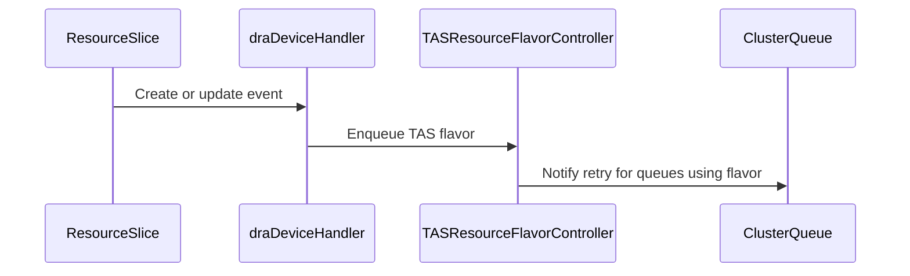

# PR #16098: DRA: requeue feasibility Workloads when devices change

**Summary**: DRA: requeue feasibility Workloads when devices change

**Sources**: https://github.com/kubernetes-sigs/kueue/pull/16098

**Last updated**: 2026-09-24T15:28:23Z

---

## Metadata

- **State**: closed (merged)
- **Author**: [@sohankunkerkar](https://github.com/sohankunkerkar)
- **Branch**: `dra-feasibility-requeue` → `main`
- **Created**: 2026-09-24T03:44:02Z
- **Updated**: 2026-09-24T15:28:23Z
- **Merged**: 2026-09-24T15:28:19Z
- **Closed**: 2026-09-24T15:28:19Z
- **Labels**: `kind/feature`, `release-note`, `size/L`, `lgtm`, `approved`, `cncf-cla: yes`, `area/tas`, `area/dra`
- **Assignees**: [@mimowo](https://github.com/mimowo)
- **Requested reviewers**: [@mbobrovskyi](https://github.com/mbobrovskyi), [@PBundyra](https://github.com/PBundyra)
- **Changed files**: 7   **+475 / -14**

## Description

<!-- Thank you for contributing! Check CONTRIBUTING.md for details. -->

#### What type of PR is this?
<!-- Choose one of the following kinds:
/kind bug
/kind cleanup
/kind documentation
/kind feature
/kind kep
-->
/kind feature
/area tas
/area dra

<!-- Optionally choose one or more of the following kinds:
/kind api-change
/kind deprecation
/kind failing-test
/kind flake
/kind regression
-->


<!-- Consider setting the area:
/area tas
/area was
/area integrations
/area multikueue
/area dashboard
/area localization
/area testing
/area website
-->


#### What this PR does / why we need it?
Requeue Workloads rejected by KueueDRADeviceFeasibility when a ResourceSlice, DeviceClass, ResourceClaim or DeviceTaintRule change may make devices available.The TAS RF controller now requeues only the ClusterQueues that use the flavor, instead of every ClusterQueue.

<!--
Use `Fixes #123` for an issue addressed by this PR; it will be closed when the PR merges.
Use `Related:` or `Part of:` to reference an issue without closing it.
-->
Fixes #15769 

#### Useful notes for your reviewer


#### Release note

<!-- Describe the behavior change accurately from the user's perspective. Hints:
- Do not leave this block blank.
- Use "NONE" when there is no user-facing change.
- When feasible use a prefix for the sub-component or feature, e.g. "FairSharing:" or "MultiKueue:".
- If upgrade steps are required, include an "ACTION REQUIRED:" section.
You may consider AI assistance using the skill: cmd/experimental/skills/kueue-release-notes/SKILL.md.
-->
```release-note
TAS: Added requeueing of Workloads rejected by `KueueDRADeviceFeasibility`, allowing them to be admitted once a ResourceSlice, DeviceClass, ResourceClaim or DeviceTaintRule change makes the devices available. Node changes now requeue only the ClusterQueues that use the affected TAS flavor.
```


<!-- This is an auto-generated comment: release notes by coderabbit.ai -->
## AI summary

Kueue now requeues Workloads rejected by `KueueDRADeviceFeasibility` when DRA device changes may make them feasible. These changes include ResourceSlice and DeviceClass changes, ResourceClaim deallocation or deletion, and DeviceTaintRule changes. For TAS flavors, Kueue requeues only ClusterQueues that use the affected flavor.

### Suggested release note

TAS: Fixed a bug where Workloads rejected by `KueueDRADeviceFeasibility` could remain pending after DRA device changes made them feasible. Kueue now requeues them when relevant ResourceSlices, DeviceClasses, ResourceClaims, or DeviceTaintRules change.
<!-- end of auto-generated comment: release notes by coderabbit.ai -->

## Discussion

### Comment by [@coderabbitai[bot]](https://github.com/apps/coderabbitai) — 2026-09-24T03:44:07Z

<!-- This is an auto-generated comment: summarize by coderabbit.ai -->
<!-- review_stack_entry_start -->

<a href="https://app.coderabbit.ai/change-stack/kubernetes-sigs/kueue/pull/16098"></a>

Navigate logical layers of code changes, visualize relationships, and explore their blast radius.

<!-- review_stack_entry_end -->
<!-- recent_review_start -->

No actionable comments were generated in the recent review. 🎉

<details>
<summary>ℹ️ Recent review info</summary>

<details>
<summary>⚙️ Run configuration</summary>

**Configuration used**: Repository: kubernetes-sigs/kueue/.coderabbit.yaml

**Review profile**: CHILL

**Plan**: Advanced

**Run ID**: `544f271e-fb65-4aaf-83e4-232803dd36b7`

</details>

<details>
<summary>📥 Commits</summary>

Reviewing files that changed from the base of the PR and between bf068f498e46d753ad1cbb5f8e8c864ec1112949 and 5f1652a747535adc426973a26355776b7eccfe8f.

</details>

<details>
<summary>📒 Files selected for processing (4)</summary>

* `keps/2941-DRA/README.md`
* `pkg/controller/tas/resource_flavor.go`
* `pkg/controller/tas/resource_flavor_test.go`
* `test/integration/singlecluster/scheduler/was/was_test.go`

</details>

**Included review availability:** Your plan provides up to 8 included reviews per hour; 6 remain after this review.

</details>

---


<!-- recent_review_end -->
<!-- walkthrough_start -->

<details>
<summary>📝 Walkthrough</summary>

## Walkthrough

Kueue now requeues workloads rejected by DRA device feasibility after qualifying device changes. The TAS controller conditionally watches DRA resources and retries workloads for ClusterQueues that use the affected TAS flavor.

### Changes

**DRA feasibility requeueing**

|Layer / File(s)|Summary|
|---|---|
|**Expose DRA cache state** <br> `pkg/cache/scheduler/cache.go`, `pkg/cache/scheduler/snapshot.go`|The cache renames its DeviceTaintRule state, exposes whether DeviceTaintRules are served, and passes that state to the DRA checker. It removes `ActiveClusterQueues`.|
|**Watch device changes and retry workloads** <br> `pkg/controller/tas/resource_flavor.go`|When DRA feasibility is enabled, the TAS controller watches ResourceSlices, DeviceClasses, and ResourceClaims. It watches DeviceTaintRules only when the cache reports they are served. Qualifying events requeue TAS flavors. Reconciliation retries workloads for ClusterQueues that use the flavor.|
|**Test and document DRA requeue behavior** <br> `pkg/controller/tas/resource_flavor_test.go`, `pkg/util/testing/wrappers.go`, `test/integration/singlecluster/scheduler/was/was_test.go`, `keps/2941-DRA/README.md`|Tests cover event filtering and workload admission after device feasibility changes. The KEP documents requeue conditions and adds them to the alpha graduation criteria.|

<!-- change_assessment_start -->
**Priority:** ➖ Normal

**Estimated code review effort:** 3 (Moderate) | ~25 minutes

<!-- change_assessment_commit:"5f1652a747535adc426973a26355776b7eccfe8f" -->
**Change:** Feature · **Severity of issue fixed:** Medium
<!-- change_assessment_end -->

### Sequence Diagram(s)



</details>

<!-- walkthrough_end -->
<!-- final_review_risk_start -->
**Merge Risk:** _⚪ Minimal_ · up to `5f165`
<!-- final_review_risk_coverage:{"sourceCommitId":"5f1652a747535adc426973a26355776b7eccfe8f","coveredCommitId":"5f1652a747535adc426973a26355776b7eccfe8f","kind":"reviewed"} -->

The DRA event watches can retry affected pending workloads, and no unresolved merge-blocking issue was established.
<!-- final_review_risk_end -->
<!-- pre_merge_checks_walkthrough_start -->

<details>
<summary>🚥 Pre-merge checks | ✅ 3 | ❌ 2</summary>

### ❌ Failed checks (2 warnings)

|         Check name         | Status     | Explanation                                                                                                                                                                                               | Resolution                                                                                                                                                                                          |
| :------------------------: | :--------- | :-------------------------------------------------------------------------------------------------------------------------------------------------------------------------------------------------------- | :-------------------------------------------------------------------------------------------------------------------------------------------------------------------------------------------------- |
| Out of Scope Changes check | ⚠️ Warning | `#15769` is limited to ResourceSlice changes. The PR also adds requeue behavior and tests for `DeviceClass`, `ResourceClaim`, and `DeviceTaintRule` changes in `pkg/controller/tas/resource_flavor.go` and… | Remove the `DeviceClass`, `ResourceClaim`, and `DeviceTaintRule` implementation, tests, and related KEP documentation from this PR, or provide linked issues that explicitly require these changes. |
|     Docstring Coverage     | ⚠️ Warning | Docstring coverage is 25.00% which is insufficient. The required threshold is 80.00%. Docstring coverage is scoped to functions touched by this diff. Analyzed 4 functions across 6 files. (1 skipped: 1… | Write docstrings for the functions missing them to satisfy the coverage threshold.                                                                                                                  |

<details>
<summary>✅ Passed checks (3 passed)</summary>

|      Check name     | Status   | Explanation                                                                                                                                                                                               |
| :-----------------: | :------- | :-------------------------------------------------------------------------------------------------------------------------------------------------------------------------------------------------------- |
|  Description Check  | ✅ Passed | Check skipped - CodeRabbit’s high-level summary is enabled.                                                                                                                                               |
|     Title check     | ✅ Passed | The title clearly and concisely describes the main change: requeueing DRA feasibility Workloads when device state changes.                                                                                |
| Linked Issues check | ✅ Passed | The PR satisfies `#15769`. `pkg/controller/tas/resource_flavor.go` watches all `ResourceSlice` objects when `KueueDRADeviceFeasibility` is enabled. The handler does not filter events by `deviceClassMapp… |

</details>

<details>
<summary>Full details: Out of Scope Changes check</summary>

**Explanation**

`#15769` is limited to ResourceSlice changes. The PR also adds requeue behavior and tests for `DeviceClass`, `ResourceClaim`, and `DeviceTaintRule` changes in `pkg/controller/tas/resource_flavor.go` and `test/integration/singlecluster/scheduler/was/was_test.go`. The KEP documents these additional behaviors. No linked issue in the supplied scope requires them.

</details>

<details>
<summary>Full details: Docstring Coverage</summary>

**Explanation**

Docstring coverage is 25.00% which is insufficient. The required threshold is 80.00%. Docstring coverage is scoped to functions touched by this diff. Analyzed 4 functions across 6 files. (1 skipped: 1 unsupported.)

</details>

</details>

<!-- pre_merge_checks_walkthrough_end -->

- [ ] <!-- {"checkboxId":"585bb3f6-faf5-4dbf-96d2-74e382adf19a"} --> Fix all pre-merge checks with AI
<!-- finishing_touch_checkbox_start -->

<details>
<summary>✨ Finishing Touches</summary>

<details open>
<summary>🧪 Generate unit tests (beta)</summary>

- [ ] <!-- {"checkboxId": "f47ac10b-58cc-4372-a567-0e02b2c3d479", "radioGroupId": "utg-output-choice-group-unknown_comment_id"} --> Create a new PR

</details>

</details>

<!-- finishing_touch_checkbox_end -->
<!-- tips_start -->

---


<sub>Comment `@coderabbitai help` to get the list of available commands.</sub>

<!-- tips_end -->

### Comment by [@netlify[bot]](https://github.com/apps/netlify) — 2026-09-24T03:44:08Z

### <span aria-hidden="true">✅</span> Deploy Preview for *kubernetes-sigs-kueue* ready!


|  Name | Link |
|:-:|------------------------|
|<span aria-hidden="true">🔨</span> Latest commit | 5f1652a747535adc426973a26355776b7eccfe8f |
|<span aria-hidden="true">🔍</span> Latest deploy log | https://app.netlify.com/projects/kubernetes-sigs-kueue/deploys/6ab5379c62ed52000801df2b |
|<span aria-hidden="true">😎</span> Deploy Preview | [https://deploy-preview-16098--kubernetes-sigs-kueue.netlify.app](https://deploy-preview-16098--kubernetes-sigs-kueue.netlify.app) |
|<span aria-hidden="true">📱</span> Preview on mobile | <details><summary> Toggle QR Code... </summary><br /><br /><br /><br />_Use your smartphone camera to open QR code link._</details> |
---
<!-- [kubernetes-sigs-kueue Preview](https://deploy-preview-16098--kubernetes-sigs-kueue.netlify.app) -->
_To edit notification comments on pull requests, go to your [Netlify project configuration](https://app.netlify.com/projects/kubernetes-sigs-kueue/configuration/notifications#deploy-notifications)._

### Comment by [@sohankunkerkar](https://github.com/sohankunkerkar) — 2026-09-24T03:45:08Z

I took the first commit from https://github.com/kubernetes-sigs/kueue/pull/16081 bc this PR builds on top of that.

### Comment by [@sohankunkerkar](https://github.com/sohankunkerkar) — 2026-09-24T14:59:06Z

@mimowo PTAL

### Comment by [@kubernetes-prow[bot]](https://github.com/apps/kubernetes-prow) — 2026-09-24T15:25:30Z

LGTM label has been added.  <details>Git tree hash: bd226b95e547ccfc0e09f3f4ca4814bef80c5819</details>

### Comment by [@kubernetes-prow[bot]](https://github.com/apps/kubernetes-prow) — 2026-09-24T15:25:35Z

[APPROVALNOTIFIER] This PR is **APPROVED**

This pull-request has been approved by: *<a href="https://github.com/kubernetes-sigs/kueue/pull/16098#pullrequestreview-5306503848" title="Approved">mimowo</a>*, *<a href="https://github.com/kubernetes-sigs/kueue/pull/16098#" title="Author self-approved">sohankunkerkar</a>*

The full list of commands accepted by this bot can be found [here](https://go.k8s.io/bot-commands?repo=kubernetes-sigs%2Fkueue).

The pull request process is described [here](https://git.k8s.io/community/contributors/guide/owners.md#the-code-review-process)

<details >
Needs approval from an approver in each of these files:

- ~~[OWNERS](https://github.com/kubernetes-sigs/kueue/blob/main/OWNERS)~~ [mimowo,sohankunkerkar]

Approvers can indicate their approval by writing `/approve` in a comment
Approvers can cancel approval by writing `/approve cancel` in a comment
</details>
<!-- META={"approvers":[]} -->

## Reviews

### Review by [@copilot-pull-request-reviewer[bot]](https://github.com/apps/copilot-pull-request-reviewer) (commented) — 2026-09-24T03:51:38Z

<!-- ccr-overview-v2 -->

## Copilot review overview

### 🟡 Changes recommended

Critical API compatibility and integration-suite issues, plus unnecessary status-triggered requeues, remain unresolved.

*Get a fresh assessment by requesting another Copilot review.*

**Review effort:** Lite  
**Findings:** 2 <picture><source media="(prefers-color-scheme: dark)" srcset="https://github.githubassets.com/static/images/icons/copilot-code-review/high-v2-dark.svg"><source media="(prefers-color-scheme: light)" srcset="https://github.githubassets.com/static/images/icons/copilot-code-review/high-v2-light.svg"></picture>

<details open>
<summary><strong>Open (2)</strong></summary>

- <picture><source media="(prefers-color-scheme: dark)" srcset="https://github.githubassets.com/static/images/icons/copilot-code-review/high-v2-dark.svg"><source media="(prefers-color-scheme: light)" srcset="https://github.githubassets.com/static/images/icons/copilot-code-review/high-v2-light.svg"></picture> [Avoid ignoring device taints when v1 API is unavailable](#discussion_r4089702352) · New
- <picture><source media="(prefers-color-scheme: dark)" srcset="https://github.githubassets.com/static/images/icons/copilot-code-review/high-v2-dark.svg"><source media="(prefers-color-scheme: light)" srcset="https://github.githubassets.com/static/images/icons/copilot-code-review/high-v2-light.svg"></picture> [Skip DeviceTaintRule tests when the API is unavailable](#discussion_r4089702417) · New
</details>

<details>
<summary><strong>What changed in this PR</strong></summary>

Adds DRA-aware feasibility requeueing and DeviceTaintRule handling for TAS workloads.

**Changes:**
- Requeues affected TAS flavors when DRA resources change.
- Applies device taints during feasibility and allocation.
- Adds tests, RBAC updates, helpers, and documentation.

| File | Summary |
|---|---|
| `test/​integration/​singlecluster/​scheduler/​was/​was_test.go` | Adds DRA taint and requeue integration coverage. |
| `test/​integration/​singlecluster/​scheduler/​was/​suite_test.go` | Configures integration tests; API availability assertion requires changes for supported Kubernetes versions. |
| `pkg/​util/​testingjobs/​dra/​wrappers.go` | Adds DRA test helpers. |
| `pkg/​util/​testing/​wrappers.go` | Adds ResourceClaim test helpers. |
| `pkg/​util/​dra/​dra.go` | Detects DeviceTaintRule API availability; the fallback can ignore taints on Kubernetes 1.35/1.36. |
| `pkg/​scheduler/​scheduler_tas_test.go` | Updates TAS test harness support. |
| `pkg/​scheduler/​scheduler_tas_dra_test.go` | Adds TAS/DRA scheduling coverage. |
| `pkg/​controller/​tas/​resource_flavor.go` | Watches DRA events and requeues TAS flavors; should avoid requeueing on status-only DeviceTaintRule updates. |
| `pkg/​controller/​tas/​resource_flavor_test.go` | Tests handler and requeue behavior. |
| `pkg/​controller/​core/​workload_controller.go` | Adds DeviceTaintRule RBAC configuration. |
| `pkg/​cache/​scheduler/​tas_cache_test.go` | Updates checker setup tests. |
| `pkg/​cache/​scheduler/​snapshot.go` | Propagates device-taint configuration. |
| `pkg/​cache/​scheduler/​dra/​taints.go` | Applies device taints during allocation. |
| `pkg/​cache/​scheduler/​dra/​taints_test.go` | Tests taint behavior. |
| `pkg/​cache/​scheduler/​dra/​checker.go` | Adds taint-aware feasibility checking. |
| `pkg/​cache/​scheduler/​dra/​checker_test.go` | Tests feasibility behavior. |
| `pkg/​cache/​scheduler/​dra/​allocator.go` | Applies taints during allocation and caching. |
| `pkg/​cache/​scheduler/​dra/​allocator_test.go` | Tests allocation caching. |
| `pkg/​cache/​scheduler/​cache.go` | Stores DeviceTaintRule availability. |
| `keps/​2941-DRA/​README.md` | Documents DRA taint and requeue behavior. |
| `config/​components/​rbac/​role.yaml` | Updates generated RBAC permissions. |
| `cmd/​kueue/​main.go` | Registers DeviceTaintRule informers. |
| `charts/​kueue/​templates/​rbac/​role.yaml` | Updates Helm RBAC permissions. |
</details>

---

💡 <a href="/kubernetes-sigs/kueue/new/main?filename=.github/skills/code-review/SKILL.md" class="Link--inTextBlock" target="_blank" rel="noopener noreferrer">Add a `code-review` agent skill</a> or configure MCP servers for context-aware, tailored reviews. <a href="https://docs.github.com/copilot/how-tos/use-copilot-agents/request-a-code-review/use-code-review?tool=webui#mcp-servers-and-agent-skills" class="Link--inTextBlock" target="_blank" rel="noopener noreferrer">Learn more in the docs.</a>

- **pkg/util/dra/dra.go:58** by [@Copilot](https://github.com/apps/copilot-pull-request-reviewer) — 2026-09-24T03:51:37Z
```diff
@@ -36,3 +42,20 @@ func CheckResourceSliceAPIAvailable(mgr ctrl.Manager) bool {
 	}
 	return false
 }
+
+// RegisterDeviceTaintRuleInformer registers the DeviceTaintRule informer before the
+// manager starts, and reports whether the rules are served. Otherwise the first scheduling
+// cycle starts the informer and blocks on its sync, which never completes when RBAC denies it.
+func RegisterDeviceTaintRuleInformer(ctx context.Context, mgr ctrl.Manager) (bool, error) {
+	if !utilfeature.DefaultFeatureGate.Enabled(kubefeatures.DRADeviceTaintRules) {
+		return false, nil
+	}
+	if _, err := mgr.GetCache().GetInformer(ctx, &resourcev1.DeviceTaintRule{}); err != nil {
+		if !apimeta.IsNoMatchError(err) {
+			return false, err
+		}
+		ctrl.Log.V(0).Info("DeviceTaintRules not served as resource.k8s.io/v1, ignoring them; this needs Kubernetes 1.37 or later")
+		return false, nil
```

  When `DRADeviceTaintRules` is enabled on Kubernetes 1.35/1.36, the v1 endpoint can be unavailable even though the versioned DeviceTaintRule API is supported. Returning `false` here silently makes Kueue's feasibility check ignore device taints while the corresponding kube-scheduler still enforces them, so Kueue can admit a Workload that kube-scheduler cannot place. Support the served API version or fail/disable this feasibility path instead of treating the missing v1 endpoint as a safe fallback.

- **test/integration/singlecluster/scheduler/was/suite_test.go:103** by [@Copilot](https://github.com/apps/copilot-pull-request-reviewer) — 2026-09-24T03:51:38Z
```diff
@@ -92,6 +97,11 @@ func managerSetup() func(ctx context.Context, mgr manager.Manager) {
 		gomega.Expect(err).NotTo(gomega.HaveOccurred())
 		err = core.SetupResourceSliceIndexer(ctx, mgr.GetFieldIndexer())
 		gomega.Expect(err).NotTo(gomega.HaveOccurred())
+		// Matches cmd/kueue/main.go.
+		deviceTaintRulesServed, err := utildra.RegisterDeviceTaintRuleInformer(ctx, mgr)
+		gomega.Expect(err).NotTo(gomega.HaveOccurred())
+		gomega.Expect(deviceTaintRulesServed).To(gomega.BeTrue())
```

  `RegisterDeviceTaintRuleInformer` intentionally returns `false` when the cluster does not serve `resource.k8s.io/v1` (including the documented Kubernetes 1.35/1.36 case), so this assertion makes the entire integration suite fail on those supported versions before any test runs. Please skip only the DeviceTaintRule-dependent specs when `deviceTaintRulesServed` is false rather than requiring the API unconditionally.

### Review by [@copilot-pull-request-reviewer[bot]](https://github.com/apps/copilot-pull-request-reviewer) (commented) — 2026-09-24T11:39:25Z

<!-- ccr-overview-v2 -->

## Copilot review overview

**Review effort:** Balanced  
**Findings:** None

<details>
<summary><strong>Resolved since last review (2)</strong></summary>

- <picture><source media="(prefers-color-scheme: dark)" srcset="https://github.githubassets.com/static/images/icons/copilot-code-review/high-v2-dark.svg"><source media="(prefers-color-scheme: light)" srcset="https://github.githubassets.com/static/images/icons/copilot-code-review/high-v2-light.svg"></picture> [Skip DeviceTaintRule tests when the API is unavailable](#discussion_r4089702417)
- <picture><source media="(prefers-color-scheme: dark)" srcset="https://github.githubassets.com/static/images/icons/copilot-code-review/high-v2-dark.svg"><source media="(prefers-color-scheme: light)" srcset="https://github.githubassets.com/static/images/icons/copilot-code-review/high-v2-light.svg"></picture> [Avoid ignoring device taints when v1 API is unavailable](#discussion_r4089702352)
</details>

### Review by [@mimowo](https://github.com/mimowo) (commented) — 2026-09-24T12:12:27Z

- **pkg/controller/tas/resource_flavor.go:229** by [@mimowo](https://github.com/mimowo) — 2026-09-24T12:12:27Z
```diff
@@ -152,11 +213,11 @@ func (r *rfReconciler) Reconcile(ctx context.Context, req reconcile.Request) (re
 		}
 	}
 	if flv.Spec.TopologyName != nil {
-		// requeue inadmissible workloads as a change to the resource flavor
-		// or the set of nodes can allow admitting a workload which was
-		// previously inadmissible.
-		if cqNames := r.cache.ActiveClusterQueues(); len(cqNames) > 0 {
-			qcache.NotifyRetryInadmissible(r.queues, cqNames)
+		// requeue inadmissible workloads as a change to the resource flavor,
+		// the set of nodes or their devices can allow admitting a workload
+		// which was previously inadmissible.
+		if cqNames := r.cache.ClusterQueuesUsingFlavor(kueue.ResourceFlavorReference(req.Name)); len(cqNames) > 0 {
+			qcache.NotifyRetryInadmissible(r.queues, sets.New(cqNames...))
```

  This looks like a good fix / performance optimization unrelated to the PR, could you send a bugfix for that?

### Review by [@mimowo](https://github.com/mimowo) (commented) — 2026-09-24T12:13:21Z

- **test/integration/singlecluster/scheduler/was/was_test.go:346** by [@mimowo](https://github.com/mimowo) — 2026-09-24T12:13:22Z
```diff
@@ -342,6 +342,199 @@ var _ = ginkgo.Describe("WAS Simulator", ginkgo.Ordered, ginkgo.Label("feature:s
 				gomega.Expect(ta.Domains).To(gomega.HaveLen(1))
 				gomega.Expect(ta.Domains[0].Values).To(gomega.ContainElement("was-n2"))
 			})
+			ginkgo.It("should admit a pending DRA workload once the rule is deleted", func() {
```

  nit, add a newline to separate the test cases

### Review by [@mimowo](https://github.com/mimowo) (commented) — 2026-09-24T12:18:11Z

- **pkg/controller/tas/resource_flavor.go:193** by [@mimowo](https://github.com/mimowo) — 2026-09-24T12:18:11Z
```diff
@@ -141,6 +154,54 @@ func (h *nodeHandler) Generic(_ context.Context, e event.GenericEvent, q workque
 	}
 }
 
+var _ handler.EventHandler = (*draDeviceHandler)(nil)
+
+// draDeviceHandler requeues TAS flavors on the DRA events that can make devices available,
+// following the ones kube-scheduler's dynamicresources plugin retries Pods on.
+type draDeviceHandler struct {
+	cache *schdcache.Cache
+}
+
+func (h *draDeviceHandler) Create(_ context.Context, e event.CreateEvent, q workqueue.TypedRateLimitingInterface[reconcile.Request]) {
+	switch e.Object.(type) {
+	case *resourcev1.ResourceSlice, *resourcev1.DeviceClass:
+		h.requeue(q)
+	}
+}
+
+func (h *draDeviceHandler) Update(_ context.Context, e event.UpdateEvent, q workqueue.TypedRateLimitingInterface[reconcile.Request]) {
+	switch newObj := e.ObjectNew.(type) {
+	// kube-scheduler sees a DeviceTaintRule change as an update of the slices it patches.
+	case *resourcev1.ResourceSlice, *resourcev1.DeviceClass, *resourcev1.DeviceTaintRule:
+		h.requeue(q)
+	case *resourcev1.ResourceClaim:
+		if oldObj, ok := e.ObjectOld.(*resourcev1.ResourceClaim); ok && oldObj.Status.Allocation != nil && newObj.Status.Allocation == nil {
+			h.requeue(q)
+		}
+	}
+}
+
+func (h *draDeviceHandler) Delete(_ context.Context, e event.DeleteEvent, q workqueue.TypedRateLimitingInterface[reconcile.Request]) {
+	switch obj := e.Object.(type) {
+	case *resourcev1.DeviceTaintRule:
+		h.requeue(q)
+	case *resourcev1.ResourceClaim:
+		// With the final state unknown, the deallocation may have been missed.
+		if e.DeleteStateUnknown || obj.Status.Allocation != nil {
+			h.requeue(q)
+		}
+	}
```

  Could you extract to some helpers like handleDelete, handleUpdate to commonize the handling? I'm quite surprised the handling is not symmetric, for example why deletion of  *resourcev1.DeviceClass, does not requeue, but update does. This feels a bit tricky.  I think commonizing the code could help to avoid silly copy-paste bugs.

### Review by [@sohankunkerkar](https://github.com/sohankunkerkar) (commented) — 2026-09-24T13:10:14Z

- **pkg/controller/tas/resource_flavor.go:193** by [@sohankunkerkar](https://github.com/sohankunkerkar) — 2026-09-24T13:10:14Z
```diff
@@ -141,6 +154,54 @@ func (h *nodeHandler) Generic(_ context.Context, e event.GenericEvent, q workque
 	}
 }
 
+var _ handler.EventHandler = (*draDeviceHandler)(nil)
+
+// draDeviceHandler requeues TAS flavors on the DRA events that can make devices available,
+// following the ones kube-scheduler's dynamicresources plugin retries Pods on.
+type draDeviceHandler struct {
+	cache *schdcache.Cache
+}
+
+func (h *draDeviceHandler) Create(_ context.Context, e event.CreateEvent, q workqueue.TypedRateLimitingInterface[reconcile.Request]) {
+	switch e.Object.(type) {
+	case *resourcev1.ResourceSlice, *resourcev1.DeviceClass:
+		h.requeue(q)
+	}
+}
+
+func (h *draDeviceHandler) Update(_ context.Context, e event.UpdateEvent, q workqueue.TypedRateLimitingInterface[reconcile.Request]) {
+	switch newObj := e.ObjectNew.(type) {
+	// kube-scheduler sees a DeviceTaintRule change as an update of the slices it patches.
+	case *resourcev1.ResourceSlice, *resourcev1.DeviceClass, *resourcev1.DeviceTaintRule:
+		h.requeue(q)
+	case *resourcev1.ResourceClaim:
+		if oldObj, ok := e.ObjectOld.(*resourcev1.ResourceClaim); ok && oldObj.Status.Allocation != nil && newObj.Status.Allocation == nil {
+			h.requeue(q)
+		}
+	}
+}
+
+func (h *draDeviceHandler) Delete(_ context.Context, e event.DeleteEvent, q workqueue.TypedRateLimitingInterface[reconcile.Request]) {
+	switch obj := e.Object.(type) {
+	case *resourcev1.DeviceTaintRule:
+		h.requeue(q)
+	case *resourcev1.ResourceClaim:
+		// With the final state unknown, the deallocation may have been missed.
+		if e.DeleteStateUnknown || obj.Status.Allocation != nil {
+			h.requeue(q)
+		}
+	}
```

  You're right, and it's more than style. Mirroring kube-scheduler's `EventsToRegister` skipped deletes, but in Kueue a DeviceClass delete can make a Workload fit: when two classes share an `extendedResourceName`, deleting the newer one switches us to the other. So I made slices, classes and rules requeue on every event and kept the filter only for ResourceClaims, since those change with every Pod.

### Review by [@sohankunkerkar](https://github.com/sohankunkerkar) (commented) — 2026-09-24T14:04:24Z

- **pkg/controller/tas/resource_flavor.go:229** by [@sohankunkerkar](https://github.com/sohankunkerkar) — 2026-09-24T14:04:24Z
```diff
@@ -152,11 +213,11 @@ func (r *rfReconciler) Reconcile(ctx context.Context, req reconcile.Request) (re
 		}
 	}
 	if flv.Spec.TopologyName != nil {
-		// requeue inadmissible workloads as a change to the resource flavor
-		// or the set of nodes can allow admitting a workload which was
-		// previously inadmissible.
-		if cqNames := r.cache.ActiveClusterQueues(); len(cqNames) > 0 {
-			qcache.NotifyRetryInadmissible(r.queues, cqNames)
+		// requeue inadmissible workloads as a change to the resource flavor,
+		// the set of nodes or their devices can allow admitting a workload
+		// which was previously inadmissible.
+		if cqNames := r.cache.ClusterQueuesUsingFlavor(kueue.ResourceFlavorReference(req.Name)); len(cqNames) > 0 {
+			qcache.NotifyRetryInadmissible(r.queues, sets.New(cqNames...))
```

  Done! here: https://github.com/kubernetes-sigs/kueue/pull/16152

### Review by [@mimowo](https://github.com/mimowo) (commented) — 2026-09-24T15:25:21Z

/lgtm
/approve
Thank you!
