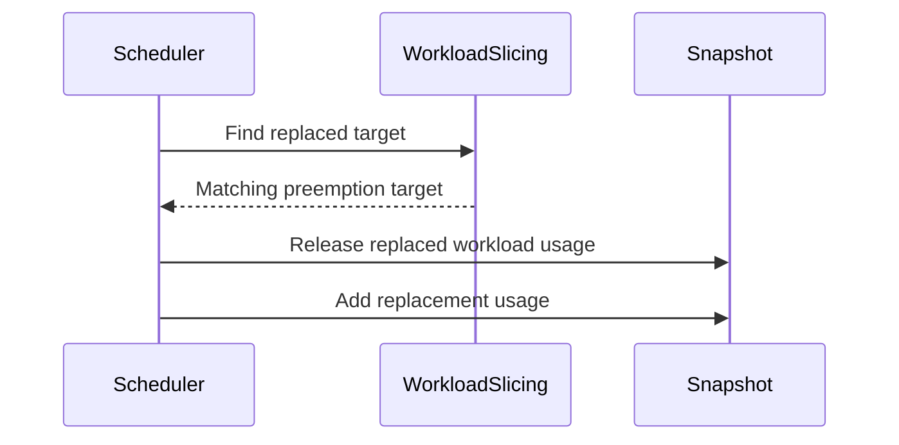

# PR #16125: Elastic jobs: fix workload-slice replacement accounting within a scheduling cycle

**Summary**: Elastic jobs: fix workload-slice replacement accounting within a scheduling cycle

**Sources**: https://github.com/kubernetes-sigs/kueue/pull/16125

**Last updated**: 2026-09-25T09:58:06Z

---

## Metadata

- **State**: open
- **Author**: [@apullo777](https://github.com/apullo777)
- **Branch**: `fix-slice-replacement-accounting` → `main`
- **Created**: 2026-09-24T08:56:55Z
- **Updated**: 2026-09-25T09:58:06Z
- **Merged**: —
- **Closed**: —
- **Labels**: `kind/bug`, `release-note`, `size/XL`, `do-not-merge/hold`, `cncf-cla: yes`, `area/elastic-jobs`
- **Assignees**: _none_
- **Requested reviewers**: [@kannon92](https://github.com/kannon92), [@kshalot](https://github.com/kshalot)
- **Changed files**: 6   **+749 / -15**

## Description

<!-- Thank you for contributing! Check CONTRIBUTING.md for details. -->

#### What type of PR is this?

/kind bug
/area elastic-jobs

#### What this PR does / why we need it?

I put these two issues into one PR because they seem to come from the same cycle-local replacement transition. My current approach is to release the old slice's usage once and book the replacement in full, while fair-sharing ranking still uses only the incremental request. I'd be interested in whether this feels like the right boundary for the shared fix.

<!--
Use `Fixes #123` for an issue addressed by this PR; it will be closed when the PR merges.
Use `Related:` or `Part of:` to reference an issue without closing it.
-->
Fixes #16118
Fixes #16119

#### Useful notes for your reviewer

- The cycle-local released state lives in `Snapshot`. The old Workload stays in its ClusterQueue and target state for replacement/fork detection; only its usage is marked released, so later fit and preemption simulations don't release it again.
- When `ElasticJobsViaWorkloadSlicesWithTAS` is disabled, quota still transitions to the replacement, but the old topology usage remains counted because those Pods are still running.
- A later preemptor that selects an already-released slice gets no capacity from it and continues looking for other victims.

Tests cover quota over-admission, TAS scale-up and scale-down, DeferredFit, gate-off TAS behavior, fork protection, and snapshot release semantics. `go test ./pkg/...`, `make ci-lint`, `make verify`, and the `singlecluster/scheduler` integration tests pass.


#### Release note

<!-- Describe the behavior change accurately from the user's perspective. Hints:
- Do not leave this block blank.
- Use "NONE" when there is no user-facing change.
- When feasible use a prefix for the sub-component or feature, e.g. "FairSharing:" or "MultiKueue:".
- If upgrade steps are required, include an "ACTION REQUIRED:" section.
You may consider AI assistance using the skill: cmd/experimental/skills/kueue-release-notes/SKILL.md.
-->
```release-note
ElasticJobsViaWorkloadSlices: Fixed a bug where resizing an elastic job could let the scheduler admit workloads beyond a cohort's quota in the same scheduling cycle. With ElasticJobsViaWorkloadSlicesWithTAS enabled, the replaced slice's topology usage no longer defers other workloads to the next scheduling cycle.
```


<!-- This is an auto-generated comment: release notes by coderabbit.ai -->
## AI summary

This change fixes scheduling-cycle accounting for workload-slice replacements. Kueue releases the replaced slice’s quota usage once and books the replacement in full, while fair-sharing ranking uses only the incremental request. When `ElasticJobsViaWorkloadSlicesWithTAS` is enabled, the cycle also excludes the replaced slice’s topology usage.

## Suggested release note

ElasticJobsViaWorkloadSlices: Fixed a bug where replacing a workload slice could overcommit cohort quota. When `ElasticJobsViaWorkloadSlicesWithTAS` is enabled, Kueue also removes the replaced slice’s topology usage from the cycle so it does not incorrectly defer workloads.
<!-- end of auto-generated comment: release notes by coderabbit.ai -->

## Discussion

### Comment by [@netlify[bot]](https://github.com/apps/netlify) — 2026-09-24T08:57:01Z

### <span aria-hidden="true">✅</span> Deploy Preview for *kubernetes-sigs-kueue* ready!


|  Name | Link |
|:-:|------------------------|
|<span aria-hidden="true">🔨</span> Latest commit | 408fc265a842dd01e01ee4dea058570d018f7944 |
|<span aria-hidden="true">🔍</span> Latest deploy log | https://app.netlify.com/projects/kubernetes-sigs-kueue/deploys/6ab642831d6c760008a88b0a |
|<span aria-hidden="true">😎</span> Deploy Preview | [https://deploy-preview-16125--kubernetes-sigs-kueue.netlify.app](https://deploy-preview-16125--kubernetes-sigs-kueue.netlify.app) |
|<span aria-hidden="true">📱</span> Preview on mobile | <details><summary> Toggle QR Code... </summary><br /><br /><br /><br />_Use your smartphone camera to open QR code link._</details> |
---
<!-- [kubernetes-sigs-kueue Preview](https://deploy-preview-16125--kubernetes-sigs-kueue.netlify.app) -->
_To edit notification comments on pull requests, go to your [Netlify project configuration](https://app.netlify.com/projects/kubernetes-sigs-kueue/configuration/notifications#deploy-notifications)._

### Comment by [@kubernetes-prow[bot]](https://github.com/apps/kubernetes-prow) — 2026-09-24T08:57:07Z

[APPROVALNOTIFIER] This PR is **NOT APPROVED**

This pull-request has been approved by: *<a href="https://github.com/kubernetes-sigs/kueue/pull/16125#" title="Author self-approved">apullo777</a>*
**Once this PR has been reviewed and has the lgtm label**, please assign [olekzabl](https://github.com/olekzabl), [tenzen-y](https://github.com/tenzen-y) for approval. For more information see [the Code Review Process](https://git.k8s.io/community/contributors/guide/owners.md#the-code-review-process).

The full list of commands accepted by this bot can be found [here](https://go.k8s.io/bot-commands?repo=kubernetes-sigs%2Fkueue).

<details open>
Needs approval from an approver in each of these files:

- **[OWNERS](https://github.com/kubernetes-sigs/kueue/blob/main/OWNERS)**

Approvers can indicate their approval by writing `/approve` in a comment
Approvers can cancel approval by writing `/approve cancel` in a comment
</details>
<!-- META={"approvers":["olekzabl","tenzen-y"]} -->

### Comment by [@apullo777](https://github.com/apullo777) — 2026-09-24T08:57:18Z

Holding while we align on the shared replacement-accounting shape for #16118 and #16119.

/hold

### Comment by [@coderabbitai[bot]](https://github.com/apps/coderabbitai) — 2026-09-24T08:58:09Z

<!-- This is an auto-generated comment: summarize by coderabbit.ai -->
<!-- review_stack_entry_start -->

<a href="https://app.coderabbit.ai/change-stack/kubernetes-sigs/kueue/pull/16125"></a>

Navigate logical layers of code changes, visualize relationships, and explore their blast radius.

<!-- review_stack_entry_end -->
<!-- recent_review_start -->

No actionable comments were generated in the recent review. 🎉

<details>
<summary>ℹ️ Recent review info</summary>

<details>
<summary>⚙️ Run configuration</summary>

**Configuration used**: Repository: kubernetes-sigs/kueue/.coderabbit.yaml

**Review profile**: CHILL

**Plan**: Advanced

**Run ID**: `9f620fca-63ee-43ba-a721-8181c7880320`

</details>

<details>
<summary>📥 Commits</summary>

Reviewing files that changed from the base of the PR and between 229037f98b0e6efe40611480b9ec85727e0dbf23 and 408fc265a842dd01e01ee4dea058570d018f7944.

</details>

<details>
<summary>📒 Files selected for processing (1)</summary>

* `pkg/cache/scheduler/snapshot_test.go`

</details>

**Included review availability:** Your plan provides up to 8 included reviews per hour; 6 remain after this review.

</details>

---


<!-- recent_review_end -->
<!-- walkthrough_start -->

<details>
<summary>📝 Walkthrough</summary>

## Walkthrough

The scheduler now tracks released workload-slice usage separately from workload presence. Fit checks and snapshot booking account for replaced slices. Tests cover quota accounting, topology-aware scheduling, and deferred fit.

### Changes

**Workload-slice replacement accounting**

|Layer / File(s)|Summary|
|---|---|
|**Released usage in scheduler snapshots** <br> `pkg/cache/scheduler/snapshot.go`, `pkg/cache/scheduler/snapshot_test.go`|The snapshot tracks workloads whose usage has been released while they remain in the ClusterQueue. Add, remove, and simulated usage-removal operations preserve that state. Tests cover release, removal, simulation, and revert behavior.|
|**Replacement fit checks and usage booking** <br> `pkg/workloadslicing/workloadslicing.go`, `pkg/scheduler/scheduler.go`, `pkg/scheduler/preemption/preemption_test.go`, `pkg/scheduler/scheduler_workload_slices_test.go`|A new function finds a matching replacement target without changing the target list. Scheduler fit checks and snapshot booking account for replaced slice usage. Tests cover quota accounting, topology-aware scheduling, and deferred fit.|

<!-- change_assessment_start -->
**Priority:** ➖ Normal

**Estimated code review effort:** 3 (Moderate) | ~25 minutes

<!-- change_assessment_commit:"408fc265a842dd01e01ee4dea058570d018f7944" -->
**Change:** Bug fix · **Severity of issue fixed:** Medium
<!-- change_assessment_end -->

### Sequence Diagram(s)



</details>

<!-- walkthrough_end -->
<!-- final_review_risk_start -->
**Merge Risk:** _⚪ Minimal_ · up to `408fc`
<!-- final_review_risk_coverage:{"sourceCommitId":"408fc265a842dd01e01ee4dea058570d018f7944","coveredCommitId":"408fc265a842dd01e01ee4dea058570d018f7944","kind":"reviewed"} -->

The reported partial-scale-up preemption mismatch is already corrected at this head. No actionable merge-blocking issue remains after normal checks.
<!-- final_review_risk_end -->
<!-- architecture_review_start -->
### Security Architecture Review

**Security architecture risk:** _🔵 Low_ · up to `408fc`

The replacement accounting changes an important scheduling control, but the reviewed paths do not establish a new security bypass. The remaining uncertainty is in failure-path and broader security coverage.

**Retained concerns**
No architecture-level concerns identified.

<details>
<summary>Security review details</summary>

**Security Blast Radius**
- _inferred_ — A replacement-accounting error could affect quota or topology availability seen by later workloads in the scheduling cycle. The reviewed change does not establish a new external route or privilege boundary.

**Trust Boundaries and Controls**
- _observed_ — The scheduler obtains replacement candidates during assignment, checks fit against booked usage, and guards repeat release by workload key. These are the relevant controls on annotation-driven replacement accounting in the inspected path.

**Resilience and Maintainability Implications**
- _inferred_ — Simulation revert paths and cycle-local snapshot ownership limit how long an interrupted accounting transition can influence scheduling. The scoped test evidence does not independently cover every production failure or concurrent state.

</details>

<!-- architecture_review_end -->
<!-- pre_merge_checks_walkthrough_start -->

<details>
<summary>🚥 Pre-merge checks | ✅ 4 | ❌ 1</summary>

### ❌ Failed checks (1 warning)

|     Check name     | Status     | Explanation                                                                                                                                                                                 | Resolution                                                                         |
| :----------------: | :--------- | :------------------------------------------------------------------------------------------------------------------------------------------------------------------------------------------ | :--------------------------------------------------------------------------------- |
| Docstring Coverage | ⚠️ Warning | Docstring coverage is 72.73% which is insufficient. The required threshold is 80.00%. Docstring coverage is scoped to functions touched by this diff. Analyzed 11 functions across 6 files. | Write docstrings for the functions missing them to satisfy the coverage threshold. |

<details>
<summary>✅ Passed checks (4 passed)</summary>

|         Check name         | Status   | Explanation                                                                                                                                                                                               |
| :------------------------: | :------- | :-------------------------------------------------------------------------------------------------------------------------------------------------------------------------------------------------------- |
|      Description Check     | ✅ Passed | Check skipped - CodeRabbit’s high-level summary is enabled.                                                                                                                                               |
|         Title check        | ✅ Passed | The title clearly and concisely describes the main change: correcting workload-slice replacement accounting within a scheduling cycle.                                                                    |
|     Linked Issues check    | ✅ Passed | The PR satisfies [`#16118`] and [`#16119`]. `bookUsage` releases the replaced slice once and books the replacement usage in full. `bookedUsage` keeps fair-sharing accounting based on the incremental reque… |
| Out of Scope Changes check | ✅ Passed | The production changes directly implement replacement accounting for [`#16118`] and [`#16119`]. The snapshot and target-detection changes support single-cycle replacement handling. The added tests verify … |

</details>

</details>

<!-- pre_merge_checks_walkthrough_end -->

- [ ] <!-- {"checkboxId":"585bb3f6-faf5-4dbf-96d2-74e382adf19a"} --> Fix all pre-merge checks with AI
<!-- finishing_touch_checkbox_start -->

<details>
<summary>✨ Finishing Touches</summary>

<details open>
<summary>🧪 Generate unit tests (beta)</summary>

- [ ] <!-- {"checkboxId": "f47ac10b-58cc-4372-a567-0e02b2c3d479", "radioGroupId": "utg-output-choice-group-unknown_comment_id"} --> Create a new PR

</details>

</details>

<!-- finishing_touch_checkbox_end -->
<!-- tips_start -->

---


<sub>Comment `@coderabbitai help` to get the list of available commands.</sub>

<!-- tips_end -->

### Comment by [@apullo777](https://github.com/apullo777) — 2026-09-24T11:38:30Z

The [integration failure](https://prow.k8s.io/view/gs/kubernetes-ci-logs/pr-logs/pull/kubernetes-sigs_kueue/16125/pull-kueue-test-integration-shard-1-main/2103046022182735872) is reproducible, and I think I found the mismatch. `GetTargets` is sizing the preemptor differently from the assignment we eventually try to admit: it misses the `pods` resource, and for workload-slice replacements it ignores the partial-admission count.

I opened #16142 for that. I will keep this PR on hold and rebase it once that fix is in.

### Comment by [@mimowo](https://github.com/mimowo) — 2026-09-24T19:47:59Z

https://prow.k8s.io/view/gs/kubernetes-ci-logs/pr-logs/pull/kubernetes-sigs_kueue/16125/pull-kueue-test-integration-shard-1-main/2103046022182735872 
This is RayCluster failure so it might be related, wdyt?

### Comment by [@apullo777](https://github.com/apullo777) — 2026-09-25T09:00:08Z

> https://prow.k8s.io/view/gs/kubernetes-ci-logs/pr-logs/pull/kubernetes-sigs_kueue/16125/pull-kueue-test-integration-shard-1-main/2103046022182735872
> This is RayCluster failure so it might be related, wdyt?

Yes, it's related. That's the RayCluster partial scale-up test with preemption. I think this PR exposes #16142 by removing the accounting behavior that masked it.

I verified this PR on top of #16167; the RayCluster, RayJob and scheduler integration suites all pass locally. I'll rebase once #16167 merges
