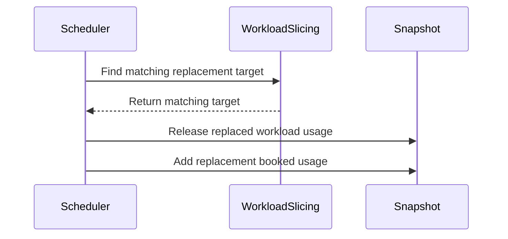

# PR #16125: Elastic jobs: fix workload-slice replacement accounting within a scheduling cycle

**Summary**: Elastic jobs: fix workload-slice replacement accounting within a scheduling cycle

**Sources**: https://github.com/kubernetes-sigs/kueue/pull/16125

**Last updated**: 2026-10-03T19:48:25Z

---

## Metadata

- **State**: closed (merged)
- **Author**: [@apullo777](https://github.com/apullo777)
- **Branch**: `fix-slice-replacement-accounting` → `main`
- **Created**: 2026-09-24T08:56:55Z
- **Updated**: 2026-10-03T19:48:25Z
- **Merged**: 2026-10-02T13:29:36Z
- **Closed**: 2026-10-02T13:29:36Z
- **Labels**: `kind/bug`, `release-note`, `lgtm`, `size/XL`, `approved`, `cncf-cla: yes`, `area/elastic-jobs`
- **Assignees**: [@mimowo](https://github.com/mimowo)
- **Requested reviewers**: [@kannon92](https://github.com/kannon92), [@kshalot](https://github.com/kshalot)
- **Changed files**: 10   **+969 / -19**

## Description

<!-- Thank you for contributing! Check CONTRIBUTING.md for details. -->

#### What type of PR is this?

/kind bug
/area elastic-jobs

#### What this PR does / why we need it?

I put these two issues into one PR because they seem to come from the same cycle-local replacement transition. My current approach is to release the old slice's usage once and book the replacement in full, while fair-sharing ranking still uses only the incremental request. I'd be interested in whether this feels like the right boundary for the shared fix.

<!--
Use `Fixes #123` for an issue addressed by this PR; it will be closed when the PR merges.
Use `Related:` or `Part of:` to reference an issue without closing it.
-->
Fixes #16118
Fixes #16119

#### Useful notes for your reviewer

- The cycle-local released state lives in `Snapshot`. The old Workload stays in its ClusterQueue and target state for replacement/fork detection; only its usage is marked released, so later fit and preemption simulations don't release it again.
- When `ElasticJobsViaWorkloadSlicesWithTAS` is disabled, quota still transitions to the replacement, but the old topology usage remains counted because those Pods are still running.
- A later preemptor that selects an already-released slice gets no capacity from it and continues looking for other victims.

Tests cover quota over-admission, TAS scale-up and scale-down, DeferredFit, gate-off TAS behavior, fork protection, and snapshot release semantics. `go test ./pkg/...`, `make ci-lint`, `make verify`, and the `singlecluster/scheduler` integration tests pass.


#### Release note

<!-- Describe the behavior change accurately from the user's perspective. Hints:
- Do not leave this block blank.
- Use "NONE" when there is no user-facing change.
- When feasible use a prefix for the sub-component or feature, e.g. "FairSharing:" or "MultiKueue:".
- If upgrade steps are required, include an "ACTION REQUIRED:" section.
You may consider AI assistance using the skill: cmd/experimental/skills/kueue-release-notes/SKILL.md.
-->
```release-note
ElasticJobsViaWorkloadSlices: Fixed a bug where resizing an elastic job could let the scheduler admit workloads beyond a cohort's quota in the same scheduling cycle. With ElasticJobsViaWorkloadSlicesWithTAS enabled, the replaced slice's topology usage no longer defers other workloads to the next scheduling cycle.
```


<!-- This is an auto-generated comment: release notes by coderabbit.ai -->
## AI summary

Fixed workload-slice replacement accounting so replacements cannot cause a scheduling cycle to exceed cohort quota. With `ElasticJobsViaWorkloadSlicesWithTAS` enabled, the scheduler also accounts for the replaced slice’s topology usage correctly, so a successor that fits is not deferred.

### Suggested release note

ElasticJobsViaWorkloadSlices: Fixed a bug where replacing a workload slice could overcommit cohort quota or leave stale topology usage that deferred other workloads. Kueue now accounts for the replaced slice correctly, including when `ElasticJobsViaWorkloadSlicesWithTAS` is enabled.
<!-- end of auto-generated comment: release notes by coderabbit.ai -->

## Discussion

### Comment by [@netlify[bot]](https://github.com/apps/netlify) — 2026-09-24T08:57:01Z

### <span aria-hidden="true">✅</span> Deploy Preview for *kubernetes-sigs-kueue* canceled.


|  Name | Link |
|:-:|------------------------|
|<span aria-hidden="true">🔨</span> Latest commit | 7ca12dd6059c758cc4a53fc10bc88c5c3d16a323 |
|<span aria-hidden="true">🔍</span> Latest deploy log | https://app.netlify.com/projects/kubernetes-sigs-kueue/deploys/6abfa9a2948ac90008ad13cc |

### Comment by [@apullo777](https://github.com/apullo777) — 2026-09-24T08:57:18Z

Holding while we align on the shared replacement-accounting shape for #16118 and #16119.

/hold

### Comment by [@coderabbitai[bot]](https://github.com/apps/coderabbitai) — 2026-09-24T08:58:09Z

<!-- This is an auto-generated comment: summarize by coderabbit.ai -->
<!-- review_stack_entry_start -->

<a href="https://app.coderabbit.ai/change-stack/kubernetes-sigs/kueue/pull/16125?cs_source=review_comment"></a>

Navigate logical layers of code changes, visualize relationships, and explore their blast radius.

<!-- review_stack_entry_end -->
<!-- recent_review_start -->

No actionable comments were generated in the recent review. 🎉

<details>
<summary>ℹ️ Recent review info</summary>

<details>
<summary>⚙️ Run configuration</summary>

**Configuration used**: Repository: kubernetes-sigs/kueue/.coderabbit.yaml

**Review profile**: CHILL

**Plan**: Advanced

**Run ID**: `a498daec-30f1-4332-8234-e8d92918391d`

</details>

<details>
<summary>📥 Commits</summary>

Reviewing files that changed from the base of the PR and between b001d5cf130a926c2c71cd5e41775c9dfa0fd245 and 7ca12dd6059c758cc4a53fc10bc88c5c3d16a323.

</details>

<details>
<summary>📒 Files selected for processing (5)</summary>

* `pkg/scheduler/scheduler_recompute_preemption_test.go`
* `pkg/scheduler/scheduler_refill_tas_test.go`
* `pkg/scheduler/scheduler_test.go`
* `test/integration/singlecluster/scheduler/scheduler_test.go`
* `test/integration/singlecluster/tas/tas_workload_slice_refill_test.go`

</details>

**Included review availability:** This review used your included allowance. Your plan provides up to 8 included reviews per hour; 7 remain after this review.

</details>

---


<!-- recent_review_end -->
<!-- walkthrough_start -->

<details>
<summary>📝 Walkthrough</summary>

## Walkthrough

The snapshot now tracks released workload usage separately from workload presence. Scheduler fit checks and booking account for workload-slice replacements. Tests cover quota accounting, deferred preemption, and TAS refill behavior.

### Changes

**Workload-slice replacement accounting**

|Layer / File(s)|Summary|
|---|---|
|**Track released usage in scheduler snapshots** <br> `pkg/cache/scheduler/snapshot.go`, `pkg/cache/scheduler/snapshot_test.go`, `pkg/scheduler/preemption/preemption_test.go`|Snapshots track workloads whose usage was released while they remain in their ClusterQueue. Removal, restoration, simulation, and revert tests cover the resulting usage and workload state. Snapshot comparisons ignore the new `released` field.|
|**Account for replaced slices during fit and booking** <br> `pkg/workloadslicing/workloadslicing.go`, `pkg/scheduler/scheduler.go`|`ReplacedSliceTarget` returns a matching replacement target without changing the target list. Scheduler fit checks and booking account for the replaced slice's assigned quota. Booking releases the replaced workload's usage, applies the TAS usage adjustment when slice-aware TAS is disabled, and adds the replacement's booked usage.|
|**Validate quota and deferred-preemption behavior** <br> `pkg/scheduler/scheduler_test.go`, `pkg/scheduler/scheduler_recompute_preemption_test.go`, `test/integration/singlecluster/scheduler/scheduler_test.go`|Scheduler tests cover replacement quota checks, fair-sharing rank, and deferred-fit recomputation. The integration test checks cohort quota as a replacement and another workload compete for capacity.|
|**Validate TAS replacement and refill behavior** <br> `pkg/scheduler/scheduler_refill_tas_test.go`, `test/integration/singlecluster/tas/tas_workload_slice_refill_test.go`|Unit and integration tests cover topology usage after replacement, successor refill, and behavior under different feature-gate settings.|

<!-- change_assessment_start -->
**Priority:** ⬆️ High

**Estimated code review effort:** 4 (Complex) | ~45 minutes

<!-- change_assessment_commit:"7ca12dd6059c758cc4a53fc10bc88c5c3d16a323" -->
**Change:** Bug fix · **Severity of issue fixed:** Medium
<!-- change_assessment_end -->

### Sequence Diagram(s)



**Suggested reviewers:** `mszadkow`

</details>

<!-- walkthrough_end -->
<!-- final_review_risk_start -->
**Merge Risk:** _⚪ Minimal_ · up to `7ca12`
<!-- final_review_risk_coverage:{"sourceCommitId":"7ca12dd6059c758cc4a53fc10bc88c5c3d16a323","coveredCommitId":"7ca12dd6059c758cc4a53fc10bc88c5c3d16a323","kind":"reviewed"} -->

No actionable merge-blocking issue was identified; the change is ready for normal merge checks.
<!-- final_review_risk_end -->
<!-- architecture_review_start -->
### Security Architecture Review

**Security architecture risk:** _🟡 Moderate_ · up to `7ca12`

The change addresses double-counting during workload replacement, but the new accounting path does not consistently enforce the predecessor’s namespace and queue ownership. Normal replacement and simulation behavior have supporting coverage; cross-queue target handling and some failure transitions remain unresolved.

**Retained concerns**
- **Medium · security · inferred:** The new usage-transfer path identifies a predecessor from the generic preemption-target list without enforcing the same namespace and ClusterQueue checks used by scoped replacement lookup. If an accepted replacement annotation names an eligible ordinary preemption target outside that scope and the booked-usage fit check succeeds, booking can release that target’s usage from its owning queue and charge it to the requesting queue while the target remains active. The base already had unscoped target filtering; the newly added accounting mutation makes that identity ambiguity security-relevant. A complete attacker-triggered path is not verified.

<details>
<summary>Security review details</summary>

**Security Blast Radius**
- _inferred_ — The relevant exposure is resource isolation and scheduling availability across affected ClusterQueues, cohort quota, and topology capacity. The conditional cross-owner path requires control over a scheduling Workload’s replacement annotation, an enabled workload-slicing gate, selection of the named target under preemption policy, and a successful booked-usage fit check. Arbitrary cluster-wide target selection is not established.

**Security Findings and Attack Paths**
- _inferred_ — A replacement annotation can match an ordinary preemption target rather than the scoped predecessor returned by replacement lookup. The head newly uses that match to release the target’s usage from its owning queue and add booked usage to the requesting queue. This is an inferred ownership-boundary concern, not a verified exploit; admission rejection and effective planner/fit constraints have not been fully resolved.

**Trust Boundaries and Controls**
- _observed_ — The normal replacement producer enforces namespace and ClusterQueue scope. The new target matcher instead checks only the annotation’s namespaced workload key and feature gate. Full booked-usage fitting is an additional capacity control, but it does not itself establish replacement authority over the matched workload.

**Resilience and Maintainability Implications**
- _inferred_ — For a legitimate same-queue replacement, the new release-and-full-book operation preserves the base’s aggregate quota reservation. Admission patch failure therefore does not, by itself, prove newly freed quota. Failure-sensitive topology ownership remains a separate uncertainty because booking precedes external completion, while successful admission finishes the old slice afterward and documents reconciliation recovery for finishing failures.

**Hardening Proposals**
- _proposed_ — Carry the validated predecessor identity from assignment planning into booking, or require booking to validate the matched target against the requesting namespace and ClusterQueue. This would make replacement authority explicit rather than deriving it from membership in a generic preemption-target list.


</details>

<!-- architecture_review_end -->
<!-- pre_merge_checks_walkthrough_start -->

<details>
<summary>🚥 Pre-merge checks | ✅ 4 | ❌ 1</summary>

### ❌ Failed checks (1 warning)

|     Check name     | Status     | Explanation                                                                                                                                                                                  | Resolution                                                                         |
| :----------------: | :--------- | :------------------------------------------------------------------------------------------------------------------------------------------------------------------------------------------- | :--------------------------------------------------------------------------------- |
| Docstring Coverage | ⚠️ Warning | Docstring coverage is 60.00% which is insufficient. The required threshold is 80.00%. Docstring coverage is scoped to functions touched by this diff. Analyzed 15 functions across 11 files. | Write docstrings for the functions missing them to satisfy the coverage threshold. |

<details>
<summary>✅ Passed checks (4 passed)</summary>

|         Check name         | Status   | Explanation                                                                                                                                                                                               |
| :------------------------: | :------- | :-------------------------------------------------------------------------------------------------------------------------------------------------------------------------------------------------------- |
|      Description Check     | ✅ Passed | Check skipped - CodeRabbit’s high-level summary is enabled.                                                                                                                                               |
|         Title check        | ✅ Passed | The title clearly and concisely describes the main change: fixing accounting for workload-slice replacements within a scheduling cycle.                                                                   |
|     Linked Issues check    | ✅ Passed | The PR satisfies [`#16118`]. Scheduler accounting releases replaced usage once, books replacement usage in full, and uses the incremental request for fair-sharing ranking. Unit and integration tests cov… |
| Out of Scope Changes check | ✅ Passed | The production changes directly implement replacement accounting for [`#16118`] and [`#16119`]. Snapshot tracking, replacement-target detection, and preemption-target updates support this accounting. The … |

</details>

</details>

<!-- pre_merge_checks_walkthrough_end -->

- [ ] <!-- {"checkboxId":"585bb3f6-faf5-4dbf-96d2-74e382adf19a"} --> Fix all pre-merge checks with AI
<!-- finishing_touch_checkbox_start -->

<details>
<summary>✨ Finishing Touches</summary>

<details open>
<summary>🧪 Generate unit tests (beta)</summary>

- [ ] <!-- {"checkboxId": "f47ac10b-58cc-4372-a567-0e02b2c3d479", "radioGroupId": "utg-output-choice-group-unknown_comment_id"} --> Create a new PR

</details>

</details>

<!-- finishing_touch_checkbox_end -->
<!-- tips_start -->

---


<sub>Comment `@coderabbitai help` to get the list of available commands.</sub>

<!-- tips_end -->

### Comment by [@apullo777](https://github.com/apullo777) — 2026-09-24T11:38:30Z

The [integration failure](https://prow.k8s.io/view/gs/kubernetes-ci-logs/pr-logs/pull/kubernetes-sigs_kueue/16125/pull-kueue-test-integration-shard-1-main/2103046022182735872) is reproducible, and I think I found the mismatch. `GetTargets` is sizing the preemptor differently from the assignment we eventually try to admit: it misses the `pods` resource, and for workload-slice replacements it ignores the partial-admission count.

I opened #16142 for that. I will keep this PR on hold and rebase it once that fix is in.

### Comment by [@mimowo](https://github.com/mimowo) — 2026-09-24T19:47:59Z

https://prow.k8s.io/view/gs/kubernetes-ci-logs/pr-logs/pull/kubernetes-sigs_kueue/16125/pull-kueue-test-integration-shard-1-main/2103046022182735872 
This is RayCluster failure so it might be related, wdyt?

### Comment by [@apullo777](https://github.com/apullo777) — 2026-09-25T09:00:08Z

> https://prow.k8s.io/view/gs/kubernetes-ci-logs/pr-logs/pull/kubernetes-sigs_kueue/16125/pull-kueue-test-integration-shard-1-main/2103046022182735872
> This is RayCluster failure so it might be related, wdyt?

Yes, it's related. That's the RayCluster partial scale-up test with preemption. I think this PR exposes #16142 by removing the accounting behavior that masked it.

I verified this PR on top of #16167; the RayCluster, RayJob and scheduler integration suites all pass locally. I'll rebase once #16167 merges

### Comment by [@mimowo](https://github.com/mimowo) — 2026-09-30T13:42:14Z

@apullo777 is this one ready for review?

### Comment by [@apullo777](https://github.com/apullo777) — 2026-09-30T14:23:58Z

> @apullo777 is this one ready for review?

Ah, yes, thanks for checking! #16167 is in now, and after rebasing the previously failing CI is green. I also rechecked it on latest main and it’s still green.

/hold cancel

### Comment by [@mimowo](https://github.com/mimowo) — 2026-10-01T19:37:14Z

> Fixes https://github.com/kubernetes-sigs/kueue/issues/16118
> Fixes https://github.com/kubernetes-sigs/kueue/issues/16119

That is pretty impressive. Would it be feasible to add integration tests for the two scenarios?

### Comment by [@mimowo](https://github.com/mimowo) — 2026-10-01T19:38:08Z

> My current approach is to release the old slice's usage once and book the replacement in full, while fair-sharing ranking still uses only the incremental request. I'd be interested in whether this feels like the right boundary for the shared fix.

This sounds reasonable as an approach.

### Comment by [@apullo777](https://github.com/apullo777) — 2026-10-02T12:58:59Z

Pushed the follow-ups from this round:

- consolidated the unit cases into the existing scheduler test tables and dropped the custom runner
- added integration coverage for both the cohort over-admission and TAS refill scenarios. Both fail without the fix

### Comment by [@kubernetes-prow[bot]](https://github.com/apps/kubernetes-prow) — 2026-10-02T13:12:24Z

LGTM label has been added.  <details>Git tree hash: e1d031dbeedaad80db41c46360294532f23c21f5</details>

### Comment by [@kubernetes-prow[bot]](https://github.com/apps/kubernetes-prow) — 2026-10-02T13:12:27Z

[APPROVALNOTIFIER] This PR is **APPROVED**

This pull-request has been approved by: *<a href="https://github.com/kubernetes-sigs/kueue/pull/16125#" title="Author self-approved">apullo777</a>*, *<a href="https://github.com/kubernetes-sigs/kueue/pull/16125#pullrequestreview-5392190193" title="Approved">mimowo</a>*

The full list of commands accepted by this bot can be found [here](https://go.k8s.io/bot-commands?repo=kubernetes-sigs%2Fkueue).

The pull request process is described [here](https://git.k8s.io/community/contributors/guide/owners.md#the-code-review-process)

<details >
Needs approval from an approver in each of these files:

- ~~[OWNERS](https://github.com/kubernetes-sigs/kueue/blob/main/OWNERS)~~ [mimowo]

Approvers can indicate their approval by writing `/approve` in a comment
Approvers can cancel approval by writing `/approve cancel` in a comment
</details>
<!-- META={"approvers":[]} -->

### Comment by [@mimowo](https://github.com/mimowo) — 2026-10-02T13:33:22Z

/cherrypick release-0.20
/cherrypick release-0.19

### Comment by [@k8s-infra-cherrypick-robot](https://github.com/k8s-infra-cherrypick-robot) — 2026-10-02T13:34:00Z

@mimowo: #16125 failed to apply on top of branch "release-0.19":
```
Applying: Move usage from the replaced slice when booking a slice replacement
Using index info to reconstruct a base tree...
M	pkg/cache/scheduler/snapshot.go
M	pkg/cache/scheduler/snapshot_test.go
M	pkg/scheduler/preemption/preemption_test.go
M	pkg/scheduler/scheduler.go
M	pkg/workloadslicing/workloadslicing.go
Falling back to patching base and 3-way merge...
Auto-merging pkg/cache/scheduler/snapshot.go
Auto-merging pkg/cache/scheduler/snapshot_test.go
CONFLICT (content): Merge conflict in pkg/cache/scheduler/snapshot_test.go
Auto-merging pkg/scheduler/preemption/preemption_test.go
Auto-merging pkg/scheduler/scheduler.go
CONFLICT (content): Merge conflict in pkg/scheduler/scheduler.go
Auto-merging pkg/workloadslicing/workloadslicing.go
error: Failed to merge in the changes.
hint: Use 'git am --show-current-patch=diff' to see the failed patch
hint: When you have resolved this problem, run "git am --continue".
hint: If you prefer to skip this patch, run "git am --skip" instead.
hint: To restore the original branch and stop patching, run "git am --abort".
hint: Disable this message with "git config set advice.mergeConflict false"
Patch failed at 0001 Move usage from the replaced slice when booking a slice replacement

```

<details>

In response to [this](https://github.com/kubernetes-sigs/kueue/pull/16125#issuecomment-5953523037):

>/cherrypick release-0.20
>/cherrypick release-0.19


Instructions for interacting with me using PR comments are available [here](https://git.k8s.io/community/contributors/guide/pull-requests.md).  If you have questions or suggestions related to my behavior, please file an issue against the [kubernetes-sigs/prow](https://github.com/kubernetes-sigs/prow/issues/new?title=Prow%20issue:) repository.
</details>

### Comment by [@k8s-infra-cherrypick-robot](https://github.com/k8s-infra-cherrypick-robot) — 2026-10-02T13:34:39Z

@mimowo: new pull request created: #16601

<details>

In response to [this](https://github.com/kubernetes-sigs/kueue/pull/16125#issuecomment-5953523037):

>/cherrypick release-0.20
>/cherrypick release-0.19


Instructions for interacting with me using PR comments are available [here](https://git.k8s.io/community/contributors/guide/pull-requests.md).  If you have questions or suggestions related to my behavior, please file an issue against the [kubernetes-sigs/prow](https://github.com/kubernetes-sigs/prow/issues/new?title=Prow%20issue:) repository.
</details>

### Comment by [@mimowo](https://github.com/mimowo) — 2026-10-02T13:36:04Z

@apullo777 please prep cp for 0.19

### Comment by [@tenzen-y](https://github.com/tenzen-y) — 2026-10-03T19:47:26Z

@coderabbitai Please open a cleanup issue to address @tenzen-y 's comments, but no one should be assigned to the issues.

### Comment by [@coderabbitai[bot]](https://github.com/apps/coderabbitai) — 2026-10-03T19:48:25Z

<!-- This is an auto-generated reply by CodeRabbit -->
> [!TIP]
> For best results, initiate chat on the files or code changes.

<details>
<summary>🧩 Analysis chain</summary>

🏁 Script executed:

```shell
#!/bin/bash
set -euo pipefail
fd --hidden --exclude .git '^AGENTS\.md$' . --exec sh -c 'printf "\n--- %s ---\n" "$1"; cat "$1"' sh {}
gh api --paginate repos/kubernetes-sigs/kueue/issues/16125/comments --jq '.[] | select(.user.login == "tenzen-y") | {body,html_url}'
gh api --paginate repos/kubernetes-sigs/kueue/pulls/16125/comments --jq '.[] | select(.user.login == "tenzen-y") | {body,path,line,original_line,html_url,in_reply_to_id}'
gh api --paginate repos/kubernetes-sigs/kueue/pulls/16125/reviews --jq '.[] | select(.user.login == "tenzen-y") | {body,html_url,state}'
```

Length of output: 6818

---

🏁 Script executed:

```shell
#!/bin/bash
set -euo pipefail
cat cmd/experimental/skills/kueue-pr-issue-workflow/SKILL.md
ast-grep outline pkg/cache/scheduler/snapshot_test.go --match TestSnapshotReleaseWorkloadUsage
ast-grep outline pkg/scheduler/scheduler_recompute_preemption_test.go
ast-grep outline pkg/scheduler/scheduler_refill_tas_test.go
ast-grep outline pkg/scheduler/scheduler_test.go --match 'slice|Slice'
sed -n '2330,2415p' pkg/cache/scheduler/snapshot_test.go
sed -n '200,285p' pkg/scheduler/scheduler_recompute_preemption_test.go
sed -n '110,175p' pkg/scheduler/scheduler_refill_tas_test.go
sed -n '570,650p' pkg/scheduler/scheduler_test.go
```

Length of output: 16051

---

🏁 Script executed:

```shell
#!/bin/bash
set -euo pipefail
find .github/ISSUE_TEMPLATE -maxdepth 1 -type f -print
find .github/ISSUE_TEMPLATE -maxdepth 1 -type f -exec sh -c 'printf "\n--- %s ---\n" "$1"; cat "$1"' sh {} \;
```

Length of output: 9203

---

🏁 Script executed:

```shell
#!/bin/bash
set -euo pipefail
body=$(cat <<'EOF'
**What would you like to be cleaned**:

Replace callback-based operations and local workload-slice fixture helpers introduced in #16125 with declarative test data and explicit `utiltestingapi` builder chains.

- `pkg/cache/scheduler/snapshot_test.go`: replace the `operate` callbacks in `TestSnapshotReleaseWorkloadUsage` with declarative operation fields; build the admitted workloads explicitly. [Comments](https://github.com/kubernetes-sigs/kueue/pull/16125#discussion_r4174566947), [fixture example](https://github.com/kubernetes-sigs/kueue/pull/16125#discussion_r4174571405).
- `pkg/scheduler/scheduler_recompute_preemption_test.go`: replace the added slice fixture helpers with declarative test fixtures. [Comment](https://github.com/kubernetes-sigs/kueue/pull/16125#discussion_r4174574210).
- `pkg/scheduler/scheduler_refill_tas_test.go`: express slice workloads and feature gates declaratively. [Comment](https://github.com/kubernetes-sigs/kueue/pull/16125#discussion_r4174575002).
- `pkg/scheduler/scheduler_test.go`: replace the added slice fixture helpers with declarative inputs and expected states. [Comment](https://github.com/kubernetes-sigs/kueue/pull/16125#discussion_r4174575923).

Acceptance: remove the flagged callbacks/helpers, preserve all existing scenarios and assertions, and keep the affected tests passing. Do not change scheduler behavior.

**Why is this needed**:

Declarative fixtures make each scenario's inputs and expected states visible and easier to review.

Requested by @tenzen-y in [this comment](https://github.com/kubernetes-sigs/kueue/pull/16125#issuecomment-5972856946) on [#16125](https://github.com/kubernetes-sigs/kueue/pull/16125). Leave this issue unassigned.

AI disclosure: CodeRabbit AI prepared and filed this issue.
EOF
)
url=$(gh issue create --repo kubernetes-sigs/kueue --title "🧹 Use declarative fixtures in workload-slice scheduler tests" --body "$body")
printf '%s\n' "$url"
gh issue view "$url" --repo kubernetes-sigs/kueue --json number,url,title,assignees
```

Length of output: 2428

---

</details>

`@tenzen-y` Created `#16639` to address your comments about declarative test fixtures. The issue links to all five review comments and has no assignees.

I followed `AGENTS.md`. Its use is experimental, with no guarantees of backward or future compatibility.

_You are interacting with an AI system._

## Reviews

### Review by [@mimowo](https://github.com/mimowo) (commented) — 2026-10-01T19:33:19Z

- **pkg/scheduler/scheduler_workload_slices_test.go:452** by [@mimowo](https://github.com/mimowo) — 2026-10-01T19:33:19Z
```diff
@@ -0,0 +1,558 @@
+/*
+Copyright The Kubernetes Authors.
+
+Licensed under the Apache License, Version 2.0 (the "License");
+you may not use this file except in compliance with the License.
+You may obtain a copy of the License at
+
+    http://www.apache.org/licenses/LICENSE-2.0
+
+Unless required by applicable law or agreed to in writing, software
+distributed under the License is distributed on an "AS IS" BASIS,
+WITHOUT WARRANTIES OR CONDITIONS OF ANY KIND, either express or implied.
+See the License for the specific language governing permissions and
+limitations under the License.
+*/
+
+package scheduler
+
+import (
+	"context"
+	"sync"
+	"testing"
+	"time"
+
+	"github.com/google/go-cmp/cmp"
+	corev1 "k8s.io/api/core/v1"
+	"k8s.io/apimachinery/pkg/api/resource"
+	"k8s.io/component-base/featuregate"
+	testingclock "k8s.io/utils/clock/testing"
+	"sigs.k8s.io/controller-runtime/pkg/client"
+	"sigs.k8s.io/controller-runtime/pkg/client/interceptor"
+
+	config "sigs.k8s.io/kueue/apis/config/v1beta2"
+	kueue "sigs.k8s.io/kueue/apis/kueue/v1beta2"
+	qcache "sigs.k8s.io/kueue/pkg/cache/queue"
+	schdcache "sigs.k8s.io/kueue/pkg/cache/scheduler"
+	tasindexer "sigs.k8s.io/kueue/pkg/controller/tas/indexer"
+	"sigs.k8s.io/kueue/pkg/features"
+	preemptexpectations "sigs.k8s.io/kueue/pkg/scheduler/preemption/expectations"
+	"sigs.k8s.io/kueue/pkg/util/routine"
+	utiltesting "sigs.k8s.io/kueue/pkg/util/testing"
+	utiltestingapi "sigs.k8s.io/kueue/pkg/util/testing/v1beta2"
+	testingnode "sigs.k8s.io/kueue/pkg/util/testingjobs/node"
+	"sigs.k8s.io/kueue/pkg/workload"
+	"sigs.k8s.io/kueue/pkg/workloadslicing"
+)
+
+type workloadSliceCycle struct {
+	featureGates map[featuregate.Feature]bool
+	fairSharing  bool
+	flavor       *kueue.ResourceFlavor
+	topology     *kueue.Topology
+	nodes        []corev1.Node
+	cqs          []*kueue.ClusterQueue
+	lqs          []kueue.LocalQueue
+	workloads    []kueue.Workload
+}
+
+// run runs one scheduling cycle and reports the cache's admissions and what is
+// left in the queues.
+func (c workloadSliceCycle) run(t *testing.T, now time.Time) (map[workload.Reference]kueue.Admission, map[kueue.ClusterQueueReference][]workload.Reference) {
+	t.Helper()
+	features.SetFeatureGatesDuringTest(t, c.featureGates)
+	ctx, log := utiltesting.ContextWithLog(t)
+
+	lists := []client.ObjectList{
+		&kueue.WorkloadList{Items: c.workloads},
+		&corev1.NodeList{Items: c.nodes},
+		&kueue.LocalQueueList{Items: c.lqs},
+	}
+	if c.topology != nil {
+		lists = append(lists, &kueue.TopologyList{Items: []kueue.Topology{*c.topology}})
+	}
+	clientBuilder := utiltesting.NewClientBuilder().
+		WithLists(lists...).
+		WithObjects(utiltesting.MakeNamespace("default")).
+		WithInterceptorFuncs(interceptor.Funcs{
+			SubResourceApply: utiltesting.TreatSSAAsStrategicMergeForApplyConfiguration,
+		}).
+		WithStatusSubresource(&kueue.Workload{}, &kueue.ClusterQueue{}, &kueue.LocalQueue{})
+	_ = tasindexer.SetupIndexes(ctx, utiltesting.AsIndexer(clientBuilder))
+	cl := clientBuilder.Build()
+
+	cqCache := schdcache.New(cl)
+	fakeClock := testingclock.NewFakeClock(now)
+	qManager := qcache.NewManagerForUnitTests(cl, cqCache, qcache.WithClock(fakeClock))
+	for i := range c.nodes {
+		cqCache.TASCache().SyncNode(&c.nodes[i])
+	}
+	cqCache.AddOrUpdateResourceFlavor(log, c.flavor.DeepCopy())
+	if c.topology != nil {
+		cqCache.AddOrUpdateTopology(log, c.topology.DeepCopy())
+	}
+	for _, cq := range c.cqs {
+		if err := cqCache.AddClusterQueue(ctx, cq.DeepCopy()); err != nil {
+			t.Fatalf("Inserting clusterQueue %s in cache: %v", cq.Name, err)
+		}
+		if err := qManager.AddClusterQueue(ctx, cq.DeepCopy()); err != nil {
+			t.Fatalf("Inserting clusterQueue %s in manager: %v", cq.Name, err)
+		}
+	}
+	for i := range c.lqs {
+		if err := qManager.AddLocalQueue(ctx, c.lqs[i].DeepCopy()); err != nil {
+			t.Fatalf("Inserting queue %s/%s in manager: %v", c.lqs[i].Namespace, c.lqs[i].Name, err)
+		}
+	}
+
+	opts := []Option{WithClock(t, fakeClock), WithPreemptionExpectations(preemptexpectations.New())}
+	if c.fairSharing {
+		opts = append(opts, WithFairSharing(&config.FairSharing{}))
+	}
+	scheduler := New(qManager, cqCache, cl, &utiltesting.EventRecorder{}, opts...)
+	wg := sync.WaitGroup{}
+	scheduler.setAdmissionRoutineWrapper(routine.NewWrapper(
+		func() { wg.Add(1) },
+		func() { wg.Done() },
+	))
+
+	ctx, cancel := context.WithTimeout(ctx, queueingTimeout)
+	go qManager.CleanUpOnContext(ctx)
+	defer cancel()
+
+	scheduler.schedule(ctx)
+	wg.Wait()
+
+	snapshot, err := cqCache.Snapshot(ctx)
+	if err != nil {
+		t.Fatalf("unexpected error while building snapshot: %v", err)
+	}
+	gotAssignments := make(map[workload.Reference]kueue.Admission)
+	for _, cq := range snapshot.ClusterQueues() {
+		for name, w := range cq.Workloads {
+			if workload.HasQuotaReservation(w.Obj) {
+				gotAssignments[name] = *w.Obj.Status.Admission
+			}
+		}
+	}
+	return gotAssignments, qManager.Dump()
+}
+
+// elasticWorkload builds a workload slice as the job controllers create it.
+func elasticWorkload(name, lq string, pods int, creation time.Time) *utiltestingapi.WorkloadWrapper {
+	return utiltestingapi.MakeWorkload(name, "default").
+		Queue(kueue.LocalQueueName(lq)).
+		Creation(creation).
+		Annotation(workloadslicing.EnabledAnnotationKey, workloadslicing.EnabledAnnotationValue).
+		PodSets(*utiltestingapi.MakePodSet("one", pods).
+			Request(corev1.ResourceCPU, "1").
+			Obj())
+}
+
+// TestScheduleWorkloadSliceReplacementQuota pins that a workload slice
+// replacement moves quota from the replaced slice to itself exactly once in the
+// scheduling cycle, for its own fit and for every entry after it.
+//
+// Without fair sharing, the cohort has 10 CPUs and "grow" replaces the 6 CPU
+// slice "old" with 8, leaving 2 CPUs for "b1", which asks for 4.
+func TestScheduleWorkloadSliceReplacementQuota(t *testing.T) {
+	now := time.Now().Truncate(time.Second)
+
+	clusterQueue := func(name, nominal, borrowingLimit string) *kueue.ClusterQueue {
+		return utiltestingapi.MakeClusterQueue(name).Cohort("cohort").
+			ResourceGroup(*utiltestingapi.MakeFlavorQuotas("default").
+				Resource(corev1.ResourceCPU, nominal, borrowingLimit).Obj()).
+			Obj()
+	}
+	admission := func(cq string, pods int32) kueue.Admission {
+		return *utiltestingapi.MakeAdmission(kueue.ClusterQueueReference(cq)).PodSets(
+			utiltestingapi.MakePodSetAssignment("one").
+				Assignment(corev1.ResourceCPU, "default", resource.NewQuantity(int64(pods), resource.DecimalSI).String()).
+				Count(pods).
+				Obj(),
+		).Obj()
+	}
+	old := elasticWorkload("old", "lq-a", 6, now.Add(-4*time.Minute)).
+		ReserveQuotaAt(new(admission("cq-a", 6)), now.Add(-4*time.Minute)).
+		Obj()
+	grow := elasticWorkload("grow", "lq-a", 8, now.Add(-3*time.Minute)).
+		Annotation(workloadslicing.WorkloadSliceReplacementFor, "default/old").
+		Obj()
+	b1 := utiltestingapi.MakeWorkload("b1", "default").
+		Queue("lq-b").
+		Creation(now.Add(-2 * time.Minute)).
+		PodSets(*utiltestingapi.MakePodSet("one", 4).Request(corev1.ResourceCPU, "1").Obj()).
+		Obj()
+	grow2 := utiltestingapi.MakeWorkload("grow", "default").
+		Queue("lq-a").
+		Creation(now.Add(-3 * time.Minute)).
+		PodSets(*utiltestingapi.MakePodSet("one", 2).Request(corev1.ResourceCPU, "1").Obj()).
+		Obj()
+
+	cases := map[string]struct {
+		fairSharing     bool
+		cqs             []*kueue.ClusterQueue
+		workloads       []kueue.Workload
+		wantAssignments map[workload.Reference]kueue.Admission
+		wantLeft        map[kueue.ClusterQueueReference][]workload.Reference
+	}{
+		// cq-b only borrows, so the replacement is processed first and b1
+		// must see the 2 CPUs the cohort really has left.
+		"a later entry does not reuse the replaced slice's quota": {
+			cqs:       []*kueue.ClusterQueue{clusterQueue("cq-a", "10", ""), clusterQueue("cq-b", "0", "10")},
+			workloads: []kueue.Workload{*old, *grow, *b1},
+			wantAssignments: map[workload.Reference]kueue.Admission{
+				"default/old":  admission("cq-a", 6),
+				"default/grow": admission("cq-a", 8),
+			},
+			wantLeft: map[kueue.ClusterQueueReference][]workload.Reference{
+				"cq-b": {"default/b1"},
+			},
+		},
+		"control: a later entry after an ordinary workload of the same net size": {
+			cqs:       []*kueue.ClusterQueue{clusterQueue("cq-a", "10", ""), clusterQueue("cq-b", "0", "10")},
+			workloads: []kueue.Workload{*old, *grow2, *b1},
+			wantAssignments: map[workload.Reference]kueue.Admission{
+				"default/old":  admission("cq-a", 6),
+				"default/grow": admission("cq-a", 2),
+			},
+			wantLeft: map[kueue.ClusterQueueReference][]workload.Reference{
+				"cq-b": {"default/b1"},
+			},
+		},
+		// b1 fits within cq-b's nominal quota, so it is processed first and
+		// the replacement's own fit check sees a cohort with no room left.
+		"the replacement's own fit does not reuse the replaced slice's quota": {
+			cqs:       []*kueue.ClusterQueue{clusterQueue("cq-a", "6", ""), clusterQueue("cq-b", "4", "10")},
+			workloads: []kueue.Workload{*old, *grow, *b1},
+			wantAssignments: map[workload.Reference]kueue.Admission{
+				"default/old": admission("cq-a", 6),
+				"default/b1":  admission("cq-b", 4),
+			},
+			wantLeft: map[kueue.ClusterQueueReference][]workload.Reference{
+				"cq-a": {"default/grow"},
+			},
+		},
+		// ClusterQueues are ranked by their share after admission: cq-a would
+		// borrow 2 for grow's increase and cq-b 3 for b1, so grow goes first
+		// and b1 no longer fits.
+		"fair sharing ranks the replacement by its increase": {
+			fairSharing: true,
+			cqs: []*kueue.ClusterQueue{
+				clusterQueue("cq-a", "4", ""),
+				clusterQueue("cq-b", "3", ""),
+				clusterQueue("cq-c", "3", ""),
+			},
+			workloads: []kueue.Workload{
+				*elasticWorkload("old", "lq-a", 4, now.Add(-4*time.Minute)).
+					ReserveQuotaAt(new(admission("cq-a", 4)), now.Add(-4*time.Minute)).
+					Obj(),
+				*elasticWorkload("grow", "lq-a", 6, now.Add(-3*time.Minute)).
+					Annotation(workloadslicing.WorkloadSliceReplacementFor, "default/old").
+					Obj(),
+				*utiltestingapi.MakeWorkload("b1", "default").
+					Queue("lq-b").
+					Creation(now.Add(-5 * time.Minute)).
+					PodSets(*utiltestingapi.MakePodSet("one", 6).Request(corev1.ResourceCPU, "1").Obj()).
+					Obj(),
+			},
+			wantAssignments: map[workload.Reference]kueue.Admission{
+				"default/old":  admission("cq-a", 4),
+				"default/grow": admission("cq-a", 6),
+			},
+			wantLeft: map[kueue.ClusterQueueReference][]workload.Reference{
+				"cq-b": {"default/b1"},
+			},
+		},
+	}
+	for name, tc := range cases {
+		t.Run(name, func(t *testing.T) {
+			gotAssignments, gotLeft := workloadSliceCycle{
+				featureGates: map[featuregate.Feature]bool{features.ElasticJobsViaWorkloadSlices: true},
+				fairSharing:  tc.fairSharing,
+				flavor:       utiltestingapi.MakeResourceFlavor("default").Obj(),
+				cqs:          tc.cqs,
+				lqs: []kueue.LocalQueue{
+					*utiltestingapi.MakeLocalQueue("lq-a", "default").ClusterQueue("cq-a").Obj(),
+					*utiltestingapi.MakeLocalQueue("lq-b", "default").ClusterQueue("cq-b").Obj(),
+				},
+				workloads: tc.workloads,
+			}.run(t, now)
+			if diff := cmp.Diff(tc.wantAssignments, gotAssignments); diff != "" {
+				t.Errorf("Unexpected assignments (-want,+got):\n%s", diff)
+			}
+			if diff := cmp.Diff(tc.wantLeft, gotLeft, cmpDump...); diff != "" {
+				t.Errorf("Unexpected elements left in the queue (-want,+got):\n%s", diff)
+			}
+		})
+	}
+}
+
+// TestScheduleWorkloadSliceReplacementTAS pins the topology side of the same
+// transition. It needs refill: only a successor nominated mid-cycle reads the
+// topology usage the replacement leaves behind.
+func TestScheduleWorkloadSliceReplacementTAS(t *testing.T) {
+	now := time.Now().Truncate(time.Second)
+
+	topology := utiltestingapi.MakeTopology("tas-single-level").
+		Levels(corev1.LabelHostname).
+		Obj()
+	node := func(name, cpu string) corev1.Node {
+		return *testingnode.MakeNode(name).
+			Label("tas-node", "true").
+			Label(corev1.LabelHostname, name).
+			StatusAllocatable(corev1.ResourceList{
+				corev1.ResourceCPU:  resource.MustParse(cpu),
+				corev1.ResourcePods: resource.MustParse("10"),
+			}).
+			Ready().
+			Obj()
+	}
+	tasWorkload := func(name string, pods int, creation time.Time) *utiltestingapi.WorkloadWrapper {
+		return utiltestingapi.MakeWorkload(name, "default").
+			Queue("lq").
+			Creation(creation).
+			Annotation(workloadslicing.EnabledAnnotationKey, workloadslicing.EnabledAnnotationValue).
+			PodSets(*utiltestingapi.MakePodSet("one", pods).
+				UnconstrainedTopologyRequest().
+				Request(corev1.ResourceCPU, "1").
+				Obj())
+	}
+	type domain struct {
+		host string
+		pods int32
+	}
+	admission := func(domains ...domain) kueue.Admission {
+		var pods int32
+		ta := utiltestingapi.MakeTopologyAssignment([]string{corev1.LabelHostname})
+		for _, d := range domains {
+			pods += d.pods
+			ta = ta.Domain(utiltestingapi.MakeTopologyDomainAssignment([]string{d.host}, d.pods).Obj())
+		}
+		return *utiltestingapi.MakeAdmission("cq").PodSets(
+			utiltestingapi.MakePodSetAssignment("one").
+				Assignment(corev1.ResourceCPU, "tas-default", resource.NewQuantity(int64(pods), resource.DecimalSI).String()).
+				Count(pods).
+				TopologyAssignment(ta.Obj()).
+				Obj(),
+		).Obj()
+	}
+	oldSlice := func(pods int32) kueue.Workload {
+		return *tasWorkload("old", int(pods), now.Add(-3*time.Minute)).
+			ReserveQuotaAt(new(admission(domain{"x1", pods})), now.Add(-3*time.Minute)).
+			Obj()
+	}
+	old := oldSlice(2)
+	replacement := func(name string, pods int, creation time.Time) kueue.Workload {
+		return *tasWorkload(name, pods, creation).
+			Annotation(workloadslicing.WorkloadSliceReplacementFor, "default/old").
+			Obj()
+	}
+	succ := *tasWorkload("succ", 1, now.Add(-time.Minute)).Obj()
+
+	cases := map[string]struct {
+		sliceAwareTAS   bool
+		nodes           []corev1.Node
+		workloads       []kueue.Workload
+		wantAssignments map[workload.Reference]kueue.Admission
+		wantLeft        map[kueue.ClusterQueueReference][]workload.Reference
+	}{
+		// The node fits grow and succ only if old's pods are no longer counted.
+		"a refilled successor sees the replaced slice's domains released": {
+			sliceAwareTAS: true,
+			nodes:         []corev1.Node{node("x1", "4")},
+			workloads:     []kueue.Workload{old, replacement("grow", 3, now.Add(-2*time.Minute)), succ},
+			wantAssignments: map[workload.Reference]kueue.Admission{
+				"default/old":  admission(domain{"x1", 2}),
+				"default/grow": admission(domain{"x1", 3}),
+				"default/succ": admission(domain{"x1", 1}),
+			},
+		},
+		"scale down: a refilled successor sees the replaced slice's domains released": {
+			sliceAwareTAS: true,
+			nodes:         []corev1.Node{node("x1", "3")},
+			workloads:     []kueue.Workload{oldSlice(3), replacement("grow", 2, now.Add(-2*time.Minute)), succ},
+			wantAssignments: map[workload.Reference]kueue.Admission{
+				"default/old":  admission(domain{"x1", 3}),
+				"default/grow": admission(domain{"x1", 2}),
+				"default/succ": admission(domain{"x1", 1}),
+			},
+		},
+		// Without slice-aware placement the replacement is placed on x2 as
+		// if it were new, while old's pods keep running on x1.
+		"without slice-aware placement the replaced slice's domains stay occupied": {
+			sliceAwareTAS: false,
+			nodes:         []corev1.Node{node("x1", "2"), node("x2", "3")},
+			workloads:     []kueue.Workload{old, replacement("grow", 3, now.Add(-2*time.Minute)), succ},
+			wantAssignments: map[workload.Reference]kueue.Admission{
+				"default/old":  admission(domain{"x1", 2}),
+				"default/grow": admission(domain{"x2", 3}),
+			},
+			wantLeft: map[kueue.ClusterQueueReference][]workload.Reference{
+				"cq": {"default/succ"},
+			},
+		},
+		// Only refill can bring a second replacement of the same slice into
+		// the cycle, and it must still conflict with the first one.
+		"a second replacement of the same slice is not admitted in the same cycle": {
+			sliceAwareTAS: true,
+			nodes:         []corev1.Node{node("x1", "20")},
+			workloads: []kueue.Workload{
+				old,
+				replacement("grow", 3, now.Add(-2*time.Minute)),
+				replacement("fork", 3, now.Add(-2*time.Minute+time.Second)),
+			},
+			wantAssignments: map[workload.Reference]kueue.Admission{
+				"default/old":  admission(domain{"x1", 2}),
+				"default/grow": admission(domain{"x1", 3}),
+			},
+			wantLeft: map[kueue.ClusterQueueReference][]workload.Reference{
+				"cq": {"default/fork"},
+			},
+		},
+	}
+	for name, tc := range cases {
+		t.Run(name, func(t *testing.T) {
+			gotAssignments, gotLeft := workloadSliceCycle{
+				featureGates: map[featuregate.Feature]bool{
+					features.ElasticJobsViaWorkloadSlices:        true,
+					features.ElasticJobsViaWorkloadSlicesWithTAS: tc.sliceAwareTAS,
+					features.FairSharingRefill:                   true,
+				},
+				fairSharing: true,
+				flavor: utiltestingapi.MakeResourceFlavor("tas-default").
+					NodeLabel("tas-node", "true").
+					TopologyName("tas-single-level").
+					Obj(),
+				topology: topology,
+				nodes:    tc.nodes,
+				cqs: []*kueue.ClusterQueue{utiltestingapi.MakeClusterQueue("cq").
+					ResourceGroup(*utiltestingapi.MakeFlavorQuotas("tas-default").
+						Resource(corev1.ResourceCPU, "100").Obj()).
+					Obj()},
+				lqs:       []kueue.LocalQueue{*utiltestingapi.MakeLocalQueue("lq", "default").ClusterQueue("cq").Obj()},
+				workloads: tc.workloads,
+			}.run(t, now)
+			if diff := cmp.Diff(tc.wantAssignments, gotAssignments); diff != "" {
+				t.Errorf("Unexpected assignments (-want,+got):\n%s", diff)
+			}
+			if diff := cmp.Diff(tc.wantLeft, gotLeft, cmpDump...); diff != "" {
+				t.Errorf("Unexpected elements left in the queue (-want,+got):\n%s", diff)
+			}
+		})
+	}
+}
+
+// TestScheduleWorkloadSliceReplacementDeferredFit pins the same transition for
+// a replacement deferred until another workload's preemption completes.
+//
+// The cohort has 10 CPUs and "v" borrows 6 of them. "x" reclaims from v, and
+// "grow" overlaps x's targets, so grow is deferred until v is gone. "l"
+// borrows 2 and comes last.
+func TestScheduleWorkloadSliceReplacementDeferredFit(t *testing.T) {
```

  Could we consolidate these tests into one of the other tests?

### Review by [@mimowo](https://github.com/mimowo) (commented) — 2026-10-02T13:12:14Z

/lgtm 
/approve
/cherrypick release-0.20
/cherrypick release-0.19
Thank you for hardening Elastic Jobs, we are getting there. Seems like another endeavour after making AFS stable :)

### Review by [@tenzen-y](https://github.com/tenzen-y) (commented) — 2026-10-03T19:46:46Z

- **pkg/cache/scheduler/snapshot_test.go:2369** by [@tenzen-y](https://github.com/tenzen-y) — 2026-10-03T19:42:25Z
```diff
@@ -2354,3 +2354,94 @@ func TestSnapshotWrapsTheDeviceCheckOnEitherSimulator(t *testing.T) {
 		})
 	}
 }
+
+func TestSnapshotReleaseWorkloadUsage(t *testing.T) {
+	now := time.Now().Truncate(time.Second)
+	admittedWorkload := func(name, cpu string) kueue.Workload {
+		return *utiltestingapi.MakeWorkload(name, "").
+			Request(corev1.ResourceCPU, cpu).
+			ReserveQuotaAt(utiltestingapi.MakeAdmission("c1").
+				PodSets(utiltestingapi.MakePodSetAssignment(kueue.DefaultPodSetName).
+					Assignment(corev1.ResourceCPU, "default", cpu).
+					Obj()).
+				Obj(), now).
+			Obj()
+	}
```

  ```suggestion
  ```
  
  Instead of a callback function in the test, a declarative way should be better.

- **pkg/cache/scheduler/snapshot_test.go:2370** by [@tenzen-y](https://github.com/tenzen-y) — 2026-10-03T19:43:53Z
```diff
@@ -2354,3 +2354,94 @@ func TestSnapshotWrapsTheDeviceCheckOnEitherSimulator(t *testing.T) {
 		})
 	}
 }
+
+func TestSnapshotReleaseWorkloadUsage(t *testing.T) {
+	now := time.Now().Truncate(time.Second)
+	admittedWorkload := func(name, cpu string) kueue.Workload {
+		return *utiltestingapi.MakeWorkload(name, "").
+			Request(corev1.ResourceCPU, cpu).
+			ReserveQuotaAt(utiltestingapi.MakeAdmission("c1").
+				PodSets(utiltestingapi.MakePodSetAssignment(kueue.DefaultPodSetName).
+					Assignment(corev1.ResourceCPU, "default", cpu).
+					Obj()).
+				Obj(), now).
+			Obj()
+	}
+	workloads := []kueue.Workload{admittedWorkload("kept", "1"), admittedWorkload("released", "2")}
```

  ```suggestion
  	workloads := []kueue.Workload{admittedWorkload("kept", "1"), admittedWorkload("released", "2")}
  	workloads := []kueue.Workload{
  		*utiltestingapi.MakeWorkload("kept, "").
  				Request(corev1.ResourceCPU, "1").
  				ReserveQuotaAt(utiltestingapi.MakeAdmission("c1").
  					PodSets(utiltestingapi.MakePodSetAssignment(kueue.DefaultPodSetName).
  						Assignment(corev1.ResourceCPU, "default", "1").
  						Obj()).
  					Obj(), now).
  				Obj(),
  		*utiltestingapi.MakeWorkload("released", "").
  				Request(corev1.ResourceCPU, "2").
  				ReserveQuotaAt(utiltestingapi.MakeAdmission("c1").
  					PodSets(utiltestingapi.MakePodSetAssignment(kueue.DefaultPodSetName).
  						Assignment(corev1.ResourceCPU, "default",  "2").
  						Obj()).
  					Obj(), now).
  				Obj()
  	}
  ```

- **pkg/scheduler/scheduler_recompute_preemption_test.go:242** by [@tenzen-y](https://github.com/tenzen-y) — 2026-10-03T19:44:53Z
```diff
@@ -114,6 +116,132 @@ func TestScheduleRecomputePreemptionTargets(t *testing.T) {
 		*utiltestingapi.MakeLocalQueue("lq-rest", "eng-alpha").ClusterQueue("cq-rest").Obj(),
 	}
 
+	// In the workload slice cases "x" reclaims from the borrowing "v", and
+	// "grow" replaces "old" and overlaps x's targets, so grow is deferred until
+	// v is gone.
+	sliceClusterQueue := func(name, nominal string) kueue.ClusterQueue {
+		return *utiltestingapi.MakeClusterQueue(name).Cohort("slice-cohort").
+			ResourceGroup(*utiltestingapi.MakeFlavorQuotas("default").
+				Resource(corev1.ResourceCPU, nominal).Obj()).
+			Preemption(kueue.ClusterQueuePreemption{
+				ReclaimWithinCohort: kueue.PreemptionPolicyAny,
+			}).
+			Obj()
+	}
+	sliceClusterQueues := []kueue.ClusterQueue{
+		sliceClusterQueue("cq-v", "0"),
+		sliceClusterQueue("cq-x", "4"),
+		sliceClusterQueue("cq-a", "6"),
+		sliceClusterQueue("cq-l", "0"),
+	}
+	sliceLocalQueues := []kueue.LocalQueue{
+		*utiltestingapi.MakeLocalQueue("lq-v", "default").ClusterQueue("cq-v").Obj(),
+		*utiltestingapi.MakeLocalQueue("lq-x", "default").ClusterQueue("cq-x").Obj(),
+		*utiltestingapi.MakeLocalQueue("lq-a", "default").ClusterQueue("cq-a").Obj(),
+		*utiltestingapi.MakeLocalQueue("lq-l", "default").ClusterQueue("cq-l").Obj(),
+	}
+	sliceAdmission := func(cq string, pods int32) *kueue.Admission {
+		return utiltestingapi.MakeAdmission(kueue.ClusterQueueReference(cq)).PodSets(
+			utiltestingapi.MakePodSetAssignment("one").
+				Assignment(corev1.ResourceCPU, "default", resource.NewQuantity(int64(pods), resource.DecimalSI).String()).
+				Count(pods).
+				Obj(),
+		).Obj()
+	}
+	sliceWorkload := func(name, lq string, pods int, creation time.Time) *utiltestingapi.WorkloadWrapper {
+		return utiltestingapi.MakeWorkload(name, "default").
+			UID(types.UID(name)).
+			JobUID("job-" + name).
+			Queue(kueue.LocalQueueName(lq)).
+			Creation(creation).
+			PodSets(*utiltestingapi.MakePodSet("one", pods).Request(corev1.ResourceCPU, "1").Obj())
+	}
+	sliceV := func() *utiltestingapi.WorkloadWrapper {
+		return sliceWorkload("v", "lq-v", 6, now.Add(-10*time.Minute)).
+			ReserveQuotaAt(sliceAdmission("cq-v", 6), now.Add(-10*time.Minute))
+	}
+	sliceOld := func(pods int32) *utiltestingapi.WorkloadWrapper {
+		return sliceWorkload("old", "lq-a", int(pods), now.Add(-9*time.Minute)).
+			Annotation(workloadslicing.EnabledAnnotationKey, workloadslicing.EnabledAnnotationValue).
+			ReserveQuotaAt(sliceAdmission("cq-a", pods), now.Add(-9*time.Minute))
+	}
+	sliceX := func(pods int32) *utiltestingapi.WorkloadWrapper {
+		return sliceWorkload("x", "lq-x", int(pods), now.Add(-3*time.Minute))
+	}
+	sliceGrow := func() *utiltestingapi.WorkloadWrapper {
+		return sliceWorkload("grow", "lq-a", 5, now.Add(-2*time.Minute)).
+			Annotation(workloadslicing.EnabledAnnotationKey, workloadslicing.EnabledAnnotationValue).
+			Annotation(workloadslicing.WorkloadSliceReplacementFor, "default/old")
+	}
+	sliceL := func() *utiltestingapi.WorkloadWrapper {
+		return sliceWorkload("l", "lq-l", 2, now.Add(-time.Minute))
+	}
+	sliceWorkloads := func(oldPods, xPods int32) []kueue.Workload {
+		return []kueue.Workload{*sliceV().Obj(), *sliceOld(oldPods).Obj(), *sliceX(xPods).Obj(), *sliceGrow().Obj(), *sliceL().Obj()}
+	}
+	slicePreemptedByX := func(w *utiltestingapi.WorkloadWrapper) kueue.Workload {
+		const msg = "Preempted to accommodate a workload (UID: x, JobUID: job-x) due to reclamation within the cohort; preemptor path: /slice-cohort/cq-x; preemptee path: /slice-cohort/cq-v"
+		return *w.
+			Condition(metav1.Condition{
+				Type:               kueue.WorkloadEvicted,
+				Status:             metav1.ConditionTrue,
+				Reason:             "Preempted",
+				Message:            msg,
+				LastTransitionTime: metav1.NewTime(now),
+			}).
+			Condition(metav1.Condition{
+				Type:               kueue.WorkloadPreempted,
+				Status:             metav1.ConditionTrue,
+				Reason:             "InCohortReclamation",
+				Message:            msg,
+				LastTransitionTime: metav1.NewTime(now),
+			}).
+			SchedulingStatsEviction(kueue.WorkloadSchedulingStatsEviction{Reason: "Preempted", Count: 1}).
+			Obj()
+	}
+	sliceWaiting := func(w *utiltestingapi.WorkloadWrapper, reason, msg, cpu string) kueue.Workload {
+		return *w.
+			Condition(metav1.Condition{
+				Type:               kueue.WorkloadQuotaReserved,
+				Status:             metav1.ConditionFalse,
+				Reason:             reason,
+				Message:            msg,
+				LastTransitionTime: metav1.NewTime(now),
+			}).
+			Condition(metav1.Condition{
+				Type:               kueue.WorkloadAdmitted,
+				Status:             metav1.ConditionFalse,
+				Reason:             kueue.WorkloadAdmittedReasonNoReservation,
+				Message:            "The workload has no reservation",
+				LastTransitionTime: metav1.NewTime(now),
+			}).
+			ResourceRequests(kueue.PodSetRequest{
+				Name:      "one",
+				Resources: corev1.ResourceList{corev1.ResourceCPU: resource.MustParse(cpu)},
+			}).
+			Obj()
+	}
+	sliceAdmitted := func(w *utiltestingapi.WorkloadWrapper, cq string, pods int32) kueue.Workload {
+		return *w.
+			Condition(metav1.Condition{
+				Type:               kueue.WorkloadQuotaReserved,
+				Status:             metav1.ConditionTrue,
+				Reason:             "QuotaReserved",
+				Message:            "Quota reserved in ClusterQueue " + cq,
+				LastTransitionTime: metav1.NewTime(now),
+			}).
+			Condition(metav1.Condition{
+				Type:               kueue.WorkloadAdmitted,
+				Status:             metav1.ConditionTrue,
+				Reason:             "Admitted",
+				Message:            "The workload is admitted",
+				LastTransitionTime: metav1.NewTime(now),
+			}).
+			Admission(sliceAdmission(cq, pods)).
+			Obj()
+	}
```

  These also should be declarative approach as mentioned in the above comment.

- **pkg/scheduler/scheduler_refill_tas_test.go:142** by [@tenzen-y](https://github.com/tenzen-y) — 2026-10-03T19:45:08Z
```diff
@@ -105,9 +113,37 @@ func TestScheduleForFairSharingRefillTAS(t *testing.T) {
 				Obj(),
 		).Obj()
 	}
+	sliceWl := func(name string, pods int, creation time.Time) *utiltestingapi.WorkloadWrapper {
+		return utiltestingapi.MakeWorkload(name, "default").
+			Queue("tas-refill-lq").
+			Creation(creation).
+			Annotation(workloadslicing.EnabledAnnotationKey, workloadslicing.EnabledAnnotationValue).
+			PodSets(*utiltestingapi.MakePodSet("one", pods).
+				UnconstrainedTopologyRequest().
+				Request(corev1.ResourceCPU, "1").
+				Obj())
+	}
+	sliceOld := func(pods int32) kueue.Workload {
+		return *sliceWl("old", int(pods), now.Add(-3*time.Minute)).
+			ReserveQuotaAt(new(tasAdmission("x1", pods, fmt.Sprint(pods))), now.Add(-3*time.Minute)).
+			Obj()
+	}
+	sliceReplacement := func(name string, pods int, creation time.Time) kueue.Workload {
+		return *sliceWl(name, pods, creation).
+			Annotation(workloadslicing.WorkloadSliceReplacementFor, "default/old").
+			Obj()
+	}
+	sliceSucc := *sliceWl("succ", 1, now.Add(-time.Minute)).Obj()
+	sliceGates := func(sliceAwareTAS bool) map[featuregate.Feature]bool {
+		return map[featuregate.Feature]bool{
+			features.ElasticJobsViaWorkloadSlices:        true,
+			features.ElasticJobsViaWorkloadSlicesWithTAS: sliceAwareTAS,
+		}
+	}
```

  Same as above.

- **pkg/scheduler/scheduler_test.go:619** by [@tenzen-y](https://github.com/tenzen-y) — 2026-10-03T19:45:27Z
```diff
@@ -531,6 +531,93 @@ func TestSchedule(t *testing.T) {
 		*utiltestingapi.MakeLocalQueue("lend-a-queue", "lend").ClusterQueue("lend-a").Obj(),
 		*utiltestingapi.MakeLocalQueue("lend-b-queue", "lend").ClusterQueue("lend-b").Obj(),
 	}
+	sliceClusterQueue := func(name, nominal, borrowingLimit string) kueue.ClusterQueue {
+		return *utiltestingapi.MakeClusterQueue(name).Cohort("slice-cohort").
+			ResourceGroup(*utiltestingapi.MakeFlavorQuotas("default").
+				Resource(corev1.ResourceCPU, nominal, borrowingLimit).Obj()).
+			Obj()
+	}
+	sliceLocalQueues := []kueue.LocalQueue{
+		*utiltestingapi.MakeLocalQueue("lq-a", "default").ClusterQueue("cq-a").Obj(),
+		*utiltestingapi.MakeLocalQueue("lq-b", "default").ClusterQueue("cq-b").Obj(),
+	}
+	sliceAdmission := func(cq string, pods int32) *kueue.Admission {
+		return utiltestingapi.MakeAdmission(kueue.ClusterQueueReference(cq)).PodSets(
+			utiltestingapi.MakePodSetAssignment("one").
+				Assignment(corev1.ResourceCPU, "default", resource.NewQuantity(int64(pods), resource.DecimalSI).String()).
+				Count(pods).
+				Obj(),
+		).Obj()
+	}
+	sliceWorkload := func(name, lq string, pods int, creation time.Time) *utiltestingapi.WorkloadWrapper {
+		return utiltestingapi.MakeWorkload(name, "default").
+			Queue(kueue.LocalQueueName(lq)).
+			Creation(creation).
+			PodSets(*utiltestingapi.MakePodSet("one", pods).Request(corev1.ResourceCPU, "1").Obj())
+	}
+	sliceOld := func(pods int32) *utiltestingapi.WorkloadWrapper {
+		return sliceWorkload("old", "lq-a", int(pods), now.Add(-4*time.Minute)).
+			Annotation(workloadslicing.EnabledAnnotationKey, workloadslicing.EnabledAnnotationValue).
+			ReserveQuotaAt(sliceAdmission("cq-a", pods), now.Add(-4*time.Minute))
+	}
+	sliceGrow := func(pods int) *utiltestingapi.WorkloadWrapper {
+		return sliceWorkload("grow", "lq-a", pods, now.Add(-3*time.Minute)).
+			Annotation(workloadslicing.EnabledAnnotationKey, workloadslicing.EnabledAnnotationValue).
+			Annotation(workloadslicing.WorkloadSliceReplacementFor, "default/old")
+	}
+	sliceWaiting := func(w *utiltestingapi.WorkloadWrapper, cpu string) kueue.Workload {
+		return *w.
+			Condition(metav1.Condition{
+				Type:               kueue.WorkloadQuotaReserved,
+				Status:             metav1.ConditionFalse,
+				Reason:             kueue.WorkloadQuotaReservedReasonWaitingForQuota,
+				Message:            "Workload no longer fits after processing another workload",
+				LastTransitionTime: metav1.NewTime(now),
+			}).
+			Condition(metav1.Condition{
+				Type:               kueue.WorkloadAdmitted,
+				Status:             metav1.ConditionFalse,
+				Reason:             kueue.WorkloadAdmittedReasonNoReservation,
+				Message:            "The workload has no reservation",
+				LastTransitionTime: metav1.NewTime(now),
+			}).
+			ResourceRequests(kueue.PodSetRequest{
+				Name:      "one",
+				Resources: corev1.ResourceList{corev1.ResourceCPU: resource.MustParse(cpu)},
+			}).
+			Obj()
+	}
+	sliceAdmitted := func(w *utiltestingapi.WorkloadWrapper, cq string, pods int32) kueue.Workload {
+		return *w.
+			Condition(metav1.Condition{
+				Type:               kueue.WorkloadQuotaReserved,
+				Status:             metav1.ConditionTrue,
+				Reason:             "QuotaReserved",
+				Message:            "Quota reserved in ClusterQueue " + cq,
+				LastTransitionTime: metav1.NewTime(now),
+			}).
+			Condition(metav1.Condition{
+				Type:               kueue.WorkloadAdmitted,
+				Status:             metav1.ConditionTrue,
+				Reason:             "Admitted",
+				Message:            "The workload is admitted",
+				LastTransitionTime: metav1.NewTime(now),
+			}).
+			Admission(sliceAdmission(cq, pods)).
+			Obj()
+	}
+	sliceReplaced := func(w *utiltestingapi.WorkloadWrapper) kueue.Workload {
+		return *w.
+			Condition(metav1.Condition{
+				Type:               kueue.WorkloadFinished,
+				Status:             metav1.ConditionTrue,
+				Reason:             kueue.WorkloadSliceReplaced,
+				Message:            "Replaced to accommodate a workload (UID: , JobUID: ) due to workload slice aggregation",
+				LastTransitionTime: metav1.NewTime(now),
+			}).
+			Obj()
+	}
```

  Same as above comment.
