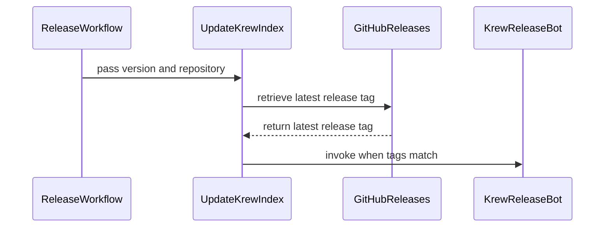

# PR #16134: Run krew release on publish release

**Summary**: Run krew release on publish release

**Sources**: https://github.com/kubernetes-sigs/kueue/pull/16134

**Last updated**: 2026-09-24T11:32:22Z

---

## Metadata

- **State**: closed (merged)
- **Author**: [@mbobrovskyi](https://github.com/mbobrovskyi)
- **Branch**: `cleanup/run-krew-release-on-publish-release` → `main`
- **Created**: 2026-09-24T10:09:47Z
- **Updated**: 2026-09-24T11:32:22Z
- **Merged**: 2026-09-24T11:32:16Z
- **Closed**: 2026-09-24T11:32:16Z
- **Labels**: `kind/bug`, `lgtm`, `release-note-none`, `approved`, `size/M`, `cncf-cla: yes`, `area/release`
- **Assignees**: [@mimowo](https://github.com/mimowo)
- **Requested reviewers**: [@mimowo](https://github.com/mimowo), [@pajakd](https://github.com/pajakd), [@Singularity23x0](https://github.com/Singularity23x0), [@tenzen-y](https://github.com/tenzen-y)
- **Changed files**: 3   **+45 / -1**

## Description

<!-- Thank you for contributing! Check CONTRIBUTING.md for details. -->

#### What type of PR is this?
<!-- Choose one of the following kinds:
/kind bug
/kind cleanup
/kind documentation
/kind feature
/kind kep
-->
/kind bug

<!-- Optionally choose one or more of the following kinds:
/kind api-change
/kind deprecation
/kind failing-test
/kind flake
/kind regression
-->


<!-- Consider setting the area:
/area tas
/area was
/area integrations
/area multikueue
/area dashboard
/area localization
/area testing
/area website
-->
/area release

#### What this PR does / why we need it?
Run krew release on publish release

<!--
Use `Fixes #123` for an issue addressed by this PR; it will be closed when the PR merges.
Use `Related:` or `Part of:` to reference an issue without closing it.
-->
Fixes #

#### Useful notes for your reviewer
Previously, the release team created releases manually, and the `krew-release` workflow was triggered automatically. However, GitHub does not allow workflows to be triggered automatically after a release is created or published by a bot. This is a security measure to prevent potentially infinite workflow loops.

That's why we need to trigger this workflow manually.

#### Release note

<!-- Describe the behavior change accurately from the user's perspective. Hints:
- Do not leave this block blank.
- Use "NONE" when there is no user-facing change.
- When feasible use a prefix for the sub-component or feature, e.g. "FairSharing:" or "MultiKueue:".
- If upgrade steps are required, include an "ACTION REQUIRED:" section.
You may consider AI assistance using the skill: cmd/experimental/skills/kueue-release-notes/SKILL.md.
-->
```release-note
NONE
```

## Discussion

### Comment by [@netlify[bot]](https://github.com/apps/netlify) — 2026-09-24T10:10:12Z

### <span aria-hidden="true">✅</span> Deploy Preview for *kubernetes-sigs-kueue* canceled.


|  Name | Link |
|:-:|------------------------|
|<span aria-hidden="true">🔨</span> Latest commit | c32e0f3edf822ce6b2a46e17e971512dfd39db8d |
|<span aria-hidden="true">🔍</span> Latest deploy log | https://app.netlify.com/projects/kubernetes-sigs-kueue/deploys/6ab4f753d3a4fc0008fd4886 |

### Comment by [@coderabbitai[bot]](https://github.com/apps/coderabbitai) — 2026-09-24T10:11:06Z

<!-- This is an auto-generated comment: summarize by coderabbit.ai -->
<!-- review_stack_entry_start -->

<a href="https://app.coderabbit.ai/change-stack/kubernetes-sigs/kueue/pull/16134"></a>

Navigate logical layers of code changes, visualize relationships, and explore their blast radius.

<!-- review_stack_entry_end -->
<!-- recent_review_start -->

No actionable comments were generated in the recent review. 🎉

<details>
<summary>ℹ️ Recent review info</summary>

<details>
<summary>⚙️ Run configuration</summary>

**Configuration used**: Repository: kubernetes-sigs/kueue/.coderabbit.yaml

**Review profile**: CHILL

**Plan**: Essentials

**Run ID**: `84beced7-7b64-4769-9b63-befc753587a8`

</details>

<details>
<summary>📥 Commits</summary>

Reviewing files that changed from the base of the PR and between 8e7973362eed98f95164ad8fc72b63dd24a9f8f5 and c32e0f3edf822ce6b2a46e17e971512dfd39db8d.

</details>

<details>
<summary>📒 Files selected for processing (3)</summary>

* `.github/actions/update-krew-index/action.yml`
* `.github/workflows/krew-release.yml`
* `.github/workflows/release-utils.yml`

</details>

**Included review availability:** Your plan provides up to 8 included reviews per hour; 7 remain after this review.

</details>

---


<!-- recent_review_end -->
<!-- walkthrough_start -->

<details>
<summary>📝 Walkthrough</summary>

## Walkthrough

A local composite action checks the target repository’s latest release tag against the supplied version. The Krew release and release utilities workflows invoke this action to update the Krew index.

### Changes

**Krew release updates**

|Layer / File(s)|Summary|
|---|---|
|**Conditional Krew index action** <br> `.github/actions/update-krew-index/action.yml`|The action accepts a version and repository, checks the latest release tag, and runs the Krew release bot only when the tags match.|
|**Release workflow integration** <br> `.github/workflows/krew-release.yml`, `.github/workflows/release-utils.yml`|The Krew release workflow uses the local action. The release utilities workflow checks that the action file exists and invokes it after publishing a release.|

<!-- change_assessment_start -->
**Priority:** ⬇️ Low


**Estimated code review effort:** 2 (Simple) | ~10 minutes

<!-- change_assessment_commit:"c32e0f3edf822ce6b2a46e17e971512dfd39db8d" -->
**Change:** Bug fix
<!-- change_assessment_end -->

### Sequence Diagram(s)



</details>

<!-- walkthrough_end -->
<!-- final_review_risk_start -->
**Merge Risk:** _⚪ Minimal_ · up to `c32e0`
<!-- final_review_risk_coverage:{"sourceCommitId":"c32e0f3edf822ce6b2a46e17e971512dfd39db8d","coveredCommitId":"c32e0f3edf822ce6b2a46e17e971512dfd39db8d","kind":"reviewed"} -->

The change conditionally updates the Krew index for the matching latest release. No concrete release failure is established; the standalone workflow relies on GitHub’s configured default permissions.
<!-- final_review_risk_end -->
<!-- pre_merge_checks_walkthrough_start -->

<details>
<summary>🚥 Pre-merge checks | ✅ 5</summary>

<details>
<summary>✅ Passed checks (5 passed)</summary>

|         Check name         | Status   | Explanation                                                                                                                                                                                               |
| :------------------------: | :------- | :-------------------------------------------------------------------------------------------------------------------------------------------------------------------------------------------------------- |
|     Docstring Coverage     | ✅ Passed | No functions found in the changed files to evaluate docstring coverage. Skipping docstring coverage check. Docstring coverage is scoped to functions touched by this diff. Analyzed 0 functions across 0… |
|     Linked Issues check    | ✅ Passed | Check skipped because no linked issues were found for this pull request.                                                                                                                                  |
| Out of Scope Changes check | ✅ Passed | Check skipped because no linked issues were found for this pull request.                                                                                                                                  |
|      Description Check     | ✅ Passed | Check skipped - CodeRabbit’s high-level summary is enabled.                                                                                                                                               |
|         Title check        | ✅ Passed | The title clearly identifies the main change: run the Krew release process when a release is published. The wording is awkward but remains concise and specific.                                          |

</details>

</details>

<!-- pre_merge_checks_walkthrough_end -->
<!-- finishing_touch_checkbox_start -->

<details>
<summary>✨ Finishing Touches</summary>

<details open>
<summary>🧪 Generate unit tests (beta)</summary>

- [ ] <!-- {"checkboxId": "f47ac10b-58cc-4372-a567-0e02b2c3d479", "radioGroupId": "utg-output-choice-group-unknown_comment_id"} --> Create a new PR

</details>

</details>

<!-- finishing_touch_checkbox_end -->
<!-- tips_start -->

---


<sub>Comment `@coderabbitai help` to get the list of available commands.</sub>

<!-- tips_end -->

### Comment by [@mbobrovskyi](https://github.com/mbobrovskyi) — 2026-09-24T10:16:18Z

/cc @Singularity23x0 @mimowo @tenzen-y

### Comment by [@Singularity23x0](https://github.com/Singularity23x0) — 2026-09-24T10:29:36Z

Do we have a way of testing this before we merge?

### Comment by [@mbobrovskyi](https://github.com/mbobrovskyi) — 2026-09-24T10:32:05Z

I tested it in local fork. It looks like working fine.

### Comment by [@mimowo](https://github.com/mimowo) — 2026-09-24T11:30:02Z

/lgtm
/approve
Thank you for testing 👍

### Comment by [@kubernetes-prow[bot]](https://github.com/apps/kubernetes-prow) — 2026-09-24T11:30:11Z

LGTM label has been added.  <details>Git tree hash: aef95f546344d9039ae11a20a511f1bd60171135</details>

### Comment by [@kubernetes-prow[bot]](https://github.com/apps/kubernetes-prow) — 2026-09-24T11:30:15Z

[APPROVALNOTIFIER] This PR is **APPROVED**

This pull-request has been approved by: *<a href="https://github.com/kubernetes-sigs/kueue/pull/16134#" title="Author self-approved">mbobrovskyi</a>*, *<a href="https://github.com/kubernetes-sigs/kueue/pull/16134#issuecomment-5813191336" title="Approved">mimowo</a>*

The full list of commands accepted by this bot can be found [here](https://go.k8s.io/bot-commands?repo=kubernetes-sigs%2Fkueue).

The pull request process is described [here](https://git.k8s.io/community/contributors/guide/owners.md#the-code-review-process)

<details >
Needs approval from an approver in each of these files:

- ~~[OWNERS](https://github.com/kubernetes-sigs/kueue/blob/main/OWNERS)~~ [mimowo]

Approvers can indicate their approval by writing `/approve` in a comment
Approvers can cancel approval by writing `/approve cancel` in a comment
</details>
<!-- META={"approvers":[]} -->
