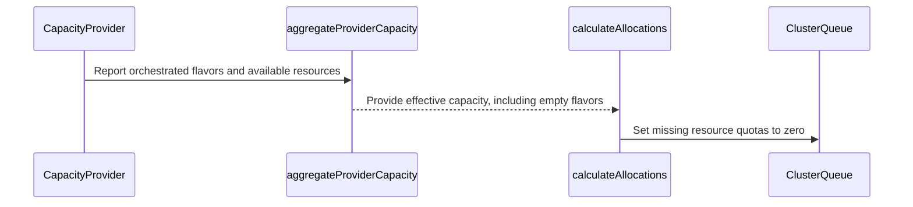

# PR #16168: fix(dqo): distribute zero for unreported resources of orchestrated flavors

**Summary**: fix(dqo): distribute zero for unreported resources of orchestrated flavors

**Sources**: https://github.com/kubernetes-sigs/kueue/pull/16168

**Last updated**: 2026-09-28T06:28:45Z

---

## Metadata

- **State**: closed (merged)
- **Author**: [@sumukha-radhakrishna](https://github.com/sumukha-radhakrishna)
- **Branch**: `dqo-unreported-orchestrated-resources` → `main`
- **Created**: 2026-09-24T16:36:40Z
- **Updated**: 2026-09-28T06:28:45Z
- **Merged**: 2026-09-28T06:24:35Z
- **Closed**: 2026-09-28T06:24:35Z
- **Labels**: `kind/bug`, `size/L`, `lgtm`, `release-note-none`, `approved`, `ok-to-test`, `cncf-cla: yes`
- **Assignees**: [@amy](https://github.com/amy), [@mimowo](https://github.com/mimowo)
- **Requested reviewers**: [@mbobrovskyi](https://github.com/mbobrovskyi), [@kshalot](https://github.com/kshalot)
- **Changed files**: 17   **+322 / -47**

## Description

<!-- Thank you for contributing! Check CONTRIBUTING.md for details. -->

#### What type of PR is this?
/kind bug

#### What this PR does / why we need it?

A CapacityProvider had no way to report that an orchestrated flavor has no capacity, for example when all nodes of the flavor left. A flavor could not be published with an empty `resources` map (CEL required 1–64 entries), and pairs missing from the aggregate kept their `spec.resourceGroups` value, so quota silently fell back to the static spec.

As agreed in review, a provider now orchestrates **all resources** of the flavors in `spec.orchestratedFlavors`:
- discovery adds every orchestrated flavor to `DynamicQuotaOrchestrator.status.effectiveCapacity`, with `resources: {}` when no capacity is reported for it;
- distribution reads only the aggregate: any declared `(flavor, resource)` pair of a flavor present there but missing from its `resources` is distributed as 0;
- the CEL rule on `resources` (CapacityProvider and DQO effective capacity) is relaxed from 1–64 to at most 64 entries;
- pairs of flavors that no provider orchestrates keep their spec value, as before.

Empty `spec.orchestratedFlavors` remains rejected.

Extracted from #16080 as requested in review.

Related: #10270

#### Useful notes for your reviewer

- The zero is visible in DQO status (`effectiveCapacity` shows the flavor with `resources: {}`), so distribution depends only on the aggregated capacity.
- Relaxing the validation is backward compatible: all existing objects remain valid.
- KEP-12382 "Effective quota construction", the API snippets and the field godoc are updated.
- Tests: unit (orchestrated flavors appear in the aggregate even when unreported; partial and unreported pairs distributed as 0; non-orchestrated flavors keep spec), webhook validation (0 resource entries allowed; `orchestratedFlavors` omitted, empty, duplicate, invalid-name and over-64 cases rejected), and an integration spec that also checks `effectiveCapacity` in DQO status.
- AI disclosure: prepared with the help of an AI coding assistant and reviewed by me.

#### Release note

```release-note
NONE
```

🤖 Generated with [Claude Code](https://claude.com/claude-code)


<!-- This is an auto-generated comment: release notes by coderabbit.ai -->

## AI summary

Dynamic Quota Orchestration now assigns zero capacity to declared `(flavor, resource)` pairs missing from reported capacity. Flavors listed in `spec.orchestratedFlavors` remain in effective capacity even when they have no reported resources. Flavors that no provider orchestrates retain their `spec.resourceGroups` quotas. Resource maps may now be empty, but `spec.orchestratedFlavors` must remain non-empty.

### Suggested release note

Dynamic Quota Orchestration: Fixed a bug where missing reported capacity for an orchestrated flavor could leave declared resource quotas unchanged. Kueue now assigns zero capacity to unreported resources for orchestrated flavors.

<!-- end of auto-generated comment: release notes by coderabbit.ai -->

## Discussion

### Comment by [@netlify[bot]](https://github.com/apps/netlify) — 2026-09-24T16:36:50Z

### <span aria-hidden="true">✅</span> Deploy Preview for *kubernetes-sigs-kueue* canceled.


|  Name | Link |
|:-:|------------------------|
|<span aria-hidden="true">🔨</span> Latest commit | fbf1e8a17d85c0b6d4c0f6f15d99b06357067cee |
|<span aria-hidden="true">🔍</span> Latest deploy log | https://app.netlify.com/projects/kubernetes-sigs-kueue/deploys/6ab5a15ef362fb00082e0a54 |

### Comment by [@coderabbitai[bot]](https://github.com/apps/coderabbitai) — 2026-09-24T16:38:09Z

<!-- This is an auto-generated comment: summarize by coderabbit.ai -->
<!-- review_stack_entry_start -->

<a href="https://app.coderabbit.ai/change-stack/kubernetes-sigs/kueue/pull/16168"></a>

Navigate logical layers of code changes, visualize relationships, and explore their blast radius.

<!-- review_stack_entry_end -->
<!-- recent_review_start -->

No actionable comments were generated in the recent review. 🎉

<details>
<summary>ℹ️ Recent review info</summary>

<details>
<summary>⚙️ Run configuration</summary>

**Configuration used**: Repository: kubernetes-sigs/kueue/.coderabbit.yaml

**Review profile**: CHILL

**Plan**: Advanced

**Run ID**: `39bea339-4e6c-413d-b725-080a9e92d406`

</details>

<details>
<summary>📥 Commits</summary>

Reviewing files that changed from the base of the PR and between bbaed765187711e5b9c2fffe582553014bd7e32d and fbf1e8a17d85c0b6d4c0f6f15d99b06357067cee.

</details>

<details>
<summary>⛔ Files ignored due to path filters (3)</summary>

* `client-go/applyconfiguration/kueue/v1alpha1/capacityprovidernormalizedcapacityflavor.go` is excluded by `!client-go/**`
* `client-go/applyconfiguration/kueue/v1alpha1/capacityproviderspec.go` is excluded by `!client-go/**`
* `client-go/applyconfiguration/kueue/v1alpha1/effectivecapacityflavor.go` is excluded by `!client-go/**`

</details>

<details>
<summary>📒 Files selected for processing (14)</summary>

* `apis/kueue/v1alpha1/capacityprovider_types.go`
* `apis/kueue/v1alpha1/dynamicquotaorchestrator_types.go`
* `charts/kueue/templates/crd/kueue.x-k8s.io_capacityproviders.yaml`
* `charts/kueue/templates/crd/kueue.x-k8s.io_dynamicquotaorchestrators.yaml`
* `config/components/crd/alpha/bases/kueue.x-k8s.io_capacityproviders.yaml`
* `config/components/crd/alpha/bases/kueue.x-k8s.io_dynamicquotaorchestrators.yaml`
* `keps/12382-dynamic-quota-orchestration/README.md`
* `pkg/controller/core/dqo/discovery.go`
* `pkg/controller/core/dqo/distribution.go`
* `pkg/controller/core/dqo/distribution_test.go`
* `pkg/controller/core/dqo/reconciler_test.go`
* `test/integration/singlecluster/controller/dynamicquotaorchestrator/dynamicquotaorchestrator_test.go`
* `test/integration/singlecluster/webhook/core/capacityprovider_test.go`
* `test/integration/singlecluster/webhook/core/dynamicquotaorchestrator_test.go`

</details>

**Included review availability:** Your plan provides up to 8 included reviews per hour; 7 remain after this review.

</details>

---


<!-- recent_review_end -->
<!-- walkthrough_start -->

<details>
<summary>📝 Walkthrough</summary>

## Walkthrough

Resource capacity maps can now be empty. Capacity discovery retains listed orchestrated flavors with no reported resources, and quota allocation sets missing resource pairs for those flavors to zero. Flavors that no specified provider orchestrates retain their configured quotas.

### Changes

**Empty-flavor capacity handling**

|Layer / File(s)|Summary|
|---|---|
|**Allow empty resource maps** <br> `apis/kueue/v1alpha1/*_types.go`, `charts/kueue/templates/crd/*capacityproviders.yaml`, `charts/kueue/templates/crd/*dynamicquotaorchestrators.yaml`, `config/components/crd/alpha/bases/*capacityproviders.yaml`, `config/components/crd/alpha/bases/*dynamicquotaorchestrators.yaml`, `test/integration/singlecluster/webhook/core/*`, `keps/12382-dynamic-quota-orchestration/README.md`|API types and CRD schemas allow empty resource maps while retaining the 64-entry maximum. Webhook tests cover empty maps and orchestrated-flavor validation. The KEP describes zero capacity for unreported resources and the updated overlay scope.|
|**Retain orchestrated flavors** <br> `pkg/controller/core/dqo/discovery.go`, `pkg/controller/core/dqo/reconciler_test.go`|Capacity aggregation retains an entry for each orchestrated flavor when capacity is nil or has no reported resources. Reconcile expectations include these empty entries.|
|**Allocate zero for missing resources** <br> `pkg/controller/core/dqo/distribution.go`, `pkg/controller/core/dqo/distribution_test.go`, `test/integration/singlecluster/controller/dynamicquotaorchestrator/dynamicquotaorchestrator_test.go`|Allocation sets missing resource pairs to zero for flavors present in effective capacity. Unit and integration tests also verify that quotas for un-orchestrated flavors remain unchanged.|

<!-- change_assessment_start -->
**Priority:** ⬇️ Low


**Estimated code review effort:** 3 (Moderate) | ~20 minutes

<!-- change_assessment_commit:"fbf1e8a17d85c0b6d4c0f6f15d99b06357067cee" -->
**Change:** Bug fix
<!-- change_assessment_end -->

### Sequence Diagram(s)



**Suggested reviewers:** `pajakd`

</details>

<!-- walkthrough_end -->
<!-- final_review_risk_start -->
**Merge Risk:** _⚪ Minimal_ · up to `fbf1e`
<!-- final_review_risk_coverage:{"sourceCommitId":"fbf1e8a17d85c0b6d4c0f6f15d99b06357067cee","coveredCommitId":"fbf1e8a17d85c0b6d4c0f6f15d99b06357067cee","kind":"reviewed"} -->

The described changes allow empty capacity reports and set missing orchestrated quotas to zero without changing un-orchestrated quotas. No actionable issue remains on the supplied evidence.
<!-- final_review_risk_end -->
<!-- pre_merge_checks_walkthrough_start -->

<details>
<summary>🚥 Pre-merge checks | ✅ 4 | ❌ 1</summary>

### ❌ Failed checks (1 warning)

|     Check name     | Status     | Explanation                                                                                                                                                                                               | Resolution                                                                         |
| :----------------: | :--------- | :-------------------------------------------------------------------------------------------------------------------------------------------------------------------------------------------------------- | :--------------------------------------------------------------------------------- |
| Docstring Coverage | ⚠️ Warning | Docstring coverage is 42.86% which is insufficient. The required threshold is 80.00%. Docstring coverage is scoped to functions touched by this diff. Analyzed 7 functions across 10 files. (5 skipped: … | Write docstrings for the functions missing them to satisfy the coverage threshold. |

<details>
<summary>✅ Passed checks (4 passed)</summary>

|         Check name         | Status   | Explanation                                                                                                      |
| :------------------------: | :------- | :--------------------------------------------------------------------------------------------------------------- |
|     Linked Issues check    | ✅ Passed | Check skipped because no linked issues were found for this pull request.                                         |
| Out of Scope Changes check | ✅ Passed | Check skipped because no linked issues were found for this pull request.                                         |
|      Description Check     | ✅ Passed | Check skipped - CodeRabbit’s high-level summary is enabled.                                                      |
|         Title check        | ✅ Passed | The title clearly describes the main change: distributing zero for unreported resources of orchestrated flavors. |

</details>

<details>
<summary>Full details: Docstring Coverage</summary>

**Explanation**

Docstring coverage is 42.86% which is insufficient. The required threshold is 80.00%. Docstring coverage is scoped to functions touched by this diff. Analyzed 7 functions across 10 files. (5 skipped: 5 unsupported.)

</details>

</details>

<!-- pre_merge_checks_walkthrough_end -->

- [ ] <!-- {"checkboxId":"585bb3f6-faf5-4dbf-96d2-74e382adf19a"} --> Fix all pre-merge checks with AI
<!-- finishing_touch_checkbox_start -->

<details>
<summary>✨ Finishing Touches</summary>

<details open>
<summary>🧪 Generate unit tests (beta)</summary>

- [ ] <!-- {"checkboxId": "f47ac10b-58cc-4372-a567-0e02b2c3d479", "radioGroupId": "utg-output-choice-group-unknown_comment_id"} --> Create a new PR

</details>

</details>

<!-- finishing_touch_checkbox_end -->
<!-- tips_start -->

---


<sub>Comment `@coderabbitai help` to get the list of available commands.</sub>

<!-- tips_end -->

### Comment by [@sumukha-radhakrishna](https://github.com/sumukha-radhakrishna) — 2026-09-24T16:48:09Z

@mimowo could you please take a look?

### Comment by [@mimowo](https://github.com/mimowo) — 2026-09-24T17:23:23Z

/ok-to-test

### Comment by [@mimowo](https://github.com/mimowo) — 2026-09-24T17:23:37Z

C @j-skiba @pajakd

### Comment by [@amy](https://github.com/amy) — 2026-09-24T17:57:04Z

/assign

### Comment by [@mimowo](https://github.com/mimowo) — 2026-09-24T19:55:36Z

/release-note-none
As the feature is not released yet

### Comment by [@kubernetes-prow[bot]](https://github.com/apps/kubernetes-prow) — 2026-09-24T19:55:38Z

@mimowo: you can only set the release note label to release-note-none if the release-note block in the PR body text is empty or "none".

<details>

In response to [this](https://github.com/kubernetes-sigs/kueue/pull/16168#issuecomment-5821209868):

>/release-note-none
>As the feature is not released yet


Instructions for interacting with me using PR comments are available [here](https://git.k8s.io/community/contributors/guide/pull-requests.md).  If you have questions or suggestions related to my behavior, please file an issue against the [kubernetes-sigs/prow](https://github.com/kubernetes-sigs/prow/issues/new?title=Prow%20issue:) repository.
</details>

### Comment by [@kubernetes-prow[bot]](https://github.com/apps/kubernetes-prow) — 2026-09-28T06:09:04Z

LGTM label has been added.  <details>Git tree hash: 219b7d6b910f1034b692bf7069e5224b8369a5f3</details>

### Comment by [@kubernetes-prow[bot]](https://github.com/apps/kubernetes-prow) — 2026-09-28T06:09:08Z

[APPROVALNOTIFIER] This PR is **APPROVED**

This pull-request has been approved by: *<a href="https://github.com/kubernetes-sigs/kueue/pull/16168#pullrequestreview-5334606770" title="Approved">mimowo</a>*, *<a href="https://github.com/kubernetes-sigs/kueue/pull/16168#" title="Author self-approved">sumukha-radhakrishna</a>*

The full list of commands accepted by this bot can be found [here](https://go.k8s.io/bot-commands?repo=kubernetes-sigs%2Fkueue).

The pull request process is described [here](https://git.k8s.io/community/contributors/guide/owners.md#the-code-review-process)

<details >
Needs approval from an approver in each of these files:

- ~~[OWNERS](https://github.com/kubernetes-sigs/kueue/blob/main/OWNERS)~~ [mimowo]

Approvers can indicate their approval by writing `/approve` in a comment
Approvers can cancel approval by writing `/approve cancel` in a comment
</details>
<!-- META={"approvers":[]} -->

## Reviews

### Review by [@mimowo](https://github.com/mimowo) (commented) — 2026-09-24T20:00:47Z

- **keps/12382-dynamic-quota-orchestration/README.md:731** by [@mimowo](https://github.com/mimowo) — 2026-09-24T20:00:47Z
```diff
@@ -727,10 +727,13 @@ For example, one byte for memory or one item for an extended scalar resource.
 ### Effective quota construction
 
 For each managed ClusterQueue or Cohort, DQO constructs `status.effectiveQuotas.resourceGroups`
-by copying `spec.resourceGroups`. It then overlays nominalQuota only for `(ResourceFlavor, resource)` 
-pairs present in `status.effectiveCapacity`. The aggregate contains the union of pairs
-reported by the specified providers. For a pair in that union, a provider that omits the pair
-contributes zero. A pair omitted by all specified providers remains unchanged from `spec.resourceGroups`.
+by copying `spec.resourceGroups`. It then overlays nominalQuota for `(ResourceFlavor, resource)` 
+pairs whose flavor is listed in `spec.orchestratedFlavors` of at least one specified provider.
```

  'm not sure I like this that the CapacityProviders influence distribution. I think we should distribute whatever we get in the aggregatedCapacity. So, I imagined for some CapacityProviders they may assume empty `spec.orchestratedFlavors` means "scrape capacity for all flavors registered in api-server". 
  
  Let me know what is the use case you see for this check. (I'm not dismissing that as a bad idea, just trying to understand for now to have full picture).

### Review by [@sumukha-radhakrishna](https://github.com/sumukha-radhakrishna) (commented) — 2026-09-24T21:18:40Z

- **keps/12382-dynamic-quota-orchestration/README.md:731** by [@sumukha-radhakrishna](https://github.com/sumukha-radhakrishna) — 2026-09-24T21:18:40Z
```diff
@@ -727,10 +727,13 @@ For example, one byte for memory or one item for an extended scalar resource.
 ### Effective quota construction
 
 For each managed ClusterQueue or Cohort, DQO constructs `status.effectiveQuotas.resourceGroups`
-by copying `spec.resourceGroups`. It then overlays nominalQuota only for `(ResourceFlavor, resource)` 
-pairs present in `status.effectiveCapacity`. The aggregate contains the union of pairs
-reported by the specified providers. For a pair in that union, a provider that omits the pair
-contributes zero. A pair omitted by all specified providers remains unchanged from `spec.resourceGroups`.
+by copying `spec.resourceGroups`. It then overlays nominalQuota for `(ResourceFlavor, resource)` 
+pairs whose flavor is listed in `spec.orchestratedFlavors` of at least one specified provider.
```

  I dont see a specific use case for provider spec driving distribution. 
  
  The case I need is "the controller observed and reported empty" (all nodes of a flavor are gone).  Right now a flavor cant be published with an empty resource list (CEL requires 1–64), so it's omitted and quota falls back to spec. We would need an API change to relax the CEL rules to allow {} in resources.
  
  So the new proposal is to relax the CEL rule to 0-64, keep empty flavors in the aggregate and distribute 0 for the declared pairs of flavors with no resources. Absent flavors and partial reports behave as today. Distribution then depends only on the aggregated capacity and it should also work with empty orchestratedFlavor case of "all flavors". wdyt?

### Review by [@mimowo](https://github.com/mimowo) (commented) — 2026-09-24T21:30:22Z

- **keps/12382-dynamic-quota-orchestration/README.md:731** by [@mimowo](https://github.com/mimowo) — 2026-09-24T21:30:22Z
```diff
@@ -727,10 +727,13 @@ For example, one byte for memory or one item for an extended scalar resource.
 ### Effective quota construction
 
 For each managed ClusterQueue or Cohort, DQO constructs `status.effectiveQuotas.resourceGroups`
-by copying `spec.resourceGroups`. It then overlays nominalQuota only for `(ResourceFlavor, resource)` 
-pairs present in `status.effectiveCapacity`. The aggregate contains the union of pairs
-reported by the specified providers. For a pair in that union, a provider that omits the pair
-contributes zero. A pair omitted by all specified providers remains unchanged from `spec.resourceGroups`.
+by copying `spec.resourceGroups`. It then overlays nominalQuota for `(ResourceFlavor, resource)` 
+pairs whose flavor is listed in `spec.orchestratedFlavors` of at least one specified provider.
```

  'm not sure.  On the second reflection assuming "empty orchestratedFlavors is all flavors" creates a bit weird of a twist, and requires all CapacityProviders to work on two modes - subset, and "all".
  
  After the second reflection I kinda like the proposed approach here more. I think if we block empty orchestratedFlavors on CapacityProvider this would give us a choice which way to go later,
  
  Let me think a bit more.

### Review by [@mimowo](https://github.com/mimowo) (commented) — 2026-09-24T21:48:53Z

- **keps/12382-dynamic-quota-orchestration/README.md:731** by [@mimowo](https://github.com/mimowo) — 2026-09-24T21:48:52Z
```diff
@@ -727,10 +727,13 @@ For example, one byte for memory or one item for an extended scalar resource.
 ### Effective quota construction
 
 For each managed ClusterQueue or Cohort, DQO constructs `status.effectiveQuotas.resourceGroups`
-by copying `spec.resourceGroups`. It then overlays nominalQuota only for `(ResourceFlavor, resource)` 
-pairs present in `status.effectiveCapacity`. The aggregate contains the union of pairs
-reported by the specified providers. For a pair in that union, a provider that omits the pair
-contributes zero. A pair omitted by all specified providers remains unchanged from `spec.resourceGroups`.
+by copying `spec.resourceGroups`. It then overlays nominalQuota for `(ResourceFlavor, resource)` 
+pairs whose flavor is listed in `spec.orchestratedFlavors` of at least one specified provider.
```

  I'm leaning to:
  1.  validate against empty spec.orchestratedFlavors to simplify the contract on a CapacityProvider. 
  2. use your new approach to relax the validation for CEL [0,64], and iiuc interpreting any `(Flavor, Resource): empty` in DQO status.effectiveCapactiy as `(Flavor, Resource): 0`, for all orchestratedFlavors, because we don't support "partial orchestration of flavor for a subset of resources".
  
  (2.) I think solves your issue, and (1.) makes it simpler to implement CapacityProviders

### Review by [@sumukha-radhakrishna](https://github.com/sumukha-radhakrishna) (commented) — 2026-09-24T21:51:33Z

- **keps/12382-dynamic-quota-orchestration/README.md:731** by [@sumukha-radhakrishna](https://github.com/sumukha-radhakrishna) — 2026-09-24T21:51:33Z
```diff
@@ -727,10 +727,13 @@ For example, one byte for memory or one item for an extended scalar resource.
 ### Effective quota construction
 
 For each managed ClusterQueue or Cohort, DQO constructs `status.effectiveQuotas.resourceGroups`
-by copying `spec.resourceGroups`. It then overlays nominalQuota only for `(ResourceFlavor, resource)` 
-pairs present in `status.effectiveCapacity`. The aggregate contains the union of pairs
-reported by the specified providers. For a pair in that union, a provider that omits the pair
-contributes zero. A pair omitted by all specified providers remains unchanged from `spec.resourceGroups`.
+by copying `spec.resourceGroups`. It then overlays nominalQuota for `(ResourceFlavor, resource)` 
+pairs whose flavor is listed in `spec.orchestratedFlavors` of at least one specified provider.
```

  Thanks, no rush. Just to confirm, by "the proposed approach here" do you mean the original version (zero for unreported pairs of flavors in orchestratedFlavors), or the latest one (a flavor published with empty resources)?
  
  Either way we can keep empty orchestratedFlavors on CapacityProvider blocked to decide on what the empty should mean later on.

### Review by [@mimowo](https://github.com/mimowo) (commented) — 2026-09-24T22:05:30Z

- **keps/12382-dynamic-quota-orchestration/README.md:731** by [@mimowo](https://github.com/mimowo) — 2026-09-24T22:05:30Z
```diff
@@ -727,10 +727,13 @@ For example, one byte for memory or one item for an extended scalar resource.
 ### Effective quota construction
 
 For each managed ClusterQueue or Cohort, DQO constructs `status.effectiveQuotas.resourceGroups`
-by copying `spec.resourceGroups`. It then overlays nominalQuota only for `(ResourceFlavor, resource)` 
-pairs present in `status.effectiveCapacity`. The aggregate contains the union of pairs
-reported by the specified providers. For a pair in that union, a provider that omits the pair
-contributes zero. A pair omitted by all specified providers remains unchanged from `spec.resourceGroups`.
+by copying `spec.resourceGroups`. It then overlays nominalQuota for `(ResourceFlavor, resource)` 
+pairs whose flavor is listed in `spec.orchestratedFlavors` of at least one specified provider.
```

  > Either way we can keep empty orchestratedFlavors on CapacityProvider blocked to decide on what the empty should mean later on.
  
  Yeah, I would do that.
  
  > Thanks, no rush. Just to confirm, by "the proposed approach here" do you mean the original version (zero for unreported pairs of flavors in orchestratedFlavors), or the latest one (a flavor published with empty resources)?
  
  I wanted to say that that a published flavor with empty resources (in DQO status.effectiveCapacity) is interpreted as 0 in the status.effectiveQuota. I suppose this is the latter of your options.
  
  So - strengthen validation on spec.orchestratedFlavors, but relax on the published capacity to allow [0-64]. That will give us flexibility.

### Review by [@sumukha-radhakrishna](https://github.com/sumukha-radhakrishna) (commented) — 2026-09-24T22:10:09Z

- **keps/12382-dynamic-quota-orchestration/README.md:731** by [@sumukha-radhakrishna](https://github.com/sumukha-radhakrishna) — 2026-09-24T22:10:09Z
```diff
@@ -727,10 +727,13 @@ For example, one byte for memory or one item for an extended scalar resource.
 ### Effective quota construction
 
 For each managed ClusterQueue or Cohort, DQO constructs `status.effectiveQuotas.resourceGroups`
-by copying `spec.resourceGroups`. It then overlays nominalQuota only for `(ResourceFlavor, resource)` 
-pairs present in `status.effectiveCapacity`. The aggregate contains the union of pairs
-reported by the specified providers. For a pair in that union, a provider that omits the pair
-contributes zero. A pair omitted by all specified providers remains unchanged from `spec.resourceGroups`.
+by copying `spec.resourceGroups`. It then overlays nominalQuota for `(ResourceFlavor, resource)` 
+pairs whose flavor is listed in `spec.orchestratedFlavors` of at least one specified provider.
```

  Thanks, will make the change.

### Review by [@mimowo](https://github.com/mimowo) (commented) — 2026-09-28T06:08:57Z

/lgtm
/approve

### Review by [@mimowo](https://github.com/mimowo) (commented) — 2026-09-28T06:28:45Z

- **keps/12382-dynamic-quota-orchestration/README.md:731** by [@mimowo](https://github.com/mimowo) — 2026-09-28T06:28:45Z
```diff
@@ -727,10 +727,13 @@ For example, one byte for memory or one item for an extended scalar resource.
 ### Effective quota construction
 
 For each managed ClusterQueue or Cohort, DQO constructs `status.effectiveQuotas.resourceGroups`
-by copying `spec.resourceGroups`. It then overlays nominalQuota only for `(ResourceFlavor, resource)` 
-pairs present in `status.effectiveCapacity`. The aggregate contains the union of pairs
-reported by the specified providers. For a pair in that union, a provider that omits the pair
-contributes zero. A pair omitted by all specified providers remains unchanged from `spec.resourceGroups`.
+by copying `spec.resourceGroups`. It then overlays nominalQuota for `(ResourceFlavor, resource)` 
+pairs whose flavor is listed in `spec.orchestratedFlavors` of at least one specified provider.
```

  Please also follow up with KEP update
